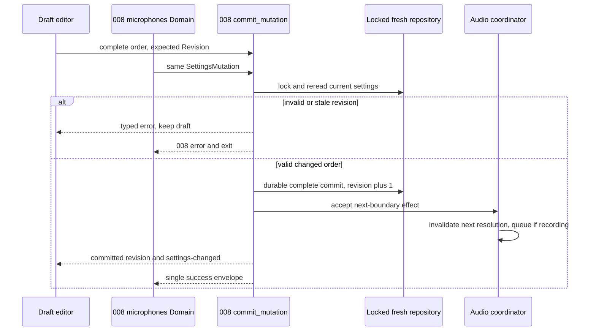
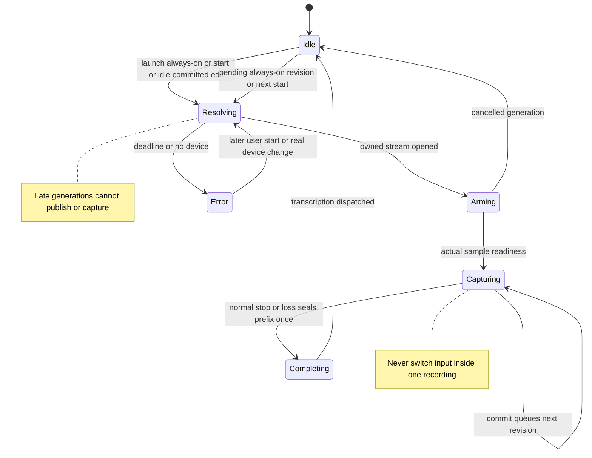
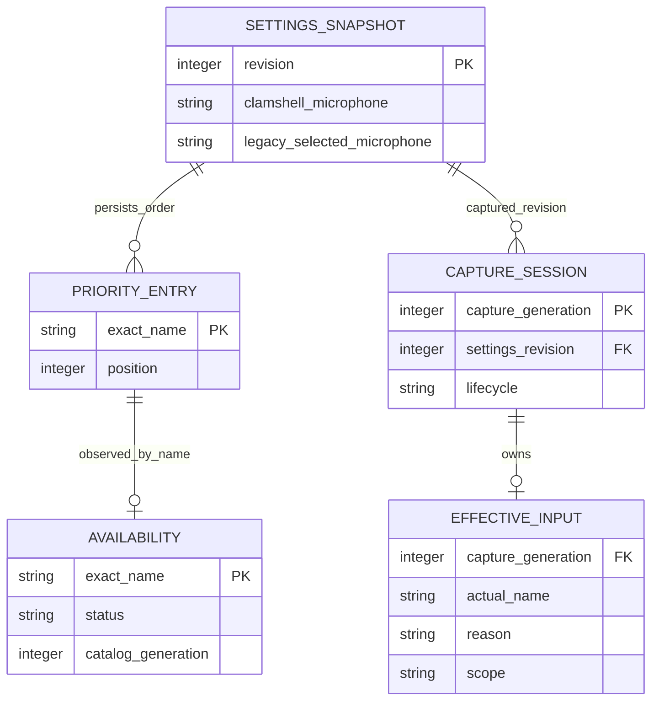

# Implementation Plan: Microphone Priority

## Summary

Extend 008's settings transaction/domain service with persistent microphone priority; resolve audio input with bounded workers and session generations, keep intent separate from availability/effective input, and replace the single selector with an accessible draft editor.

Inspect [functional source](spec.md) for FR-001–FR-008, AC-001–AC-008 and SC-001–SC-003. Inspect [008's frozen foundation plan](../008-settings-cli/plan.md) for the exact shared architecture names. Scope **L**: eight FR, shared audio/settings lifecycle, migration and cross-platform native failure handling. Deliver 008 first, then 001; this command produces documentation only.

## Technical Context

| Aspect | Choice | Reason / observed source |
|---|---|---|
| Backend | Rust edition 2021, Tauri 2.11.5, existing Tokio | Existing managers, commands, Cargo manifest |
| Audio | Existing cpal, AudioRecorder, VAD, resampling | Preserve sample-processing pipeline, channel policy and readiness handshake |
| Settings | 008 SettingsRepository, SettingsSnapshot, Revision, SettingsMutation, SettingsError | One fresh-disk `commit_mutation` path and existing durable revision/lock |
| CLI | 008 Domain trait, OperationRequest, clap and single renderer | Add `microphones` registration; reuse local IPC/offline routing |
| UI | React 18, TypeScript, Zustand, i18next | Existing general audio settings; typed Tauri commands/events |
| Storage | Existing JSON settings payload; `microphone_priority: Vec<String>` | No new database, HTTP API, cloud resources or credentials |
| Tests | Cargo unit/integration, Bun, Playwright, native hardware procedure | Pure policy versus real capture/file/process boundaries |

Inspect [manager](../../../src-tauri/src/managers/audio.rs), [recorder](../../../src-tauri/src/audio_toolkit/audio/recorder.rs), [enumeration](../../../src-tauri/src/audio_toolkit/audio/device.rs), [audio commands](../../../src-tauri/src/commands/audio.rs), [actions](../../../src-tauri/src/actions.rs) and [selector](../../../src/components/settings/MicrophoneSelector.tsx) for implementation context. Preserve existing filenames; new Rust module filenames use Rust snake_case, new Markdown/TS files kebab-case. Repository Bun/ESLint/Prettier overrides generic Commander/Biome/Vitest guidance.

## Constitution Check

| Principle | Gate / decision |
|---|---|
| Existing native/frontend boundary | PASS: native validates/persists/resolves; UI owns draft, focus and translated presentation |
| Observed stack/manager choices | PASS: reuse audio manager/recorder and 008 service; no parallel settings repository or IPC protocol |
| Tool availability versus runtime evidence | PASS: tools checked below; no recording/build/test success inferred |
| Specify before implementation and meaningful tests | PASS: every FR/AC mapped; real capture-loss and store fault boundaries required |
| Simple responsibilities and injectable I/O | PASS: pure policy, catalog, opener, session owner, thin UI/CLI adapters |
| Compatibility and privacy | PASS: retain clamshell and legacy raw key; no new log payload containing audio, names or secrets |

## Requirement Inventory

| Requirement | Acceptance / measure | Steps |
|---|---|---|
| FR-001 | AC-001/007; ordered unique draft, pointer/keyboard, restart | 2, 6, 7 |
| FR-002 | AC-002/003; four availability states, effective reason, timed refresh | 1, 3, 5, 6, 7 |
| FR-003 | AC-003/004; order, default, 2 s/6 s, no preference erasure | 1, 3, 4, 7 |
| FR-004 | AC-004/007; pending revision, reconnect, preserved audio prefix | 1, 4, 7 |
| FR-005 | AC-005; override plus closed lid, then default | 3, 4, 7 |
| FR-006 | AC-006; absent-key migration, explicit empty wins, recoverability | 2, 7 |
| FR-007 | AC-001/007/008; atomic writes, CAS, shared events/cache | 2, 4, 5, 6, 7 |
| FR-008 | AC-008; CLI list/set-priority and exact 008 envelope/exits | 5, 7 |

SC-001 requires all eight AC plus native/UI gates; Story 4's P2 label does not relax the release gate. SC-002 asserts exact configured order and unrelated settings across each failure fixture. SC-003 requires keyboard focus/error recovery and separate design/runtime assertions.

## Architecture Decisions

### Settings and migration

008 must deliver `settings_service/{descriptor.rs,validation.rs,protocol.rs,errors.rs,store.rs,transaction.rs,live.rs,domains/mod.rs,cli.rs,render.rs}` before production wiring. Extend its `SettingDescriptor`, `SettingsMutation`, `SettingsSnapshot`, `Revision`, `PublicSettings`, `OperationRequest`, `SettingsError`, `Domain` trait and `LiveSettingsEffects`; use `SettingsRepository::read_snapshot` and `commit_mutation`. Do not create another lock, revision counter, file writer, settings channel or envelope. The whole ordered list is one typed patch to the latest snapshot; unrelated simultaneous writes survive. Generic scalar set refuses the list and directs users to the registered domain.

Detect key presence in raw JSON before serde defaults. Absent `microphone_priority`: non-default legacy `selected_microphone` becomes `[exact_name]`; null or legacy default sentinel becomes `[]`. Present new list, including `[]`, wins. Preserve the raw legacy key unchanged and ignore it for normal resolution once the new key exists. Keep clamshell/channel/unknown fields. Startup migration commits once under 008's lock, with atomic replacement/recoverable original bytes; failure leaves the original readable and reports an actionable persistence error. No read-only CLI operation writes a migration. Test second startup no-op, unavailable/ambiguous legacy names and failed flush/replace.

Shared validation accepts exact, non-empty, non-whitespace-only unique names regardless of current presence; preserve case and meaningful bytes. Presence is runtime status, never a persistence validator. UI Add lists the real catalog (including duplicate-name groups labelled ambiguous); a grouped ambiguous name may be saved once but never opens an arbitrary device. The synthetic system-default option is not a priority entry: empty list represents fallback. A real device literally named `Default` is an exact name; legacy sentinel interpretation applies only to legacy migration, never new-list validation. Removed unavailable entries remain removable. Duplicate/empty input returns `validation_failed` without a partial commit. No invented list-count cap; 008's bounded request size remains authoritative.

### Resolution and deadline allocation

Inject `AudioDeviceCatalog`, `StreamOpener`, monotonic `Clock/Deadline`, `LidStateProbe` and `CaptureSessionPort`. A catalog snapshot records observation/generation, name groups and transient handles; indices never persist. Successful complete enumeration may mark missing names unavailable; failure or incomplete name discovery marks affected status unknown; duplicates are ambiguous. Failed probes cannot masquerade as absence. UI refresh is non-invasive enumeration only, not opening candidate devices. One in-flight refresh per view; open/5-second cadence/Retry trigger fresh observations, late replies are fenced and unmount cancels publication.

Normal resolution uses the committed revision captured at session start and a fresh catalog at every recording start, including always-on. Device-change notifications may invalidate cache but cannot replace the next-start fresh check needed for reconnection. Cache transient handles/config only within a catalog generation. Closed lid **and configured override** selects override then default, excluding normal list. Open/unknown lid, or no override, uses normal priority. Channel mapping uses saved channel only if valid for actual device; otherwise existing default mapping without changing settings.

A single monotonic 6-second resolution deadline includes lid probe, enumeration, one fresh re-enumeration on stale-cache/enumeration failure and open/readiness work. Reserve up to the last 2 seconds for one default attempt. Divide the remaining normal-phase budget across unresolved candidates in saved order, each open ≤2 seconds and ≤its remaining allocation. Presence/ambiguity failures consume no open call; configured candidates that cannot resolve within the remaining deadline receive a typed deadline failure. Re-enumerate at most once, never reopen an already attempted name; then attempt default once inside the same 6 seconds. Closed-lid override follows the same bounded rule. Four-plus slow devices and slow enumeration must prove termination/default allocation rather than silently extend the deadline. If the native spike cannot ensure default invocation and cancellation inside this budget, AC-003 is a release blocker, not a claimed guarantee. Start latency samples are collected separately for on-demand/always-on; no unsupported additional user-facing latency target is invented.

### Worker ownership and readiness

Existing `AudioRecorder::open` waits on unbounded `init_rx.recv()` and can join a stalled worker. Refactor attempt initialization into an owned attempt handle with generation, deadline/cancellation flag and stop/drain channel. Coordinator never joins a potentially blocked opener on the main loop or while holding settings/manager state locks. A timed-out generation cannot publish a device, cache config, capture-ready event or samples; a late native stream is immediately dropped by its owner. Track/reap abandoned workers; cap outstanding native opens so repeated starts cannot create unlimited detached threads. Reaching the cap reports a recording error, never successful capture. Step 1 must prove cleanup and device release on each supported backend; a `spawn_blocking` timeout alone proves only caller latency. If cpal cannot bound native ownership cleanup, stop the spike and propose an isolated cancellable native worker design for review before production; never assume Rust can kill a blocked thread.

`Stream::play()` is not recording readiness. Preserve existing first-sample handshake and capture generation fencing; indicator stays arming until the actual stream/capture is ready. Do not buffer/replay audio spoken before readiness. Effective input is published only from a successful owned stream; resolve actual default name from that opened handle rather than infer it from a synthetic label.

### Recording boundary, always-on and loss

A session serializes start/stop/error/priority-effect intents in the audio coordinator. Snapshot committed revision/order/lid at start; no settings lock spans enumeration/open/capture. A priority commit invalidates next-open cache and queues a revision-tagged effect. Idle always-on re-resolves/reopens; active recording continues on its chosen stream, then applies latest pending revision after completion. A successful transaction means settings are committed and this boundary effect is accepted; post-commit native failure uses 008's truthful `internal_error` with committed outcome/revision and reconciliation, not rollback or false validation failure. No-op commit does not increment revision or needlessly reopen. Always-on recording start re-resolves; same device retains healthy stream, changed device reopens before capture. Idle stream-loss recovery is one bounded resolution per event, no self-triggered unbounded loop; later user start/real device event may retry.

On stream error during capture, seal the current generation's captured prefix, end it exactly once, report translated cut-short notification and send that prefix through the existing normal stop/transcription path. Do not use cancel-generation or splice samples from fallback device. Add a loss notification/output from the recorder's error path and a recoverable capture-buffer drain even if the consumer dies; `rec.stop()` returning error→empty today is insufficient. Preserve VAD/channel/resampling decisions. Ordinary stop and loss racing share one completion token; trailing-buffer delay is skipped on lost input. Push-to-talk release after automatic end consumes its ended binding and is a no-op; a later independent toggle starts a new session. Cancellation explicitly requested by the user retains existing cancel semantics.

Keep current effective stream while always-on is open; otherwise display last **recording** device since launch, marked last-used, or not-used-yet after restart. Idle stream observations never overwrite last-recording state. Reasons are first-choice, fallback, clamshell, system-default; availability is independent. Samples retained/transcribed are not a durable-history promise: existing actions saves history only after verified WAV save. Test WAV failure separately: transcription still runs, missing history is surfaced honestly. F1 does not redesign history, clipboard, destination, AX, activation, LLM or insertion. Native loss completion must not require the future 010 bubble.

### UI and CLI operations

Keep the public names in AC-008: `handy settings microphones list` and `handy settings microphones set-priority <name>...`. Zero names sets the valid empty list; quote names with spaces, use clap's `--` separator for hyphen-leading names. Reuse 008 expected-revision argument/JSON placements, Domain schema/help, typed request patch and renderer. Persisted offline writes remain supported through 008; live-only effective input is null/offline/not-used-yet, never fabricated from preferences. Offline catalog read is a bounded headless worker without Tauri/model/UI activation; failed enumeration yields unknown status with warning in data, never a destructive write. Domain list gets a revision-consistent configured snapshot plus separately timestamped observed audio generation; these are explicitly distinct clocks, not an atomic promise about changing hardware.

List data: `configured_order`, `availability` entries `{name,status}`, `availability_observed_at`, `effective_input` `{name,reason,scope,capture_generation}` or null, and optional typed enumeration warning. Mutation data returns committed `configured_order`; 008 envelope carries the authoritative revision. `scope` is current/last-recording/not-used-yet/offline. Exact wire enums and nullable fields are locked in domain DTO tests, not localized. Reuse success 0; persistence_failed/internal_error 1; usage_error/validation_failed 2; revision_conflict 3 with current_revision; not_found 4 where applicable; unavailable/unknown-outcome 5. A failed catalog projection may be successful data with unknown statuses; a failed transport/service read uses 008 errors. No credentials or raw AppSettings serialization. No second JSON line or diagnostics on stdout, no MCP server, no OpenAPI because no HTTP endpoint is introduced.

UI keeps `draft_order`, base Revision and dirty/error/busy/conflict state. Save submits complete draft through same validator/transaction; busy prevents double dispatch. Stale revision retains draft and offers Reload to adopt current committed order/discard edits. A settings-changed event advances committed data but never overwrites a dirty draft; older async reads cannot overwrite newer revisions. Reset empties draft only (translated explanation that Save is required), not clamshell; retain spec label rather than silently invent a renamed action. Pointer dragging and Move up/down have identical draft transitions; stable per-name row identity preserves focus after reorder/remove/retry. Availability text adds information to color; loading/error/success/dragging/drop-target/empty/invalid/valid/enabled/disabled/focus are testable states.

## Design Reference

| Screen | Component breakdown | Reference / stage |
|---|---|---|
| microphone-settings | Existing settings container, priority rows, Add catalog control, Move up/down/remove, pointer target, Save/Reset/Reload, status/retry, effective-input panel, clamshell explanation | Approved spec IDs; PNG and theme reference generated in the common pass before spec-ship |

No theme.css/theme.md is currently present. Retain current tokens/components; if the common pass creates a theme, install/import it once with existing-output guard before UI implementation. No mockups or shared Penflow edits in this command.

## Penflow Contract Inputs

- Planned `flow_id: microphone-priority`, `screen_id: microphone-settings` are authoritative from the approved decision.
- Inspect [current semantic tree](../../../penflow/semantic-ui-tree.json) as incomplete context; its existing IDs are not newly approved by this plan.
- Primary future code input: `penflow/code-ir.json`; absent today, as is `expected-ui-tree.json`; ui.pen desktop geometry is incomplete. Inspection reported BLOCKED/certified false. No code IR or design PASS is claimed.
- User decision overrides immediate forward-chain/mockup generation: the program owner produces all flow/screen contracts, semantic/test IDs and Pencil mockups once before spec-ship. This plan retains required policy procedures above; required does not mean performed. Bind all interactive/observable states to semantic/test IDs then; don't freeze placeholder selectors or regenerate approved IDs as a repair.
- Before UI code: forward validation/export/code IR, generated documents, native geometry/export and homologous visual references; cumulative FR/AC predicates, bound review-snapshot/raw review-result and plan-review approval; design profile C51 PASS/certified true plus registry/mockup gates. Runtime code/build evidence is a separate later gate. Missing common-pass artifacts block UI implementation/release, not permission to fabricate this preparation.

## Gherkin Scenarios and Sequence Diagrams

```gherkin
Feature: One shared microphone settings transaction
  Scenario: Conflict retains user draft
    Given UI base revision is 8 and CLI has committed revision 9
    When UI saves its changed list with expected revision 8
    Then revision_conflict returns current revision 9 without mutation
    And the dirty draft remains until Reload is activated
  Scenario: Commit during capture
    Given a recording owns device A at revision 9
    When CLI commits device B first through the shared service
    Then the whole order is durable at revision 10
    And A continues until this session ends
    And the next opening resolves revision 10
```



```gherkin
Feature: Bounded input ownership
  Scenario: Fallback and late opener
    Given A then B is saved and A's opener times out
    When B becomes ready inside the global deadline
    Then B supplies samples and A remains saved
    And a late completion for A is disposed without publishing readiness
  Scenario: Lost input completes once
    Given a session has captured a prefix from B
    When B disconnects while a user stop also arrives
    Then the prefix is transcribed exactly once
    And no fallback microphone is spliced into this recording
```

```mermaid
sequenceDiagram
  participant Start as Recording intent
  participant Policy as Resolution coordinator
  participant Catalog as AudioDeviceCatalog and lid probe
  participant Opener as Owned StreamOpener
  participant Capture as Capture generation
  participant Action as Normal transcription action
  Start->>Policy: committed snapshot, new generation, deadline
  Policy->>Catalog: fresh enumeration and lid state
  loop ordered candidates once within normal budget
    Policy->>Opener: bounded open attempt
    alt missing, ambiguous, failed or expired
      Opener-->>Policy: typed failure; fence late result
    else ready stream
      Opener-->>Policy: actual device handle
      Policy->>Capture: start, await first-sample readiness
    end
  end
  alt configured attempts fail
    Policy->>Opener: one default attempt inside 6 seconds
    Opener-->>Policy: ready or recording error
  end
  Capture-->>Start: current effective input and capture-ready
  Capture->>Action: sealed prefix on stream loss, one completion token
  Action->>Action: existing WAV and transcription pipeline
```

## State Model

```gherkin
Feature: Session generation and pending edits
  Scenario: Pending always-on edit
    Given a recording is active and priority changes
    When its current generation finishes
    Then only the latest pending committed revision is resolved
    And reopening does not discard the completed samples
  Scenario: Settings draft states
    Given a dirty valid draft
    When Save fails or conflicts
    Then draft and focus remain recoverable
    When Reload is selected after conflict
    Then current committed order replaces the draft
```



## Data Model

Logical entities in existing JSON plus runtime memory; no SQL table or migration infrastructure.



## Implementation Plan

### Step 1 — Spike bounded native ownership and capture loss

**Prerequisite:** 008 architecture pinned; current spec/progression plan and independent plan review ready before code.
**Required inputs:** Existing blocking recorder handshake, cpal backends, readiness generation, test hardware and isolated native harness.
**Action:** Plan new `src-tauri/tests/microphone_native.rs` and `scripts/microphone-native-proof.ts`; modify recorder only during implementation to inject attempt/loss ports. Prove timeout fencing, bounded outstanding workers, late stream drop/device release, prefix drain after worker death and enum-while-open behavior on macOS/Windows/Linux. Capture fresh-start latency and cleanup observations.
**FR covered:** FR-002.1: Native enumeration evidence, FR-003.1: Deadline and cleanup spike, FR-004.1: Loss prefix and completion spike
**Execution evidence:** Binary/OS/device-class metadata, monotonic timings, handle/worker counters, native cut-short transcript and captured-prefix hash.
**Success criteria:** Per-open ≤2 s/global ≤6 s with final default slot, zero stale publication, bounded native resource ownership, exactly-once prefix completion; backend unknowns explicit.
**Failure handling:** Missing cleanup/prefix guarantee blocks production audio integration and affected platform release. Review a changed native ownership design before coding it; no caller-timeout-only success.

### Step 2 — Extend 008 schema, migration and transaction validation

**Prerequisite:** 008 service and writer inventory delivered; Step 1 native feasibility established.
**Required inputs:** Raw presence-aware settings, Revision, SettingsMutation, SettingsError, repository fault seam.
**Action:** Modify `src-tauri/src/settings.rs` and `settings_service/{descriptor.rs,validation.rs,protocol.rs,store.rs,transaction.rs}` with list schema/descriptor/patch and absent-key startup migration. New `src-tauri/tests/microphone_settings.rs` uses real temp store plus fault/barrier adapters. Preserve legacy/clamshell/unknown fields; no independent serializer/writer.
**FR covered:** FR-001.1: Persistent ordered list, FR-006.1: Presence-aware recoverable migration, FR-007.1: Shared atomic list validation
**Execution evidence:** Raw before/after generations, idempotence and explicit-empty fixtures, validation parity, failed-write unchanged hashes and revisions.
**Success criteria:** Complete valid order commits once; stale/invalid/failure never partially changes state; migration repeat is no-op and original source survives failures.
**Failure handling:** Any lost intent, changed clamshell, partial persistence or direct writer is P0; keep error/old generation, no blind replay.

### Step 3 — Implement pure ordered resolver and catalog projection

**Prerequisite:** Steps 1–2 pass; input schema stable.
**Required inputs:** AudioDeviceCatalog, Clock/Deadline, LidStateProbe, StreamOpener ports and independent decision cases.
**Action:** New `src-tauri/src/microphones/{mod.rs,policy.rs,catalog.rs,types.rs}` with pure candidate/deadline/status policy and real cpal catalog adapter via `audio_toolkit/audio/device.rs`. Inline unit tests plus `src-tauri/tests/microphone_resolution.rs`; name groups never arbitrary first-match. One re-enumeration, budget allocations/default and normal/clamshell branches explicit.
**FR covered:** FR-002.2: Four-state catalog projection, FR-003.2: Ordered bounded resolution, FR-005.1: Closed-lid override policy
**Execution evidence:** Fake-clock decision traces, call/attempt counts, 0/1/4-plus choice boundaries, unknown/busy/ambiguity/default/lid fixtures.
**Success criteria:** Each eligible name tried once in order, default inside global budget after failures, unknown never unavailable, preferences untouched.
**Failure handling:** Contradiction between deadlines/default/presence stops progression to manager wiring; document failing trace and repair policy without extending spec bounds.

### Step 4 — Integrate stream ownership and recording boundaries

**Prerequisite:** Native spike and pure resolver gates PASS.
**Required inputs:** Recorder worker/error/readiness channels, AudioRecordingManager state, 008 LiveSettingsEffects and actions stop pipeline.
**Action:** Modify `audio_toolkit/audio/recorder.rs`, `managers/audio.rs`, `actions.rs` and necessary shortcut completion dispatch to own attempt generations, drain lost prefix and publish effective state. Remove `persist_default_microphone_after_fallback` erasure and first-match cache path. Adapt `update_selected_device`, start/stop/always-on/lazy-close to queued committed-revision policy, preserve channel/VAD. New `src-tauri/tests/microphone_sessions.rs`; reuse recorder inline tests.
**FR covered:** FR-003.3: Owned opener and ready boundary, FR-004.2: Deferred changes and loss completion, FR-005.2: Clamshell integration, FR-007.2: Commit cache and boundary effects
**Execution evidence:** Race barriers for stop/loss/cancel/commit/late-ready, audio-prefix assertions, always-on startup/edit/reconnect and no-op tests, WAV-failure observation.
**Success criteria:** Exactly one completion per generation; no splicing/discard due to settings change; last recording and current stream distinguished; no main-thread or settings-lock wait on I/O.
**Failure handling:** Duplicate output, lost captured prefix, unbounded reopen or stale readiness is P0. Native effect failure retains truthful committed settings and 008 reconciliation.

### Step 5 — Register microphones domain and typed frontend commands

**Prerequisite:** 008 Domain/IPC/envelope deployed and Steps 2–4 stable.
**Required inputs:** Domain trait, OperationRequest, read_snapshot/commit_mutation, catalog/effective projection, shared errors.
**Action:** New `src-tauri/src/settings_service/domains/microphones.rs`; modify `domains/mod.rs` registration, `commands/audio.rs` and `lib.rs` command bindings. Retire legacy selected-microphone writer in favor of priority operations; legacy stored data remains. Generate `src/bindings.ts` through existing specta flow during implementation. New `src-tauri/tests/microphone_cli.rs`; create feature contract matrix/schema from typed DTOs during implementation.
**FR covered:** FR-002.3: Status and effective read contract, FR-007.3: UI and CLI adapter equivalence, FR-008.1: microphones Domain commands
**Execution evidence:** Real CLI processes on isolated stores, live/offline/CAS/no-op/transport-timeout/UTF-8/quoted-name cases; exactly one envelope and exit mapping.
**Success criteria:** Exact AC-008 names; zero-name empty set; no raw settings/secrets/log names; inherited 008 timeout/routing and no-retry semantics; shared validator results.
**Failure handling:** Contract drift or second persistence path blocks release. Uncertain IPC outcome is reread before retry; enumeration failure preserves saved order.

### Step 6 — Build accessible draft editor and status refresh

**Prerequisite:** Shared command contract ready; common UI pass and bound Penflow design approval complete before UI code.
**Required inputs:** Approved microphone-priority/microphone-settings IR and IDs, existing SettingContainer/controls, i18next and Revision.
**Action:** Modify `MicrophoneSelector.tsx`, general settings registration, `src/hooks/useSettings.ts`, `src/stores/settingsStore.ts`, en/fr translations. New `src/components/settings/microphone-priority/{priority-editor.tsx,priority-row.tsx,effective-input.tsx,draft-state.ts,draft-state.test.ts}`; `src/hooks/use-microphone-status.ts` schedules view-lifetime refresh and generation fencing. Pointer reorder uses native drag events plus keyboard Move up/down, no new DnD dependency. New `tests/microphone-priority.spec.ts` for visual/keyboard/async/conflict behavior.
**FR covered:** FR-001.2: Accessible list editor, FR-002.4: Refresh and effective input UI, FR-007.4: Draft CAS and translated errors
**Execution evidence:** State tests, typed bindings/typecheck, English/French labels, focus assertions, drag/drop state screenshots and refresh fake-clock traces.
**Success criteria:** 5-second/open/Retry status, dirty draft protected, Save busy prevents duplicate dispatch, Reset draft-only and Reload explicit, no styling-based test selectors.
**Failure handling:** Missing common-pass IR/approved IDs/design proof blocks UI code; keyboard/focus/error recovery or untranslated strings block delivery.

### Step 7 — Prove acceptance, regression and operational guidance

**Prerequisite:** Steps 1–6 delivered; build/model/native dependencies available; current design authority intact.
**Required inputs:** Eight AC/three SC assertion inventory, actual release binary, isolated store, microphones/lid hardware, native operator.
**Action:** Run commands below; extend test/harness files from prior steps with AC matrix, restart, reconnect, active-edit and legacy-ambiguous cases. Update application README CLI/settings usage during implementation only. Preserve original/transcribed-prefix and WAV outcome evidence without logging speech/device names. Verify all 008 setting-domain regression tests still pass.
**FR covered:** FR-001.3: Restart and editor acceptance, FR-002.5: Availability and native proof, FR-003.4: Deadline fallback evidence, FR-004.3: Session race acceptance, FR-005.3: Clamshell regression proof, FR-006.2: Migration fault evidence, FR-007.5: Transaction parity and event proof, FR-008.2: CLI process contract proof
**Execution evidence:** Versioned binary hash, command stdout/stderr/exits, per-AC assertions, native UI/capture observations and resource/latency samples.
**Success criteria:** All AC/SC and P0/P1 gates have actual scoped proof; no unrelated/global suite failures hidden; every platform claimed is observed.
**Failure handling:** Missing native platform/UI/resource/WAV evidence remains explicitly BLOCKED; browser Tauri fakes and tool versions cannot certify native acceptance.

## Resolved Test Commands

Availability checked 2026-10-12: Cargo/rustc 1.94.0, clippy 0.1.94, rustfmt 1.8.0, Bun 1.3.9. Local node_modules binaries absent. No surfaces.yaml; Playwright testDir is `tests`, native integration is `src-tauri/tests`. Commands are resolved, application tests not executed during planning.

| Action | Command | Status |
|---|---|---|
| Rust unit | `cargo test --manifest-path src-tauri/Cargo.toml --lib microphones` | Cargo available; planned module/tests |
| Resolver integration | `cargo test --manifest-path src-tauri/Cargo.toml --test microphone_resolution` | Target planned, compile/dependencies unverified |
| Settings/migration | `cargo test --manifest-path src-tauri/Cargo.toml --test microphone_settings` | Real-file/fault tests planned |
| Session and CLI integration | `cargo test --manifest-path src-tauri/Cargo.toml --test microphone_sessions --test microphone_cli` | Targets planned |
| Native harness | `cargo test --manifest-path src-tauri/Cargo.toml --test microphone_native -- --ignored --nocapture` | Hardware/manual gate, target planned |
| Native orchestration | `bun scripts/microphone-native-proof.ts --binary <absolute-release-binary> --platform <os> --out <proof-directory>` | Script planned; no installed native harness today |
| Frontend unit | `bun test src/components/settings/microphone-priority/draft-state.test.ts` | Bun available; proposed test |
| Existing unit regression | `bun run test:keyboard` | Script observed, not run |
| UI integration/visual | `bun run test:playwright -- tests/microphone-priority.spec.ts` | TOOL NEEDED: `bun install`, then `bunx playwright install chromium` |
| Type check | `bunx --no-install tsc --noEmit` | TOOL NEEDED: `bun install` for pinned TypeScript |
| Frontend lint/translation | `bun run lint`; `bun run check:translations` | ESLint needs local install; scripts observed |
| Rust lint/format | `cargo clippy --manifest-path src-tauri/Cargo.toml --all-targets -- -D warnings`; `cargo fmt --manifest-path src-tauri/Cargo.toml -- --check` | Tools available, not run |
| Frontend formatting | `bun run format:check` | Prettier needs local install; no application formatting mutation now |
| Build | `bun run build`; `bun run tauri build` | BUILD.md native/model prerequisites to verify before implementation |
| Full suite | `cargo test --manifest-path src-tauri/Cargo.toml` + frontend/unit/UI/type/lint/format + native harness | Composite planned gate, not a present PASS |

## Testing Strategy

| Priority/level | Concrete planned file and assertion | FR / AC |
|---|---|---|
| P0 unit | policy inline tests and microphone_resolution.rs: ordered first usable, ambiguity, failed enumeration, default, lid unknown/no override, 2 s/6 s, four-plus slow devices, one refresh/no repeated choice | FR-002/003/005; AC-003/005 |
| P0 real-file integration | microphone_settings.rs: missing/null/default/unavailable/ambiguous legacy, explicit empty wins, exact order after restart, idempotence, flush/replace fault and unknown-field preservation | FR-001/006/007; AC-001/006/007 |
| P0 concurrency | microphone_sessions.rs: pending edit, always-on launch/idle/active edit, reconnect before next keypress, same stream reuse, late generation, loss/stop/cancel race, no-op reopen, bounded worker cap | FR-003/004/007; AC-003/004/007 |
| P0 capture/action | microphone_sessions.rs and microphone_native.rs: recover sample prefix even on consumer death, once-only transcription, no splice, cut-short notice, post-loss release no-op, WAV failure is not history success | FR-004; AC-004; SC-001/002 |
| P0 process contract | microphone_cli.rs: genuine UI adapter versus CLI valid/invalid parity, CAS, complete-order readback, exact names/envelope/exits, offline unknown/current absence, IPC unknown reread | FR-007/008; AC-007/008 |
| P1 frontend unit | draft-state.test.ts: validation, busy/error/success, conflict keeps draft, Reset draft only, Reload discards, event revision and late-read fencing | FR-001/007; AC-001/007 |
| P1 UI/a11y/visual | tests/microphone-priority.spec.ts: pointer target/drag, tab/Enter move, focus retention, unavailable removal, all four text statuses, 5 s/open/Retry, current/last/not-used-yet, Save/Reset/Reload, all behavioral trait states | FR-001/002; AC-001/002/007; SC-003 |
| P0/P1 native | microphone_native.rs + native-proof.ts: unplug while speaking, known reconnect, stale opener cleanup, no main-loop freeze, enum while active, always-on switch, clamshell override/default, permissions denied | FR-002–005; AC-002–005 |
| P1 regression | Existing recorder tests, full Rust plus 008 domain/transaction suite; channel invalid defaults, VAD/resampling, lazy close, push-to-talk/toggle/cancel, clamshell no override | All FR; SC-001/002 |

Inject only I/O boundaries: catalog/open/lid/error/sample drain, monotonic clock, store fault and event/output ports. Test actual policy/validation/transaction, not mocked service-under-test. Clipboard, workspace/activation, AX classification and LLM are outside F1 and remain existing output-stage ports; no unused new seams introduced here. A fake downstream transcription completion port asserts dispatch/prefix once; real native transcription evidence remains mandatory. Use barriers/callbacks/fake clocks, never arbitrary sleeps.

Native manual procedure: build against the required model/VAD resource on an isolated store; record OS/build/binary hash and anonymized device classes. Save A/B order, restart/read UI and CLI; unplug A, record with B, reconnect A and start again. Repeat on-demand/always-on and with edits during capture. Speak a known local fixture, disconnect mid-utterance, inspect retained prefix/transcription and notification exactly once; check WAV/history outcome separately. Exercise real closed lid with override present/absent and unknown-lid injected fixture, channel fallback and enumeration while stream open. Record start/attempt/end monotonic times, readiness, resource counters and UI responsiveness. Repeat supported Windows/Linux backends; macOS proof does not certify them. Private audio artifacts are kept only in operator-selected isolated proof storage, never printed in debug logs.

## QE Analysis

Criticality High; blast radius Shared settings/audio pipeline; primary risk Regression; confidence Medium for design and Low for unexecuted native behavior. All native QE dimensions apply: functional correctness, regression, contract compatibility, data/migration, security/privacy, performance, accessibility/UX and observability. No remote auth/cloud provisioning is needed.

| Gate | Evidence and owner | Blocking rule / known gap |
|---|---|---|
| Plan quality | Current independent raw review, structural validate, Analyze/progression; planner | Complete review is required; no invented PASS |
| P0 audio ownership | Step 1/4 fake-clock plus native worker/resource/prefix transcripts; implementer/spec-test | Caller timeout without cleanup or captured-prefix loss blocks release |
| P0 data/contract | Real store generations, UI/CLI parity/CAS/no-op and 008 regression; spec-test | Partial write, erasure, lost revision or second writer blocks release |
| P1 UI/source authority | Common pass code IR/IDs, bound review/design certificate, screenshots and focus assertions; program UI producer/spec-test | Penflow incomplete today; user-approved preparation deferral is not certification |
| P1 performance/operability | 2 s/6 s traces, always-on latency samples, off-main-loop observation, actionable retries; native operator | Missing deadline/default evidence or resource growth blocks release |
| Privacy | Sentinel assertions in stdout/stderr/errors/logs, no added name/audio/secret dumps; implementer | Projection only; F1 does not perform a broader vulnerability audit |
| Evidence integrity | AC/SC matrix with binary/OS/hash/transcripts; verifier | Tools/planned tests do not prove native success |

Expected later artifacts: `proofs/001-microphone-priority/<os>/acceptance-matrix.json`, `commands.json`, `resolution-timings.json`, `resource-observations.json`, `native-observations.md` and private captured-prefix hash/WAV outcome. These are planned outputs. QE defines sufficiency; independent review checks plan correctness, Penflow approves UI sources/design, spec-test runs tests and native capture proof. Security audit, unrelated program features and insertion verification remain separate.

## Risks & Considerations

All findings from the original specification review and refreshed model-bound review are disposed here; the original spec is not edited by planning.

| Finding | Decision / test / documented risk |
|---|---|
| F8 interface not pinned | Frozen 008 names/service/Domain/error mapping above; release dependency mandatory |
| AC-008 names versus provisional clarification | Register exact microphones list/set-priority AC names as Domain extension; no rename of 008 |
| UI contract/IDs/mockups deferred | Common pre-spec-ship pass; required policy retained, no certification claim |
| Default versus 6 s and blocking cpal | Budget allocation reserves default; owned attempt fence/reaper/native spike; release blocker if cleanup infeasible |
| Closed-lid carve-out | Override configured AND confirmed closed; otherwise normal; no-override and unknown-lid tests |
| Always-on per-start latency | Fresh catalog off main loop, same healthy stream reuse; measure mode-specific latency and honor 6 s bound |
| Enumeration side effects | No open/probe during refresh, one in flight; busy/error→unknown; native backend tests |
| Legacy same-name behavior changes | Preserve intent as ambiguous, skip arbitrary first-match, show ambiguity after upgrade; migration fixture |
| Missing Rust/native test strategy | Resolved Cargo commands, injected ports and native procedure in this plan; global strategy untouched |
| Names absent/default/ambiguous Add validation | Exact unique non-empty names accepted independent of presence; synthetic default excluded, real exact name allowed; grouped ambiguous persisted and skipped |
| Awkward clarification record | Preserve accepted original decision/provenance; consume named flow/screen IDs below; no speculative spec cleanup |
| P2 CLI priority versus release | All eight AC gate release despite story priority |
| Reset label confusing | Explicit translated clears-draft explanation; Save required; Reload separate; keyboard/UI tests |
| Post-loss release/toggle | Ended binding release no-op; next independent toggle can start; race/session-token tests |
| Native prefix and history | Once-only recoverable drain/transcription, no replacement splice; WAV-gated history truthfully separate |
| Main-thread/shared lock waits | Worker audio coordinator; no join/open/enum under settings/main-loop lock; observe UI responsiveness |

## Next Action

After current independent plan review and READY progression, the next implementation command is `$spec-implement 001-microphone-priority --model=gpt-6`, with 008 delivered first and the common UI contract/design pass completed before UI code. It is not executed by this planning task. No application changes, commit or push are authorized here.
