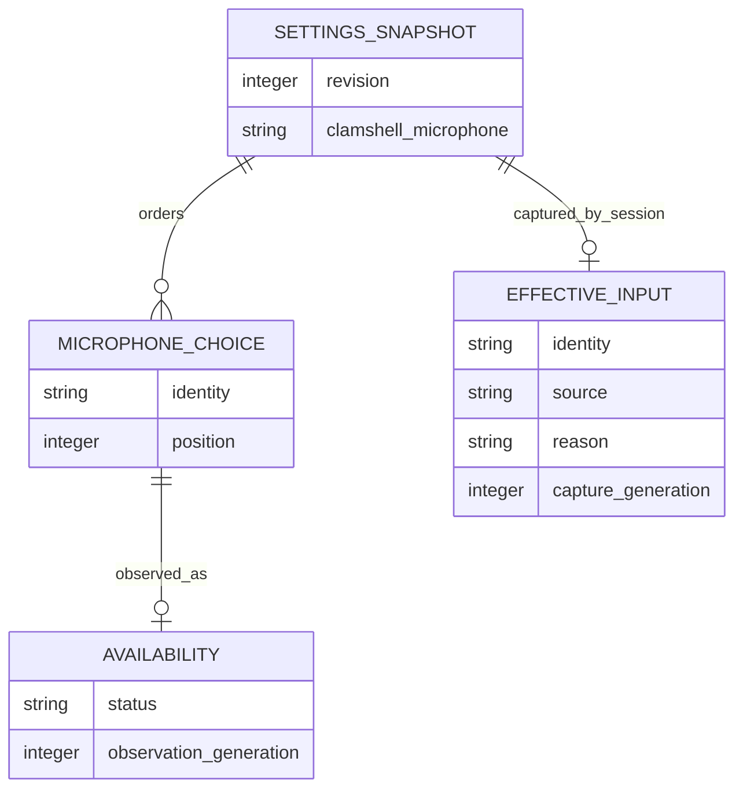
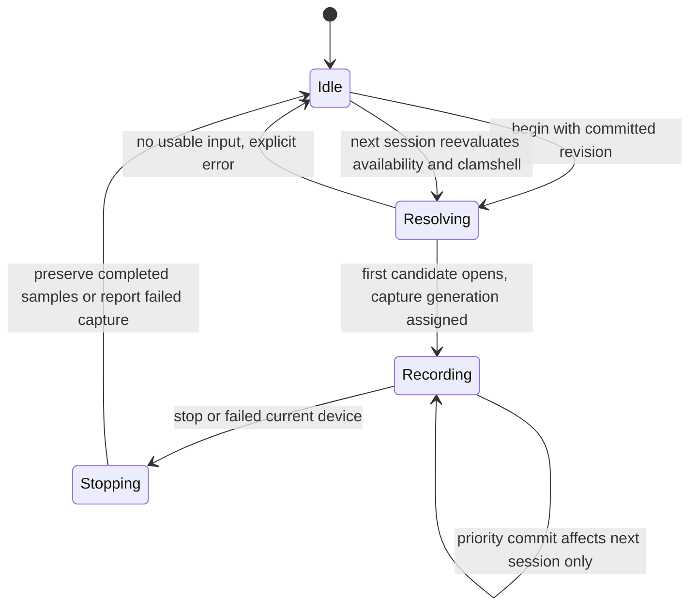

# Preparatory plan — Microphone priority

Prepared by F1, explicitly configured `gpt-6.1-sol` / high, on 2026-10-09. This is a preparatory artifact, not the official `spec-plan` output. Feature status remains **Draft**. No application code or application test has been executed or changed by this preparation.

Read [the reviewed specification](spec.md) for behavior. Inspect [the semantic receipt](.reviews/spec.json), [Clarify result](clarification-wave1.json) and [progression command evidence](semantic-progression-commands.json): the current source has complete/ready semantic review, no unresolved clarification, and actual `Progression: READY`. This readiness permits preparing the technical design; it does not close the specification's missing UI proofs or authorize implementation.

## Delivery boundary and Constitution Check

- F8 must deliver the shared persistent JSON settings service before F1 releases. F1 consumes its transaction, revision, persistence and single-instance routing contract; microphone operations are adapters to that authority. Final command spelling is a technical convergence task with F8 before implementation.
- Retain Rust/Tauri manager and command boundaries, React/Zustand state, tauri-specta generated bindings, existing ESLint/Prettier, and i18next. No added MCP server, database, cloud service or dependency is planned.
- Constitution alignment: specify before code; source-derived architecture; meaningful failure/migration tests; tooling observations separate from runtime evidence. These are design commitments, not executed checks.
- Official `spec-plan`, independent plan review, Analyze, UI closure, implementation and runtime checks remain required later. Do not create `plan.md`, mark Planned, or release the F1 reservation on the basis of this document.

## Source findings and intended ownership

| Layer | Concrete source / existing symbol | Intended change and reason |
|---|---|---|
| Persisted schema | Change [settings.rs](/Users/julienm/projects/handy/src-tauri/src/settings.rs:376), `AppSettings`, `get_default_settings`, `apply_settings_migrations`, `get_settings`, `write_settings` | Add ordered `microphone_priority: Vec<String>`; preserve `clamshell_microphone`. Use key presence in raw JSON to distinguish absence from deliberate empty intent. Consume F8's typed fallible transaction instead of current void writer. |
| Shared commit authority | Integrate [settings.rs](/Users/julienm/projects/handy/src-tauri/src/settings.rs:1248) with the F8 service/module finalized by F8 | One service owns validation, revision comparison, serialization, durable commit, rollback and notifications. Current plugin-store `set` and void result alone do not prove durable atomicity. |
| Device observation | Change [commands/audio.rs](/Users/julienm/projects/handy/src-tauri/src/commands/audio.rs:191), `get_available_microphones`, and inspect [device.rs](/Users/julienm/projects/handy/src-tauri/src/audio_toolkit/audio/device.rs) | Return typed availability per configured name plus enumerated choices; run enumeration on a blocking worker. CPAL indices remain process-local. Same-name matches are ambiguous. |
| Selection and lifecycle | Change [managers/audio.rs](/Users/julienm/projects/handy/src-tauri/src/managers/audio.rs:451), `desired_microphone`, `resolve_microphone_device`, `start_microphone_stream`, `try_start_recording`, `update_selected_device` | Resolve a captured configuration at each recording boundary, preserve closed-lid override, and apply edits only before the next capture. Do not use the current unconditional stream restart for an active session. |
| Destructive fallback | Remove new-list calls to [persist_default_microphone_after_fallback](/Users/julienm/projects/handy/src-tauri/src/managers/audio.rs:540) and its successful-open call site | Availability resolution must never write `None` or mutate the configured list. Successful fallback updates session-local effective input only. |
| Tauri surface | Change [commands/audio.rs](/Users/julienm/projects/handy/src-tauri/src/commands/audio.rs:217), command registration in [lib.rs](/Users/julienm/projects/handy/src-tauri/src/lib.rs:748) | Add typed priority read/replace/status commands using the common service. Decide and document a compatibility facade for old selected-mic commands during F8 integration; it must use shared validation and cannot erase list intent. |
| UI | Change [MicrophoneSelector.tsx](/Users/julienm/projects/handy/src/components/settings/MicrophoneSelector.tsx:13); inspect [ClamshellMicrophoneSelector.tsx](/Users/julienm/projects/handy/src/components/settings/ClamshellMicrophoneSelector.tsx) | Replace single selection with draft list, add/remove, drag and move controls, Save, text statuses, effective reason and retry. Preserve the separate clamshell setting. |
| Client state | Change [settingsStore.ts](/Users/julienm/projects/handy/src/stores/settingsStore.ts:316) and [useSettings.ts](/Users/julienm/projects/handy/src/hooks/useSettings.ts) | New typed commit action exposes failure to callers. Existing `updateSetting` catches and swallows errors and can restore a stale whole-settings snapshot, so it cannot implement the new Save contract unchanged. Keep draft, committed revision and observed availability separate. |
| Bindings / translation | Regenerate [bindings.ts](/Users/julienm/projects/handy/src/bindings.ts); change [English translations](/Users/julienm/projects/handy/src/i18n/locales/en/translation.json) and follow locale workflow | Generate bindings from Rust rather than hand-editing them. Translate statuses, validation/conflict/persistence errors, buttons, announcements and fallback reasons. No hardcoded JSX text. |
| CLI | Extend [cli.rs](/Users/julienm/projects/handy/src-tauri/src/cli.rs:6), [main.rs](/Users/julienm/projects/handy/src-tauri/src/main.rs:33), F8 routing in [lib.rs](/Users/julienm/projects/handy/src-tauri/src/lib.rs:856) | Route F1 operations through the same live authority as UI; no second independent writer when Handy is running. Persistent operations are distinct from existing runtime-only flags. |

## Data and migration

Proposed Rust types, to converge with F8 before coding: `MicrophonePriorityUpdate { priority: Vec<String>, expected_revision: u64 }`, `MicrophonePrioritySnapshot { priority, revision }`, `MicrophoneAvailability` enum (`Available`, `Unavailable`, `Ambiguous`, `Unknown`), `EffectiveMicrophone { identity: Option<String>, source, reason, settings_revision, capture_generation }`, and typed `MicrophoneSettingsError` using F8's JSON error envelope.

Exact names use existing device-name identity until the backend provides a stable alternative. Reject empty/blank identities and exact duplicates; do not trim or normalize otherwise valid opaque device names into different identities. Do not reject a saved choice merely because it is disconnected. Successful enumeration with zero matches means unavailable, multiple matches ambiguous, and enumeration failure unknown. Availability is not persistent intent.

Migration is prepared from raw stored JSON before filling defaults. If the new key is absent, a non-default legacy name becomes one entry, while legacy null/default becomes an empty normal list. If the key is explicitly present, including `[]`, retain it; malformed present data reports a typed recoverable validation error rather than silently resurrecting legacy preferences. Keep legacy raw bytes and unrelated fields recoverable until a durable commit succeeds. Coordinate schema-version allocation centrally with F8; do not independently choose conflicting version numbers. Preserve the existing frozen legacy fixture and add upgrade fixtures rather than replacing history to make a test pass.

F8 separates initialization/migration from read operations. Status/read operations consume the initialized snapshot without incidental writes. Migration commits once through the shared service. On serialization or persistence failure, retain the last committed snapshot and original store; report failure, do not emit a committed settings event, and allow a later retry. A successful second load is idempotent. Downgrade safety requires retaining the migration source; do not invent a lossy inverse conversion from a multi-entry list to one name.



The diagram describes in-memory and persisted JSON relationships; it introduces no relational database.

## Transaction and surface contracts

The shared F8 service validates the whole proposed order before changing state, then acquires its commit authority, compares expected revision and constructs the next full settings snapshot from the current committed snapshot. Preserve concurrent unrelated changes. Persist through the fallible durability mechanism selected and tested by F8, publish the new revision only after success, then emit exactly one setting-change notification. A persistence failure restores the authoritative previous state. Consumers must never interpret a swallowed promise rejection as a successful Save.

Proposed error codes, to map to F8's stable namespace: `invalid_input`, `duplicate_identity`, `revision_conflict`, `persistence_failed`, `device_enumeration_failed`, and `no_usable_microphone`. Distinguish a status-observation warning from a failed settings commit. User messages come from translated code mappings. Logs record operation/code/revision/generation only; do not add audio, credentials or device-name payload logging.

Proposed CLI integration contracts (PLANNED): read `microphone_priority`; replace the entire ordered value with `expected_revision`; read microphone status with configured order, availability and the actual current effective session device separately. When idle, a preview must be labeled a prospective candidate, not an input whose stream has actually opened. JSON stdout is a single structured result/error; human diagnostics go to stderr. The status projection exposes no unrelated settings or provider credentials. F8 decides exact argv, exit codes, payload budget and routing once, and F1 records that finalized interface before implementation.

The UI keeps a draft and base revision, validates locally for feedback and relies on authoritative backend validation. Reorder/add/remove do not commit. Save disables duplicate submission while pending; success adopts the returned committed revision and announces confirmation. On conflict, retain the user's draft and fetch the latest committed snapshot; show the conflict and let the user review/retry with an explicit current base. Do not silently merge competing orders. On another failure, retain draft and previous committed settings and expose retry. Stale refresh responses carry an observation generation and cannot overwrite a newer snapshot. Setting events refresh committed data without erasing an in-progress draft.

```mermaid
sequenceDiagram
  participant UI as Draft editor
  participant CLI as F8 JSON adapter
  participant Service as Shared settings service
  participant Store as Durable store
  participant Audio as Audio manager
  UI->>Service: replace order + expected revision
  CLI->>Service: competing replace + expected revision
  Service->>Service: serialize commits and validate whole order
  alt revision stale or invalid
    Service-->>UI: typed error; no partial change
    Service-->>CLI: JSON error; no partial change
  else valid current revision
    Service->>Store: commit complete next snapshot
    alt durable commit fails
      Store-->>Service: persistence error
      Service-->>UI: failure; previous snapshot retained
    else commit succeeds
      Store-->>Service: durable success
      Service-->>UI: committed snapshot + new revision
      Service->>Audio: invalidate next-session resolution
    end
  end
```

## Resolver, clamshell and recording lifecycle

Separate pure candidate selection from injectable enumeration/open operations. Capture one committed settings revision at the recording boundary. With a confirmed closed lid and configured override, try that identity first. With open or unknown lid state use normal order. Then attempt each normal choice in saved order, skipping absent or ambiguous identities, and select only when open succeeds. Finally attempt system default once. The empty normal list preserves this clamshell-first rule. Report a terminal recording error when no input opens; retain all persistent choices and clamshell configuration.

Each candidate has a bounded open budget. A genuinely stale cached handle permits one fresh enumeration/re-resolution; after that, each fresh candidate is attempted once and the default once. No unlimited retry or repeating a failed candidate in the normal list simply because it was also the override. Enumeration failure marks statuses unknown and permits the default recovery attempt; it does not prove choices disappeared. Run device IO on a blocking worker and verify cancellation/generation before adopting results; attempt counts alone do not promise a wall-clock timeout for a non-cancellable CPAL call.

Always-on mode requires explicit handling: current `start_microphone_stream` returns early for an already-live stream. At each *new recording boundary*, refresh selection and compare its identity/revision with the idle open stream before starting sample ownership, so a reconnected preferred device can win. Reuse a live stream only when it corresponds to the current resolved choice. Close/reopen an idle stream as needed before capture; never use a configuration edit to restart an active capture. Retain lock ordering from the existing manager and avoid waiting for a settings transaction while holding recorder locks; document the final lock order with F8 implementation.

Store effective device and capture generation with the session. Priority commits invalidate a pending resolution/cache for the next session; they do not change a Recording or Stopping session. Device loss fails that capture without splicing another microphone's samples into it. Preserve readiness/cancel generation checks, VAD initialization, channel configuration, mute restoration, stream cleanup and recorded samples. A resolution/open failure cleans up transient streams and publishes an error without changing persisted settings. A new session reevaluates reconnection and current lid state.



## UI / design work still required

Use an ordered list with per-choice textual status, selection and clearly associated move-up/move-down/remove controls; pointer reorder complements keyboard controls. Preserve focus on the corresponding choice after movement. Add control exposes available identities and rejects duplicates; disconnected configured rows remain visible and removable. Show effective input/reason separately and explain closed-lid override precedence. Busy/error/success states, unknown availability with retry, empty list, disabled invalid Save and visible keyboard focus require native screen/state design and later actual UI assertions.

Inspect [the generated semantic source](/Users/julienm/projects/handy/penflow/semantic-ui-tree.json) and [C20 source](/Users/julienm/projects/handy/penflow/flow-ui-contract/contract.json): source validation and deterministic projections succeeded, but full required identities/control-state coverage still need production and review. The actual native probe contains only root/header/title and is not the final screen. It proves native Get/context/bounds and PNG export capability only. Complete desktop frames at least 1024×700, not the 900×680 probe, when the native transport prerequisite is repaired.

Required remaining proof: C46 distinct pre/post opaque byte snapshots, observation and verified persistence receipt; compatible canonical source reader under the current MCP-only restriction; admissible raw native geometry for C51; complete contextualized screen/export, token/layout/vision/audit validation, generated expected/IR inputs, exact IDs/versioned PNG references and registry entries. The current execute response wraps Print JSON in text; its retained raw response fails the current strict JSON observation decoder. Do not relabel it as `snapshot_layout`, manufacture a plaintext .pen, remove required duties or claim certification. Global adapter/tool repair is outside F1 authority. C51 final design follows actual applicable reviewed plan/workflow metadata; no application runner manifest is required at this preparatory stage.

## FR → AC → tests and implementation sequence

All following tests are **PLANNED**, not executed. Proposed test files/symbols are future outputs.

| FR | AC | Concrete production unit | Meaningful planned proof |
|---|---|---|---|
| FR-001 | AC-001, AC-007 | `MicrophoneSelector`, typed priority commit action, shared order validator | UI draft reorder before/after Save, duplicate/blank rejection, exact order after restart; keyboard focus and drag have equivalent resulting order. |
| FR-002 | AC-002, AC-003 | audio status projection and device-name matching | Fake enumeration cases zero/one/multiple/error distinguish unavailable/available/ambiguous/unknown; UI shows text and retry, retains saved rows, rejects stale refresh generation. |
| FR-003 | AC-003, AC-004 | candidate resolver + injected recorder open | Table tests preferred/lower/default success, failure at every candidate, duplicate names and stale-handle refresh; assert exact attempted sequence and bounded calls and unchanged settings. Native disconnect/reconnect validates actual CPAL behavior later. |
| FR-004 | AC-004, AC-007 | manager recording boundary and session effective input | Concurrent commit during Recording/Stopping cannot restart or replace session audio; pending results cannot adopt a stale capture generation. Always-on next-session reconnection switches before capture; current disconnect fails without audio-source splice. |
| FR-005 | AC-005 | lid policy and candidate ordering | Open/closed/unknown lid × override present/missing/open-fails × empty/nonempty normal order; assert override→normal→default and unchanged clamshell settings. Real macOS clamshell scenario later. |
| FR-006 | AC-006 | migration on raw key presence + F8 commit | Frozen legacy fixture plus absent/null/default/unavailable name, explicit empty/list, malformed present key, repeated load, simulated durable failure; original store recoverable and unrelated fields equal. |
| FR-007 | AC-001, AC-007, AC-008 | F8 transaction/revision service + UI and CLI adapters | Same input gives identical typed validation; barrier-controlled competing revision writes permit one commit and conflict the other; fault injection before durable success never publishes partial state/events. UI sees errors rather than swallowed success. |
| FR-008 | AC-008 | F8 microphone JSON operation adapters | Subprocess stdout parses as one JSON result, stable nonzero error envelope, readback/restart equality with UI service, instance routing uses one writer, no unrelated credential fields. Foundation delivered first. |

Add pure resolver/validator tests in the future Rust microphone module (or existing audio manager inline test module); extend settings inline migration tests without altering the frozen historical fixture. Add frontend interaction tests to proposed `tests/microphone-priority.spec.ts` using the configured Playwright environment for UI semantics. Mocked Tauri fixtures prove presentation and focus only; they do not prove native recording or durable CLI integration. Add real service/CLI integration tests and native manual/harness captures for those boundaries. The existing HTML smoke tests are insufficient for these AC.

Sequence: (1) close F8 transaction/durability/routing design; (2) restore native design prerequisites and close official specify/plan gates; (3) add migration and shared types with failure tests; (4) implement pure resolver and session lifecycle with deterministic sequence/concurrency tests; (5) adapt Tauri and F8 CLI together; (6) implement draft UI/state/i18n and regenerate bindings; (7) run relevant lint/format/build, Rust, UI and service/CLI checks; (8) run native reconnect/clamshell/restart scenarios and required visual/runtime verification. Actual implementation must pass current Analyze first.

Release acceptance is conjunctive: every AC has mapped actual evidence, no preference loss in all failure fixtures, current independent review/Clarify/plan/Analyze and UI gates, F8 foundation available, appropriate repository checks, and native behavior observed. No PASS is inferred from this preparatory plan.
