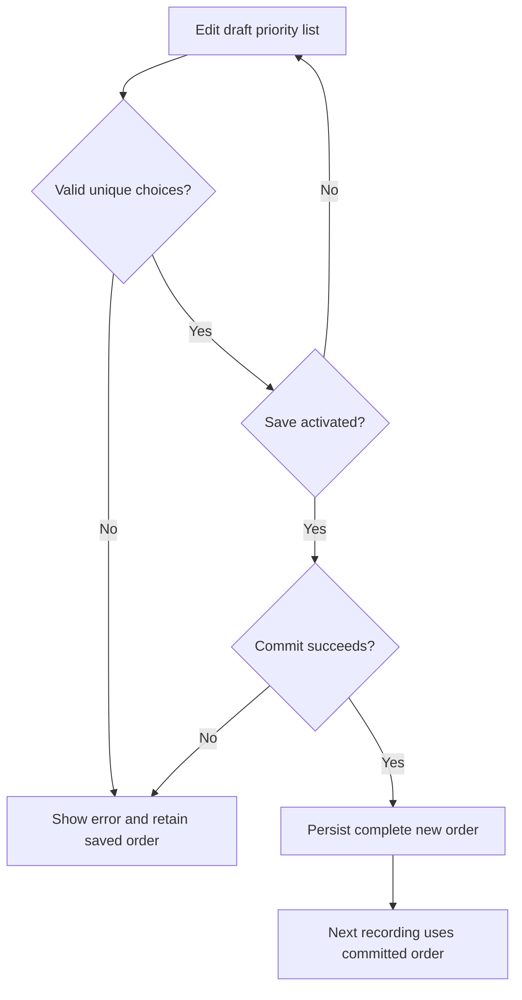
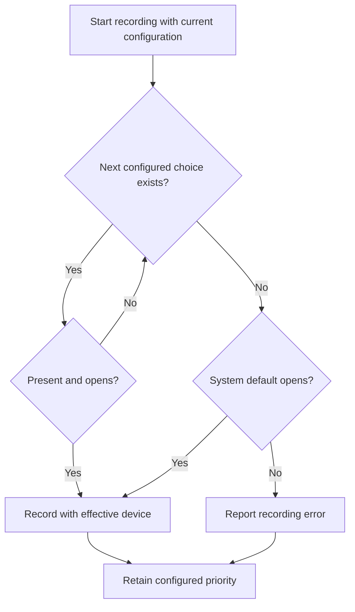
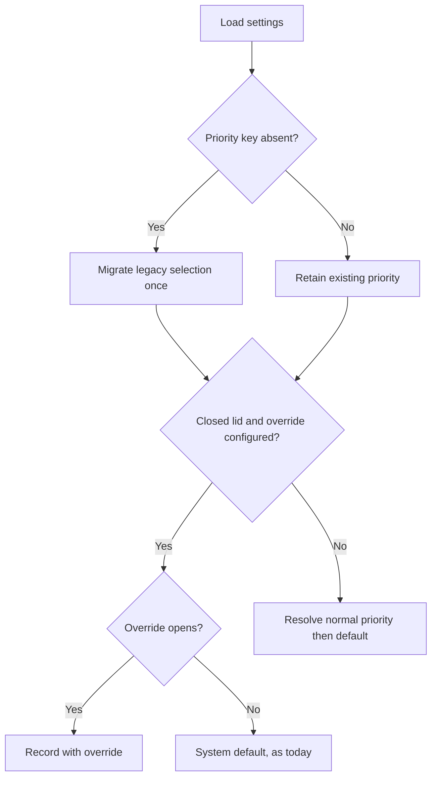
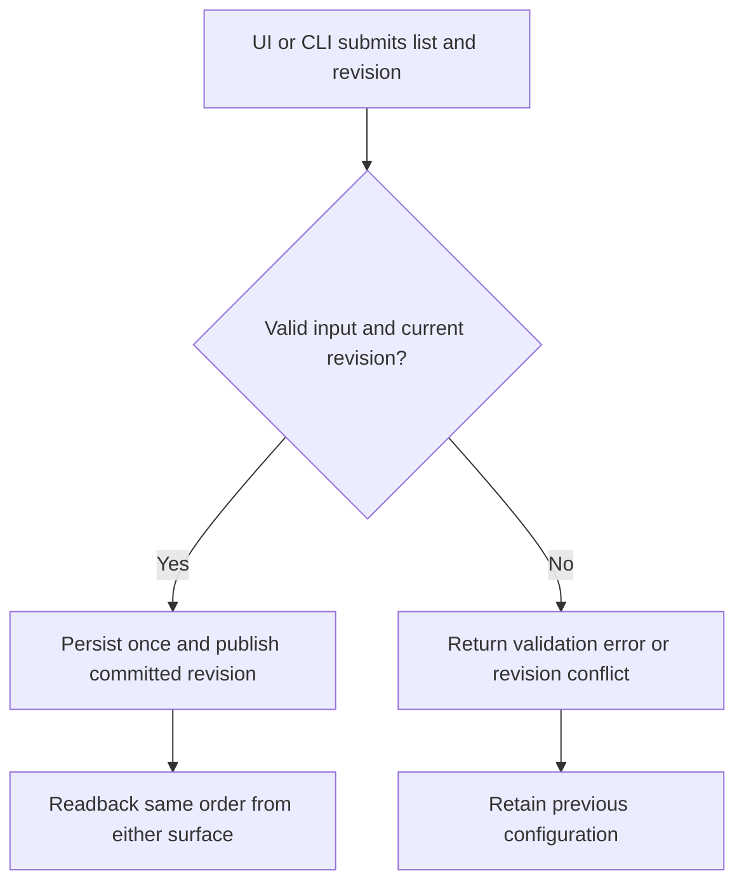

# Feature Spec: Microphone Priority

## Header

- **Feature:** Microphone Priority
- **Branch:** None — specification only (--no-branch)
- **Date:** 2026-10-09
- **Status:** Planned
- **Input:** Program item 1 (user request 2026-10-12): in settings, show an ordered microphone list reorderable by drag and drop. At each recording, try the first available microphone, then the next ones, and finally the system default microphone. Display the microphone actually used and the unavailable devices, without deleting their preferences after a disconnection. Preserve the existing closed-lid (clamshell) behavior. Migrate the legacy single selection. F8 (settings CLI, feature 008) provides the shared persistent configuration CLI before F1 ships.
- **Feature Number:** 001

## User Scenarios & Testing

### Story 1 — Edit ordered microphone choices `P1`

**As a** Handy user, **I want to** add, remove and reorder microphone choices, **so that** each recording uses my preferred available device.

**Priority reason:** Device choice controls the core recording workflow.
**Independent test:** Configure two devices, move the second above the first, verify only the draft changed, activate Save, reload settings and inspect the committed order.

```gherkin
Feature: Ordered microphone preferences
  Scenario: Reorder available devices
    Given the configured order is USB headset then MacBook microphone
    When the user moves MacBook microphone above USB headset
    Then the draft order is MacBook microphone then USB headset
    And the persisted order remains USB headset then MacBook microphone before Save
    When the user activates Save and it succeeds
    Then the persisted order is MacBook microphone then USB headset
    And the next recording attempts MacBook microphone first
  Scenario: Invalid duplicate choice
    Given USB headset is already configured
    When the user adds USB headset again
    Then the duplicate is rejected with an actionable error
    And the saved order remains unchanged
```



### Story 2 — Record through availability fallback `P1`

**As a** Handy user, **I want to** see unavailable choices and record with the next usable microphone, **so that** disconnecting a preferred device does not destroy my preferences.

**Priority reason:** Fallback prevents loss of the core recording capability.
**Independent test:** Disconnect the first configured device, start a recording and compare the effective device with unchanged stored preferences.

```gherkin
Feature: Microphone availability fallback
  Scenario: First choice unavailable
    Given USB headset then MacBook microphone is configured
    And USB headset is disconnected while MacBook microphone is available
    When a recording starts
    Then MacBook microphone is opened
    And USB headset remains first in the configured list with an unavailable label
  Scenario: No configured device opens
    Given every configured microphone is unavailable or fails to open
    When a recording starts
    Then the system default is attempted after the configured choices
    And failure of that attempt reports a recording error without changing preferences
  Scenario: Reconnection restores priority
    Given the first configured microphone is unavailable for one recording
    When it reconnects before the next recording starts
    Then it is attempted before the lower priority microphones
  Scenario: Ambiguous name is skipped
    Given "USB headset" is configured first and two present devices are named "USB headset"
    When a recording starts
    Then "USB headset" counts as a failed attempt with reason ambiguous
    And the next configured choice is attempted
  Scenario: Always-on stream follows the priority
    Given always-on microphone mode is enabled and no recording is active
    When the user saves a new priority order
    Then the input stream reopens on the first usable choice of the new order
  Scenario: Device lost during a recording
    Given a recording is in progress on USB headset
    When USB headset disconnects
    Then the recording ends and the audio captured before the loss is transcribed
    And the user is told the recording was cut short
    And the configured list is unchanged
```



### Story 3 — Preserve clamshell and upgrade behavior `P1`

**As a** existing Handy user, **I want to** retain my current microphone and clamshell choices during upgrade, **so that** the new list respects existing intent.

**Priority reason:** Migration and clamshell behavior affect persisted configuration and shared runtime.
**Independent test:** Load a legacy settings fixture and exercise open-lid and closed-lid resolution.

```gherkin
Feature: Compatible microphone priority migration
  Scenario: Legacy selection migration
    Given the stored settings have selected_microphone equal to USB headset
    And no microphone priority setting exists
    When the settings load after upgrade
    Then USB headset becomes the sole configured priority entry
    And the clamshell microphone setting is unchanged
    And a second load preserves the same configuration
  Scenario: Closed lid override unavailable
    Given a clamshell override and an ordered priority list are configured
    And the lid is closed
    And the override cannot be opened
    When a recording starts
    Then the system default is attempted, as in the current behavior
    And neither the override nor the list is erased
  Scenario: Open lid does not prefer the override
    Given the lid is open or its state cannot be determined
    When a recording starts
    Then the normal configured priority list is used
```



### Story 4 — Use identical UI and CLI configuration contracts `P2`

**As a** automation user, **I want to** read and update the microphone list through JSON CLI operations, **so that** scripts receive the same validation and persisted outcome as settings UI.

**Priority reason:** F8 is the foundational control surface required before F1 delivery.
**Independent test:** Run equivalent valid and invalid UI/CLI writes against an isolated settings store and compare readback.

```gherkin
Feature: Shared microphone settings operations
  Scenario: CLI saves a valid complete order
    Given the settings CLI foundation is implemented
    When the user submits a valid ordered microphone list through its JSON write operation
    Then the shared backend validates and persists that list
    And a JSON read reports configured order separately from effective microphone and availability
  Scenario: Concurrent stale write
    Given the UI has saved a newer settings revision
    When the CLI submits an earlier expected revision
    Then it returns a conflict without partially writing settings
    And a fresh read reports the UI's order
```



## Acceptance Criteria

### AC-001

**Criterion:** The settings UI displays the configured order, supports add/remove and both pointer and keyboard reorder, and preserves the exact committed order after restart. Duplicate or empty device identities are rejected without a partial write.
**Priority:** P1 | **Story:** Story 1

### AC-002

**Criterion:** Each configured choice remains visible with available, unavailable, ambiguous or unknown status. Availability refreshes when the audio settings open, every 5 seconds while they remain open, and on manual Retry; refresh errors show unknown status and an actionable retry. The microphone actually used is displayed separately from saved order: during a recording or an open always-on stream, the current device and its reason (first choice, fallback, clamshell, system default); otherwise the device used by the last recording since launch, labelled as such, or "not used yet" after a restart. Add offers the currently enumerated devices. Status uses text in addition to color.
**Priority:** P1 | **Story:** Story 2

### AC-003

**Criterion:** Whenever the input stream opens — at the start of a recording, or, in always-on microphone mode, when the stream opens at launch, after a committed priority change while no recording is active, or after a device loss — attempt configured devices in saved order and use the first device that is present, unambiguous and opens. A configured name matching several present devices counts as a failed attempt with reason ambiguous. Each open attempt times out after 2 seconds and the whole resolution after 6 seconds; until the stream is ready the indicator keeps its existing arming state and audio spoken before readiness is not captured. Attempt the system default only after configured attempts fail (after the single fresh re-enumeration, unresolvable entries count as failed attempts); if no device opens, report the recording error. Transient enumeration/open failures do not modify the saved list.
**Priority:** P1 | **Story:** Story 2

### AC-004

**Criterion:** A fallback, disconnect or reconnect never deletes/reorders saved choices or resets the clamshell setting. A reconnected higher priority device is preferred on the next recording; in always-on mode the priority is re-resolved when a recording starts and, when the result differs from the open stream's device, the stream reopens on it before capture begins. Editing priority during a recording affects the next session and does not interrupt or discard the current session's captured audio.
**Priority:** P1 | **Story:** Stories 1 and 2

### AC-005

**Criterion:** The closed-lid behavior is preserved exactly: with a configured override and a confirmed closed lid, attempt the clamshell microphone; if it is unavailable or fails to open, attempt the system default, as today. Open lid or unknown lid state uses the normal priority list. All settings remain unchanged by resolution.
**Priority:** P1 | **Story:** Story 3

### AC-006

**Criterion:** On first load without the new priority key, a non-default legacy selected_microphone becomes one priority entry; null/default becomes an empty normal priority list; the closed-lid override precedence in AC-005 still applies. An explicitly stored new list, including an empty list, wins. Migration is idempotent, retains unavailable legacy choices, preserves clamshell settings and leaves the original store recoverable if persistence fails.
**Priority:** P1 | **Story:** Story 3

### AC-007

**Criterion:** UI and F8 CLI invoke shared backend validation and transaction semantics. Valid writes commit the complete order once; invalid input, persistence failure and stale revision return explicit errors with no partial state change. On a stale revision the UI keeps the draft, shows that settings changed elsewhere and offers Reload, which displays the committed order and discards the draft. A committed priority update invalidates cached resolution for the next stream opening without interrupting an active recording.
**Priority:** P2 | **Story:** Story 4

### AC-008

**Criterion:** F8 offers `handy settings microphones list` (configured order, availability, effective device and reason) and `handy settings microphones set-priority <name>...` (complete order, optional expected revision). With `--json`, stdout contains only the F8 JSON envelope; errors use the F8 stable codes (`validation_failed`, `revision_conflict`, `persistence_failed`) and exit codes; reads expose no credentials. F8 is delivered before F1 release; no MCP control server is introduced.
**Priority:** P2 | **Story:** Story 4

## Behavioral AC

Signals extracted by the specification agent: reorder, drag-drop, keyboard navigation, loading, validation, form. Official detect_traits returned async_action, has_drag_drop, has_validation, is_keyboard_navigable, is_submittable.

### async_action

```gherkin
Feature: Microphone priority asynchronous writes
  Scenario: Saving indicates busy
    Given the user saves a valid priority list
    When the write is in progress
    Then the save control is busy and cannot dispatch another write
    And the save control matches visual state "loading"
  Scenario: Failed write can be retried
    Given saving failed without committing any preferences
    When the user inspects the editor
    Then the previous committed order remains active
    And an actionable error and retry are visible
    And the editor matches visual state "error"
    When the user retries
    Then one validated write is submitted
  Scenario: Successful save
    Given a validated write commits
    When the editor receives its revision
    Then the committed order is displayed with confirmation
    And the editor matches visual state "success"
```

### has_drag_drop

```gherkin
Feature: Pointer microphone reorder
  Scenario: Drop updates the draft order
    Given a list of three configured microphones
    When the user drags the first below the third
    Then the draft order reflects that drop
    And a subsequent successful Save commits that complete order
  Scenario: Drop target is visible
    Given the user drags a configured microphone
    When the pointer enters a valid drop position
    Then the target is highlighted
    And the list matches visual state "drop-target"
    And the dragged row matches visual state "dragging"
```

### has_validation

```gherkin
Feature: Microphone choice validation
  Scenario: Empty add choice
    Given no microphone choice is selected for Add
    When the user inspects the Add control
    Then Add is unavailable with an accessible explanation
    And the choice input matches visual state "empty"
  Scenario: Duplicate choice
    Given a selected microphone already exists in the draft order
    When the user attempts to add it
    Then a duplicate error explains that each choice may appear once
    And the input matches visual state "invalid"
  Scenario: Corrected choice
    Given a duplicate error is displayed
    When the user selects a distinct unambiguous microphone
    Then the error clears
    And the input matches visual state "valid"
```

### is_keyboard_navigable

<!-- WARNING: No visual states defined for trait "is_keyboard_navigable" in ui-behavioral-taxonomy.md -->

```gherkin
Feature: Keyboard microphone controls
  Scenario: Tab traversal
    Given the microphone editor is open
    When the user presses Tab through its interactive controls
    Then each enabled control receives visible focus in reading order
  Scenario: Keyboard reorder
    Given Move up for the second configured choice has focus
    When the user presses Enter
    Then that choice moves above the first in the draft order
    And focus remains on that choice's corresponding move control
```

### is_submittable

```gherkin
Feature: Commit microphone priority
  Scenario: Commit valid choices
    Given the user has a valid changed draft list
    When the user activates Save
    Then the entire order is persisted and confirmation is displayed
    And Save matches visual state "enabled" before submission
  Scenario: Reject invalid draft
    Given the draft contains duplicate identities
    When the user inspects Save
    Then Save is disabled with validation errors
    And Save matches visual state "disabled"
  Scenario: Reset edits only the draft
    Given the saved normal list has two choices
    When the user activates Reset
    Then the draft normal list is empty and Save is enabled
    And the persisted list and clamshell setting are unchanged until Save succeeds
  Scenario: Empty list is valid
    Given the user removes all normal priority choices
    And the lid is open or its state is unknown
    When the user activates Save and it succeeds
    Then the persisted normal list is empty and the next session uses system default
    And the clamshell override is unchanged
  Scenario: Empty normal list preserves closed-lid override precedence
    Given the normal priority list is empty
    And the lid is confirmed closed with a configured clamshell override
    When the next recording starts
    Then the override is attempted first
    And system default is attempted only if that override is unavailable or fails to open
    And the normal list and clamshell setting remain unchanged
```

## Functional Requirements

### FR-001

**Requirement:** Persist a unique ordered list of microphone choices and expose accessible add/remove/reorder controls in the existing audio settings.
**AC References:** AC-001, AC-007

### FR-002

**Requirement:** Report refreshed availability and effective input separately from configured preferences; failed enumeration is unknown, not proof that a device disappeared. Same-named ambiguous devices are reported as ambiguous, are skipped as a failed attempt at stream opening rather than resolved to an arbitrary device, and remain saved until explicitly edited.
**AC References:** AC-002, AC-003

### FR-003

**Requirement:** Resolve and open normal microphone choices in order, then system default, with bounded attempts and explicit failure. Keep the configured list unchanged during availability resolution or stream recovery.
**AC References:** AC-003, AC-004

### FR-004

**Requirement:** Apply changes at the next stream opening and retain the current session's chosen device while recording. A device loss ends the current recording: audio captured before the loss is kept and transcribed normally, the user is told the recording was cut short, and no other microphone is spliced into its samples. The next stream opening resolves the priority again.
**AC References:** AC-004, AC-007

### FR-005

**Requirement:** Preserve the existing closed-lid behavior (override first, then system default) and never erase the clamshell setting or the normal priority list.
**AC References:** AC-005

### FR-006

**Requirement:** Migrate old single microphone selection only when the priority key is absent, retaining intent and recoverability without changing unrelated settings.
**AC References:** AC-006

### FR-007

**Requirement:** Share typed validation, atomic persistence, revision conflict handling, cache invalidation and setting change notifications between UI and CLI.
**AC References:** AC-001, AC-007, AC-008

### FR-008

**Requirement:** Extend F8 settings JSON operations with priority read/write and device-status read contracts, preserving configured/effective separation and documented error codes.
**AC References:** AC-008

## Key Entities

| Entity | Description | Key fields |
|---|---|---|
| Microphone priority | Persistent user intent; empty normal order falls through to system default after any applicable clamshell override | ordered device identities, settings revision |
| Availability snapshot | Current enumeration, distinct from user intent | device identity, available/unavailable/ambiguous/unknown, observed revision |
| Effective input | Session-local resolved device | device identity or system default, source normal/clamshell/default, reason, capture generation |

## Clarifications

- Scope (updated 2026-10-12): this spec covers microphone choice only. It belongs to a ten-feature program (001–010) specified in list order; F8 denotes feature `008-settings-cli`, the shared configuration foundation shipped before any other program feature. The program includes the recovery bubble (010). No MCP server is introduced.
- Closed lid (decision 2026-10-12, following "preserve the existing closed-lid behavior"): override first, then system default exactly as today; the normal list is not tried with a closed lid. An empty normal list falls through to system default when the lid is open/unknown. A configured override with a confirmed closed lid is still attempted first. Reset explicitly empties only the normal list and leaves clamshell unchanged.
- Device identity uses existing exact device names until a backend offers stable identifiers. Enumeration indices are session-local and never persisted as identity. Multiple devices with the same name are ambiguous; no arbitrary first-match selection.
- UI edits a draft; Save commits the complete list. UI offers move-up/move-down controls and pointer reorder; persisted choices can be removed even while unavailable.
- Resolution/open attempts are bounded to each configured choice once, one fresh re-enumeration on stale-cache failure, then one system-default attempt. A choice already tried is not retried indefinitely.
- Recording settings are captured at session start. Edits do not restart an active recording; in always-on mode an edit saved during a recording reopens the stream after that recording ends. A disconnected current input ends the recording with the captured audio kept (FR-004); the next recording uses fresh resolution.
- F8 supplies the shared settings transaction/revision contract; proposed operation naming is finalized with F8 before application implementation.

- Decision `` / `placeholders:- Workspace status on 2026-10-12: `incomplete` (missing `expected-ui-tree.json`, `code-ir.json`, desktop frame dimensions). Per the user's 2026-10-12 decision, the full forward contract and Pencil mockups for all program features are completed once, before `spec-ship`. Semantic/test IDs: [NEEDS CLARIFICATION] until that pass. No inspection READY or certification PASS is claimed.`: User decision 2026-10-12 (lightweight UI contract): Penflow flow/screen contracts, semantic and test IDs and Pencil mockups for all program features are produced in one pass before spec-ship; until then the planned flow_id and screen_id above are authoritative and no inspection READY or certification PASS is claimed.
<!-- livespec-clarification:{"requirement_id": "", "decision_key": "placeholders:- Workspace status on 2026-10-12: `incomplete` (missing `expected-ui-tree.json`, `code-ir.json`, desktop frame dimensions). Per the user's 2026-10-12 decision, the full forward contract and Pencil mockups for all program features are completed once, before `spec-ship`. Semantic/test IDs: [NEEDS CLARIFICATION] until that pass. No inspection READY or certification PASS is claimed.", "evidence_hash": "b61444800c5ba99004508bcff949034b15088bbab3f0772da8c38f3707d21dcd", "answer": "User decision 2026-10-12 (lightweight UI contract): Penflow flow/screen contracts, semantic and test IDs and Pencil mockups for all program features are produced in one pass before spec-ship; until then the planned flow_id and screen_id above are authoritative and no inspection READY or certification PASS is claimed."} -->

## QE Analysis

- **Criticality:** High; **Blast radius:** Shared; **Primary risk:** Regression; **Confidence:** Medium for source understanding, Low for unexecuted runtime.
- **Dimensions:** Functional correctness, regression, API/contract compatibility, data/migration integrity, security, performance, accessibility/UX, observability/operability.
- **P0 gates/evidence:** Gherkin-derived resolver, migration and transaction tests; unavailable preference retention; clamshell regression fixtures; UI/CLI equivalence and stale revision tests; native disconnect/reconnect and restart evidence.
- **P1 gates/evidence:** Keyboard reorder/focus and text status checks; bounded enumeration/open attempts; i18next and strict generated bindings; settings UI visual gate.
- **Non-functional expectations:** Device enumeration and opening sit behind an injectable seam so disconnect/ambiguity tests are deterministic; never enumerate on the webview/main loop; bound attempts by configured length; serialize settings commits and recording boundaries; labels and recovery errors are translated; no audio, device names or credential payloads in debug output added by this feature.
- **Missing evidence:** All application tests are PLANNED. No native Handy recording, build, migration or UI assertion has run for this feature. Draft UI contract, independent review, clarification, design and finalization gates remain open until their receipts exist.
- **Boundary:** QE defines risk/test sufficiency. Independent review judges requirements. Penflow governs UI source/design evidence. spec-test executes runtime proof; broader security audit is separate.

## Screens

| Screen | Status | Reference |
|--------|--------|-----------|
| microphone-settings | Modified | Mockup to produce before `spec-ship` (user decision 2026-10-12: lightweight UI contract during specification) |

- Existing audio settings show the ordered priority list, availability, effective input and clamshell explanation. No PNG exists yet; this Draft does not claim the UI gate passed.

## Penflow Contract

- Existing source: `penflow/flow-ui-contract/flows/microphone-priority.md` and `penflow/flow-ui-contract/screens/microphone-settings.md`; `flow_id: microphone-priority`, `screen_id: microphone-settings`.
- Workspace status on 2026-10-12: `incomplete` (missing `expected-ui-tree.json`, `code-ir.json`, desktop frame dimensions). Per the user's 2026-10-12 decision, the full forward contract and Pencil mockups for all program features are completed once, before `spec-ship`. Semantic/test IDs: [NEEDS CLARIFICATION] until that pass. No inspection READY or certification PASS is claimed.

## Edge Cases

- Channel selection: the existing channel setting applies only when valid for the opened device; otherwise the device's default channel mapping is used and the setting is not changed.
- Legacy key: after migration `selected_microphone` stays stored unchanged (not read while the priority key exists) so a downgrade keeps the previous choice; the legacy set command is replaced by the priority operations.
- Reset: empties the draft normal list only; it requires Save and leaves clamshell unchanged.
- Empty normal list: use and show system default when the lid is open/unknown or no usable override applies; a confirmed closed lid still attempts the configured override first.
- All devices missing: retain configured entries and show the attempted default or recording error.
- Enumeration error: mark availability unknown and retain preferences; after the single fresh re-enumeration, configured entries count as failed attempts, the system default is attempted, and the enumeration warning is shown.
- Duplicate names: mark ambiguous; do not persist transient enumeration indices or select an arbitrary match.
- Concurrent reorder and start: capture one committed revision; edits affect the next session.
- Persistence failure: restore last committed settings and allow retry without erasing the migration source.
- Repeated device failures: bounded attempts terminate with an error; no unbounded stream reopen loop.

## Success Criteria

### SC-001

All eight AC pass their mapped deterministic tests and required native/UI scenarios before feature release; evidence is recorded per AC, with no generic runtime success claim.

### SC-002

Disconnect/reconnect, enumeration failure, clamshell fallback and restart tests preserve exact configured order and unrelated settings in every fixture.

### SC-003

Keyboard-only users can add, remove and reorder a choice, read availability and recover from a rejected write without losing focus; source/design and runtime assertions are validated separately.
