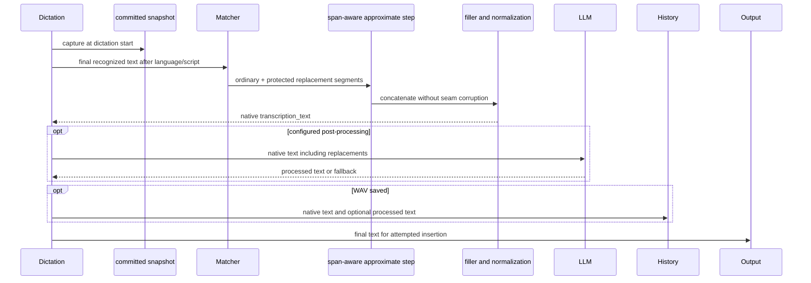
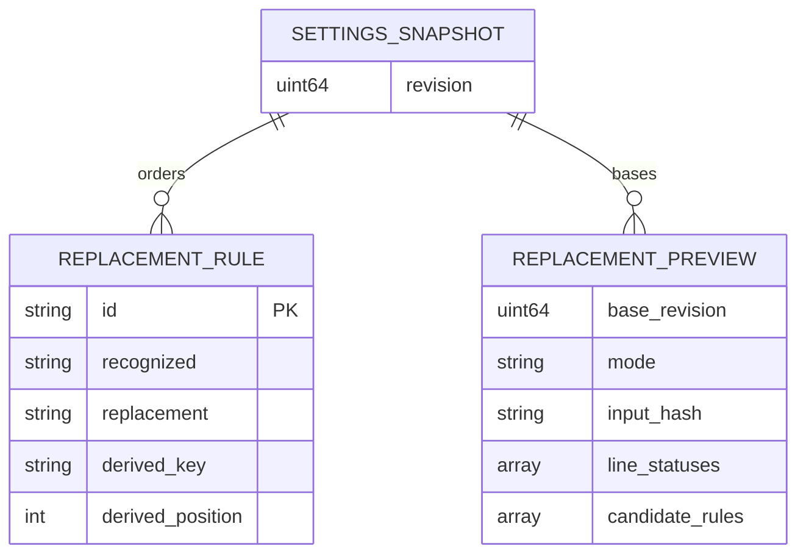

# Implementation Plan: Word Replacements

## Summary

Add an ordered Rust replacement domain with one validator, exchange parser, revision-bound preview and offset-mapped matcher; use the 008 transaction service for UI/CLI persistence and protect replacement spans from approximate custom-word correction.

Read [the functional source](spec.md) for FR-001–FR-006, AC-001–AC-008 and SC-001–SC-003. Scope **L**: six FR, three entities, shared persistence, Unicode transformations and live transcription integration. Deliver after 008 and 001 in the approved program order. This command creates planning/review artifacts only, with no application code, commit or push.

Inspect [008's approved technical plan](../008-settings-cli/plan.md) for the shared foundation. Its `settings_service` modules, `SettingDescriptor`, `SettingsMutation`, `SettingsSnapshot`, `Revision`, `PublicSettings`, `OperationRequest`, `SettingsError`, `SettingsRepository`, `StoreLocator`, `LocalTransport`, `LiveSettingsEffects`, `read_snapshot` and `commit_mutation` remain authoritative. The domain trait in `settings_service/domains/mod.rs` owns command schema/help, parsing, validation, preview, typed patch and export. 002 registers `replacements`; it does not create another lock, revision, renderer, IPC channel or direct plugin-store writer. Implementation Step 1 requires the actual 008 interfaces and passing transaction/domain gates; a READY plan for 008 is a design dependency, not proof that those interfaces exist yet.

## Technical Context

| Aspect | Choice | Evidence / rationale |
|---|---|---|
| Native | Rust edition 2021, Tauri 2.11.5, existing serde/specta | Cargo and selected stack; domain logic runs without AppHandle |
| Frontend | React 18, TypeScript, Zustand, i18next, existing shared controls | Preserve frontend/native boundary and existing settings layout |
| Persistence | New `AppSettings.word_replacements: Vec<ReplacementRule>` with serde empty default | Ordered collection independent of custom_words; 008 settings_store.json and settings_revision; no SQL table |
| Identity | Opaque RuleId, UUID v4 through injected RuleIdSource | Proposed reviewed/pinned uuid dependency; edits retain ID, imports reconcile by normalized key |
| Unicode | Default full case folding C+F; pinned Unicode tables and original UTF-8 offset map | Lowercasing/simple folding does not satisfy expansions; compile keys once per committed rule snapshot |
| File exchange | Strict UTF-8, leading BOM and CRLF accepted; byte-bounded reader | No CSV quoting or execution; one shared parser for file, stdin and textarea |
| Concurrency | Immutable compiled snapshot captured at dictation start; worker transactions and revision CAS | Commit before next dictation starts is visible; in-flight dictation never mixes rule versions |
| Tests | Cargo unit/integration/process, Bun controller, Playwright UI, real native Tauri evidence | Vite mocks do not prove native dialogs, persistence or insertion |
| Infrastructure | None beyond 008 private user store/channel | No cloud resources, credentials or provisioning step |

Inspect [settings](../../../src-tauri/src/settings.rs), [transcription](../../../src-tauri/src/managers/transcription.rs), [text transforms](../../../src-tauri/src/audio_toolkit/text.rs), [output/history call sites](../../../src-tauri/src/actions.rs), [history fields](../../../src-tauri/src/managers/history.rs), [advanced settings](../../../src/components/settings/advanced/AdvancedSettings.tsx), [navigation](../../../src/App.tsx) and [capabilities](../../../src-tauri/capabilities/default.json) for current implementation context. Inspect [Unicode case folding data](https://www.unicode.org/Public/UCD/latest/ucd/CaseFolding.txt) and [UCD definitions](https://www.unicode.org/reports/tr44/) as external technical context: full folding uses C+F and may expand characters. Pin source version/checksum during Step 1, never download mutable latest data at runtime.

## Constitution Check

| Principle | Pass / deviation |
|---|---|
| Preserve source and native/frontend boundaries | PASS: Rust owns parsing, validation, matching and commits; React owns pending edits and translated errors |
| Derive stack/managers from manifests | PASS: existing Tauri/React/serde/specta retained; only reviewed ID/Unicode support is proposed |
| Tool availability does not prove execution | PASS: availability recorded below; native and performance evidence remains required at implementation |
| Specify before implementation, meaningful tests | PASS: all FR/AC/SC mapped; actual domain logic and real filesystem/process tests, fakes only at ports |
| Naming, typed APIs and separation | PASS: Rust snake_case modules, TypeScript/Markdown kebab-case for new files; existing names retained; no catch-all helper module |
| Project conventions take precedence | PASS: retain Bun, ESLint/Prettier, Cargo and clap; generic Commander/Vitest/Biome guidance is inapplicable to existing native CLI |
| All user text localized | PASS: en/fr keys and translation validation; stable backend code/field/issue kinds mapped through i18next |
| UI production timing | Approved exception: forward contract and mockups deferred by user decision 2026-10-12; no visual readiness/certification asserted now |

## Requirement Inventory

| FR | AC / success | Steps |
|---|---|---|
| FR-001 | AC-001/002; ordered list, stable edits, confirmation, restart | 1, 3, 5, 7 |
| FR-002 | AC-002/005/008; one validator and unchanged store on rejection | 1, 2, 3, 6, 7 |
| FR-003 | AC-003/004; exchange diagnostics and round-trip SC-002 | 2, 5, 6, 7 |
| FR-004 | AC-003/005; exact preview, merge/replace and SC-003 | 2, 3, 5, 6, 7 |
| FR-005 | AC-006/007; >=30 exact fixtures SC-001; <20 ms M1 budget | 1, 4, 7 |
| FR-006 | AC-008; full operations, JSON, codes and conflicts | 3, 6, 7 |

## Architecture Decisions

### Validation, exchange and identity

`ReplacementRule` stores id, trimmed recognized and replacement strings; normalized key and position are derived rather than independently editable. Count characters as Unicode scalar values before folding (1–100 / 1–500), validate 1000-rule maximum, forbid CR/LF/tab in both fields, semicolon and leading # in recognized, and empty trimmed strings. Collapse internal Unicode whitespace in the recognized key, then full default non-Turkic case fold. Do not add NFC/NFKC, accent removal, locale switches or regex interpretation. Validation returns typed field issues and all participating duplicate line numbers; the UI must call this same Rust validator, not implement a separate JS fold.

For file/stdin input, enforce **1,000,000 bytes** inclusive before UTF-8 decoding (1 MB interpreted as decimal bytes), report invalid byte offset, remove only the initial BOM, split LF/CRLF, retain original 1-based line numbers. Recognize blank/comment lines after trim. Only the first nonblank/noncomment line can be a header; split it like a rule line (tab first, otherwise `;`), trim both fields and compare them case-insensitively (same folded key as recognized text) to the AC-004 pairs `texte_reconnu`/`remplacement` and `recognized`/`replacement`, whatever the separator. A tab-separated `recognized<TAB>replacement` first line copied from a spreadsheet is therefore a header, not a rule; a later identical line is an ordinary rule. If a line contains a tab, split at its first tab even if a semicolon precedes it; otherwise split at the first semicolon. Validate fields after split; subsequent separators are literal replacement content except forbidden tabs. Serialize LF, canonical `recognized;replacement` header and saved order. The bulk editor always includes that header, so a first genuine `recognized;replacement` rule appears on line 2 and round-trips. Standalone CR in a field is a validation error. CSV quotes are literal, never an escaping grammar.

Merge keeps matched existing recognized spelling, ID and position, updates only replacement, and appends new rules in file order. Replace uses input spelling/order, reuses an existing ID for an unchanged normalized key when possible and allocates IDs for new keys at commit. UI/CLI update by ID may change recognized text while preserving ID; duplicate new key is refused. Exchange equality in SC-002 means ordered recognized/replacement content, since files carry no IDs. Preview retains stable existing IDs plus temporary candidate identities; final ID allocation cannot change the previewed content/order.

Format-level serialization/parsing is lossless for valid rules; the independent file/stdin reader limit can still reject an export larger than 1,000,000 bytes. Use importable fixtures for the 1/100/1000-rule SC-002 file matrix and separate worst-case Unicode tests for pure format and IPC. A large list remains editable/readable through UI and bounded live transfers. This size-limit tension in AC-004/005 is a documented residual risk; do not increase the import cap or certify oversized file re-import without a later spec decision.

### Revision-bound previews and transactions

`ReplacementPreview` contains base Revision, mode, input hash, candidate content/order and line statuses add/update/delete/unchanged/ignored/error. Deletions absent from replace input have source rule IDs and no invented input line number. Any error disables Apply. The UI keeps an exact preview payload and base revision; Apply validates and commits that candidate using 008 `SettingsMutation` and `commit_mutation`, checking expected revision under settings.lock after fresh reload. A competing unrelated settings write is still a revision conflict: never silently recompute a different merge or apply a stale preview. Re-preview explicitly after reload. Add/update/remove CLI requests are minimal typed mutations evaluated against fresh state under the same lock. A normalized no-op returns current revision without write or event, exactly as 008.

Compile the candidate matcher as a fallible preparation before durable persistence and publish its immutable snapshot through 008 LiveSettingsEffects. Persistence failure retains old rules, revision and matcher. Native readers obtain a consistent settings/matcher snapshot; capture it at recording/dictation start for both batch and streaming-final paths, including after an app restart. All changes committed before that capture apply to the next dictation without restart. Compiling or publication failure cannot return a successful mutation with stale live rules; preserve 008's committed-outcome error/reconciliation protocol when durability already occurred. No mutable global matcher and no second revision counter.

### Matcher and approximate correction protection

Compile normalized rule keys into a trie with terminal list positions; at each original input scalar boundary, traverse the folded/whitespace-collapsed input view and select the valid terminal with greatest normalized-key scalar count, then lowest saved position. Store every folded token's original byte start/end and flags for start/end of its source scalar (or entire whitespace run). A match cannot begin/end halfway through a folding expansion (`ß`→`ss`, ligatures, dotted I); consume the full original source range. The folded view collapses each nonempty Unicode whitespace run to one token. Use original adjacent characters for boundary tests (AC-006): a word character blocks a boundary, while edges pass. A word character is Unicode Letter, Decimal_Number, a combining mark (General_Category Mn, Mc or Me) or Join_Control (U+200C ZWNJ, U+200D ZWJ), so dependent vowels, virama, decomposed accents and ZWNJ-joined Persian/Urdu words are never split. A recognized side that begins or ends with a Han ideograph, kana or hangul character ignores neighbouring base characters on that side only; a combining mark next to the match still blocks there (`か` never matches the base of an NFD `が`). Variation selectors are Mn, so an emoji selector next to a match blocks it: an accepted, non-corrupting false negative. Pin category, mark, join-control and script tables in the same generated Unicode data as folding, and test supplementary ideographs, halfwidth kana and decomposed hangul jamo. Do not use regex `\b`, byte positions or generic ASCII tests.

Emit a `ReplacementOutput` sequence of ordinary source segments and protected replacement segments (rule ID + original range + exact trimmed replacement bytes). Scan only original input; never scan emitted output. Unmatched characters and punctuation retain their original bytes. Empty rules take the existing unchanged path with no segmentation regression. Both final transcription paths run detection → Chinese conversion → replacement → approximate custom words → filler removal → normalization; replacement execution is unconditional even when Whisper already received custom_words as a decode hint. Streaming live preview remains unreplaced as specified.

Adapt `apply_custom_words` to accept segment boundaries, process only unprotected token spans and prohibit 1–3-word n-grams crossing any protected segment. Tokenization must retain whitespace/punctuation separators at segment seams; do not independently trim segments or join them with a guessed space. Keep exact replacement bytes through this approximate step. **Protection ends there**: existing filler removal may remove filler-containing replacement text, stutter collapse/normalization may collapse repeated words/spaces, and configured AI processing may rewrite it. These are the explicitly ordered existing transforms, not another replacement pass. Tests assert exact matcher output, protected approximate output, deterministic later cleanup and separate LLM output. Do not promise byte-identical insertion after optional downstream transforms or introduce additional filler/LLM immunity without a spec change.

### History and output seams

`transcription_text` currently receives final native transformed text before LLM; `post_processed_text` stores the optional LLM result, and insertion receives `ProcessedTranscription.final_text`. Preserve those meanings: both history and insertion start from replacement-aware output, with downstream cleanup/LLM transformation documented above. Per AC-007 (clarified 2026-10-13), the replacement guarantee covers the text handed to AI post-processing and `transcription_text`; LLM-rewritten `post_processed_text` and the insertion derived from it are outside that guarantee. Native proof must compare each field against its stage oracle. History is saved **only when wav_saved**; test saved WAV with history entry and failed/disabled WAV with no entry. 002 does not add unconditional retention or a new history column. A history write failure is recorded as failure, never asserted successful. Output-port inspection proves text supplied for insertion; separately read a real controlled target's text to prove insertion. An attempted paste alone is insufficient. Destination, insertion method, clipboard recovery and notification bubble remain owned by 006/009, existing output, 007 and 010 respectively.

### Editor state and file I/O

One controller owns saved snapshot/revision and a single logical pending draft, represented as structured list edits or bulk raw text plus parsed preview. Add/edit/confirmed delete modify this draft only. List Save and bulk/import Apply each commit the complete candidate once; Apply is not a draft-only action. Switching list/bulk with pending edits offers Save/Discard/Stay; successful commit switches and reconstructs the other representation from saved content. Import while dirty uses the same guard before selecting a file; cancelled dialog changes nothing. Navigating away offers Stay/Discard as specified. Busy state prohibits double dispatch and leaving mid-commit. Failure displays the unchanged saved snapshot alongside retained pending content and actionable retry; conflict offers reload/discard/re-preview with no automatic overwrite. External settings events refresh clean state; dirty state marks conflict and keeps edits. Late validator/preview/refresh responses carry generation+revision and cannot replace newer state.

Native commands own import/export dialogs for the main settings window and selected path read/write; the frontend receives no unrestricted fs write permission. `ReplacementFilePort` has dialog, bounded read and atomic export operations, injected for tests. Export uses a same-directory temporary file and rename so a failed write leaves the old destination intact; cancellation is not a commit. CLI file I/O uses the same bounded reader/serializer with explicit path or `-`, without opening a dialog. Dialog selections are file-only, no recursive traversal or command execution; do not pass selected content/path to a shell. UI error messages use code/field/line i18n keys; rule text is never logged above debug, and production logs contain only sanitized kind/count/revision.

## Local CLI Contract

The new production domain is `handy settings replacements`; aliases edit→update and delete→remove use the 008 framework. `--json` and `--expected-revision` use its supported common options and positions.

| Operation | Arguments / data |
|---|---|
| list | Ordered `{rules:[{id,recognized,replacement}], ...}` with envelope revision |
| add | `RECOGNIZED REPLACEMENT`; append validated rule, return committed rules |
| update | `ID RECOGNIZED REPLACEMENT`; stable ID/position; not_found for missing ID |
| remove | `ID`; CLI explicit removal, UI confirmation handled before draft mutation |
| import | `PATH\|- --mode merge\|replace [--dry-run]`; preview or atomic committed result |
| export | `PATH\|-`; selected ordered snapshot; human stdout raw content, JSON data.content or file metadata |

All JSON stdout is exactly one 008 `{ok:true,revision:N,data:...}` or `{ok:false,error:{code,message,details:{...}}}` followed by newline. Export-to-file JSON returns path/count, export-to-stdout embeds content rather than raw text; diagnostics go to stderr. Success 0; persistence_failed/internal_error 1; usage_error/validation_failed/limit_exceeded 2; revision_conflict with details.current_revision 3; not_found 4; unavailable 5. Details include stable issue kind, field and line numbers, never raw OS traces or full import bodies. Invalid dry-run returns validation_failed/2 with all line issues, valid dry-run preview/0 without persistence/live effects. No HTTP API exists; OpenAPI generation is not applicable.

### Internal bounded IPC assembly

008 bounds each JSON frame to 1 MiB, but 1000 valid Unicode rules can exceed this. Register domain-private `stage`, `preview`, `commit` and `read-page` operations through the existing Domain/OperationRequest dispatcher; they are technical implementation details, not public settings subcommands. Do not enlarge 008 frame limits or change its plan/renderer. CLI batches payloads into encoded frames <=512 KiB including metadata; list/export/preview paginate internal snapshots and reassemble **one** public response. Each page is byte-bounded, never rule-count-only.

Domain staging is memory-only, owner/store-bound, random unguessable token, ordered chunk index and declared total length/hash. Set candidate/snapshot encoded-JSON maximum 4 MiB: 1000×600 scalars with at most six bytes JSON escape per scalar plus bounded IDs/DTO metadata fits; verify the bound with worst-case serialization tests. File source remains <=1,000,000 bytes. Cap total per-instance temporary storage at 32 MiB and return unavailable/5 for saturation, with zero settings writes; these are bounded-resource technical limits, not stricter valid rule-field limits. Expire tokens at a monotonic five-second deadline; every operation validates owner, store, expiry and sequence. Cleanup on commit/abort/disconnect/expiry and shutdown is required; lazy expiration alone must not leave memory retained indefinitely. Use injected 008 Clock/Deadline and scheduled cleanup. Validate staged content/hash and expected revision only at final locked commit; a missing, duplicated or reordered chunk never produces a partial mutation. Stage/preview/dry-run do not change settings or invoke live effects. In-flight timeout returns unavailable with outcome unknown only after commit submission, and never offline fallback or blind replay; reread rules/revision first. All frames of one public operation share the remaining 008 five-second total deadline rather than resetting it per chunk. Read pagination pins one immutable snapshot and revision so concurrent edits cannot mix pages. Offline adapter may run the same domain directly, preserving identical validation/content and public output. A real >1-MiB valid set read/edit round-trip through list, add/update and UI complete-set commit is a blocking integration gate; it is separate from capped file/stdin import.

## Gherkin Scenarios and Sequence Diagrams

```gherkin
Feature: Revision-bound bulk replacement transaction
  Scenario: Shared preview and atomic commit
    Given saved rules at revision 12 and a valid replace preview at revision 12
    When UI Apply or CLI import submits that candidate
    Then all previewed rule content and order is persisted at revision 13
    And the next dictation starts with the new compiled rules
  Scenario: Error or competing writer
    Given a preview with duplicate lines or a stale expected revision
    When Apply is attempted
    Then no partial rules or revision are written
    And the UI retains pending edits and offers recovery
```

```mermaid
sequenceDiagram
  participant Editor as UI or CLI
  participant Domain as replacements domain
  participant Tx as 008 commit_mutation
  participant Repo as 008 repository and lock
  participant Live as immutable matcher
  Editor->>Domain: parse and preview against read_snapshot
  Domain-->>Editor: candidate, line status, base revision
  Editor->>Tx: typed candidate + expected revision
  Tx->>Repo: lock, fresh reload and CAS
  alt invalid or stale
    Tx-->>Editor: shared error; saved state unchanged
  else valid
    Tx->>Domain: validate and compile candidate
    Tx->>Repo: atomic durable commit
    Tx->>Live: publish same committed snapshot
    Tx-->>Editor: success revision and ordered rules
  end
```

```gherkin
Feature: Replacement pipeline stages
  Scenario: No chaining and protected custom correction
    Given rules A1 to B1 and B1 to C1 and approximate vocabulary C1
    When final recognized text A1 reaches the replacement step
    Then matcher and approximate outputs contain B1
    And replacement output is never rescanned
  Scenario: Downstream processing and conditional history
    Given replacement output contains a filler and post-processing is enabled
    When cleanup and the configured LLM produce their stage outputs
    Then insertion receives the final stage output derived from replacement text
    And a saved-WAV history entry records native text and optional LLM text separately
    And no history entry is asserted when the WAV was not saved
```



## State Model

```gherkin
Feature: Shared replacement draft lifecycle
  Scenario: Save/discard/stay at a view switch
    Given one pending list draft differs from saved rules
    When the user requests the bulk view
    Then Save commits before switching, Discard reloads before switching, or Stay preserves the draft
  Scenario: Failed Apply and external update
    Given a valid bulk preview and a commit in progress
    When persistence fails or a newer revision causes conflict
    Then saved rules remain unchanged by that request
    And pending content remains available for retry or explicit reload
```



```mermaid
stateDiagram-v2
  [*] --> Clean
  Clean --> Dirty: list edit or bulk text
  Dirty --> Invalid: validation or parse issues
  Invalid --> Dirty: edit correction
  Dirty --> PreviewReady: valid bulk or import preview
  Dirty --> Committing: valid list Save
  PreviewReady --> Committing: Apply
  Committing --> Clean: committed revision or no-op
  Committing --> Error: persistence refusal; pending retained
  Committing --> Conflict: stale revision; pending retained
  Error --> Committing: retry after known refusal
  Conflict --> Dirty: reload and explicit re-preview
  Dirty --> Clean: confirmed discard
  PreviewReady --> Clean: confirmed discard
  Dirty --> Guard: switch view or start import
  Guard --> Dirty: Stay
  Guard --> Committing: Save
  Guard --> Clean: Discard
```

## Data Model

Conceptual entities are in the settings JSON and memory; no database migration is introduced.



## Design Reference

| Screen | Component breakdown | Reference / status |
|---|---|---|
| replacement-settings | settings section, ordered rule list/row, add/edit form, delete confirmation, draft guard, bulk editor, preview lines, file controls, busy/error/success | User-approved single-pass contract/mockup production before spec-ship; no PNG exists for this screen |

## Penflow Contract Inputs

Authoritative planned `flow_id: word-replacements`, `screen_id: replacement-settings`. Inspect [current semantic workspace](../../../penflow/semantic-ui-tree.json) as incomplete context; `penflow/code-ir.json` and `penflow/expected-ui-tree.json` are currently missing and not implementation inputs. `livespec penflow-contract status --project . --target web-desktop --json` reports incomplete/BLOCKED, certified false. No accepted 002 visual approval was found. The explicit user decision supersedes immediate forward/mockup generation; do not run it in this plan-only task or assert a bound Penflow review PASS from semantic review alone.

Before spec-ship/code, the one-pass program producer creates the root flow/screen contracts, semantic/test IDs, ui.pen, expected tree and code IR, then binds selected FR/AC and cumulative active requirements/predicates. Reuse these IDs; new interactive/state selectors follow replacements-element[-rule-id] and are approved there, not generated independently now. Obtain the real bound review-snapshot/review-result and Plan Review Done, then design-profile C51 PASS/certified true plus complementary visual evidence before UI application code. On missing inputs, implementation remains BLOCKED with the exact missing contracts; no repeated full mockup pass is planned. Source changes after approval require delta review.

No .specs/design/theme.css or theme.md exists, so theme installation Step 0 is inapplicable now. Root penflow/theme.css exists but has no approved 002 code IR; the program preparation must resolve theme authority before UI implementation. Use approved CSS variables/spacing and current UI controls then; do not invent hardcoded theme values in this plan.

## Implementation Plan

### Step 1 — Fix dependency interfaces and Unicode domain model

**Prerequisite:** 008 delivered with passing service/domain contract gates; current 002 spec and independent plan review ready. UI code additionally requires the deferred Penflow/design gate.
**Required inputs:** Actual 008 DTOs/domain interface, AppSettings, pinned Unicode source/license/version/hash, RuleIdSource.
**Action:** New `src-tauri/src/word_replacements/{mod.rs,model.rs,validation.rs,unicode.rs}` define ReplacementRule, RuleId, ReplacementPreview, issues and full folding/category/source-map primitives; reviewed pinned uuid/Unicode support in Cargo.toml/lock during implementation only. Modify settings.rs with serde default word_replacements and startup normalization through 008; empty legacy rules, preserve other settings and revision. Do not copy custom_words into rules. Add validator inline tests with scalar limits, banned fields, fold expansions, uniqueness and stable IDs.
**FR covered:** FR-001.1: Ordered independent rule model, FR-002.1: Shared validator and Unicode keys, FR-005.1: Full folding and source offsets
**Execution evidence:** 008 adapter compatibility assertions, legacy/current store fixtures, Unicode conformance subset and exact serialized-limit cases.
**Success criteria:** One native validator, <=1000 valid rules, no existing data/revision reset; full folding maps complete original scalars safely.
**Failure handling:** Missing 008 interfaces blocks; Unicode simplification or invalid migration fails P0 and must be repaired before commits.

### Step 2 — Build exchange parser and deterministic previews

**Prerequisite:** Step 1 shared model/validation passes.
**Required inputs:** Bounded byte reader, latest SettingsSnapshot, import mode and exact source text.
**Action:** New `word_replacements/{exchange.rs,preview.rs}` implement parse_rules, serialize_rules and preview_rules. Preserve diagnostics and all duplicate participants, six preview statuses, merge positions/spelling, replace order, generated canonical header and IDs/content equality. Add inline unit tests and new `src-tauri/tests/replacement_exchange.rs` against real temp files for UTF-8/BOM/CRLF/limits and ordered 1/100/1000 round-trips.
**FR covered:** FR-002.2: Validate every import candidate, FR-003.1: Parse serialize and diagnostics, FR-004.1: Revision-bound merge replace preview
**Execution evidence:** Header/tab priority fixtures, invalid line 3 oracle, duplicate group assertions and boundary sizes 999999/1000000/1000001 bytes.
**Success criteria:** AC-005 merge/replace import preserves specified order and atomicity; no parser side effects, exact ordered round-trip, invalid input always produces error issues and cannot Apply.
**Failure handling:** Any silent dropped rule, wrong line number or partial-valid apply blocks downstream mutation work.

### Step 3 — Integrate the 008 domain transaction and live snapshot

**Prerequisite:** Steps 1–2 pass and 008 real repository/routing exists.
**Required inputs:** SettingsMutation/Revision/SettingsError, commit_mutation/read_snapshot, LiveSettingsEffects and fault ports.
**Action:** New `word_replacements/service.rs` supplies minimal edits and complete candidate commits; new `settings_service/domains/replacements.rs` implements the existing Domain interface and registers in domains/mod.rs. Modify 008 descriptor/public projection registration for word_replacements and live.rs publication of prepared immutable matcher. New `src-tauri/tests/replacement_transactions.rs` tests the actual service/adapter with temp stores, concurrent CLI/UI writers, startup and durability faults, no-op and CAS. Never add a second persistence owner.
**FR covered:** FR-001.2: Ordered restart persistence, FR-002.3: UI CLI transaction parity, FR-004.2: Atomic candidate and live revision, FR-006.1: Domain registration and typed errors
**Execution evidence:** Before/after durable bytes and revisions, fail-before-commit unchanged state, explicit post-commit outcome/reconciliation and next-dictation snapshot tests.
**Success criteria:** Preview equals committed content/order, stale revision refuses all writes, empty legacy set unchanged, next dictation obtains committed rules.
**Failure handling:** Re-read unknown outcome before any retry; lost fields, phantom success or stale matcher is P0.

### Step 4 — Apply rules once to both final transcription paths

**Prerequisite:** Immutable snapshot and Unicode primitives pass; no UI dependency for pure tests.
**Required inputs:** Batch/stream-final shared pipeline, source-offset segments, custom_words_already_prompted and existing cleanup/AI/history stages.
**Action:** New `word_replacements/matcher.rs` implements compiled trie and ReplacementOutput. Modify managers/transcription.rs to capture rules at dictation start and invoke after language/script conversion in both final paths, including Whisper-prompted and ONNX/streaming. Modify audio_toolkit/text.rs for span-aware approximate correction preserving seams and barring cross-protected n-grams. Modify actions.rs recording-start handling to capture and pass the committed rules snapshot into both batch and streaming-final paths; managers/transcription.rs finalization must consume that captured snapshot rather than reload rules at recognition end. Inspect history.rs integration and change only if needed to carry the existing stage text correctly; retain WAV guard, no new retention. New inline matcher tests and `src-tauri/tests/replacement_pipeline.rs` with injected recognized text, LLM and output/history ports.
**FR covered:** FR-005.2: Longest single-pass protected pipeline
**Execution evidence:** >=30 independent exact matching oracles, original byte-offset invariants, n-gram crossing refusal, four downstream interaction fixtures, streaming/batch/Whisper parity, commit-after-recording-start uses old captured rules while the next recording uses new rules, and empty-set regression.
**Success criteria:** No chaining/partial expansion, correct per-side CJK boundaries, custom correction never changes replacement spans, stage history/output semantics conserved.
**Failure handling:** Any silent text corruption blocks release; preserve existing fail-open behavior with sanitized error evidence, never claim replacement success on a fallback that skipped rules.

### Step 5 — Implement the shared editor and native file adapters

**Prerequisite:** Native validation/preview/transactions pass; program UI contract/IDs/mockups and design certification completed before this UI step.
**Required inputs:** Approved replacement-settings code IR/theme, shared Rust commands, revision events, FilePort and semantic IDs.
**Action:** New `src/components/settings/word-replacements/{word-replacements.tsx,rule-list.tsx,bulk-editor.tsx,replacement-preview.tsx,editor-state.ts,editor-state.test.ts}`; modify AdvancedSettings.tsx to mount separately from CustomWords. New `src-tauri/src/commands/replacements.rs` wraps shared snapshot/validation/preview/commit plus main-window native file operations; register commands in commands/mod.rs/lib.rs and regenerate bindings.ts through supported specta export. Adapt App.tsx/settings navigation to consult the draft guard, and settingsStore.ts to revision-aware clean/dirty refresh. Add en/fr translations and main-window-only command permissions as required by Tauri ACL; no broad fs write scope. New `tests/word-replacements.spec.ts` checks actual controller/UI behaviors with only native ports substituted.
**FR covered:** FR-001.3: List draft confirmation and navigation, FR-003.2: Bulk canonical text and diagnostics, FR-004.3: Preview Apply and file controls
**Execution evidence:** Save/Discard/Stay, failure retention, double-dispatch prevention, external conflicts, keyboard delete focus, accessible field/line errors, dialog cancel and native real-file round-trip.
**Success criteria:** Same logical draft, explicit complete-set Save/Apply, all controls/state selectors approved and translated; pending data survives failure.
**Failure handling:** Missing Penflow/code IR blocks UI code; Vite-only screenshots never prove native dialog/file behavior or SC-002.

### Step 6 — Deliver CLI operations and bounded live transfer

**Prerequisite:** Registered 008 domain service and steps 1–4 pass.
**Required inputs:** 008 clap/Domain/OperationRequest/LocalTransport, shared Clock/Deadline, owner/store identity and FilePort.
**Action:** Extend settings_service/domains/replacements.rs with public operation schema/help and internal staging/paging; new `word_replacements/transfer.rs` handles bounded owner-bound snapshots, chunk hashes and cleanup, without changing transport frame/envelope. Use existing settings_service/input.rs and render.rs for file/stdin, JSON/raw export, code/exit handling. New `src-tauri/tests/replacement_cli.rs` launches actual built binary against private stores offline/live, plus transfer inline tests with fake Clock and hostile/missing/reordered/expired tokens. During implementation update application README.md with exact domain commands and semicolon/tab-header behavior; current plan task leaves that README untouched.
**FR covered:** FR-002.4: CLI validation error parity, FR-003.3: File stdin and export parity, FR-004.4: Dry-run and atomic live transfer, FR-006.2: All domain commands JSON and exits
**Execution evidence:** All seven public operations/aliases, exact stdout/stderr/exits, real >1-MiB candidate/set response, owner/store denial, deadline/cleanup/reread and no-fallback faults.
**Success criteria:** One public envelope, full valid set supported inside unchanged 1-MiB frame bound, zero writes/effects in dry-run, one final atomic commit.
**Failure handling:** Oversized frame or mixed snapshots is P0; timeout after submission reports unknown outcome and requires readback, never retry/offline write.

### Step 7 — Produce acceptance, performance and native evidence

**Prerequisite:** Steps 1–6 complete with available macOS native build/test evidence; UI design gate and independent analysis ready. Checks requiring Windows/Linux, an older Handy binary, a second user account or an interactive check unavailable headlessly are listed as pending release evidence with the exact check to run; they do not block implementation steps or integration-branch completion.
**Required inputs:** Actual binaries/hashes, private stores, controlled transcript/target and hardware, complete assertion inventory.
**Action:** New `src-tauri/tests/replacement_performance.rs` release benchmark, new `scripts/replacement-native-proof.ts` Bun process harness derived from 008 private-store conventions, and native manual observation protocol. Run the resolved commands and retain an AC/FR/SC matrix plus per-stage text, durable revisions, file bytes, M1 timing samples and native focus/dialog/insertion observations. Test real UI and CLI export→replace-import for 1/100/1000 rules and compare ordered content. Exercise live settings update then next dictation, all insertion/history stage variants and persistence failures. No real user store or rule corpus in fixtures.
**FR covered:** FR-001.4: Native editor restart proof, FR-002.5: Complete validation boundary proof, FR-003.4: UI CLI round-trip matrix, FR-004.5: Fault atomicity proof, FR-005.3: Stage and performance proof, FR-006.3: Native binary CLI contract proof
**Execution evidence:** Actual OS/tool/build hashes, command stdout/stderr/exits, assertion matrix, persisted generations, recorded fields and target readback, independent native observations.
**Success criteria:** All AC/SC prove their real behavior; M1 release 1000-rule/2000-scalar matching adds <20 ms; no unexplained P0/P1 failure; no inference from another feature's receipts.
**Failure handling:** Missing available macOS native proof or required performance proof remains BLOCKED; report the exact failed assertion or missing harness. Windows/Linux, older-binary, second-account and non-headless interactive checks remain pending release evidence with exact instructions, never passed by inference and never blocking implementation steps or integration-branch completion.

## Resolved Test Commands

Availability checked 2026-10-12: Cargo 1.94.0, clippy 0.1.94, rustfmt 1.8.0 and Bun 1.3.9 present. Local node_modules/.bin playwright/tsc/eslint/prettier are absent. No proposed test target, harness or application build has been executed or created by this plan. No surfaces.yaml exists; Playwright testDir is `tests` from playwright.config.ts, Rust integration tests use `src-tauri/tests`.

| Action | Command | Status |
|---|---|---|
| Rust domain unit | `cargo test --manifest-path src-tauri/Cargo.toml --lib word_replacements` | Cargo verified; proposed tests not present |
| Exchange/transactions | `cargo test --manifest-path src-tauri/Cargo.toml --test replacement_exchange --test replacement_transactions` | Targets planned; native build dependencies unverified |
| Pipeline / real CLI | `cargo test --manifest-path src-tauri/Cargo.toml --test replacement_pipeline --test replacement_cli` | Targets planned; binary/008 prerequisite |
| Release matching | `cargo test --release --manifest-path src-tauri/Cargo.toml --test replacement_performance -- --nocapture` | Planned M1 benchmark, not current evidence |
| All Rust regression | `cargo test --manifest-path src-tauri/Cargo.toml` | Available runner; native SDK/model-resource prerequisites from BUILD.md |
| Frontend controller | `bun test src/components/settings/word-replacements/editor-state.test.ts` | Bun verified, target planned |
| Existing frontend regression | `bun run test:keyboard` | Existing script; not run here |
| Browser / visual | `bun run test:playwright -- tests/word-replacements.spec.ts` | TOOL NEEDED: bun install, then bunx playwright install chromium; approved visual references required |
| Native harness | `bun scripts/replacement-native-proof.ts --binary <absolute-binary> --out <proof-directory>` | Script planned; no existing native UI automation certification |
| Typecheck | `bunx --no-install tsc --noEmit` | TOOL NEEDED: bun install, use manifest-pinned TypeScript |
| Lint / Rust typing | `bun run lint`; `cargo clippy --manifest-path src-tauri/Cargo.toml --all-targets -- -D warnings` | ESLint installation needed; clippy available |
| Format / translations | `bun run format:check`; `bun run check:translations`; `cargo fmt --manifest-path src-tauri/Cargo.toml -- --check` | Bun/Rust available, frontend dependencies needed |
| Application build | `bun run build`; `bun run tauri build` | Native/frontend prerequisites not verified |
| Full suite | All rows above plus real native proof per supported OS | Planned composite gate, no current runtime PASS |

## Testing Strategy

| Priority / level | Assertion and concrete planned file | Coverage |
|---|---|---|
| P0 Rust unit | Trim/scalar lengths 0/1/100/101 and 0/1/500/501, 1000/1001 set, banned chars, key fold/whitespace duplicates, stable IDs; validation.rs tests | FR-001/002; AC-002 |
| P0 unit + file integration | Header with `;` or tab separator/comments/blank/tab-first/semicolon-in-replacement/BOM/CRLF, duplicate participants, line 3, exact 1MB and unreadable UTF-8; exchange.rs tests, replacement_exchange.rs | FR-002/003/004; AC-003/004/005; SC-002 |
| P0 actual service/process | UI command and CLI use same validator/commit, merge spelling/position, replace exact order, atomic parse/duplicate/persist/CAS errors, unrelated concurrent update, restart, unknown effects; replacement_transactions.rs | FR-001/002/004/006; AC-001/005/007/008; SC-003 |
| P0 matcher unit | >=30 exact cases: casefold expansions, source bounds, accent literal difference, supplementary Han/kana/hangul, one-sided exemption, combining marks (Indic, NFD accents, CJK-side NFD dakuten), ZWNJ/ZWJ, digits/letters/underscore/punctuation, whitespace, longest key vs consumed span, tie order, A1→B1→C1, empty set; matcher.rs | FR-005; AC-006/007; SC-001 |
| P0 pipeline integration | Batch+stream final, Whisper custom prompt, script/detection order, 1–3 n-grams crossing protected spans, separator preservation, filler/repeats/spaces/LLM interactions, WAV/history/no-history/cancel and attempted-output oracle; replacement_pipeline.rs | FR-005; AC-007 |
| P0 CLI + transfer | All operations, stdout JSON-only/raw export, stable code/exit, dry-run zero effects, stale revision, byte-offset errors, >1-MiB Unicode set, partial/foreign/expired tokens, bounded memory, concurrent page revision, timeout reread; replacement_cli.rs, transfer.rs | FR-002/003/004/006; AC-008; SC-002/003 |
| P1 controller + browser | Shared draft, delete confirm, Save/Discard/Stay, dirty import guard, failure retained edits, reload, stale async generation, busy/idle/error/success, focus order and next/add focus; editor-state.test.ts, tests/word-replacements.spec.ts | FR-001/003/004; AC-001/003 and all Behavioral AC |
| P1 native UI / file / insertion | Real file dialogs/cancel/write denial and UI round-trip 1/100/1000, restart, CLI live next dictation, native/history fields and controlled target text readback; native harness + manual observations | AC-001/005/007/008; SC-002 |
| P1 release performance | Precompiled 1000 rules, 2000 Unicode scalars, warm and adversarial prefixes/overlaps/expansions; retain samples and maximum, require each measured matching overhead <20 ms on M1; replacement_performance.rs | FR-005; spec QE performance expectation |

Inject only boundary ports: SettingsRepository/StoreLocator and durability faults from 008; RuleIdSource; monotonic Clock/Deadline; ReplacementFilePort; recognized-text producer; LlmClient; HistorySink and TextOutputPort. Audio enumeration remains 008/001 AudioDeviceCatalog, stubbed only when constructing the native test app, not part of replacement logic. Clipboard access uses a test output/clipboard boundary; Workspace/Activation and AX classification are owned by destination features and are unused by the matcher/configuration domain. No unused native adapters are added by 002. Native acceptance uses actual clipboard/activation/target readback separately when those insertion methods run. Use barriers/events and bounded waits, no arbitrary sleep; never mock the matcher, parser, validator or transaction under test.

Native manual evidence records OS/build/binary hash, private store/revision, before/after rule list, actual selected/exported file and re-import, keyboard/focus/error behavior, next real dictation, stage text or synthetic fixture IDs, history WAV condition, optional LLM configuration and controlled target readback. Cover macOS M1 first and supported Windows/Linux file/CLI/keyboard behavior; one OS screenshot cannot certify another. Browser-native port substitution is functional UI evidence only; actual dialog/file proof and native insertion proof remain separate.

## QE Analysis

Criticality **High**, blast radius **Shared/Cross-system every dictation**, primary risk **Functional silent text corruption**, confidence **Medium** until implementation evidence. Consider functional correctness, regression, contract compatibility, data/migration integrity, file/token security, performance, accessibility/internationalization and observability. Cloud security/infrastructure is N/A; local input/token/path boundaries are applicable.

| Gate | Level / expected artifacts | Gap / blocking rule / owner |
|---|---|---|
| Plan quality and evidence integrity | Independent raw spec/plan receipts, structural/Analyze/progression outputs | Planner supplies current documentation/review; runtime proof absent |
| Text correctness P0 | Exact matcher and stage assertions, >=30 cases, offset/property invariants | Any corruption or approximate span mutation blocks; implementer + spec-test |
| Data/contract integrity P0 | Real before/after store bytes/revisions, concurrent writers, fault transcripts, CLI envelopes and >1-MiB set | No alternate writer or partial staging mutation; implementer + spec-test |
| File/token security P0 | Bounded input, hostile token/expiry/cleanup, selected-path export faults and sanitized logs | Code-level security review of new I/O boundary separate from QE; failure blocks |
| Performance P1 | M1 release binary/version, input builders and timing samples/max | <20 ms not inferred from algorithm; actual benchmark required |
| UX/native P1 | Functional focus/dirty behavior, real file/dialog and controlled target observations | Missing SC-002 native UI path or stage/insertion proof blocks release |
| Visual design | Deferred root contracts/code IR, bound review and design C51 PASS plus visual reference evidence | Approved before-spec-ship gate; missing today, do not certify UI |

Expected implementation outputs: `proofs/002-word-replacements/acceptance-matrix.json`, `store-generations.json`, `matching-cases.json`, `stage-outputs.json`, `cli-transcripts/`, `m1-performance.json` and per-OS `native-observations.md` plus file hashes. These are future outputs, not existing evidence. QE defines sufficiency; independent review judges design and scope, security review judges I/O boundaries, spec-test executes tests/native proof, and Penflow certifies its stage. A registry receipt only proves registry coherence.

## Risks & Considerations

All historical spec review findings and the refreshed 13 findings have dispositions here.

| Finding | Decision / test / residual risk |
|---|---|
| 008 dependency / stale not-yet-specified note | Exact types/service/framework above; Step 1 requires actual delivered 008, no fallback service; historical QE note retained in spec |
| UI contract absent | Approved single-pass before spec-ship, stable flow/screen IDs; no generation now, later UI blocking gate |
| Pipeline semantics / history integrity | Only approximate correction protected; later cleanup/LLM explicitly may transform; stage oracles and WAV-gated history tests, no new retention |
| Shared draft versus Apply / failure | One logical pending draft; Save/Apply commit directly; save/discard/stay guard, dirty import guard, pending retained on failure |
| Header edge case | AC-004 decision 2026-10-13: the first content line is a header when its trimmed fields match a header pair, with tab or `;`; a spreadsheet header is never imported; bulk always emits canonical header so a first genuine `recognized;replacement` rule sits on line 2 and round-trips |
| Rust/native test gap | Cargo commands and actual service/file/CLI harness, native UI dialogue observations; frontend mocks cannot establish SC-002 |
| Unicode feasibility / protected n-grams | Full C+F folding with source map, scalar expansion endpoint validity and protected token barriers; 30+ exact cases |
| Word boundaries beyond letters (re-audit N1/N3/N4) | AC-006 decisions 2026-10-13: combining marks and ZWNJ/ZWJ are word characters; a CJK side still rejects an adjacent combining mark; emoji variation selectors stay blocking (accepted false negative, no corruption); fixtures for Persian ZWNJ, ZWJ, NFD `が` and unchanged kana-in-word matching |
| Export permission | Native dialog-selected backend write, main settings window only, atomic export; no broad frontend fs write permission |
| Missing behavioral visual states | Dirty indicator and focus order are functional assertions, not invented taxonomy visual-state labels |
| Performance | Precompile per committed snapshot; source map/trie; M1 measured <20 ms gate and adversarial prefixes, no unmeasured pass |
| Exchange ID equality | Compare ordered content in round-trip; stable edits/merge IDs, replace reconcile and new IDs at commit |
| Export beyond import byte cap | Format remains lossless; oversized files are refused by the specified cap; use importable SC-002 fixtures and distinct large-set IPC tests, no unsupported all-size re-import promise |
| Dictation snapshot boundary | Mandatory actions.rs recording-start capture shared by both final paths; commit-during-recording/next-recording oracle |
| IPC 1-MiB frame vs valid data | Domain-private chunk/stage/page operations under unchanged 008 envelope; 4-MiB assembly and owner/deadline bounds, real large-set test |
| Pipeline fallback | Existing fail-open transform may skip corrections on panic; sanitize error and record missing guarantee, test it without success claim |
| Program overlay / output ownership | No overlay/menu resize in 002. Native nonactivating spike belongs 005/006/009/010; 002 must not absorb destination, clipboard recovery or notification contracts |

No spec semantic wording is changed by this plan. Finalize may update only selected lifecycle status to Planned as required by spec-plan. No unresolved new business scope is introduced; any design that needs broader header recognition, downstream immunity or unconditional history must go through explicit spec refinement.

## Next Action

After complete+ready plan review and READY progression, the next command is `$spec-implement 002-word-replacements --model=gpt-6.1-sol`, scheduled after delivered 008 and 001 and the approved program-wide UI preparation. This plan command does not invoke implementation. A READY semantic gate does not waive those dependency, native/runtime or visual certification gates.
