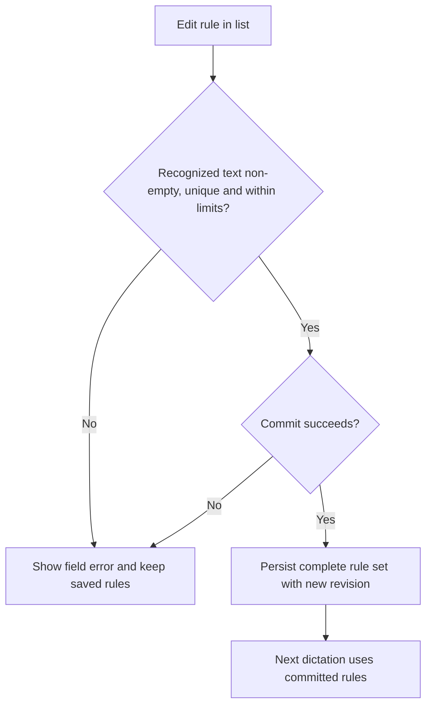
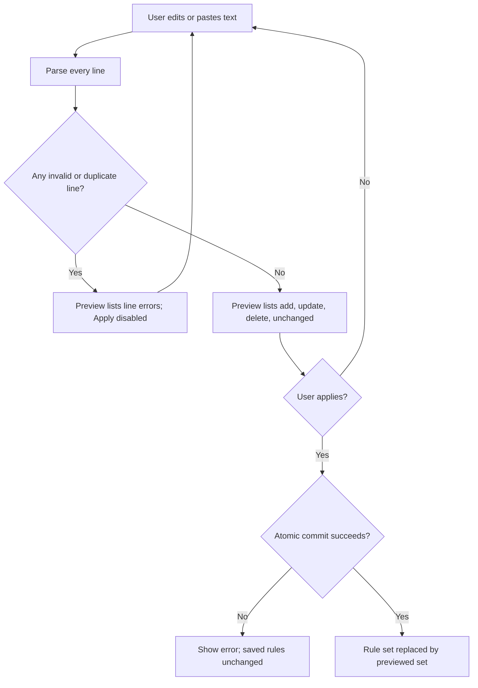
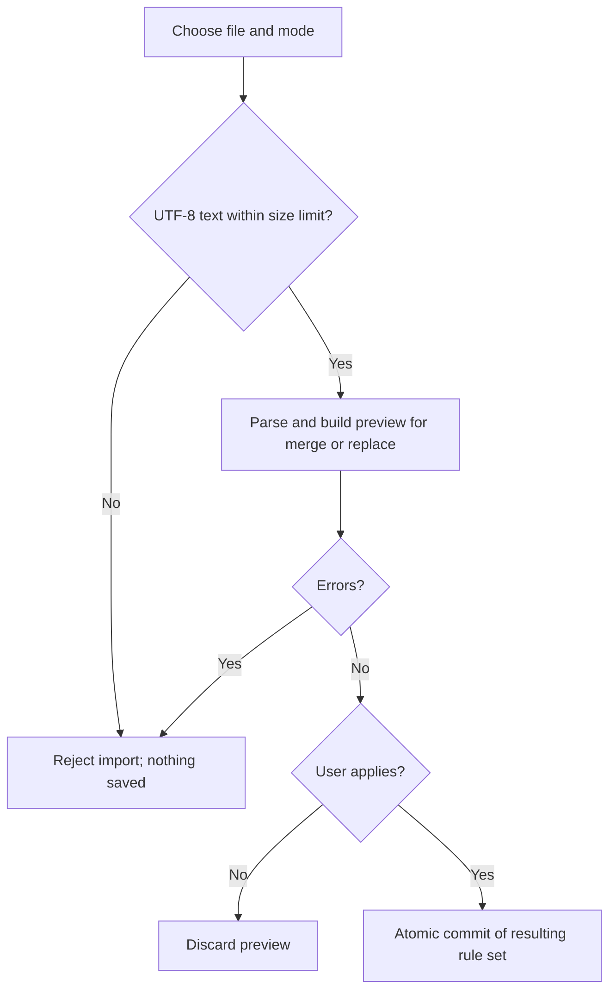
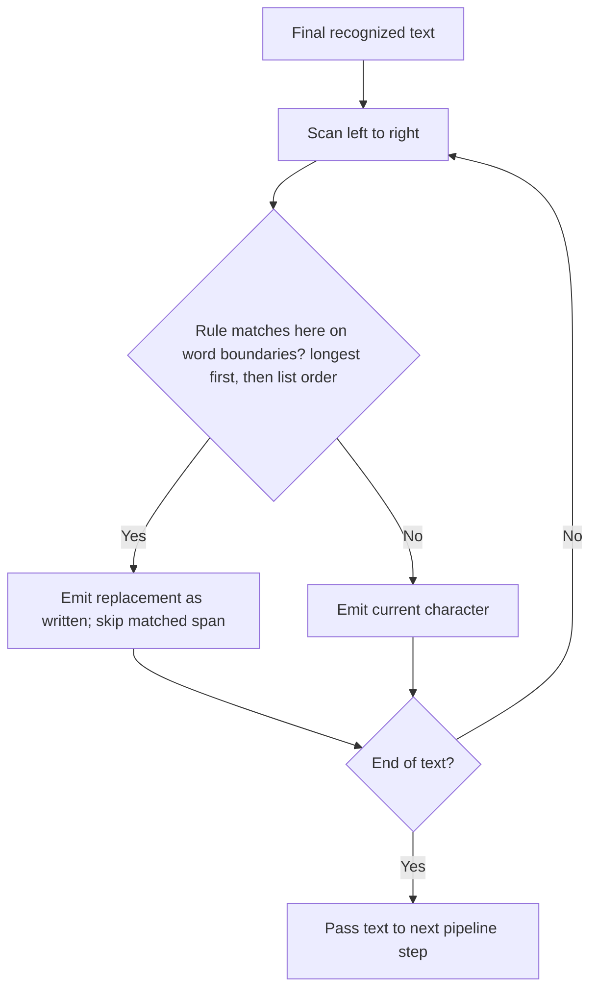
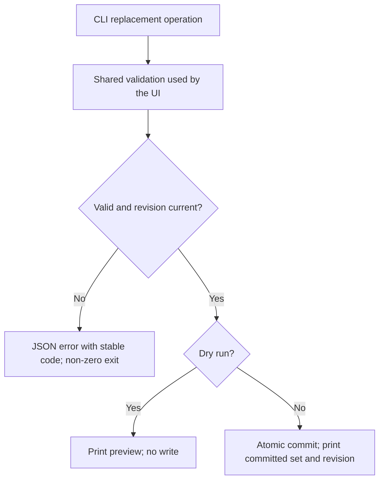

# Feature Spec: Word Replacements

## Header

- **Feature:** Word Replacements
- **Branch:** None — specification only (program specified before `spec-ship`)
- **Date:** 2026-10-12
- **Status:** Planned
- **Input:** Program item 2: explicit rules "recognized text → replacement text", distinct from custom vocabulary. Add, edit and delete rules in a list; paste, import and export many rules at once using a simple two-column format such as `texte_reconnu;remplacement` / `Cloud Code;Claude Code` / `Cloud Sonnet;Claude Sonnet`. Define duplicates, case, whole words and application order. The same capability is available through the CLI (feature 008).
- **Feature Number:** 002

## User Scenarios & Testing

### Story 1 — Maintain replacement rules in a list `P1`

**As a** Handy user, **I want to** add, edit and delete replacement rules, **so that** recurring misrecognitions are corrected in every dictation.

**Priority reason:** Deterministic correction of known misrecognitions is the core value of the feature.
**Independent test:** Add the rule `Cloud Code → Claude Code`, dictate a sentence containing "cloud code", and compare the inserted text and the history entry.

```gherkin
Feature: Replacement rule list
  Scenario: Add a rule and apply it to the next dictation
    Given the rule list is empty
    When the user adds the rule "Cloud Code" to "Claude Code" and saves
    Then the list shows one rule "Cloud Code" to "Claude Code"
    And the next dictation recognized as "open cloud code now" is inserted as "open Claude Code now"
  Scenario: Edit a rule
    Given the rule "Cloud Sonnet" to "Claude Sonet" exists
    When the user changes its replacement to "Claude Sonnet" and saves
    Then the stored rule replaces "Cloud Sonnet" with "Claude Sonnet"
  Scenario: Reject a duplicate recognized text
    Given the rule "Cloud Code" to "Claude Code" exists
    When the user adds the rule "cloud  code" to "Claude-Code"
    Then the rule is rejected because "cloud code" is already defined
    And the saved rule list is unchanged
  Scenario: Delete a rule
    Given the rule "Cloud Code" to "Claude Code" exists
    When the user deletes it, confirms the deletion and saves
    Then the next dictation recognized as "cloud code" is inserted unchanged
```



### Story 2 — Paste or edit many rules as text `P1`

**As a** Handy user, **I want to** paste or edit all rules as two-column text, **so that** I can manage dozens of rules quickly.

**Priority reason:** Bulk editing is an explicit requirement and the main productivity gain over one-by-one entry.
**Independent test:** Paste a block of five lines including a header, a blank line and one invalid line; check the preview, fix the line, apply, then reload the list.

```gherkin
Feature: Bulk text editing of replacement rules
  Scenario: Paste several valid rules
    Given the rule list is empty and the bulk editor is empty
    When the user pastes the lines "texte_reconnu;remplacement", "Cloud Code;Claude Code" and "Cloud Sonnet;Claude Sonnet"
    Then the preview shows the header as ignored and two rules to add
    When the user applies the preview
    Then the saved list contains exactly the rules shown in the preview
  Scenario: Invalid line blocks the whole apply
    Given the bulk editor contains exactly the lines "Cloud Code;Claude Code", "Cloud Sonnet;Claude Sonnet" and "Cloud Opus"
    When the user requests a preview
    Then the preview reports line 3 as invalid with the reason "missing separator"
    And Apply is unavailable until the line is fixed or removed
    And the saved list is unchanged
  Scenario: Duplicate recognized text inside the pasted block
    Given the pasted text contains "Cloud Code;Claude Code" and "cloud code;Claude Code CLI"
    When the user requests a preview
    Then both lines are reported as duplicates of the same recognized text
    And nothing is saved
```



### Story 3 — Import and export rule files `P2`

**As a** Handy user, **I want to** import and export rule files, **so that** I can back up rules, share them and edit them in a spreadsheet.

**Priority reason:** File exchange is requested, but the list and bulk editor already deliver the core capability.
**Independent test:** Export rules to a file, re-import it in merge mode and in replace mode on a different rule set, and compare results.

```gherkin
Feature: Replacement rule files
  Scenario: Export then re-import is lossless
    Given three rules exist
    When the user exports them to a file and imports that file in replace mode
    Then the saved rules equal the exported rules in the same order
  Scenario: Merge import updates and adds
    Given the rule "Cloud Code" to "Claude Code" exists
    And the import file contains "cloud code;Claude Code CLI" and "Open Claw;OpenClaw"
    When the user imports it in merge mode and applies the preview
    Then "Cloud Code" now maps to "Claude Code CLI"
    And "Open Claw" to "OpenClaw" is added at the end of the list
  Scenario: Unreadable file
    Given the selected file is not valid UTF-8 text
    When the user imports it
    Then the import is rejected with an actionable error and nothing is saved
```



### Story 4 — Predictable application to recognized text `P1`

**As a** Handy user, **I want to** know exactly how rules apply, **so that** a rule never corrupts unrelated words.

**Priority reason:** Incorrect matching would silently alter user text in every target application.
**Independent test:** Run the documented matching fixtures (case, word boundaries, overlapping rules, punctuation) against the text pipeline.

```gherkin
Feature: Replacement matching semantics
  Scenario: Case-insensitive match, replacement inserted as written
    Given the rule "cloud code" to "Claude Code" exists
    When the recognized text is "CLOUD CODE, ready."
    Then the output is "Claude Code, ready."
  Scenario: Whole words only
    Given the rule "art" to "ART" exists
    When the recognized text is "smart art"
    Then the output is "smart ART"
  Scenario: A combining mark belongs to its word
    Given the rule "भारत" to "India" exists
    When the recognized text is "भारतीय संविधान"
    Then the output is "भारतीय संविधान"
  Scenario: A zero-width non-joiner belongs to its word
    Given the rule "می" to "X" exists
    When the recognized text is "می‌خواهم", where "می" and "خواهم" are joined by U+200C
    Then the output is "می‌خواهم"
  Scenario: Longest rule wins on overlap
    Given the rules "Cloud" to "Claude" and "Cloud Code" to "Claude Code CLI" exist in that order
    When the recognized text is "cloud code and cloud"
    Then the output is "Claude Code CLI and Claude"
  Scenario: No chaining
    Given the rules "A1" to "B1" and "B1" to "C1" exist
    When the recognized text is "A1"
    Then the output is "B1"
```



### Story 5 — Manage rules from the CLI `P2`

**As an** automation user, **I want to** list, add, update, remove, import and export rules from the CLI, **so that** scripts and agents get the same result as the settings UI.

**Priority reason:** The CLI is the shared configuration surface of the program (008) and must expose this feature from its first version.
**Independent test:** Run every CLI operation with `--json` against an isolated settings store, then compare with UI readback.

```gherkin
Feature: Replacement rules through the settings CLI
  Scenario: Import with dry run
    Given a file with two valid rules
    When the user runs the replacement import operation with dry run and JSON output
    Then stdout contains the preview with two additions
    And the saved rules are unchanged
  Scenario: Invalid rule through the CLI
    When the user adds a rule with an empty recognized text
    Then the command exits with the documented validation exit code
    And stdout contains a JSON error with a stable code
    And the saved rules are unchanged
```



## Acceptance Criteria

### AC-001

**Criterion:** The settings UI lists rules in their saved order with recognized and replacement text, and supports add, edit and delete (delete asks for confirmation). Add, edit and delete change a draft; Save persists the complete rule set once; a restart shows the same rules in the same order. The list view and the bulk text view edit the same draft: switching view with unsaved changes asks the user to save or discard them first.
**Priority:** P1 | **Story:** Story 1

### AC-002

**Criterion:** A rule is valid when the trimmed recognized text has 1–100 characters, contains no line break, tab or `;`, and does not start with `#`; and the trimmed replacement has 1–500 characters and contains no line break or tab. Recognized text is unique by its normalized key (trimmed, inner whitespace collapsed to one space, Unicode case-folded). Invalid or duplicate input is rejected with a field error and no partial write. The rule set holds at most 1000 rules.
**Priority:** P1 | **Story:** Stories 1 and 2

### AC-003

**Criterion:** The bulk editor shows all rules as text in the exchange format, accepts pasted text, and shows a line-by-line preview (add, update, delete, unchanged, ignored, error) before applying. Any error line disables Apply. Applying replaces the saved set with exactly the previewed set in one commit.
**Priority:** P1 | **Story:** Story 2

### AC-004

**Criterion:** The exchange format is UTF-8 text with one rule per line. A line containing a tab splits on its first tab; otherwise it splits on its first `;`. Blank lines and lines starting with `#` are ignored. The first line that is neither blank nor a comment is ignored as a header when its two fields, split like a rule line and trimmed, equal case-insensitively `texte_reconnu` and `remplacement` or `recognized` and `replacement`, whatever the separator (tab or `;`). Export writes the header `recognized;replacement`, then one `recognized;replacement` line per rule in list order; because AC-002 forbids tab, `;` and a leading `#` in recognized text and tab in replacements, every valid rule set round-trips. Replacement text may contain `;`. CSV quoting is not supported; spreadsheet copy and paste uses the tab separator.
**Priority:** P1 | **Story:** Stories 2 and 3

### AC-005

**Criterion:** Import accepts a file up to 1 MB (1,000,000 bytes, inclusive) in merge or replace mode. Merge updates the replacement of rules whose normalized key matches, keeps their position, and appends new rules in file order. Replace makes the file content the whole rule set in file order. Duplicate keys inside one file or block are errors. Import is atomic: on any error, unreadable file or persistence failure, saved rules are unchanged. Export then replace-import of the same file reproduces the same rules and order.
**Priority:** P2 | **Story:** Story 3

### AC-006

**Criterion:** Matching is case-insensitive (Unicode case folding) and the replacement is inserted exactly as written. A match must start and end on word boundaries: the characters immediately before and after the match are not word characters, or are the text edges. A word character is a Unicode letter, a decimal digit, a combining mark (General_Category Mn, Mc or Me) or a zero-width non-joiner or joiner (U+200C, U+200D), so a rule never replaces a word fragment, including in Indic scripts (dependent vowel signs, virama), next to a decomposed (NFD) accent and inside a Persian or Urdu word joined by a zero-width non-joiner. On a side where the recognized text begins or ends with a CJK ideograph, kana or hangul character, the boundary check ignores neighbouring base characters, because those scripts are written without spaces; a combining mark immediately next to the match still blocks it on that side. A whitespace run inside the recognized text matches any non-empty whitespace run; other characters match literally. Punctuation adjacent to a match is kept.
**Priority:** P1 | **Story:** Story 4

### AC-007

**Criterion:** Rules apply in one left-to-right pass over the final recognized text. At each position the rule with the longest normalized key wins; ties follow list order. A matched span is replaced and scanning continues after it; replacement output is never rescanned (no chaining). Rules apply after speech recognition, language detection and Chinese script conversion, and before the existing approximate custom-word correction, filler removal, normalization and AI post-processing. Approximate correction never alters a span produced by a replacement. The text handed to AI post-processing and the history transcription text include the replacements; without AI post-processing, the inserted text includes them too. Text rewritten by AI post-processing is outside this guarantee. Rules committed from the UI or the CLI apply from the next dictation of the running app. An empty rule set leaves text unchanged.
**Priority:** P1 | **Story:** Story 4

### AC-008

**Criterion:** The settings CLI (008) offers list, add, update, remove, import (merge/replace, dry run, file or stdin) and export (file or stdout) for rules, using the same validation, preview and atomic commit as the UI. With JSON output, stdout contains only JSON; errors carry stable codes and non-zero exit codes; a stale expected revision returns a conflict without writing.
**Priority:** P2 | **Story:** Story 5

## Behavioral AC

Signals extracted: form, validation, list, edit, delete, confirm dialog, unsaved changes, import, export, textarea, preview, loading, keyboard navigation. Official `detect_traits` returned async_action, has_dirty_state, has_validation, is_keyboard_navigable, is_submittable.

### async_action

```gherkin
Feature: Replacement rule asynchronous commits
  Scenario: Commit in progress
    Given the user applies a valid preview
    When the commit is in progress
    Then the Apply control is busy and cannot dispatch another commit
    And the Apply control matches visual state "loading"
  Scenario: Commit failure
    Given the commit failed without saving
    When the user inspects the editor
    Then the previous saved rules remain displayed with an actionable error and retry
    And the editor matches visual state "error"
  Scenario: Commit success
    Given the commit succeeded
    When the editor receives the new revision
    Then the saved rules are displayed with a confirmation
    And the editor matches visual state "success"
  Scenario: Idle editor
    Given no commit is pending
    When the user opens the rule editor
    Then the editor matches visual state "idle"
```

### has_dirty_state

<!-- WARNING: No visual states defined for trait "has_dirty_state" in ui-behavioral-taxonomy.md -->

```gherkin
Feature: Unsaved replacement edits
  Scenario: Dirty indicator after edit
    Given the rule editor shows the saved rules
    When the user edits a replacement field or the bulk text
    Then an "unsaved changes" indicator appears
    And Save or Apply becomes enabled
  Scenario: Leaving with unsaved edits
    Given the rule editor has unsaved changes
    When the user navigates to another settings section
    Then a warning lets the user stay or discard the changes
```

### has_validation

```gherkin
Feature: Replacement rule validation
  Scenario: Empty recognized text
    Given the recognized field is empty
    When the user inspects the add form
    Then Add is unavailable with an accessible explanation
    And the recognized field matches visual state "empty"
  Scenario: Duplicate recognized text
    Given the recognized text duplicates an existing rule key
    When the user leaves the field
    Then an error explains that each recognized text may appear once
    And the recognized field matches visual state "invalid"
  Scenario: Corrected field
    Given a duplicate error is displayed
    When the user enters a unique recognized text
    Then the error clears
    And the recognized field matches visual state "valid"
```

### is_keyboard_navigable

<!-- WARNING: No visual states defined for trait "is_keyboard_navigable" in ui-behavioral-taxonomy.md -->

```gherkin
Feature: Keyboard rule editing
  Scenario: Tab traversal
    Given the replacement settings are open
    When the user presses Tab through the list, add form, bulk editor and import/export controls
    Then each enabled control receives visible focus in reading order
  Scenario: Keyboard delete
    Given the delete control of a rule has focus
    When the user presses Enter and confirms with the keyboard
    Then the rule is removed and focus moves to the next rule or the add form
```

### is_submittable

```gherkin
Feature: Commit replacement rules
  Scenario: Valid changes enable Save
    Given the user has a valid changed rule set
    When the user inspects Save
    Then Save matches visual state "enabled"
  Scenario: Invalid changes disable Save
    Given the draft contains an invalid rule
    When the user inspects Save
    Then Save is disabled with validation errors
    And Save matches visual state "disabled"
  Scenario: Submission in progress
    Given the user activates Save with a valid rule set
    When the commit is pending
    Then Save matches visual state "loading"
```

## Functional Requirements

### FR-001

**Requirement:** Persist an ordered, uniquely keyed set of replacement rules separate from custom words/vocabulary, with add, edit, delete and confirmation in the existing settings UI.
**AC References:** AC-001, AC-002

### FR-002

**Requirement:** Validate rules and rule sets with one shared typed validator (lengths, forbidden characters and leading `#`, normalized-key uniqueness, set size) used by UI, bulk editor, import and CLI.
**AC References:** AC-002, AC-005, AC-008

### FR-003

**Requirement:** Parse and serialize the two-column exchange format, including header, comments, blank lines and tab or semicolon separator, with line-numbered diagnostics.
**AC References:** AC-003, AC-004

### FR-004

**Requirement:** Compute a preview (add, update, delete, unchanged, ignored, error) for bulk text and file imports in merge or replace mode, and commit the resulting set atomically with a settings revision.
**AC References:** AC-003, AC-005

### FR-005

**Requirement:** Apply rules to final recognized text with case-insensitive, whole-word, whitespace-tolerant, longest-first, single-pass, non-chaining semantics, at the specified pipeline position, and protect replaced spans from approximate correction.
**AC References:** AC-006, AC-007

### FR-006

**Requirement:** Expose list, add, update, remove, import (with dry run) and export operations through the settings CLI with JSON output, stable error codes and revision conflict handling.
**AC References:** AC-008

## Key Entities

| Entity | Description | Key fields |
|---|---|---|
| Replacement rule | One explicit correction | stable id, recognized text, replacement text, normalized key, position |
| Replacement rule set | Ordered persisted collection | rules, settings revision |
| Import preview | Result of parsing text or a file against the saved set | mode, per-line status and reason, resulting rule set |

## Clarifications

- Distinction: replacement rules are explicit, deterministic text rules applied after recognition. Custom words (and the vocabulary of 003) influence recognition or approximate correction; they are not replacement rules.
- `[ASSUMED]` Matching has no per-rule case option: always case-insensitive, replacement inserted as written. This keeps the two-column exchange format lossless.
- `[ASSUMED]` Empty replacements are invalid; deleting words is covered by the existing filler-word removal, not by this feature.
- `[ASSUMED]` Limits: 1000 rules, 100 characters recognized, 500 characters replacement, 1 MB import. They bound UI rendering and per-dictation matching cost.
- `[ASSUMED]` Rules apply to the final transcript only; the live streaming preview may show unreplaced text.
- Rule ids are stable for UI/CLI edits; the exchange format does not carry ids. Merge matches by normalized key.
- Program context: specified in list order (001–010); the settings CLI foundation (008) ships first and owns the revision and JSON error contract.

- Decision `` / `placeholders:- Planned `flow_id: word-replacements`, `screen_id: replacement-settings`. The Penflow workspace is `incomplete` on 2026-10-12; the forward contract, semantic and test IDs are produced in the single pass before `spec-ship`: [NEEDS CLARIFICATION] until then. No inspection READY or certification PASS is claimed.`: User decision 2026-10-12 (lightweight UI contract): Penflow flow/screen contracts, semantic and test IDs and Pencil mockups for all program features are produced in one pass before spec-ship; until then the planned flow_id and screen_id above are authoritative and no inspection READY or certification PASS is claimed.
<!-- livespec-clarification:{"requirement_id": "", "decision_key": "placeholders:- Planned `flow_id: word-replacements`, `screen_id: replacement-settings`. The Penflow workspace is `incomplete` on 2026-10-12; the forward contract, semantic and test IDs are produced in the single pass before `spec-ship`: [NEEDS CLARIFICATION] until then. No inspection READY or certification PASS is claimed.", "evidence_hash": "60177e7db83c98006a89d753b5518c4788a2eb2b8d860901fc70f5faaffac0b6", "answer": "User decision 2026-10-12 (lightweight UI contract): Penflow flow/screen contracts, semantic and test IDs and Pencil mockups for all program features are produced in one pass before spec-ship; until then the planned flow_id and screen_id above are authoritative and no inspection READY or certification PASS is claimed."} -->

- Decision `002-word-replacements:AC-006` / `decision:ac-006:word-character-includes-combining-marks`: Orchestrator decision 2026-10-13 (independent audit finding 1): for AC-006 word boundaries a word character is a Unicode letter, a decimal digit or a combining mark (General_Category Mn, Mc or Me), checked on both sides of the match. A rule therefore never replaces a word fragment, including Indic scripts (dependent vowel signs, virama) and decomposed (NFD) accents. The side-by-side CJK exemption is unchanged.
<!-- livespec-clarification:{"requirement_id": "002-word-replacements:AC-006", "decision_key": "decision:ac-006:word-character-includes-combining-marks", "evidence_hash": "78e1693c5b19e28640a96965d2c4657aa7b18ec31fee4aebc1cccd4eb7167638", "answer": "Orchestrator decision 2026-10-13 (independent audit finding 1): for AC-006 word boundaries a word character is a Unicode letter, a decimal digit or a combining mark (General_Category Mn, Mc or Me), checked on both sides of the match. A rule therefore never replaces a word fragment, including Indic scripts (dependent vowel signs, virama) and decomposed (NFD) accents. The side-by-side CJK exemption is unchanged."} -->

- Decision `002-word-replacements:AC-006` / `decision:ac-006:join-controls-are-word-characters`: Orchestrator decision 2026-10-13 (independent re-audit finding N1): U+200C ZERO WIDTH NON-JOINER (ZWNJ) and U+200D ZERO WIDTH JOINER (ZWJ) count as word characters for AC-006 boundaries, like letters, decimal digits and combining marks. A rule therefore never replaces a morpheme joined by ZWNJ inside a Persian or Urdu word: the rule می to X leaves می‌خواهم unchanged.
<!-- livespec-clarification:{"requirement_id": "002-word-replacements:AC-006", "decision_key": "decision:ac-006:join-controls-are-word-characters", "evidence_hash": "f353743efecbc2ee996f1892ee85cdbde313de5372be65abb97be4b1d7563a60", "answer": "Orchestrator decision 2026-10-13 (independent re-audit finding N1): U+200C ZERO WIDTH NON-JOINER (ZWNJ) and U+200D ZERO WIDTH JOINER (ZWJ) count as word characters for AC-006 boundaries, like letters, decimal digits and combining marks. A rule therefore never replaces a morpheme joined by ZWNJ inside a Persian or Urdu word: the rule می to X leaves می‌خواهم unchanged."} -->

- Decision `002-word-replacements:AC-006` / `decision:ac-006:cjk-exemption-applies-to-base-characters`: Orchestrator decision 2026-10-13 (independent re-audit finding N3): the CJK side exemption applies to base characters only. A combining mark immediately next to the matched text still blocks the match, even on a CJK side. The rule か to X leaves が (が in NFD) unchanged, while the rule か to X in あかい keeps its current behavior (あXい).
<!-- livespec-clarification:{"requirement_id": "002-word-replacements:AC-006", "decision_key": "decision:ac-006:cjk-exemption-applies-to-base-characters", "evidence_hash": "d9e03d7e67724263db30fd1acf360c0a3968341a46d37b7509b959e8ad06c32e", "answer": "Orchestrator decision 2026-10-13 (independent re-audit finding N3): the CJK side exemption applies to base characters only. A combining mark immediately next to the matched text still blocks the match, even on a CJK side. The rule か to X leaves が (が in NFD) unchanged, while the rule か to X in あかい keeps its current behavior (あXい)."} -->

- Decision `002-word-replacements:AC-006` / `decision:ac-006:emoji-variation-selector-accepted-false-negative`: Orchestrator decision 2026-10-13 (independent re-audit finding N4): behavior is unchanged. A variation selector (General_Category Mn, for example U+FE0F after an emoji) is a combining mark, so it blocks a match next to it. This false negative is accepted and documented in Edge Cases; it never corrupts text, and a rule written with the selector still matches.
<!-- livespec-clarification:{"requirement_id": "002-word-replacements:AC-006", "decision_key": "decision:ac-006:emoji-variation-selector-accepted-false-negative", "evidence_hash": "f353743efecbc2ee996f1892ee85cdbde313de5372be65abb97be4b1d7563a60", "answer": "Orchestrator decision 2026-10-13 (independent re-audit finding N4): behavior is unchanged. A variation selector (General_Category Mn, for example U+FE0F after an emoji) is a combining mark, so it blocks a match next to it. This false negative is accepted and documented in Edge Cases; it never corrupts text, and a rule written with the selector still matches."} -->

- Decision `002-word-replacements:AC-005` / `decision:ac-005:one-megabyte-is-decimal-bytes`: Orchestrator decision 2026-10-13 (spec review ambiguity): 1 MB means 1,000,000 bytes, inclusive, which is the implemented import cap.
<!-- livespec-clarification:{"requirement_id": "002-word-replacements:AC-005", "decision_key": "decision:ac-005:one-megabyte-is-decimal-bytes", "evidence_hash": "562f4f5406c3da22cbe5651f3a8bfabf6ad4427c69b52d0c6a2207025660fa25", "answer": "Orchestrator decision 2026-10-13 (spec review ambiguity): 1 MB means 1,000,000 bytes, inclusive, which is the implemented import cap."} -->

- Decision `002-word-replacements:AC-004` / `decision:ac-004:header-recognized-with-either-separator`: Orchestrator decision 2026-10-13 (spec review ambiguity): the header is recognized whatever its separator, tab or semicolon. The first content line is a header when its two fields, split like a rule line and trimmed, equal case-insensitively the header names, so a header copied from a spreadsheet is not imported as a rule.
<!-- livespec-clarification:{"requirement_id": "002-word-replacements:AC-004", "decision_key": "decision:ac-004:header-recognized-with-either-separator", "evidence_hash": "75f8bcf0d4c5991f8e99b7e7b25545ac301be78001f688aef5a9e8af47265f8d", "answer": "Orchestrator decision 2026-10-13 (spec review ambiguity): the header is recognized whatever its separator, tab or semicolon. The first content line is a header when its two fields, split like a rule line and trimmed, equal case-insensitively the header names, so a header copied from a spreadsheet is not imported as a rule."} -->

- Decision `002-word-replacements:AC-007` / `decision:ac-007:inserted-text-guarantee-before-ai-post-processing`: Orchestrator decision 2026-10-13 (spec review ambiguity): the guarantee covers the text handed to AI post-processing, which includes the replacements; it does not cover the text that the AI rewrites. Without AI post-processing, the inserted text and the history transcription text include the replacements.
<!-- livespec-clarification:{"requirement_id": "002-word-replacements:AC-007", "decision_key": "decision:ac-007:inserted-text-guarantee-before-ai-post-processing", "evidence_hash": "2bbca261cdf84b815f692cab139ad0f5cf66d8b52b4a9c5c026040ad8c0c048e", "answer": "Orchestrator decision 2026-10-13 (spec review ambiguity): the guarantee covers the text handed to AI post-processing, which includes the replacements; it does not cover the text that the AI rewrites. Without AI post-processing, the inserted text and the history transcription text include the replacements."} -->

## QE Analysis

- **Criticality:** High; **Blast radius:** Every dictation output; **Primary risk:** Silent text corruption; **Confidence:** Medium (pipeline source mapped, nothing executed).
- **Dimensions:** Functional correctness, data integrity, API/contract compatibility, performance, accessibility/UX, internationalization, security (file import).
- **P0 gates/evidence:** Table-driven matching tests for every AC-006/AC-007 rule (case, Unicode, boundaries, whitespace, punctuation, overlap, no chaining); parser/serializer round-trip and diagnostics tests; atomic import tests with injected persistence failure; UI/CLI equivalence tests.
- **P1 gates/evidence:** Keyboard and dirty-state UI checks; i18next keys; bulk editor with 1000 rules stays responsive; settings UI visual gate.
- **Non-functional expectations:** Matching 1000 rules over a 2000-character transcript adds under 20 ms in a release build on an Apple M1 Mac; import parsing never executes content; no rule text is written to logs above debug level.
- **Missing evidence:** No test executed; no mockup (deferred before `spec-ship`); revision contract owned by 008 not yet specified.
- **Boundary:** QE defines risk and test sufficiency; the independent review judges requirements; Penflow governs UI design evidence; spec-test executes runtime proof.

## Screens

| Screen | Status | Reference |
|--------|--------|-----------|
| replacement-settings | New | Mockup to produce before `spec-ship` (user decision 2026-10-12: lightweight UI contract during specification) |

- Settings section with the rule list, add form, bulk text editor with preview, and import/export controls.

## Penflow Contract

- Planned `flow_id: word-replacements`, `screen_id: replacement-settings`. The Penflow workspace is `incomplete` on 2026-10-12; the forward contract, semantic and test IDs are produced in the single pass before `spec-ship`: [NEEDS CLARIFICATION] until then. No inspection READY or certification PASS is claimed.

## Edge Cases

- Rule whose replacement contains its own recognized text ("Code" → "Claude Code"): single pass, no infinite expansion.
- Recognized text with accents or non-Latin letters: Unicode case folding applies; boundaries follow AC-006, including the CJK exception. Combining marks (Indic vowel signs and virama, decomposed accents) and the zero-width non-joiner and joiner (U+200C, U+200D, used inside Persian and Urdu words and in joined sequences) are word characters, so a rule never matches part of a word.
- CJK side next to a combining mark: the CJK exemption ignores neighbouring base characters only. The rule "か" to "X" leaves "が" written in NFD ("か" followed by U+3099) unchanged, while it still turns "あかい" into "あXい".
- Emoji variation selector (accepted false negative): a variation selector such as U+FE0F is a combining mark, so it blocks a match next to it. The rule "ok" to "X" leaves "❤️ok" unchanged, and the rule "❤" to "love" does not match "❤️" (U+2764 U+FE0F). No text is ever corrupted; a rule written with the selector ("❤️" to "love") matches.
- Header copied from a spreadsheet: a tab-separated first line `recognized<TAB>replacement` or `texte_reconnu<TAB>remplacement` is ignored as a header, like its `;` form (AC-004).
- Recognized text containing punctuation ("C++"): matched literally; boundaries are checked on the characters around the whole match.
- Import file with Windows line endings or a UTF-8 BOM: CRLF and a leading BOM are accepted.
- Settings changed by the CLI while the UI editor has unsaved edits: UI Save returns a revision conflict and offers reload.
- Very long transcript: matching remains linear in text length times rule count, within the stated budget.

## Success Criteria

### SC-001

All AC-006/AC-007 matching fixtures pass, including at least 30 table-driven cases covering case, Unicode, boundaries, whitespace, punctuation, overlap and no chaining.

### SC-002

Export followed by replace-import reproduces an identical rule set for fixtures of 1, 100 and 1000 rules, through both UI and CLI.

### SC-003

No partial rule set is ever persisted in fault-injection tests (parse errors, duplicate keys, persistence failure, stale revision).
