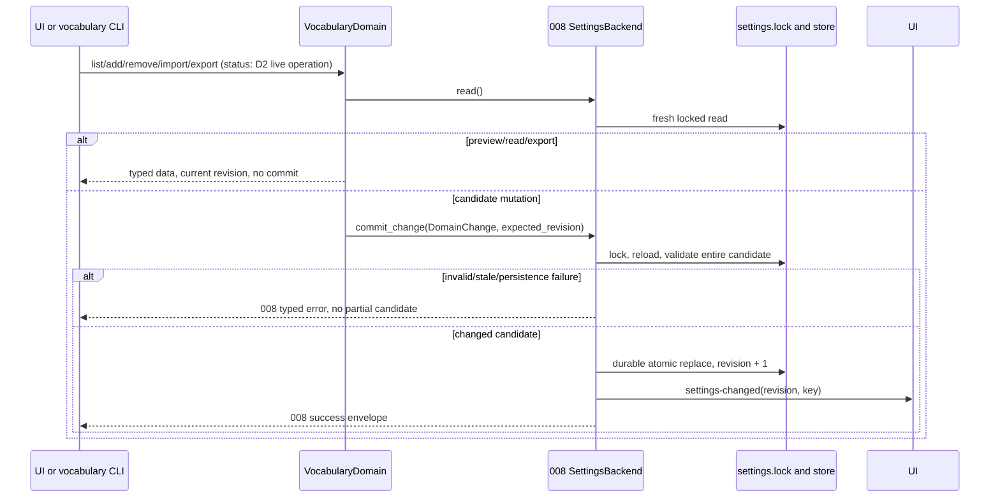
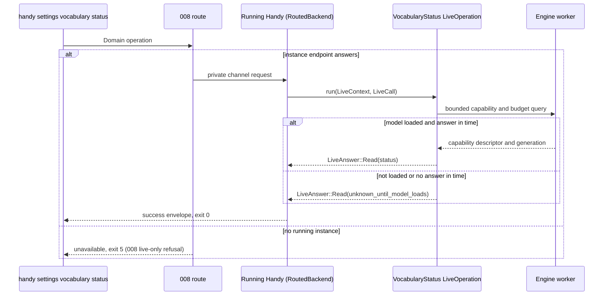
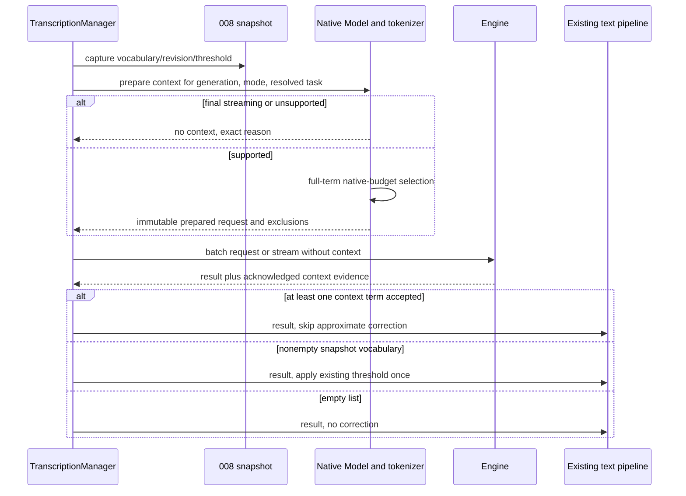
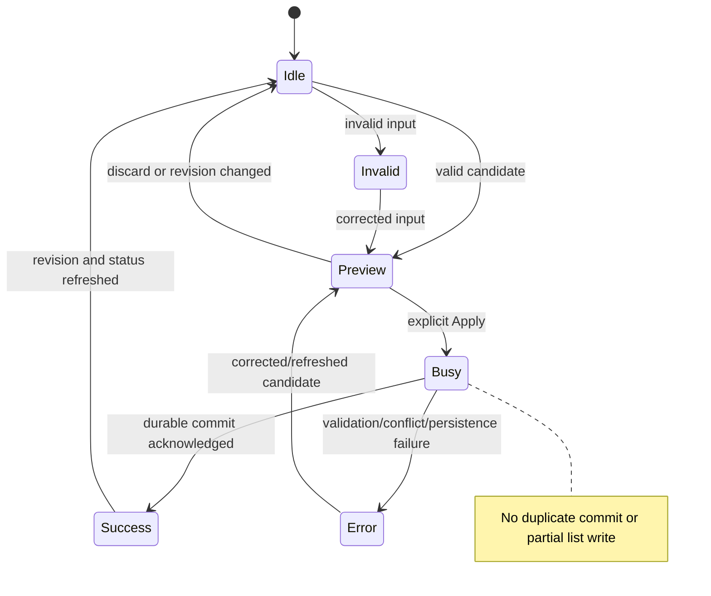

# Implementation Plan: Recognition Vocabulary

## Summary

Reuse `custom_words` as the single ordered vocabulary, validate and commit through 008's transaction service, and derive recognition context, truthful status and approximate-correction routing from one capability-aware per-recognition snapshot.

Inspect [the functional source](spec.md) for five FR, seven AC and three SC. Scope **M**, with two entities and worker/CLI interactions; migration and shared recognition risks require an early adapter spike. 008 is merged in `dev` (`e9f96df`). The CLI step also depends on **step 0 of 006**, which extends the 008 framework with live domain operations (D2) and typed error details (D3); see [Shared CLI and local contracts](#shared-cli-and-local-contracts). This is a plan only: no application code, model download, mockup, commit or push. No new cloud infrastructure or database table; ER is unnecessary because both entities reuse settings or are volatile DTOs.

## Technical Context

| Aspect | Choice | Current evidence / reason |
|---|---|---|
| Native | Rust 2021, Tauri 2.11.5, existing managers and engine worker | Stack and Cargo manifest |
| Recognition | transcribe-cpp 0.3.1, ONNX-only transcribe-rs 0.3.8 | Cargo.lock/manifests; preserve supervisor isolation/cancellation |
| Frontend | React 18, TypeScript ~5.6.3, Zustand, i18next, existing Tailwind/CSS | Stack and package scripts; no new UI framework |
| Settings | Existing `custom_words: Vec<String>` and `word_correction_threshold` | No second list, new key or threshold migration |
| Transaction | Merged 008 (`e9f96df`): `domains::{Domain, DomainPlan, DomainChange, ChangeKind::Apply}`, `SettingsBackend::commit_change` (routed: `sequence::write_change`; offline: `SettingsRepository::commit_edit_with_probe`), `tauri_adapter` for UI writes, `effects.rs` live effects | Fresh locked edit, durable revision, `settings-changed` event and private local routing; `custom_words` has no live effect (read at use), which AC-006 needs |
| Domain framework | 008 `settings_service/domains/mod.rs` (`Domain::plan` is pure: no I/O, no live effect), `input.rs::read_source`, `render.rs` (`View::Export`), `cli.rs` and `crate::cli` clap types | Add one registered vocabulary domain, no new transport/envelope/lock; the live status uses the D2 live operations of 006 step 0 (see [Shared CLI and local contracts](#shared-cli-and-local-contracts)) |
| Text validation | Rust-authoritative Unicode scalar count and full default case fold | One shared validator for UI, worker selection and CLI; pin a small Unicode case-fold dependency after version/license check |
| Test levels | Cargo unit/integration/process, Bun UI adapter, Playwright, manual native model proof | Tool availability and actual runtime proof remain separate |

Inspect [008's implementation record](../008-settings-cli/implementation.md) and the merged `src-tauri/src/settings_service/` as the authority for names; [008's foundation plan](../008-settings-cli/plan.md) is historical context only, and names it announced but did not ship (`commit_mutation`, `LiveSettingsEffects`) are not used here. Inspect [recognition](../../../src-tauri/src/managers/transcription.rs), [worker protocol](../../../src-tauri/src/engine_supervisor/protocol.rs), [worker](../../../src-tauri/src/engine_supervisor/worker.rs), [supervisor](../../../src-tauri/src/engine_supervisor/supervisor.rs), [settings](../../../src-tauri/src/settings.rs), [custom words UI](../../../src/components/settings/CustomWords.tsx), [settings commands](../../../src-tauri/src/shortcut/mod.rs) and [text correction](../../../src-tauri/src/audio_toolkit/text.rs). These are descriptive context, not additional business requirements.

## Constitution Check

| Principle | Gate / decision |
|---|---|
| Preserve native/frontend boundary | PASS: Rust owns validation, effect selection and commit; React presents typed results and translations |
| Derive stack/managers from manifests | PASS: retain engines, worker, manager, settings and existing UI tooling |
| Tool availability is not application proof | PASS: test commands resolved below; native sample, UI, timing and worker-boundary results required later |
| Specify before implementation | PASS: reviewed current spec and plan progression precede code; no semantic spec changes in this command |
| Simplicity/separation | PASS: one list/service/domain; no engine list hardcoded in UI, no HTTP service, no new history schema |
| Naming | PASS: Rust snake_case and existing React filenames follow project/language authority; Markdown kebab-case |
| Project conventions versus generic presets | PASS: keep Bun, Cargo, clap, ESLint and Prettier; no Commander/Biome/Vitest migration |
| Meaningful tests and input safety | PASS: test real validator/service; fake only capability/tokenizer/engine ports and fault I/O; no secret/raw term logging |
| i18n | PASS: every UI label, status, issue, retry and explanatory sentence uses English-source translation keys, French translation and existing locale workflow |

## Requirement Inventory and Scope

| Requirement | Acceptance / measurable outcome | Steps |
|---|---|---|
| FR-001 | AC-001/002/006; ordered editing, preview, legacy preservation, next recognition | 2, 3, 5, 6 |
| FR-002 | AC-003/005; SC-001, five statuses from selected loaded capabilities and actual mode/task | 1, 3, 5, 6 |
| FR-003 | AC-004; documented mechanism budget, ordered full terms, truthful sent/not-sent | 1, 3, 6 |
| FR-004 | AC-005/006; actual-send predicate, empty disables fallback, streaming fallback | 3, 6 |
| FR-005 | AC-007; six CLI operations, shared validation, revision and error mapping | 2, 4, 6 |
| SC-002 | Exact term bytes/order and threshold before/after upgrade | 2, 6 |
| SC-003 | Frozen real audio says Claude Code; model id and correct output archived | 1, 6 |

Vocabulary does not implement 002 replacements or 005 AI prompts. Approximate correction remains at the existing post-recognition stage before replacement rules where 002 installs them; keep fillers/script conversion/normalization ordering and avoid running correction twice. Insertion destination (006/009), insertion method and clipboard (007) remain separate consumers of resulting text. Configuration/context receipt proves neither insertion attempted nor text verified. Existing history is saved only when `wav_saved` and `HistoryManager::save_entry` succeed in actions.rs; native sample evidence must save its own audio/output artifacts, never rely on unconditional history conservation.

## Architecture Decisions

### Ordered storage, Unicode and legacy data

`custom_words` remains the serialized list. Loading, upgrading and listing never normalize or prune old entries; threshold and unrelated/unknown settings fields are preserved through 008. Use stable occurrence indices within the base revision to identify legacy duplicate rows; no persisted IDs required. Remove one occurrence, not every equal string. Preview validation reports per-line `index`, normalized key and stable issue reason.

New terms: reject embedded CR, LF, U+0085, U+2028 and U+2029 before whitespace processing; trim Unicode White_Space, collapse remaining Unicode whitespace to ASCII space, count Unicode scalar values on the trimmed text before collapse, require 1–100, and reject `<`, `>`, double quote and NUL (native C-string safety). Apostrophe remains allowed. Preserve accents, case and compatibility distinctions; the uniqueness key is trimmed/whitespace-collapsed **full default Unicode case fold**, non-Turkic, with no NFC/NFKC transformation. `Straße` and `STRASSE` collide; composed/decomposed accents do not silently converge. Rust is authoritative: frontend never uses UTF-16 `.length` or `toLowerCase()` for business validation. Pin casefold Unicode table version and whitespace version together in tests; cached preview becomes stale on input/revision change.

Direct add of a duplicate fails atomically. Bulk paste/import first prepares a candidate: keep the first spelling/order, report later duplicates as skipped non-errors, and require explicit UI Apply or explicit CLI import to commit the complete candidate. Any invalid new line, capacity error or stale revision rejects the entire candidate; never save the valid subset while an invalid line remains. Ignore trailing line terminator, treat interior blank lines as invalid, normalize CRLF separators for bulk input. Merge retains existing bytes/order and appends new unique terms; replace is explicit and replaces the full list with the validated preview. Empty replace clears; empty merge is no-op. Preview is pure and valid dry-run changes no disk, revision, model or events.

Grandfather only unchanged legacy occurrences, including invalid/duplicate/over-500 lists. Flag them individually; exclude invalid terms and later duplicate keys from recognition context, retain first valid occurrence in order. Entries beyond the first 500 stored positions are marked over-capacity/excluded until the user reduces the list; never silently delete them. New adds/merge are refused while count exceeds 500. Remove-only mutations can reduce a legacy over-capacity list even before it reaches 500; unrelated settings mutations preserve the legacy exemption. Edited/new occurrences and explicit replace must satisfy current validity, uniqueness and ≤500. Apply the same identity-aware validator inside the domain's `ChangeKind::Apply` edit, which 008 reruns on the locked latest settings (`SettingsBackend::commit_change`), so legacy exemptions cannot be asserted by an untrusted caller. Keep existing approximate-correction algorithm/threshold, using the preserved nonempty snapshot list on fallback; native-context safety filtering must not silently rewrite legacy storage or broaden this feature into a correction-algorithm change.

### Capabilities and mechanism budgets

The worker owns the loaded native Model, tokenizer and session; `LoadedInfo` currently sends only `supports_initial_prompt` plus capabilities. Extend it with actual `Feature::Vocabulary`, `Feature::ContextPrompt`, extension acceptance, model generation and a versioned context descriptor. ONNX adapters declare no context for their current APIs. Family names choose a request encoding/budget adapter only after positive capability probes; they never decide support in the UI or via the catalog. Probe the selected loaded model, not a temporary command-line model override. A stale descriptor is discarded after load/unload/model switch/worker restart.

Inspect [versioned prompting documentation](https://raw.githubusercontent.com/handy-computer/transcribe.cpp/v0.3.1/docs/prompting.md), [public capability API](https://raw.githubusercontent.com/handy-computer/transcribe.cpp/v0.3.1/include/transcribe.h) and [native fitting helper](https://raw.githubusercontent.com/handy-computer/transcribe.cpp/v0.3.1/src/transcribe-prompting.cpp) as technical context. They establish capability probes, task restrictions and whole-tail term dropping; they do not supply one universal numeric budget.

| Mechanism | Encoding and budget policy | Source / readiness gap |
|---|---|---|
| Whisper initial prompt | Prefer existing `RunExtension::Whisper(WhisperRunOptions { initial_prompt: ... })` only if InitialPrompt + Whisper extension accepted. Render comma-space terms, tokenize complete rendered candidates with loaded model. Budget **223 tokens** = `n_text_ctx / 2 − 1` with the Whisper text context `n_text_ctx = 448`; include separators. No generic vocabulary/prompt at the same time | Engine source: the [OpenAI Whisper reference decoder](https://github.com/openai/whisper/blob/main/whisper/decoding.py) keeps at most `n_ctx // 2 - 1` prompt tokens after the start-of-previous token, and [whisper.cpp](https://github.com/ggml-org/whisper.cpp/blob/master/src/whisper.cpp) keeps at most `n_text_ctx / 2` past-prompt tokens (`whisper_full_with_state`), dropping the oldest ones. 223 is the smaller of the two, so no rendered term is ever cut by native trimming. Inspect the [Whisper model documentation](https://raw.githubusercontent.com/handy-computer/transcribe.cpp/v0.3.1/docs/models/whisper-large-v3.md) for `n_text_ctx`. Step 1 confirms the same rule in the pinned transcribe-cpp 0.3.1 Whisper path and records it in `contracts/context-budget.md` |
| Generic vocabulary (Qwen/Fun-ASR/declared Granite) | `RunOptions::vocabulary`, no Whisper extension or custom context text. Full family rendering/tokenizer accounting; budget = the per-family allowance **measured and documented in Step 1**, no application ceiling | No published per-mechanism number exists today: Qwen context 65,536 and Fun-ASR context 40,960 are total decoder sizes, **not** vocabulary budgets. Step 1 extracts each pinned family's formula (rendering, reserved, audio and output tokens) from the pinned sources, measures it with the loaded tokenizer and records value, unit, source, version and hash in `contracts/context-budget.md` before the mechanism is enabled |
| Context prompt only | Plain comma-space list through `RunOptions::prompt` only when ContextPrompt declared, exact task and serializer proven; budget = the remaining allowance measured and documented in Step 1 | No new business prompt editor/LLM call. Unknown native formula/tokenizer blocks adapter activation, never sends unchecked text |
| Unsupported/mode streaming | Zero terms; vocabulary/prompt/Whisper extension all absent | Family/task/mode matrix; no transcript prefix or INSTRUCT used as bias |

Inspect [Qwen model](https://raw.githubusercontent.com/handy-computer/transcribe.cpp/v0.3.1/docs/models/qwen3-asr-0.6b.md) as informative source context. Inspect [Qwen family input limits](https://raw.githubusercontent.com/handy-computer/transcribe.cpp/v0.3.1/docs/models/qwen3-asr.md) as informative source context. Inspect [Fun-ASR limits](https://raw.githubusercontent.com/handy-computer/transcribe.cpp/v0.3.1/docs/models/fun-asr-nano.md) as informative source context. Loaded GGUF Granite capability still requires actual model proof. Reading a family description does not certify a catalog file.

Prepare the longest whole prefix of eligible terms whose **complete native rendered text** fits; stop at the first overflowing valid term, list it and all following terms as budget-excluded. Never cut a term or let native trimming silently remove unreported terms. Native fitting/tokenizer port rechecks the exact request and reports accepted indices/count; initial prompt/generic alternatives cannot be attached simultaneously. Cache by vocabulary revision, loaded generation, mechanism, task and budget; invalidate cheaply on any change. Actual status is calculated from the exact request builder output and engine acknowledgement, not a separate JS estimator.

Unknown support before load produces `unknown_until_model_loads`. A known positive capability with an unproven budget is a technical readiness error, distinct from the five domain statuses: UI displays an actionable error with no false status; CLI returns `internal_error` (exit 1) with `details.reason = "context_budget_unverified"` (new `ErrorReason::ContextBudgetUnverified`, D3). Rule D4: never `unavailable`/5, which tells agents to read again and retry, because this error is not transient and no retry can clear it. `validation_failed`/2 is rejected too: the command and the vocabulary are valid and the user cannot fix anything; the cause is a build whose adapter was enabled without a documented budget, i.e. an internal defect. Runtime keeps recognition without context and fallback for that request; release is blocked against AC-004 until Step 1 resolves every supporting catalog adapter. Do not falsely call unknown budget unsupported or over-budget. This bounded recovery is not a certification exemption.

### Recognition snapshot and truthful status

`RecognitionContextSnapshot` is volatile: selected model id/generation, actual mode, resolved task, settings revision, mechanism, numeric budget/unit, eligible terms, sent terms/count, not_sent with reasons and context_applied. Capture immediately before a batch request or streaming begin, after loading the selected model and resolving effective translate task. Vocabulary edits affect the next recognition; an in-flight batch or stream/finalize keeps its own list/threshold even if the UI commits meanwhile. No model reload for list edits.

One shared preparation/query path drives UI/CLI next-request preview and actual request. Preview fields are marked `evidence_kind=prepared`, with last actual delivery separately `evidence_kind=dispatched`; preview never means a past run happened. The status label `used_during_recognition` is permitted for a populated exact engine request with positively verified adapter/acceptance (and for the next-request preview only as explicitly future effect). `context_applied` in `RunOutcome` is true only for acknowledged whole terms, not `run.model_is_whisper`. Preserve other uses of model_is_whisper (language evidence etc.). Cancel/error has no success/delivery receipt. Worker recovery must recheck capabilities/tokenizer against the recovered generation before using the frozen list; never replay stale prepared context after different model load.

Status priority: unreadable selected capability → unknown; final route streaming → not_used_streaming; no supported mechanism for resolved task → not_supported; known mechanism with zero eligible/fitting terms → no_term_sent with empty/invalid-only/over-budget reason; otherwise exact accepted request → used_during_recognition. Settings/CLI return sent and excluded terms for the selected model/mode/task; a runtime temporary model override is labelled separately in actual delivery evidence. Translate option is resolved by existing `transcribe_cpp_run_plan`: Qwen/Fun-ASR without translate support retain actual transcription task; do not infer vocabulary rejection from the user toggle alone. Streaming-final-to-batch fallback prepares a fresh batch snapshot and updates actual mode; cosmetic partial overlay text cannot determine final route or delivery.

Approximate correction predicate is `!snapshot.terms.is_empty() && !outcome.context_applied`. Supporting models sending at least one term skip fallback for the complete result, including omitted terms, as AC-005 demands. Zero sent with nonempty vocabulary uses fallback; empty list disables both. Streaming sends no context and applies fallback exactly once to final text, not repeatedly to cumulative preview. Do not run AI post-processing to simulate recognition support. Logs at info/warn/error contain model/mode/revision/count/reason only, never term text or transcript; debug raw term logging is avoided too.

### Shared CLI and local contracts

Register `VocabularyDomain` in `domains::production()` (`settings_service/domains/mod.rs`); new `domains/vocabulary.rs` implements the merged 008 `Domain` trait. Its pure `plan` answers reads with `DomainPlan::Read`, turns every mutation into one `DomainPlan::Change { change: DomainChange(ChangeKind::Apply(..)), keys: vec!["custom_words"] }` committed by the shared path (`SettingsBackend::commit_change`: `sequence::write_change` in the running instance, `SettingsRepository::commit_edit_with_probe` offline), and answers `status` with `DomainPlan::Live` (D2, below). Canonical actions are `list`, `add`, `remove`, `import`, `export` and `status`; the framework already maps the `delete` alias to `remove`. No second service, revision, file writer, IPC channel or renderer. The native UI command `update_custom_words` builds the same `DomainChange` from the same validator and commits it with its base revision through a new `tauri_adapter::write_change(app, &DomainChange, expected)` wrapper over the existing `sequence::write_change` (the path routed CLI domain writes already take), so UI and CLI share the edit, the compare-and-set and the ordered effects; both bulk preview and commit call the same Rust validator. Generic scalar `set` of `custom_words` keeps refusing the list with the delivered `ValidationReason::VocabularyDomain`.

| Command after `handy settings` | Data/behavior |
|---|---|
| `vocabulary list` | Ordered terms, occurrence indices, legacy validity issues; current revision. Pure read, offline and live |
| `vocabulary add TERM` | Add one valid unique term, single commit |
| `vocabulary remove TERM` | Find normalized key and remove first occurrence; not_found if absent; UI uses revision-bound occurrence selector for ambiguous legacy rows |
| `vocabulary import FILE\|- --mode merge\|replace [--dry-run]` | UTF-8 one-term-per-line, preview de-duplication, atomic candidate; the file or stdin is read by the CLI process with 008 `input::read_source` (1 MiB bound, `-` explicit, never a prompt) |
| `vocabulary export -` | One original term per line on stdout: raw content in human mode (008 `View::Export`), `data.content` in JSON. The merged 008 framework writes exports only to stdout and has no file output, so a file is obtained by shell redirection (`handy settings vocabulary export - > vocabulary.txt`); any other target argument is `usage_error`. No settings revision change |
| `vocabulary status` | D2 live operation: selected model, capability, actual/preview mode/task, mechanism, budget/unit, status, terms sent/not_sent and evidence kind |

Mutations accept 008 `--expected-revision`; reads/dry-run keep revision; a no-op merge/remove-only unchanged candidate produces no commit. Both JSON placements from 008 work. Offline list/add/remove/import/export use the same store service.

`vocabulary status` is a live operation of **006 step 0** (D2, contract recorded in `.specs/ship.md`): `plan` returns `DomainPlan::Live(Box::new(VocabularyStatus))`, a `domains::live_operation::LiveOperation` whose `run(context, call)` reads the settings through `LiveContext::read`, reaches the running instance's transcription manager with `managed_state::<Arc<TranscriptionManager>>(context)` and asks the worker for the loaded model's capability descriptor through the bounded query of Step 3, off the UI thread and well inside 008's 5-second answer deadline; it returns `LiveAnswer::Read(status)`. A model that is not loaded yet, or a worker query that does not answer in time, is the successful status `unknown_until_model_loads`, never a guess. Without a running Handy, `domains::execute` returns the 008 live-only refusal unchanged (`unavailable`, exit 5, empty `details`): the status describes the model loaded by the running app, and a CLI process never loads a model. `vocabulary list` remains the offline read of the vocabulary itself.

Reuse exactly `{ok:true,revision:N,data:...}` and `{ok:false,error:{code,message,details:{...}}}`. success=0; persistence_failed/internal_error=1; usage_error/validation_failed/limit_exceeded=2; revision_conflict=3 with current_revision; not_found=4; unavailable=5. Line-by-line issues use D3 (006 step 0): one `validation_failed` refusal built with `SettingsError::with_items`, whose `details.items` lists `ErrorItem::new(index, code)` for each refused line (`index` = 0-based position of the line in the import, or 0 for `add`; at most `MAX_ERROR_ITEMS` = 100, the first ones by index). This feature adds its `ErrorReason` variants for the codes: `term_empty`, `term_too_long`, `term_line_break`, `term_forbidden_character`, `term_duplicate`, each with a fixed English message and never the candidate text. The 501st new term uses `limit_exceeded`. A dry run with an invalid line is the same `validation_failed` refusal with its items, never a successful preview. `context_budget_unverified` is `internal_error`/1 with `details.reason` (see [Capabilities and mechanism budgets](#capabilities-and-mechanism-budgets)). Uncertain timeout retains 008 `details.outcome=unknown` and no offline fallback or blind mutation retry. Model-not-loaded is a successful unknown domain status, not unavailable; verified no-support is a successful not_supported. Contract schema is typed DTOs/JSON schema and command matrix in implementation, no HTTP endpoints and no OpenAPI artifact.

## Design Reference

| Screen | Planned component breakdown | Reference / stage |
|---|---|---|
| vocabulary-settings | Existing CustomWords area → ordered rows, term input/Add, paste textarea, duplicate/error preview, Apply, exactly one status, sent/excluded detail and migration flags | Planned screen in spec; mockup explicitly deferred to shared pre-ship pass |

## Penflow Contract Inputs

Planned `flow_id: recognition-vocabulary`, `screen_id: vocabulary-settings` are authoritative. Inspect the existing workspace only as unrelated preparation context; it is incomplete and lacks code-ir/expected tree. No current 003 UI approval/C51 certification is claimed. User decision overrides generation during this plan: the program produces flow/screen contracts, semantic/test IDs, Pencil reference and code IR in one pass before spec-ship. Future inputs are `penflow/semantic-ui-tree.json`, `penflow/code-ir.json`, canonical `penflow/flow-ui-contract/contract.json` and `penflow/ui.pen`, after they contain this flow/screen; do not link absent inputs as read artifacts. No secondary .pen file or .brainstorm fallback.

The eventual UI implementer must use code-ir as primary behavior input, preserve stable semantic/test IDs generated in that pass, and review the cumulative source/mapping snapshot with the independent plan reviewer before application code. Keep required generated_docs/native_geometry/homologous_references/native_export procedures in the policy above; missing files are a deferred production gate, not not_applicable. Native geometry/export and design-registry PNGs plus bound approval precede design certification; runtime build/capture proof follows implementation. No theme.css/theme.md exists under .specs/design now; retain existing app tokens and consume the approved theme from shared pass, with guarded installation only if variables are absent. This settings screen requires no overlay resize, nonactivating menu or AX spike from 005/006/009/010.

## Gherkin Scenarios and Sequence Diagrams

```gherkin
Feature: Shared vocabulary candidate transaction
  Scenario: Explicitly apply a deduplicated preview
    Given revision 8 has no terms
    When the preview receives Claude Code, Claude Sonnet, claude code and OpenClaw
    Then three unique candidate terms and one skipped duplicate are returned without a write
    When the user applies the full preview at revision 8
    Then the shared commit path stores all three terms and revision 9
  Scenario: Invalid or stale candidate
    Given the preview contains an invalid new term or its base revision is stale
    When Apply or CLI import is submitted
    Then the whole write is rejected and disk and revision are unchanged
```



```gherkin
Feature: Vocabulary status through the running instance
  Scenario: Live status
    Given Handy is running with a supporting model loaded
    When the user runs "handy settings vocabulary status --json"
    Then the running instance answers with the selected model, its status, the terms sent and the terms not sent
  Scenario: No running instance
    Given Handy is not running
    When the user runs "handy settings vocabulary status --json"
    Then the exit code is 5 with code "unavailable" and empty details
    And "handy settings vocabulary list --json" still returns the stored terms
```



```gherkin
Feature: Recognition context delivery
  Scenario: Supporting loaded batch request
    Given the loaded model and task declare a verified context mechanism and budget
    And at least one whole vocabulary term fits
    When the next batch recognition is prepared and acknowledged
    Then its snapshot lists exactly the terms accepted by that request
    And approximate correction is skipped
  Scenario: No context or final streaming
    Given no term reaches the engine or final text uses streaming
    When final recognized text is processed
    Then context_applied is false and nonempty vocabulary uses approximate correction once
    And empty vocabulary disables correction
  Scenario: Hot update during recognition
    Given an active recognition captured revision 9
    When revision 10 changes the vocabulary
    Then the active recognition keeps revision 9 and the next recognition uses revision 10 without model reload
```



```gherkin
Feature: Vocabulary editor lifecycle
  Scenario: Successful candidate lifecycle
    Given the editor is idle at a current revision
    When valid unique input is previewed
    Then Apply is enabled and the saved list is unchanged
    When Apply begins
    Then Apply is busy and duplicate submission is unavailable
    When the commit succeeds
    Then the saved list and status refresh at the returned revision
  Scenario: Recover after failure
    Given a commit failed without saving
    Then the editor displays an actionable error and retains saved terms
    When input is corrected or the state is refreshed after conflict
    Then a new preview can be applied
```



## Implementation Plan

### Step 1 — Prove capability and native fitting adapters

**Prerequisite:** 008 merged (`e9f96df`); current Clarify/Analyze gates READY; shared UI contract production remains before UI coding.
**Required inputs:** Locked transcribe-cpp sources, actual worker Model/Session APIs, prompting family sources, loaded GGUF specimens, actual task resolution.
**Action:** New `src-tauri/src/recognition_vocabulary/{mod.rs,capability.rs,budget.rs}` defines typed capability descriptors and native fitting port. Modify `engine_supervisor/{protocol.rs,worker.rs,supervisor.rs}` to query feature bits, extension acceptance, tokenizer/fitting and versioned generation without moving Model ownership. Spike actual generic RunOptions serde round-trip and worker receipt fields. Write `contracts/context-budget.md` in this feature: for each mechanism, the budget value and unit, how it is computed (rendering, separators, reserved, audio and output tokens), the source file, version and hash it comes from, and the tokenizer measurement that confirms it. Whisper: confirm in the pinned transcribe-cpp 0.3.1 Whisper path the `n_text_ctx / 2 − 1` = 223-token prompt limit of the Whisper reference decoder (see the budget table). Generic vocabulary and context prompt: extract and measure the per-family allowance, since no engine document publishes it; until documented there, the mechanism stays disabled. Test no-support/unknown/load/recovery paths before accepting any effective status; prove native acceptance of the exact whole prefix, not just request field presence.
**FR covered:** FR-002.1: Loaded capability and mode descriptor, FR-003.1: Native tokenizer and budget spike
**Execution evidence:** Planned source-backed budget table, Rust adapter/serialization transcript, native metadata and fixed-audio request proof per supporting mechanism including Granite.
**Success criteria:** `contracts/context-budget.md` gives a sourced, measured value, unit and task restrictions for every supporting catalog mechanism (AC-004 "documented context budget"); request fields and backend accepted-term counts agree; no inherited UI whitelist.
**Failure handling:** Missing budget/API proof blocks that adapter and complete release (`context_budget_unverified`, `internal_error`/1); do not relabel it unsupported, invent a limit or modify dependencies invisibly. Unresolvable API gap requires plan revision/re-review before later code. Native failure reports exact model/version and missing evidence.

### Step 2 — Integrate validation, legacy preservation and transactions

**Prerequisite:** Typed descriptors stable; merged 008 service tests PASS.
**Required inputs:** Existing custom_words, threshold, 008 domain trait and mutation validator, Unicode tables, isolated legacy snapshots.
**Action:** New `recognition_vocabulary/{validation.rs,preview.rs}` implements scalar/key validation, keyed de-dup preview and grandfathered occurrence handling. New `settings_service/domains/vocabulary.rs` supplies the pure `plan` (reads and `ChangeKind::Apply` edits); modify `domains/mod.rs` (`production()` registration), `settings_service/descriptor_data.rs` only if the `custom_words` row needs it, and keep `validation.rs`'s delivered `VocabularyDomain` refusal, preserving the legacy exemption for unrelated writes. Add `tauri_adapter::write_change` (wrapper over `sequence::write_change` with an expected revision) and modify shortcut/mod.rs `update_custom_words` to commit the same `DomainChange` through it, never writing a stale AppSettings. Modify Cargo.toml/Cargo.lock only if pinned casefold crate is needed; settings.rs preserves existing serialization and threshold. New inline unit tests and `src-tauri/tests/vocabulary_transactions.rs` exercise real service with temporary stores, barriers/CAS/fault writes.
**FR covered:** FR-001.1: Shared keys preview and preservation, FR-005.1: Registered domain mutation adapter
**Execution evidence:** Before/after exact serialized terms/threshold, preview issues and candidates, no-op/revision/CAS/fault snapshots, Unicode boundaries and migration fixture matrix.
**Success criteria:** AC-002 and SC-002: 100% legacy term/order/threshold preservation; 500/501 and 100/101 boundaries; no partial write; UI and CLI use identical candidate validator; direct duplicate add fails while explicit dedup preview commits atomically.
**Failure handling:** Lost bytes/order, silently stripped punctuation or threshold change is P0; repair before recognition wiring. Unknown durable result follows 008 reread protocol; no blind retry.

### Step 3 — Wire request snapshots and correction routing

**Prerequisite:** Steps 1–2 PASS, capability/budget source evidence present.
**Required inputs:** Actual batch/stream-final paths, RunOutcome, worker generation, snapshot service, existing correction and 002 stage boundary.
**Action:** New `recognition_vocabulary/{context.rs,status.rs}` builds typed snapshots and exclusive status. Modify managers/transcription.rs batch `transcribe_cpp`, `transcribe_onnx`, stream begin/finalize and RunOutcome to retain snapshot revision/threshold and actual accepted context_applied. Preserve all unrelated model_is_whisper usages. Worker generic vocabulary/initial prompt is exclusive, verifies generation and returns accepted-term evidence; supervisor reconstructs against recovery model without mixing revisions. Modify `commands/transcription.rs` and lib.rs registration for preview/status query/events; emit generation/revision invalidation and query after model/mode/task changes. Existing text correction implementation stays unchanged; inline regression tests assert every engine/task/mode and request outcome.
**FR covered:** FR-001.2: Next-recognition committed snapshot, FR-002.2: Five truthful status outcomes, FR-003.2: Exact request and delivery evidence, FR-004.1: Actual-send fallback routing
**Execution evidence:** Planned `vocabulary_context.rs` integration matrix, wire request/ack equivalence, empty/no-fit/invalid-only, translate resolution, cancellation/crash/stream-to-batch and in-flight edit transcripts.
**Success criteria:** AC-006: next recognition sees committed vocabulary without restart/reload. Zero used_without_context across every family in spec; supporting context reached via correct mechanism; no streaming context; no reload on edit; fallback once only when needed and empty disabled.
**Failure handling:** Stale generation, budget mismatch or unsupported request field fails safely without effective status; preserve existing recognition failure/cancel handling, do not substitute an LLM or silently corrupt text.

### Step 4 — Complete CLI contract and native routing

**Prerequisite:** Domain mutations and live status query ready; **006 step 0 merged** (D2 `DomainPlan::Live`/`LiveOperation`/`LiveContext`/`managed_state`, D3 `ErrorReason`/`ErrorItem`/`with_items`/`with_reason`), since `status` and the per-line items depend on it.
**Required inputs:** 008 `input::read_source`, `View::Export`, registered help, stable envelope/errors/exits, D2/D3 types from 006 step 0, isolated store and actual settings binary.
**Action:** Extend only owning vocabulary domain and 008 clap domain registration in `crate::cli` (`SettingsCommand`) and `settings_service/{cli.rs,domains/mod.rs}`. Implement list/add/remove/import/export/status operations above with existing private live/offline routing, expected_revision and dry-run; `status` as the D2 `VocabularyStatus` live operation; per-line refusals with D3 `details.items` and the new `ErrorReason` variants. Export writes to stdout only (`vocabulary export -`, file by shell redirection), as the 008 framework provides no file output. New `src-tauri/tests/vocabulary_cli.rs` spawns real test/release binary using 008 StoreLocator harness; assert stdout/stderr/exit, help, raw/JSON export and UI mutation parity. Update root README CLI usage during application implementation, never as a direct global LiveSpec registry write.
**FR covered:** FR-005.2: All CLI operations and envelopes
**Execution evidence:** Actual process transcripts for all operations in both JSON placements, malformed args/UTF-8/duplicate/limit/CAS/not_found and file/stdin/dry-run cases; `details.items` indices on a multi-line import; `status` live (loaded, not loaded) and offline (`unavailable`/5, empty details); export redirected to a file and compared.
**Success criteria:** Six operations, atomic validation and same revision service; status answered only by the running instance, never by loading a model in the CLI process; exactly one JSON envelope, no term-bearing diagnostics; no output-domain regression.
**Failure handling:** New transport or duplicate writer is P0. Timeout stays unavailable/5 with unknown outcome; reread before any retry. Invalid dry-run is error/2, never successful preview.

### Step 5 — Implement the approved settings screen

**Prerequisite:** Shared pre-ship UI pass completed for recognition-vocabulary/vocabulary-settings, bound plan/source review and design certificate current; Rust APIs and CLI parity PASS.
**Required inputs:** Actual canonical code-ir/tree and approved reference/theme, generated semantic/test IDs, current bindings.
**Action:** Modify existing `src/components/settings/CustomWords.tsx` to rename Vocabulary and present ordered rows, explicit Add/remove, paste preview/Apply, status and sent/excluded/legacy issue detail; preserve existing imports instead of gratuitous file renaming. New `src/hooks/use-vocabulary.ts` wraps typed backend preview/status; modify settingsStore.ts for revision-aware refresh and regenerate bindings.ts using supported specta export. Add English-source/French vocabulary translations and existing locale checks. All client-visible strings translated. Add stable approved data-testid to every control/observable state; no guessed contract IDs before production. New `tests/vocabulary-settings.spec.ts` and `src/hooks/use-vocabulary.test.ts` cover stale responses, states and keyboard behavior.
**FR covered:** FR-001.3: Accessible ordered vocabulary editor, FR-002.3: Status and exclusions rendering
**Execution evidence:** Browser/native captures for idle/loading/error/success, empty/invalid/valid and enabled/disabled, Tab reading order, Enter removal and focus recovery; revision/model switch race assertions.
**Success criteria:** Exactly one current status or explicit technical error, no false effective control; busy prevents duplicate Apply; errors preserve stored data with retry; stale responses discarded by input/revision/generation; vocabulary versus replacements explained.
**Failure handling:** Missing UI source/certificate blocks UI work; no mockup generation during this plan. Native screenshots complement browser state tests, never certify recognition delivery.

### Step 6 — Prove acceptance, performance and regressions

**Prerequisite:** Steps 1–5 complete; actual built binary and selected model artifacts available.
**Required inputs:** Independent AC/FR/SC matrix, frozen audio, native operator, corpus boundaries, tools below.
**Action:** New `src-tauri/tests/{vocabulary_context.rs,vocabulary_cli.rs,vocabulary_transactions.rs}` plus inline module tests; new `scripts/vocabulary-native-proof.ts` Bun harness orchestrates isolated stores, exact binary/model/audio, worker evidence and before/after output. Run Cargo, frontend and native proof commands on macOS, archive hashes/transcripts and semantic assertions. Code, build and automated tests cover macOS, Windows and Linux; the native sample, UI and CLI observations on macOS are required before Implemented. Benchmark warmed/cold preparation/caching on release builds with 500×100 scalars and adversarial tokenizer cases; measure inclusive new context-preparation worker time, not inference/model load, with every measured preparation under 5 ms. Capture SC-003 on frozen Claude Code sample/model and retain baseline. Test existing Chinese/filler/custom-word corrections, 002 replacement ordering and native cancellation/recovery; no service-under-test mock.
**FR covered:** FR-001.4: Migration and editor acceptance proof, FR-002.4: Engine status matrix proof, FR-003.3: Budget dispatch and sample proof, FR-004.2: Fallback and hot-update regression, FR-005.3: Native CLI parity proof
**Execution evidence:** Planned feature-local `proofs/<os>/acceptance-matrix.json`, `native-observations.md`, `context-requests.json`, timing samples, CLI stdout/stderr/exits, model/audio/binary hashes and full sample outputs.
**Success criteria:** Every AC/FR/SC and Behavioral AC has adequate evidence; all P0/P1 gates PASS; supporting sample contains correct Claude Code spelling; no false status, data loss or ≥5 ms preparation sample. No general accuracy improvement claim from one sample.
**Failure handling:** Missing macOS native/model/visual proof keeps the feature from Implemented, with its exact cause; SC-003 failure remains failure even if mock request tests pass. Do not change/fish audio/model until it passes without an approved evidence revision. Per the constitution (decision 2026-10-13), native observations that need Windows, Linux, an older Handy binary or a second user account are recorded as **pending release evidence** with the exact check to run (the native sample command of the Resolved Test Commands run on a Windows or Linux build, plus the UI keyboard/status checks there); they never block a step, feature completion on the integration branch or the merge into `dev`, and are never claimed as passed.

## Resolved Test Commands

Resolved 2026-10-12. No surfaces.yaml exists; Playwright `testDir` is `tests` from playwright.config.ts, Rust integration directory is planned `src-tauri/tests`. Planning ran versions/file checks only, not tests or builds.

| Action | Command | Tool / status |
|---|---|---|
| Unit | `cargo test --manifest-path src-tauri/Cargo.toml --lib recognition_vocabulary` | Cargo 1.94.0 available; tests not created |
| Native integration | `cargo test --manifest-path src-tauri/Cargo.toml --test vocabulary_transactions --test vocabulary_context --test vocabulary_cli` | Cargo available; targets/harness planned |
| Existing correction regression | `cargo test --manifest-path src-tauri/Cargo.toml --lib custom_words`; `cargo test --manifest-path src-tauri/Cargo.toml --lib post_process_transcription_text` | Available command, no execution proof |
| All Rust | `cargo test --manifest-path src-tauri/Cargo.toml` | rustc 1.94.0; native model/SDK/resource prerequisites unverified |
| Frontend adapter unit | `bun test src/hooks/use-vocabulary.test.ts` | Bun 1.3.9 available; pure adapter target planned |
| Existing frontend regression | `bun run test:keyboard` | Existing script; not run |
| Browser/visual | `bun run test:playwright -- tests/vocabulary-settings.spec.ts` | Declared @playwright/test; local binary absent. TOOL NEEDED: `bun install`, then `bunx playwright install chromium`; approved reference/baselines not produced |
| Type check | `bunx --no-install tsc --noEmit` | Local tsc absent; TOOL NEEDED: bun install, use pinned manifest compiler |
| Lint | `bun run lint`; `cargo clippy --manifest-path src-tauri/Cargo.toml --all-targets -- -D warnings` | ESLint absent; TOOL NEEDED: bun install; clippy 0.1.94 available |
| Format | `bun run format:check`; `cargo fmt --manifest-path src-tauri/Cargo.toml -- --check` | Prettier absent; TOOL NEEDED: bun install; rustfmt 1.8.0 available |
| Translations | `bun run check:translations` | Existing script; additional supported locale handling follows contribution rules |
| Build | `bun run build`; `bun run tauri build` | Existing scripts; deps/native build prerequisites from BUILD.md to verify |
| Native sample/UI | `bun scripts/vocabulary-native-proof.ts --binary /absolute/handy --model /absolute/model.gguf --audio /absolute/claude-code.wav --out /absolute/proof-dir` | Harness planned; actual model/engine/binary evidence absent |
| Full acceptance | All Rust + Bun adapter/keyboard + browser + type/lint/format/translations + native harness/manual model proof | Planned composite gate, not a current PASS |

## Testing Strategy

| Level / priority | Concrete planned file and assertions | FR / AC / SC |
|---|---|---|
| Unit P0 | `validation.rs`, `preview.rs`: 0/1/100/101 Unicode scalars, emoji/combining marks, full-casefold collisions, whitespace, apostrophe/forbidden/NUL/separators, 500/501, direct duplicate versus bulk first-wins | FR-001/005; AC-001/007 |
| File/service integration P0 | `vocabulary_transactions.rs`: all legacy bytes/order/threshold, duplicate/invalid/>500 preservation, remove-one occurrence, changed-term exemption refusal, no-op/CAS/crash/failure/racing other-domain mutations, unchanged unknown fields | FR-001/005; AC-001/002/006/007; SC-002 |
| Worker/request integration P0 | `vocabulary_context.rs`: actual protocol serialization and acknowledgement, Whisper initial prompt regression, positive/negative capability, every listed ONNX and cpp family, Granite lacking metadata, mode/task/translate, Whisper 223-token boundary and each Step 1 documented budget including rendering, prefix truncation, unknown budget/tokenizer, no hidden native trimming | FR-002/003/004; AC-003/004/005; SC-001 |
| Lifecycle regression P0 | Inline context/status + `vocabulary_context.rs`: empty/nonempty/no-fit, one term accepted suppresses all fallback, streaming context absent/fallback once, streaming-final-to-batch, cancel, worker recovery, edit/model switch while recognition active, no reload | FR-001/002/003/004; AC-003/004/005/006; SC-001 |
| Process contract P0 | `vocabulary_cli.rs`: six operations, merge/replace/file/stdin/UTF-8/1 MiB, valid/invalid dry-run, `details.items` indices and codes (≤100 items), both JSON locations, all applicable owned codes/exits, raw/JSON stdout export and redirection, live UI parity, live status and offline `unavailable`/5 | FR-005; AC-007 |
| Frontend/browser P1 | `use-vocabulary.test.ts`, `tests/vocabulary-settings.spec.ts`: real reducer/API adapter, backend-produced issues, out-of-order model/revision responses, every Behavioral AC state, keyboard focus/removal, labels, five statuses and technical error | FR-001/002; AC-001/002/003; Behavioral AC |
| Native/manual P1 | `scripts/vocabulary-native-proof.ts` + manual notes: actual engine requests/results, frozen audio with/without vocabulary, correct spelling, no model reload; UI keyboard and error states. macOS required; Windows/Linux pending release evidence | FR-002/003/004; AC-003/004/005/006; SC-003 |
| Performance P1 | `budget.rs` release benchmark/harness: cold/warm context building incl. tokenize/query costs, 500 terms, <5 ms each observed preparation, no quadratic per-keystroke UI work | QE non-functional expectation |

Seams for this feature: injectable `LoadedContextCapabilities`, `NativeContextFitter/Tokenizer`, engine request/delivery output port, 008 `StoreLocator/SettingsRepository` fault I/O and monotonic Clock for timing. Use the production validator/context builder; spies only on engine dispatch/ack and events, real files/processes for atomicity. Audio enumeration, clipboard, workspace/activation, AX classification and LLM client seams belong to 001/007/006+009/010/005 respectively and are not called by 003; do not add empty interfaces or native focus claims for them. Native recognition proof bypasses microphone capture with fixed PCM; live UI dictation additionally verifies actual route without changing device policy. Use barriers/events and bounded predicates rather than arbitrary sleeps.

## QE Analysis

Criticality **Medium**, blast radius **Shared**, primary risk **UX** (a misleading status about engine support), followed by **Regression** (the existing Whisper initial prompt): the same classification as the spec's `## Quality Engineering`, which drives the **light** delivery lane. Shared because the vocabulary reuses the existing custom-words setting, reaches the recognition request of every dictation on supporting engines and is exposed through the settings CLI. Data preservation (legacy terms, order, threshold) stays a P0 gate below without raising the criticality. Confidence **Medium** for design and low for real recognition outcomes. All eight dimensions considered: functional, regression, contract compatibility, data/migration, security/input/logging, performance, accessibility/UX and operability.

| Gate | Evidence and owner | Gap / blocking rule |
|---|---|---|
| Plan quality | Current independent semantic review, structural validate and Analyze/progression; planner | Raw complete+ready review required, semantic scope cannot be replaced by FR grep |
| Native capability/budget P0 | Versioned source + loaded GGUF + actual request/ack and tokenizer/fitting boundary tests; native implementer/spec-test | Other-family numeric native budgets and locked tokenizer access not yet observed; Step 1 blocks adapter activation and release until proven |
| Data integrity P0 | Exact legacy before/after, CAS/no-op/concurrency/crash snapshots; implementer/verifier | No implementation yet; any legacy data loss blocks delivery |
| CLI/UI compatibility P0 | Real command transcripts and shared validator/revision parity; spec-test | Planned targets and dependencies not present; all applicable errors must be exercised |
| Security P0 | UTF-8/input bounds/NUL/control-token and term sentinel log tests; native boundary reviewer | No vulnerability scan performed; worker diagnostics must not echo sensitive terms above debug |
| Native recognition P1 | Frozen audio/output/request/model ids/hashes, SC-003 correct spelling on macOS; native operator | Not executed; API support is not accuracy proof. Windows/Linux observations are pending release evidence (constitution), never a step gate |
| Performance P1 | Release preparation wall-time transcript with every sample <5 ms, cold/warm; spec-test | Tokenizer IPC/cache feasibility remains spike/performance risk |
| UI/design P1 | Shared generated contract IDs, bound independent approval, design/native reference and runtime screenshots; pre-ship producer | Deferred explicitly; no READY/PASS/certified UI claim in this plan |
| Evidence integrity | AC/FR/SC assertion matrix, original transcripts and actual artifact hashes; verifier | Planned test names/tool versions never certify behavior |

Expected future artifacts live within this feature's `proofs/<os>/` and budget evidence in `contracts/context-budget.md`. QE states gates and sufficiency; independent review judges the plan, any security boundary review inspects unsafe/native adapter code, and spec-test runs actual tests. This plan does not replace those stages or broaden into an audit of other features.

## Risks & Considerations

| Original/refreshed spec-review finding | Decision / test / risk disposition |
|---|---|
| status-completeness blocking in stale receipt | Accepted fifth no_term_sent status now normative; refreshed spec review complete+ready, Step 3 exact status/request tests; no semantic spec edit |
| bulk-duplicate-semantics | Preparation first-wins de-dup + explicit atomic Apply/import; direct duplicate and invalid candidate writes rejected; Step 2 boundary tests |
| unicode-validation | Backend scalar metric and default full non-Turkic case fold, no NFC/NFKC; shared preview/commit and emoji/combining/ß fixtures; dependency pin gate |
| context-budget-capability / mechanism-budget-and-capability | Positive loaded feature/extension probes; Whisper 223 tokens from the reference decoder rule `n_text_ctx / 2 − 1`; other mechanisms use the allowance measured and documented in Step 1 (`contracts/context-budget.md`), no application ceiling; missing numeric native formula is a Step 1 gate, not a hidden limit |
| native-testing-gap / native-test-evidence | Cargo targets, worker wire/service seams, native sample and UI manual proof; no browser mock counted as native engine proof |
| visual-contract-stage | Keep planned flow/screen IDs; one program pass before spec-ship, future bound source/design gates; do not produce maquettes now |
| legacy-vocabulary-exemptions | Preserve every old occurrence and threshold, flag/exclude unsafe context, identity-aware remove/edit/capacity policy; Step 2 fixture and transaction tests |
| truthful-status-snapshot | One immutable revision/generation/mode/task selection drives request/status/fallback; preview versus actual delivery separated, race and recovery tests |
| recognition-sample | Frozen sample/model/parameters with baseline and actual correct spelling; failure blocks SC-003, no general accuracy claim |
| 2026-10-14 review: plan QE High vs spec Medium | Plan QE aligned on the spec (Medium, Shared, UX then Regression); light lane kept; data preservation stays a P0 gate |
| 2026-10-14 review: indexed issues outside the 008 error schema | D3 of 006 step 0: `details.items` (`ErrorItem {index, code, message}`, ≤100) with this feature's `ErrorReason` variants |
| 2026-10-14 review: `context_budget_unverified` as `unavailable`/5 | D4: `internal_error`/1 with `details.reason`, justified above; never exit 5 |
| 2026-10-14 review: live status needs worker access | D2 live operation (`DomainPlan::Live`, `VocabularyStatus`); offline: 008 live-only refusal |
| 2026-10-14 review: file export absent from 008 | Stdout export only (`vocabulary export -`), file by shell redirection, documented in the README at implementation |
| 2026-10-14 review: 223-token ceiling vs documented budget | Whisper: engine rule `n_text_ctx / 2 − 1` with sources; other mechanisms: measured and documented in Step 1, no application ceiling |
| 2026-10-14 review: Windows/Linux native proof as gates | macOS native proof gates Implemented; Windows/Linux recorded as pending release evidence (constitution) |

Additional risks: transcribe-cpp may require exposing native fitting/tokenizer/budget access through safe Rust worker API; do not forge accepted-term telemetry from a boolean architecture test. The 223-token figure applies to the Whisper initial prompt only (engine rule, see the budget table); exact engine budgets must not be confused with decoder sizes, and a large documented budget may send all 500 terms, which the <5 ms preparation gate must still meet. Qwen 0.6B can echo vocabulary and actual quality may worsen even with correctly delivered context. Cold tokenization plus worker IPC could exceed the under-5-ms requirement; cache generation/revision and measure cold requests, never hide them from the gate. Unknown/invalid native preparation errors preserve existing text fallback but do not satisfy AC-004 delivery. Runtime/visual gates remain separate from technical plan progression.

## Next Action

The next command after complete+ready independent plan review and READY progression is `/spec-implement 003-recognition-vocabulary` with `--review-max-chars 180000` and the model resolved at implementation time, after the shared pre-ship UI contract/design gate; Step 4 additionally waits for 006 step 0 (D2/D3). This plan does not execute it. Six implementation steps; two sequence diagrams and one state diagram; no ER/new SQL table, HTTP endpoint or OpenAPI file.
