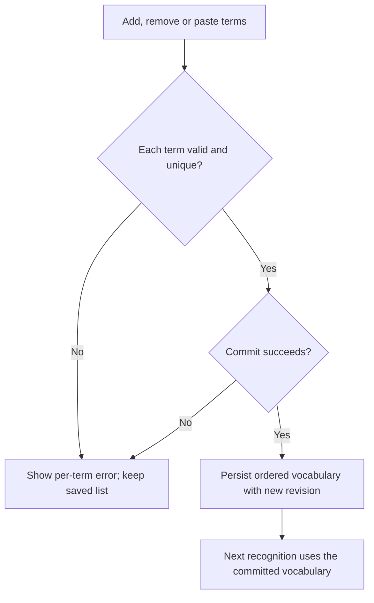
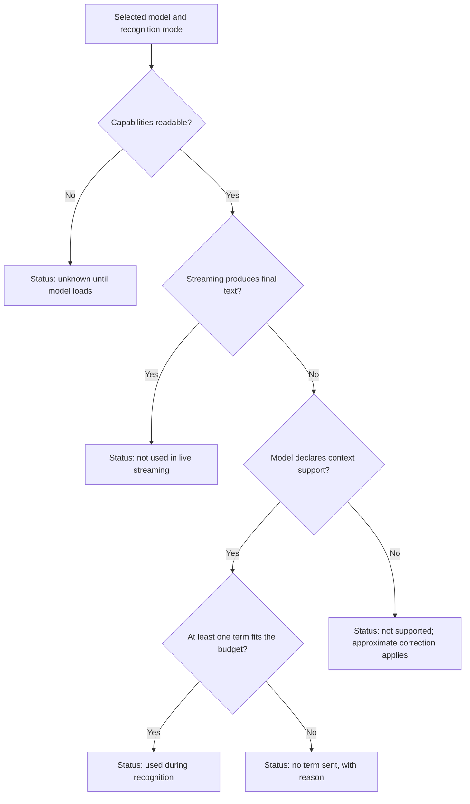
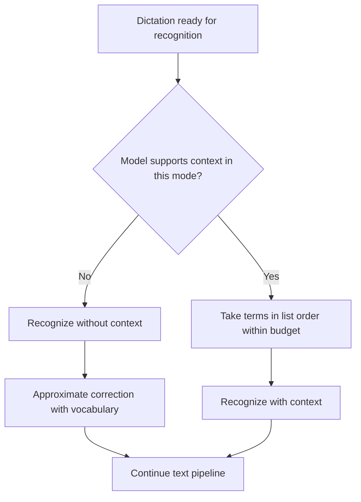
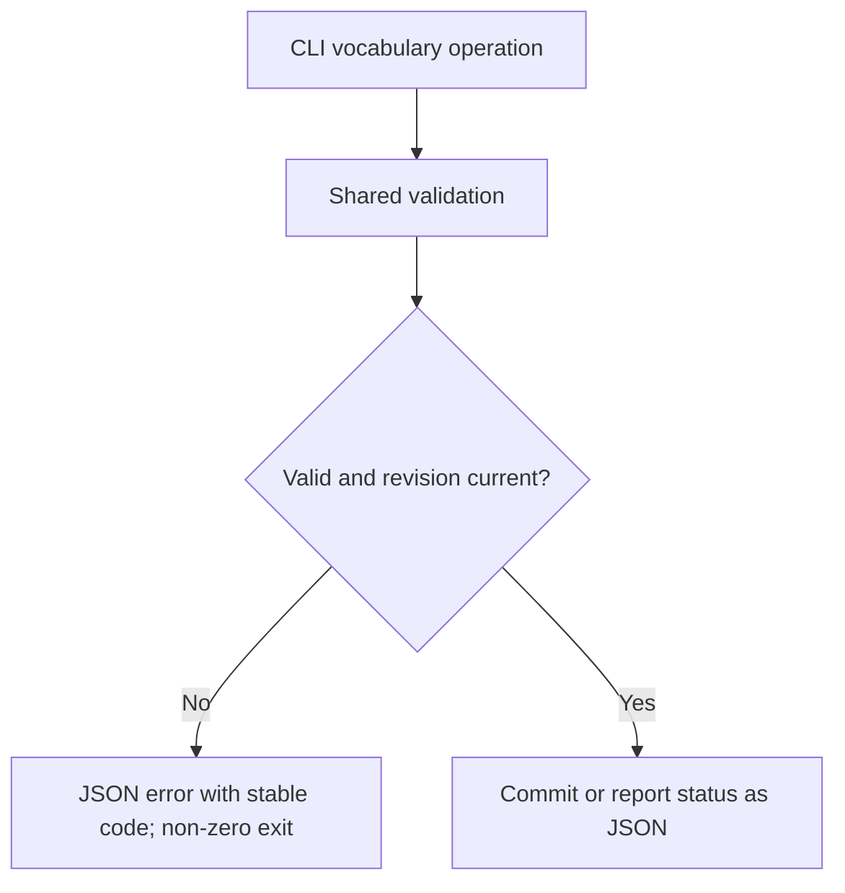

# Feature Spec: Recognition Vocabulary

## Header

- **Feature:** Recognition Vocabulary
- **Branch:** None — specification only (program specified before `spec-ship`)
- **Date:** 2026-10-12
- **Status:** Planned
- **Input:** Program item 3: let the user enter a list of keywords, proper nouns and technical terms to improve recognition ("Claude Code", "Claude Sonnet", "Claude Opus", "OpenClaw", etc.). This context acts during recognition, whereas the replacements of item 2 act on recognized text. Check what each local engine supports and report limitations; never show a setting as effective when the engine does not support it.
- **Feature Number:** 003

## User Scenarios & Testing

### Story 1 — Maintain the vocabulary list `P1`

**As a** Handy user, **I want to** add, remove and paste vocabulary terms, **so that** names and technical terms I use are known to the recognizer.

**Priority reason:** The term list is the input of every other story.
**Independent test:** Paste four terms (one per line, one duplicate), save, reload settings and inspect the stored list.

```gherkin
Feature: Vocabulary list
  Scenario: Paste several terms
    Given the vocabulary is empty
    When the user pastes the lines "Claude Code", "Claude Sonnet", "claude code" and "OpenClaw"
    Then the preview shows three terms to add and "claude code" as a duplicate of "Claude Code"
    When the user applies the preview
    Then the vocabulary is "Claude Code", "Claude Sonnet", "OpenClaw" in that order
  Scenario: Remove a term
    Given the vocabulary contains "OpenClaw"
    When the user removes "OpenClaw"
    Then the saved vocabulary no longer contains it
  Scenario: Reject an invalid term
    When the user adds a term of 101 characters
    Then the term is rejected with an explanation of the 100-character limit
    And the saved vocabulary is unchanged
```



### Story 2 — See whether the vocabulary is effective `P1`

**As a** Handy user, **I want to** see, for the selected model, whether the vocabulary is used during recognition, **so that** I am never misled by a setting that has no effect.

**Priority reason:** The request explicitly forbids presenting an unsupported setting as effective.
**Independent test:** Select a Whisper model, then a Parakeet model, then a live-streaming configuration, and read the status shown each time.

```gherkin
Feature: Truthful vocabulary status
  Scenario: Model that supports recognition context
    Given the selected model declares recognition-context support
    And batch transcription is used
    When the user opens the vocabulary settings
    Then the status says the vocabulary is used during recognition by this model
  Scenario: Model without recognition context
    Given the selected model declares no recognition-context support
    When the user opens the vocabulary settings
    Then the status says this model cannot use the vocabulary during recognition
    And the status says approximate correction after recognition applies instead
    And no control suggests that recognition is influenced
  Scenario: Live streaming
    Given the live overlay produces the final text through streaming recognition
    When the user opens the vocabulary settings
    Then the status says recognition context is not used in live streaming
  Scenario: Capability unknown
    Given no model is loaded and the selected model's capabilities cannot be read
    When the user opens the vocabulary settings
    Then the status says support is unknown until the model loads
  Scenario: Supporting model but nothing to send
    Given the selected model supports recognition context in batch mode
    And the vocabulary is empty, or no term fits within the model's context budget
    When the user opens the vocabulary settings
    Then the status says no term is sent, with the reason (empty vocabulary or terms over the limit)
```



### Story 3 — Bias recognition on supporting engines `P1`

**As a** Handy user, **I want to** have my terms passed to the recognizer when it supports it, **so that** "Claude Code" is recognized instead of "Cloud Code".

**Priority reason:** This is the recognition-time effect the user asked for.
**Independent test:** Transcribe a fixed audio sample saying "Claude Code" with and without the vocabulary on a supporting model, and inspect the engine request.

```gherkin
Feature: Vocabulary as recognition context
  Scenario: Supporting model receives the terms
    Given the vocabulary is "Claude Code", "OpenClaw"
    And the selected model supports recognition context in batch mode
    When a dictation is transcribed
    Then the engine request contains "Claude Code" and "OpenClaw" through the model's supported mechanism
  Scenario: Vocabulary exceeds the context budget
    Given the vocabulary is longer than the selected model's context budget
    When a dictation is transcribed
    Then terms are sent in list order until the budget is reached
    And the settings show how many terms are sent and which are not
  Scenario: Unsupported model is not sent the terms
    Given the selected model does not support recognition context
    When a dictation is transcribed
    Then no context is sent to the engine
    And approximate correction applies to the recognized text
```



### Story 4 — Manage the vocabulary from the CLI `P2`

**As an** automation user, **I want to** list, add, remove, import and export terms from the CLI, **so that** scripts and agents share the UI behavior.

**Priority reason:** The settings CLI (008) must cover vocabulary from its first version.
**Independent test:** Run each operation with `--json` on an isolated store and compare with the UI readback.

```gherkin
Feature: Vocabulary through the settings CLI
  Scenario: Status for the selected model
    When the user runs the vocabulary status operation with JSON output
    Then stdout reports the selected model, its context support, the terms sent and the terms not sent
  Scenario: Import from stdin
    Given stdin contains "Claude Opus" and "OpenClaw" on two lines
    When the user runs the vocabulary import operation in merge mode
    Then the new terms are appended in input order and the command reports the new revision
```



## Acceptance Criteria

### AC-001

**Criterion:** The settings UI shows the vocabulary as an ordered list with add, remove and a paste box (one term per line) with preview. A term is valid when its trimmed text has 1–100 characters, no line break and none of the characters `<`, `>`, `"`. Terms are unique by their trimmed, whitespace-collapsed, case-folded key; duplicates and invalid terms are reported without a partial write. The vocabulary holds at most 500 terms.
**Priority:** P1 | **Story:** Story 1

### AC-002

**Criterion:** The vocabulary is the existing custom-words list: upgrading keeps every stored term in order, and the existing approximate-correction threshold keeps its value. The UI names the list "Vocabulary" and explains that it influences recognition when supported, unlike replacement rules (002), which rewrite recognized text.
**Priority:** P1 | **Story:** Story 1

### AC-003

**Criterion:** For the selected model, the vocabulary settings show exactly one status among: used during recognition (at least one term reaches the engine); no term sent (the model supports context but the vocabulary is empty or no term fits the budget, with that reason); not supported by this model (approximate correction applies instead); not used in live streaming; unknown until the model loads. The status derives from the capabilities declared by the loaded model and engine, not from a fixed model list. No status says "used" when no context reaches the engine.
**Priority:** P1 | **Story:** Story 2

### AC-004

**Criterion:** In batch recognition, a model declaring recognition-context support receives the vocabulary through its supported mechanism (initial prompt, vocabulary list or context prompt). Terms are sent in list order up to the model's documented context budget; the settings and the CLI status report the number of terms sent and the terms not sent.
**Priority:** P1 | **Story:** Story 3

### AC-005

**Criterion:** A model without recognition-context support, and every streaming recognition, receives no vocabulary context. In those cases the existing approximate correction after recognition applies, as today. When context was sent, approximate correction is skipped, as today for Whisper.
**Priority:** P1 | **Story:** Stories 2 and 3

### AC-006

**Criterion:** A vocabulary change applies from the next recognition without restarting the app or reloading the model. An empty vocabulary sends no context and disables approximate correction.
**Priority:** P2 | **Story:** Stories 1 and 3

### AC-007

**Criterion:** The settings CLI (008) offers vocabulary list, add, remove, import (merge or replace, file or stdin, dry run), export (one term per line) and status (selected model, support, terms sent, terms not sent), sharing UI validation and atomic commit. With `--json`, stdout contains only the JSON envelope; errors use stable codes and exit codes.
**Priority:** P2 | **Story:** Story 4

## Behavioral AC

Signals extracted: form, list, validation, status badge, paste, preview, loading, keyboard navigation. Official `detect_traits` returned async_action, has_validation, is_keyboard_navigable, is_submittable.

### async_action

```gherkin
Feature: Vocabulary asynchronous commits
  Scenario: Commit in progress
    Given the user applies a valid vocabulary change
    When the commit is in progress
    Then the apply control is busy and cannot dispatch another commit
    And the apply control matches visual state "loading"
  Scenario: Commit failure
    Given the commit failed without saving
    When the user inspects the vocabulary settings
    Then the saved vocabulary remains with an actionable error and retry
    And the vocabulary editor matches visual state "error"
  Scenario: Commit success
    Given the commit succeeded
    When the editor receives the new revision
    Then the saved vocabulary and its effectiveness status are refreshed
    And the vocabulary editor matches visual state "success"
  Scenario: Idle editor
    Given no commit is pending
    When the user opens the vocabulary settings
    Then the vocabulary editor matches visual state "idle"
```

### has_validation

```gherkin
Feature: Vocabulary term validation
  Scenario: Empty term
    Given the term input is empty
    When the user inspects Add
    Then Add is unavailable with an accessible explanation
    And the term input matches visual state "empty"
  Scenario: Duplicate term
    Given the input duplicates an existing term key
    When the user tries to add it
    Then an error explains that each term may appear once
    And the term input matches visual state "invalid"
  Scenario: Corrected term
    Given an error is displayed
    When the user enters a valid unique term
    Then the error clears
    And the term input matches visual state "valid"
```

### is_keyboard_navigable

<!-- WARNING: No visual states defined for trait "is_keyboard_navigable" in ui-behavioral-taxonomy.md -->

```gherkin
Feature: Keyboard vocabulary editing
  Scenario: Tab traversal
    Given the vocabulary settings are open
    When the user presses Tab through the term input, list, paste box and status
    Then each enabled control receives visible focus in reading order
  Scenario: Keyboard removal
    Given the remove control of a term has focus
    When the user presses Enter
    Then the term is removed and focus moves to the next term or the input
```

### is_submittable

```gherkin
Feature: Commit vocabulary
  Scenario: Valid paste enables Apply
    Given the paste preview contains only valid terms
    When the user inspects Apply
    Then Apply matches visual state "enabled"
  Scenario: Invalid paste disables Apply
    Given the paste preview contains an invalid term
    When the user inspects Apply
    Then Apply is disabled with the error list
    And Apply matches visual state "disabled"
  Scenario: Submission in progress
    Given the user activates Apply with a valid preview
    When the commit is pending
    Then Apply matches visual state "loading"
```

## Functional Requirements

### FR-001

**Requirement:** Persist an ordered, uniquely keyed vocabulary in the existing custom-words setting with shared validation, bulk paste preview and atomic commit.
**AC References:** AC-001, AC-002, AC-006

### FR-002

**Requirement:** Determine recognition-context support from the loaded model's declared capabilities and the recognition mode (batch or streaming), and expose one truthful status per model.
**AC References:** AC-003, AC-005

### FR-003

**Requirement:** Pass vocabulary terms to supporting models in batch recognition through the model's supported mechanism, within a documented per-mechanism budget, and record which terms were sent.
**AC References:** AC-004

### FR-004

**Requirement:** Keep approximate correction as the fallback when no context is sent, and skip it when context was sent.
**AC References:** AC-005, AC-006

### FR-005

**Requirement:** Expose vocabulary list, add, remove, import, export and status through the settings CLI with JSON output and stable error codes.
**AC References:** AC-007

## Key Entities

| Entity | Description | Key fields |
|---|---|---|
| Vocabulary | Ordered user terms (stored as custom words) | terms, normalized keys, settings revision |
| Context support status | Truthful effect of the vocabulary for one model and mode | model id, mode, status, mechanism, budget, terms sent, terms not sent |

## Clarifications

- Engine verification on 2026-10-12 from the public sources of `transcribe-cpp` 0.3.1 and `transcribe-rs` 0.3.8 (docs.rs) and Handy's code. In batch mode, Whisper supports an initial prompt (used by Handy today). qwen3_asr supports a vocabulary list and a context prompt, and funasr_nano supports a vocabulary (hotwords) list; Handy uses neither today. granite_speech supports vocabulary only when its GGUF declares the capability. Canary (prefix only), voxtral (instruction prompt, not recognition bias), parakeet and moonshine in transcribe-cpp, and every ONNX engine in transcribe-rs (Parakeet, Moonshine, SenseVoice, GigaAM, Canary, Cohere) offer no recognition-context API. Streaming offers no recognition context. AC-003 relies on declared capabilities so that new engine versions update the status without a spec change.
- Decision 2026-10-12 (user): a supporting model with an empty vocabulary, or with no term fitting the budget, shows the fifth status "no term sent" with its reason; "used" is shown only when at least one term reaches the engine.
- `[ASSUMED]` The existing custom-words list becomes the vocabulary (no second list). The current approximate-correction behavior is retained and labelled truthfully rather than removed.
- `[ASSUMED]` Limits: 500 terms of 100 characters. The context budget per mechanism is set in the plan from engine documentation (for example Whisper's prompt token limit) and shown to the user as terms sent / not sent.
- `[ASSUMED]` The characters `<`, `>` and `"` stay forbidden, as in today's input sanitizing; the apostrophe becomes allowed for names such as "O'Neil".
- Passing the vocabulary to AI post-processing is not part of this feature; custom prompts are feature 005.
- Program context: specified in list order (001–010); the settings CLI foundation (008) ships first.

- Decision `` / `placeholders:- Planned `flow_id: recognition-vocabulary`, `screen_id: vocabulary-settings`. The Penflow workspace is `incomplete` on 2026-10-12; the forward contract, semantic and test IDs are produced in the single pass before `spec-ship`: [NEEDS CLARIFICATION] until then. No inspection READY or certification PASS is claimed.`: User decision 2026-10-12 (lightweight UI contract): Penflow flow/screen contracts, semantic and test IDs and Pencil mockups for all program features are produced in one pass before spec-ship; until then the planned flow_id and screen_id above are authoritative and no inspection READY or certification PASS is claimed.
<!-- livespec-clarification:{"requirement_id": "", "decision_key": "placeholders:- Planned `flow_id: recognition-vocabulary`, `screen_id: vocabulary-settings`. The Penflow workspace is `incomplete` on 2026-10-12; the forward contract, semantic and test IDs are produced in the single pass before `spec-ship`: [NEEDS CLARIFICATION] until then. No inspection READY or certification PASS is claimed.", "evidence_hash": "6c8354e84418a46d09c5133f13a450ae3b78f0df0575f770d7543fda85dfd926", "answer": "User decision 2026-10-12 (lightweight UI contract): Penflow flow/screen contracts, semantic and test IDs and Pencil mockups for all program features are produced in one pass before spec-ship; until then the planned flow_id and screen_id above are authoritative and no inspection READY or certification PASS is claimed."} -->

## QE Analysis

- **Criticality:** Medium; **Blast radius:** Recognition quality for every dictation; **Primary risk:** Misleading status and regression of the existing Whisper prompt; **Confidence:** High for engine API facts (public sources read), low for recognition quality gains (nothing executed).
- **Dimensions:** Functional correctness, compatibility (engine and model capabilities), regression, UX honesty, data migration, performance.
- **P0 gates/evidence:** Unit tests of the status function for each engine/mode combination; engine-request tests proving terms reach supporting mechanisms and never reach unsupported ones; migration test keeping stored custom words; regression test of the Whisper initial prompt.
- **P1 gates/evidence:** Recognition sample before/after on one supporting model (qualitative); budget truncation tests; UI keyboard and status rendering checks; CLI JSON contract tests.
- **Non-functional expectations:** Building the context adds under 5 ms per dictation; no model reload on vocabulary change; terms are not logged above debug level.
- **Missing evidence:** No runtime test; the granite GGUF capability of catalog models is not verified; context budgets per mechanism to be fixed in the plan; mockups deferred before `spec-ship`.
- **Boundary:** QE defines risk and test sufficiency; the independent review judges requirements; Penflow governs UI design evidence; spec-test executes runtime proof.

## Quality Engineering

- **Risk:** Medium criticality (rated so by the QE Analysis: a wrong status misleads the user about engine support, and the existing Whisper initial prompt can regress); Shared blast radius (the vocabulary reuses the existing custom-words setting, reaches the recognition request of every dictation on supporting engines and is exposed through the settings CLI); primary risk UX (misleading status), followed by Regression.
- **Applicable dimensions:** functional correctness, compatibility (engine and model capabilities), regression, UX honesty, data migration, performance.
- **P0 gates/evidence:** Unit tests of the status function for each engine/mode combination; engine-request tests proving terms reach supporting mechanisms and never reach unsupported ones; migration test keeping stored custom words; regression test of the Whisper initial prompt.
- **Boundary:** QE defines risk and test sufficiency only. The independent spec review judges requirements, Penflow governs UI design evidence, spec-test executes runtime proof and the end-of-feature delivery review looks for defects.

## Screens

| Screen | Status | Reference |
|--------|--------|-----------|
| vocabulary-settings | Modified | Mockup to produce before `spec-ship` (user decision 2026-10-12: lightweight UI contract during specification) |

- Existing custom-words area renamed Vocabulary, with paste preview, status for the selected model and terms sent / not sent.

## Penflow Contract

- Planned `flow_id: recognition-vocabulary`, `screen_id: vocabulary-settings`. Per the user decision of 2026-10-12 (lightweight UI contract), the Penflow flow/screen contract, semantic and test IDs and the Pencil mockup are produced in one pass for all program features before `spec-ship`; the planned IDs above are authoritative until then. No inspection READY or certification PASS is claimed.

## Edge Cases

- Model switch while settings are open: the status refreshes for the newly selected model.
- Granite model whose GGUF does not declare vocabulary support: status "not supported".
- Vocabulary with only terms longer than the remaining budget: those terms are listed as not sent; the earlier terms are still sent.
- Translation to English enabled: context support is evaluated for the translate task the model runs.
- Stored legacy terms that violate the new limits: kept as stored, flagged invalid in the UI, and excluded from context until edited.

## Success Criteria

### SC-001

For every engine family in the clarification table, an automated test asserts the displayed status and whether context reaches the engine request; zero cases show "used" without context in the request.

### SC-002

Upgrading a settings store with existing custom words keeps 100% of terms, their order and the correction threshold.

### SC-003

On one supporting model, a recorded sample containing "Claude Code" produces the correct spelling with the vocabulary and the evidence is recorded with the model id.
