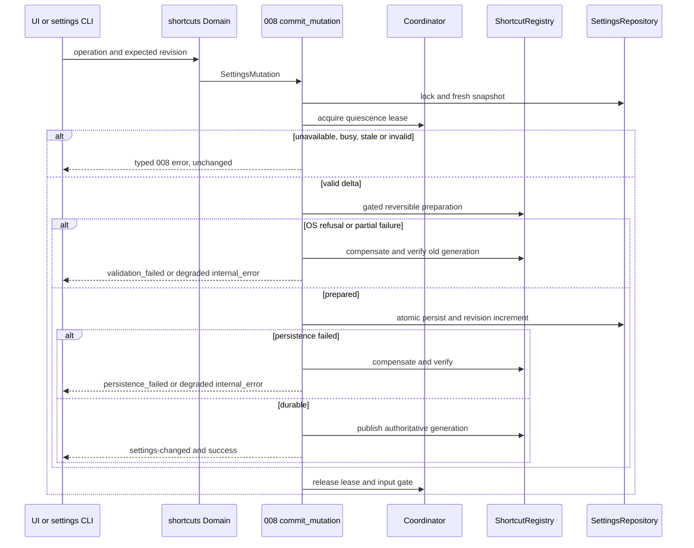
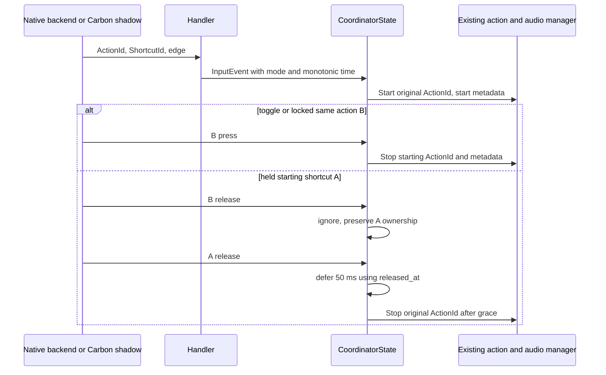
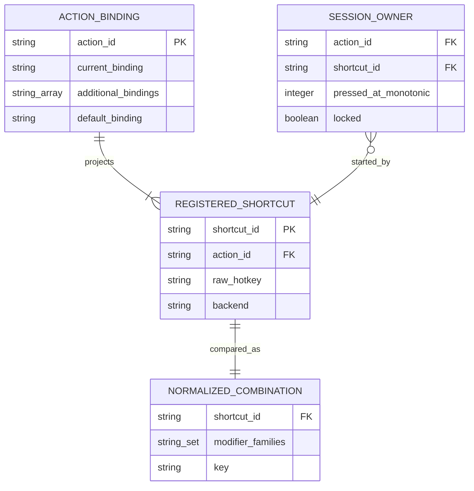

# Implementation Plan: Multiple Dictation Shortcuts

## Summary

Extend the two dictation actions to ordered 1–4 bindings, separate action and physical shortcut identities in the existing coordinator, and expose shared validated mutations through the transactional settings service delivered by 008.

Inspect [the functional specification](spec.md) for FR-001–FR-005, AC-001–AC-006 and SC-001–SC-003. Scope **L**: five FR but native registry, migration, coordinator and shared settings dependencies. Deliver after 008, 001, 002 and 003; expose the action-agnostic checker for 005 without implementing prompts. Plan only; no application code, runtime proof, commit or push.

## Technical Context

| Aspect | Choice | Evidence / reason |
|---|---|---|
| Backend | Rust edition 2021, Tauri 2.11.5 | Existing manifests and native/frontend boundary |
| Keyboard backends | Existing Tauri global-shortcut and handy-keys 0.3.4 | Preserve active parser/recorder and platform capabilities |
| Lifecycle | Existing transcription_coordinator.rs pure state machine | Preserve global 30 ms debounce, 50 ms deferred release and actual release timestamp |
| Settings | 008 SettingsRepository, SettingsMutation, SettingsSnapshot, Revision, commit_mutation | One persisted revision, stable settings.lock, private same-user IPC |
| Side effects | 008 LiveSettingsEffects and ShortcutRegistry seam | Stage reversible registration before durable commit; reconcile post-commit failures |
| Frontend | React 18, TypeScript, Zustand, i18next | Existing settings and recorder components, no new framework |
| Storage | Existing bindings map in settings_store.json | Legacy current_binding plus optional additional_bindings; no database migration |
| Testing | cargo unit/integration, Bun, Playwright, native release observation | Browser mocks cannot prove native registration, Secure Input or physical releases |
| Infrastructure | Existing local settings service only | No HTTP endpoint, cloud resource, credential or provisioning |

Inspect [008's plan](../008-settings-cli/plan.md) as the foundation contract context. Reuse its exact names: StoreLocator, SettingsRepository.read_snapshot, commit_mutation, SettingDescriptor, SettingsMutation, SettingsSnapshot, Revision, PublicSettings, OperationRequest, SettingsError, Domain, LiveSettingsEffects, ShortcutRegistry, InstanceProbe, LocalTransport and monotonic Clock/Deadline. Extend settings_service/domains/mod.rs with domains/shortcuts.rs; do not create another lock, revision, transport, renderer or settings writer. All implementation references below name future changes, not files changed by this planning command.

## Constitution Check

| Principle | Decision / gate |
|---|---|
| Preserve native/frontend boundaries | PASS: Rust owns normalized validation, state machine and transactions; React manages draft capture and translated feedback |
| Derive stack/manager choices from manifests | PASS: retain clap/serde, existing coordinator, both keyboard implementations; no new database or runtime |
| Tool availability differs from runtime evidence | PASS: availability table below; native, downgrade and three-platform gates remain unexecuted |
| Specify before implementing; meaningful tests | PASS: five FR and six AC mapped; real production state machine, registry fault injection and actual CLI/process boundaries |
| Naming and minimal structure | PASS: Rust snake_case per language delta; new TS kebab-case; preserve existing component filenames and organization |
| Project tooling authority | PASS: Bun, ESLint/Prettier and existing tests override generic Commander/Biome/Vitest advice |
| i18n / accessibility | PASS: every UI label/reason uses i18next; disabled controls retain discoverable explanations and visible focus |
| UI preparation | Approved deviation: user decision 2026-10-12 defers program-wide Penflow/IDs/mockups; no current READY/PASS visual claim |

## Requirement Inventory and Signals

| Requirement | Behavior / evidence | Steps |
|---|---|---|
| FR-001 | Both transcription actions, ordered 1–4, upgrade/downgrade, every registered shortcut | 1, 3, 5, 6, 7 |
| FR-002 | Action routing, starting-key ownership, all modes, busy parity, deferred release | 1, 4, 7 |
| FR-003 | Shared all-action normalization, equality, subset overlap, native refusal | 1, 2, 3, 5, 7 |
| FR-004 | Never zero, maximum four, cancel dynamic limits | 2, 3, 5, 6, 7 |
| FR-005 | CLI list/add/remove/reset, live apply, 008 envelope/errors/revision | 3, 5, 7 |

Input inventory: action, immutable registration identity, raw parser syntax, parsed modifier set/key, backend, press/release, monotonic timestamp, activation mode/threshold, external trigger flag, active stage/hold/locked state, remembered press, deferred release, current revision, proposed full action list, post_process_enabled, dynamically requested cancel, Secure Input/fallback, capture suspension, backend switch, OS registration/compensation outcome. Boundaries include 0/1/4/5 entries, modifier reordering/aliases/sides, disabled actions, cancel and future prompts, simultaneous/auto-repeat inputs, read/no-op/CAS/deadline, startup/restart/downgrade, focus loss and failed microphone start.

## Architecture Decisions

### Ordered storage and downgrade compatibility

Keep ShortcutBinding.current_binding at its existing location as the first shortcut; add optional `additional_bindings: Vec<String>` with serde default and skip-serialization when empty. The derived ordered list is `[current_binding] + additional_bindings`, never duplicate the first item in storage. Only transcribe and transcribe_with_post_process accept alternatives in 004. Other actions retain their original serialized fields and single-binding behavior, while participating in the full conflict inventory. No index or new synthetic ID is passed to ACTION_MAP or AudioRecordingManager.

Legacy missing additional_bindings loads empty, preserving the original text byte-for-byte. Migration is idempotent, operates in 008's startup transaction, preserves unknown fields and valid settings_revision, and never writes on list/read. Old deserialization ignores additional_bindings; downgrade still reads current_binding. An older writer may discard alternatives; do not promise round-trip retention through an old binary's save. Test an old reader/binary separately from a new serializer fixture.

Removal of the first entry promotes the next raw entry into current_binding atomically. Reset sets current_binding to default_binding and clears alternatives after full validation/preparation. Every changed commit increments once; no-op and refusal keep revision unchanged. First-entry edits through existing change_binding are adapted to the same service, retaining alternatives; reset_binding intentionally clears them. Never reconstruct a stale AppSettings snapshot.

Existing legacy conflicts retain their original registration and behavior, as expressly approved in AC-002 and SC-003 on 2026-10-12. The pure migration does not reject/drop a first binding, reserve cancel ahead of it, reorder registrations, deduplicate colliding callbacks or introduce startup precedence. Reuse each backend's existing initialization traversal, event matching and native refusal behavior for unchanged legacy entries; retain the current post-processing/cancel enabled-state rules. Capture an independent pre-upgrade fixture oracle with each supported old binary/backend (including HandyKeys equal and modifier-subset conflicts) and require the upgraded run to produce the same action/press/release results. Existing legacy double-trigger or refusal behavior is an approved compatibility exception, never promised as newly safe. The UI marks each involved stored row with a conflict warning and owning action(s), without silently fixing it.

Only new additions and changed combinations are strictly checked against every configured entry. An unrelated legacy collision must not make an otherwise-valid mutation fail whole-candidate validation: validate structural cardinality for all rows, but apply conflict rejection only to changed normalized combinations (including reset defaults and switch repairs). An unchanged no-op preserves the exception and revision. Removal may improve a conflicted set without revalidating unchanged remaining entries. Keep the legacy allowance scoped to unchanged entries loaded during upgrade, track its in-memory diagnostic identities per snapshot, and recompute on restart; do not add persisted provenance or write on read. A downgrade writer may discard alternatives; on re-upgrade its first fields remain original single bindings and follow the same migration policy. A newly supplied CLI/UI candidate identical to a conflicting legacy value is not a bypass: equality against another unchanged entry is rejected, except a true no-op edit of the same row. Real legacy fixtures, not a new serializer alone, prove AC-002/SC-003.

### Stable identities and lifecycle ownership

Create typed ActionId, ShortcutId, ShortcutEvent and RegisteredShortcut in shortcut/identity.rs. ShortcutId is an immutable runtime identity derived from action ID plus the backend's parsed canonical registration representation, independent of list position. Use distinct typed fields, not string-prefix parsing. Both callbacks and HandyKeys bidirectional maps carry `(action_id, shortcut_id, raw_hotkey)`; Tauri closures retain that identity. Secure Input Carbon shadows carry the original ShortcutId even when their registration syntax widens side-specific modifiers.

Coordinator InputEvent, Stage::Recording, Hold, PendingPress and PendingRelease retain the starting action and shortcut. Effect::Start/Stop continue calling existing actions with the **original action ID**, and stop uses the start session's action/hotkey metadata; AudioRecordingManager's binding_id equality must still succeed when B stops a session started by A. Do not change actions.rs or audio output policy unless an adapter signature demands it; no insertion, clipboard, LLM or history policy change.

- Toggle and locked hold-or-toggle: any press of the starting action stops; other actions are ignored. Releases remain ignored.
- Held push-to-talk/hold-or-toggle: only starting ShortcutId releases/auto-repeat cancel its pending release; B cannot end or clear A's hold.
- Busy processing: toggle remembered ownership is ActionId; two presses A/B net to forget. Hold modes remember ShortcutId, including a tap already classified locked while busy; another shortcut is ignored. After the drain starts that queued locked session, ordinary locked-phase action semantics apply.
- Preserve global debounce 30 ms, release grace 50 ms, threshold equality (`>=` stops), actual released_at and pressed_at across drain. No new per-shortcut debounce or timer reset. External CLI/signal edges remain action-based toggle and exempt from debounce.
- Failed microphone start clears optimistic state; cancel clears pending press/release without prematurely clearing Processing. Existing single-binding tests keep their expectations unchanged.

Registry mutation, capture suspension and implementation switching acquire a coordinator quiescence lease by message/acknowledgement on its worker, not by blocking the main thread. Refuse writes/switch/capture while recording, processing, a remembered press or deferred release exists with `unavailable`, reason `shortcut_session_busy`; do not persist or remove the owner's release path. Once idle, gate input dispatch during registration preparation and resume the authoritative generation on every exit. Live application means no restart, not changing a held key's lifetime. A concurrent key-down either becomes owned before the lease (mutation refused) or is gated before staging; never let registration remove a newly active owner. Tests must prove this race, including late release and queued input. Keep unaffected registrations/shadows intact.

### Shared conflict checker and normalization

Add shortcut/conflicts.rs with `normalize_shortcut(raw, backend)` and `check_shortcut_conflicts(candidate, inventory, excluded_identity)`. Parse using the active backend first. Comparison derives canonical modifier families (ctrl/control, alt/option, cmd/command/meta/super as reported by the active parser), normalized key identity and sorted set; preserve raw stored syntax for backend registration/display. HandyKeys left/right variants collapse **for conflict comparison only**; native activation retains parsed side-specific semantics. Tauri side-specific/fn/modifier-only syntax remains rejected by its parser, never stripped into an accepted string. Include side-specific Carbon widening in fallback collision tests.

Compare every configured shortcut, including disabled post-processing, dynamically inactive cancel, existing test actions and later 005 prompts. Equal candidate within same action or across actions rejects with owner action and shortcut. For each modifier-only combination M, reject when M is a subset of the other combination's modifiers, independent of key, in both candidate/existing directions. Overlap is a **rejection**, despite the legacy Key Entities phrase 'overlap warning'. OS conflicts without a known Handy owner expose the OS reason, without inventing another application's identity. Reset/replacement excludes only the exact entry being replaced, never the entire action.

Expose action-agnostic `ShortcutInventory` to 005, which supplies prompt ActionIds and registration entries using the same checker/identities. A fixture prompt action proves 004's extension seam; a real 004↔005 integration test runs when 005 ships. Do not create prompt settings or code in this plan command. The checker is shared by all UI command adapters, CLI domain, reset, switches, startup diagnostics and Secure Input projection checks; frontend preview is advisory and backend authoritative.

### Registration transactions through 008

All shortcut writes are live-only (both backends), declared via 008 Domain metadata. Offline list is supported; mutations with no authenticated compatible owner return `unavailable`/5 unchanged. This avoids falsely claiming a Tauri OS check without an instance and ensures runtime backend/capture/cancel state participates. Offline pure dry-run may validate syntax/inventory and emit preview with OS feasibility explicitly unverified, no effects, no write; it never certifies a future registration. No offline fallback or automatic resubmission after timeout.

Under settings.lock and the coordinator lease, commit_mutation reloads current settings/revision, validates cardinality and all changed candidate conflicts while preserving approved unchanged legacy conflicts, then LiveSettingsEffects prepares a ShortcutRegistry delta. Stage added registrations with dispatch gated; keep unchanged ones. Tauri attempts real registration before persistence; HandyKeys applies internal checks/manager operations without pretending OS registration exists. For removal/reset/replacement, preserve exact restoration handles and old generation before touching old entries. Inactive post-processing candidates and cancel on platforms supporting dynamic cancel receive Tauri probe registration/unregistration before saving, then remain inactive; Linux cancel is excluded from native probing because dynamic registration is disabled there, with parser/conflict validation only and its existing platform limitation reported; inability to verify probe cleanup is an explicit error, never success. Keep cancel's recording-only dynamic registration and Linux no-dynamic-registration behavior.

If preparation partially fails, unregister all staged entries and restore any removed original registrations; verify the old generation. If persistence fails, compensate likewise, return persistence_failed/1 with durable values/revision unchanged. If compensation fails, keep dispatch gated for affected entries, return internal_error/1 with a runtime-degraded diagnostic and reconcile before the next affected mutation; never claim working rollback. After durable commit publish the authoritative snapshot, finalize delta and notify settings-changed using 008 ordering. A failure after durable commit uses 008 internal_error with `{outcome:"committed", current_revision:N}` and reconciliation; it is never reported as unchanged validation failure. A timeout after submission stays unavailable with outcome unknown; reread revision/list before any human retry.

Callbacks, cancel reconciliation, implementation switch, recorder suspend/resume and Secure Input reconcile share the registry serialization boundary. Avoid settings-lock/native-main-thread inversion: worker owns orchestration; any required main-thread OS call executes a bounded nonblocking dispatch, and UI never waits synchronously for a worker holding settings.lock. Native Step 1 proves thread affinity and registry acknowledgement before final wiring.

Switch backend only while quiescent. Parse all entries with destination backend; reset an invalid first to the action default, remove invalid alternatives, retain valid entries in order and report each affected identity. Validate structural cardinality of the complete set and strict conflicts of repaired entries before commit; preserve unchanged legacy entries and their current behavior whenever valid on the destination backend; if a default conflicts, refuse and retain the old backend/settings rather than silently erase unrelated entries. Coalesce an alternative equal to the repaired default only as part of the reported switch repair, preserve cardinality ≥1. Init fallback from HandyKeys to Tauri uses the same transaction and repair rules. Keep current valid identities/shadows untouched where possible; no release is lost during Secure Input transitions.

### CLI domain contract

004 adds `handy settings shortcuts list [ACTION]`, `add ACTION SHORTCUT`, `remove ACTION SHORTCUT`, `reset ACTION`. SHORTCUT uses active-backend stored text syntax; action defaults are shown by list. Only the two transcription actions accept add/remove alternatives here; other existing actions remain listed and resettable to one default through their existing policy. Unknown action/entry returns not_found/4; attempting an unsupported alternative operation on another action returns validation_failed/2 with an explanation. Future prompt domain ownership stays with 005.

Use 008 OperationRequest, optional expected revision, SettingsMutation, Domain parsing/help/preview and its renderer. Success data is `{action_id, shortcuts:[raw strings], default_shortcut, keyboard_implementation}` (list without action returns an actions collection), with the 008 top-level revision. No extra CLI replace/import/reorder operation. Changing a lone binding through CLI is add then remove; at four, remove one then add. Those are two separately revisioned transactions, not an advertised atomic replacement. UI existing change edits a row atomically using the shared service.

| Outcome | Stable code / details | Exit |
|---|---|---|
| List/change/no-op/valid preview | 008 `{ok:true,revision:N,data:...}` | 0 |
| Equal or modifier-only overlap | shortcut_conflict; owning_action, owning_shortcut, kind | 2 |
| Fifth shortcut | limit_exceeded; action_id, limit:4 | 2 |
| Last removal, parser/OS refusal | validation_failed; reason, action_id; OS reason when applicable | 2 |
| Malformed command | usage_error | 2 |
| Stale revision | revision_conflict; current_revision | 3 |
| Unknown action or remove target | not_found | 4 |
| Missing owner, busy session, deadline | unavailable; reason; outcome unknown on submitted timeout | 5 |
| Durable write failure | persistence_failed | 1 |
| Compensation/post-commit failure | internal_error; truthful runtime/durable outcome | 1 |

Exactly one JSON object/newline; diagnostics to stderr, no raw key event logs above debug. UI maps typed errors to translation keys with owner labels; no free-text error parsing. Inspect [the local CLI contract](contracts/shortcuts-cli.md) for the same domain matrix. No HTTP endpoint, therefore no OpenAPI YAML.

## Design Reference

| Screen | Planned component breakdown | Evidence |
|---|---|---|
| shortcut-settings | Existing GeneralSettings and PostProcessingSettings areas; ShortcutInput selects the backend recorder; new action list/rows and add/remove/reset feedback | Mockup deferred before spec-ship by explicit user decision |

No theme.css/theme.md exists. Retain existing CSS/tokens and components; no theme install step or invented PNG reference. Tab order follows rows then add/reset, every control/state gets final semantic/test ID in the approved program pass. Reuse the active recorder mechanics, but draft capture reports a candidate to the list controller instead of writing the first binding immediately. Focus loss/cancel/unmount releases the capture lease, resumes current bindings and discards draft without a restoring settings write. Tauri focus-leave handling must include keyboard blur, not only current click-outside handling. Retry is a new deliberate submission after fresh revision/list, not an automatic blind repeat.

## Penflow Contract Inputs

Authoritative planned `flow_id: multiple-dictation-shortcuts`, `screen_id: shortcut-settings`. Inspect [the existing semantic tree](../../../penflow/semantic-ui-tree.json): it currently contains microphone-priority only, not 004. `penflow/code-ir.json` and expected-ui-tree.json are absent; inspection returned BLOCKED/required_contract_artifacts_missing, certified false. Do not use microphone nodes as 004 evidence or mutate global Penflow in this parallel plan.

The user explicitly defers flow/screen contracts, semantic/test IDs and Pencil mockups to one program-wide pass before spec-ship; this overrides skill Step 2.6 generation and before-plan mockup integration for this run. That pass must provide canonical code-ir and bound cumulative plan review, native geometry/export and homologous references as required by the declared policy, then design C51 PASS before application UI code. No accepted 004 Penflow approval history currently exists. Semantic plan readiness is separate from this deferred implementation/design prerequisite; no visual Plan Review Done or certification is claimed now. Follow the same bound reviewer protocol after the program sources exist, without changing authoritative flow/screen identities.

States to bind in that pass: rows idle/loading/error/success; recorder empty/invalid/valid; add enabled/disabled/loading; visible focus; last-removal and four-limit reasons. This section reserves behavior, not generated identities or mockups.

## Gherkin Scenarios and Sequence Diagrams

```gherkin
Feature: Atomic live shortcut mutation
  Scenario: Add succeeds
    Given an idle live instance has revision 8 and shortcut A
    When UI or CLI adds valid shortcut B with expected revision 8
    Then native preparation registers B before durable revision 9
    And both shortcuts trigger their action and settings-changed refreshes the UI
  Scenario: OS or persistence refuses
    When OS preparation or persistence fails
    Then saved shortcuts and revision remain unchanged
    And the previous registry is restored or an explicit degraded error is returned
  Scenario: Busy owner or no instance
    Given shortcut A is held or no compatible live owner exists
    When a mutation requests removal, reset or addition
    Then unavailable is returned without changing settings or losing A's release
```



```gherkin
Feature: Action and shortcut identity
  Scenario: B stops A in toggle
    Given A and B belong to transcribe and the debounce window has elapsed
    When A starts then B presses
    Then exactly one Stop effect targets transcribe using the starting session metadata
  Scenario: B cannot stop A while held
    Given A owns a push-to-talk or held hold-or-toggle session
    When B presses and releases
    Then A keeps recording until A releases and the grace window expires
  Scenario: Two busy toggle presses cancel each other
    Given processing is active
    When A then B of the same action press after debounce
    Then processing drain starts no new session
```



## State Model

```gherkin
Feature: Coordinator transitions
  Scenario: Short tap locks and another same-action shortcut stops
    Given hold-or-toggle and an idle coordinator
    When A presses and releases before the hold threshold
    Then grace expiry classifies the tap and locks the session
    When B of the same action presses after debounce
    Then the session enters processing
  Scenario: Failed start and cancellation
    When microphone start fails
    Then coordinator returns idle
    When cancel arrives with pending busy input
    Then pending input and deferred release are cleared
```



```mermaid
stateDiagram-v2
  [*] --> Idle
  Idle --> Held: A press in hold mode
  Idle --> Locked: A press in toggle
  Held --> Held: B input ignored
  Held --> Deferred: owner release
  Deferred --> Held: owner repeat cancels release
  Deferred --> Locked: short tap after grace
  Deferred --> Processing: hold at least threshold after grace
  Locked --> Processing: same action press after debounce
  Held --> Idle: cancel or failed start
  Locked --> Idle: cancel or failed start
  Processing --> Processing: remember or forget busy press
  Processing --> Idle: drain, no pending press
  Processing --> Held: drain, pending held shortcut
  Processing --> Locked: drain, pending toggle or tap
  note right of Processing: Busy toggle ownership is action; hold ownership is shortcut
```

## Data Model

Logical ER diagram, not new SQL tables; persist only additional_bindings in the existing JSON binding object.



## Implementation Plan

### Step 1 — Prove native registry and ownership seams

**Prerequisite:** 008 service/framework delivered; independent plan readiness; program-wide design preparation before UI code.
**Required inputs:** Actual native backends, coordinator, cancel and Secure Input sources; ShortcutRegistry and Clock/Deadline ports from 008.
**Action:** During implementation, spike Tauri thread affinity, reversible delta/probe and HandyKeys multi-ID maps on macOS; test Carbon widening/shadow preservation and quiescence lease race. New shortcut/identity.rs defines typed identities; new src-tauri/tests/shortcuts_registry.rs builds an injectable registry fault port and production adapter integration. Implement the minimal coordinator worker quiescence lease/acknowledgement and dispatch-gate protocol in transcription_coordinator.rs in this step, with native adapters; Step 3 consumes that implemented port and Step 4 extends ownership matching. Spike stays feature-scoped; do not extend overlay geometry here.
**FR covered:** FR-001.1: Native multi-ID seam, FR-002.1: Ownership and quiescence seam, FR-003.1: OS and fallback collision seam
**Execution evidence:** Native acknowledgement/rollback/focus observations, deterministic ownership race transcript and original registry generation.
**Success criteria:** All registrations uniquely addressable; failed preparation leaves durable state unchanged; owner release never lost; no synchronous main-thread wait.
**Failure handling:** Registry rollback/thread-affinity or release loss is P0; block wiring until repaired, do not infer native capability from a fake.

### Step 2 — Implement pure lists, migration and conflict inventory

**Prerequisite:** Step 1 seams fixed and registry generation contract stable.
**Required inputs:** Legacy ShortcutBinding fixtures, parsed backend representations, all action definitions and 005 extension interface.
**Action:** Modify settings.rs for optional additional_bindings and pure migration/list helpers. New shortcut/conflicts.rs and identity.rs implement normalized comparison and strict candidate checks. Inline Rust tests cover count boundaries, promotion/reset, unknown-field preservation, all modifier sides/aliases, inactive cancel/post-processing and fixture prompt actions. Add src-tauri/tests/shortcuts_migration.rs for actual old deserializer/store boundaries, revision and idempotency.
**FR covered:** FR-001.2: Legacy ordered list migration, FR-003.2: All-action normalized checker, FR-004.1: Cardinality and promotion rules
**AC covered:** AC-001, AC-002, AC-004, AC-005; SC-002, SC-003.
**Execution evidence:** Old/new JSON fixtures and reader results, candidate table cases, migration twice, default reset and unchanged unrelated bindings/revision evidence.
**Success criteria:** Every valid legacy first binding preserved; no zero/fifth entry; every equality/overlap rejected with owner; defaults conflict checked; unchanged inherited conflicts keep their pre-upgrade behavior and visible warning.
**Failure handling:** Never fix a failing downgrade fixture by rewriting the legacy field; existing conflicts remain reported with their approved pre-upgrade behavior; any change of that behavior is a regression blocker.

### Step 3 — Integrate reversible registry transactions

**Prerequisite:** Step 2 pure validation PASS; 008 live writer migration complete.
**Required inputs:** commit_mutation, LiveSettingsEffects, SettingsError, coordinator lease and ShortcutRegistry.
**Action:** New shortcut/registry.rs coordinates delta/generation/suspension and compensation. Modify shortcut/{mod.rs,tauri_impl.rs,handy_keys.rs}, secure_input.rs and 008 settings_service/live.rs adapters to enumerate every alternative, serialize cancel/capture/switch/shadow work, acknowledge bounded operations and register before durable persistence. Existing change_binding/reset_binding/post-processing toggle/implementation fallback route through minimal SettingsMutation; add/remove Tauri adapters use the same transaction. lib.rs registers commands and supported specta export regenerates bindings.ts during implementation.
**FR covered:** FR-001.3: Register every alternative, FR-003.3: Prepare compensate and publish, FR-004.2: Safe list and cancel mutations, FR-005.1: Shared live mutation service
**Execution evidence:** Real service with temp repository plus fault registry: nth registration, unregister, restore, persist and post-commit failures; UI/CLI writer races; revision/no-op/CAS; inactive probes and capture finally cleanup.
**Success criteria:** No saved rejection, no partial success, no leaked staged callback, no direct settings writer; committed failures and failed compensation explicit.
**Failure handling:** Runtime degradation gates affected dispatch and reconciliation; no blanket retry on unknown outcome; preserve Linux cancel limits.

### Step 4 — Extend production coordinator without changing single-key behavior

**Prerequisite:** Typed callbacks/identities and quiescence contract stable.
**Required inputs:** Existing CoordinatorState tests, release/busy classifiers, InputEvent/Effect and external trigger paths.
**Action:** Modify transcription_coordinator.rs and shortcut/handler.rs to carry action/shortcut identity, apply mode-dependent owner matching, preserve original action metadata for Stop, and acknowledge quiescence/input gating on the coordinator worker. Keep signal_handle.rs external action input compatible through an adapter if necessary. Extend inline production-machine tests; new src-tauri/tests/shortcuts_lifecycle.rs verifies native adapter→coordinator→real effect contract with output-port fakes only.
**FR covered:** FR-002.2: Modes debounce pending and release
**AC covered:** AC-003; SC-001. Quiescence port exists from Step 1; this step does not introduce a prerequisite needed by Step 3.
**Execution evidence:** Three-mode A/B transition matrix, 29/30 ms debounce, 49/50 ms grace, threshold minus/equal/plus, auto-repeat, busy parity, drain timing, cancel/start failure and external triggers.
**Success criteria:** SC-001 unchanged existing single-key expectations; B stops A only in action-owned phase; Stop reaches original audio action ID; no double start.
**Failure handling:** Any changed single-key expectation or unobserved release is P0 regression; repair the production transition, not its oracle.

### Step 5 — Register the shortcuts CLI domain

**Prerequisite:** Steps 2–4 PASS; 008 Domain/IPC/envelope delivered.
**Required inputs:** Domain, OperationRequest, SettingsMutation, typed errors, latest snapshot and live-only policy.
**Action:** New settings_service/domains/shortcuts.rs; modify domains/mod.rs and settings_service/cli.rs additive clap registration/help only. Bind list/add/remove/reset and shared renderer, expected revision and preview paths. Create generated DTO schema during implementation; test actual parser/service/IPC in new src-tauri/tests/shortcuts_cli.rs and shortcuts_transactions.rs. Document production CLI usage in README.md during implementation, not by this plan command.
**FR covered:** FR-001.4: CLI list projection, FR-003.4: CLI validation parity, FR-004.3: CLI count enforcement, FR-005.2: Domain command and error matrix
**Execution evidence:** Each code/exit/envelope, offline read and live-only mutation, same-user routing, live re-registration, stale/no-op/dry-run and timeout reread transcripts.
**Success criteria:** UI and CLI identical validation; list adds no writes; exactly one response; active shortcuts match committed revision on success.
**Failure handling:** No owner means unavailable, no fallback; no code rename or separate revision from 008.

### Step 6 — Deliver accessible action lists and draft recorders

**Prerequisite:** Program-wide canonical Penflow/code-ir and bound review/design C51 ready before application UI work; Steps 3–5 commands available.
**Required inputs:** Approved shortcut-settings component tree/IDs, existing backend recorders, revisions and i18n contracts.
**Action:** New components/settings/shortcut-list.tsx and colocated pure shortcut-list.test.ts; modify ShortcutInput.tsx, GlobalShortcutInput.tsx, HandyKeysShortcutInput.tsx, GeneralSettings.tsx and PostProcessingSettings.tsx. Add typed add/remove/row-edit/reset methods to settingsStore.ts and useSettings.ts. Separate candidate capture from commit, handle blur/unmount/Secure Input, finally resume current generation without rollback writes. Add en/fr keys and fallback-aware translation tests, preserving other locale keys; use final program-provided IDs and existing styling.
**FR covered:** FR-001.5: Visible list and active recorder, FR-003.5: Translated conflict and retry feedback, FR-004.4: Explained bounds and keyboard navigation
**Execution evidence:** tests/shortcuts-settings.spec.ts with both recorder ports, 1/2/4 entry states, busy/error/success, owner reason, blur/unmount/capture cleanup and revision race; native Secure Input capture test.
**Success criteria:** All specified Behavioral AC states bound and observable; final removal/fifth add disabled with accessible reasons; no unsaved display interpreted as saved.
**Failure handling:** Missing canonical UI inputs remains a design blocker; browser mock cannot certify native capture or OS refusal.

### Step 7 — Prove acceptance, native regression and performance

**Prerequisite:** Previous steps implemented, platform release builds and independent assertion inventory ready.
**Required inputs:** Reviewed FR/AC/SC matrix, actual binaries/stores, native keyboard input and isolated harness.
**Action:** New scripts/shortcuts-native-proof.ts launches actual Handy against 008's isolated StoreLocator and private channel, records physical event/effect timestamps and registry observations; create tests for macOS Tauri/HandyKeys plus Windows/Linux supported backend matrix. Run commands below and attach native manual observations, old-reader/downgrade and existing cancel/post-processing regression. Add real prompt interaction proof with 005 when delivered.
**FR covered:** FR-001.6: Restart and downgrade proof, FR-002.3: Native activation and latency proof, FR-003.6: Native and future prompt conflict proof, FR-004.5: Boundary and cancel regression proof, FR-005.3: Real CLI live acceptance proof
**AC covered:** AC-001, AC-002, AC-003, AC-004, AC-005, AC-006; SC-001, SC-002, SC-003.
**Execution evidence:** Binary/store hashes, tool/OS versions, commands/stdout/stderr/exits, native mode/event observations and all latency samples in proofs/004-multiple-dictation-shortcuts/.
**Success criteria:** Every AC/SC maps to actual assertions; P0/P1 gates PASS; no unexplained regressions or false insertion/history guarantees.
**Failure handling:** Missing platform/native/design evidence stays BLOCKED for delivery; planned harness or availability never substitutes for executed proof.

## Resolved Test Commands

Checked 2026-10-12: Bun 1.3.9, cargo/rustc 1.94.0, clippy 0.1.94, rustfmt 1.8.0 available. No application suite/build executed in planning. No surfaces.yaml; browser testDir resolves to `tests` in playwright.config.ts, Rust integration to `src-tauri/tests`.

| Action | Command | Status |
|---|---|---|
| Production state machine | `cargo test --manifest-path src-tauri/Cargo.toml --lib transcription_coordinator` | Tool available; native compilation/dependencies unverified |
| Pure checker/registry | `cargo test --manifest-path src-tauri/Cargo.toml --lib shortcut` | Tool available; new tests planned |
| Migration | `cargo test --manifest-path src-tauri/Cargo.toml --test shortcuts_migration` | Target planned |
| Native adapter/transaction/lifecycle | `cargo test --manifest-path src-tauri/Cargo.toml --test shortcuts_registry --test shortcuts_transactions --test shortcuts_lifecycle` | Targets planned; injected ports plus real boundaries |
| CLI process | `cargo test --manifest-path src-tauri/Cargo.toml --test shortcuts_cli` | Target planned; actual binary/private IPC |
| All Rust | `cargo test --manifest-path src-tauri/Cargo.toml` | Required regression gate, not executed |
| Keyboard/frontend pure | `bun run test:keyboard`; `bun test src/components/settings/shortcut-list.test.ts` | Bun available; list target planned |
| Browser integration/visual | `bun run test:playwright -- tests/shortcuts-settings.spec.ts` | Local Playwright absent; TOOL NEEDED `bun install`, then `bunx playwright install chromium`; future approved baselines |
| Type check | `bunx --no-install tsc --noEmit` | Local tsc absent; TOOL NEEDED `bun install`, use pinned manifest dependency |
| Lint | `bun run lint`; `cargo clippy --manifest-path src-tauri/Cargo.toml --all-targets -- -D warnings` | Local ESLint absent; Rust tool available |
| Format | `bun run format:check`; `cargo fmt --manifest-path src-tauri/Cargo.toml -- --check` | Local Prettier absent; Rust tool available |
| Translations | `bun run check:translations` | Script observed; install dependencies before execution |
| Build | `bun run build`; `bun run tauri build` | Observed scripts; BUILD.md native SDK/model prerequisites unverified |
| Native proof | `bun scripts/shortcuts-native-proof.ts --binary ABSOLUTE_RELEASE_BINARY --out PROOF_DIRECTORY` | Proposed harness, not created; genuine native/manual actions required |
| Full acceptance | All Rust + keyboard/list + Playwright + type/lint/format/translations + native supported-platform proofs | Composite release gate, no current PASS claimed |

## Testing Strategy

| Priority / level | Planned test file and concrete assertion | FR / AC / SC |
|---|---|---|
| P0 unit/data integration | settings.rs inline + shortcuts_migration.rs: first field retained, old reader, missing/unknown fields, ordered promotion/reset, idempotency, no-op/revisions, legacy equal/subset conflicts against the old-binary oracle, downgrade/re-upgrade and unrelated action bytes | FR-001/004; AC-001/002/005; SC-003 |
| P0 pure table | conflicts.rs inline: aliases/order/sides, equality within/across, modifier-only subset both directions, disabled/cancel/prompt fixture, parser unsupported syntax, default collision | FR-003; AC-004/006; SC-002 |
| P0 production state machine | transcription_coordinator.rs inline: all three modes A/B, held/locked busy ownership, two toggle busy presses, cancel, repeat/debounce/grace/threshold boundaries, failed start and external parity | FR-002; AC-003; SC-001 |
| P0 integration/fault | shortcuts_registry.rs + shortcuts_transactions.rs: partial prepare, failed unregister/restore/persist, post-commit failure, session lease/key-down race, probes, current snapshot/CAS, capture/resume and cancel reconcile ordering | FR-001/003/004/005; AC-001/002/004/005/006 |
| P0 contract/process | shortcuts_cli.rs: all 008 exits, owner conflict details, last removal/fifth add, list no write, genuine shared UI adapters, live/no instance/busy/stale/deadline/dry-run | FR-003/004/005; AC-004/005/006 |
| P1 browser/accessibility | tests/shortcuts-settings.spec.ts and shortcut-list.test.ts: all Behavioral AC states, Tab focus, bound explanations, retry fresh state, draft blur/unmount, no stale optimistic rollback write | FR-001/003/004; AC-001/004/005 plus Behavioral AC |
| P1 native manual | scripts/shortcuts-native-proof.ts + observations: restart both actions, two then four physical keys, all modes with A/B, post-processing disabled, cancel during recording, Secure Input shadows/capture protection, backend switching/refusal while busy | All FR/AC; SC-001/003 |
| P1 performance/logging | Native proof samples and log sentinel test: four versus one shortcut latency, no key events above debug | FR-001/002; spec QE expectation |
| Deferred cross-feature | Real prompt action registered by 005 tested against dictation/cancel and recorder suspension | FR-003; AC-004; 005 owner supplies real prompt |

Inject monotonic Clock/event source, ShortcutRegistry and registration fault/acknowledgement port, coordinator effects/start result, SettingsRepository fault port and 008 LocalTransport/InstanceProbe. Audio enumeration stays behind 008's AudioDeviceCatalog and later microphone owner; simulate start success/failure through output port, not fake the state machine. Clipboard, workspace/activation, AX classification and LLM client are not invoked by 004 shortcuts; retain existing owner seams for later 006/007/009/010 rather than implement unused adapters here. Physical keyboard/backends, native Secure Input and real IPC/store writes require actual native evidence separately from injected tests.

Latency protocol: release build on the same machine/OS/backend, identical microphone/model/settings and idle state. Instrument monotonic timestamp at the actual callback/key event and at confirmed AudioRecordingManager recording start, plus coordinator dequeue/effect timestamps to isolate overhead. Compare one-binding baseline against four per action, alternating baseline/candidate runs, 30 samples each after five excluded warmups per configuration; retain every sample, failures and paired deltas, require each valid paired delta ≤10 ms. Failed starts are failures rather than dropped latency outliers. Avoid arbitrary sleeps; await recording/end signals with deadlines. Sampling defines measurement, not a new user speed guarantee. Preserve explicit runtime evidence gaps when the native environment cannot provide comparable samples.

Native manual evidence records macOS hardware/OS/binary hash, backend, permissions, raw store revisions and each press/release/start/stop observation. Test A starts/B stops locked, A held/B ignored, threshold/grace and busy remembered behavior, cancel dynamic registration, restart/legacy first action, Secure Input enable/disable while held with unchanged shadows, keyboard capture refusal and cleanup. Windows/Linux native proofs cover supported Tauri/backend matrix without inventing HandyKeys availability; Linux cancel remains hidden/disabled dynamically and X11 auto-repeat release regression must pass. Do not touch the real user settings store or claim Windows/Linux success from macOS tests.

## QE Analysis

Criticality High; blast radius Shared/Cross-system; primary risk Regression; confidence Medium until native proof. Dimensions: functional correctness, regression, API/CLI compatibility, data/migration integrity, security/input logging, performance, accessibility/UX and observability. No network auth/LLM behavior is introduced; same-user IPC security belongs to 008 and must not regress.

| Gate | Evidence / owner | Gaps and blocking rule |
|---|---|---|
| Plan quality | Current independent raw spec/plan reviews, structural validation, Analyze and progression; planner | This run produces documentation/review only |
| Activation P0 | Existing tests unchanged plus A/B production-machine matrix and native original action Stop; implementer/spec-test | Wrong owner, stuck recording, double start or changed single-key oracle blocks release |
| Data/native atomicity P0 | Old-reader fixtures, raw store/revision snapshots, prepare/compensate fault transcripts; implementer | Rollback failure must be explicit; any success with stale registry or lost fields blocks |
| Contract P0 | Actual Domain/UI adapter parity and binary CLI stdout/stderr/exits; spec-test | Browser fixture does not prove private routing/OS validation |
| UI/native P1 | Program-wide bound Penflow review and design certificate, all Behavioral AC states plus native capture/Secure Input evidence | Inputs missing now; design work remains prerequisite, not generated here |
| Platform/performance P1 | Mac both backend/native receipts, supported Windows/Linux, every paired sample delta ≤10 ms, debug-only key event logs | No harness/baseline/current runtime proof yet; unsupported evidence cannot certify release |
| Evidence integrity | Versioned binary hashes, command transcripts and independent AC/SC matrix; verifier | No tool-version, migration fixture or plan review alone certifies app behavior |

Expected later artifacts: proofs/004-multiple-dictation-shortcuts/{platform}/commands.json, acceptance-matrix.json, native-observations.md, registry-generations.json, store-generations.json, latency-samples.json and stdout/stderr. These are proposed outputs. QE defines sufficient gates; independent review judges plan design; security review owns native/private IPC boundaries when changed; spec-test executes runtime proof. This run neither audits security nor claims runtime acceptance.

## Risks & Considerations

| Original/refreshed spec-review finding | Disposition |
|---|---|
| 008 unwritten envelope/live channel | Read current READY 008 plan; exact service/Domain names and full envelope/exit matrix used; 004 owns shortcuts domain |
| 005 prompt conflicts | Action-agnostic inventory seam, fixture now; real cross-feature test when 005 delivered |
| Missing UI/IDs/mockups | Explicit user-approved one-pass deferral; exact flow/screen kept; missing code-ir/design certification blocks UI implementation |
| Persist before register / offline OS check | Reversible prepare before commit; every mutation live-only, list offline, preview never claims OS feasibility |
| overlap warning wording | AC-004/FR-003 rejection is normative; typed kind modifier_overlap; spec text unchanged |
| Legacy conflicts | Preserve stored first/unrelated values and report; existing initialization/callback behavior unchanged, approved compatibility exception; warning per involved row, strict new candidates, old-binary conflict oracle and downgrade/re-upgrade fixtures |
| Side-specific normalization | Active parser first; collapse sides only for comparison, preserve native semantics; fallback widening collision tests |
| FR-004 reference omits AC-001 | Plan explicitly maps count tests to both AC-001 and AC-005; no spec amendment needed |
| 10 ms measure missing | Real callback→confirmed start, same-machine/backend paired protocol and full retained samples |
| Switch invalid alternatives/default duplicates | First resets to default, invalid alternatives removed/reported, full candidate rechecked; conflict refuses switch unchanged |
| No CLI replace | Document two-transaction add/remove sequence; UI row edit atomic; do not add unapproved operation |
| Live edit loses held owner release | Quiescence lease and unavailable while lifecycle busy, native lease/key-down race and shadows retained |
| Partial native/persist rollback | Injectable nth-failure and real registry proof, explicit degraded/committed/unknown outcomes; reconcile gates future writes |
| Hold metadata versus audio manager | Stop uses original ActionId and starting session metadata, tested through real effect adapter |
| UI recorder writes first directly today | Draft candidate callback, authoritative submission; blur/unmount restores registration only, never stale settings snapshot |

Cross-program boundaries: 004 creates no destination policy (006/009), insertion method change, clipboard recovery (007), bubble (010), native overlay resize or WAV/history guarantee. actions.rs currently inserts on run_on_main_thread and saves history only when WAV is saved; shortcut success means recording/action execution was requested, not text insertion verified or text retained. The nonactivating overlay spike belongs to 005/006/009/010; 004's early macOS spike concerns keyboard/Carbon ownership instead. Existing history and insertion regression run in full suite, but this plan does not expand their guarantees.

## Next Action

After current complete+ready independent plan review and READY progression implement, the next command is `$spec-implement 004-multiple-dictation-shortcuts --model=gpt-6`, with 008 delivered and the approved program-wide UI preparation complete. This is a proposed next workflow, not executed by this planning command. No spec behavior amendment is planned; finalize may synchronize lifecycle metadata only.
