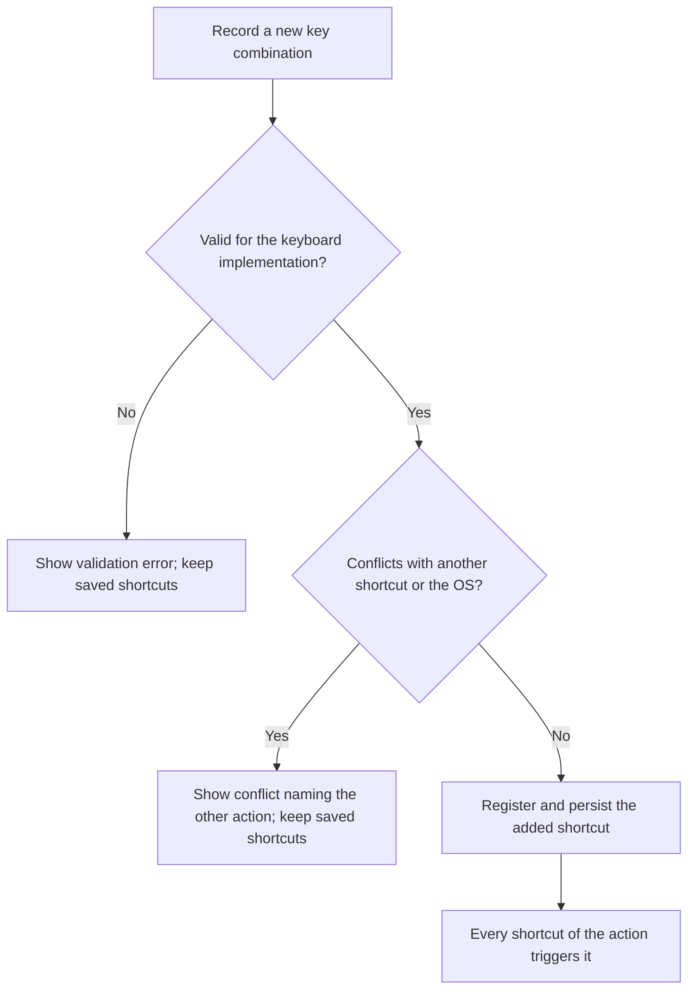
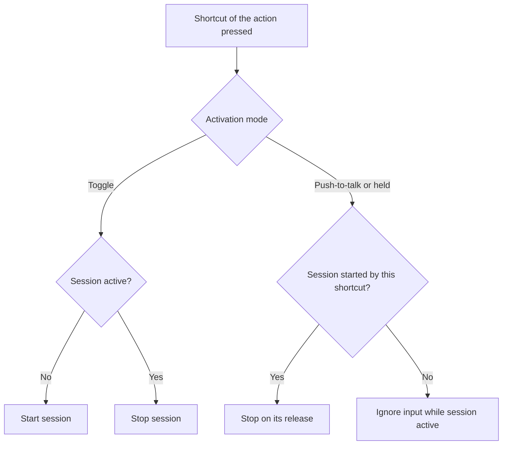
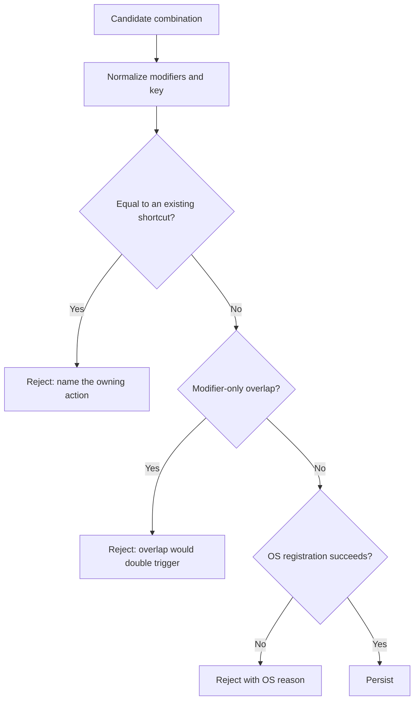
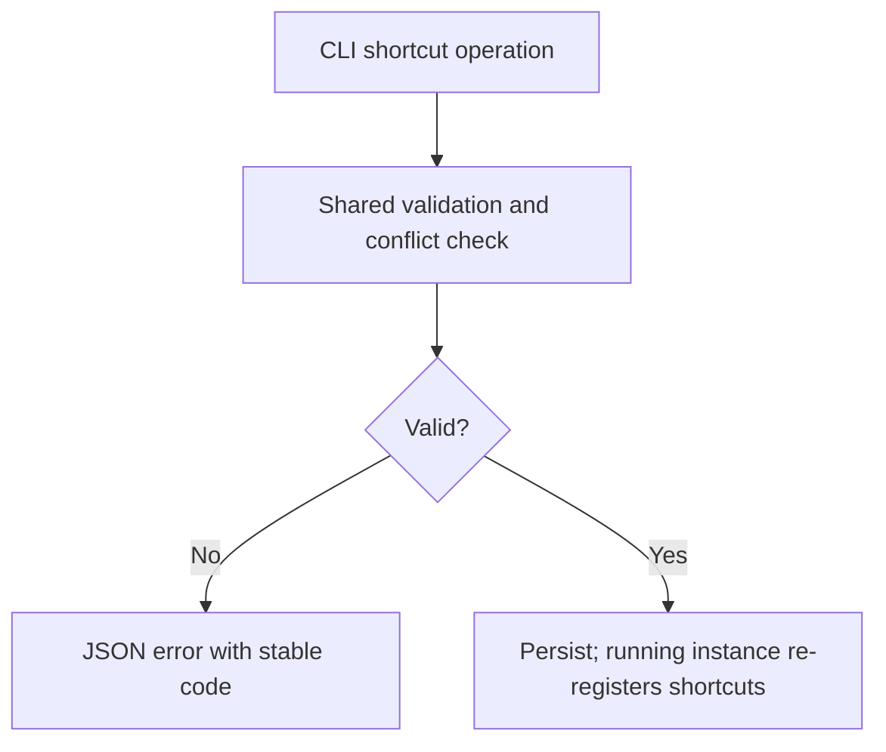

# Feature Spec: Multiple Dictation Shortcuts

## Header

- **Feature:** Multiple Dictation Shortcuts
- **Branch:** None — specification only (program specified before `spec-ship`)
- **Date:** 2026-10-12
- **Status:** Planned
- **Input:** Program item 4: allow at least two configurable shortcuts for the same transcription action. The existing shortcuts for different actions (with or without post-processing) are not enough. Keep the existing activation behavior and detect shortcut conflicts. Program item 8 requires the settings CLI to read and modify shortcuts.
- **Feature Number:** 004

## User Scenarios & Testing

### Story 1 — Add a second shortcut for dictation `P1`

**As a** Handy user, **I want to** bind two or more key combinations to the dictation action, **so that** I can start dictation from the hand position that suits each keyboard or app.

**Priority reason:** This is the requested capability.
**Independent test:** Add a second shortcut to the dictation action, restart, then start and stop dictation with each shortcut in turn.

```gherkin
Feature: Several shortcuts for one action
  Scenario: Add an alternative shortcut
    Given the dictation action has the shortcut "option+space"
    When the user adds the shortcut "ctrl+option+d" to the same action
    Then the dictation action lists "option+space" and "ctrl+option+d"
    And pressing either shortcut starts a dictation
  Scenario: Remove an alternative shortcut
    Given the dictation action has two shortcuts
    When the user removes "ctrl+option+d"
    Then only "option+space" starts a dictation
  Scenario: The last shortcut cannot be removed
    Given the dictation action has one shortcut
    When the user inspects its remove control
    Then removal is unavailable with an explanation that each action keeps at least one shortcut
    And the user can still change or reset that shortcut
  Scenario: Fifth shortcut
    Given the dictation action has four shortcuts
    When the user inspects the add control
    Then adding is unavailable with an explanation of the four-shortcut limit
```



### Story 2 — Keep the existing activation behavior `P1`

**As a** Handy user, **I want to** have every shortcut follow my activation mode, **so that** toggle, push-to-talk and hold-or-toggle behave as before.

**Priority reason:** Breaking activation semantics would make dictation unreliable.
**Independent test:** For each activation mode, start with shortcut A and try to stop with shortcut A and with shortcut B of the same action.

```gherkin
Feature: Activation semantics with several shortcuts
  Scenario: Toggle mode
    Given the activation mode is toggle
    And the dictation action has shortcuts A and B
    When the user presses A to start and then presses B
    Then the dictation stops
  Scenario: Push-to-talk mode
    Given the activation mode is push-to-talk
    And the user holds A to record
    When the user presses and releases B during the recording
    Then the recording continues
    And it stops when A is released
  Scenario: Hold-or-toggle mode
    Given the activation mode is hold-or-toggle
    When the user taps A shorter than the hold threshold
    Then the dictation stays on until a shortcut of the action is pressed again
```



### Story 3 — Detect conflicts `P1`

**As a** Handy user, **I want to** be told when a combination is already used, **so that** one key press never triggers two actions.

**Priority reason:** Conflict detection is explicitly required.
**Independent test:** Try to add the cancel shortcut, the post-processing shortcut and an OS-reserved combination as dictation shortcuts.

```gherkin
Feature: Shortcut conflicts
  Scenario: Combination used by another action
    Given "option+shift+space" is the post-processing shortcut
    When the user adds "shift+option+space" to the dictation action
    Then the shortcut is rejected because it is already used by the post-processing action
    And the saved shortcuts are unchanged
  Scenario: Duplicate within the same action
    Given the dictation action has "option+space"
    When the user adds "option+space" again
    Then the shortcut is rejected as already assigned to this action
  Scenario: Combination unavailable from the OS
    Given another application already registered the combination globally
    When the user adds it
    Then registration fails with an explanation and nothing is saved
  Scenario: Modifier-only overlap
    Given the keyboard implementation allows modifier-only shortcuts
    And "option" is a dictation shortcut
    When the user adds "option+space" to another action
    Then the shortcut is rejected because pressing "option+space" would also trigger "option"
    And the saved shortcuts are unchanged
```



### Story 4 — Manage shortcuts from the CLI `P2`

**As an** automation user, **I want to** list, add, remove and reset shortcuts from the CLI, **so that** I can provision Handy on several machines.

**Priority reason:** The settings CLI (008) covers shortcuts from its first version.
**Independent test:** Add, list, conflict and reset shortcuts with `--json` on an isolated store and a running instance.

```gherkin
Feature: Shortcuts through the settings CLI
  Scenario: Add an alternative shortcut
    When the user runs the shortcut add operation for the dictation action with "ctrl+option+d"
    Then the JSON output lists both shortcuts of the action and the new revision
  Scenario: Conflict through the CLI
    When the user adds the cancel shortcut to the dictation action
    Then the command exits with the validation exit code
    And the JSON error code is "shortcut_conflict" and names the owning action
```



## Acceptance Criteria

### AC-001

**Criterion:** The dictation action and the dictation-with-post-processing action each keep 1 to 4 shortcuts: the last shortcut cannot be removed (only changed or reset) and adding is unavailable at four, with an explanation. The settings UI lists every shortcut of an action with add and remove controls; adding records a key combination with the existing recorder of the active keyboard implementation. After restart all shortcuts are registered and trigger their action.
**Priority:** P1 | **Story:** Story 1

### AC-002

**Criterion:** Upgrading keeps each existing shortcut as the first shortcut of its action, stored where earlier versions read it, so that a downgrade keeps that first shortcut working and ignores the additional ones; actions and stored bindings other than these two are unchanged. Reset restores the action to its single default shortcut. Stored shortcuts that already conflict under the new checker at upgrade keep their current registration and behavior unchanged; the settings show a conflict warning on them, and the checker applies only to new additions and changes.
**Priority:** P1 | **Story:** Story 1

### AC-003

**Criterion:** The global activation mode and hold threshold apply to every shortcut of an action. In toggle mode and in the locked (toggled) phase of hold-or-toggle, any shortcut of the action that started the session stops it. In push-to-talk and in the held phase of hold-or-toggle, only the release of the shortcut that started the session ends it, and other shortcuts are ignored during the session, as different bindings are today. A press remembered while processing belongs to the action in toggle mode and to the pressed shortcut in hold modes. Debounce, the deferred release and the remembered press while processing keep their current behavior.
**Priority:** P1 | **Story:** Story 2

### AC-004

**Criterion:** Before saving, a candidate is normalized (modifier order, left/right-agnostic modifiers as the implementation reports them) and compared with every shortcut of every action, including cancel and prompt shortcuts from feature 005. An equal combination is rejected with the owning action named. A modifier-only shortcut whose modifiers are a subset of another shortcut's modifiers is rejected, because one press would trigger both. With the Tauri implementation, an OS registration failure rejects the change with the OS reason; the HandyKeys implementation performs no OS registration and relies on these checks. Rejections leave saved shortcuts unchanged.
**Priority:** P1 | **Story:** Story 3

### AC-005

**Criterion:** No action can be left without a shortcut. The cancel shortcut keeps its current dynamic registration while recording and its current platform limits.
**Priority:** P2 | **Story:** Story 1

### AC-006

**Criterion:** The settings CLI (008) offers shortcut list, add, remove and reset per action using the stored text syntax of the active keyboard implementation, with the same validation, limits and conflict check (removing the last shortcut is refused with `validation_failed`). A running instance applies the change without restart. With `--json`, conflicts use the stable code `shortcut_conflict` and include the owning action, the limit uses `limit_exceeded`, and other errors use the F8 envelope codes.
**Priority:** P2 | **Story:** Story 4

## Behavioral AC

Signals extracted: form, validation, keyboard shortcut, conflict, warning, confirm dialog, loading, keyboard navigation. Official `detect_traits` returned async_action, has_validation, is_keyboard_navigable, is_submittable.

### async_action

```gherkin
Feature: Shortcut registration feedback
  Scenario: Registration in progress
    Given the user recorded a valid combination
    When registration is in progress
    Then the add control is busy
    And the shortcut row matches visual state "loading"
  Scenario: Registration failure
    Given the OS refused the combination
    When the user inspects the row
    Then the reason and a retry are shown and saved shortcuts are unchanged
    And the shortcut row matches visual state "error"
  Scenario: Registration success
    Given registration succeeded
    When the list refreshes
    Then the new shortcut is listed
    And the shortcut row matches visual state "success"
  Scenario: Idle list
    Given no registration is pending
    When the user opens the shortcut settings
    Then the shortcut row matches visual state "idle"
```

### has_validation

```gherkin
Feature: Shortcut validation
  Scenario: Nothing recorded
    Given the recorder captured no key yet
    When the user inspects Add
    Then Add is unavailable
    And the recorder matches visual state "empty"
  Scenario: Conflicting combination
    Given the recorded combination equals another action's shortcut
    When validation runs
    Then the conflict names the other action
    And the recorder matches visual state "invalid"
  Scenario: Valid combination
    Given the recorded combination is unique and valid
    When validation runs
    Then no error is shown
    And the recorder matches visual state "valid"
```

### is_keyboard_navigable

<!-- WARNING: No visual states defined for trait "is_keyboard_navigable" in ui-behavioral-taxonomy.md -->

```gherkin
Feature: Keyboard shortcut management
  Scenario: Tab traversal
    Given the shortcut settings are open
    When the user presses Tab
    Then each shortcut row, remove control and add control receives visible focus in reading order
  Scenario: Leave the recorder
    Given the recorder is capturing keys
    When focus leaves the recorder
    Then capture stops without saving, as with the existing recorder
```

### is_submittable

```gherkin
Feature: Commit a shortcut
  Scenario: Valid recording enables Add
    Given a valid unique combination is recorded
    When the user inspects Add
    Then Add matches visual state "enabled"
  Scenario: Invalid recording disables Add
    Given the recorded combination conflicts
    When the user inspects Add
    Then Add matches visual state "disabled"
  Scenario: Commit in progress
    Given the user activates Add
    When registration is pending
    Then Add matches visual state "loading"
```

## Functional Requirements

### FR-001

**Requirement:** Store an ordered list of 1–4 shortcuts per transcription action, migrate each existing single shortcut, and register every shortcut with the active keyboard implementation.
**AC References:** AC-001, AC-002

### FR-002

**Requirement:** Route every shortcut of an action to that action while preserving activation-mode semantics, session ownership by the starting shortcut for hold modes, debounce and pending-press behavior.
**AC References:** AC-003

### FR-003

**Requirement:** Provide one shared conflict checker over all shortcuts of all actions (normalized equality, modifier-only overlap, OS registration result where the implementation registers) used by UI and CLI.
**AC References:** AC-004, AC-006

### FR-004

**Requirement:** Allow removing any shortcut except the last one of an action, and enforce the four-shortcut limit.
**AC References:** AC-005

### FR-005

**Requirement:** Expose shortcut list, add, remove and reset through the settings CLI with live re-registration in a running instance and stable error codes.
**AC References:** AC-006

## Key Entities

| Entity | Description | Key fields |
|---|---|---|
| Action shortcuts | Shortcuts bound to one action | action id, ordered shortcut strings (1–4), default shortcut |
| Normalized combination | Comparable form of a shortcut | modifiers set, key, implementation |
| Conflict result | Outcome of a check | kind (duplicate, overlap warning, OS refusal), owning action |

## Clarifications

- Current code (2026-10-12): one `current_binding` string per binding id; global activation mode and hold threshold; the coordinator ignores a different binding pressed during a session; the only conflict check is the Tauri `is_registered` test; HandyKeys and the frontend have none.
- `[ASSUMED]` Maximum 4 shortcuts per action; enough for "at least two" without cluttering the settings.
- `[ASSUMED]` Multiple shortcuts apply to both transcription actions (with and without post-processing); prompt-specific shortcuts are defined by feature 005 and use the same conflict checker.
- `[ASSUMED]` In hold modes the session is owned by the starting shortcut, matching today's rule for different bindings; toggle treats all shortcuts of the action as one. The coordinator and both keyboard implementations identify events by binding id today; events will need both the action id and the shortcut identity.
- Decision 2026-10-12 (user): legacy conflicts keep today's behavior. Shortcuts that conflict under the new checker when the upgrade runs stay registered exactly as today; a warning marks them in settings until the user changes them; the checker governs only new additions and changes.
- `[ASSUMED]` Starting dictation from the tray is out of scope; every action keeps at least one shortcut.
- Program context: specified in list order (001–010); the settings CLI foundation (008) ships first.

## QE Analysis

- **Criticality:** High; **Blast radius:** Dictation start/stop for every user; **Primary risk:** Activation regression and double triggering; **Confidence:** Medium (coordinator source read, nothing executed).
- **Dimensions:** Functional correctness, regression, platform compatibility (Tauri vs HandyKeys, macOS/Windows/Linux), data migration, accessibility, UX.
- **P0 gates/evidence:** Coordinator state-machine unit tests for each activation mode with two shortcuts; migration test from single bindings; conflict checker table tests (equal, reordered modifiers, modifier-only overlap, cross-action, cancel).
- **P1 gates/evidence:** Native manual test on macOS with both keyboard implementations; Linux limits unchanged; UI keyboard checks; CLI JSON contract and live re-registration test.
- **Non-functional expectations:** With four shortcuts per action, the time from key press to recording start stays within 10 ms of the single-shortcut baseline; no key events are logged above debug level.
- **Missing evidence:** No native runtime test; mockups deferred before `spec-ship`.
- **Boundary:** QE defines risk and test sufficiency; the independent review judges requirements; Penflow governs UI design evidence; spec-test executes runtime proof.

## Screens

| Screen | Status | Reference |
|--------|--------|-----------|
| shortcut-settings | Modified | Mockup to produce before `spec-ship` (user decision 2026-10-12: lightweight UI contract during specification) |

- General settings shortcut area and post-processing shortcut area show a list of shortcuts per action.

## Penflow Contract

- Planned `flow_id: multiple-dictation-shortcuts`, `screen_id: shortcut-settings`. Per the user decision of 2026-10-12 (lightweight UI contract), the Penflow flow/screen contract, semantic and test IDs and the Pencil mockup are produced in one pass for all program features before `spec-ship`; the planned IDs above are authoritative until then. No inspection READY or certification PASS is claimed.

## Edge Cases

- Switching keyboard implementation invalidates one alternative shortcut: only that shortcut is reset or removed and reported, as today's reset of invalid bindings.
- macOS password-field keyboard protection active (another app holds exclusive key input): recording a shortcut is blocked as today and the UI says why.
- Two shortcuts pressed simultaneously: debounce and session ownership prevent a double start.
- Post-processing disabled: its shortcuts are unregistered but kept, as today for its single shortcut.

## Success Criteria

### SC-001

Coordinator tests cover all three activation modes with two shortcuts and pass with zero changes to existing single-shortcut test expectations.

### SC-002

The conflict checker rejects 100% of equal combinations across all actions in table tests, including modifier reordering.

### SC-003

A user with a migrated store, including one with legacy conflicting shortcuts, can start and stop dictation with the original shortcut without reconfiguration, with every legacy shortcut behaving as before the upgrade.
