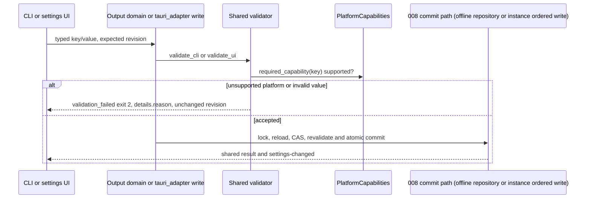
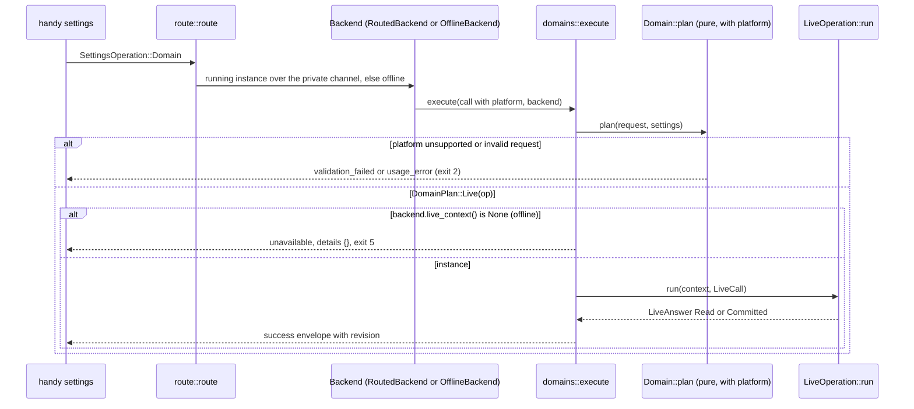
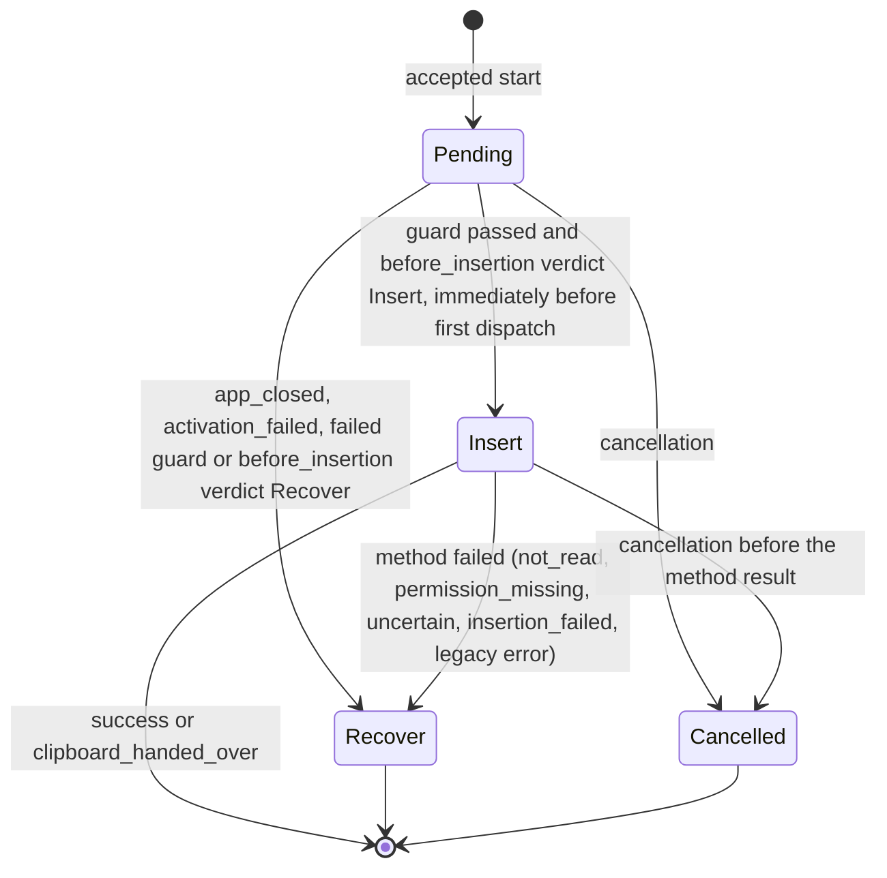
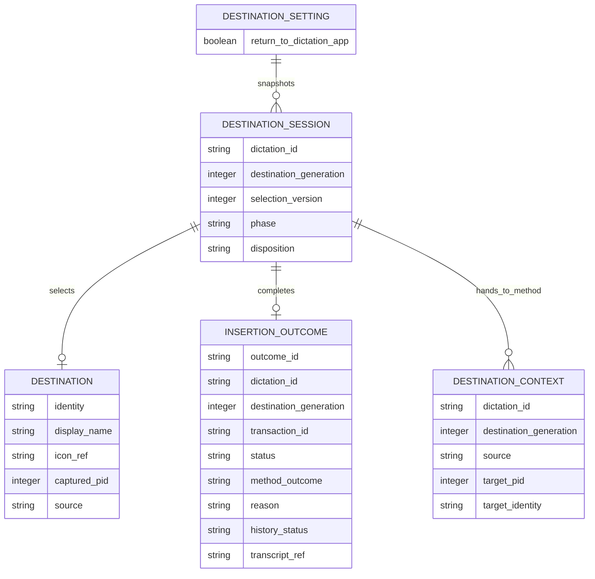

# Implementation Plan: Destination Application

## Summary

Capture one application identity per dictation in a Rust destination manager, allow explicit session changes or one-click removal through a nonactivating badge/menu, then asynchronously activate and verify the application before delegating to the existing insertion method; publish truthful outcomes and preserve conditional history/recovery evidence.

Inspect [the functional source](spec.md) for FR-001–FR-006, AC-001–AC-008 and SC-001–SC-003. Scope **L**: six FR, native macOS/Windows activation, shared insertion lifecycle, 007 method results and 009/010 consumers. Deliver after 008 and before 007/009/010. Step 0 first extends the delivered 008 settings framework with live domain operations, a static platform capability and two optional error-detail fields (orchestrator decisions D2–D4 of 2026-10-14); 001, 003, 005 and 009 consume these exact names. This document is a plan; no application code, native compatibility or visual certification has been produced.

## Technical Context

| Aspect | Choice | Reason |
|---|---|---|
| Native | Existing Rust 2021, Tauri 2.11.5, Tokio | Keep platform and manager boundaries from manifests |
| Frontend | React 18, TypeScript, Zustand, i18next, existing Tailwind/CSS | Retain overlay and output settings components |
| macOS workspace | Existing objc2-app-kit 0.3, NSWorkspace/NSRunningApplication | Native identity/activation; no shell/AppleScript process |
| Windows workspace | Existing windows 0.61.3 Win32 bindings | Foreground HWND→PID→AUMID or executable path; native activation |
| Storage | 008 settings service for one boolean; existing history SQLite path | No new database table, separate volatile dictation state; history `file_name` becomes nullable for text-only rows (change shared with 005) |
| Concurrency | Session manager + async activation worker + brief main-thread native calls | No sleep, polling loop or blocking worker join on native UI thread |
| Test levels | Cargo unit/integration; Bun adapter; Playwright components; real native harness | Browser mocks cannot prove OS focus/activation |
| Infrastructure | Local OS APIs only | No cloud provisioning or secret required |

Inspect [start/paste lifecycle](../../../src-tauri/src/actions.rs), [coordinator](../../../src-tauri/src/transcription_coordinator.rs), [insertion methods](../../../src-tauri/src/clipboard.rs), [reliable paste](../../../src-tauri/src/paste_tx/mod.rs), [native overlay](../../../src-tauri/src/overlay.rs), [frontend overlay](../../../src/overlay/RecordingOverlay.tsx) and [settings](../../../src-tauri/src/settings.rs) before implementing. At planning time actions.rs saves history only under `wav_saved` (a gate this plan removes, see the history rule in Architecture Decisions) and queues `utils::paste` on `run_on_main_thread`; clipboard.rs sleeps before/after a paste and owns current auto-submit and clipboard policy. These are integration constraints, not proofs of insertion.

Inspect 008's spec (`.specs/features/008-settings-cli/spec.md`), its implementation map (`.specs/features/008-settings-cli/implementation.md`) and the delivered code in `src-tauri/src/settings_service/` as the framework reference; do not revise 008's plan. 006 uses only names that exist in `dev` (merge `e9f96df`):

| Need | Delivered 008 name |
|---|---|
| Key inventory | `descriptor::SettingDescriptor`, `descriptor_data.rs` `inventory!` rows, `RuntimeEffect::None` for values read at use |
| Shared validation | `validation::{validate_cli, validate_ui, ValidationContext, SettingsMutation}`, `LiveSettings::validate_ui_value` |
| Errors | `errors::{SettingsError, SettingsErrorCode, ErrorDetails, ValidationReason}`, `command_error::SettingsCommandError`, exit mapping `SettingsErrorCode::exit_code` |
| UI writes | `tauri_adapter::write` (async UI command, one scalar), `set`, `edit`, `set_prepared` with `native_changes::prepared_change`, `repair`; the output UI commands live in `shortcut/mod.rs` (`live_settings::write(app, "paste_method", …)`) |
| Live effects and UI event | `sequence::LiveEffectsPort`, `tauri_adapter::TauriEffects`, `effects::apply_changed`, event `settings-changed {revision, keys}` |
| CLI domains | `domains::{Domain, DomainPlan, DomainRequest, DomainCall, DomainChange, ChangeKind, execute, public_keys, production}`, `domains::output::{OutputDomain, OUTPUT_KEYS}` |
| Routing | `route::route`, `operations::{SettingsBackend, execute, Reply}`, `tauri_adapter::RoutedBackend` (running instance, `is_live() == true`), offline `route::OfflineBackend` |
| Store | `store::{SettingsRepository, SettingsRead}`, `SettingsRepository::{read_snapshot, commit_mutation}` (reached only through the service and the offline backend, never called directly by 006), `protocol::{Revision, SettingsSnapshot, contract_schema}`, `public::PublicSettings` |

`LiveSettingsEffects` does not exist and is not used; effects are those of `effects.rs` behind `LiveSettings`. No independent settings writer, lock, revision counter, transport or renderer is introduced by 006.

## Constitution Check

| Principle | Explicit check |
|---|---|
| Existing native/frontend boundaries | PASS: Rust owns destination/lifecycle; frontend renders typed snapshots and requests choices |
| Manifest-derived stack and managers | PASS: use existing objc2/windows/Tauri; review needed feature flags, no new inference/cloud dependency |
| Tool availability distinct from runtime | PASS: commands below are resolved only; native and UI evidence remains required later |
| Changed behavior specified first | PASS: six FR and eight AC mapped; spec semantics untouched by planning; AC-005's history clause refined on 2026-10-14 by Julien's decision (text-only entry when the WAV fails) before this plan applies it |
| Meaningful tests and source verification | PASS: real session logic, fake OS ports, real file/CLI/native boundary tests, no mocked manager under test |
| Naming and project tooling | PASS: keep existing Rust module conventions and TS filenames; new UI/artifact names kebab-case; retain ESLint/Prettier/Bun rather than changing toolchain |
| i18n and data boundaries | PASS: all badge, toggle, accessibility and reason text through translation keys; no transcript/window-title broadcast or logs above debug |
| Native platform evidence (2026-10-13) | PASS: every step builds and passes automated tests on macOS, Windows and Linux targets; only macOS native evidence gates a step or the Implemented status. Windows native observations, Linux native observations, an older Handy binary and a second user account are **pending release evidence** with the exact check named in Step 7; they never block a step, completion on the integration branch or the merge into `dev`, and are never claimed as passed (decision D1) |
| Minimal scope | PASS: 006 builds no CLI action that its spec does not require (no live destination status, no support read); Step 0 builds only the framework extension decided by the orchestrator (D2–D4) for 001, 003, 005, 009 |

## Requirement Inventory

| FR | AC / measure | Steps |
|---|---|---|
| FR-001 | AC-001/004; capture <50 ms; stable recording/processing/AI | 1, 2, 4, 7 |
| FR-002 | AC-002/006; ≤1 s activation, no UI freeze, paste none/off/default paths | 1, 4, 7 |
| FR-003 | AC-003/004; badge, one-click removal and pointer menu, update ≤200 ms, no keyboard capture | 1, 5, 7 |
| FR-004 | AC-005; reason ≥4 s; conditional history; available recovery consumers | 4, 6, 7 |
| FR-005 | AC-006; attempted versus verified; separation and consumer contract | 2, 4, 6, 7 |
| FR-006 | AC-007/008; platform availability and CLI parity | 0, 1, 3, 5, 7 |

Step 0 (settings framework extension D2–D4) carries FR-006's unsupported-platform refusal (AC-008) and the shared contract the later program features consume; it maps to FR-006 only.

Entities: volatile Destination, DestinationSession, DestinationContext, RecoveryDisposition and InsertionOutcome; persistent DestinationSetting in existing AppSettings. Interactions: workspace capture/enumeration/activation, UI snapshot/choice, 008 domain get/set, insertion delegation, conditional history and recovery. No HTTP API, cloud infrastructure, new table or credential setup. Contracts below are local DTO/CLI contracts, not OpenAPI.

## Design Reference

| Screen | Component breakdown | Reference and status |
|---|---|---|
| recording-indicator | Existing indicator + DestinationBadge + RemoveDestination cross + pointer-operated DestinationMenu + transient reason | Spec Screens; mockup intentionally deferred before spec-ship |
| output-settings | DestinationReturnToggle + platform-unavailable reason | Spec Screens; mockup intentionally deferred before spec-ship |

### Penflow Contract Inputs

Authoritative planned IDs are `flow_id: destination-application`, `screen_id: recording-indicator`, `screen_id: output-settings`. The user decision of 2026-10-12 overrides immediate mockup/forward generation: flow contracts, semantic/test IDs and Pencil mockups are produced once for the program before spec-ship. No new IDs are frozen or minted here.

Inspect [the current semantic tree](../../../penflow/semantic-ui-tree.json) as incomplete context: it contains microphone-priority only. The future input `penflow/code-ir.json` and expected tree are absent. Current `livespec penflow-contract status --project . --target web-desktop --json` is BLOCKED/certified=false (missing expected-ui-tree.json, code-ir.json and desktop native geometry). That status is not 006 approval; do not rewrite the root workspace or other feature's contracts during this plan.

Before UI implementation, the program owner must generate the complete cumulative contracts and flow/semantic/test mappings for these planned IDs, produce `penflow/ui.pen`, theme, expected tree and code-ir, and complete bound source review (`review-snapshot`, actual raw reviewer JSON, `review-result`, pipeline plan-review update) plus design certification. The metadata above keeps all four producing procedures required for that later Livespec design pass; no N/A inferred from missing files. Review generated docs, native geometry, homologous mockup references and native export as actual evidence. Use code-ir as primary UI implementation input; retain stable identities after approval. Never substitute today's semantic plan receipt for a Penflow bound result or C51 PASS. No accepted 006 Penflow approval history exists at planning time.

No `.specs/design/theme.css` or theme installation command is currently present. Before UI work, consume the one-pass theme, install/import only if its variables are absent, and guard against repeated installation. Existing CSS tokens remain until then. Final badge/menu dimensions come from approved geometry, not a fabricated 256×50 mockup.

## Architecture Decisions

### Session and application identity

`DestinationManager` owns `DestinationSession {dictation_id, destination_generation, selection_version, phase, return_enabled, support, selection, captured_at, disposition}`. Identifier names follow 007's `PasteOutcome`: `dictation_id: DictationId` is the immutable identity of one accepted dictation; `destination_generation: u64` increases at every accepted start and at cancellation and invalidates late callbacks; `selection_version: u64` is the compare-and-set token of badge choices only. `selection` is `FrontmostAtEnd` or `Application {identity, display_name, icon_ref, captured_pid, source}`; `source` is captured or badge (009 will add its own PIN policy). Destination is an application, never a saved field/window. Keep last-active-window semantics to the OS, no AX classification in 006. The focused-field read/write/read-back port used by 007 direct insertion is owned by 007; the pre-insertion editability classifier is owned by 010. Destination consumes neither as proof of its own activation or field insertion.

Capture when a recording actually starts, including a queued coordinator press when it drains, not when a key press was remembered while busy. Snapshot support and setting, read frontmost before showing any Handy surface, and create/commit the session only on successful recording start. Discard tentative state on mic/model/start failure. Capture work is bounded <50 ms, including the native main-thread hop; delay/capture failure is a capability failure with the old insertion path and explicit unavailable reason, not a fabricated destination. Do not enumerate all windows or load icons synchronously on this path. Cache small icon assets by app identity and finish badge rendering asynchronously; snapshot its icon reference/availability rather than holding UI/native objects across threads. Native spike must prove this tuple and latency.

macOS identity is bundle identifier; PID and process start identity defend against PID reuse. Windows prefers AUMID, otherwise canonical executable path; keep HWND only as an activation hint, not field-level authority. Revalidate HWND→PID→identity at activation. Exclude Handy and its panels/helpers by own process identity. Same app clicked is a no-op. Restart: if original PID is gone, resolve a running instance with the same stable identity; prefer a still-valid captured instance, otherwise one unambiguous matching instance. Multiple ambiguous matches fail closed as activation_failed; do not select an unrelated process by display name. Closed identity is app_closed, never auto-launch. Icons/names have native fallback handling without inventing a target.

Freeze `return_enabled` and capability for each accepted dictation so CLI/UI changes affect the next dictation, as Story 5 specifies. Capture and selection stay unchanged through recording, processing and AI except explicit badge choices. The badge cross calls the same FrontmostAtEnd selection mutation as the menu entry: one click clears only this session, leaves the persistent setting unchanged, and updates the badge within 200 ms. Give the cross its own localized accessible name "Remove destination"; stop event propagation so its click does not open the menu or take keyboard focus. Expose the control until insertion begins, including processing/AI; then hide/disable it and reject queued removal commands. Repeated removal of FrontmostAtEnd is a no-op. No destination setting or selection from a later session is changed. A mutation requires exact dictation_id/selection_version and phase before Inserting; insertion entry atomically freezes selection, closes any menu and rejects late choices. Cancellation invalidates the session/generation; late native replies and stale UI events cannot activate or insert into the next session.

### Platform support and menu enumeration

`WorkspacePort` exposes `capability`, `frontmost`, `running_windowed_apps`, `resolve_identity`, `activate_once`, `observe_frontmost`. Native calls return typed snapshots, not framework objects. macOS uses NSWorkspace frontmost/running apps and NSRunningApplication; Windows uses GetForegroundWindow/GetWindowThreadProcessId, AUMID/path lookup, EnumWindows and SetForegroundWindow. Inspect [Apple frontmostApplication](https://developer.apple.com/documentation/appkit/nsworkspace/frontmostapplication) and [NSRunningApplication](https://developer.apple.com/documentation/appkit/nsrunningapplication) as informative API context. Inspect [Microsoft SetForegroundWindow restrictions](https://learn.microsoft.com/en-us/windows/win32/api/winuser/nf-winuser-setforegroundwindow) as informative context: an activation request is not proof of foreground success.

Support has two layers with distinct owners:

- **Platform capability (static, shared by UI and CLI, works offline).** `PlatformCapability::Destination` (Step 0) is supported on macOS and Windows builds and unsupported elsewhere (Linux). `required_capability("return_to_dictation_app") == Some(Destination)`. The shared validator refuses a set of this key on an unsupported platform, for `true` and `false` alike, with `SettingsError::unsupported_platform(Some("return_to_dictation_app"))`: `validation_failed`, exit 2, `details.reason = "unsupported_platform"`, `details.field = "return_to_dictation_app"` (decision D4; same code and exit as 007's `smart_paste` refusal, and 007 is expected to use the same constructor; never `unavailable`/5, which tells an agent to retry). A type-invalid value is refused first with `canonical_type`. The UI command and both CLI paths (`set`, `output set`) reach the same validator, offline and routed, so their decision is identical.
- **Runtime readability (live, instance only).** On a supported platform the running instance asks `WorkspacePort::frontmost` at startup and at each capture; when it cannot read the foreground it records `DestinationSupport::Unsupported(SupportReason::FrontmostUnreadable)`, the settings window shows the toggle as unavailable on this system with that reason (AC-007), the badge is hidden and insertion behaves as today. This state is never a settings validation: an offline CLI cannot read another session's foreground, so the CLI neither evaluates nor reports it. A set accepted while the instance cannot read the foreground is stored and has no effect until capture works again. A UI capability change is pushed by a private `destination-support-changed` event, without a settings revision.

Distinguish a readable Handy foreground (supported, no destination) from no readable foreground. Default: `true` on macOS and Windows, `false` on other platforms (serde default from `PlatformCapabilities::current()`); no startup rewrite, no persisted forced value and no silent write. Reads are pure 008 reads: `output get return_to_dictation_app` returns `{"return_to_dictation_app": <bool>}` exactly like every other output key, on every platform. A failure after a valid destination was captured is activation_failed/app_closed, never a switch to the legacy frontmost path.

At menu-open read frontmost before touching surface focus, list that non-Handy app first, then deduplicated other running applications with user windows, and finally Frontmost app at the end. Exclude daemon/helper/windowless entries from the remaining list; do not expose window titles. Current chosen destination is marked. Entries use opaque manager tokens; stale/closed choice is rejected without changing session, refresh list, and localized feedback; never accept caller PID/name alone. Clicking outside dismisses unchanged. Badge/menu is pointer-operated per approved spec, while settings toggle supports Tab/Space and a spoken label.

### Activation and insertion threading

The orchestrator performs: check cancellation → freeze chosen destination → retain final text/history status → skip activation if paste_method=none → resolve target → request activation once → await foreground condition bounded by monotonic 1 s → schedule existing method → recheck cancellation and target immediately before actual first dispatch. The 1 s deadline bounds activation request scheduling and foreground observation only. A late activation callback cannot authorize insertion. Successful foreground observation within the deadline creates a session/generation-bound activation authorization; configured insertion delays occur afterwards and are not charged to the activation deadline. At actual dispatch after such a delay, require a fresh foreground and cancellation check; never reuse a stale foreground observation or reactivate on failure. OS notifications may wake observation, with bounded async sampling as fallback. Brief AppKit/native requests run on main thread via returned channels; all deadline waiting happens on worker/Tokio. Never join a worker, sleep, enumerate all apps or poll for 1 s inside run_on_main_thread.

A single activation call, no retry on failed final recheck. Already-frontmost still rechecked. Deadline 999/1000/1001 ms boundaries tested with injected Clock; timeout/cancellation invalidates activation callbacks. Test observation at 100 ms with paste_delay_ms=1500: valid foreground/cancellation checks after the preserved delay permit dispatch; focus loss during that delay prevents it without reactivation. Off/unsupported/no destination/FrontmostAtEnd retains current insertion policy and does not activate a captured app. PasteMethod::None can retain existing clipboard output policy, but has `skipped` outcome, never `insertion_attempted` and never activates. Empty final text/cancel produces no activation/input.

Retain configured method behavior (direct, ctrl_v, shift_insert, ctrl_shift_v, external_script), delays, trailing-space, existing clipboard handling and legacy auto-submit semantics. When 007 ships, delegate macOS `smart_paste` to its own adapter after destination activation and hand it the `DestinationContext` defined below; 007 alone owns its AX-first insertion, read-back verification, fallback decision, clipboard publication, read/no-read timing and restoration (its AC-009/011/017/018), and 006 neither reimplements nor resets any of them. Windows reliable paste and Linux methods remain unchanged. Introduce a thin `InsertionPort` adapter around clipboard.rs, adding an optional pre-dispatch guard, not a replacement method algorithm: `InsertionPort::dispatch(&DestinationContext, &FinalText, &MethodSnapshot) -> MethodResult`, awaited off the main thread. Its guard runs **after paste_delay_ms**, immediately before first emitted key/text or external-script launch, with no clipboard-policy side effects for an unavailable destination. When feasible check at subsequent direct-typing chunk boundaries to abort on lost focus; the final unavoidable OS race remains documented. Do not advertise atomic focus+injection or verified field text.

Separate timing from UI ownership: async orchestration schedules existing bounded native method calls where required; configured activation wait adds no main-thread freeze. Existing long direct-typing/external-script/delay paths are already a responsiveness risk; Step 1 measures them and Step 4 extracts waits and process waiting to workers while keeping thread-bound key/clipboard calls brief, preserving output bytes, method choice and delays. Such scheduling changes are technical integration, not a new insertion method. If the selected existing adapter cannot preserve these boundaries, block its implementation proof rather than claim responsive UI.

006 does not add Enter: current legacy auto-submit remains inside existing adapter until 009 takes ownership. Provide 009 with the frozen target identity and terminal method outcome; its later change must route legacy, Windows reliable-paste and macOS smart-paste auto-submit through its own policy to prevent duplicate or wrong-target Enter. For smart paste, only `inserted_verified`, `read_observed` and `typed` are eligible for automatic Enter in 009 (which still applies its target/frontmost, PIN, `RecoveryDisposition` and exactly-once guards); `not_read`, `permission_missing`, `uncertain`, `clipboard_handed_over` and `insertion_failed` are not. 007 owns its direct AX insertion and exact read-back verification, fallback decision, pasteboard snapshot, publication, read detection, timing and guarded restoration; destination never restores or changes clipboard settings. Existing reliable-paste enqueue success is not a smart-paste terminal result or field verification. Method errors after partial delivery cannot undo characters; no fallback to another application or retry is performed.

### Outcome, conservation and staged recovery

Native `InsertionOutcome` v1: `{dictation_id, destination_generation, outcome_id, target: Option<ApplicationIdentity>, destination_source, status, method_outcome, transaction_id, reason, history_status, history_entry_id, transcript_ref, completed_at}`. `dictation_id` and `destination_generation` are the same values 007 puts in its `PasteOutcome`; `transaction_id` is 007's when smart paste ran, otherwise absent. Status is `insertion_attempted | failed | clipboard_handed_over | skipped | cancelled`; destination failure reason is `app_closed | activation_failed | insertion_failed`; 009 adds `pinned_app_not_running` for a pinned application that is not running, while a running pinned application that does not come forward within the deadline keeps `activation_failed`. Optional `method_outcome` carries 007's `PasteOutcome.kind` wire value unchanged: `inserted_verified`, `read_observed`, `not_read`, `permission_missing`, `uncertain`, `typed`, `clipboard_handed_over` or `insertion_failed`; it is absent when no method ran or an existing method has no detailed result. Mapping:

| `method_outcome` (007 wire value) | 006 `status` | 006 `reason` | `RecoveryDisposition` after the result |
|---|---|---|---|
| `inserted_verified`, `read_observed`, `typed` | `insertion_attempted` | — | stays `Insert` |
| `not_read`, `permission_missing`, `uncertain`, `insertion_failed` | `failed` | `insertion_failed` | `Recover` |
| `clipboard_handed_over` | `clipboard_handed_over` | — | stays `Insert` (no Enter: 009 excludes this kind) |
| absent, legacy method success | `insertion_attempted` | — | stays `Insert` |
| absent, legacy method error | `failed` | `insertion_failed` | `Recover` |

006 never produces a field verification claim; only `inserted_verified` carries 007's own read-back evidence. **Display ownership:** 007 presents its translated "Text placed on the clipboard for the remote screen" message on the indicator (007 plan, Outcome Contract); 006 presents only destination failure reasons, so the message appears once. 006 adds neither automatic Enter nor failure recovery for `clipboard_handed_over`. `history_status` is saved/not_saved/failed, assigned only from the actual `save_entry` result, never from the WAV: `saved` when save_entry committed the row, with audio or text-only, and `history_entry_id` is that row's id; `failed` when save_entry was attempted and failed; `not_saved` when no history write was attempted (cancellation observed before the write). `transcript_ref` is an opaque native reference, never plaintext in an event. No `verified` success flag. UI receives metadata only through typed `destination-changed` and `insertion-outcome`; trusted native consumers access retained text by current dictation reference. Event/consumer dedup uses outcome_id, no text-based deduplication; a result whose `dictation_id`/`destination_generation` is not current is discarded.

Producer is destination orchestration at the former paste completion in actions.rs, exactly once per terminal session. 007 is the smart-paste method result producer, not a recovery-window consumer: the InsertionPort awaits its direct read-back or clipboard read/no-read completion without blocking the UI and never turns transaction enqueue into a terminal success. 009 consumes target, exact method_outcome and the `RecoveryDisposition` for its Enter policy; 010 consumes app/activation failures and the terminal `not_read`/`permission_missing`/`uncertain`/`insertion_failed` results with the retained transcript reference for its bubble and field classification. Consumer decisions wait for that result. 010 Copy publishes new clipboard content, so 007's changeCount guard abandons pending restoration; 006 invokes no cancellation-of-window API and introduces no clipboard_recovery_* key. Hand off to registered consumers, not a dependency on an absent feature. Consumer registry declares its reason-presentation capability. Avoid broadcasting transcript via app-wide events/logs. Contract tests verify optional/missing consumers, duplicate and stale events.

**History rule (Julien's decision 2026-10-14, AC-005 as refined):** the history save no longer depends on the WAV. Every non-cancelled dictation that produced a transcript goes through `save_entry`; when the WAV save or its verification fails, whatever the cause, the row is saved text-only (`file_name` NULL, no audio) instead of being skipped. A transcription error keeps today's behavior: its empty-text retry row needs the audio, so without a WAV no row is written. Cancelled dictations keep today's behavior (no row). The guarantee stays conditional on `save_entry` as AC-005/SC-002 state: never claim history when save_entry fails. Story 4's history assertion therefore holds unless save_entry itself fails, a case the fault matrix covers.

**Shared history change (with 005):** the text-only row needs the same change as 005's Step 7 (`.specs/features/005-custom-ai-prompts/plan.md`): a transactional rebuild of `transcription_history` making `file_name` nullable while preserving IDs, saved flags, timestamps and rows; removal of the `wav_saved` gate before every `save_entry` of a transcript in actions.rs; and guards for rows without audio in playback, retry (unavailable with its reason), export, cleanup (never deletes `recordings_dir` or a NULL path), latest-transcript reads and the history UI audio controls. Whichever of 006 Step 6 and 005 Step 7 is implemented first builds it once; the other reuses it and adds only its own tests. 005's prompt metadata columns are not part of it.

Preserve the final text in the native recovery slot on destination failure even when history fails; keep latest unresolved outcome until superseded by a later final result, explicit consumer release or process exit. This bounded volatile slot is technical handoff storage, not durable history or a new recovery feature; old references fail explicitly. No restart/crash survival is claimed without a successful history save. A later successful dictation can supersede it; log/notice history failure separately without transcript. This limitation must be stated truthfully in native proof.

While 010 is absent, visible-overlay failures use a dedicated reason state in the indicator for **at least 4 s measured from visible presentation**; do not run the unconditional hide-after-paste path first. Existing generation guard extends to reason timers so a previous failure cannot hide a new recording. If another recording starts during these 4 s, keep reason in the dedicated nonactivating surface until its minimum display duration instead of overwriting/hiding it. App closed, activation failed and insertion failed have distinct localized text; text preservation description reflects actual history status. Tray returns idle independently of reason lifetime.

**006→010 ownership:** once 010 advertises reason presentation, delegate the failure reason/transcript reference to its bubble for all styles, including overlay none, and suppress the duplicate indicator reason. 010 inherits the ≥4 s minimum reason visibility obligation from 006; its AC-001 replaces the surface, not conservation or truthful status. Require a 010 consumer acknowledgement before suppressing 006's visible fallback. No handler/acknowledgement → fallback ≥4 s when an overlay is enabled. With style none before 010 ships, emit typed outcome plus existing paste-error feedback to the settings listener and retain text/history; there is no visible recovery bubble yet. Document that staged limitation; do not enable an overlay against the user's none setting or invent a certification of the absent bubble. Consequently `implementation.md` maps AC-005 as ⚠️ Partial for the overlay-none sub-case until 010 ships; every other AC-005 clause is certified at 006 delivery. 007 method-result integration and 010 recovery behavior are tested when their owners ship.

### DestinationContext and RecoveryDisposition (contracts for 007, 009 and 010)

`destination::DestinationContext` is the only value handed to an insertion method and to the recovery check. It is built by the orchestrator at the pre-dispatch guard, after `paste_delay_ms`, immediately before the first dispatch:

```rust
pub struct DestinationContext {
    pub dictation_id: DictationId,
    pub destination_generation: u64,
    pub source: DestinationSource,          // Captured | Badge | FrontmostAtEnd (009 adds Pinned)
    pub target: Option<ResolvedTarget>,     // None: no application can be named for this insertion
}
pub struct ResolvedTarget { pub pid: u32, pub identity: ApplicationIdentity }
pub enum ApplicationIdentity { BundleId(String), Aumid(String), ExecutablePath(PathBuf) }
// ApplicationIdentity::bundle_id() -> Option<&str> serves 007's per-app strategies.
```

| Route | `source` | `target` |
|---|---|---|
| Captured or badge-chosen application, activation observed | `Captured` / `Badge` | the activated instance: its PID and stable identity, re-read at the guard (a PID change fails the guard as `activation_failed`) |
| Destination return off, unsupported, no destination, or `FrontmostAtEnd` chosen | `FrontmostAtEnd` | the frontmost application read at the guard; `None` when the foreground is unreadable or is Handy itself |

007 uses `target.pid` for its focused-element process check (AC-017) and `bundle_id()` for its strategies; with `target: None` it skips direct AX insertion (no process to compare) and continues with its clipboard strategy, as for any destination its AC-017 cannot verify. A context whose `destination_generation` is no longer current is refused by the method before any input.

`destination::RecoveryDisposition { Pending, Insert, Recover, Cancelled }` is the single per-dictation decision "insert or recover", carried by `DestinationSession.disposition` and changed only by `DestinationManager::set_disposition(dictation_id, destination_generation, next) -> Result<RecoveryDisposition, StaleDictation>`. Transitions are monotonic: `Pending → Insert | Recover | Cancelled`, `Insert → Recover | Cancelled`; `Recover` and `Cancelled` are final; a stale `dictation_id`/generation is refused unchanged. The orchestrator sets:

- `Recover` on a destination failure (`app_closed`, `activation_failed`, failed pre-dispatch guard) and on a failed method result (table above);
- `Recover` when a registered 010 check answers `RecoveryPort::before_insertion(&DestinationContext) -> PreInsertionVerdict { Insert, Recover(RecoveryReason) }` with `Recover` (010 owns `RecoveryReason` and its no-text-field classification; without 010 the verdict is `Insert`);
- `Insert` immediately before the first dispatch, after that verdict; `Cancelled` on cancellation.

This is the only Enter veto of the program. 009 reads it through one atomic call that 006 exposes, `DestinationManager::claim_enter(dictation_id, destination_generation) -> Result<EnterClaim, EnterRefusal>`. Under the same session lock as `set_disposition`, `claim_enter` refuses a stale `dictation_id`/generation (`EnterRefusal::Stale`), refuses every disposition other than `Insert` (`EnterRefusal::Disposition(current)`), refuses a second claim for the same dictation (`EnterRefusal::AlreadyClaimed`), and otherwise records the claim in `DestinationSession.enter_claimed` and returns `EnterClaim { dictation_id, destination_generation }`. A claim never changes the disposition: a later `set_disposition(…, Recover)` stays allowed for recovery and cannot revoke a granted claim. 006 never calls `claim_enter` itself (it adds no Enter); 009 calls it once per dictation as its `Pending → Consumed` transition. 010 publishes no separate revocation message, and a late recovery event cannot change a granted claim. 009's earlier `Insert | RecoverInstead | Cancelled` name is replaced by this type (`Recover`).

The badge visibility predicate is one function, `badge_visible(return_enabled, support, overlay_style)` in `destination/session.rs`, true when destination return is on and supported and the overlay style is not none (AC-003). 009 extends this same function for an active pin; 006 does not show a badge with destination return off.

### Settings framework extension (Step 0, decisions D2–D4)

**Live domain operations (D2).** The delivered `DomainPlan::LiveOnly(Value)` can only return a value computed from the settings by the pure `Domain::plan`. Step 0 adds, without changing `LiveOnly`:

- `domains::DomainPlan::Live(Box<dyn LiveOperation>)`;
- new module `settings_service/domains/live_operation.rs` with `pub trait LiveOperation: Send + Sync { fn run(&self, context: &dyn LiveContext, call: &LiveCall) -> Result<LiveAnswer, SettingsError>; }`, `pub struct LiveCall { pub dry_run: bool, pub expected: Option<Revision> }`, `pub enum LiveAnswer { Read(Value), Committed { read: SettingsRead, data: Value } }`, `pub trait LiveContext { fn app(&self) -> Option<&tauri::AppHandle>; fn read(&self) -> Result<SettingsRead, SettingsError>; fn commit_change(&self, change: &DomainChange, expected: Option<Revision>) -> Result<SettingsRead, SettingsError>; }` and `pub fn managed_state<T: Send + Sync + 'static>(context: &dyn LiveContext) -> Result<tauri::State<'_, T>, SettingsError>`;
- `operations::SettingsBackend::live_context(&self) -> Option<&dyn LiveContext>` with default `None`; `tauri_adapter::RoutedBackend` implements `LiveContext` (`app` = its `AppHandle`, `read` = the published snapshot, `commit_change` = `sequence::write_change` with `TauriEffects`, so a live write gets the same ordered write, live effects and `settings-changed` event as the UI) and returns `Some(self)`; `route::OfflineBackend` keeps the default.

`domains::execute` runs `Live(op)` only through `backend.live_context()`. Without a running instance it returns exactly the live-only refusal already delivered for `LiveOnly`: `SettingsError::new(SettingsErrorCode::Unavailable)`, wire `{"code":"unavailable","message":"Settings operation is unavailable.","details":{}}`, exit 5. A live operation executes inside the instance reached through the existing private channel (`ipc_server::serve` → `RoutedBackend`), never in the CLI process; it reads native state through `managed_state` and may act without a settings write, or write through `context.commit_change` only. `LiveAnswer::Read` answers at the revision read before planning; `LiveAnswer::Committed` at the committed revision. With `dry_run`, an operation that acts must not act: it returns a preview or `usage_error`. A missing manager is `unavailable`. 006 registers no production live operation (its spec exposes no live CLI read); the first production consumers are 009 `destination pin|unpin|status`, 001 `microphones list`, 003 `vocabulary status` and 005's Apple Intelligence availability.

**Platform capability in the framework.** New module `settings_service/platform_capability.rs`: `pub enum PlatformCapability { Destination }`, `pub struct PlatformCapabilities` with `current()` (build target: `Destination` on macOS and Windows), `supports(PlatformCapability) -> bool` and `only(&'static [PlatformCapability])` for tests, `pub fn required_capability(key: &str) -> Option<PlatformCapability>` backed by a const table `KEY_CAPABILITIES` (empty in Step 0; Step 3 adds `return_to_dictation_app`), and the pure check `PlatformCapabilities::check(self, requirement: Option<PlatformCapability>, key: Option<&str>) -> Result<(), SettingsError>` that returns `SettingsError::unsupported_platform(key)` when the requirement is unsupported. `validation::ValidationContext` gains `platform: PlatformCapabilities`. Its four production constructions pass `current()`: `operations::set` (`operations.rs`), `LiveSettings::validate_ui_value` (`live.rs`), `domains::output::set` (`domains/output.rs`) and the revalidation under the store lock in `edit::revalidate_mutation` (`edit.rs:98` at `dev`). The 29 constructions in ten files of `src-tauri/tests/` (`settings_live.rs`, `settings_transactions/*`, `settings_validation/*`) pass `PlatformCapabilities::current()` unless a test injects `PlatformCapabilities::only(...)`; `validate_context` refuses a key whose required capability is unsupported. `domains::DomainCall` and `domains::DomainRequest` gain `platform: PlatformCapabilities` so a domain decides a platform refusal in its pure `plan`, before any live routing. Each later feature adds its own capability variant and key row in its own step.

**Error details (D3).** `errors::ErrorDetails` gains two optional fields, absent unless a constructor sets them, so no existing 008 output changes:

- `reason: Option<ErrorReason>` → `details.reason`, a closed snake_case enum with a fixed English `message()`; Step 0 ships `ErrorReason::UnsupportedPlatform` (`"unsupported_platform"`); later features add their own variants;
- `items: Vec<ErrorItem>` → `details.items`, with `pub struct ErrorItem { index: u64, code: ErrorReason, message: &'static str }` built by `ErrorItem::new(index, code)`; `index` is the zero-based position in the domain input; at most `MAX_ERROR_ITEMS = 100` items, the first ones by index; never a candidate value.

Constructors and accessors: `SettingsError::with_reason(self, ErrorReason) -> Self`, `SettingsError::with_items(self, impl IntoIterator<Item = ErrorItem>) -> Self`, `detail_reason()`, `items()`. `protocol::contract_schema()` adds `reason` (`enum` of `ErrorReason` values) and `items` (`maxItems` 100, `required: [index, code, message]`, `additionalProperties: false`) to `error_details`; the checked file `.specs/features/008-settings-cli/contracts/settings-cli.schema.json` is regenerated and `checked_schema_matches_the_actual_dto_generator` keeps them equal. `render.rs` prints `reason` and items on stderr in human mode. README (exit table) and `008-settings-cli/contracts/settings-cli.md` document both fields and that exit 5 also means "this operation needs a running Handy".

**Unsupported platform (D4).** `SettingsError::unsupported_platform(key: Option<&str>)` = `validation_failed` (exit 2) with `details.reason = "unsupported_platform"`, `details.field` = the key when it names a descriptor, the `issues` entry of that field, and the typed `ValidationReason::UnsupportedPlatform` that the settings UI maps to a translation through `SettingsCommandError.reason`. A platform refusal is decided in the pure validator or plan, so it is identical offline and routed and is never `unavailable`/5.

### Settings and local contracts

Add `return_to_dictation_app: bool` to `AppSettings` (`settings.rs`, serde default from `PlatformCapabilities::current().supports(PlatformCapability::Destination)`), one descriptor row `"return_to_dictation_app" => (Boolean,false,None,&[],false,false,"output",None)` in `descriptor_data.rs` (runtime effect `None`: the value is read when a dictation starts and frozen for it), its `PublicSettings` field, `OUTPUT_KEYS: [&str; 11]` in `domains/output.rs` (after `append_trailing_space`) and `required_capability("return_to_dictation_app") == Some(PlatformCapability::Destination)`. No second output domain. Commands: `handy settings output get return_to_dictation_app --json`, `handy settings output set return_to_dictation_app true|false --json`, and generic `handy settings get|set return_to_dictation_app`; `output get` with no key lists the eleven keys. The settings UI command `change_return_to_dictation_app_setting` sits beside the other output commands in `shortcut/mod.rs` and calls `live_settings::write(app, "return_to_dictation_app", enabled)` (`tauri_adapter::write`): shared `validate_ui`, ordered durable commit, effects, then `settings-changed`; no preparation through `native_changes` is needed because the static capability is decided by the validator and the runtime readability is not a validation. Do not persist session destination, icon, PID or selection in AppSettings. No-op does not increment; success increments once; stale CAS/error leaves store unchanged. 007 adds `paste_method=smart_paste` through this same output domain; 006 neither implements 007's migration nor invents clipboard recovery settings.

Inventory consequences of the new key: the descriptor count grows by one; the generated UI/CLI parity of 008 SC-001 (`tests/settings_live.rs` `generated_parity`) covers it automatically and must stay green on every target (on Linux both paths refuse identically); `contract_schema()` lists it in `field` and `public_settings`, so the checked schema file is regenerated; `settings-cli.md`, the README CLI section and `output` help list it; `tests/settings_domains.rs` uses `OUTPUT_KEYS` and needs no hand-written list.

Return exactly 008 envelopes `{ok:true,revision:N,data:{...}}` or `{ok:false,error:{code,message,details:{...}}}` and existing exit mapping 0/1/2/3/4/5. Unsupported platform set: `validation_failed`, exit 2, `details.reason = "unsupported_platform"`, `details.field = "return_to_dictation_app"`, no revision change. Invalid bool: `validation_failed`/2 with `canonical_type`; stale CAS: `revision_conflict`/3 with `current_revision`. Success is configuration only, never insertion evidence. Pure reads do not write. UI receives `settings-changed` revision/key names and discards older refreshes; runtime readability changes reach the UI through `destination-support-changed`, without a settings revision.

New local contract artifact is [destination contract](contracts/destination-contract.md): typed session commands, `DestinationContext`, `RecoveryDisposition`, outcomes, availability and settings command matrix. No new network endpoint and no openapi.yaml.

## Gherkin Scenarios and Sequence Diagrams

```gherkin
Feature: Destination routing
  Scenario: Explicit override through AI processing
    Given dictation starts in ChatGPT and destination return is supported and on
    When the user switches to Comet and chooses Comet during processing
    Then the badge updates within 200 ms and Comet becomes the frozen target
    When insertion starts
    Then the menu closes and late selections are ignored
    And Comet is frontmost within 1 second before the method dispatches
  Scenario: Preserved insertion delay exceeds the activation budget
    Given the target becomes frontmost at 100 ms and paste_delay_ms is 1500
    When the configured insertion delay ends with the target still frontmost
    Then the method dispatches with a fresh foreground and cancellation guard
    And the 1 second activation deadline has not shortened the insertion delay
  Scenario: Focus changes during the configured pre-paste delay
    Given TextEdit was activated and paste_delay_ms is nonzero
    When Safari becomes frontmost before actual dispatch
    Then no input is dispatched and activation_failed is reported without retry
  Scenario: Smart paste has not yet reported consumption
    Given the destination was activated and 007 started smart paste
    When only transaction enqueue has succeeded and no terminal result exists
    Then no terminal insertion outcome or automatic Enter is authorized
    When 007 reports not read after its no-read deadline
    Then the exact method result is retained and 010 receives insertion failure
```

```mermaid
sequenceDiagram
  participant U as User
  participant D as DestinationManager
  participant W as WorkspacePort
  participant UI as Nonactivating badge and menu
  participant I as Existing insertion adapter
  participant R as Registered recovery consumers
  U->>D: Actual recording start
  D->>W: Capture foreground and identity
  W-->>D: Application or FrontmostAtEnd
  D-->>UI: Session snapshot
  U->>UI: Select Comet before insertion
  UI->>D: Choose with session/version token
  D-->>UI: Updated destination
  D->>D: Freeze destination and close menu
  alt none or cancelled
    D-->>R: skipped or cancelled
  else chosen app
    D->>W: Resolve and activate once
    W-->>D: Async foreground observation within 1 s
    alt closed or timeout
      D-->>R: Failed outcome, retained reference/history status
    else foreground observed
      D->>I: Existing method plus pre-dispatch guard
      I->>W: Final foreground recheck after delay
      alt wrong target
        I-->>D: activation_failed; no input
      else target remains foreground
        I-->>D: Terminal method result (007 direct or clipboard decision awaited)
      end
      D-->>R: Exact method result plus attempted destination status
    end
  end
```

```gherkin
Feature: Destination output settings
  Scenario: Unsupported platform CLI set, offline or routed
    Given the build has no Destination platform capability and revision is 41
    When the CLI sets return_to_dictation_app to true or false with JSON output
    Then one validation_failed envelope returns exit 2
    And details.reason is "unsupported_platform" and details.field is "return_to_dictation_app"
    And the store and revision stay unchanged and no activation happens
  Scenario: Same refusal from the settings UI
    Given the build has no Destination platform capability
    When the settings UI command writes return_to_dictation_app
    Then SettingsCommandError has code validation_failed and reason unsupported_platform
  Scenario: Supported UI and CLI parity
    Given a macOS or Windows build and revision 41
    When the CLI sets false with expected revision 41
    Then the shared commit path persists revision 42 and the UI refreshes
    And the next dictation uses the frontmost-at-end policy
  Scenario: Foreground unreadable on a supported platform
    Given a macOS build whose running instance cannot read the foreground
    When the CLI sets return_to_dictation_app to true
    Then the set succeeds with the next revision
    And the settings window still shows the setting as unavailable with its reason
    And dictations insert into the frontmost application as today
```



### Step 0 scenarios: live domain operations and error details

```gherkin
Feature: Live domain operations (D2)
  Scenario: Live operation without a running instance
    Given a domain plans a Live operation and no Handy instance runs
    When the CLI runs that operation with JSON output
    Then the envelope is unavailable with empty details and exit 5
    And the operation never runs in the CLI process and nothing is written
  Scenario: Live read inside the running instance
    Given a running instance with a registered manager
    When the CLI runs a live read through the private channel
    Then the instance runs the operation with its LiveContext
    And the answer carries the revision read before planning and no settings write
  Scenario: Live operation that writes settings
    Given a running instance and revision 7
    When a live operation commits a change through LiveContext commit_change with expected revision 7
    Then the instance's ordered write commits revision 8, applies effects and emits settings-changed
  Scenario: Missing manager
    Given a running instance where the manager is not registered
    When a live operation asks managed_state for it
    Then the envelope is unavailable with exit 5 and nothing is written
  Scenario: Platform refusal precedes liveness
    Given a domain operation that requires an unsupported capability and no running instance
    When the CLI runs it
    Then the envelope is validation_failed with details.reason "unsupported_platform" and exit 2
```

```gherkin
Feature: Optional error details (D3)
  Scenario: Existing errors are unchanged
    When any 008 error is produced without a reason or items
    Then its details contain neither reason nor items
  Scenario: Line-by-line refusal
    Given a domain input whose items 2 and 5 are invalid
    When the domain refuses it with items
    Then details.items lists index 2 then 5 with their codes and fixed messages
    And no candidate value appears in the envelope
  Scenario: Items are bounded
    Given 150 invalid items
    When the refusal is built
    Then details.items holds the first 100 by index
```



### Refinement acceptance scenarios (2026-10-13)

```gherkin
Feature: One-click removal and truthful insertion handoff
  Scenario: Cross removes destination during AI processing
    Given the session destination is ChatGPT and Comet keeps keyboard focus
    When the user clicks the cross once before insertion starts
    Then Frontmost app replaces the badge within 200 ms
    And the menu stays closed and return_to_dictation_app is unchanged
    And the control is announced as Remove destination
    And insertion later uses the frontmost application
  Scenario: Cross loses the insertion-entry race
    Given insertion entry has frozen the selected destination
    When a queued cross click arrives
    Then the frozen selection is unchanged and the command is rejected
  Scenario: Direct result retains method evidence
    Given 007 reports inserted_verified after exact AX field read-back
    When 006 publishes the result
    Then destination status is insertion_attempted with method_outcome inserted_verified
    And 009 may evaluate Enter but 006 claims no field verification of its own
  Scenario: Unexpected AX change prevents duplicate insertion
    Given 007 reports uncertain without clipboard fallback
    When 006 publishes the result
    Then status is failed with method_outcome uncertain and the disposition becomes Recover
    And 010 receives the retained transcript and no Enter is authorized
  Scenario: No post-keystroke read
    Given 007 reports not_read
    When 006 routes recovery
    Then the disposition becomes Recover, 010 receives not_read and 009 sends no Enter
    And 006 performs no clipboard operation
  Scenario: Frontmost at the end gives 007 the application frontmost at dispatch
    Given destination return is off and Notes is frontmost when the pre-dispatch guard runs
    When smart paste is dispatched
    Then the DestinationContext has source FrontmostAtEnd and the PID and bundle identifier of Notes
  Scenario: No nameable application at the end
    Given the foreground is unreadable or is Handy when the pre-dispatch guard runs
    When smart paste is dispatched
    Then the DestinationContext target is None and 007 skips direct AX insertion
  Scenario: One veto for Enter
    Given the disposition is Insert and a 009 Enter token is pending
    When the method reports insertion_failed
    Then the disposition becomes Recover before 009 claims the token
    And 009 sends no Enter
```

P0 owner-contract tests in destination_contract.rs use actual destination mapping with injected method results and a clipboard side-effect spy: all eight `PasteOutcome.kind` values mapped to status, reason and disposition, late/duplicate/stale-generation callbacks, `DestinationContext` contents for every route, and zero 006 clipboard effect. They do not test 007's internal timers (300 ms quiet, 800 ms no-read, 8 s cap, Jump Desktop), which 007 tests in its own suite. Native cross-click focus/label/latency evidence is required on macOS, including a queued click at insertion entry; the Windows observation is pending release evidence.

## Gherkin Scenarios and State Diagram

```gherkin
Feature: Session lifecycle
  Scenario: Stale choice cannot redirect next dictation
    Given dictation A has entered Inserting and dictation B later starts
    When a delayed menu selection for A arrives
    Then neither frozen A nor session B changes
  Scenario: Cancellation during activation
    Given an activation callback is outstanding
    When the session is cancelled
    Then the callback cannot send input or revive the session
  Scenario: Failure reason lifetime
    Given 010 is unavailable and the indicator is enabled
    When an insertion failure is presented
    Then its reason remains visible for at least 4 seconds
    And a new recording cannot be hidden by its timer
  Scenario: Pre-insertion recovery verdict
    Given a registered 010 check answers Recover for the DestinationContext
    When insertion is due
    Then the disposition becomes Recover, no method is dispatched and no Enter can be claimed
  Scenario: Disposition never goes back to Insert
    Given the disposition is Recover
    When a late or stale caller asks for Insert
    Then set_disposition refuses it and the disposition stays Recover
  Scenario: Enter claim reads the disposition atomically
    Given the disposition is Insert and no Enter was claimed for the dictation
    When claim_enter is called twice for the same dictation and generation
    Then the first call is granted and the second is refused as AlreadyClaimed
    And a later move to Recover does not revoke the granted claim
```





```mermaid
stateDiagram-v2
  [*] --> Recording : accepted start and capture
  Recording --> Recording : valid explicit choice or cross removal
  Recording --> Processing : recording stopped
  Processing --> Processing : valid explicit choice or cross removal through AI
  Processing --> Activating : freeze chosen app and close menu
  Processing --> Inserting : legacy frontmost path
  Processing --> Skipped : method none or empty text
  Activating --> Inserting : foreground before deadline
  Activating --> Failed : closed or timeout
  Inserting --> Attempted : legacy success or 007 inserted_verified / read_observed / typed
  Inserting --> HandedOver : 007 clipboard_handed_over
  Inserting --> Failed : final recheck or 007 not_read / permission_missing / uncertain / insertion_failed
  Recording --> Cancelled : cancellation
  Processing --> Cancelled : cancellation
  Activating --> Cancelled : cancellation
  Failed --> Retained : history status and recovery handoff
  Retained --> [*] : released or superseded
  Attempted --> [*]
  HandedOver --> [*] : remote clipboard information; no Enter
  Skipped --> [*]
  Cancelled --> [*]
```

## Logical Entity Diagram

This is an in-memory relationship diagram; the existing settings/history stores receive no new table.



## Implementation Plan

### Step 0 — Extend the 008 settings framework (D2–D4)

**Prerequisite:** 008 merged in `dev` (`e9f96df`); current spec/plan gates READY. No dependency on native destination code, so this step can run first and alone.
**Required inputs:** Delivered `settings_service/{domains/mod.rs,domains/output.rs,operations.rs,edit.rs,tauri_adapter.rs,route.rs,errors.rs,validation.rs,live.rs,protocol.rs,render.rs,command_error.rs}`, 008 fixture domain tests, checked schema file and README exit table.
**Action:** New `settings_service/domains/live_operation.rs` (`LiveOperation`, `LiveCall`, `LiveAnswer`, `LiveContext`, `managed_state`) and `DomainPlan::Live`; `SettingsBackend::live_context` with default `None`, implemented by `tauri_adapter::RoutedBackend`; `domains::execute` runs `Live` only through it and otherwise returns the delivered live-only refusal (`unavailable`, exit 5, empty details). New `settings_service/platform_capability.rs` (`PlatformCapability::Destination`, `PlatformCapabilities::{current, supports, only}`, `required_capability`); `ValidationContext.platform` (set in the four production constructions, including `edit.rs`, and in the test constructions of `src-tauri/tests/`), `DomainCall.platform`, `DomainRequest.platform`, and the platform check in `validate_context`. In `errors.rs`: `ErrorReason` (`UnsupportedPlatform`), `ErrorItem`, `MAX_ERROR_ITEMS`, `ErrorDetails.{reason, items}`, `SettingsError::{with_reason, with_items, unsupported_platform, detail_reason, items}`, `ValidationReason::UnsupportedPlatform`. Extend `protocol::contract_schema()`, regenerate `.specs/features/008-settings-cli/contracts/settings-cli.schema.json`, print the new fields in `render.rs` human mode, and document them in `008-settings-cli/contracts/settings-cli.md` and the README CLI section (exit 5 also covers "needs a running Handy"). Add the `unsupported_platform` translation key used by `SettingsCommandError.reason` in English and French. Tests: extend `domains/fixture_tests.rs` with a test-only live domain (read, write through `commit_change`, dry run, missing manager through a context whose `app()` is `None`, offline refusal) and a test-only live domain whose pure `plan` calls `PlatformCapabilities::check` under `PlatformCapabilities::only(&[])` (refusal before liveness) and `only(&[PlatformCapability::Destination])`; extend `tests/settings_validation/contracts.rs` (schema, closed details, `with_items` bound and order, absent fields on every existing error) and `tests/settings_domains.rs` (offline live refusal through the real CLI process).
**FR covered:** FR-006.0: Shared live operations, platform capability and error details for the settings CLI
**Execution evidence:** Targeted `cargo test` transcripts for `settings_service`, `settings_validation` and `settings_domains`; schema diff limited to `error_details.reason` and `error_details.items`; unchanged envelopes of every existing 008 fixture; clippy/fmt/conventions receipts.
**Success criteria:** Live operations run only inside the instance; offline they return exactly the delivered live-only refusal; a capability refusal is `validation_failed`/2 with `details.reason = "unsupported_platform"` offline and routed; existing 008 outputs are byte-identical; the checked schema equals the generator.
**Failure handling:** Any change to an existing 008 envelope, a live operation that runs in the CLI process or writes outside `commit_change`, or a schema drift blocks Step 3 and every program consumer; fix within Step 0, never in a consumer.

### Step 1 — Prove native feasibility before feature wiring

**Prerequisite:** 008 implemented with its service and current spec/plan gates READY; program UI contract design gate completed before UI code.
**Required inputs:** Current overlay/clipboard/action source, target OS versions, test applications, approved one-pass geometry, native workspace APIs.
**Action:** New `scripts/destination-native-proof.ts` orchestrates real app runs and evidence collection; new `src-tauri/tests/destination_platform.rs` exercises injectable native boundary adapters. Spike macOS NSPanel badge resizing and a separate nonactivating `destination_menu` webview panel (can_become_key_window=false); Windows no-activate HWND/WebView2 surface using WS_EX_NOACTIVATE and WM_MOUSEACTIVATE handling. Prove on macOS pointer open/select/dismiss preserves keyboard focus, last-active-window/Space activation, capture tuple <50 ms, ≤1 s activation, delay-time final recheck and UI heartbeat. The Windows surface and activation spike compiles and passes its automated adapter tests; its native observation is recorded as pending release evidence with the exact check of Step 7. Include existing slow direct/external-script/clipboard delays before selecting safe worker scheduling. No normal NSMenu tracking loop which captures keyboard. Use a dedicated nonactivating panel for menus/reasons; resize badge host beyond its current 256×50 using approved geometry, preserving existing streaming layout.
**FR covered:** FR-001.1: Native capture feasibility, FR-002.1: Activation and thread spike, FR-003.1: Nonactivating surface spike, FR-006.1: Platform capability proof
**Execution evidence:** Binary/OS hash, per-app identity/activation timing, foreground/focus timeline, heartbeat and surface geometry/export receipts for macOS TextEdit/Notes/ChatGPT/Comet; Windows build and automated adapter test transcripts; Windows native run listed as pending release evidence.
**Success criteria:** macOS proves the intended APIs and no menu keyboard capture, with recorded failures; Windows code builds and its automated tests pass; no inferred support from browser screenshots and no Windows native claim.
**Failure handling:** A macOS activation restriction or focus-stealing surface blocks Step 2; do not add unsupported activation hacks or relax AC. A Windows native failure found later blocks the Windows release only (D1), never a step or the merge into `dev`.

### Step 2 — Introduce session manager and typed contracts

**Prerequisite:** Step 1 macOS feasibility and chosen surface recorded (Windows native observation pending does not block).
**Required inputs:** Contract below, coordinator generations, typed WorkspacePort/Clock/InsertionPort/HistoryPort/RecoveryPort boundaries.
**Action:** New `src-tauri/src/destination/{mod.rs,session.rs,workspace.rs,outcome.rs,context.rs}` define DestinationManager, `DictationId`, `destination_generation`, `selection_version`, `DestinationContext`, `ResolvedTarget`, `ApplicationIdentity`, `RecoveryDisposition` with `set_disposition`, `claim_enter` (`EnterClaim`, `EnterRefusal`), `badge_visible`, pure transitions, registry and retained transcript ownership. Register manager in lib.rs. New inline Rust tests cover immutable capture, explicit choices and cross removal/no-op/insertion-boundary races, queued actual-start capture, restart/PID reuse, stale/cancelled generations, every allowed and refused disposition transition, `claim_enter` (granted once on `Insert`; refused on `Pending`, `Recover`, `Cancelled`, a stale generation and a second claim; a later `Recover` does not revoke a granted claim; concurrent `claim_enter`/`set_disposition` serialized by the session lock) and the `DestinationContext` of every route. Add adapters in `destination/{macos.rs,windows.rs,unsupported.rs}` after spike; review required Cargo feature flags without new shell dependency.
**FR covered:** FR-001.2: Stable session and identities, FR-005.1: Typed attempted outcome, context and disposition contract
**Execution evidence:** State transition unit transcript; guarded OS-call spies at output boundaries, exact serialized DTO contract test.
**Success criteria:** All explicit state transitions and dedup/reference rules hold; no transcript in public metadata; session is never persisted.
**Failure handling:** Missing identity, stale callback or leaked transcript is P0; no mutable global foreground target fallback.

### Step 3 — Add destination key to 008 output domain

**Prerequisite:** Step 0 PASS (platform capability and `unsupported_platform` refusal available); Step 2 runtime support state available.
**Required inputs:** Delivered `descriptor_data.rs`, `public.rs`, `domains/output.rs` (`OUTPUT_KEYS`), `validation.rs`, `settings.rs`, output UI commands in `shortcut/mod.rs`, Step 0 `platform_capability.rs`, checked schema file, `settings-cli.md`, README CLI section.
**Action:** Add `return_to_dictation_app` to `AppSettings` (platform default), its `descriptor_data.rs` row (owner `output`, runtime effect `None`), its `PublicSettings` field, `OUTPUT_KEYS: [&str; 11]` and `required_capability("return_to_dictation_app") == Some(PlatformCapability::Destination)`. Add `change_return_to_dictation_app_setting` in `shortcut/mod.rs` through `live_settings::write` (`tauri_adapter::write`) and the destination session commands (`destination_snapshot`, `destination_menu`, `choose_destination`, `remove_destination`) in new `src-tauri/src/commands/destination.rs`, registered in commands/mod.rs and lib.rs. Emit `destination-support-changed` from the manager for runtime readability. Regenerate bindings.ts via the supported specta export and the checked schema file; update `settings-cli.md`, README and output help. New `src-tauri/tests/destination_cli.rs` invokes the real CLI process (offline and routed) and the UI write path with isolated stores and `PlatformCapabilities::only` injection.
**FR covered:** FR-006.2: Shared UI and CLI settings parity
**Execution evidence:** JSON stdout/stderr/exits for get/set/no-op/stale CAS/invalid type/unsupported platform (offline and routed), revision and store hashes, same `unsupported_platform` refusal via UI and CLI, 008 generated parity (SC-001) green with the new key, schema diff limited to the new key.
**Success criteria:** One envelope, revision and transaction implementation; unsupported platform refuses `true` and `false` with `validation_failed`/2 and no mutation; reads are the plain 008 value; runtime readability never changes a stored value or a CLI result.
**Failure handling:** Any direct writer, a second lock/renderer, an `unavailable`/5 platform refusal or a hand-written key list blocks integration; never patch the 008 plan to mask a mismatch.

### Step 4 — Wire capture, async activation and guarded dispatch

**Prerequisite:** Steps 2–3 PASS with stable session commands.
**Required inputs:** actions.rs real start/stop/history/paste path, cancellation generation, existing method adapters and worker scheduling from spike.
**Action:** Modify actions.rs and transcription_coordinator.rs only at actual accepted start/finish/cancellation boundaries; capture before overlay display and preserve through processing/AI. New `destination/insertion.rs` orchestrates freeze/resolve/one-shot activation/async deadline, builds the `DestinationContext` at the pre-dispatch guard (including the frontmost-at-end case), calls the optional `RecoveryPort::before_insertion` and sets the disposition before the first dispatch. Modify clipboard.rs to accept optional guard at actual dispatch after existing delay; move waits/process waiting off main where needed, preserving method and clipboard/auto-submit results. Windows reliable-paste launch uses the same guard and truthful enqueue result; keep its paste_tx algorithms and legacy semantics. When 007 ships, add its macOS smart_paste adapter behind InsertionPort, pass it the `DestinationContext`, preserve its terminal `PasteOutcome` and await it off the main thread; destination never owns snapshot/restoration or layout policy. New `src-tauri/tests/destination_insertion.rs` uses fake Workspace/Clock/Insertion/History ports but real orchestrator; include scheduling failure and post-activation focus loss.
**FR covered:** FR-001.3: Actual-start lifecycle integration, FR-002.2: Async guarded target dispatch, FR-004.1: Failed target prevents fallback, FR-005.2: Preserve method and outcome separation
**Execution evidence:** Deterministic deadline/cancel/final-guard fault transcripts, exact method byte regression and native heartbeat/target logs without transcript.
**Success criteria:** No destination retry/fallback on chosen-app failure; guard before input, none/cancel no activation, old frontmost behavior for off/no destination/unsupported.
**Failure handling:** Never infer native delivery from method return; partial delivery remains insertion_failed and no replay; residual focus race is recorded.

### Step 5 — Build badge, pointer menu and settings toggle

**Prerequisite:** Program one-pass Penflow contracts/code-ir/mockups and bound approval/design certification complete; Steps 1–4 available (macOS native surface proof; Windows observation pending does not block).
**Required inputs:** Planned flow/screen IDs, approved semantic/test IDs/theme/native geometry, generated bindings and live support snapshots.
**Action:** Modify `src/overlay/RecordingOverlay.tsx` and RecordingOverlay.css; new `src/overlay/destination-badge.tsx`, `destination-menu.tsx` and `destination-state.ts` for metadata/state, pointer events and versioned choices. Add a separate cross hit target and translated "Remove destination" label, consume its click without opening the menu, and reuse FrontmostAtEnd command/version guards; no persistent setting mutation. Hide/disable cross at insertion entry, reject late events, preserve focus and verify ≤200 ms badge update. Modify overlay.rs to own the nonactivating dedicated menu/reason surfaces and badge geometry; new `src/components/settings/destination-return.tsx` wired into existing advanced output settings. Modify settingsStore.ts/useSettings.ts for revision/capability updates; add English/French translation keys and reconcile remaining locales per translation workflow. Configure Tauri capabilities narrowly for new surface label and commands. New `tests/destination-ui.spec.ts` under actual Playwright testDir and `src/overlay/destination-state.test.ts` prove component state and stale-event behavior.
**FR covered:** FR-003.2: Badge and pointer menu behavior, FR-006.3: Accessible settings and unavailable reason
**AC covered:** AC-003: badge label and visibility; AC-004: one-click cross with accessible label, event isolation and insertion-entry freeze; foreground-first menu, current-session choices, dismiss unchanged, ≤200 ms update, insertion close and no keyboard focus capture; AC-007: unsupported reason.
**Execution evidence:** Browser component assertions plus native focus proof, approved mockup comparison, screen-reader badge label, toggle Tab/Space, ≤200 ms choice-to-badge measurements.
**Success criteria:** Icons/names or Frontmost app, badge hidden for off/unsupported/none, cross clears only current destination without menu/focus/settings side effects; menu first/remaining/end ordering, dismiss unchanged and insertion closes/rejects choices; keyboard remains with app.
**Failure handling:** Browser PASS cannot waive native focus or Penflow gates; unsupported surface/undefined state remains BLOCKED.

### Step 6 — Preserve outcome and present failures across staged consumers

**Prerequisite:** Step 4 terminal outcomes and Step 5 surfaces available.
**Required inputs:** Actual WAV result and save_entry result (text-only save when the WAV fails), reason Clock/presentation acknowledgement, 007 method results and optional consumers 009/010.
**Action:** Modify actions.rs and destination/outcome.rs to retain final text and publish one truthful metadata outcome; remove the `wav_saved` gate and record the actual `save_entry` status. Unless 005 Step 7 already delivered it, build the shared history change (history rule above) in managers/history.rs, commands/history.rs and the history UI audio controls. Modify overlay.rs/RecordingOverlay.tsx to hold reason ≥4 s with generation-safe timers/dedicated fallback, and App.tsx existing paste-error listener for localized metadata fallback. New `src-tauri/tests/destination_recovery.rs` verifies real outcome registry with absent/present/failed-ack fake consumers, volatile reference ownership and history faults. Consume the eight exact 007 terminal results when its owner implements smart paste, and add 009/010 consumer adapters only when their owners implement them; no implementation of those features here. Test the mapping of injected results to status, reason and disposition, dedup/stale terminal callbacks, and clipboard hand-over separately from failure recovery; 006 does not display 007's hand-over message.
**FR covered:** FR-004.2: Retention and reason lifetime, FR-005.3: Optional recovery and Enter handoff
**Execution evidence:** History matrix (WAV saved: row with audio; WAV failure: text-only row `saved`, reread without audio; save_entry failure: `failed`; cancellation before the write: `not_saved`), migration preserving existing rows and IDs, reason visibility timings, eight injected smart-paste results with no premature outcome and the expected disposition, outcome shape and dedup, 010 capability delegation tests and raw transcript recovery comparison using safe test phrases.
**Success criteria:** A WAV failure never drops the history row; never claim a missing history entry or field verification; same failed transcript handed to every available consumer; 010 suppresses indicator reason only after acknowledgement, carries ≥4 s obligation.
**Failure handling:** Lost active reference/false history success blocks delivery; absent 010/style-none feedback and volatile supersession/crash limitations remain explicit, never called certified recovery.

### Step 7 — Prove complete acceptance and platform regression

**Prerequisite:** Steps 0–6 implemented; macOS release binary built; Windows and Linux builds compile and pass their automated tests.
**Required inputs:** Actual binaries, target app fields, native harness, independent AC/SC assertion inventory, reviewed UI identities and isolated settings/history fixtures.
**Action:** Run resolved commands below; capture macOS native scenarios per app including ChatGPT→Comet, app quit/restart/PID reuse, multiple windows/fullscreen Space, Handy frontmost, none/off, cancelled/stale choices, activation timeout, insertion failure, pre-dispatch focus race, reason lifetime, history WAV/save failure, and CLI. New `src-tauri/tests/destination_contract.rs` verifies the mapping of all eight injected 007 results, the `DestinationContext` of every route, disposition transitions, 009 eligibility inputs, 010 failure routing, consumers and typed command output; preserve the Windows reliable-paste regression in automated tests. Extend native harness with real foreground event/callback timing, UI heartbeat and actual text comparison; no target app text logs. Record the pending release evidence list with exact checks: (a) Windows: `bun scripts/destination-native-proof.ts --binary <absolute-windows-release-binary> --platform windows --out <proof-directory>` with two applications, multi-window, restricted activation, menu without activation, unsupported-reason and CLI parity; (b) Linux: the settings window shows the setting unavailable with its reason, `handy settings output set return_to_dictation_app true --json` returns `validation_failed`/2 with `details.reason = "unsupported_platform"`, and insertion behaves as today. Feed proof to spec-test with AC/FR mapping and current build identity.
**FR covered:** FR-001.4: Capture and session acceptance, FR-002.3: Native activation and no-freeze proof, FR-003.3: Badge focus and timing proof, FR-004.3: No-fallback and conservation proof, FR-005.4: Outcome consumer contract proof, FR-006.4: Cross-platform and CLI proof
**Execution evidence:** macOS native evidence folder, per-app table, command transcripts/exits, assertion matrix, focus/timing and UI captures; Windows/Linux automated test transcripts; `pending-release-evidence.md` listing each Windows/Linux check above as not run; test phrase comparisons kept only in private proof artifacts.
**Success criteria:** All AC and SC observed with real macOS target/native evidence where needed; Windows and Linux automated tests pass; every non-macOS native observation is listed as pending, never claimed.
**Failure handling:** Windows or app compatibility cannot be inferred from macOS/browser mocks; wrong-app characters, swallowed save error or UI freeze on macOS block the step. Pending Windows/Linux observations block only their platform release (D1), never feature completion on the integration branch or the merge into `dev`.

## Resolved Test Commands

Availability rechecked 2026-10-13 (Cargo/Bun and local tool paths); historical rustc/clippy/rustfmt versions below are not re-certified by this refinement: Cargo 1.94.0, rustc 1.94.0 and Bun 1.3.9 present. Commands/tests below were **not executed** in this plan. No surfaces.yaml exists; Playwright testDir is `tests`, Rust integration directory `src-tauri/tests`.

| Action | Command | Status |
|---|---|---|
| Step 0 framework | `cargo test --manifest-path src-tauri/Cargo.toml --lib settings_service`; `cargo test --manifest-path src-tauri/Cargo.toml --test settings_validation --test settings_domains --test settings_live` | Existing targets extended in Step 0; not run here |
| Rust unit | `cargo test --manifest-path src-tauri/Cargo.toml --lib destination` | Cargo available; proposed inline tests not created |
| Rust integration | `cargo test --manifest-path src-tauri/Cargo.toml --test destination_insertion --test destination_recovery --test destination_cli --test destination_contract` | Tool verified; planned targets/native build not verified |
| Native adapter | `cargo test --manifest-path src-tauri/Cargo.toml --test destination_platform` | Planned target; macOS run gates Step 1; Windows run is pending release evidence |
| Full Rust | `cargo test --manifest-path src-tauri/Cargo.toml` | Resolved; no suite PASS claimed |
| Frontend pure state | `bun test src/overlay/destination-state.test.ts` | Bun available, test planned |
| Existing regression | `bun run test:keyboard` | Existing script, not run here |
| Browser integration/visual | `bun run test:playwright -- tests/destination-ui.spec.ts` | TOOL NEEDED `bun install`, then `bunx playwright install chromium`; local binary absent |
| Native release/manual | `bun scripts/destination-native-proof.ts --binary <absolute-release-binary> --platform <macos\|windows> --out <proof-directory>` | Bun present; harness planned; macOS required, Windows pending release evidence |
| Type check/build | `bunx --no-install tsc --noEmit`; `bun run build`; `cargo check --manifest-path src-tauri/Cargo.toml` | Local TS dependency absent; TOOL NEEDED `bun install`; native deps/build unverified |
| Lint | `bun run lint`; `cargo clippy --manifest-path src-tauri/Cargo.toml --all-targets -- -D warnings` | ESLint absent; install pinned frontend deps; clippy 0.1.94 available; checks not executed |
| Format | `bun run format:check`; `cargo fmt --manifest-path src-tauri/Cargo.toml -- --check` | Frontend local dependency absent; rustfmt 1.8.0 available; formatting not executed |
| Translations | `bun run check:translations` | Existing script; run after added keys during implementation |
| Full acceptance | Rust + frontend state + keyboard + browser + type/lint/format/translation on every target + native macOS evidence; Windows/Linux native observations listed as pending release evidence | Composite future gate, zero unaccounted failures |

Seams: WorkspacePort and monotonic Clock cover activation/enumeration and deadlines; InsertionPort/ClipboardPort expose side effects only, keeping actual orchestration/service logic under test; HistoryPort fault-injects WAV/save_entry results; RecoveryPort controls reason acknowledgements/consumers. Audio enumeration belongs behind the audio feature's AudioDeviceCatalog, 007 direct AX read/write/read-back behind its injectable focused-field port; 010 pre-insertion AX classification behind its classifier, and LLM behind existing post-process client port; 006 does not query those interfaces. For pipeline integration, inject their completions/errors/cancellation to prove destination stability through audio/AI, without reimplementing their owners or mocking destination logic. Native adapters use private test stores and safe test phrases; no paid LLM or production clipboard needed by unit tests.

## Testing Strategy

| Priority/level | Concrete tests / assertions | FR/AC/SC |
|---|---|---|
| P0 unit | session.rs inline: start/queued start/Handy exclusion, switch during recording/AI, explicit/end selection and cross removal/no-op, freeze/stale/cancel, restart identity/PID reuse | FR-001; AC-001/004 |
| P0 integration | destination_insertion.rs: 1 s boundaries, no main-thread wait, cancellation in queued callbacks, guard after delay, dispatch failure, none/off/unsupported/no destination, actual method delegation | FR-002/004/005; AC-002/005/006; SC-002 |
| P0 integration | destination_recovery.rs: WAV failure with a text-only row saved, save_entry failure, save success with audio, no false entry, volatile retention, eight injected smart-paste results mapped to status/reason/disposition, delayed terminal completion, optional/duplicate/stale consumers, 010 reason ack and minimum visibility, no other app fallback | FR-004/005; AC-005/006; SC-002 |
| P0 framework (Step 0) | fixture_tests.rs, settings_validation contracts, settings_domains: live operation offline refusal (unavailable/5, empty details), live read/write inside the instance, dry run, missing manager, capability refusal before liveness, `details.reason`/`details.items` shape and bound, unchanged existing envelopes, schema file equality | FR-006; AC-008 |
| P0 real CLI/service | destination_cli.rs: boolean invalid, unsupported platform refusal (`validation_failed`/2, `unsupported_platform`) offline and routed for both values, stale CAS, no-op, concurrent key changes, exact one JSON envelope/exits/revision and UI parity | FR-006; AC-007/008 |
| P1 frontend + native | destination-state.test.ts, destination-ui.spec.ts: icon/name/fallback label, hidden badge, cross one-click/label/no-menu/focus and settings invariant, ordering/dismiss/mark selection, removal race at insertion, close on insertion, ≤200 ms, settings Tab/Space, screen-reader label | FR-003/006; AC-003/004/007 |
| P1 native macOS | harness: TextEdit, Notes, ChatGPT desktop, Comet; start/switch/explicit Comet, last window/Space, capture <50 ms, activation ≤1 s, reason ≥4 s, no focus capture | AC-001–006; SC-001/003 |
| Pending release evidence (Windows) | two apps including multi-window and restricted activation conditions; deny/timeout/last-window, menu no activation, support reason/CLI; automated Windows build/tests are required, the native run is not a step gate (D1) | AC-001–008, SC-002; platform release only |
| P1 regression | native old methods, trailing space, clipboard dont_modify/copy, Windows reliable paste (automated), smart_paste outcome handoff and `DestinationContext`, legacy auto-submit, overlay styles none/minimal/streaming, next queued dictation | FR-002/005; AC-002/003/006 |
| P1 privacy | sentinel transcript/title absent from non-debug logs and UI metadata; icon/path errors sanitized; recovery access bound to session | FR-004/005; spec QE privacy expectation |

Fault tests returning insertion_failed before any dispatch prove SC-002 zero characters in another app for that branch. Also test method failure after partial injection and report irreversible residual delivery; do not pass it off as an all-method atomic no-leak guarantee. Native focus change between recheck and OS consumption (especially direct typing/external scripts) remains a separate residual race, with abort-between-chunks where feasible. Actual target text comparison is manual/native evidence above method-reported attempted status.

Native proof records binary SHA/build, OS and app versions, exact settings/method, capture and selection timings, target identity/foreground timeline, activation request/deadline/final dispatch timestamps, UI heartbeat, actual per-app text comparison, method-return evidence level, reason-visible start/end, history status and recovery result. Screenshots/exports supplement focus traces, not replace them. Automated clocks/barriers/callbacks replace arbitrary sleeps. Keep absent Windows and Linux native evidence as pending release evidence with its exact check; no compatibility certification from a macOS spike.

## QE Analysis

Criticality **High**; blast radius **Shared** (the captured destination decides where every transcript goes, and the output behavior and the Step 0 framework extension are shared through the settings CLI); primary risk **Functional** (wrong destination or lost text), with wrong-window privacy leakage as its consequence; confidence **Medium for design, low for native evidence until spikes**. This classification is the one of the spec's `## Quality Engineering` section, which `livespec delivery lane` reads (full lane through High criticality). Dimensions considered: functional correctness, regression, contract compatibility, data integrity/conservation, security/privacy, performance, accessibility/UX, observability.

| Gate | Evidence and owner | Gap / blocking rule |
|---|---|---|
| Plan quality | Current independent raw semantic plan review, structural validation and Analyze/progression; planner/reviewer | This command supplies documentation/review only |
| Native feasibility P0/P1 | Step 1 real workspace/activation/menu/heartbeat traces on macOS; Windows build and automated adapter tests; native implementer | A macOS activation/focus failure blocks Step 2; Windows native observation is pending release evidence and blocks only the Windows release (D1) |
| Settings framework P0 (Step 0) | Framework tests, unchanged 008 envelopes, schema file equality; implementer | Any 008 output change, CLI-side live execution or `unavailable`/5 platform refusal blocks Step 3 and the program consumers |
| Wrong-app prevention P0 | Branch faults, delayed guard/cancel tests and native text comparison; spec-test | Any tested fallback/wrong-app input blocks; race limitation explicitly recorded |
| Conservation P0 | WAV/save result (text-only row on WAV failure) and consumer/volatile-ref matrix, actual saved history reread; spec-test | Missing durable history never declared saved; loss paths visible |
| Settings contract P0 | 008 production adapter tests, envelopes/revisions/exit, `unsupported_platform` parity; implementer and spec-test | Independent writer or unsupported success blocks |
| UI/visual P1 | One-pass planned IDs/mappings, bound review result, design certification and runtime build-bound comparison; program design owner then spec-test | Current Penflow inspection BLOCKED, no code-ir/mockup proof; must close before UI implementation |
| Accessibility/performance P1 | Badge announced, toggle keyboard flow, pointer focus proof, <50 ms/≤200 ms/≤1 s/≥4 s native measurements; native operator | Menu is pointer-only by approved spec; keyboard redirect waits for 009 |
| Evidence integrity | Versioned per-app assertions, timing/focus trace and raw native artifacts; verifier | Availability and method return do not certify insertion in field |

Expected artifacts after implementation: `proofs/006-destination-application/<os>/native-observations.md`, `focus-timeline.json`, `latency.json`, `history-matrix.json`, `acceptance-matrix.json`, command stdout/stderr/exits and screenshots/native exports. They are proposed outputs, not existing evidence. QE defines sufficiency; independent review judges design, a separate security review inspects native FFI/privacy/race boundaries, and spec-test executes tests/runtime proof. No vulnerability audit or native execution is replaced by this plan.

## Risks & Considerations

| Spec-review warning/info (original and refreshed) | Decision, test or retained risk |
|---|---|
| 006 before 007 smart paste/010; style none lacks bubble | Optional outcome registry; visible indicator ≥4 s, existing paste-error listener otherwise; explicitly no visible bubble before 010, preserve conditional history/volatile reference |
| Story 4 unconditional history vs AC-005/WAV path (decided 2026-10-14) | Julien's decision: text-only row whenever the WAV fails, AC-005 refined; Story 4 holds unless save_entry fails; the fault matrix covers WAV failure (`saved`, text-only) and save_entry failure (`failed`); RAM handoff with supersession/exit limitation |
| 2026-10-14: history without WAV shared with 005 | One shared history change (nullable audio migration, gate removal, consumer guards) built by whichever of 006 Step 6 and 005 Step 7 runs first; the 007, 009 and 010 plans still describe a WAV-gated history and are realigned by their owners |
| Cooperative macOS/Windows foreground restrictions | Early macOS spike, Windows automated adapter tests with native observation pending release evidence (D1); one-shot activation and observed foreground, fail closed; no activation hacks/claimed support without evidence |
| 256×50 overlay/menu/reason/threading | Resize badge host plus separate nonactivating pointer panel, generation-safe reason lifetime; bounded async deadline and short native main-thread calls |
| Pointer-only menu vs keyboard traits | Badge label and settings keyboard tested; no global keyboard capture; redirect keyboard path owned by 009, retained limitation until 009 ships |
| Focus race after final recheck / slow typing | Guard after configured pre-delay and before dispatch, check chunks where feasible; no atomic OS guarantee and no method change/fallback; native race proof, explicit residual partial-delivery risk |
| Deferred mockups/undefined visual states | Keep exact planned flow/screen IDs; one-pass contracts/code-ir/states/mockups + bound review and design certification before UI code; no fabricated READY/PASS |
| 008 CLI revision/envelope dependency | Reuse same descriptor/output domain/transaction/renderer and locks; production parity/no-op/CAS/unsupported tests |
| 007 scope alignment: smart paste, no recovery window | Delegate all eight terminal results after activation, no enqueue-as-success; 009 Enter only `inserted_verified`/`read_observed`/`typed`, 010 recovery on `not_read`/`permission_missing`/`uncertain`/`insertion_failed` and Copy abandons restoration via changeCount. Reuse paste_method=smart_paste in 008 output; Windows reliable paste unchanged. Contract/native integration tests required when 007 ships |
| 2026-10-13 cross / typed-result update | Reuse session FrontmostAtEnd mutation, pointer focus and translated Remove destination label; test propagation/no-op/freeze and settings invariant. Preserve inserted, verified method provenance without destination verification; uncertain routes failed/010 and blocks Enter. Current 007 legacy wording conflicts (AC-012/014, edge-case first-read text) are governed by Julien’s explicit 2026-10-13 decision and AC-009/017/018; flag owner-contract drift without editing 007 or importing superseded plans |
| Missing cargo/native runner in testing strategy | Explicit Rust targets and new native harness/manual protocol; versions are availability only, no execution claim |
| Refreshed: 010 capability-aware reason delegation | Once 010 delivered, bubble replaces reason surface with ≥4 s obligation; require ack, fallback if missing, including explicit none-style staging |
| Refreshed: actual dispatch after paste delay | Guard inside existing adapter after delay; failures skip key/text/script, not just check at enqueue time |
| Partial method failure and external scripts | Cannot retract delivered chars or control user script focus behavior; report failed, preserve text, no retry and no field verification; record compatibility limitations per method |
| Runtime capability changes / restart ambiguity | Readability failure before capture is unavailable; after captured destination fails closed; resolve same stable identity, reject ambiguous matches and PID reuse |
| 2026-10-14 independent plan review: Windows proofs as gates | D1: macOS native evidence only gates steps and Implemented; Windows/Linux/older binary/second account recorded as pending release evidence with exact checks (Steps 1, 7) |
| 2026-10-14 review: platform refusal `unavailable`/5 incompatible with 008 | D4: `validation_failed`/2 with `details.reason = "unsupported_platform"` via Step 0 `SettingsError::unsupported_platform`, same contract as 007; decided in the pure validator, offline and routed |
| 2026-10-14 review: undelivered 008 names, offline frontmost | Delivered names table in Technical Context; static `PlatformCapability::Destination` for validation, runtime readability only in the running instance and never a CLI validation; no new CLI read |
| 2026-10-14 review: 007 interface | `DestinationContext` (incl. frontmost-at-end and `target: None`), 007 identifier and wire-value names, hand-over message displayed by 007 only, 006 tests limited to mapping injected results |
| Shared framework change (Step 0) used by 001/003/005/009 | Names fixed in this plan (section "Settings framework extension" and Step 0); additive only, existing envelopes byte-identical, schema regenerated and checked |
| One Enter veto (009/010) | `RecoveryDisposition` owned by 006, monotonic `set_disposition`, read by 009 only through `DestinationManager::claim_enter` (same session lock); 010 answers through `RecoveryPort::before_insertion` and publishes no second veto |
| 2026-10-14 round 2 review: plan review could not be prepared | 008 sources cited as code paths, so they stay context and import no normative closure; four production `ValidationContext` constructions (including `edit.rs:98`) plus the test constructions; `DestinationManager::claim_enter` exposed for 009's atomic claim; 009's pinned reason named `pinned_app_not_running`; shared names recorded only in this plan and its contract |

## Next Action

After a current complete+ready independent plan review and progression implement READY, the next implementation command is `/spec-implement 006-destination-application` (Claude Code) or `$spec-implement 006-destination-application` (Codex) with the model resolved at that time, within delivery order after 008. Step 0 may be implemented first and alone, because 001, 003, 005 and 009 consume it. The program's deferred one-pass UI contract and bound design approval remain mandatory before UI implementation. This plan command does not implement, commit or push.
