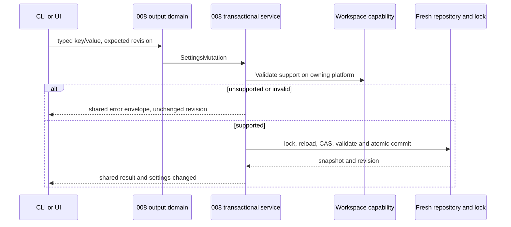
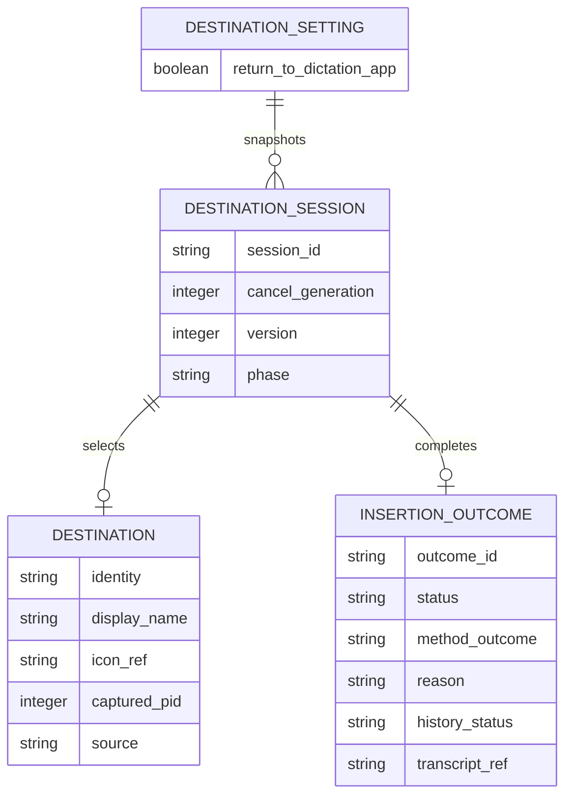

# Implementation Plan: Destination Application

## Summary

Capture one application identity per dictation in a Rust destination manager, allow explicit session changes or one-click removal through a nonactivating badge/menu, then asynchronously activate and verify the application before delegating to the existing insertion method; publish truthful outcomes and preserve conditional history/recovery evidence.

Inspect [the functional source](spec.md) for FR-001–FR-006, AC-001–AC-008 and SC-001–SC-003. Scope **L**: six FR, native macOS/Windows activation, shared insertion lifecycle, 007 method results and 009/010 consumers. Deliver after 008 and before 007/009/010. This document is a plan; no application code, native compatibility or visual certification has been produced.

## Technical Context

| Aspect | Choice | Reason |
|---|---|---|
| Native | Existing Rust 2021, Tauri 2.11.5, Tokio | Keep platform and manager boundaries from manifests |
| Frontend | React 18, TypeScript, Zustand, i18next, existing Tailwind/CSS | Retain overlay and output settings components |
| macOS workspace | Existing objc2-app-kit 0.3, NSWorkspace/NSRunningApplication | Native identity/activation; no shell/AppleScript process |
| Windows workspace | Existing windows 0.61.3 Win32 bindings | Foreground HWND→PID→AUMID or executable path; native activation |
| Storage | 008 settings service for one boolean; existing history SQLite path | No new database table, separate volatile dictation state |
| Concurrency | Session manager + async activation worker + brief main-thread native calls | No sleep, polling loop or blocking worker join on native UI thread |
| Test levels | Cargo unit/integration; Bun adapter; Playwright components; real native harness | Browser mocks cannot prove OS focus/activation |
| Infrastructure | Local OS APIs only | No cloud provisioning or secret required |

Inspect [start/paste lifecycle](../../../src-tauri/src/actions.rs), [coordinator](../../../src-tauri/src/transcription_coordinator.rs), [insertion methods](../../../src-tauri/src/clipboard.rs), [reliable paste](../../../src-tauri/src/paste_tx/mod.rs), [native overlay](../../../src-tauri/src/overlay.rs), [frontend overlay](../../../src/overlay/RecordingOverlay.tsx) and [settings](../../../src-tauri/src/settings.rs) before implementing. At planning time actions.rs saves history only under `wav_saved` and queues `utils::paste` on `run_on_main_thread`; clipboard.rs sleeps before/after a paste and owns current auto-submit and clipboard policy. These are integration constraints, not proofs of insertion.

Inspect [008's approved plan](../008-settings-cli/plan.md) as the framework reference; do not revise it. Reuse its exact `SettingDescriptor`, `SettingsMutation`, `SettingsSnapshot`, `Revision`, `PublicSettings`, `OperationRequest`, `SettingsError`, `StoreLocator`, `SettingsRepository`, `LiveSettingsEffects`, `read_snapshot` and `commit_mutation` names and `settings_service/{descriptor.rs,validation.rs,protocol.rs,errors.rs,store.rs,transaction.rs,live.rs,domains/mod.rs,domains/output.rs}` layout. No independent settings writer, lock, revision counter, transport or renderer is introduced by 006.

## Constitution Check

| Principle | Explicit check |
|---|---|
| Existing native/frontend boundaries | PASS: Rust owns destination/lifecycle; frontend renders typed snapshots and requests choices |
| Manifest-derived stack and managers | PASS: use existing objc2/windows/Tauri; review needed feature flags, no new inference/cloud dependency |
| Tool availability distinct from runtime | PASS: commands below are resolved only; native and UI evidence remains required later |
| Changed behavior specified first | PASS: six FR and eight AC mapped; spec semantics untouched by planning |
| Meaningful tests and source verification | PASS: real session logic, fake OS ports, real file/CLI/native boundary tests, no mocked manager under test |
| Naming and project tooling | PASS: keep existing Rust module conventions and TS filenames; new UI/artifact names kebab-case; retain ESLint/Prettier/Bun rather than changing toolchain |
| i18n and data boundaries | PASS: all badge, toggle, accessibility and reason text through translation keys; no transcript/window-title broadcast or logs above debug |

## Requirement Inventory

| FR | AC / measure | Steps |
|---|---|---|
| FR-001 | AC-001/004; capture <50 ms; stable recording/processing/AI | 1, 2, 4, 7 |
| FR-002 | AC-002/006; ≤1 s activation, no UI freeze, paste none/off/default paths | 1, 4, 7 |
| FR-003 | AC-003/004; badge, one-click removal and pointer menu, update ≤200 ms, no keyboard capture | 1, 5, 7 |
| FR-004 | AC-005; reason ≥4 s; conditional history; available recovery consumers | 4, 6, 7 |
| FR-005 | AC-006; attempted versus verified; separation and consumer contract | 2, 4, 6, 7 |
| FR-006 | AC-007/008; platform availability and CLI parity | 1, 3, 5, 7 |

Entities: volatile Destination, DestinationSession and InsertionOutcome; persistent DestinationSetting in existing AppSettings. Interactions: workspace capture/enumeration/activation, UI snapshot/choice, 008 domain get/set, insertion delegation, conditional history and recovery. No HTTP API, cloud infrastructure, new table or credential setup. Contracts below are local DTO/CLI contracts, not OpenAPI.

## Design Reference

| Screen | Component breakdown | Reference and status |
|---|---|---|
| recording-indicator | Existing indicator + DestinationBadge + RemoveDestination cross + pointer-operated DestinationMenu + transient reason | Spec Screens; mockup intentionally deferred before spec-ship |
| output-settings | DestinationReturnToggle + platform-unavailable reason | Spec Screens; mockup intentionally deferred before spec-ship |

### Penflow Contract Inputs

Authoritative planned IDs are `flow_id: destination-application`, `screen_id: recording-indicator`, `screen_id: output-settings`. The user decision of 2026-10-12 overrides immediate mockup/forward generation: flow contracts, semantic/test IDs and Pencil mockups are produced once for the program before spec-ship. No new IDs are frozen or minted here.

Inspect [the current semantic tree](../../../penflow/semantic-ui-tree.json) as incomplete context: it contains microphone-priority only. The future input `penflow/code-ir.json` and expected tree are absent. Current `livespec penflow-contract status --project . --target web-desktop --json` is BLOCKED/certified=false (missing expected-ui-tree.json, code-ir.json and desktop native geometry). That status is not 006 approval; do not rewrite the root workspace or other feature's contracts during this plan.

Before UI implementation, the program owner must generate the complete cumulative contracts and flow/semantic/test mappings for these planned IDs, produce `penflow/ui.pen`, theme, expected tree and code-ir, and complete bound source review (`review-snapshot`, actual raw reviewer JSON, `review-result`, pipeline plan-review update) plus design certification. The metadata above keeps all four producing procedures required for that later Livespec design pass; no N/A inferred from missing files. Review generated docs, native geometry, homologous mockup references and native export as actual evidence. Use code-ir as primary UI implementation input; retain stable identities after approval. Never substitute today's semantic plan receipt for a Penflow bound result or C51 PASS. No accepted 006 Penflow approval history exists at planning time.

No `.specs/design/theme.css` or theme installation command is currently present. Before UI work, consume the one-pass theme, install/import only if its variables are absent, and guard against repeated installation. Existing CSS tokens remain until then. Final badge/menu dimensions come from approved geometry, not a fabricated 256×50 mockup.

## Architecture Decisions

### Session and application identity

`DestinationManager` owns `DestinationSession {session_id, cancel_generation, version, phase, return_enabled, support, selection, captured_at}`. `selection` is `FrontmostAtEnd` or `Application {identity, display_name, icon_ref, captured_pid, source}`; `source` is captured or badge (009 will add its own PIN policy). Destination is an application, never a saved field/window. Keep last-active-window semantics to the OS, no AX classification in 006. The focused-field read/write/read-back port used by 007 direct insertion is owned by 007; the pre-insertion editability classifier is owned by 010. Destination consumes neither as proof of its own activation or field insertion.

Capture when a recording actually starts, including a queued coordinator press when it drains, not when a key press was remembered while busy. Snapshot support and setting, read frontmost before showing any Handy surface, and create/commit the session only on successful recording start. Discard tentative state on mic/model/start failure. Capture work is bounded <50 ms, including the native main-thread hop; delay/capture failure is a capability failure with the old insertion path and explicit unavailable reason, not a fabricated destination. Do not enumerate all windows or load icons synchronously on this path. Cache small icon assets by app identity and finish badge rendering asynchronously; snapshot its icon reference/availability rather than holding UI/native objects across threads. Native spike must prove this tuple and latency.

macOS identity is bundle identifier; PID and process start identity defend against PID reuse. Windows prefers AUMID, otherwise canonical executable path; keep HWND only as an activation hint, not field-level authority. Revalidate HWND→PID→identity at activation. Exclude Handy and its panels/helpers by own process identity. Same app clicked is a no-op. Restart: if original PID is gone, resolve a running instance with the same stable identity; prefer a still-valid captured instance, otherwise one unambiguous matching instance. Multiple ambiguous matches fail closed as activation_failed; do not select an unrelated process by display name. Closed identity is app_closed, never auto-launch. Icons/names have native fallback handling without inventing a target.

Freeze `return_enabled` and capability for each accepted dictation so CLI/UI changes affect the next dictation, as Story 5 specifies. Capture and selection stay unchanged through recording, processing and AI except explicit badge choices. The badge cross calls the same FrontmostAtEnd selection mutation as the menu entry: one click clears only this session, leaves the persistent setting unchanged, and updates the badge within 200 ms. Give the cross its own localized accessible name "Remove destination"; stop event propagation so its click does not open the menu or take keyboard focus. Expose the control until insertion begins, including processing/AI; then hide/disable it and reject queued removal commands. Repeated removal of FrontmostAtEnd is a no-op. No destination setting or selection from a later session is changed. A mutation requires exact session_id/version and phase before Inserting; insertion entry atomically freezes selection, closes any menu and rejects late choices. Cancellation invalidates the session/generation; late native replies and stale UI events cannot activate or insert into the next session.

### Platform support and menu enumeration

`WorkspacePort` exposes `capability`, `frontmost`, `running_windowed_apps`, `resolve_identity`, `activate_once`, `observe_frontmost`. Native calls return typed snapshots, not framework objects. macOS uses NSWorkspace frontmost/running apps and NSRunningApplication; Windows uses GetForegroundWindow/GetWindowThreadProcessId, AUMID/path lookup, EnumWindows and SetForegroundWindow. Inspect [Apple frontmostApplication](https://developer.apple.com/documentation/appkit/nsworkspace/frontmostapplication) and [NSRunningApplication](https://developer.apple.com/documentation/appkit/nsrunningapplication) as informative API context. Inspect [Microsoft SetForegroundWindow restrictions](https://learn.microsoft.com/en-us/windows/win32/api/winuser/nf-winuser-setforegroundwindow) as informative context: an activation request is not proof of foreground success.

Linux is explicitly unsupported; macOS/Windows become unsupported when frontmost cannot be read. Distinguish a readable Handy foreground (supported, no destination) from no readable foreground. On supported systems the default boolean is true. Unsupported state is `{available:false, reason}` with old insertion behavior, hidden badge and disabled toggle with localized explanation; no persisted forced false and no silent write. Setting attempts on unsupported systems return 008 `unavailable`/exit 5, including both true and false; type-invalid inputs return validation_failed/2 first. Reads are nonmutating and report value plus support. A failure after a valid destination was captured is activation_failed/app_closed, never a switch to the legacy frontmost path.

At menu-open read frontmost before touching surface focus, list that non-Handy app first, then deduplicated other running applications with user windows, and finally Frontmost app at the end. Exclude daemon/helper/windowless entries from the remaining list; do not expose window titles. Current chosen destination is marked. Entries use opaque manager tokens; stale/closed choice is rejected without changing session, refresh list, and localized feedback; never accept caller PID/name alone. Clicking outside dismisses unchanged. Badge/menu is pointer-operated per approved spec, while settings toggle supports Tab/Space and a spoken label.

### Activation and insertion threading

The orchestrator performs: check cancellation → freeze chosen destination → retain final text/history status → skip activation if paste_method=none → resolve target → request activation once → await foreground condition bounded by monotonic 1 s → schedule existing method → recheck cancellation and target immediately before actual first dispatch. The 1 s deadline bounds activation request scheduling and foreground observation only. A late activation callback cannot authorize insertion. Successful foreground observation within the deadline creates a session/generation-bound activation authorization; configured insertion delays occur afterwards and are not charged to the activation deadline. At actual dispatch after such a delay, require a fresh foreground and cancellation check; never reuse a stale foreground observation or reactivate on failure. OS notifications may wake observation, with bounded async sampling as fallback. Brief AppKit/native requests run on main thread via returned channels; all deadline waiting happens on worker/Tokio. Never join a worker, sleep, enumerate all apps or poll for 1 s inside run_on_main_thread.

A single activation call, no retry on failed final recheck. Already-frontmost still rechecked. Deadline 999/1000/1001 ms boundaries tested with injected Clock; timeout/cancellation invalidates activation callbacks. Test observation at 100 ms with paste_delay_ms=1500: valid foreground/cancellation checks after the preserved delay permit dispatch; focus loss during that delay prevents it without reactivation. Off/unsupported/no destination/FrontmostAtEnd retains current insertion policy and does not activate a captured app. PasteMethod::None can retain existing clipboard output policy, but has `skipped` outcome, never `insertion_attempted` and never activates. Empty final text/cancel produces no activation/input.

Retain configured method behavior (direct, ctrl_v, shift_insert, ctrl_shift_v, external_script), delays, trailing-space, existing clipboard handling and legacy auto-submit semantics. When 007 ships, delegate macOS `smart_paste` to its own adapter after destination activation; its clipboard read/no-read timings replace only its post-paste delay as specified by 007. For applicable applications, 007 first tries AXSelectedText and reads the value back: exact expected replacement → inserted, verified without touching the clipboard; unchanged value → clipboard fallback; unexpected change → uncertain without fallback or duplicate insertion. This direct attempt adds at most 150 ms before fallback. For clipboard paste, count reads only after Cmd+V, restore after 300 ms quiet since the LAST read, with an 8 s cap measured from the FIRST read; no read within 800 ms means not read and no restoration, leaving the transcript published. Jump Desktop keeps the current 007 exceptions (1.5 s quiet / 3 s no-read); changeCount still protects newer copies. These decisions and all timers are owned by 007, never reimplemented or reset by 006. Windows reliable paste and Linux methods remain unchanged. Introduce a thin `InsertionPort` adapter around clipboard.rs, adding an optional pre-dispatch guard, not a replacement method algorithm. Its guard runs **after paste_delay_ms**, immediately before first emitted key/text or external-script launch, with no clipboard-policy side effects for an unavailable destination. When feasible check at subsequent direct-typing chunk boundaries to abort on lost focus; the final unavoidable OS race remains documented. Do not advertise atomic focus+injection or verified field text.

Separate timing from UI ownership: async orchestration schedules existing bounded native method calls where required; configured activation wait adds no main-thread freeze. Existing long direct-typing/external-script/delay paths are already a responsiveness risk; Step 1 measures them and Step 4 extracts waits and process waiting to workers while keeping thread-bound key/clipboard calls brief, preserving output bytes, method choice and delays. Such scheduling changes are technical integration, not a new insertion method. If the selected existing adapter cannot preserve these boundaries, block its implementation proof rather than claim responsive UI.

006 does not add Enter: current legacy auto-submit remains inside existing adapter until 009 takes ownership. Provide 009 with the frozen target identity and terminal method outcome; its later change must route legacy, Windows reliable-paste and macOS smart-paste auto-submit through its own policy to prevent duplicate or wrong-target Enter. For smart paste, only `inserted, verified`, `read observed` and `typed` are eligible for automatic Enter in 009 (which still applies its target/frontmost, PIN, recovery and exactly-once guards); `not read`, `permission missing`, `uncertain`, `clipboard handed over` and `insertion failed` are not. 007 owns its direct AX insertion and exact read-back verification, fallback decision, pasteboard snapshot, publication, read detection, timing and guarded restoration; destination never restores or changes clipboard settings. Existing reliable-paste enqueue success is not a smart-paste terminal result or field verification. Method errors after partial delivery cannot undo characters; no fallback to another application or retry is performed.

### Outcome, conservation and staged recovery

Native `InsertionOutcome` v1: `{session_id, cancel_generation, outcome_id, target: Option<ApplicationIdentity>, destination_source, status, method_outcome, reason, history_status, history_entry_id, transcript_ref, completed_at}`. Status is `insertion_attempted | failed | clipboard_handed_over | skipped | cancelled`; destination failure reason remains `app_closed | activation_failed | insertion_failed`. Optional `method_outcome` preserves all eight terminal 007 results: `read observed` (reported by 007 as "insertion attempted, read observed"), `not read`, `permission missing`, `typed`, `clipboard handed over`, `insertion failed`, `inserted, verified`, or `uncertain`; it is absent when no method ran or an existing method has no detailed result. Map inserted, verified/read observed/typed to insertion_attempted in the destination status, preserving exact method_outcome and its method-owned evidence; 006 never produces a field verification claim. Map not read/permission missing/uncertain/insertion failed to failed with insertion_failed reason while preserving the exact method detail; clipboard handed over to clipboard_handed_over, neither attempted field insertion nor failure. It displays 007's localized "Text placed on the clipboard for the remote screen" information, with no automatic Enter or failure recovery from that result alone. `history_status` is saved/not_saved/failed, assigned only from actual WAV/save_entry result. `transcript_ref` is an opaque native reference, never plaintext in an event. No `verified` success flag. UI receives metadata only through typed `destination-changed` and `insertion-outcome`; trusted native consumers access retained text by current session reference. Event/consumer dedup uses outcome_id, no text-based deduplication.

Producer is destination orchestration at the former paste completion in actions.rs, exactly once per terminal session. 007 is the smart-paste method result producer, not a recovery-window consumer: the InsertionPort awaits its direct read-back or clipboard read/no-read completion without blocking the UI and never turns transaction enqueue into a terminal success. 009 consumes target and exact method_outcome for its Enter policy; 010 consumes app/activation failures and the terminal not read/permission missing/uncertain/insertion failed results with the retained transcript reference for its bubble and field classification. Consumer decisions wait for that result. 010 Copy publishes new clipboard content, so 007's changeCount guard abandons pending restoration; 006 invokes no cancellation-of-window API and introduces no clipboard_recovery_* key. Hand off to registered consumers, not a dependency on an absent feature. Consumer registry declares its reason-presentation capability. Avoid broadcasting transcript via app-wide events/logs. Contract tests verify optional/missing consumers, duplicate and stale events.

History guarantee is explicitly conditional as AC-005/SC-002 require: keep existing WAV-gated save, never claim history when WAV or save_entry fails. Story 4's history assertion is exercised with successful saving as its precondition; spec is not silently rewritten. Preserve the final text in the native recovery slot on destination failure even when history fails; keep latest unresolved outcome until superseded by a later final result, explicit consumer release or process exit. This bounded volatile slot is technical handoff storage, not durable history or a new recovery feature; old references fail explicitly. No restart/crash survival is claimed without a successful history save. A later successful dictation can supersede it; log/notice history failure separately without transcript. This limitation must be stated truthfully in native proof.

While 010 is absent, visible-overlay failures use a dedicated reason state in the indicator for **at least 4 s measured from visible presentation**; do not run the unconditional hide-after-paste path first. Existing generation guard extends to reason timers so a previous failure cannot hide a new recording. If another recording starts during these 4 s, keep reason in the dedicated nonactivating surface until its minimum display duration instead of overwriting/hiding it. App closed, activation failed and insertion failed have distinct localized text; text preservation description reflects actual history status. Tray returns idle independently of reason lifetime.

**006→010 ownership:** once 010 advertises reason presentation, delegate the failure reason/transcript reference to its bubble for all styles, including overlay none, and suppress the duplicate indicator reason. 010 inherits the ≥4 s minimum reason visibility obligation from 006; its AC-001 replaces the surface, not conservation or truthful status. Require a 010 consumer acknowledgement before suppressing 006's visible fallback. No handler/acknowledgement → fallback ≥4 s when an overlay is enabled. With style none before 010 ships, emit typed outcome plus existing paste-error feedback to the settings listener and retain text/history; there is no visible recovery bubble yet. Document that staged limitation; do not enable an overlay against the user's none setting or invent a certification of the absent bubble. 007 method-result integration and 010 recovery behavior are tested when their owners ship.

### Settings and local contracts

Add `return_to_dictation_app: bool` descriptor to 008's existing output domain and PublicSettings projection, rather than registering a second output domain. Commands: `handy settings output get return_to_dictation_app --json`, `handy settings output set return_to_dictation_app true|false --json`, also generic get/set via that descriptor. UI command uses the same SettingsMutation and pure validation/capability guard; read_snapshot/commit_mutation use 008's same latest-state validation, expected revision, lock, durable persist and LiveSettingsEffects. Do not persist session destination, icon, PID or selection in AppSettings. No-op does not increment; success increments once; stale CAS/error leaves store unchanged. Domain output help extends additively and keeps method/clipboard keys separate. 007 adds `paste_method=smart_paste` through this same 008 output-domain descriptor/framework, with UI parity and validation_failed/exit 2 outside macOS; 006 only adds return_to_dictation_app and neither implements 007's migration nor invents clipboard recovery settings.

Return exactly 008 envelopes `{ok:true,revision:N,data:{...}}` or `{ok:false,error:{code,message,details:{...}}}` and existing exit mapping 0/1/2/3/4/5. Unsupported set: `unavailable`, reason/platform in details, exit 5, no revision change. Invalid bool: validation_failed/2; stale CAS: revision_conflict/3 with current_revision. Success is configuration only, never insertion evidence. Startup missing-key default/migration runs only through 008 service; pure reads do not write. UI receives settings-changed revision/key names and discards older refreshes. Live availability may change independently of boolean; a private capability update refreshes disabled state without a settings revision write.

New local contract artifact is [destination contract](contracts/destination-contract.md): typed session commands, outcomes, availability and settings command matrix. No new network endpoint and no openapi.yaml.

## Gherkin Scenarios and Sequence Diagrams

```gherkin
Feature: Destination routing
  Scenario: Explicit override through AI processing
    Given dictation starts in ChatGPT and destination return is supported and on
    When the user switches to Comet and chooses Comet during processing
    Then the badge updates within 200 ms and Comet becomes the frozen target
    When insertion starts
    Then the menu closes and late selections are ignored
    And Comet is frontmost within 1 second before the method dispatches
  Scenario: Preserved insertion delay exceeds the activation budget
    Given the target becomes frontmost at 100 ms and paste_delay_ms is 1500
    When the configured insertion delay ends with the target still frontmost
    Then the method dispatches with a fresh foreground and cancellation guard
    And the 1 second activation deadline has not shortened the insertion delay
  Scenario: Focus changes during the configured pre-paste delay
    Given TextEdit was activated and paste_delay_ms is nonzero
    When Safari becomes frontmost before actual dispatch
    Then no input is dispatched and activation_failed is reported without retry
  Scenario: Smart paste has not yet reported consumption
    Given the destination was activated and 007 started smart paste
    When only transaction enqueue has succeeded and no terminal result exists
    Then no terminal insertion outcome or automatic Enter is authorized
    When 007 reports not read after its no-read deadline
    Then the exact method result is retained and 010 receives insertion failure
```

```mermaid
sequenceDiagram
  participant U as User
  participant D as DestinationManager
  participant W as WorkspacePort
  participant UI as Nonactivating badge and menu
  participant I as Existing insertion adapter
  participant R as Registered recovery consumers
  U->>D: Actual recording start
  D->>W: Capture foreground and identity
  W-->>D: Application or FrontmostAtEnd
  D-->>UI: Session snapshot
  U->>UI: Select Comet before insertion
  UI->>D: Choose with session/version token
  D-->>UI: Updated destination
  D->>D: Freeze destination and close menu
  alt none or cancelled
    D-->>R: skipped or cancelled
  else chosen app
    D->>W: Resolve and activate once
    W-->>D: Async foreground observation within 1 s
    alt closed or timeout
      D-->>R: Failed outcome, retained reference/history status
    else foreground observed
      D->>I: Existing method plus pre-dispatch guard
      I->>W: Final foreground recheck after delay
      alt wrong target
        I-->>D: activation_failed; no input
      else target remains foreground
        I-->>D: Terminal method result (007 direct or clipboard decision awaited)
      end
      D-->>R: Exact method result plus attempted destination status
    end
  end
```

```gherkin
Feature: Destination output settings
  Scenario: Unsupported CLI set
    Given the workspace capability is unsupported and revision is 41
    When the CLI sets return_to_dictation_app with JSON output
    Then one unavailable envelope returns exit 5
    And the store and revision stay unchanged and no activation happens
  Scenario: Supported UI and CLI parity
    Given supported capability and revision 41
    When the CLI sets false with expected revision 41
    Then shared commit_mutation persists revision 42 and the UI refreshes
    And the next dictation uses the frontmost-at-end policy
```




### Refinement acceptance scenarios (2026-10-13)

```gherkin
Feature: One-click removal and truthful insertion handoff
  Scenario: Cross removes destination during AI processing
    Given the session destination is ChatGPT and Comet keeps keyboard focus
    When the user clicks the cross once before insertion starts
    Then Frontmost app replaces the badge within 200 ms
    And the menu stays closed and return_to_dictation_app is unchanged
    And the control is announced as Remove destination
    And insertion later uses the frontmost application
  Scenario: Cross loses the insertion-entry race
    Given insertion entry has frozen the selected destination
    When a queued cross click arrives
    Then the frozen selection is unchanged and the command is rejected
  Scenario: Direct result retains method evidence
    Given 007 reports inserted, verified after exact AX field read-back
    When 006 publishes the result
    Then destination status is insertion_attempted with exact inserted, verified method_outcome
    And 009 may evaluate Enter but 006 claims no field verification of its own
  Scenario: Unexpected AX change prevents duplicate insertion
    Given 007 reports uncertain without clipboard fallback
    When 006 publishes the result
    Then status is failed with the exact uncertain method_outcome
    And 010 receives the retained transcript and no Enter is authorized
  Scenario: Clipboard restoration belongs to 007
    Given 007 observed post-Cmd+V reads at 50 ms and 250 ms
    When its restoration decision occurs
    Then 006 has neither restored nor reset any timer
    And owner-contract evidence requires 300 ms quiet after 250 ms with an 8 s first-read cap
  Scenario: No post-keystroke read
    Given 007 reports not read after 800 ms without a post-Cmd+V read
    When 006 routes recovery
    Then 010 receives not read and 009 sends no Enter
    And 006 never restores the previous clipboard or withdraws the published transcript
```

P0 owner-contract tests in destination_contract.rs use actual destination mapping with injected method results and clipboard side-effect spies: all eight results, late/duplicate callbacks, direct unchanged fallback, unexpected-change no-fallback, repeated reads and 299/300 ms quiet boundaries, 799/800 ms no-read and 8 s cap, plus Jump Desktop exception metadata and Copy changeCount abandonment. They test preservation/routing and absence of 006 clipboard effects; 007 executes its algorithms and native proof in its own suite. Add native cross-click focus/label/latency evidence on macOS and Windows, including a queued click at insertion entry.

## Gherkin Scenarios and State Diagram

```gherkin
Feature: Session lifecycle
  Scenario: Stale choice cannot redirect next session
    Given session A has entered Inserting and session B later starts
    When a delayed menu selection for A arrives
    Then neither frozen A nor session B changes
  Scenario: Cancellation during activation
    Given an activation callback is outstanding
    When the session is cancelled
    Then the callback cannot send input or revive the session
  Scenario: Failure reason lifetime
    Given 010 is unavailable and the indicator is enabled
    When an insertion failure is presented
    Then its reason remains visible for at least 4 seconds
    And a new recording cannot be hidden by its timer
```



```mermaid
stateDiagram-v2
  [*] --> Recording : accepted start and capture
  Recording --> Recording : valid explicit choice or cross removal
  Recording --> Processing : recording stopped
  Processing --> Processing : valid explicit choice or cross removal through AI
  Processing --> Activating : freeze chosen app and close menu
  Processing --> Inserting : legacy frontmost path
  Processing --> Skipped : method none or empty text
  Activating --> Inserting : foreground before deadline
  Activating --> Failed : closed or timeout
  Inserting --> Attempted : legacy success or 007 inserted verified / read observed / typed
  Inserting --> HandedOver : 007 clipboard handed over
  Inserting --> Failed : final recheck or 007 not read / permission missing / uncertain / insertion failed
  Recording --> Cancelled : cancellation
  Processing --> Cancelled : cancellation
  Activating --> Cancelled : cancellation
  Failed --> Retained : history status and recovery handoff
  Retained --> [*] : released or superseded
  Attempted --> [*]
  HandedOver --> [*] : remote clipboard information; no Enter
  Skipped --> [*]
  Cancelled --> [*]
```

## Logical Entity Diagram

This is an in-memory relationship diagram; the existing settings/history stores receive no new table.



## Implementation Plan

### Step 1 — Prove native feasibility before feature wiring

**Prerequisite:** 008 implemented with its service and current spec/plan gates READY; program UI contract design gate completed before UI code.
**Required inputs:** Current overlay/clipboard/action source, target OS versions, test applications, approved one-pass geometry, native workspace APIs.
**Action:** New `scripts/destination-native-proof.ts` orchestrates real app runs and evidence collection; new `src-tauri/tests/destination_platform.rs` exercises injectable native boundary adapters. Spike macOS NSPanel badge resizing and a separate nonactivating `destination_menu` webview panel (can_become_key_window=false); Windows no-activate HWND/WebView2 surface using WS_EX_NOACTIVATE and WM_MOUSEACTIVATE handling. Prove pointer open/select/dismiss preserves keyboard focus, last-active-window/Space activation, capture tuple <50 ms, ≤1 s activation, delay-time final recheck and UI heartbeat. Include existing slow direct/external-script/clipboard delays before selecting safe worker scheduling. No normal NSMenu tracking loop which captures keyboard. Use a dedicated nonactivating panel for menus/reasons; resize badge host beyond its current 256×50 using approved geometry, preserving existing streaming layout.
**FR covered:** FR-001.1: Native capture feasibility, FR-002.1: Activation and thread spike, FR-003.1: Nonactivating surface spike, FR-006.1: Platform capability proof
**Execution evidence:** Binary/OS hash, per-app identity/activation timing, foreground/focus timeline, heartbeat and surface geometry/export receipts; macOS TextEdit/Notes/ChatGPT/Comet and Windows two apps.
**Success criteria:** Both native platforms prove intended APIs and no menu keyboard capture, with recorded failures; no inferred support from browser screenshot.
**Failure handling:** Activation restriction or focus-stealing surface blocks that platform's implementation delivery; do not add unsupported activation hacks or relax AC.

### Step 2 — Introduce session manager and typed contracts

**Prerequisite:** Step 1 feasibility and chosen surface recorded.
**Required inputs:** Contract below, coordinator generations, typed WorkspacePort/Clock/InsertionPort/HistoryPort/RecoveryPort boundaries.
**Action:** New `src-tauri/src/destination/{mod.rs,session.rs,workspace.rs,outcome.rs}` define DestinationManager, typed state/identity/version tokens, pure transitions, registry and retained transcript ownership. Register manager in lib.rs. New inline Rust tests cover immutable capture, explicit choices and cross removal/no-op/insertion-boundary races, queued actual-start capture, restart/PID reuse and stale/cancelled generations. Add adapters in `destination/{macos.rs,windows.rs,unsupported.rs}` after spike; review required Cargo feature flags without new shell dependency.
**FR covered:** FR-001.2: Stable session and identities, FR-005.1: Typed attempted outcome contract
**Execution evidence:** State transition unit transcript; guarded OS-call spies at output boundaries, exact serialized DTO contract test.
**Success criteria:** All explicit state transitions and dedup/reference rules hold; no transcript in public metadata; session is never persisted.
**Failure handling:** Missing identity, stale callback or leaked transcript is P0; no mutable global foreground target fallback.

### Step 3 — Add destination key to 008 output domain

**Prerequisite:** 008 writer migration, service and domain framework complete; Step 2 capability port available.
**Required inputs:** 008 SettingDescriptor/SettingsMutation/SettingsError, read_snapshot/commit_mutation and LiveSettingsEffects, existing AppSettings/UI command patterns.
**Action:** Modify `src-tauri/src/settings.rs` for default boolean; modify existing `settings_service/{descriptor.rs,validation.rs,live.rs,domains/output.rs}` to add the key, projection, shared boolean/support validation and help. Add destination native commands in new `src-tauri/src/commands/destination.rs` and register in commands/mod.rs and lib.rs. Regenerate bindings.ts via supported specta export during implementation. New `src-tauri/tests/destination_cli.rs` invokes real production CLI domain and UI command adapter with isolated stores and OS capability ports.
**FR covered:** FR-006.2: Shared UI and CLI settings parity
**Execution evidence:** JSON stdout/stderr/exits, no-op/CAS/revision/store hashes, same unsupported error via both adapters; concurrent mutation preserves unrelated 008 fields.
**Success criteria:** One envelope, revision and transaction implementation; unsupported refuses with no mutation, pure reads never write.
**Failure handling:** Any direct writer or second lock/renderer blocks integration; never patch 008 plan to mask mismatch.

### Step 4 — Wire capture, async activation and guarded dispatch

**Prerequisite:** Steps 2–3 PASS with stable session commands.
**Required inputs:** actions.rs real start/stop/history/paste path, cancellation generation, existing method adapters and worker scheduling from spike.
**Action:** Modify actions.rs and transcription_coordinator.rs only at actual accepted start/finish/cancellation boundaries; capture before overlay display and preserve through processing/AI. New `destination/insertion.rs` orchestrates freeze/resolve/one-shot activation/async deadline. Modify clipboard.rs to accept optional guard at actual dispatch after existing delay; move waits/process waiting off main where needed, preserving method and clipboard/auto-submit results. Windows reliable-paste launch uses the same guard and truthful enqueue result; keep its paste_tx algorithms and legacy semantics. When 007 ships, add its macOS smart_paste adapter behind InsertionPort, preserve its terminal direct read-back/clipboard result and await it off the main thread; destination never owns snapshot/restoration or layout policy. New `src-tauri/tests/destination_insertion.rs` uses fake Workspace/Clock/Insertion/History ports but real orchestrator; include scheduling failure and post-activation focus loss.
**FR covered:** FR-001.3: Actual-start lifecycle integration, FR-002.2: Async guarded target dispatch, FR-004.1: Failed target prevents fallback, FR-005.2: Preserve method and outcome separation
**Execution evidence:** Deterministic deadline/cancel/final-guard fault transcripts, exact method byte regression and native heartbeat/target logs without transcript.
**Success criteria:** No destination retry/fallback on chosen-app failure; guard before input, none/cancel no activation, old frontmost behavior for off/no destination/unsupported.
**Failure handling:** Never infer native delivery from method return; partial delivery remains insertion_failed and no replay; residual focus race is recorded.

### Step 5 — Build badge, pointer menu and settings toggle

**Prerequisite:** Program one-pass Penflow contracts/code-ir/mockups and bound approval/design certification complete; Steps 1–4 available.
**Required inputs:** Planned flow/screen IDs, approved semantic/test IDs/theme/native geometry, generated bindings and live support snapshots.
**Action:** Modify `src/overlay/RecordingOverlay.tsx` and RecordingOverlay.css; new `src/overlay/destination-badge.tsx`, `destination-menu.tsx` and `destination-state.ts` for metadata/state, pointer events and versioned choices. Add a separate cross hit target and translated "Remove destination" label, consume its click without opening the menu, and reuse FrontmostAtEnd command/version guards; no persistent setting mutation. Hide/disable cross at insertion entry, reject late events, preserve focus and verify ≤200 ms badge update. Modify overlay.rs to own the nonactivating dedicated menu/reason surfaces and badge geometry; new `src/components/settings/destination-return.tsx` wired into existing advanced output settings. Modify settingsStore.ts/useSettings.ts for revision/capability updates; add English/French translation keys and reconcile remaining locales per translation workflow. Configure Tauri capabilities narrowly for new surface label and commands. New `tests/destination-ui.spec.ts` under actual Playwright testDir and `src/overlay/destination-state.test.ts` prove component state and stale-event behavior.
**FR covered:** FR-003.2: Badge and pointer menu behavior, FR-006.3: Accessible settings and unavailable reason
**AC covered:** AC-003: badge label and visibility; AC-004: one-click cross with accessible label, event isolation and insertion-entry freeze; foreground-first menu, current-session choices, dismiss unchanged, ≤200 ms update, insertion close and no keyboard focus capture; AC-007: unsupported reason.
**Execution evidence:** Browser component assertions plus native focus proof, approved mockup comparison, screen-reader badge label, toggle Tab/Space, ≤200 ms choice-to-badge measurements.
**Success criteria:** Icons/names or Frontmost app, badge hidden for off/unsupported/none, cross clears only current destination without menu/focus/settings side effects; menu first/remaining/end ordering, dismiss unchanged and insertion closes/rejects choices; keyboard remains with app.
**Failure handling:** Browser PASS cannot waive native focus or Penflow gates; unsupported surface/undefined state remains BLOCKED.

### Step 6 — Preserve outcome and present failures across staged consumers

**Prerequisite:** Step 4 terminal outcomes and Step 5 surfaces available.
**Required inputs:** Actual WAV/save_entry results, reason Clock/presentation acknowledgement, 007 method results and optional consumers 009/010.
**Action:** Modify actions.rs and destination/outcome.rs to retain final text and publish one truthful metadata outcome; record actual conditional history status. Modify overlay.rs/RecordingOverlay.tsx to hold reason ≥4 s with generation-safe timers/dedicated fallback, and App.tsx existing paste-error listener for localized metadata fallback. New `src-tauri/tests/destination_recovery.rs` verifies real outcome registry with absent/present/failed-ack fake consumers, volatile reference ownership and history faults. Consume the eight exact 007 terminal results when its owner implements smart paste, and add 009/010 consumer adapters only when their owners implement them; no implementation of those features here. Test pending direct verification/clipboard decision states, dedup/stale terminal callbacks, Enter eligibility and clipboard hand-over information separately from failure recovery.
**FR covered:** FR-004.2: Retention and reason lifetime, FR-005.3: Optional recovery and Enter handoff
**Execution evidence:** History save success/failure/not_saved matrix, reason visibility timings, eight smart-paste results with no premature outcome/Enter, outcome shape and dedup, 010 capability delegation tests and raw transcript recovery comparison using safe test phrases.
**Success criteria:** Never claim a missing history entry or field verification; same failed transcript handed to every available consumer; 010 suppresses indicator reason only after acknowledgement, carries ≥4 s obligation.
**Failure handling:** Lost active reference/false history success blocks delivery; absent 010/style-none feedback and volatile supersession/crash limitations remain explicit, never called certified recovery.

### Step 7 — Prove complete acceptance and platform regression

**Prerequisite:** Six steps implemented and relevant platform release binaries built.
**Required inputs:** Actual binaries, target app fields, native harness, independent AC/SC assertion inventory, reviewed UI identities and isolated settings/history fixtures.
**Action:** Run resolved commands below; capture native scenarios per app including ChatGPT→Comet, app quit/restart/PID reuse, multiple windows/fullscreen Space, Handy frontmost, none/off/unsupported, cancelled/stale choices, activation timeout, insertion failure, pre-dispatch focus race, reason lifetime, history WAV/save failure, and CLI. New `src-tauri/tests/destination_contract.rs` verifies all eight 007 terminal outcomes, direct read-back/clipboard decision waiting, 009 eligibility, 010 failure routing and Copy changeCount abandonment, consumers and typed command output; preserve the Windows reliable-paste regression. Extend native harness with real foreground event/callback timing, UI heartbeat and actual text comparison; no target app text logs. Feed proof to spec-test with AC/FR mapping and current build identity.
**FR covered:** FR-001.4: Capture and session acceptance, FR-002.3: Native activation and no-freeze proof, FR-003.3: Badge focus and timing proof, FR-004.3: No-fallback and conservation proof, FR-005.4: Outcome consumer contract proof, FR-006.4: Cross-platform and CLI proof
**Execution evidence:** Native evidence folder, per-app table, command transcripts/exits, assertion matrix, focus/timing and UI captures; test phrase comparisons kept only in private proof artifacts.
**Success criteria:** All AC and SC observed with real target/native evidence where needed; no unexplained regression or missing platform proof.
**Failure handling:** Windows or app compatibility cannot be inferred from macOS/browser mocks; wrong-app characters, swallowed save error or UI freeze block platform release.

## Resolved Test Commands

Availability rechecked 2026-10-13 (Cargo/Bun and local tool paths); historical rustc/clippy/rustfmt versions below are not re-certified by this refinement: Cargo 1.94.0, rustc 1.94.0 and Bun 1.3.9 present. Commands/tests below were **not executed** in this plan. No surfaces.yaml exists; Playwright testDir is `tests`, Rust integration directory `src-tauri/tests`.

| Action | Command | Status |
|---|---|---|
| Rust unit | `cargo test --manifest-path src-tauri/Cargo.toml --lib destination` | Cargo available; proposed inline tests not created |
| Rust integration | `cargo test --manifest-path src-tauri/Cargo.toml --test destination_insertion --test destination_recovery --test destination_cli --test destination_contract` | Tool verified; planned targets/native build not verified |
| Native adapter | `cargo test --manifest-path src-tauri/Cargo.toml --test destination_platform` | Planned target; execute on macOS and Windows |
| Full Rust | `cargo test --manifest-path src-tauri/Cargo.toml` | Resolved; no suite PASS claimed |
| Frontend pure state | `bun test src/overlay/destination-state.test.ts` | Bun available, test planned |
| Existing regression | `bun run test:keyboard` | Existing script, not run here |
| Browser integration/visual | `bun run test:playwright -- tests/destination-ui.spec.ts` | TOOL NEEDED `bun install`, then `bunx playwright install chromium`; local binary absent |
| Native release/manual | `bun scripts/destination-native-proof.ts --binary <absolute-release-binary> --platform <macos\|windows> --out <proof-directory>` | Bun present; harness planned, no native runner proof |
| Type check/build | `bunx --no-install tsc --noEmit`; `bun run build`; `cargo check --manifest-path src-tauri/Cargo.toml` | Local TS dependency absent; TOOL NEEDED `bun install`; native deps/build unverified |
| Lint | `bun run lint`; `cargo clippy --manifest-path src-tauri/Cargo.toml --all-targets -- -D warnings` | ESLint absent; install pinned frontend deps; clippy 0.1.94 available; checks not executed |
| Format | `bun run format:check`; `cargo fmt --manifest-path src-tauri/Cargo.toml -- --check` | Frontend local dependency absent; rustfmt 1.8.0 available; formatting not executed |
| Translations | `bun run check:translations` | Existing script; run after added keys during implementation |
| Full acceptance | Rust + frontend state + keyboard + browser + type/lint/format/translation + native macOS/Windows evidence | Composite future gate, zero unaccounted failures |

Seams: WorkspacePort and monotonic Clock cover activation/enumeration and deadlines; InsertionPort/ClipboardPort expose side effects only, keeping actual orchestration/service logic under test; HistoryPort fault-injects WAV/save_entry results; RecoveryPort controls reason acknowledgements/consumers. Audio enumeration belongs behind the audio feature's AudioDeviceCatalog, 007 direct AX read/write/read-back behind its injectable focused-field port; 010 pre-insertion AX classification behind its classifier, and LLM behind existing post-process client port; 006 does not query those interfaces. For pipeline integration, inject their completions/errors/cancellation to prove destination stability through audio/AI, without reimplementing their owners or mocking destination logic. Native adapters use private test stores and safe test phrases; no paid LLM or production clipboard needed by unit tests.

## Testing Strategy

| Priority/level | Concrete tests / assertions | FR/AC/SC |
|---|---|---|
| P0 unit | session.rs inline: start/queued start/Handy exclusion, switch during recording/AI, explicit/end selection and cross removal/no-op, freeze/stale/cancel, restart identity/PID reuse | FR-001; AC-001/004 |
| P0 integration | destination_insertion.rs: 1 s boundaries, no main-thread wait, cancellation in queued callbacks, guard after delay, dispatch failure, none/off/unsupported/no destination, actual method delegation | FR-002/004/005; AC-002/005/006; SC-002 |
| P0 integration | destination_recovery.rs: WAV false/save failure/save success, no false entry, volatile retention, eight smart-paste results, delayed terminal completion, optional/duplicate/stale consumers, 010 reason ack and minimum visibility, no other app fallback | FR-004/005; AC-005/006; SC-002 |
| P0 real CLI/service | destination_cli.rs: boolean invalid, unavailable read/set, stale CAS, no-op, concurrent key changes, exact one JSON envelope/exits/revision and UI parity | FR-006; AC-007/008 |
| P1 frontend + native | destination-state.test.ts, destination-ui.spec.ts: icon/name/fallback label, hidden badge, cross one-click/label/no-menu/focus and settings invariant, ordering/dismiss/mark selection, removal race at insertion, close on insertion, ≤200 ms, settings Tab/Space, screen-reader label | FR-003/006; AC-003/004/007 |
| P1 native macOS | harness: TextEdit, Notes, ChatGPT desktop, Comet; start/switch/explicit Comet, last window/Space, capture <50 ms, activation ≤1 s, reason ≥4 s, no focus capture | AC-001–006; SC-001/003 |
| P1 native Windows | two apps including multi-window and restricted activation conditions; deny/timeout/last-window, menu no activation, support reason/CLI | AC-001–008, SC-002; separate platform proof |
| P1 regression | native old methods, trailing space, clipboard dont_modify/copy, Windows reliable paste, smart_paste outcome handoff and changeCount ownership, legacy auto-submit, overlay styles none/minimal/streaming, next queued dictation | FR-002/005; AC-002/003/006 |
| P1 privacy | sentinel transcript/title absent from non-debug logs and UI metadata; icon/path errors sanitized; recovery access bound to session | FR-004/005; spec QE privacy expectation |

Fault tests returning insertion_failed before any dispatch prove SC-002 zero characters in another app for that branch. Also test method failure after partial injection and report irreversible residual delivery; do not pass it off as an all-method atomic no-leak guarantee. Native focus change between recheck and OS consumption (especially direct typing/external scripts) remains a separate residual race, with abort-between-chunks where feasible. Actual target text comparison is manual/native evidence above method-reported attempted status.

Native proof records binary SHA/build, OS and app versions, exact settings/method, capture and selection timings, target identity/foreground timeline, activation request/deadline/final dispatch timestamps, UI heartbeat, actual per-app text comparison, method-return evidence level, reason-visible start/end, history status and recovery result. Screenshots/exports supplement focus traces, not replace them. Automated clocks/barriers/callbacks replace arbitrary sleeps. Keep absent Windows evidence as missing; no compatibility certification from a macOS spike.

## QE Analysis

Criticality **High**; blast radius **Cross-system** (every transcript destination); primary risk **Security/Functional** (wrong-app text); confidence **Medium for design, low for native evidence until spikes**. Dimensions considered: functional correctness, regression, contract compatibility, data integrity/conservation, security/privacy, performance, accessibility/UX, observability.

| Gate | Evidence and owner | Gap / blocking rule |
|---|---|---|
| Plan quality | Current independent raw semantic plan review, structural validation and Analyze/progression; planner/reviewer | This command supplies documentation/review only |
| Native feasibility P0/P1 | Step 1 real workspace/activation/menu/heartbeat traces on both platforms; native implementer | Unsupported activation/focus surface blocks platform release |
| Wrong-app prevention P0 | Branch faults, delayed guard/cancel tests and native text comparison; spec-test | Any tested fallback/wrong-app input blocks; race limitation explicitly recorded |
| Conservation P0 | WAV/save result and consumer/volatile-ref matrix, actual saved history reread; spec-test | Missing durable history never declared saved; loss paths visible |
| Settings contract P0 | 008 production adapter tests, envelopes/revisions/exit/support parity; implementer and spec-test | Independent writer or unsupported success blocks |
| UI/visual P1 | One-pass planned IDs/mappings, bound review result, design certification and runtime build-bound comparison; program design owner then spec-test | Current Penflow inspection BLOCKED, no code-ir/mockup proof; must close before UI implementation |
| Accessibility/performance P1 | Badge announced, toggle keyboard flow, pointer focus proof, <50 ms/≤200 ms/≤1 s/≥4 s native measurements; native operator | Menu is pointer-only by approved spec; keyboard redirect waits for 009 |
| Evidence integrity | Versioned per-app assertions, timing/focus trace and raw native artifacts; verifier | Availability and method return do not certify insertion in field |

Expected artifacts after implementation: `proofs/006-destination-application/<os>/native-observations.md`, `focus-timeline.json`, `latency.json`, `history-matrix.json`, `acceptance-matrix.json`, command stdout/stderr/exits and screenshots/native exports. They are proposed outputs, not existing evidence. QE defines sufficiency; independent review judges design, a separate security review inspects native FFI/privacy/race boundaries, and spec-test executes tests/runtime proof. No vulnerability audit or native execution is replaced by this plan.

## Risks & Considerations

| Spec-review warning/info (original and refreshed) | Decision, test or retained risk |
|---|---|
| 006 before 007 smart paste/010; style none lacks bubble | Optional outcome registry; visible indicator ≥4 s, existing paste-error listener otherwise; explicitly no visible bubble before 010, preserve conditional history/volatile reference |
| Story 4 unconditional history vs AC-005/WAV path | Test Story 4 with successful save precondition; AC-005/SC-002 conditional guarantee governs fault matrix, no spec edit; RAM handoff with supersession/exit limitation |
| Cooperative macOS/Windows foreground restrictions | Early two-platform spike, one-shot activation and observed foreground, fail closed; no activation hacks/claimed support without evidence |
| 256×50 overlay/menu/reason/threading | Resize badge host plus separate nonactivating pointer panel, generation-safe reason lifetime; bounded async deadline and short native main-thread calls |
| Pointer-only menu vs keyboard traits | Badge label and settings keyboard tested; no global keyboard capture; redirect keyboard path owned by 009, retained limitation until 009 ships |
| Focus race after final recheck / slow typing | Guard after configured pre-delay and before dispatch, check chunks where feasible; no atomic OS guarantee and no method change/fallback; native race proof, explicit residual partial-delivery risk |
| Deferred mockups/undefined visual states | Keep exact planned flow/screen IDs; one-pass contracts/code-ir/states/mockups + bound review and design certification before UI code; no fabricated READY/PASS |
| 008 CLI revision/envelope dependency | Reuse same descriptor/output domain/transaction/renderer and locks; production parity/no-op/CAS/unsupported tests |
| 007 scope alignment: smart paste, no recovery window | Delegate all eight terminal results after activation, no enqueue-as-success; 009 Enter only inserted, verified/read observed/typed, 010 recovery on not read/permission missing/uncertain/insertion failed and Copy abandons restoration via changeCount. Reuse paste_method=smart_paste in 008 output; Windows reliable paste unchanged. Contract/native integration tests required when 007 ships |
| 2026-10-13 cross / typed-result update | Reuse session FrontmostAtEnd mutation, pointer focus and translated Remove destination label; test propagation/no-op/freeze and settings invariant. Preserve inserted, verified method provenance without destination verification; uncertain routes failed/010 and blocks Enter. Current 007 legacy wording conflicts (AC-012/014, edge-case first-read text) are governed by Julien’s explicit 2026-10-13 decision and AC-009/017/018; flag owner-contract drift without editing 007 or importing superseded plans |
| Missing cargo/native runner in testing strategy | Explicit Rust targets and new native harness/manual protocol; versions are availability only, no execution claim |
| Refreshed: 010 capability-aware reason delegation | Once 010 delivered, bubble replaces reason surface with ≥4 s obligation; require ack, fallback if missing, including explicit none-style staging |
| Refreshed: actual dispatch after paste delay | Guard inside existing adapter after delay; failures skip key/text/script, not just check at enqueue time |
| Partial method failure and external scripts | Cannot retract delivered chars or control user script focus behavior; report failed, preserve text, no retry and no field verification; record compatibility limitations per method |
| Runtime capability changes / restart ambiguity | Readability failure before capture is unavailable; after captured destination fails closed; resolve same stable identity, reject ambiguous matches and PID reuse |

## Next Action

After current complete+ready independent review and progression implement READY, the next implementation command is `$spec-implement 006-destination-application --model=gpt-6`, within delivery order after 008. The program's deferred one-pass UI contract and bound design approval remain mandatory before UI implementation. This plan command does not implement, commit or push.
