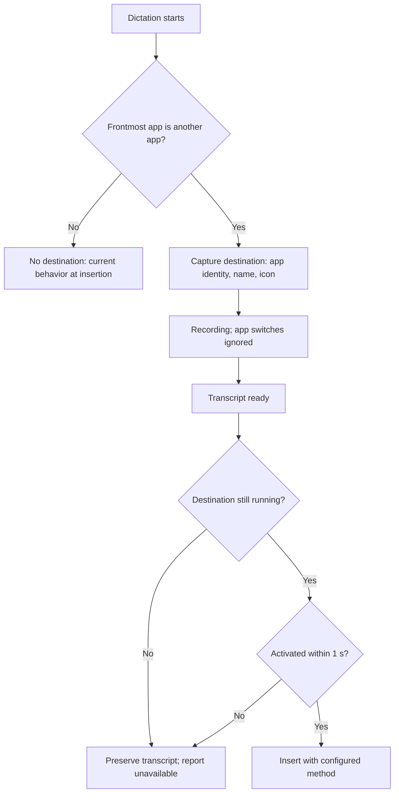
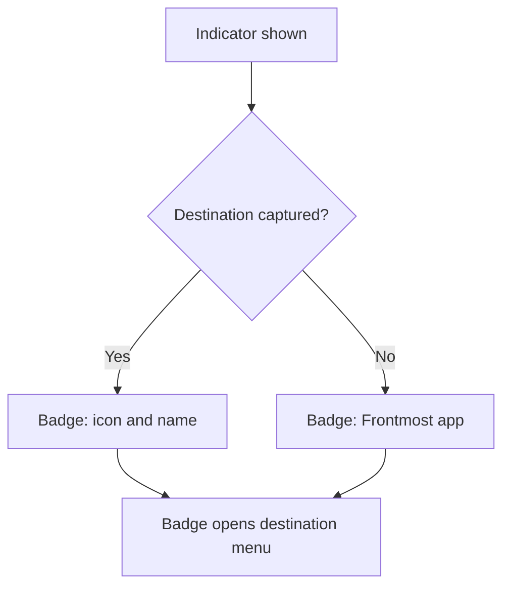
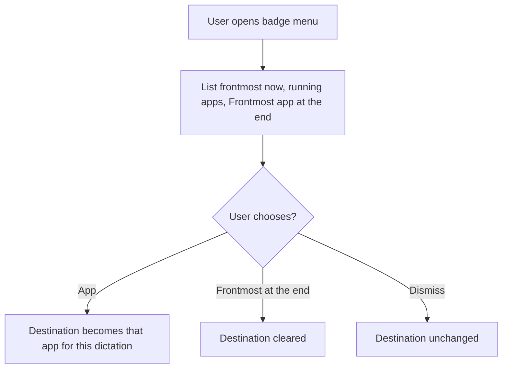
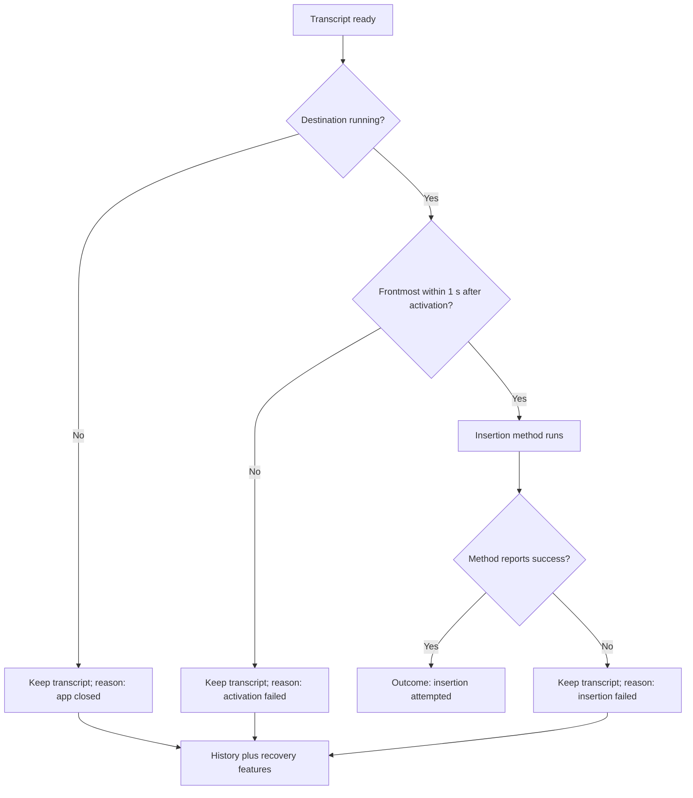
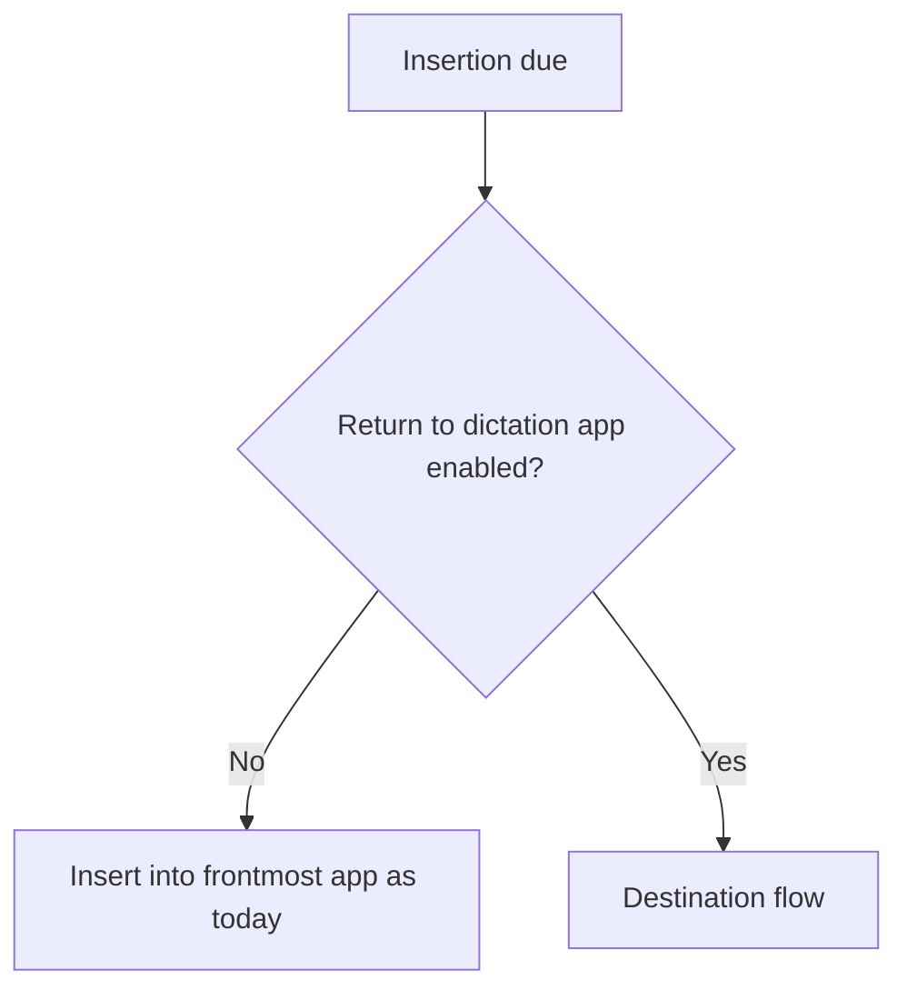

# Feature Spec: Destination Application

## Header

- **Feature:** Destination Application
- **Branch:** None — specification only (program specified before `spec-ship`)
- **Date:** 2026-10-12
- **Status:** Planned
- **Input:** Program item 6: remember the application at dictation start. Show its logo and name near the live indicator. Switching applications during the recording must not change this destination. At the end, return to the chosen application to insert the text. During the dictation, allow a deliberate change of destination from the badge: for example, start in ChatGPT, move to Comet, then explicitly choose Comet as the destination. Preserve the transcript if the application or the target field is no longer available. Program guidance: separate destination, insertion method and clipboard management; Spokenly analyses are static and real compatibility with ChatGPT, Comet and other fields remains to be verified. Program item 8 requires the settings CLI to read and modify output behaviors.
- **Feature Number:** 006

## User Scenarios & Testing

### Story 1 — Insert into the application where dictation started `P1`

**As a** Handy user, **I want to** have the text inserted into the application I was in when I started dictating, **so that** I can look at other windows while speaking.

**Priority reason:** This is the core behavior requested.
**Independent test:** Start a dictation in a text editor, switch to a browser during the recording, stop, and check where the text lands.

```gherkin
Feature: Destination captured at dictation start
  Scenario: Switch app during recording
    Given TextEdit is the frontmost application
    When the user starts a dictation, switches to Safari, and stops the dictation
    Then Handy activates TextEdit before inserting
    And the text is inserted into TextEdit with the configured insertion method
  Scenario: No switch
    Given ChatGPT is the frontmost application
    When the user dictates without switching
    Then the text is inserted into ChatGPT as today
  Scenario: Handy itself is frontmost at start
    Given the Handy settings window is frontmost
    When the user starts a dictation
    Then no destination is captured
    And the text is inserted into whichever application is frontmost at the end, as today
```



### Story 2 — See the destination on the live indicator `P1`

**As a** Handy user, **I want to** see the destination's logo and name next to the live indicator, **so that** I know where my words will go.

**Priority reason:** The badge makes the remembered destination visible and is the entry point for changing it.
**Independent test:** Start dictations from three applications and read the badge each time.

```gherkin
Feature: Destination badge
  Scenario: Badge shows the captured app
    Given the user starts a dictation in Comet
    When the indicator appears
    Then a badge next to it shows the Comet icon and the name "Comet"
  Scenario: Badge without destination
    Given no destination was captured
    When the indicator appears
    Then the badge shows "Frontmost app" without an icon
  Scenario: Badge accessible name
    Given the badge shows "Comet"
    When assistive technology reads the badge
    Then it announces "Destination: Comet"
```



### Story 3 — Change the destination during the dictation `P1`

**As a** Handy user, **I want to** choose another destination from the badge while I dictate, **so that** I can redirect the text on purpose.

**Priority reason:** The deliberate change is explicitly requested with the ChatGPT → Comet example.
**Independent test:** Start in ChatGPT, open Comet, pick Comet from the badge, stop, and check insertion.

```gherkin
Feature: Deliberate destination change
  Scenario: Start in ChatGPT, choose Comet
    Given a dictation started in ChatGPT
    And the user has moved to Comet
    When the user opens the badge menu and chooses "Comet"
    Then the badge shows Comet
    And at the end Handy activates Comet and inserts the text there
  Scenario: Remove the destination with one click
    Given a dictation started in ChatGPT and the badge shows ChatGPT
    When the user clicks the cross on the badge
    Then the badge shows "Frontmost app"
    And at the end the text is inserted into the application that is frontmost then
  Scenario: Menu content
    Given a dictation is recording
    When the user opens the badge menu
    Then it lists the application frontmost now first, then other running applications with windows, with icons and names
    And it offers "Frontmost app at the end"
  Scenario: Menu does not steal focus
    Given the user is typing in Comet while the dictation records
    When the user opens and closes the badge menu with the mouse
    Then Comet keeps keyboard focus
```



### Story 4 — Preserve the transcript when the destination is unavailable `P1`

**As a** Handy user, **I want to** keep my transcript when the destination app quit or cannot be activated, **so that** nothing I said is lost or typed into the wrong window.

**Priority reason:** Inserting into the wrong application can leak text; losing it wastes the dictation.
**Independent test:** Quit the destination app during the recording, stop, and check that nothing is typed elsewhere and the text is recoverable.

```gherkin
Feature: Unavailable destination
  Scenario: Destination quit during recording
    Given a dictation started in Notes
    When Notes quits and the dictation stops
    Then no text is inserted into any other application
    And the indicator says Notes is unavailable and the transcript was kept
    And the transcript is in history
  Scenario: Activation timeout
    Given the destination does not become frontmost within 1 second
    When insertion is due
    Then no text is inserted
    And the transcript is kept and the user is told why
  Scenario: Insertion result is not overstated
    Given the destination was activated and the insertion method reported success
    When the dictation completes
    Then Handy records the outcome as "insertion attempted", not as verified text in the field
```



### Story 5 — Control the feature from settings and CLI `P2`

**As a** Handy user, **I want to** turn destination return on or off in settings or from the CLI, **so that** I can keep the old behavior.

**Priority reason:** Users relying on the current "frontmost at the end" behavior need a switch; the CLI covers output behaviors from its first version.
**Independent test:** Disable the setting from the CLI, repeat Story 1, and read the setting back.

```gherkin
Feature: Destination settings
  Scenario: Disable destination return
    Given "Return to the dictation's application" is off
    When the user starts in TextEdit, switches to Safari and stops
    Then the text is inserted into Safari, as before this feature
  Scenario: CLI changes the setting
    When the user turns "Return to the dictation's application" off through the CLI with JSON output
    Then stdout reports the new value and settings revision
    And the next dictation inserts into the frontmost application
```



## Acceptance Criteria

### AC-001

**Criterion:** When a dictation starts and the frontmost application is not Handy, Handy records its identity (bundle identifier on macOS; application user model ID on Windows when available, otherwise executable path), display name, icon and process id. Application switches during the recording, processing and AI step do not change it. When Handy is frontmost, no destination is recorded.
**Priority:** P1 | **Story:** Story 1

### AC-002

**Criterion:** With "Return to the dictation's application" on (default on where supported), before insertion Handy activates the destination and waits until it is frontmost, for at most 1 second and without freezing Handy's interface, re-checks that it is still frontmost immediately before inserting (a failed re-check counts as an activation failure, without retry), then runs the configured insertion method unchanged. With the paste method "none" no application is activated. With the setting off, or without a destination, insertion targets the frontmost application as today.
**Priority:** P1 | **Story:** Stories 1 and 5

### AC-003

**Criterion:** While the indicator is visible and "Return to the dictation's application" is on and supported, a badge next to it shows the destination icon and name, or "Frontmost app" without a destination. The badge has the accessible name "Destination: <name>". When the setting is off or unsupported, no badge is shown. With the overlay style set to none, no badge is shown and the destination behavior still applies.
**Priority:** P1 | **Story:** Story 2

### AC-004

**Criterion:** Until insertion begins, the badge shows a cross control: one click on it removes the destination of the current dictation (badge "Frontmost app", text inserted into the application frontmost at the end), as the menu entry "Frontmost app at the end" does; the cross has the accessible name "Remove destination". Clicking the badge itself opens a menu listing the application frontmost now first (Handy excluded), then other running applications that have windows, each with icon and name, and "Frontmost app at the end". Choosing an entry changes the destination of the current dictation only and updates the badge within 200 ms; dismissing keeps it. When insertion begins, an open menu closes and later choices are ignored. Opening and using the menu does not take keyboard focus from the user's application.
**Priority:** P1 | **Story:** Story 3

### AC-005

**Criterion:** If the destination is no longer running, is not frontmost within 1 second of activation, or the insertion method reports failure, no text is sent to any other application; the transcript stays in history whenever the history save succeeds, as a text-only entry when the audio recording could not be saved, the indicator displays the reason (app closed, activation failed, insertion failed) for at least 4 seconds (with the overlay style none, the recovery bubble of 010 carries the reason), and the transcript is handed to the recovery bubble (010).
**Priority:** P1 | **Story:** Story 4

### AC-006

**Criterion:** Destination, insertion method and clipboard handling are separate settings and steps: this feature decides only which application is activated. Handy passes the insertion method's outcome (for smart paste, the outcomes of 007) to the recovery bubble (010) and to automatic Enter (009), reports "insertion attempted" when the method reports success, and never reports that text was verified in a field except when the method itself verified it (the smart paste outcome "inserted, verified" of 007, based on reading the field back).
**Priority:** P1 | **Story:** Story 4

### AC-007

**Criterion:** Support is macOS and Windows. On Linux, and wherever the frontmost application cannot be read, the setting is shown as unavailable on this system with the reason, and insertion behaves as today.
**Priority:** P2 | **Story:** Story 5

### AC-008

**Criterion:** The settings CLI (008) reads and sets "Return to the dictation's application" with the same validation as the UI, including the unsupported-platform refusal. With `--json`, stdout contains only the JSON envelope.
**Priority:** P2 | **Story:** Story 5

## Behavioral AC

Signals extracted: overlay, badge, dropdown, menu, select, popover, toggle, keyboard navigation. Official `detect_traits` returned has_dropdown, has_overlay, is_keyboard_navigable.

### has_dropdown

<!-- WARNING: No visual states defined for trait "has_dropdown" in ui-behavioral-taxonomy.md -->

```gherkin
Feature: Destination menu
  Scenario: Open the menu
    Given the badge is visible
    When the user clicks the badge
    Then the destination menu lists applications with the current destination marked
  Scenario: Dismiss the menu
    Given the destination menu is open
    When the user clicks outside it
    Then the menu closes and the destination is unchanged
```

### has_overlay

```gherkin
Feature: Destination menu layer
  Scenario: Closed
    Given a dictation is recording
    When the menu has not been opened
    Then the badge matches visual state "closed"
  Scenario: Open
    Given the user clicks the badge
    When the menu appears above other windows
    Then the menu matches visual state "open"
  Scenario: Highlighted entry
    Given the menu is open
    When the pointer rests on "Comet"
    Then the "Comet" entry matches visual state "focused"
```

### is_keyboard_navigable

<!-- WARNING: No visual states defined for trait "is_keyboard_navigable" in ui-behavioral-taxonomy.md -->

```gherkin
Feature: Keyboard access to destination settings
  Scenario: Settings toggle
    Given the output settings are open
    When the user tabs to "Return to the dictation's application" and presses Space
    Then the setting toggles and its state is announced
  Scenario: Menu without keyboard capture
    Given the destination menu is open over another application
    When the user types in that application
    Then the keystrokes go to that application and the menu stays pointer-operated
```

## Functional Requirements

### FR-001

**Requirement:** Capture the destination application at dictation start, excluding Handy, and keep it stable for the whole dictation unless changed from the badge.
**AC References:** AC-001, AC-004

### FR-002

**Requirement:** Activate the destination before insertion with a 1-second bounded wait, then delegate to the configured insertion method without changing it.
**AC References:** AC-002, AC-006

### FR-003

**Requirement:** Show a destination badge with icon, name and accessible label next to the indicator, and a non-activating menu to change the destination for the current dictation.
**AC References:** AC-003, AC-004

### FR-004

**Requirement:** Never insert into another application when the destination is unavailable; preserve the transcript, report the reason and hand it to the recovery features.
**AC References:** AC-005

### FR-005

**Requirement:** Report insertion outcomes as attempted, not verified, and keep destination, insertion method and clipboard handling separate.
**AC References:** AC-006

### FR-006

**Requirement:** Detect platform support and expose the setting through UI and settings CLI.
**AC References:** AC-007, AC-008

## Key Entities

| Entity | Description | Key fields |
|---|---|---|
| Destination | Application targeted by one dictation | identity, display name, icon, process id, source (captured or badge), captured at |
| Insertion outcome | Result reported after insertion | attempted, app closed, activation failed, insertion failed |
| Destination setting | Persistent switch | return to dictation app on/off, platform support |

## Clarifications

- Current code (2026-10-12): no capture of the frontmost application exists; text goes to whatever application is frontmost at paste time. The overlay is a non-activating panel that accepts clicks.
- `[ASSUMED]` The destination is an application, not a window or a field. Activating it returns to its last active window; whether its text field still has focus is decided by that application. Field-level detection belongs to the recovery bubble (010).
- `[ASSUMED]` 1-second activation wait; reason shown for at least 4 seconds.
- `[ASSUMED]` On by default where supported, because the request describes it as the expected behavior; a switch restores the previous behavior.
- Decision 2026-10-13 (Julien): a cross on the badge removes the remembered destination in one click; the menu remains for choosing another application.
- `[ASSUMED]` The badge menu is pointer-operated so that it never takes keyboard focus; keyboard users keep the captured destination or use PIN operations (009).
- The live destination status is not exposed by this feature's CLI; PIN status belongs to feature 009.
- `[ASSUMED]` Linux is out of scope because reading the frontmost application is not reliable across Wayland compositors.
- Compatibility with ChatGPT, Comet and other applications is unverified; the plan includes native checks with these applications.
- Pinning the destination across dictations is feature 009; the recovery bubble is 010; smart paste (007) is an insertion method that runs after this feature has activated the destination.
- Program context: specified in list order (001–010); the settings CLI foundation (008) ships first.
- Decision 2026-10-14 (Julien): a dictation whose audio recording (WAV) cannot be saved, whatever the cause and not only when the AI step fails, still gets a text-only history entry; losing the text is worse than losing the audio. AC-005 therefore no longer ties the history to today's audio-gated save. Story 4, SC-002, requirement IDs and the cancellation behavior are unchanged.

## QE Analysis

- **Criticality:** High; **Blast radius:** Where every transcript goes; **Primary risk:** Text sent to the wrong application or lost; **Confidence:** Low-medium (no existing capture code; platform behavior unverified).
- **Dimensions:** Functional correctness, security/privacy (wrong-window leakage), reliability, platform compatibility, accessibility, UX.
- **P0 gates/evidence:** State tests proving app switches do not change the destination; tests proving no insertion occurs when the destination is closed or not frontmost in time; badge change applies to the current dictation only.
- **P1 gates/evidence:** Native macOS checks with TextEdit, Notes, ChatGPT desktop and Comet (start in one, switch, choose from badge); Windows check with two applications; non-activating menu check; screen-reader label check.
- **Non-functional expectations:** Capture at start under 50 ms; activation wait bounded at 1 second; badge update under 200 ms; no window titles or text logged above debug level.
- **Missing evidence:** No runtime test; real compatibility with ChatGPT and Comet unverified; mockups deferred before `spec-ship`.
- **Boundary:** QE defines risk and test sufficiency; the independent review judges requirements; Penflow governs UI design evidence; spec-test executes runtime proof.

## Quality Engineering

- **Risk:** High criticality (rated so by the QE Analysis: a transcript can be sent to the wrong application or lost); Shared blast radius (the captured destination decides where every transcript goes, and the output behavior is exposed through the settings CLI); primary risk Functional (wrong destination or lost text), with wrong-window privacy leakage as its consequence.
- **Applicable dimensions:** functional correctness, security/privacy (wrong-window leakage), reliability, platform compatibility, accessibility, UX.
- **P0 gates/evidence:** State tests proving application switches do not change the destination; tests proving no insertion occurs when the destination is closed or not frontmost in time; badge change applies to the current dictation only.
- **Boundary:** QE defines risk and test sufficiency only. The independent spec review judges requirements, Penflow governs UI design evidence, spec-test executes runtime proof and the end-of-feature delivery review looks for defects.

## Screens

| Screen | Status | Reference |
|--------|--------|-----------|
| recording-indicator | Modified | Mockup to produce before `spec-ship` (destination badge and menu) |
| output-settings | Modified | Mockup to produce before `spec-ship` (destination return setting) |

## Penflow Contract

- Planned `flow_id: destination-application`, `screen_id: recording-indicator` and `screen_id: output-settings`. Per the user decision of 2026-10-12 (lightweight UI contract), the Penflow flow/screen contract, semantic and test IDs and the Pencil mockups are produced in one pass for all program features before `spec-ship`; the planned IDs above are authoritative until then. No inspection READY or certification PASS is claimed.

## Edge Cases

- Destination restarted during the recording (new process, same identity): the running instance with that identity is activated.
- Several windows of the destination: activation returns to its last active window.
- Destination in full screen on another Space: activation switches to that Space before insertion.
- Dictation cancelled: no activation and no insertion.
- Same app chosen from the badge as captured: no change.

## Success Criteria

### SC-001

In native checks with at least four macOS applications including ChatGPT and Comet, switching applications during recording never redirects the text; results are recorded per application.

### SC-002

In fault-injection tests (app closed, activation timeout, insertion failure), zero characters reach another application and every transcript whose history save succeeds remains in history.

### SC-003

The badge menu changes the destination in the ChatGPT → Comet scenario and the text is inserted in Comet.
