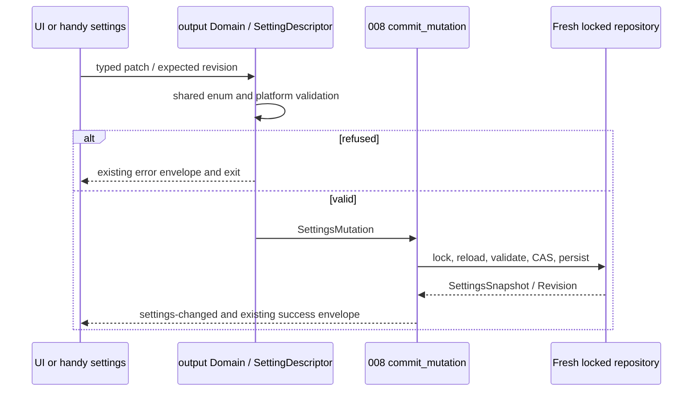
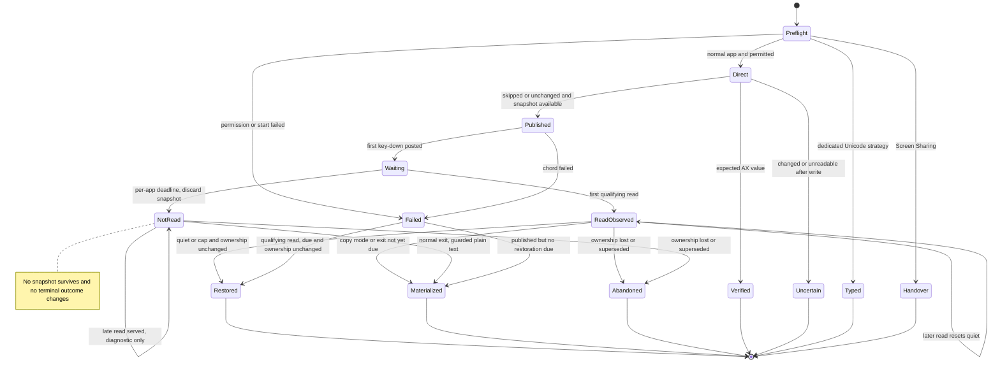
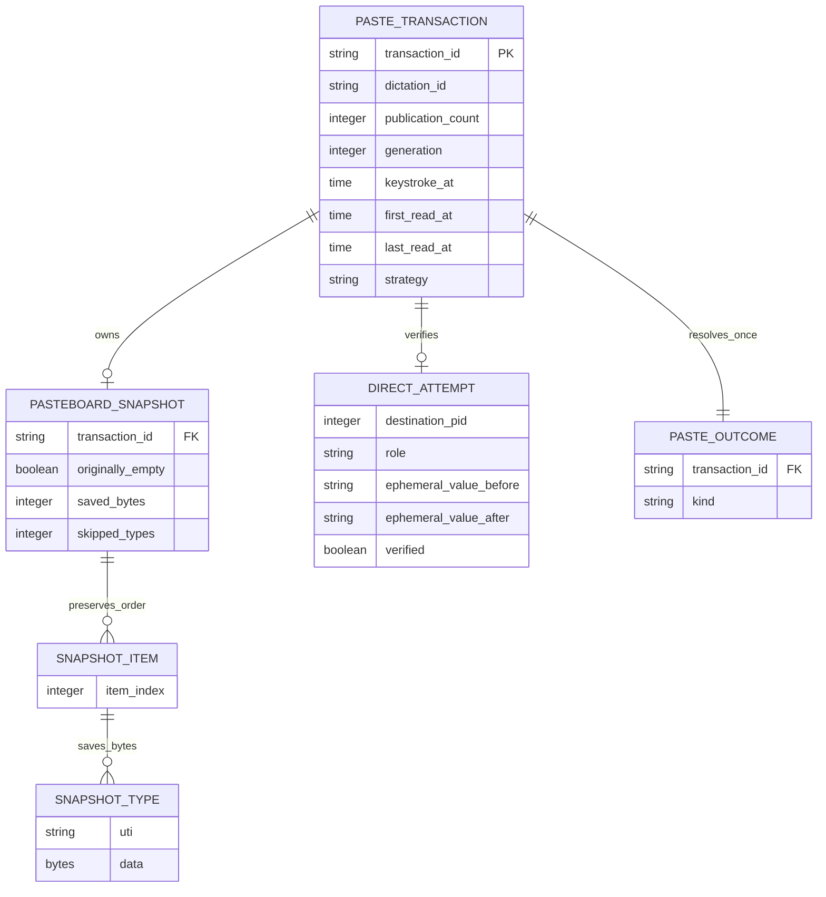

# Implementation Plan: Smart Paste

## Summary

Implement a macOS smart-paste coordinator with verified AX insertion first, then an asynchronous, receipt-driven multi-type pasteboard transaction; restore only after a qualifying read, preserve newer copies, expose honest outcomes, and integrate settings through the existing 008 output domain.

Read [the current functional source](spec.md) before implementation. This plan replaces the previous plan in full and adopts Julien's 2026-10-13 decisions. Scope **L**: seven active FR, five runtime entities, native concurrency, settings migration and cross-feature consumers. Retired FR-001–FR-004, AC-001–AC-007 and SC-001–SC-003 stay retired; no clipboard recovery window is delivered. No native mechanism, test, UI approval or application compatibility is certified by planning.

Inspect [008's foundation plan](../008-settings-cli/plan.md) for exact integration names; it is dependency context, not additional 007 acceptance scope. Deliver 008 first, then 001–007, 009 and 010. The updated 007 spec defines eight outcomes; 008's older six-outcome description is historical integration context and must not truncate the 007 outcome type.

## Technical Context

| Aspect | Choice | Evidence / reason |
|---|---|---|
| Backend | Rust edition 2021, Tauri 2.11.5, existing Tokio | Native orchestration and cancellation; retain boundaries |
| macOS bridge | Existing objc2 0.6, objc2-app-kit/foundation 0.3; ApplicationServices AX and Carbon TIS | Item provider, raw NSData snapshots, focused text, input-source handling |
| Architecture | Pure state reducer + one serialized coordinator + explicit native ports | Clock-driven tests; UI main loop remains available to AppKit |
| Storage | Snapshots and transcripts in transaction memory only | No new DB, no clipboard persistence; one internal settings migration marker |
| Settings | 008 SettingDescriptor, Domain, SettingsMutation, SettingsSnapshot, Revision, LiveSettingsEffects, commit_mutation | Reuse fresh locked repository, revision/CAS, live IPC and single renderer |
| Frontend | Existing React 18, TypeScript 5.6.3, Zustand, i18next selector | No new screen; preserve backend-selected default |
| Tests | Cargo unit/integration, Bun tests, Playwright settings regression, native release harness | Browser Tauri mocks cannot prove clipboard/AX/keyboard behavior |
| Infrastructure | Native permissions, installed input sources, isolated local helper/harness | No external API, cloud resource or credentials |

Inspect [insertion caller](../../../src-tauri/src/actions.rs), [clipboard dispatcher](../../../src-tauri/src/clipboard.rs), [shared reliable paste](../../../src-tauri/src/paste_tx/mod.rs), [macOS bridge](../../../src-tauri/src/paste_tx/macos.rs), [settings model](../../../src-tauri/src/settings.rs), [selector](../../../src/components/settings/PasteMethod.tsx) and [keyboard input](../../../src-tauri/src/input.rs) before coding. Existing actions.rs calls paste on the main thread and only saves history when WAV saving succeeded. Current macOS reliable paste saves text or image, settles an old transaction before a new one, and can finish without a read: none of those behaviors may be carried into smart paste unchanged. Preserve the Windows reliable path and Linux methods.

Technical API context: Inspect [Apple's item lifetime contract](https://developer.apple.com/documentation/appkit/nspasteboarditem?language=objc), [data-provider contract](https://developer.apple.com/documentation/appkit/nspasteboarditemdataprovider), [currentHostOnly option](https://developer.apple.com/documentation/appkit/nspasteboard/contentsoptions?language=objc), and [AX messaging timeout](https://developer.apple.com/documentation/applicationservices/1459345-axuielementsetmessagingtimeout). Items already associated with a pasteboard cannot be reinserted; reconstruct fresh items from saved bytes. currentHostOnly excludes other devices, but its effect on remote-client synchronization requires measurement. Provider callbacks are requests for data, not authenticated target acknowledgements.

## Constitution Check

| Principle | Decision / gate |
|---|---|
| Preserve native/frontend boundaries | PASS: native actor owns clipboard, AX and key events; UI consumes settings/outcomes |
| Derive stack/managers from manifests | PASS: retain existing objc2/Tauri/input stack; any extra bindings/helper dependencies reviewed and pinned at implementation |
| Availability is separate from runtime proof | PASS: command versions below prove availability only; native evidence gates remain mandatory |
| Specify first; meaningful tests | PASS: active FR/AC inventory below, deterministic boundary tests and real native checks |
| Simplicity and separation | PASS: destination activation owned by 006/009, insertion method dispatch by clipboard.rs, clipboard lifecycle by 007; no new IPC/settings service |
| Naming | PASS: preserve existing names; Rust snake_case, new TS/Markdown kebab-case; explicit native ownership/cleanup docs |
| i18n and tooling | PASS: translate user-facing selector/outcome text; existing Bun, ESLint, Prettier override generic Vitest/Biome guidance |
| Design evidence | Approved deviation: UI contract/mockups deferred to the single pre-spec-ship pass; no invented Penflow authority |

## Requirement Inventory and Scope

| Active requirement | AC / success criteria | Steps |
|---|---|---|
| FR-005 | AC-008; SC-004, SC-005, SC-008 | 1, 2, 4, 9 |
| FR-006 | AC-009, AC-013; SC-004, SC-005, SC-008 | 2, 4, 5, 9 |
| FR-007 | AC-010, AC-011; SC-006 | 1, 3, 6, 9 |
| FR-008 | AC-012; SC-004, SC-008 | 2, 3, 5, 7, 9 |
| FR-009 | AC-014, AC-015; dropdown/keyboard traits | 8, 9 |
| FR-010 | AC-016; SC-005, SC-006, SC-007, SC-008 | 1, 9 |
| FR-011 | AC-017, AC-018; SC-007 | 1, 3, 7, 9 |

No HTTP endpoint: no openapi.yaml. The native ports and outcome/settings contracts below are the API contract. No new SQL table: the ER diagram describes transient entities only. No audio or LLM behavior change.

## Architecture Decisions

### Native execution and injectable boundaries

`SmartPasteCoordinator` accepts immutable `dictation_id`, final text after trailing-space handling, settings snapshot and 006/009 `DestinationContext` (PID, bundle ID, destination generation). It returns a future terminal outcome and separately emits diagnostic late-read updates. One actor serializes clipboard ownership, key chords and input-source cleanup; no global Enigo lock held across timers, AX calls or AppKit dispatch. Generation/transaction tokens discard stale scheduled actions and prevent prior providers influencing the current restoration.

Inject `MonotonicClock`, `PasteboardPort` (read snapshot, publish, changeCount, restore, materialize), `AxTextPort` (permission, PID/role/value/range/write/readback with deadline), `InputSourcePort`, `KeyEventPort`, `WorkspacePort` (frontmost PID/generation check only), `OutcomeSink` and 008 service adapter. Real adapters remain thin; tests exercise the production reducer/coordinator. Audio enumeration and client LLM are not invoked here: 001 owns AudioDeviceCatalog and 004/005 own LLM-client seams; don't add unused implementations to 007. Destination activation and its ≤1 s worker wait remain owned by 006/009, never blocking the UI thread.

AppKit provider/publication/restore and TIS work use short main-loop dispatches. AX calls run on a native worker. Chord hold, pre-paste delay, 50 ms layout settling, 100 ms layout cleanup, quiet/no-read/cap timers all await monotonic timers outside the main loop. AppKit serves during chord hold; first-key-down timestamp is recorded immediately before posting the first key event. Requests while the chord is held qualify. Snapshot acquisition is isolated as described below; main-thread sleep is prohibited. Destination/generation is revalidated before AX writing and before posting keys; loss of destination gives insertion failed before effects, uncertain after a possibly applied AX write. No automatic retargeting.

### AX-first insertion and late-write safety

Dedicated AC-010 apps bypass AX-first. For other apps, check AX permission before touching the clipboard, even in copy mode. Missing permission emits permission missing, preserves the clipboard and retains text in memory for recovery. Find the focused element, verify `AXUIElementGetPid` equals destination PID, classify role, read AXValue and AXSelectedTextRange. Skip secure fields and unreadable values. Skip pre-write failures, invalid/out-of-bounds UTF-16 ranges, unsupported AX types and values larger than **1,000,000 UTF-16 code units** (technical memory/time guard, not a new product limit); then use clipboard fallback. Never log value, range-selected text or transcript.

An AX attempt has one **250 ms total monotonic budget**, including readback. Set `AXUIElementSetMessagingTimeout` on every messaged application/element proxy before each call, at most **20 ms** and never beyond remaining budget. Reserve up to **150 ms after the write** for polling and ≤100 ms for preparation/calls. If preparation exceeds its allocation, skip before issuing AXSelectedText. Timeout-setting failures also skip before write. Native timing spike verifies effective bounds; an outer async timeout alone cannot stop a blocking AX request or cancel a delivered write.

Compute expected value by replacing the selected UTF-16 range with the full transcript. Set AXSelectedText exactly once. Poll value with deadline, including immediate read and end-of-window read: exact expected → inserted verified; changed differently → uncertain with no fallback; unchanged at the deadline → clipboard fallback per AC-017, regardless of setter's reported result. A read that fails or times out is followed by the next read of the window (busy Chromium/Electron fields answer late); the verdict comes from the last read, so a value still unreadable at the end of the window after a possible write emits uncertain. Never retry the write or paste blindly. An unchanged expected value (transcript already equals selection) is a semantic no-op with verified readback, no extra paste.

Late application of the delivered write cannot be cancelled by a timeout. Before fallback key-down, perform one bounded final value/PID/element check: expected or other changed content cancels the chord; an already published transcript is materialized under the ownership guard and outcome is uncertain (no second insertion, no unqualified inserted-verified claim about clipboard untouched). A final guard before publication can still return inserted verified with untouched clipboard. Unchanged continues fallback; unreadable after a write cancels it as uncertain. This check narrows, but does not eliminate, the race between final read and key-down or application after key-down. Test 149/150/151 ms and delayed applications during snapshot/layout/paste_delay_ms. **SC-007 is a release blocker for any duplicate**; do not certify a universal exactly-once mechanism from the guard. A proven affected app requires an approved strategy/spec correction before release, not an unapproved silent blacklist or removal of fallback.

### Bounded snapshot and publication

Snapshot consists of ordered items, ordered UTI names, owned raw data bytes, original-empty flag, saved/skipped counts and source changeCount. Preserve all saved types exactly; no text/image decoding or normalization. Saved payload total ≤**50,000,000 bytes**, capture deadline **200 ms** including IPC; do not restart the budget per type. One helper is started ahead (at insertion start, then after each capture) and reads nothing before its start trigger, so its process startup stays outside the 200 ms; a fresh helper (none waiting, or one idle for 4 min; an armed helper exits on its own after 5 idle min) counts its startup inside them. Declared types of every item are read before AppKit-derived types (UTF-16 text, legacy `NSPasteboard` names, `dyn.`), so a slow conversion can only cost derived types; saved types keep the pasteboard order. Failed/oversized/timed-out types are skipped and debug-logged with type-name-only diagnostics and counters. More than 10,000 items, 1,000 types per item or type names over 1,024 bytes are truncated and counted, never rejected. A helper that stops mid-stream keeps its completed types, like the deadline. Preserve emptiness separately from a nonempty item with no saved types. A partial snapshot restores saved types only; acceptance's “exactly” applies to saved types. If a nonempty clipboard has no savable types, refuse transaction start before publication (insertion failed), leaving original content intact, rather than pretending it was empty. Tests explicitly document this technical fail-safe and lossy snapshots. Do not change strategy to Unicode for unrelated apps or promise intact unsaved large content.

A private read-only snapshot helper of the same installed executable isolates potentially blocking external pasteboard promises. Add an internal authenticated inherited-pipe entry before Tauri startup; no public settings domain/flag, no UI/model initialization, no clipboard mutation. Parent bounds output framing to 50 MB, kills/reaps at deadline, rejects stale source-count or incomplete framing; a progressive protocol carries completed types plus timeout/skip metadata. Late helper replies cannot publish or restore. Verify native aggregate/peak memory and slow/large promises before using it; if bounded capture is impossible, block implementation of that adapter. Never copy snapshot bytes to disk/logs. Existing known current provider content can be snapshotted from immutable owned bytes, avoiding self-generated callback attribution on a subsequent dictation.

Revalidate source changeCount before publication, immediately adjacent to clear/write on the serialized main operation. Count mismatch abandons start without copying over the intervening user copy; next dictation takes a new snapshot. AppKit cannot provide an atomic CAS against other processes between guard and write: measure this residual race and record any overwritten newer copy as P0. Publish a fresh NSPasteboardItem with full plain-text data on demand plus marker types. Keep provider/text alive until AppKit releases it, ownership is lost, or guarded materialization makes it eager; the transaction owns snapshot separately. No mutex held when dispatching to main or returning provider data. Record publication count after writeObjects; verify lazy fulfillment does not invalidate this count unexpectedly in Step 1.

### Timing, outcomes and restoration

| Destination | Strategy | No-read decision after first key-down | Quiet after last qualifying read | Cap |
|---|---|---|---|---|
| iPhone Mirroring `com.apple.ScreenContinuity` | Unicode events | N/A | No restoration | N/A |
| Windows App `com.microsoft.rdc.macos` | Unicode events | N/A | No restoration | N/A |
| Screen Sharing `com.apple.ScreenSharing` | Eager plain-text hand-over, no keys | N/A | No restoration | N/A |
| Jump Desktop `com.p5sys.jump.mac.viewer` | AX-first then clipboard | 3 s | 1.5 s | 8 s from first qualifying read |
| Other apps | AX-first then clipboard | 800 ms | 300 ms | 8 s from first qualifying read |

Pre-key reads receive the whole transcript but never start first/last qualifying read. Every qualifying read before settlement updates last_read; first_read is latched once. Restore deadline = min(last_read + per-app quiet, first_read + 8 s); callbacks reschedule quiet while cap stays fixed. Timers serialize with read notifications. At no-read deadline, discard snapshot immediately, publish terminal not read once, keep transcript provider serviceable; never restore for that dictation, even after late reads. Equality boundary tests define reads at keydown as qualifying and notifications already timestamped at decision deadline as processed before the timer.

All cleanup writes (restore, copy-mode plain rewrite, normal-exit materialization, final-guard cleanup) require current changeCount equals publication count, with transaction/generation identity current. Otherwise leave user/other-app/010 Copy content untouched and release obsolete state. Restore uses fresh items and saved NSData; truly empty-before clears. No-read is never disguised as restored/failed-injection timeout; remove macOS's old unconditional 8 s/500 ms settling behavior. `paste_delay_ms` still precedes key-down, but `paste_delay_after_ms` is not used for smart paste; classic methods keep it. Restoration scheduling allowance ≤50 ms after due time must be measured under load.

Copy mode: permission rules still apply; after verified AX insertion, Unicode typing or hand-over, deliberately put plain text on clipboard as required by AC-013/AC-010. Known limitation: copy mode makes the transcript ordinary plain text at "not read", which the pasteboard then serves without provider callback, so no late-read diagnostic exists in that mode (010 must not wait for one). For lazy clipboard paste, serve receipts normally, then guarded materialize plain text and discard snapshot instead of restoration; on not read retain plain transcript without reviving the snapshot. A failure after publication with no qualifying read never restores previous content; keep/materialize the transcript, insertion failed stays terminal. A read observed after a failed chord cannot turn failed into success but can authorize guarded cleanup after quiet/cap. Cleanup result is not a second insertion outcome.

### Concurrent dictations, late reads, exit and history

A second transaction cancels older restoration callbacks without intermediate restore. Carry the original snapshot only from an unsettled restoration-eligible transaction with unchanged ownership and a still-existing snapshot. An old not-read transaction has already discarded it: snapshot the current transcript/types for the second dictation, **never resurrect the pre-first snapshot** (AC-009 wins over the generic Edge Cases wording). Ownership changed → current clipboard is new snapshot. Old provider callbacks serve their own text and cannot affect current first/last read, outcome or deadlines. A second AX-verified dictation does not require a new clipboard publication; an older pending clipboard lifecycle remains independently guarded. Serialize input-source/chord cleanup before the next chord.

A delayed paste keystroke from an earlier dictation can read the latest global clipboard; transaction IDs cannot authenticate the consuming application or prevent that OS race. Native overlapping-dictation testing is mandatory; any old transcript/content delivered to a target blocks SC-008/AC-016 release. Never assert attribution beyond observed provider transaction.

Normal exit invokes the same reducer through `SmartPasteActor::shutdown`, called off the macOS main thread (it refuses the main thread, whose run loop the settlement write needs) with a timeout of at least `shutdown_allowance(paste_delay)`: an insertion in progress finishes first so its outcome stays truthful, queued insertions are dropped, and dropping the actor without shutdown still settles without waiting. It restores only after qualifying read **and quiet elapsed or authorized 8 s cap elapsed**, plus unchanged count. Do not bypass quiet merely because a read exists. Otherwise guarded write of the **current transcript as eager plain data**, discard snapshot, then release provider and finish layout cleanup; a changed count is never overwritten. Await bounded cleanup off main, dispatching short native writes. Copy mode never restores. Crash cannot run cleanup; lazy data availability is unknown afterward. In actions.rs history save is WAV-gated and may fail: 007 does not change history, add unconditional persistence, or promise crash recovery for every dictation. Keep immutable transcript in memory for 010 until its bounded recovery lifetime; crash loses unsaved memory. Document existing stored-history availability honestly.

### Marking and privacy policy

| Publication | currentHostOnly | TransientType / ConcealedType / AutoGeneratedType | Decision |
|---|---|---|---|
| Lazy local clipboard paste, including Jump Desktop | Yes | Keep all three existing markers, eager empty marker data; only text request counts | AC-008 requires host-only/transient; preserve ConcealedType privacy defense |
| Screen Sharing hand-over | No | None | Dedicated eager hand-over must be available for remote sync and stay until next copy; not the AC-008 temporary path |
| Copy-to-clipboard final eager text | No | None | Deliberate user copy setting should behave as ordinary plain text |
| Saved-content restoration | Yes | Restore exactly the saved original types | Never republish the previous content to other devices; do not add Handy privacy markers to restored user data |
| Saved content carrying ConcealedType or TransientType (decision 2026-10-13), including Handy's own earlier transcript item | Yes | All three, on the eager transcript left instead | Never restored: a dictation changes changeCount, so a password manager's automatic clearing no longer fires; snapshot bytes are dropped at capture |
| Transcript made eager outside copy mode (exit, not read then exit, cancelled keystroke, withheld restoration) | Yes | All three, eager empty marker data | Same privacy as the on-demand item it replaces |

Marker behavior is convention-based, not a privacy guarantee. Test clipboard managers with/without marker respect, remote sync for Screen Sharing and marked Jump Desktop. If Jump's current-host/transient policy blocks remote operation, list not verified/incompatible with evidence; any relaxation of AC-008 needs an approved spec decision, not a plan exception. Type names/counters/timings may be logged; never transcript, clipboard bytes, AX values, secret fields or raw native errors containing them at any log level. Harness uses public synthetic fixtures and records inserted text only in explicit native evidence, separate from product logs.

## Outcome Contract and Consumers

| Terminal wire value | User meaning | 009 automatic Enter | 010 recovery |
|---|---|---|---|
| `inserted_verified` | inserted, verified by AX value comparison | Eligible | No failure |
| `read_observed` | insertion attempted, read observed; field content unverified | Eligible | No failure |
| `not_read` | no qualifying read by per-app deadline | Never | Failure bubble |
| `permission_missing` | permission absent; clipboard untouched | Never | Failure bubble |
| `uncertain` | AX changed unexpectedly or completion unknown | Never | Failure bubble |
| `typed` | Unicode events posted successfully; field content unverified | Eligible | No failure |
| `clipboard_handed_over` | Text placed on the clipboard for the remote screen | Never | Neither success nor failure |
| `insertion_failed` | chord/typing/transaction-start failure | Never | Failure bubble |

`PasteOutcome {dictation_id, transaction_id, destination_generation, strategy, kind}` is terminal exactly once. `PasteDiagnostic {dictation_id, transaction_id, late_read_observed}` is a separate idempotent event, not a revised terminal outcome. Expose `is_auto_submit_eligible` and `requires_recovery` on this type so consumers do not guess from Result<(), String>. Send Enter at most once after terminal resolution, only while destination/generation remains valid per 009. A late read after not read serves text but leaves not read/Enter ineligible; 010 updates the existing correlated bubble to translated “may have been pasted after all”, without creating a duplicate bubble or recopying automatically. 007 produces the diagnostic contract now; the 010 implementation owns bubble lifetime/update handling later. Missing 010 UI does not change terminal outcomes.

006 owns indicator reason/destination. 007 emits Screen Sharing's translated hand-over message to the existing nonactivating indicator. 010 owns failure bubble presentation and supersedes 006's ≥4 s reason display when delivered; 007 creates no new activating window. 010 Copy writes via normal clipboard operation, changes changeCount, and makes pending 007 restoration abandon; no “cancel restoration window” API.

## Settings Contract: Reuse 008 Exactly

Extend `src-tauri/src/settings_service/descriptor.rs`, `validation.rs`, `domains/output.rs` and existing `Domain` registration, rather than creating a smart_paste settings service. Add serialized `PasteMethod::SmartPaste = smart_paste`; same validator for UI/CLI refuses it outside macOS (`validation_failed`, exit 2), no persisted change/revision/effect. Reuse `SettingsMutation` and `commit_mutation` under settings.lock, `SettingsSnapshot`/`Revision`, live local-user IPC, pure read/dry-run and `LiveSettingsEffects` notification. Keep generic set and output set parity. Output reads support `handy settings output get paste_method`; sets support `handy settings output set paste_method smart_paste --json`, plus generic get/set per 008. No stdout pollution: one `{ok:true,revision:N,data:...}` or `{ok:false,error:{code,message,details:{...}}}` newline; existing exit mapping 0 success, 1 persistence/internal, 2 usage/validation, 3 revision conflict, 4 not found, 5 unavailable. No network/routing or second lock implementation.

Persist internal `smart_paste_migration_version: 1` via 008 startup migration commit, read-only in descriptors. New macOS installation defaults smart_paste with marker; upgraded macOS without marker migrates **CtrlV whether reliable_paste was true or false**, preserves every other method, drops reliable_paste from its public settings/UI and persisted payload, and writes marker in the same atomic transaction. Mark migration even when method preserved. Explicitly remove the key from unknown-field preservation on macOS so it cannot reappear. A later user selection of CtrlV remains on every reload. Read-only/headless settings reads normalize in memory per 008 but do not write the marker or increment revision; only startup/explicit successful commit persists it, with no stale whole-settings rewrite. Concurrent UI/CLI startup mutations use 008 locking/CAS and fresh patches; replay is idempotent. Never reset revision. Windows retains reliable_paste field/switch/path; Linux methods/defaults unchanged. On macOS classic CtrlV selected afterward uses its classic path, never an invisible beta reliable flag.

Regenerate bindings.ts through supported specta export during implementation, avoid manual generated-type edits. Hide ReliablePasteToggle only on macOS (retain Windows). Selector uses backend settings snapshot instead of hardcoded CtrlV while loading; smart paste option macOS only. New en/fr i18n keys, translated errors and hand-over message; available languages follow project translation fallback/check policy. Keyboard arrow/Enter selection, visible Tab focus and accessible selected value tested. Preserve other paste methods and clipboard_handling as separate concepts.

## Design Reference and Penflow Contract Inputs

| Screen | Planned components | Authority |
|---|---|---|
| `output-settings` | Existing PasteMethodSetting → Dropdown, SettingContainer; macOS option and removal of beta toggle | Approved spec screen/traits; mockup pending |

Planned `flow_id: smart-paste`, `screen_id: output-settings`. Inspect [the current semantic tree](../../../penflow/semantic-ui-tree.json) for unrelated existing workspace context; inspect the eventual `penflow/code-ir.json` only after the shared pass produces it. Current inspection 2026-10-13 is **BLOCKED/incomplete**, missing expected-ui-tree.json, code-ir.json and desktop geometry; no relevant accepted 007 source approval observed. No theme.css/theme.md observed; no theme-install step invented.

User explicitly overrides premature forward/mockup generation for this run: shared contracts, semantic/test IDs, Pencil mockups and code IR are produced once before spec-ship. This plan remains visual; no current input authority or design PASS is claimed. Declared future livespec verification policy requires generated docs, native geometry and native PNG export; no homologous visual reference procedure applies to this existing selector change. Preserve the union of other plans' required procedures/approved ancestry.

Before UI code/spec-ship: shared forward chain, authoritative FR/AC bindings/predicates with these planned IDs, expected tree/code IR and PNG registry, immutable bound plan/source review-snapshot + actual review-result + pipeline plan-review approval, then design-profile C51 PASS/certified true. Reuse shared evidence, don't create a duplicate .pen file. Test IDs come from approved contract, not invented in this plan. Shared early macOS overlay spike proves the existing 256×50 indicator and 010 dedicated/resized nonactivating bubble surface; it belongs to 006/009/010, 007 tests hand-over message without activating focus. This design gate is separate from semantic implementation progression.

## Gherkin Scenarios and Sequence Diagrams

```gherkin
Feature: Verified AX then lazy clipboard
  Scenario: Direct replacement verified
    Given a readable nonsecure destination field and a selected UTF-16 range
    When AXSelectedText is written and the value equals the expected replacement
    Then the result is inserted verified and clipboard is unchanged in dont_modify mode
  Scenario: Read during chord hold
    Given AX was skipped or remains unchanged and a rich snapshot was saved
    When a text request arrives after first key-down while Command is held
    Then the whole transcript is served immediately and read observed is emitted once
    And restoration waits for last-read quiet or first-read cap and unchanged changeCount
  Scenario: Unknown AX completion
    Given AXSelectedText may have been applied and readback is unavailable
    When the direct window ends
    Then uncertain is emitted and no fallback chord is posted
```

```mermaid
sequenceDiagram
  participant Destination as 006/009 context
  participant Actor as SmartPasteCoordinator
  participant AX as Bounded AX worker
  participant Helper as Read-only snapshot helper
  participant Main as AppKit and TIS main loop
  participant Keys as Key worker
  participant Reader as Pasteboard reader
  Destination->>Actor: immutable dictation and destination
  Actor->>AX: permission, PID, role, value/range, write/readback
  alt verified expected value
    AX-->>Actor: inserted verified
    Actor-->>Destination: terminal outcome
  else changed or unknown after write
    AX-->>Actor: uncertain
    Actor-->>Destination: recovery eligible, no keys
  else skipped or unchanged
    Actor->>Helper: bounded snapshot, 200 ms / 50 MB
    Helper-->>Actor: saved types and source count
    Actor->>Main: source guard, publish lazy item, optional TIS switch
    Main-->>Actor: publication count and active-layout V key
    Actor->>Keys: pre-delay, final guard, timestamp then chord
    par provider remains available
      Reader->>Main: plain-text request
      Main-->>Reader: complete transcript
      Main-->>Actor: qualifying read timestamp for this item
    and key completion
      Keys-->>Actor: last key-up or error
    end
    Actor->>Main: restore input source after 100 ms
    alt no qualifying read by per-app deadline
      Actor->>Actor: discard snapshot; terminal not read
    else first qualifying read
      Actor-->>Destination: terminal read observed
      Actor->>Main: at quiet/cap, guarded restore or copy settlement
    end
  end
```

```gherkin
Feature: Same output domain for UI and CLI
  Scenario: MacOS changed setting
    Given 008 has current revision 41
    When UI or CLI sets smart_paste with expected revision 41
    Then commit_mutation persists revision 42 and emits settings-changed
    And CLI stdout contains only the 008 envelope
  Scenario: One-shot migration and refusal
    Given migration version is 1 and the user selected CtrlV
    When settings reload
    Then CtrlV stays selected and revision does not change for a read
    When smart_paste is set on Windows or Linux
    Then validation_failed is returned with no durable or runtime change
```



## State Model

```gherkin
Feature: Snapshot lifetime and truthful terminal result
  Scenario: Not read then a second dictation
    Given the first no-read deadline expired and its snapshot was discarded
    When a second dictation starts without an intervening external copy
    Then its snapshot is the first transcript currently on the clipboard
    And the pre-first clipboard snapshot never returns
  Scenario: Quit while reads are not quiet
    Given a qualifying read happened but quiet and cap are not yet due
    When Handy exits normally
    Then it materializes the current transcript if it still owns the pasteboard
    And it does not restore earlier content
  Scenario: Late read after not read
    Given not read is terminal
    When its provider is requested late
    Then text is served but no Enter becomes eligible
    And a correlated diagnostic lets 010 update its bubble
```



## Data Model

Transient logical entities only; no database migration or retained clipboard-content record.



## Implementation Plan

All files below are planned, not modified by this command. Relative native paths are under `src-tauri/src/` unless specified.

### Step 1 — Prove native feasibility before production wiring

**Prerequisite:** Complete current spec/plan reviews and semantic progression implement READY; 008 service contract delivered before dependent settings wiring.
**Required inputs:** AppKit provider APIs, AX deadline budget, public synthetic field/clipboard fixtures, macOS release build, clipboard manager installed/uninstalled.
**Action:** New `src-tauri/tests/smart_paste_native.rs` and `scripts/smart-paste-native-proof.ts` spike item-provider callbacks before/after key-down, callbacks during hold, changeCount on lazy fulfillment, helper slow/large promises, per-call AX timeout/large values, >150 ms writes and final-guard race. Measure remote markers and layout cleanup. Capture provider timestamps without product text logs. No production dispatch switch until viable evidence.
**FR covered:** FR-005.1: AppKit receipt and snapshot spike, FR-007.1: Layout and remote marking spike, FR-010.1: Native proof protocol, FR-011.1: AX deadline and late-write spike
**Execution evidence:** Future `evidence/native-spike.json`, binary/OS/app identities, timestamped native transcript and fixture comparisons.
**Success criteria:** Main loop services provider during key hold; bounded snapshot/AX mechanisms observed; AppKit caching limitation and delayed writes characterized; unresolved native feasibility stops affected wiring.
**Failure handling:** No repeat-callback signal → retain conservative not read, never invent receipt or restore; block native compatibility/release until approved fix. Timeout/duplication infeasibility blocks adapter implementation; report exact failure, no silent classic fallback.

### Step 2 — Define pure transaction state and outcome contracts

**Prerequisite:** Step 1 mechanism selected with truthful limitations.
**Required inputs:** Timing/strategy/outcome tables, monotonic clock, transaction/destination generation, typed native ports.
**Action:** New `smart_paste/{mod.rs,state.rs,outcome.rs,ports.rs}` defines coordinator API, Snapshot/Transaction/DirectAttempt and reducers. Add inline Rust tests for timers, one terminal outcome, first-read latch, late diagnostic and all ownership transitions. Leave `paste_tx/mod.rs` and Windows behavior intact except explicit separate macOS dispatch removal later.
**FR covered:** FR-005.2: Item-scoped read events, FR-006.1: Guarded restoration reducer, FR-008.1: Eight truthful outcome types
**Execution evidence:** `cargo test ... --lib smart_paste` transcript and requirement assertion matrix.
**Success criteria:** 300/800 ms and 1.5/3 s boundaries, first-read 8 s cap, no-read discard, copy guard and old-item isolation independently asserted.
**Failure handling:** Any timer restoring without qualifying read or eligible Enter on failure is P0; stop before native effects.

### Step 3 — Implement bounded verified AX insertion

**Prerequisite:** Pure state tests PASS; AX spike viable.
**Required inputs:** Destination PID, permission, roles, UTF-16 conversion, exact expected replacement, per-call deadline port.
**Action:** New `smart_paste/direct.rs` and `smart_paste/macos_ax.rs` implement classifier, limited value/range reads, timed single AXSelectedText write, ≤150 ms readback, ≤250 ms overall, final fallback guard and uncertain branch. Add inline tests and `src-tauri/tests/smart_paste_ax.rs` with controllable delayed field adapter plus real native spike reuse.
**FR covered:** FR-007.2: Dedicated-strategy AX bypass, FR-008.2: Verified and uncertain outcomes, FR-011.2: Timed AX replacement and fallback
**Execution evidence:** UTF-16/range, secure/unreadable/mismatched PID, no-op, failed setter/late setter, 149/150/151 ms and total-budget tests; real hanging/large field measurements.
**Success criteria:** Exact value is sole verified signal; changed/unknown after write produces no duplicate fallback; oversize/prewrite timeout skips without AX mutation; main loop never blocked.
**Failure handling:** AX timeout alone never proves write cancelled; duplicates or unbounded calls block SC-007/release and require approved remediation.

### Step 4 — Implement bounded snapshot and item provider

**Prerequisite:** Steps 1–3 proof gates PASS and native thread ownership agreed.
**Required inputs:** Raw item/type data, 200 ms/50 MB aggregate bounds, internal helper protocol and source-count guards.
**Action:** New `smart_paste/{snapshot.rs,snapshot_helper.rs,macos_pasteboard.rs}`; modify `main.rs` only for internal helper early dispatch and `Cargo.toml` only if required bindings/features. Implement helper kill/reap, progressive saved types, no disk storage, reconstruction of fresh items, lifetime-held NSPasteboardItemDataProvider and marker policies. Inline tests plus `src-tauri/tests/smart_paste_snapshot.rs` exercise actual helper/frame boundary with synthetic slow promises.
**FR covered:** FR-005.3: Bounded multi-type save and publish, FR-006.2: Exact saved-type restore adapter
**Execution evidence:** Bytewise rich/image/multi-item comparisons, exact limits and skipped metadata, source-count races, helper process cleanup, provider reentrancy/no-content log checks.
**Success criteria:** Ordered saved bytes preserved, empty distinguished from all-skipped, nothing writes after helper deadline, provider serves full text on every real request and count/lifetime behavior verified.
**Failure handling:** No usable snapshot/start failure leaves original unchanged and emits insertion failed; no legacy fixed-delay fallback. Partial snapshot loss is explicit, not certified intact.

### Step 5 — Compose asynchronous ownership, exit and concurrency

**Prerequisite:** Snapshot/provider adapter and state tests PASS.
**Required inputs:** Main executor, worker clock/timers, immutable text, publication guard, read timestamps.
**Action:** New `smart_paste/coordinator.rs`; modify `lib.rs` to own actor lifetime and normal-exit cleanup, and macOS use of `paste_tx/macos.rs` to retire beta dispatch without changing Windows. Wire no-read discard, quiet/cap restore, copy mode, two dictations, materialization and late diagnostics. New `src-tauri/tests/smart_paste_transactions.rs` exercises production actor with injected native ports, not a mock coordinator.
**FR covered:** FR-006.3: Async restore copy exit and succession, FR-008.3: Terminal and late event delivery
**Execution evidence:** Deterministic event-order traces, current transaction/read IDs, no-write assertions after changeCount changes, quit/no-read/second-dictation tests.
**Success criteria:** No intermediate restoration; not-read snapshot never resurrected; exit never bypasses quiet/cap; late old callbacks can't mutate new transaction; normal exit leaves provider-independent text when not due.
**Failure handling:** Preserve failing trace and block; crash-history guarantee cannot be inferred from memory/provider cleanup.

### Step 6 — Add keyboard and per-app strategies

**Prerequisite:** Actor serialization and ownership tested.
**Required inputs:** Destination bundle, input-source category/ID, active-layout V resolution, permission and key worker.
**Action:** New `smart_paste/{strategy.rs,macos_keyboard.rs}`; modify `input.rs` to expose bounded event posting without hold sleeps on main. Implement dedicated Unicode and Screen Sharing hand-over, ABC/US fallback with 50 ms settle and 100 ms cleanup after last key-up, layout/input-method unchanged cases and error/cancel cleanup. Inline tests plus native harness records real source IDs and key-up ordering.
**FR covered:** FR-007.3: Bundle dispatch and input-source restore
**Execution evidence:** Bundle strategy matrix, source-select failure/cancel/error cases, timer traces and real AZERTY/US/Dvorak/IME input checks.
**Success criteria:** Unicode dont_modify doesn't touch clipboard; Screen Sharing has no keystroke/restore; V resolved after switch; owned layout restored even after error/exit, no stale cleanup overriding next transaction.
**Failure handling:** Posting success is not field verification; failed events yield insertion failed. Layout restoration failure is explicit native blocker, no swallowed cleanup error.

### Step 7 — Wire pipeline and future Enter/recovery consumers

**Prerequisite:** Native paths and actor outcomes tested; 006 destination contract available.
**Required inputs:** actions.rs completion/cancel path, clipboard dispatch, 009/010 outcome contract.
**Action:** Modify `clipboard.rs` with explicit smart-paste branch and async start/result API, `actions.rs` to await it off main and maintain cancellation/generation; export outcome/diagnostic event types from `smart_paste/outcome.rs` for later 009/010. Ensure legacy auto-submit block is bypassed for smart paste so the typed eligibility gate owns one submission. Preserve WAV-gated history and surface hand-over reason via existing indicator. New `src-tauri/tests/smart_paste_outcomes.rs` uses consuming adapters and event correlation; 010 bubble code is implemented by 010, not this step.
**FR covered:** FR-008.4: Pipeline Enter recovery handover contract, FR-011.3: AX clipboard recovery ordering
**Execution evidence:** Each terminal kind through pipeline; zero duplicate Enter; late-read diagnostic fixture updates one consumer bubble without promoting outcome; cancellation/focus and history regressions.
**Success criteria:** Full chain AX → clipboard → recovery; only verified/read_observed/typed eligible; hand-over neither failure nor Enter; events contain IDs/outcome only, text remains private in memory.
**Failure handling:** No success log from Result<(), String> enqueued result; missing downstream UI proof remains assigned to 010 and blocks combined-program delivery.

### Step 8 — Extend 008 settings and existing selector

**Prerequisite:** 008 transaction/Domain framework delivered; shared Penflow design gate PASS before UI coding.
**Required inputs:** 008 descriptors/validation/output domain, settings model, specta export, selector translations and migration fixtures.
**Action:** Modify `settings.rs`, `settings_service/{descriptor.rs,validation.rs,domains/output.rs,transaction.rs}`, `shortcut/mod.rs`, `src/stores/settingsStore.ts`, `src/components/settings/PasteMethod.tsx`, `src/components/settings/debug/{DebugSettings.tsx,ReliablePaste.tsx}` and en/fr translations; regenerate `src/bindings.ts`. Persist one-time migration in 008 startup commit and reuse all CLI/UI validators/adapters. New `src-tauri/tests/smart_paste_settings.rs`, `src/stores/smart-paste-settings.test.ts`, `tests/smart-paste-settings.spec.ts` cover CLI parity, migration and traits. Update application README usage at implementation if changed; this planning run touches global spec documents only via finalize.
**FR covered:** FR-009.1: MacOS default and migration marker, FR-009.2: Output domain platform parity and UI
**Execution evidence:** Raw isolated store/revision fixtures before/after, schema/bindings diff, JSON channel/exit cases, keyboard/focus screenshots with approved test IDs.
**Success criteria:** Migrate true/false beta CtrlV once; preserve all other methods and later CtrlV; same fresh commit service/CAS; unsupported platform no mutation; Windows beta and Linux unchanged.
**Failure handling:** Missing UI authority blocks UI implementation; migration replay, stale writes, revision reset or cross-platform regression is P0.

### Step 9 — Produce native acceptance and release evidence

**Prerequisite:** Implementation steps complete, native dependencies built, shared UI/source approval current.
**Required inputs:** Release binary, app/layout versions, public fixtures, approved AC/assertion inventory, native harness and independent manual observations.
**Action:** Complete the harness from Step 1 and all planned test files, run the resolved commands below, and write feature-local `evidence/native-compatibility.json`, `evidence/native-compatibility.md`, traces and explicit missing/blocked matrix. Capture release-run app field/clipboard/layout observations; record fallback path explicitly. Run ten trials per app/layout/path and SC-005 ten consecutive full-data restore checks; include late reads, exit, app caching, overlapping dictations, >150 ms AX writes and copy races. This step runs during spec-test/implementation, not during planning.
**FR covered:** FR-005.4: Native multi-type receipt proof, FR-006.4: Zero newer-copy overwrite proof, FR-007.4: App and layout compatibility proof, FR-008.5: Truthful consumer runtime evidence, FR-009.3: Settings UI CLI regression proof, FR-010.2: Full compatibility and release matrix, FR-011.4: Exactly-once AX native evidence
**Execution evidence:** Current binary hashes, timestamped command/native receipts, assertion mappings, observations and complete available/unavailable app matrix.
**Success criteria:** All active AC/SC supported by evidence; required apps/layouts pass; no prior content/transcript delivery, no duplication; all missing optional apps explicitly not verified; no fabricated native PASS.
**Failure handling:** Any stale content or duplicate is release-blocking regardless of app. Ordinary insertion incompatibilities outside required apps may be listed as known incompatibilities under AC-016; missing required apps/layouts stays BLOCKED, never exempted by a 9/10 threshold.

## Resolved Test Commands

Availability observed 2026-10-13: Cargo/rustc 1.94.0, clippy 0.1.94, rustfmt 1.8.0, Bun 1.3.9, local Playwright 1.58.0, ESLint 9.39.1, TypeScript 5.6.3 and Prettier 3.6.2. Model resource silero_vad_v4.onnx is present. These are availability checks; no application test/build ran in planning. No surfaces.yaml; Playwright testDir is `tests` from config, native integration tests `src-tauri/tests`.

| Action | Command | Status |
|---|---|---|
| Rust unit | `cargo test --manifest-path src-tauri/Cargo.toml --lib smart_paste` | Cargo verified; tests planned |
| Boundary integration | `cargo test --manifest-path src-tauri/Cargo.toml --test smart_paste_snapshot --test smart_paste_transactions --test smart_paste_ax --test smart_paste_outcomes --test smart_paste_settings` | Targets planned; build dependencies unverified |
| Opt-in native spike | `cargo test --manifest-path src-tauri/Cargo.toml --test smart_paste_native -- --ignored --test-threads=1` | Native permission/fixture harness planned; isolated synthetic clipboard with explicit recovery |
| All Rust regression | `cargo test --manifest-path src-tauri/Cargo.toml` | Available; not executed |
| Native release/manual | `bun scripts/smart-paste-native-proof.ts --binary <absolute-release-binary> --out .specs/features/007-smart-paste/evidence` | Bun verified, harness planned; real native observations required |
| Frontend unit | `bun test src/stores/smart-paste-settings.test.ts`; `bun run test:keyboard` | Bun/script available; added tests planned |
| Browser behavioral | `bun run test:playwright -- tests/smart-paste-settings.spec.ts` | Playwright binary verified; browser engine/GUI contract not verified |
| Visual | Same browser command with approved UI baselines + shared Penflow design/implementation-profile gate | Pending shared pass; no visual certification |
| Type check | `node_modules/.bin/tsc --noEmit` | Local version verified |
| Lint | `bun run lint`; `cargo clippy --manifest-path src-tauri/Cargo.toml --all-targets -- -D warnings` | Binaries verified |
| Format | `bun run format:check`; `cargo fmt --manifest-path src-tauri/Cargo.toml -- --check` | Binaries verified |
| Translations | `bun run check:translations` | Script exists; not executed |
| Build | `bun run build`; `bun run tauri build` | Scripts exist; native release build pending |
| Full suite | Rust + frontend unit/keyboard + Playwright + type/lint/format/translations + native release matrix | Composite future gate; no PASS claimed |

If browser engine missing during implementation, record TOOL NEEDED `bunx playwright install chromium`; if dependencies missing use `bun install`. Cargo native prerequisites follow BUILD.md; no dependency installation/build mutates application code during this run.

## Testing Strategy and Acceptance Matrix

| Priority / level / planned file | Assertions | Coverage |
|---|---|---|
| P0 pure + snapshot boundary: inline state/snapshot tests, smart_paste_snapshot.rs | Ordered multi-type bytes, empty/nonempty all-skipped, 199/200/201 ms, 49,999,999/50,000,000/50,000,001 bytes, pre-key/held-key reads, full transcript every request, helper timeout/lifetime | FR-005; AC-008; SC-004/005 |
| P0 actor integration: smart_paste_transactions.rs | First/last quiet 299/300/301 ms, Jump 1499/1500/1501 ms, no-read 799/800/801 ms and 2999/3000/3001 ms, cap from first read, changeCount race/user image/010 Copy, copy mode, read then quit before/after due, no-read late read, overlapping generations | FR-006; AC-009/013; SC-004/008 |
| P0 AX: direct inline tests, smart_paste_ax.rs | Permission before any clipboard effect (also copy), PID mismatch, secure/unreadable/large fields, emoji/surrogates/range bounds, ignored setter success/failure, partial mutation, unknown readback, exact no-op, budget/per-call bounds, late-apply/final guard and duplicate counterexample | FR-011; AC-017/018; SC-007 |
| P0 strategies: strategy/keyboard inline tests and smart_paste_native.rs | Exact bundle mapping, permission only for key/direct strategies, Screen Sharing no chord, Unicode copy behavior, ABC→US fallback, failed both/input-method unchanged, 50 ms switch and 100 ms after last key-up even failure/cancel | FR-007; AC-010/011 |
| P0 outcomes: smart_paste_outcomes.rs | Eight kinds exactly once, truthful verified distinction, Enter eligibility/generation, neutral hand-over, terminal not-read at Jump 3 s, late diagnostic update/recovery consumer, failed post with later read cannot change terminal | FR-008; AC-012; SC-004/008 |
| P0 migration/CLI: smart_paste_settings.rs | Mac new/old CtrlV beta on/off, other methods, version marker and reread after deliberate CtrlV; read-only no write, CAS/concurrent startup, marker read-only, non-mac refusal, one JSON envelope/exits, Windows reliable and Linux regression | FR-009; AC-014/015 |
| P1 UI: smart-paste-settings.test.ts, smart-paste-settings.spec.ts | Backend default/no stale frontend fallback, option platform filter, beta removal only macOS, keyboard arrows/Enter/Tab, accessible current selection, i18n | FR-009; dropdown/keyboard behavioral AC |
| P0/P1 native: smart_paste_native.rs and release harness | Real provider-cache repeat reads, latency/UI responsiveness, privacy markers/current-host remote sync, secure fields, AX late apply, normal exit, optional app missing matrix, clipboard byte identity | FR-010; AC-016; SC-005/006/007/008 |
| P0 log capture: transactions/outcomes/native harness | Sentinel transcripts, copied content and AX values absent from all product logs/stdout/stderr, no clipboard snapshot disk file | Cross-cutting QE privacy |

Native matrix: TextEdit, Notes, ChatGPT, Comet and one Chromium app × AZERTY, US, Dvorak; include IME exploratory check. Record direct vs clipboard path on every trial; applications without verified AX exercise clipboard fallback. Each app/layout/path gets ten trials: direct exactly once and verified ≥9/10, clipboard transcript inserted + prior clipboard restored ≥9/10, Unicode correct ≥9/10, Screen Sharing remote availability ≥9/10. TextEdit/Notes/ChatGPT/Comet must pass every required layout. Also test available iPhone Mirroring, Windows App, Screen Sharing and Jump Desktop; unavailable applications are explicitly not verified, never inferred supported. SC-005 requires ten consecutive exact rich text/image/multi-item restores each for TextEdit and Notes. SC-007 demands zero duplicates and unchanged clipboard for verified direct dont_modify runs; copy mode is the explicit AC-013 exception. SC-006 records all available listed apps; SC-004/008 retain zero-overwrite/stale-delivery assertions and failing counterexamples.

Each run records OS/build/app version, binary SHA-256, app bundle/PID, layout before/during/after, fixture ID, path, outcome, first-key/first-read/last-read/restore timestamps, clipboard saved/skipped types and before/after bytes hashes, inserted synthetic text and multiplicity, permission, manager configuration, remote availability and observed main-loop responsiveness. Human/independent native field observation supplements harness: posted events and callback logs alone cannot prove insertion. Don't use the user's real copied data as fixtures. Keep before clipboard preservation/restore and layout recovery in the authorized native-test procedure, separate from product tests. No native operation is run by this plan.

## QE Analysis and Evidence Gates

Criticality **High**, blast radius **Cross-system/shared macOS output**, primary risk **Data integrity**, confidence **Medium in specified mechanics / Low native compatibility**.

| Dimension / risk | Required gate / level | Expected future proof / owner |
|---|---|---|
| Functional correctness | P0 state/AX/outcome tests; no-read never restores | Cargo transcripts and AC assertion map; 007 |
| Regression | P0 Windows reliable/Linux/classic methods + WAV history boundary | Platform test transcripts; 007 with existing platform owners |
| Contract compatibility | P0 008 descriptor/UI/CLI parity; typed outcomes for 009/010 | CLI envelopes/revisions and consumer tests; 007 + consumer owners |
| Data/migration | P0 saved bytes/ownership, one-shot marker and CAS | Snapshot and isolated store proofs; 007 |
| Security/privacy | P0 no content logging; manager markings with caveats | Sentinel log scan and native marking matrix; 007; separate security review if new helper IPC/bindings require it |
| Performance/concurrency | P0 200 ms snapshot, 250/150 ms AX, per-call bound, restoration due+≤50 ms, responsive main loop | Native monotonic traces/worker/helper resource measurements; 007 |
| Accessibility/UX | P1 selector traits and nonactivating hand-over indicator; shared UI gate | Approved contract/test IDs, Playwright/PNG and native focus proof; shared pass/007 |
| Operability | P0 honest failures, no blind fallback, exit/crash limits | Outcome/recovery/native matrices and known incompatibilities; 007/010 |

`qe_dimensions_considered`: all eight dimensions above. `qe_gates_required`: semantic spec/plan complete+ready and progression; native feasibility before adapter wiring; P0 automated gates before integration; shared design gate before UI; AC-016/SC runtime gates before release. `qe_expected_evidence`: reviews, future Cargo/browser/CLI transcripts, native-spike/compatibility artifacts, asserted AC maps and shared bound Penflow/C51 receipts. `qe_gaps_or_missing_evidence`: native spikes, all runtime tests, UI contract/mockups/code IR and app compatibility remain pending; tool versions and semantic READY cannot fill them. `qe_boundary_note`: QE defines sufficiency/gates; independent review judges plan coverage/extra scope; spec-test executes proof, security review inspects new helper native boundary, Penflow approves UI. No review replaces tests or native measurements.

## Review Findings: Decisions, Tests and Risks

This table resolves both the original 2026-10-13 spec-review findings and refreshed actual-model review. Spec wording is unchanged; AC-specific decisions take precedence as authorized.

| Finding | Plan disposition and owner |
|---|---|
| Snapshot kept after not read then second dictation | AC-009 discard wins; never revive old snapshot; current transcript becomes new snapshot. Step 5 actor test and SC-008 native overlap gate |
| Exit restores without quiet | FR-006 timing wins: quiet/cap must be due, otherwise guarded eager transcript. Step 5 exit-boundary tests |
| 800 ms vs Jump 3 s | One per-app timing source; Enter/recovery waits 3 s for Jump. Steps 2/7 outcome tests |
| Pre-key clipboard-manager read cached by AppKit | Step 1 native spike with/without manager. Conservative false not read never reinterpreted as target read. AppKit caching that prevents receipt blocks compatibility/release until approved remedy |
| AX hangs/large field guard | Per-proxy 20 ms/remaining timeout, 1M UTF-16 prewrite size guard, total250/readback150; real unresponsive/large target spike |
| AX applied after 150 ms can duplicate | Final guard narrows race; delayed mutations beyond guard explicitly not solved. Zero duplicates release gate SC-007; affected strategy needs approved spec fix, no false certification |
| 200 ms/50 MB excluded types | Preserve exact saved types only; partial loss reported by UTI/counters, zero-saved nonempty refuses start. Step 4 boundary tests; intact full-content evidence only on fully saved fixtures |
| Screen Sharing/Jump markers block sync | Screen Sharing ordinary eager hand-over without host-only/markers; Jump retains mandated host-only/transient+concealed; real remote spike, spec correction required for any Jump relaxation |
| Cmd+V repeatedly migrated | Atomic read-only version marker via 008 startup commit; test migrate→select CtrlV→reload unchanged |
| ConcealedType inadvertently dropped | Preserve ConcealedType and AutoGeneratedType alongside TransientType for temporary lazy paths; no false privacy guarantee |
| After-quiet/cap re-read receives restored content | Measure counterexamples explicitly. Current policy cannot guarantee infinite late reads; any observed old-content/transcript delivery blocks AC-016/SC-008 release even for optional apps. Ordinary optional incompatibilities can be documented; stale delivery cannot be waived |
| Late read bubble update absent from 010 | Correlated diagnostic contract above; 010 owns updating existing message without changing terminal outcome; combined delivery tests required |
| UI/mockups absent/traits no visual states | Approved shared pass before spec-ship/UI code; no generation now, no bound/design PASS claimed |
| Rust/native harness absent from strategy | Cargo commands and planned files above; native/manual proof procedure explicit, browser mocks insufficient |
| History save conditional | WAV and save success required; memory recovery only before crash, no new history writes or guaranteed crash recovery |
| Permission missing vs copy setting | AC-012 permission preflight wins for AX/key strategies: clipboard unchanged including copy mode; user can explicitly Copy through 010 later |

## Risks and Release Boundary

Native AppKit cache behavior, AX late writes, external copy guard/write races, globally delayed earlier keystrokes and reads after quiet/cap remain empirical/OS-bound risks. Their unresolved measurements block implementation of affected native mechanisms or release at the gates above; they are not hidden as successful planned behavior. No application gets an unsupported new strategy without approved functional change. Normal settings rollback is user selection of another existing method; marker never remigrates it. Neither semantic READY nor registry/archive completion constitutes runtime release approval.

## Next Action

After current independent plan review and semantic progression implement READY, next action is `$spec-implement 007-smart-paste --model=gpt-6.1-sol`, following 008-first delivery and the native/design gates above. This command is not run here; no application source, commit or push is authorized by planning.
