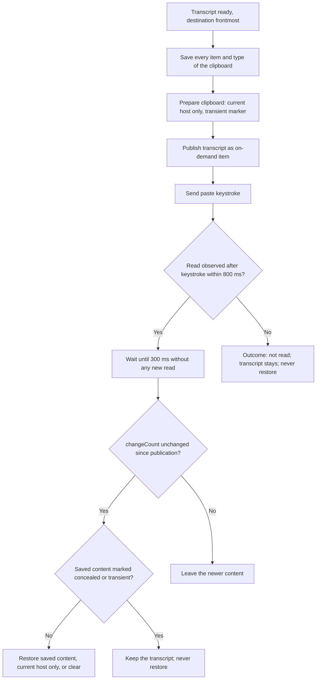
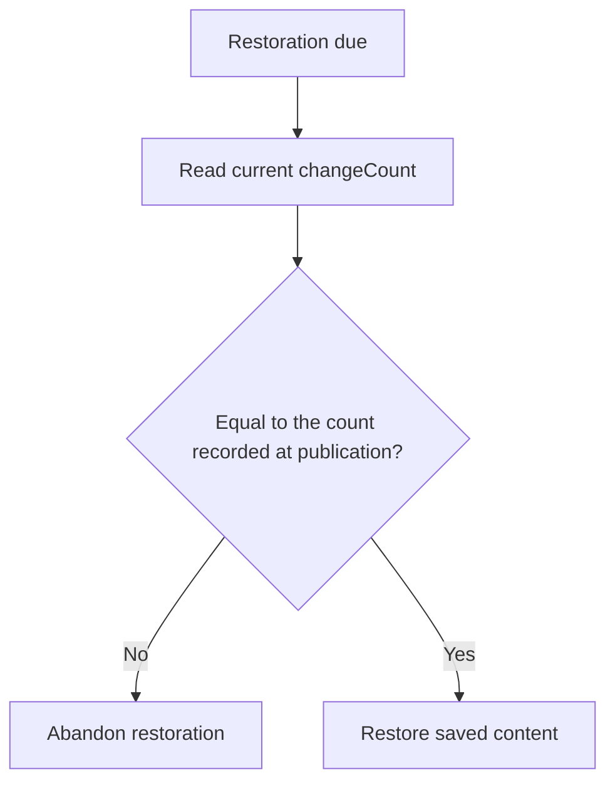
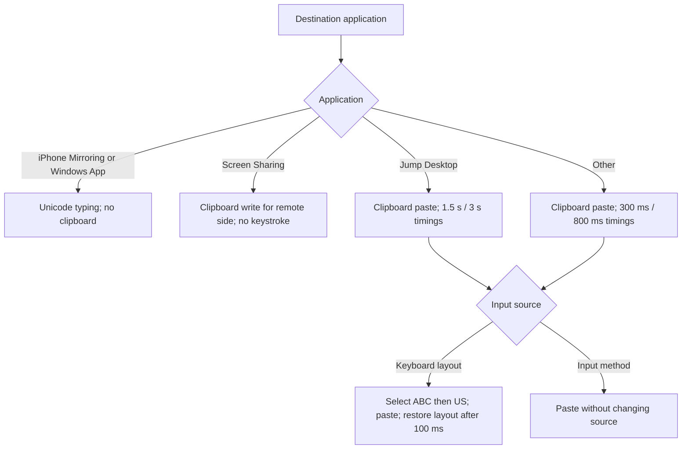
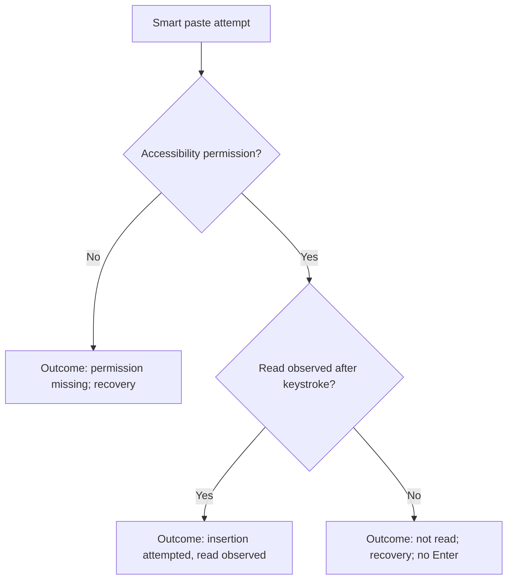
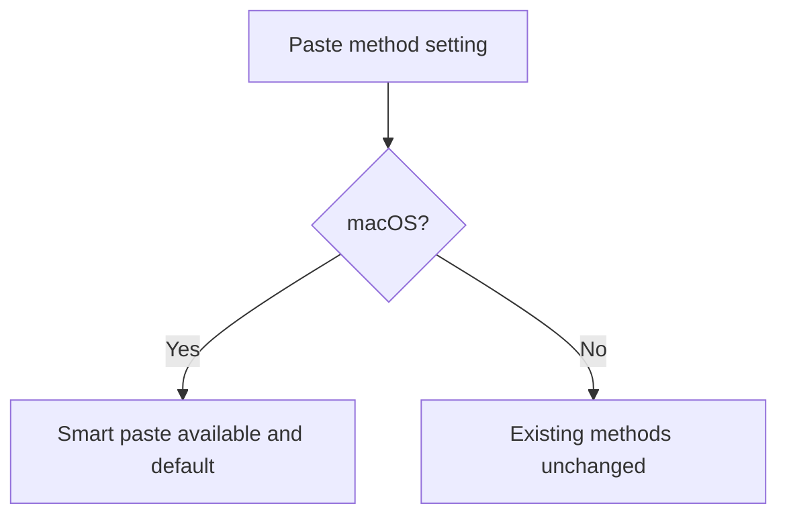
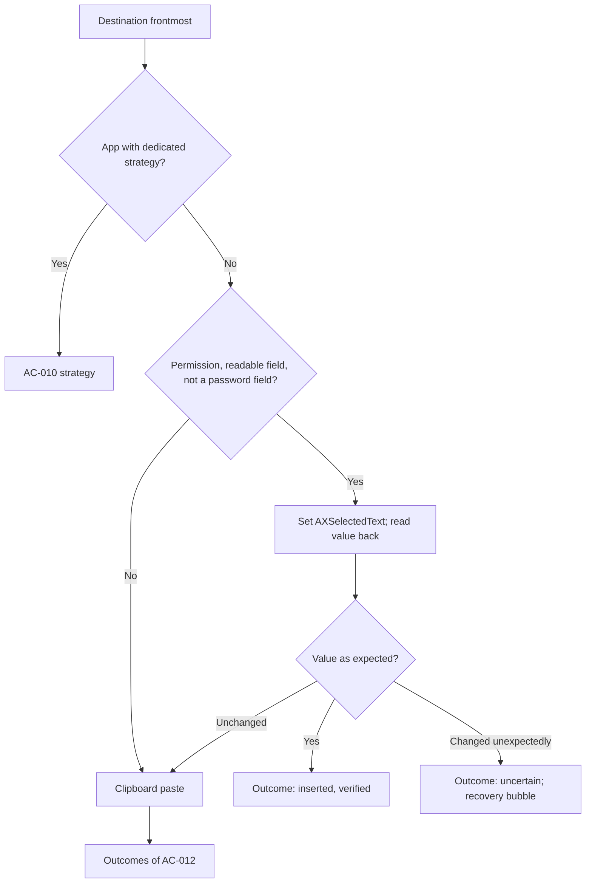

# Feature Spec: Smart Paste

## Header

- **Feature:** Smart Paste
- **Branch:** None — specification only (program specified before `spec-ship`)
- **Date:** 2026-10-12
- **Status:** In Progress
- **Input:** Program item 7, scope replaced on 2026-10-12 by Julien's decision (relayed from Codex): replace the clipboard recovery window (10–15 seconds) with smart paste inspired by Spokenly; do not plan or implement the recovery window for now; keep number 7. Read the Spokenly smart-paste report (`.investigations/spokenly-smart-paste-2026-10-09/rapport.md`). Adopt its documented principles in Handy: multi-type save of the clipboard; transcript provided on demand by a pasteboard data provider; single first-read callback; current-host-only and transient marking; restoration after the read with a fallback delay and a `changeCount` guard that preserves any newer copy; strategy adapted to the application and the keyboard, selecting the ABC then US layout and restoring the keyboard afterwards. Static Spokenly constants: 300 ms / 800 ms, Jump Desktop 1.5 s / 3 s. Inserting through `AXSelectedText` stays a distinct method (superseded by the decision of 2026-10-13 below); destination and PIN act upstream. Verify real insertion and compatibility, because the reverse-engineering evidence is static. Decisions of 2026-10-13 (Julien): (1) a previous clipboard content or an earlier transcript must never be pasted by mistake: restore only after a read confirmed after the paste keystroke, once reads have been quiet for 300 ms after the last one, and never restore when no read occurred (the transcript stays and recovery is offered); (2) try direct insertion through the accessibility API first, verified by reading the field back, then fall back to the clipboard paste, then to the recovery bubble. Program item 8 requires the settings CLI to read and modify output behaviors.
- **Feature Number:** 007

## User Scenarios & Testing

### Story 1 — Paste without losing my clipboard `P1`

**As a** Handy user on macOS, **I want to** have the transcript pasted while my clipboard comes back intact, **so that** dictating never destroys what I had copied.

**Priority reason:** Clipboard loss is the main cost of clipboard-based insertion.
**Independent test:** Copy rich content (text with formatting and an image), dictate into TextEdit, and compare the clipboard before and after.

```gherkin
Feature: Smart paste restores the previous clipboard
  Scenario: Restore after the target reads the transcript
    Given the clipboard holds rich text and an image
    And the paste method is smart paste and the clipboard paste is used
    When a dictation produces "hello world" and TextEdit reads the clipboard after the paste keystroke
    Then TextEdit receives "hello world"
    And 300 ms after the last read the clipboard holds the same rich text and image as before
  Scenario: Probe then read
    Given a Chromium-based target reads the clipboard twice, 150 ms apart, after the paste keystroke
    When smart paste waits for restoration
    Then restoration happens 300 ms after the second read, not after the first
  Scenario: No read never restores the previous content
    Given the paste method is smart paste and the clipboard paste is used
    When the target never reads the clipboard within 800 ms after the paste keystroke
    Then the previous clipboard content is not restored
    And the transcript stays on the clipboard
    And the insertion outcome is "not read"
  Scenario: Empty clipboard before
    Given the clipboard was empty before the dictation
    When the restoration runs
    Then the clipboard is empty again
  Scenario: Concealed or transient content is not restored
    Given the clipboard holds a password copied from a password manager and marked concealed
    And the paste method is smart paste and the clipboard paste is used
    When a dictation produces "hello world" and TextEdit reads the clipboard after the paste keystroke
    Then 300 ms after the last read the password is not put back
    And the clipboard holds "hello world" for this Mac only, marked transient and concealed
```



### Story 2 — Never overwrite a newer copy `P1`

**As a** Handy user, **I want to** keep anything copied after the dictation started pasting, **so that** restoration never erases my own work.

**Priority reason:** Overwriting a fresh copy is unrecoverable data loss.
**Independent test:** Make the target delay its read, copy something else before restoration, and check the clipboard afterwards.

```gherkin
Feature: changeCount guard
  Scenario: User copies before restoration
    Given smart paste published the transcript
    When the user copies "new text" before the restoration runs
    Then the restoration is abandoned
    And the clipboard still holds "new text"
  Scenario: Another application writes the clipboard
    Given smart paste published the transcript
    When another application writes an image before the restoration runs
    Then the image stays on the clipboard
```



### Story 3 — Adapt to the application and the keyboard `P1`

**As a** Handy user, **I want to** have smart paste choose a strategy that works in the frontmost application and with my keyboard layout, **so that** paste works in remote-desktop apps and with non-US layouts.

**Priority reason:** A wrong strategy types garbage or pastes nothing in these environments.
**Independent test:** Dictate with an AZERTY layout into TextEdit, into Screen Sharing, into iPhone Mirroring and into Jump Desktop when available, and check the text and the restored layout.

```gherkin
Feature: Strategy per application and keyboard
  Scenario: Keyboard layout other than ABC or US
    Given the current input source is the French AZERTY keyboard layout
    When smart paste sends the paste keystroke
    Then the ABC layout is selected, or the US layout if ABC is unavailable, before the keystroke
    And the previous layout is restored 100 ms after the keystroke
  Scenario: Input method active
    Given the current input source is an input method such as Japanese Kana
    When smart paste sends the paste keystroke
    Then the input source is not changed
  Scenario: iPhone Mirroring or Windows App
    Given the destination is iPhone Mirroring or Windows App
    When smart paste inserts the transcript
    Then the transcript is typed as Unicode key events without using the clipboard
  Scenario: Screen Sharing
    Given the destination is Screen Sharing
    When smart paste inserts the transcript
    Then the transcript is written to the clipboard for the remote side without a paste keystroke
  Scenario: Jump Desktop timings
    Given the destination is Jump Desktop
    When smart paste publishes the transcript
    Then restoration waits for 1.5 s without any new read after the last read
    And without any read within 3 s the outcome is "not read" and nothing is restored
```



### Story 4 — Report honest outcomes `P1`

**As a** Handy user, **I want to** know when the paste was not consumed, **so that** automatic Enter and recovery act only on real signals.

**Priority reason:** A read receipt is a consumption signal, not proof that text reached the field; Enter and recovery depend on it.
**Independent test:** Paste into a field, into a window without a text field, and with accessibility permission revoked; inspect outcomes, Enter and recovery.

```gherkin
Feature: Smart paste outcomes
  Scenario: Read observed
    Given the target read the transcript after the paste keystroke
    When smart paste completes
    Then the outcome is "insertion attempted, read observed"
  Scenario: No read
    Given the target did not read the transcript within 800 ms after the paste keystroke
    When smart paste completes
    Then the outcome is "not read" and the recovery bubble (010) is offered as for an insertion failure
    And the previous clipboard content is not restored
    And no automatic Enter is sent
  Scenario: Accessibility permission missing
    Given Handy lacks accessibility permission
    When smart paste would send the paste keystroke
    Then no keystroke is sent and the outcome is "permission missing"
    And the transcript is kept for recovery
```



### Story 5 — Choose smart paste in settings and CLI `P2`

**As a** Handy user, **I want to** select smart paste as my paste method in settings or through the CLI, **so that** I can switch back to another method if an application misbehaves.

**Priority reason:** Users need control while compatibility is being verified; the CLI covers output behaviors.
**Independent test:** Set smart paste from the CLI, read it back, then select the classic paste in the UI.

```gherkin
Feature: Smart paste setting
  Scenario: Select from the CLI
    When the user sets the paste method to smart_paste through the CLI with JSON output
    Then stdout reports the new value and settings revision
  Scenario: Upgrade from the beta reliable paste
    Given the beta reliable paste was enabled before the upgrade on macOS
    When settings load after the upgrade
    Then the paste method is smart paste and the beta switch no longer exists on macOS
```



### Story 6 — Insert directly without the clipboard `P1`

**As a** Handy user, **I want to** have the transcript written straight into the text field when the application allows it, **so that** my clipboard is never touched and the insertion is proven.

**Priority reason:** Direct insertion removes the clipboard risk entirely and is the only method that can verify the field content.
**Independent test:** Dictate into TextEdit, a ChatGPT field and a Comet field, then into a password field, and inspect the outcome and the clipboard.

```gherkin
Feature: Verified direct insertion
  Scenario: Native field accepts direct insertion
    Given TextEdit has the caret in a document and accessibility permission is granted
    When smart paste inserts "hello world"
    Then the field value contains "hello world" at the caret position
    And the outcome is "inserted, verified"
    And the clipboard is unchanged
  Scenario: Field refuses direct insertion
    Given the focused field ignores the accessibility write and its value stays unchanged
    When smart paste inserts "hello world"
    Then smart paste falls back to the clipboard paste
  Scenario: Partial or unexpected change
    Given the field value changes but does not match the expected result
    When smart paste checks the insertion
    Then it does not fall back to the clipboard paste
    And the outcome is "uncertain" and the recovery bubble is offered
  Scenario: Password field
    Given the focused element is a password field
    When smart paste inserts the transcript
    Then direct insertion is skipped and the clipboard paste is used
```



## Acceptance Criteria

AC-001 to AC-007 belonged to the retired clipboard recovery window scope and are not reused (see Clarifications).

### AC-008

**Criterion:** With smart paste on macOS, before writing, Handy saves every pasteboard item with all its types as data; it then prepares the general pasteboard for current-host-only content, adds the `org.nspasteboard.TransientType` marker, and publishes the transcript as an item whose plain-text data is provided on demand. The data provider supplies the full transcript on every request and reports the first request after the paste keystroke exactly once. Requests before the keystroke are served but do not count as the first read. The keystroke instant is recorded immediately before the first key-down of the Cmd+V chord is posted, as in the current reliable paste; reads served while the chord is held count. Waiting and posting the chord never block the serving of pasteboard reads. The existing delay before the keystroke (`paste_delay_ms`) still applies, the fixed delay after it (`paste_delay_after_ms`) is replaced by smart paste timings, and the V key is resolved after any layout switch of AC-011 for the layout then active. Saving the previous content is bounded to 200 ms and 50 MB; a type that cannot be saved within those bounds is skipped, and "exactly" in AC-009 applies to the saved types.
**Priority:** P1 | **Story:** Story 1

### AC-009

**Criterion:** Restoration requires a read observed after the paste keystroke. It runs once no new read has occurred for 300 ms after the last read, and at the latest 8 s after the first read if reads keep coming (for Jump Desktop, `com.p5sys.jump.mac.viewer`: 1.5 s of quiet). When no read is observed within 800 ms after the keystroke (3 s for Jump Desktop), the outcome is "not read", the saved snapshot is discarded and the previous content is never restored for that dictation: the transcript stays on the clipboard until the user or another application replaces it. A restoration puts back the saved items and types exactly, or clears the pasteboard if it was empty, only when the pasteboard `changeCount` still equals the value recorded at publication; otherwise it does nothing. Restored content is current-host-only, so it is never sent again to the user's other devices. Content whose saved items carry `org.nspasteboard.ConcealedType` or `org.nspasteboard.TransientType` is never restored (decision 2026-10-13, see Clarifications): when the restoration would run, the transcript stays on the clipboard instead, as current-host-only text with the transient, concealed and auto-generated markers, under the same `changeCount` guard.
**Priority:** P1 | **Story:** Stories 1 and 2

### AC-010

**Criterion:** Strategy by destination bundle identifier: `com.apple.ScreenContinuity` (iPhone Mirroring) and `com.microsoft.rdc.macos` (Windows App) receive the transcript as Unicode key events without clipboard use; `com.apple.ScreenSharing` receives a clipboard write of the transcript without a paste keystroke and keeps it until the user copies something else; every other application uses direct insertion (AC-017) and then the clipboard paste of AC-008/AC-009. The accessibility permission check applies to the strategies that post key events (clipboard paste and Unicode typing). With clipboard handling "copy to clipboard", Unicode typing also leaves the transcript on the clipboard.
**Priority:** P1 | **Story:** Story 3

### AC-011

**Criterion:** For the clipboard paste, when the current input source is a keyboard layout other than ABC or US, Handy selects `com.apple.keylayout.ABC`, or `com.apple.keylayout.US` when ABC cannot be selected, waits 50 ms for the switch to apply, sends Cmd+V, and restores the previous input source 100 ms after the last key of the chord is released. When the current input source is an input method, or neither layout can be selected, Handy sends Cmd+V without changing it.
**Priority:** P1 | **Story:** Story 3

### AC-012

**Criterion:** Smart paste reports one outcome per dictation: "insertion attempted, read observed" when a read followed the keystroke; "not read" when none did; "permission missing" when accessibility permission is absent (checked before the clipboard is touched, so no keystroke is sent and the clipboard is unchanged); "typed" for Unicode typing; "clipboard handed over" for Screen Sharing, shown on the indicator as "Text placed on the clipboard for the remote screen"; "insertion failed" when posting the chord or the Unicode key events fails, or the transaction cannot start. Direct insertion adds "inserted, verified" and "uncertain" (AC-017). Only "inserted, verified", "insertion attempted, read observed" and "typed" count as a successful insertion for automatic Enter (009). "Not read", "permission missing", "uncertain" and "insertion failed" are handled as an insertion failure by the recovery bubble (010). The outcome is known only after the read or the 800 ms decision delay; automatic Enter and recovery wait for it. "Clipboard handed over" is neither a success for automatic Enter nor a failure for recovery. Only "inserted, verified" states that the field contains the text, because the field was read back; every other outcome makes no claim about the field content. If a read arrives after "not read" was declared, the transcript (still on the clipboard) is served, the outcome stays "not read" for automatic Enter, and the recovery bubble states that the text may have been pasted after all.
**Priority:** P1 | **Story:** Story 4

### AC-013

**Criterion:** When clipboard handling is "copy to clipboard", smart paste replaces the restoration by leaving the transcript on the clipboard as plain text, as the current paths do; after a verified direct insertion it also writes the transcript to the clipboard as plain text. The history entry is never modified by smart paste.
**Priority:** P1 | **Story:** Story 1

### AC-014

**Criterion:** Smart paste is a paste method available on macOS and is the default there for new installations. On upgrade on macOS, the beta "reliable paste" switch is removed from macOS: users whose paste method is Cmd+V move to smart paste, whether or not the beta switch was on; users with any other method keep it and the beta switch is dropped. On Windows the beta "reliable paste" switch and its path stay unchanged; Linux paste methods are unchanged.
**Priority:** P2 | **Story:** Story 5

### AC-015

**Criterion:** The settings CLI (008) reads and sets the paste method including `smart_paste`, with the UI validation (`smart_paste` refused outside macOS with `validation_failed`). With `--json`, stdout contains only the JSON envelope.
**Priority:** P2 | **Story:** Story 5

### AC-017

**Criterion:** On macOS, for applications not covered by AC-010, smart paste first tries direct insertion: with accessibility permission, and only when the focused element belongs to the destination application's process (006), it reads the focused element's text value and selected range, sets `AXSelectedText` to the transcript, then reads the value again, polling for up to 150 ms to let applications that update asynchronously apply the change. The attempt is verified when the new value equals the old value with the selected range replaced by the transcript; the outcome is then "inserted, verified" and the clipboard is never touched. If the element is a password field (role AXSecureTextField) or its value cannot be read, direct insertion is skipped; if the value is still unchanged at the end of the read-back window (whether setting reported success or failure), smart paste falls back to the clipboard paste (AC-008/AC-009). If the value changed but does not match the expected result, smart paste does not fall back, to avoid inserting the text twice, and the outcome is "uncertain".
**Priority:** P1 | **Story:** Story 6

### AC-018

**Criterion:** The insertion chain is: direct accessibility insertion (AC-017), then clipboard paste, then recovery bubble (010) for the outcomes "not read", "permission missing", "uncertain" and "insertion failed". Direct insertion, including the read-back window, adds at most 250 ms before the fallback starts.
**Priority:** P1 | **Story:** Story 6

### AC-016

**Criterion:** Before release, native checks record the outcome, the inserted text and the restored clipboard for TextEdit, Notes, ChatGPT, Comet and one Chromium-based application, with AZERTY, US and Dvorak layouts, recording for each run which path was used (direct insertion or clipboard paste); applications where direct insertion is not verified exercise the clipboard paste, and for iPhone Mirroring, Windows App, Screen Sharing and Jump Desktop when available on the test machine; unavailable applications are listed as not verified. Pass thresholds over 10 runs per pair: direct insertion, transcript present exactly once and verified at least 9 times; clipboard paste, transcript inserted and previous clipboard restored at least 9 times; Unicode typing, transcript typed correctly at least 9 times; Screen Sharing, transcript available on the remote side at least 9 times. TextEdit, Notes, ChatGPT and Comet must pass with AZERTY, US and Dvorak before release, and no run of any application may deliver a previous clipboard content or a previous transcript; failures elsewhere are listed as known incompatibilities.
**Priority:** P1 | **Story:** Stories 1, 3 and 4

## Behavioral AC

Signals extracted: select, dropdown, setting, keyboard navigation. Official `detect_traits` returned has_dropdown, is_keyboard_navigable.

### has_dropdown

<!-- WARNING: No visual states defined for trait "has_dropdown" in ui-behavioral-taxonomy.md -->

```gherkin
Feature: Paste method selector
  Scenario: Smart paste listed on macOS
    Given the output settings are open on macOS
    When the user opens the paste method selector
    Then smart paste is listed with the other methods and the current value is marked
  Scenario: Smart paste absent elsewhere
    Given the output settings are open on Windows
    When the user opens the paste method selector
    Then smart paste is not listed
```

### is_keyboard_navigable

<!-- WARNING: No visual states defined for trait "is_keyboard_navigable" in ui-behavioral-taxonomy.md -->

```gherkin
Feature: Keyboard access to the paste method
  Scenario: Change the method with the keyboard
    Given the paste method selector has focus
    When the user picks smart paste with arrow keys and Enter
    Then the method is saved and its new value is exposed to assistive technologies
  Scenario: Tab order
    Given the output settings are open
    When the user presses Tab
    Then the paste method selector receives visible focus in reading order
```

## Functional Requirements

FR-001 to FR-004 belonged to the retired scope and are not reused.

### FR-005

**Requirement:** Save all pasteboard items and types, publish the transcript as an on-demand item on a current-host-only, transient-marked pasteboard, and detect the first read after the paste keystroke once.
**AC References:** AC-008

### FR-006

**Requirement:** Restore the saved pasteboard only after a read confirmed after the keystroke, once reads have been quiet for the per-application delay after the last read (cap 8 s), only when `changeCount` is unchanged; never restore when no read occurred.
**AC References:** AC-009, AC-013

### FR-007

**Requirement:** Choose the insertion strategy from the destination bundle identifier and the current input source, including the ABC/US layout switch and its restoration.
**AC References:** AC-010, AC-011

### FR-008

**Requirement:** Report truthful outcomes consumed by automatic Enter (009) and recovery (010).
**AC References:** AC-012

### FR-009

**Requirement:** Expose smart paste as a macOS paste method with migration from the macOS beta reliable paste (the Windows switch is kept), in settings UI and settings CLI.
**AC References:** AC-014, AC-015

### FR-010

**Requirement:** Record native compatibility evidence per application and layout before release.
**AC References:** AC-016

### FR-011

**Requirement:** Try verified direct insertion through the accessibility API before the clipboard paste, with a fallback rule that never inserts the text twice.
**AC References:** AC-017, AC-018

## Key Entities

| Entity | Description | Key fields |
|---|---|---|
| Pasteboard snapshot | Saved previous content | items, types per item, data per type, empty flag |
| Paste transaction | One smart paste | change count at publication, keystroke time, first and last read times, strategy, timings |
| Direct insertion attempt | Accessibility write before the clipboard | element role, value before, selected range, value after, verified flag |
| Paste strategy | Chosen per destination | clipboard paste, Unicode typing, clipboard hand-over; restore and fallback delays |
| Paste outcome | Result reported | inserted verified, read observed, not read, permission missing, uncertain, typed, clipboard handed over, insertion failed |

## Clarifications

- Decision 2026-10-12 (Julien, relayed by Codex): item 7 is now smart paste. The clipboard recovery window (10–15 s) is retired from the active program and is neither planned nor implemented for now; its earlier spec and plan are kept under `superseded/` for history. Requirement IDs of the retired scope (AC-001–AC-007, FR-001–FR-004, SC-001–SC-003) are not reused.
- Evidence basis: static analysis of Spokenly 2.30.9 (`.investigations/spokenly-smart-paste-2026-10-09/rapport.md`). The 300 ms delay, Jump Desktop timings and the 100 ms layout restoration come from that version; real insertion and compatibility are unverified until AC-016.
- Decision 2026-10-13 (Julien): Spokenly's restoration 800 ms after the keystroke without any read is not adopted, because a slow target could then paste the previous clipboard or an earlier transcript. 800 ms now only decides the outcome "not read"; quiet is measured after the last read (Chromium probes then reads), as in the current reliable paste.
- Decision 2026-10-13 (Julien): direct accessibility insertion is tried first and verified by reading the field back; this replaces the earlier wording that kept `AXSelectedText` as a separate method only.
- Current code (2026-10-12): the beta "reliable paste" on macOS already publishes a lazy promise, counts reads only after the paste keystroke, guards on `changeCount`, marks transient/concealed types and restores after a 200 ms quiet period with an 8 s timeout, but saves text only; the classic path restores after a fixed 60 ms without guard. Smart paste replaces the macOS reliable paste path.
- `[ASSUMED]` Reads before the paste keystroke (clipboard managers) do not count as the first read, as in the current reliable paste.
- Decision 2026-10-13 (Julien): smart paste becomes the macOS default and absorbs the Cmd+V users; users who chose another method keep it; Windows keeps its reliable paste; Screen Sharing does not restore the previous clipboard.
- `[ASSUMED]` Screen Sharing: the transcript stays on the clipboard for the remote side, since no local paste occurs; Spokenly's specific focus path for Screen Sharing is not reproduced.
- Residual limitation: an application that reads again more than 300 ms after its last read (or after the 8 s cap) receives the restored content; without any read the previous content is never restored. Native checks (AC-016) measure this with the chosen delays.
- Known limitation: with Screen Sharing the previous clipboard is not restored, because the transcript is handed to the remote side.
- Known limitation (implementation, 2026-10-13, to confirm with Julien): with clipboard handling "copy to clipboard", the transcript becomes ordinary plain text when "not read" is declared (AC-013); the pasteboard then serves later reads without any provider callback, so the late-read message of AC-012 cannot be produced in that mode.
- To verify natively: whether AppKit calls the data provider again after a clipboard manager read it before the keystroke; a missing second call would produce a false "not read".
- Destination and PIN (006, 009) act before smart paste; direct accessibility insertion is the first step of smart paste (AC-017).
- Read attribution: each dictation publishes its own on-demand item; reads served for an item of an earlier dictation never start or delay the restoration of the current one.
- Program context: specified in list order (001–010); the settings CLI foundation (008) ships first.

- Decision `007-smart-paste:AC-009` / `decision:ac-009:concealed-or-transient-content-not-restored`: User decision 2026-10-13 (Julien, relayed by the orchestrator after independent audit B, finding MAJOR-1): clipboard content marked `org.nspasteboard.ConcealedType` or `org.nspasteboard.TransientType` is not restored after a dictation. Other content is restored normally, always as current-host-only content (`currentHostOnly`). Reason: a dictation changes `changeCount`, so a password manager's automatic clearing no longer fires; restoring the secret would leave it on the clipboard indefinitely.
<!-- livespec-clarification:{"requirement_id": "007-smart-paste:AC-009", "decision_key": "decision:ac-009:concealed-or-transient-content-not-restored", "evidence_hash": "a5432975c454211298925d5ad7e473f089411f64735971530ee67b3a8e592a3f", "answer": "User decision 2026-10-13 (Julien, relayed by the orchestrator after independent audit B, finding MAJOR-1): clipboard content marked `org.nspasteboard.ConcealedType` or `org.nspasteboard.TransientType` is not restored after a dictation. Other content is restored normally, always as current-host-only content (`currentHostOnly`). Reason: a dictation changes `changeCount`, so a password manager's automatic clearing no longer fires; restoring the secret would leave it on the clipboard indefinitely."} -->

## QE Analysis

- **Criticality:** High; **Blast radius:** Every macOS paste and the user's clipboard; **Primary risk:** Clipboard loss or wrong-layout keystrokes; **Confidence:** Medium for mechanism (static evidence plus existing reliable paste), low for application compatibility.
- **Dimensions:** Data integrity, functional correctness, compatibility (applications, layouts, input methods), concurrency/timing, permissions, privacy (transient and current-host-only marking), regression.
- **P0 gates/evidence:** Fake-pasteboard tests for multi-type save/restore, first-read once, pre-keystroke reads ignored, 300/800 ms and 1.5/3 s timings, `changeCount` guard; strategy table tests by bundle identifier; input-source tests (layout vs input method, ABC then US fallback, restoration); outcome mapping tests feeding 009 and 010; migration tests from reliable paste.
- **P1 gates/evidence:** AC-016 native checks per application and layout; clipboard-history manager check for the transient marker; CLI and UI selector checks.
- **Non-functional expectations:** Restoration within 50 ms of its deadline; no transcript, clipboard content or field value read through accessibility logged at any level; input source always restored even when the paste fails.
- **Missing evidence:** All runtime evidence; mockup of the paste method selector deferred before `spec-ship`.
- **Boundary:** QE defines risk and test sufficiency; the independent review judges requirements; Penflow governs UI design evidence; spec-test executes runtime proof.

## Screens

| Screen | Status | Reference |
|--------|--------|-----------|
| output-settings | Modified | Mockup to produce before `spec-ship` (paste method selector with smart paste) |

## Penflow Contract

- Planned `flow_id: smart-paste`, `screen_id: output-settings`. Per the user decision of 2026-10-12 (lightweight UI contract), the Penflow flow/screen contract, semantic and test IDs and the Pencil mockup are produced in one pass for all program features before `spec-ship`; the planned IDs above are authoritative until then. No inspection READY or certification PASS is claimed.

## Edge Cases

- Application reads the pasteboard several times (probe then read): each read restarts the 300 ms quiet delay; all requests are served with the transcript.
- Handy quits or crashes while its on-demand item is on the pasteboard: before a normal exit Handy writes the transcript as plain data if no restoration is due; after a crash the item can no longer be served and the history keeps the transcript.
- Pasteboard content that cannot be read as data (promised by another app and failing): that type is skipped and listed in the debug log by type name only; the other types are restored.
- Layout switch fails: Cmd+V is sent with the current source, and the outcome still depends on the read.
- Second dictation before the first restoration: no intermediate restoration happens; if `changeCount` is unchanged since the first publication, the first snapshot stays the content to restore after the second dictation, otherwise the current content is saved as the new snapshot.
- Password manager or other concealed or transient content on the clipboard (`org.nspasteboard.ConcealedType` or `org.nspasteboard.TransientType` on any saved item, including a type that could not be saved): it is never restored, its bytes are not kept, and the transcript stays instead, as current-host-only text with Handy's markers. Handy's own earlier transcript item carries these markers, so after "not read" a second dictation does not put the first transcript back either. Content marked only `org.nspasteboard.AutoGeneratedType` is restored normally.
- Handy quits before restoration: the pending restoration runs before exit only when a read was observed and `changeCount` is unchanged; otherwise the transcript stays.

## Success Criteria

### SC-004

Fake-pasteboard tests covering every scenario of Stories 1, 2 and 4 pass, with zero cases overwriting content copied after publication.

### SC-005

Native checks restore rich text, image and multi-item clipboard content identically in TextEdit and Notes in 10 consecutive runs each.

### SC-008

In fake-pasteboard tests (late reads, probe-then-read, consecutive dictations, quit), zero cases deliver a previous clipboard content or a previous transcript to the target.

### SC-007

In native checks, direct insertion never inserts the transcript twice: in 100% of runs each application shows the transcript exactly once, and every application where direct insertion is verified leaves the clipboard unchanged.

### SC-006

AC-016 compatibility records exist for every listed application available on the test machine, each with outcome, inserted text and layout.
