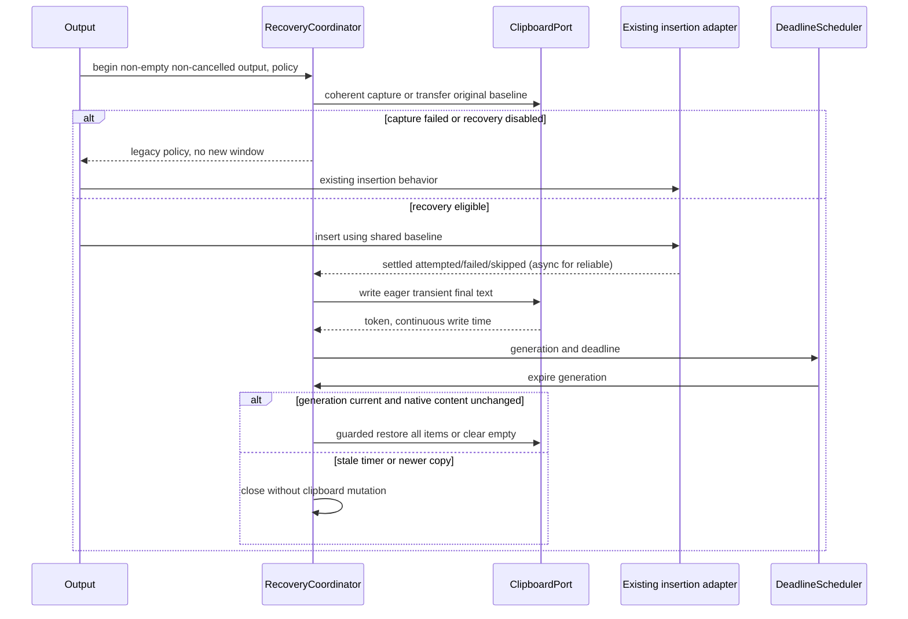
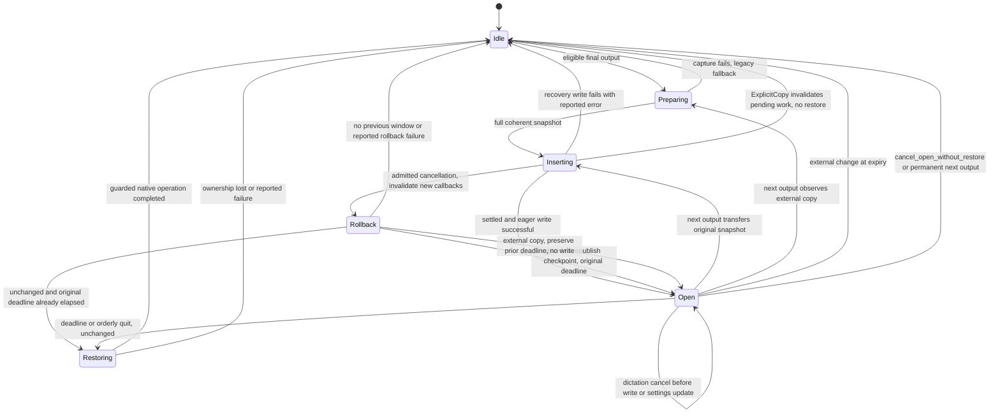
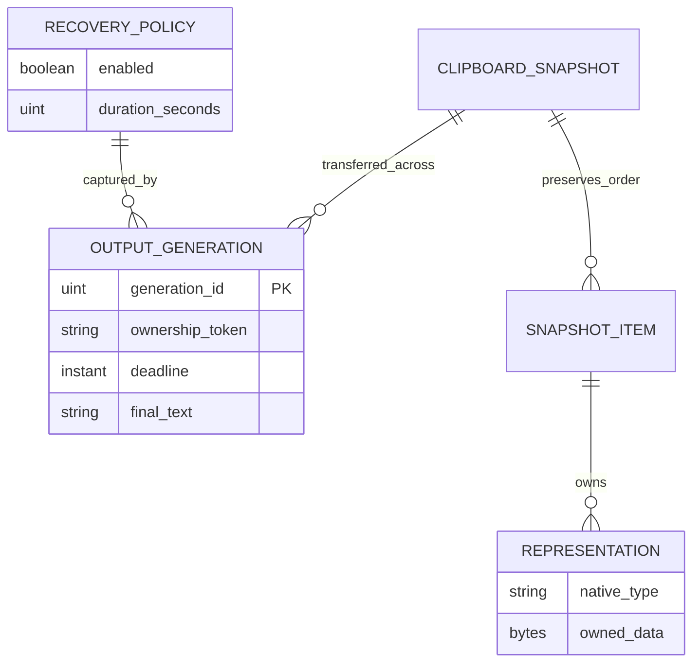

# Implementation Plan: Clipboard Recovery Window

## Summary

Introduce one native clipboard recovery coordinator with owned multi-format snapshots, generation-bound timers and guarded restoration; share its handoff with legacy/reliable insertion and extend 008's existing output settings domain.

Inspect [the functional specification](spec.md) for four FR, seven AC and three SC. Scope **L**, despite four FR: three platform adapters, asynchronous paste ownership, user-data fidelity and dependencies 008/006/009/010. Deliver in phases: native feasibility and deterministic core, insertion integration, settings/UI, acceptance. This command produces a plan only; no application tests, native spike or design certification have run.

Inspect [008's foundation plan](../008-settings-cli/plan.md) for the exact service contract. Reuse `settings_service/{store.rs,transaction.rs,live.rs,domains/mod.rs,domains/output.rs}`, `StoreLocator`, `SettingsRepository`, `read_snapshot`, `commit_mutation`, `LiveSettingsEffects`, persisted `settings_revision`, stable `settings.lock`, authenticated local IPC and the existing Domain trait. Do not add a second settings store, transaction service, domain router or CLI transport. 007 extends the registered **output** domain, keeping destination (006/009), insertion method and clipboard policy distinct.

## Technical Context

| Aspect | Choice | Source / implication |
|---|---|---|
| Native | Rust edition 2021, Tauri 2.11.5, existing Tokio | Coordinator and OS ports; no frontend timer |
| Frontend | React 18, TypeScript, Zustand, i18next | Existing settings group, typed command adapters and revision refresh |
| Clipboard | Existing objc2/AppKit on macOS; windows 0.61.3 on Windows; explicit X11/Wayland adapter on Linux | Generic text/image plugin cannot prove all-format fidelity |
| Persistence | Two scalar AppSettings fields through 008's service | Default migration; runtime snapshots remain memory-only |
| Scheduling | Single coordinator, continuous monotonic Clock and generation IDs | No 12-second sleep on the main thread; stale callbacks inert |
| Storage | Existing settings JSON only; existing history database untouched | No new SQL tables or history migration |
| Tests | Rust unit/integration, Bun pure form tests, Playwright settings, native manual proof | Browser Tauri mocks cannot prove native clipboard behavior |
| Infrastructure | Local OS clipboard only | No credentials/cloud provisioning; no new HTTP endpoints/OpenAPI |

Inspect [clipboard output](../../../src-tauri/src/clipboard.rs), [paste transaction core](../../../src-tauri/src/paste_tx/mod.rs), [macOS transaction](../../../src-tauri/src/paste_tx/macos.rs), [Windows transaction](../../../src-tauri/src/paste_tx/windows.rs), [actions](../../../src-tauri/src/actions.rs), [lifecycle](../../../src-tauri/src/lib.rs) and [settings group](../../../src/components/settings/advanced/AdvancedSettings.tsx) before implementation. The current legacy path saves text OR image, sleeps then restores unconditionally; the reliable path has a 200 ms quiet interval, 8 s no-receipt timeout and 500 ms failed-injection timeout. Reliable `Ok` currently means published/injected, not transaction settled or insertion verified.

## Constitution Check

| Principle / convention | Decision and gate |
|---|---|
| Preserve native/frontend boundaries | PASS: Rust owns clipboard, snapshot, deadlines and shutdown; React owns form draft and translated feedback |
| Derive stack and managers from manifests | PASS: retain Tauri/AppKit/Windows APIs and existing log facade; review any Linux adapter dependency during Step 1 |
| Availability versus runtime proof | PASS: availability table is not build, test, fidelity or UI certification; all native evidence remains required |
| Specify before implementation; meaningful tests | PASS: every FR/AC/SC mapped; fakes only at clipboard/clock/insertion boundaries, real coordinator/validators tested |
| Simplicity/separation | PASS: one restoration owner; reuse 008 settings service and existing paste methods; no transcript/history duplication |
| Naming | PASS: Rust snake_case language delta, Markdown kebab-case, TS component matching repository style; preserve existing names |
| Project tooling/i18n | PASS: keep Bun/ESLint/Prettier/clap; no Commander/Biome/Vitest migration; all new user strings translated |
| Infrastructure | PASS: no external provisioning; native API permissions/desktop availability checked in spike |

## Requirement Inventory

| Requirement | Acceptance / measure | Steps |
|---|---|---|
| FR-001 | AC-001/005: non-empty exact final output; any method/result; permanent bypass | 2, 3, 7 |
| FR-002 | AC-002/003: pre-first-write all representations; empty restore; ownership/comparison guard | 1, 2, 3, 7 |
| FR-003 | AC-004: original baseline across outputs, user copy, cancellation, orderly exit | 2, 3, 4, 7 |
| FR-004 | AC-006/007: defaults on/12, integers 10–15, UI/CLI parity and next-output application | 5, 6, 7 |
| SC-001 | Zero overwritten newer copies in all nine Stories 1–3 scenarios and added race schedules | 2, 7 |
| SC-002 | macOS text/image/rich multi-type equality, run count below | 1, 7 |
| SC-003 | History count/content invariant for each lifecycle event | 4, 7 |

Behavioral AC: loading/error/success/idle and empty/invalid/valid states are owned by Step 6 and browser/form assertions; no visual state is declared certified here.

## Design Reference

| Screen | Planned component breakdown | Evidence |
|---|---|---|
| output-settings | Existing output group; recovery toggle, integer duration, translated help, validation/status feedback and retry | Mockup deferred by the approved 2026-10-12 single-pass decision |

No linked PNG or `.specs/design/theme.css` currently exists for this screen; no theme installation is invented. Retain current component tokens. Do not generate a mockup during this command.

## Penflow Contract Inputs

Authoritative planned identities: `flow_id: clipboard-recovery-window`, `screen_id: output-settings`. Inspect [the existing semantic tree](../../../penflow/semantic-ui-tree.json) as context: it currently describes microphone priority, not 007. `penflow/code-ir.json` is absent. Readiness inspection on 2026-10-12 returned **BLOCKED**, certified false: missing expected-ui-tree.json, code-ir.json, desktop frame width/height. This is a recorded gap, not an absent-input certification or an approved 007 contract.

The user's explicit lightweight UI decision defers the skill's normal forward-chain/mockup preparation to one shared pass before spec-ship. That pass must produce the cumulative flow/screen requirements, semantic/test identities, expected tree, Code IR and Pencil reference, then complete the bound source review/design gate before UI implementation. Preserve the planned IDs; Step 6 consumes the approved Code IR. No provisional test IDs are generated now. Native/core planning and semantic review can proceed; UI implementation remains gated. No `penflow_verification_policy` claims are manufactured for procedures not yet performed, and no accepted 007 Penflow baseline exists to retire or update.

007 adds no overlay surface. The program's early native nonactivating-surface spike remains with 005/006/009/010; 007's clipboard spike verifies typing/copy/paste does not activate settings/overlay. Recovery runs without an overlay and while the 256×50 indicator is hidden. Do not resize that indicator from 007.

## Architecture Decisions

### One owner, one original snapshot

New `clipboard_recovery` module owns `RecoveryCoordinator`, opaque `ClipboardSnapshot`, `OwnershipToken`, `OutputId`/generation and immutable per-output `RecoveryPolicy`. Ports: `ClipboardPort` (`capture`, `write_transient_text`, `is_unchanged`, `restore_if_unchanged`, `clear_if_unchanged`), continuous `Clock`, `DeadlineScheduler`, `InsertionPort` and native dispatch. Return typed outcomes: completed restore, unchanged-content skip, cancellation without restore, snapshot/write/restore failure. The snapshot stores ordered items, each native type and owned bytes/duplicated native handles, with total-size accounting; never use derived Debug/Serialize on transcript/snapshot.

Capture before the first Handy clipboard write of a non-cancelled non-empty output, including reliable promise publication. An empty clipboard is an explicit successful Empty snapshot, not failed read. Before any new output write, serialize with expiry/Copy/exit. If an open generation still owns its token, transfer its **original** snapshot; never snapshot its transcript. If ownership changed, discard the old generation without restoration and capture the current clipboard (e.g. X). Resolve all old reliable restore callbacks before transfer without allowing them to restore; stale generation IDs cannot affect the new snapshot. A failed fresh capture opens no recovery window and invokes the specified existing insertion behavior; no partial snapshot or long timer survives. Disabled recovery and failed-capture legacy behavior are explicit safety exceptions, not newly certified guarded restoration.

Limits proposed for the spike: 64 MiB per representation and 128 MiB aggregate, matching the existing Windows per-format ceiling while bounding multi-item memory. Any inaccessible advertised representation, unsupported handle, incomplete enumeration, size overflow or unstable capture fails the **entire** recovery snapshot; never silently drop formats and call it full fidelity. Recheck token around capture; external changes before publication require a fresh coherent snapshot, bounded attempts (two); exhaustion follows snapshot-failure fallback. These are safety implementation limits, not a new user setting.

### Platform fidelity and race boundary

| Platform | Capture and restoration | Release proof / limitations |
|---|---|---|
| macOS | Enumerate NSPasteboardItem objects in order and each item's types; materialize dataForType into owned NSData bytes, retaining type names. Prebuild all replacement items before touching the general board. Use changeCount/owner-loss guard and a short main-thread native operation; preserve all bytes, not only decoded text/image. Publish UTF-8 plain text plus existing transient markers | Step 1 must establish an ownership-preserving restore primitive for multi-item replacement/clear, not just checkCount then clearContents. AppKit setData refuses changed ownership, but this alone does not prove multi-item/clear CAS. Any unresolved TOCTOU path blocks native release; no private API or silent weakening of AC-003 |
| Windows | Refactor existing full-format snapshot into shared adapter; enumerate every exposed format under OpenClipboard, duplicate HGLOBAL, bitmap, palette/metafile objects with correct handle-specific ownership. Existing skipped/oversized formats must become explicit capture failure or supported duplication. Restore under the same OpenClipboard critical section after rechecking sequence; check every SetClipboardData result | Real contention/delayed rendering, UTF-16, HTML/RTF, bitmap/metafile, registered formats and handle cleanup tests. Sequence 0/access failure is unknown, never permission to restore |
| Linux | Explicit X11/Wayland MIME/selection enumeration and byte materialization with owned selection source; no text/image-only claim. Preserve every exposed MIME representation or fail capture. Restore only if exact UTF-8 transcript comparison succeeds; include current selection-owner token where exposed | X11/Wayland and managers differ; identical-text re-copy is indistinguishable without reliable token (AC-003 fallback). No guarantee that an app-owned selection survives exit/crash without a manager. Do not treat current wl-copy success as ownership/fidelity proof |

Inspect [Apple pasteboard concepts](https://developer.apple.com/library/archive/documentation/Cocoa/Conceptual/PasteboardGuide106/Articles/pbConcepts.html), [Apple setData ownership behavior](https://developer.apple.com/documentation/appkit/nspasteboard/setdata(_:fortype:)), [Windows OpenClipboard](https://learn.microsoft.com/en-us/windows/win32/api/winuser/nf-winuser-openclipboard) and [Windows sequence numbers](https://learn.microsoft.com/en-us/windows/win32/api/winuser/nf-winuser-getclipboardsequencenumber) for external technical context. Public API observation plus adversarial native evidence is required; an in-process mutex cannot serialize another application's copies. Separate initial/repeated dictation writes (explicit output) from late timer/exit restoration (must never erase a detected newer copy).

Use existing macOS concealment types and Windows history/cloud opt-out markers for temporary output; they are hints to managers, not a privacy guarantee. Permanent CopyToClipboard remains existing unconcealed persistent behavior. Linux manager recording remains an explicit limit. No clipboard text, snapshot bytes, MIME payloads or script stderr containing text may enter logs, even debug/trace/error; diagnostics use operation IDs, counts and typed sanitized error categories.

### Insertion completion and reliable handoff

Normalize final output once, including optional trailing space exactly once; use identical bytes for insertion and recovery. 006/009 choose destination, existing clipboard.rs chooses method, 007 chooses clipboard lifetime. `InsertionOutcome::{Attempted,Failed,Skipped}` is not proof of text present in the target. No auto-submit redesign in 007.

Legacy clipboard paste with recovery enabled uses the shared baseline and suppresses its short-delay restore. After the existing insertion attempt settles (including key-injection failure), publish an eager plain-text recovery write and record its token/time. Direct typing and ExternalScript use the same finally/handoff on success or failure; None and unavailable/skipped destination still reach it. A main-thread scheduling failure must reach the coordinator's failure completion path on an available native dispatcher; if clipboard publication itself fails, record a distinct recovery error with no open window, never claim AC-001 success. Empty result or cancelled dictation never creates a generation.

Reliable paste retains receipt/quiet/timeout evaluation, but completion transfers the baseline to 007 instead of restoring it. Start the full recovery duration only after settlement and the eager plain-text handoff write. No legitimate receipt still settles after 8 s; failed injection after 500 ms; then start the full 10–15 s recovery window. Maximum no-receipt exposure is 8 s plus 15 s plus scheduler tolerance (23.5 s), excluding OS stalls/suspend. A read receipt shows consumption, not verified insertion. Preserve existing receipt-gated auto-submit once; stale/aborted prior transaction cannot later inject Enter. `try_reliable_paste` must distinguish pre-publication unavailable (safe legacy fallback) from post-publication failure (settle existing transaction, no duplicate legacy publication).

External copies during the insertion step before the final recovery write become the new restoration baseline if coherently captured; the final dictation's recovery write is an explicit AC-001 output, whereas expiry must not overwrite any copy after that write. Reliable late callbacks and two outputs completing out of order are generation checked. No mode holds settings.lock, Enigo mutex or coordinator lock for the window duration. Receipt waiting, activation waits owned by 006/009, capture materialization and scheduling are off the UI thread; marshal only required brief AppKit calls.

### Deadlines, cancellation, Copy and exit

Timer uses deadline = continuous monotonic write time + captured duration. Clock accounts for system suspend; on resume process overdue expiry once with a fresh ownership check. End processing target ≤500 ms after deadline when the OS/event loop is running; no timer promise while asleep. Expiry and user-copy races are tested around the final native mutation, not only at timer creation.

Cancellation and the first native mutation have one serialized linearization point. Preparing capture is read-only: cancellation admitted before publication leaves the open generation, text, original snapshot and deadline intact. Before transferring an open generation into a new insertion, retain a **rollback checkpoint** containing its generation, transcript, original snapshot ownership and original deadline; invalidate only its mutation callbacks, not its deadline semantics. All writes and cancellation decisions run through the coordinator/native adapter handshake, never an independently racing cancellation flag.

For cancellation admitted after publication but before output settlement, invalidate the new insertion/reliable generation first (including promise providers, pending Enter and settlement/recovery callbacks). Test ownership against the **new transaction's latest token**, never the superseded old token. While still owned and the checkpoint deadline has not elapsed, guardedly republish the checkpoint transcript, rebind its ownership token and resume its original generation with its original snapshot/deadline; do not create a new window or extend time. If the original deadline has elapsed, guardedly restore that original snapshot once and remain idle, as the prior window's normal expiry requires. Without a checkpoint, guardedly restore the pre-insertion snapshot and remain idle. If an external copy replaced the new transaction, perform no clipboard mutation; retain the checkpoint's original deadline until its normal ownership-check expiry, which skips restoration. An insertion failure is not a cancellation and still opens recovery after settlement. Any native rollback failure is reported and blocks the cancellation acceptance guarantee; no fallback to Inserting→Idle may silently discard a still-valid previous window. Settings changes apply to the next output; toggling off/changing duration never alters the current generation. Switching to permanent mode on the next output closes old recovery without restoration before leaving the new transcript permanent.

Expose internal `cancel_open_without_restore(reason: RecoveryCancelReason) -> Result<CancelOutcome, RecoveryError>` on the same serialized coordinator. It invalidates the open generation, stops its timer, releases its saved baseline and never calls restore/clear or writes clipboard. Reason `ExplicitCopy` additionally invalidates every pending insertion/reliable generation and rollback checkpoint already issued at that point: queued publication, settlement, recovery write, restore and Enter callbacks become inert. 010 serializes this cancellation **before** its permanent write in the same coordinator operation, so pending reliable work cannot reopen a window or overwrite permanent Copy. A genuinely later new dictation has a new accepted OutputId and may start its own window. Cancellation of dictation is a different operation. Future 010 owns Copy UX and error messages; 007 owns cancellation contract and race tests now.

Orderly exit routes tray quit, Cmd/Ctrl+Q, no-tray last-window close and updater/restart through `prepare_exit`. Retain process/native message loop until guarded restore completion; no synchronous waiting for a worker from the macOS main thread. Cancel timers and pending reliable callbacks once; recheck ownership immediately in adapter; newer copies remain untouched. A bounded 2 s shutdown budget reports sanitized restore failure if native clipboard is unavailable; do not claim restore succeeded or unconditionally clear. Release gate includes this failure contract. Crashes/force kill cannot run restore: macOS/Windows eagerly published recovery text may remain; Linux without manager may lose its selection. These platform qualifications resolve the spec-review crash warning without changing spec behavior.

HistoryManager is not injected into restoration logic. actions.rs currently records only when WAV was saved; 007 neither removes nor edits such entries and does not promise creation of a missing entry after crash/non-saved WAV. SC-003 tests preexisting count **and contents**; native checks seed a successfully saved WAV entry before dictation/expiry/quit/crash proof.

### Settings and local contract

Fields: `clipboard_recovery_enabled: bool` default true; `clipboard_recovery_seconds: u64` default 12, integer range 10–15 inclusive. Add serde defaults, salvage/upgrade validation and 008 descriptors. On disk, preserve unknown fields/revision using `commit_mutation`; no direct write_settings or plugin-store writer reintroduced. LiveSettingsEffects publishes the new policy snapshot; output copies both values atomically at begin. Invalid UI/CLI values leave saved data/revision and active-window state untouched. Semantic no-op preserves revision.

Extend existing `handy settings output get [KEY]` and `output set KEY VALUE`; generic list/get/set expose the same two descriptors. Examples: `handy settings output set clipboard_recovery_seconds 10 --json`, `handy settings output set clipboard_recovery_enabled false --json`. Invalid 20/noninteger/negative/overflow/null → `validation_failed`, exit 2, details field/range 10–15. Boolean accepts exactly true/false. Success `{ok:true,revision:N,data:...}`; error `{ok:false,error:{code,message,details:{...}}}`; newline once, stdout JSON only, diagnostics stderr. Reuse 008 exit mapping 0/1/2/3/4/5, revision conflict details/current_revision and timeout outcome unknown; no offline fallback after submitted live IPC. The output domain remains configuration-only, never a clipboard command.

UI setters delegate to the same descriptor/typed mutation through 008 service. New translated copy explains that dont_modify restores the previous clipboard after the temporary window; direct typing still offers manual paste; Linux history managers may retain it. Preserve serialized enum values, offer off toggle, and do not promise guaranteed manager concealment. Settings error/success comes from transaction completion, not local optimism; revision-based refresh rejects stale replies. Retry after an unknown committed outcome requires fresh read, not blind resubmission.

## Gherkin Scenarios and Sequence Diagram

```gherkin
Feature: Insertion to clipboard recovery handoff
  Scenario Outline: Every non-empty final output reaches recovery
    Given recovery is enabled for 12 seconds and permanent copy is off
    And a complete snapshot of the original clipboard exists before Handy's first write
    When the insertion method <method> finishes with <outcome>
    Then the exact final text is written as plain text at settlement
    And the recovery deadline is 12 seconds after that write
    Examples:
      | method | outcome |
      | legacy clipboard | attempted |
      | direct typing | failed |
      | external script | failed |
      | none | skipped |
      | destination unavailable | skipped |
  Scenario: Reliable path without a receipt
    Given a published reliable transaction has no post-injection read receipt
    When its 8-second timeout settles it
    Then a plain-text recovery write starts a new full configured window
    And no receipt or verified insertion is claimed
  Scenario: New user copy before expiration
    Given the recovery write has token 20
    When another app changes the clipboard to token 21
    And the timer runs
    Then no clipboard write or clear occurs
```



## State Model

```gherkin
Feature: Recovery generation lifecycle
  Scenario: Consecutive output reuses original snapshot
    Given an open window still owns the clipboard and saved original
    When the second final output settles
    Then its new generation retains original and receives a full new deadline
    And expiry from the first generation is inert
  Scenario: User copy between outputs changes the baseline
    Given a user copied X during the first window
    When a second final output is produced
    Then the first generation is discarded without restoring
    And X is saved for the second unchanged-window restoration
  Scenario: Cancel and settings changes preserve an open window
    Given an open window with its captured deadline
    When another dictation is cancelled before writing or the settings change
    Then the same open window continues with the same deadline
  Scenario: Cancel after a second publication restores the previous window
    Given the first generation has original snapshot, first transcript and deadline D
    And the second insertion published with a new transaction token T
    And no external copy occurred and D has not elapsed
    When cancellation is admitted before the second output settles
    Then a guarded write against T republishes the first transcript
    And the first generation resumes with its original snapshot and deadline D
    And the second transaction cannot publish, restore or send Enter again
  Scenario: Cancellation rollback respects an external copy
    Given a second publication was replaced by a user copy
    When that dictation is cancelled
    Then rollback performs no clipboard mutation
    And the previous window's original expiry skips restoration over the user copy
  Scenario: Explicit Copy keeps permanent text
    Given an open window or a pending reliable insertion
    When 010 cancels it without restoration before writing copied text
    Then its old expiry and reliable callbacks cannot change copied text
    And pending settlement cannot reopen recovery
  Scenario: Quit while unchanged
    Given an open unchanged window
    When orderly quit is requested
    Then its snapshot is restored before the process exits
```



## Entity Model

Conceptual in-memory relationships only; no new database table or persisted clipboard payload.



## Implementation Plan

### Step 1 — Prove native snapshot and guarded restore feasibility

**Prerequisite:** 008 foundation interfaces stable; approved spec and independent plan review. No production behavior enabled.
**Required inputs:** Native source inventory, platform API contracts, all-format examples, local test desktop/clipboard backup.
**Action:** New `src-tauri/src/clipboard_recovery/{mod.rs,port.rs,macos.rs,windows.rs,linux.rs}` isolates native capture/guard operations. Refactor snapshot primitives from paste_tx/windows.rs without changing disabled behavior. New `src-tauri/tests/clipboard_snapshot.rs` and `scripts/clipboard-native-proof.ts` implement native fixture capture/probe/compare with user clipboard saved/restored. Review necessary Linux dependency/FFI features in Cargo.toml; keep unsafe in reviewed OS adapters with SAFETY invariants. Spike macOS multi-item raw bytes, ownership-preserving replacement/clear, delayed providers, concurrent third-party copy and nonactivation early.
**FR covered:** FR-002.1: Native full-format snapshot and guard
**Execution evidence:** Platform API/ownership rationale, native fixture bytes/hashes, handle lifecycle, injected copy during final mutation, OS/build/binary identity.
**Success criteria:** Every exposed representation is captured/restored or entire capture explicitly fails; native mutation does not knowingly overwrite new ownership; unresolved macOS CAS/clear safety is a release blocker. No claim from fake port alone.
**Failure handling:** Record unsupported formats/clipboard permissions exactly; no silent lossy snapshot. If public APIs cannot satisfy AC-003 race safety, block affected native implementation and request a scoped spec decision rather than inventing atomicity.

### Step 2 — Build deterministic generation and deadline coordinator

**Prerequisite:** Step 1 port/ownership contract established for the target; tests can inject clipboard and continuous time.
**Required inputs:** Snapshot ownership types, fake clock/scheduler, recovery policy, transition scenarios.
**Action:** New `clipboard_recovery/{coordinator.rs,state.rs,clock.rs}` implements begin/transfer/settle/expire, cancellation rollback, settings capture and cancel_open_without_restore. Unit tests colocated; new `src-tauri/tests/clipboard_recovery.rs` drives actual coordinator with fake ports and race barriers. Use bounded capture retries, explicit RAII snapshot cleanup and generation-aware deadline ownership.
**FR covered:** FR-001.1: Final output and duration policy, FR-002.2: Conditional restoration decisions, FR-003.1: Generations cancellation and Copy
**Execution evidence:** All nine Stories 1–3 scenarios plus ordering/property tests, fake time at 9.999/10/12/15 s, overdue resume, stale generations, user-copy same/different text, counter unknown/wrap handling.
**Success criteria:** Zero newer-copy overwrites in SC-001 matrix; no stale callback mutation, no sleeps/locks for full duration, cancelled pre-write dictation leaves current window unchanged.
**Failure handling:** Any stale restore/clear, corrupted baseline or unbounded allocation is P0; do not wire output before repair.

### Step 3 — Integrate all insertion paths with single restoration owner

**Prerequisite:** Coordinator deterministic tests PASS, target native adapter validated; 006/009 output boundary reconciled.
**Required inputs:** clipboard.rs, paste_tx core/platforms, actions.rs cancellation generation, final-text/trailing-space semantics.
**Action:** Modify clipboard.rs and actions.rs to produce one typed final-output/settlement lifecycle and shared snapshot handoff on attempted/failed/skipped outcomes, including dispatch failure. Modify paste_tx/{mod.rs,macos.rs,windows.rs} to support recovery restoration disposition and settlement completion callback; suppress legacy restore only for eligible successful capture, preserve disabled/permanent behavior. New `src-tauri/tests/clipboard_output.rs` uses injectable insertion failures and delayed reliable receipts. Keep waits off main thread, call Enigo/AppKit only on required dispatcher.
**FR covered:** FR-001.2: Every method and result handoff, FR-002.3: Capture before first Handy write, FR-003.2: Reliable and consecutive ownership
**Execution evidence:** Method/result/permanent/toggle matrix, exact text including trailing space, no-receipt 8 s then full window, failed injection 500 ms, out-of-order callback and external copy between stages.
**Success criteria:** One restoration owner; direct/script failures still offer recovery when publication succeeds; no duplicate legacy fallback after published reliable transaction; no premature restore or stale Enter.
**Failure handling:** Clipboard write failure reports unavailable recovery distinctly; do not mark insertion verified or retry whole insertion blindly. Snapshot-failure and disabled-mode legacy exceptions tested as existing behavior.

### Step 4 — Wire orderly exit and conservation boundary

**Prerequisite:** Insertion lifecycle stable and coordinator owns shutdown cleanup.
**Required inputs:** lib.rs RunEvent/exit handlers, tray/no-tray paths, paste transaction resources, existing saved history entries.
**Action:** Modify lib.rs/tray.rs lifecycle adapters so `prepare_exit` prevents final exit while the guarded restore is pending and resumes exit once; updater/restart uses same shutdown hook. No HistoryManager mutation is added. New `src-tauri/tests/clipboard_lifecycle.rs` verifies real lifecycle adapter, quit/copy/expiry races, pending promise cleanup and history immutability. Native script covers menu, keyboard and no-tray exits plus force kill as an explicit non-restorable case.
**FR covered:** FR-003.3: Guarded orderly exit and cleanup, FR-001.3: Permanent and history conservation
**Execution evidence:** Before/after history count/content, saved-WAV fixture, process lifetime and clipboard readback, timers/providers/handles released, shutdown error receipt.
**Success criteria:** Normal unchanged quit restores before exit; changed clipboard untouched; all current entries identical; non-saved WAV is not represented as a missing recovery-created entry.
**Failure handling:** OS restore failure/2 s deadline reported truthfully and blocks native exit guarantee until resolved; no main-thread worker deadlock, forced clear or claimed crash restoration.

### Step 5 — Extend 008 descriptors and output domain transaction

**Prerequisite:** 008 implemented first; settings service is sole writer and output Domain framework registered.
**Required inputs:** AppSettings defaults/salvage, 008 descriptors/validators/commit service and envelope renderer.
**Action:** Modify settings.rs for both fields; extend `settings_service/{descriptor.rs,validation.rs,live.rs,domains/output.rs}` from 008's Step 2 interface. Reuse `SettingDescriptor`, `SettingsMutation`, `SettingsSnapshot`, `Revision`, `PublicSettings`, `OperationRequest` and `SettingsError`. Add both descriptors, typed UI command adapter in commands/mod.rs and registration in lib.rs, policy publication and specta bindings regeneration. New `src-tauri/tests/clipboard_settings.rs` uses actual 008 service/CLI framework, isolated stores, native effects port and subprocess JSON assertions. Update application README CLI usage during implementation only.
**FR covered:** FR-004.1: Defaults validation and shared domain
**AC covered:** AC-006, AC-007
**Execution evidence:** UI/CLI parity table for true/false, 10/12/15, 9/16/20, fraction/negative/overflow/null/empty, revisions/no-op/CAS, unknown-outcome fresh read and active-window unchanged tests.
**Success criteria:** Same validator/reason; invalid values leave disk/revision/current generation unchanged; settings changes affect next output atomically; exactly one JSON envelope and existing exit mapping.
**Failure handling:** No direct settings writer; 008 interface drift requires reconciliation against delivered 008 contract, not modification of its plan. IPC/persistence failures preserve 008 truthful outcome semantics.

### Step 6 — Add output settings controls from approved common UI contract

**Prerequisite:** Single-pass program Penflow/semantic/test IDs/mockups and bound source review/design gate complete for clipboard-recovery-window/output-settings; Step 5 adapter ready.
**Required inputs:** Approved Code IR, existing SettingsGroup/Toggle/number-input patterns, translations and settingsStore revision handling.
**Action:** New `src/components/settings/clipboard-recovery-window.tsx` and `clipboard-recovery-window.test.ts`; modify AdvancedSettings.tsx, ClipboardHandling.tsx description translations, settingsStore.ts command map and en/fr translation.json. Keep duration draft string until valid integer commit; blur/Enter validates, empty restores committed value with explanation. Toggle/number load/save/error/success feedback uses service result; failure retains previous value and retry, respects permanent-mode bypass. Consume approved IDs for all interactive/state elements. New `tests/clipboard-recovery-settings.spec.ts` covers browser behavior and visual states.
**FR covered:** FR-004.2: UI states translated explanation and retry
**Execution evidence:** Pure form boundary tests, actual store-adapter error/revision tests, browser keyboard/focus feedback, approved mockup-versus-runtime comparisons.
**Success criteria:** AC-006 and every behavioral visual state mapped; range explanation and default/bypass/privacy copy truthful; no hardcoded JSX strings or provisional semantic IDs.
**Failure handling:** Missing/stale Code IR or approval blocks UI code; planned identities/reference absence cannot establish design readiness. No new mockup from this plan command.

### Step 7 — Prove acceptance, timing, fidelity and regressions

**Prerequisite:** Steps 1–6 complete with reviewed native primitives; target release binaries and isolated store/clipboard fixtures.
**Required inputs:** AC/FR/SC matrix, actual native harness, platform test operators, UI design/runtime artifacts.
**Action:** Run resolved commands and native proof matrix below. New native script records sanitized observations, representation equality and scheduler timestamps; attach reports under `proofs/007-clipboard-recovery-window/<os>/`. Run existing paste_tx/clipboard/keyboard tests plus 008 contract regressions. Independently map assertions to all requirements and exclude browser mocks from clipboard/exit proof.
**FR covered:** FR-001.4: All output acceptance and history parity, FR-002.4: Fidelity ownership and race proof, FR-003.4: Lifecycle and timing acceptance, FR-004.3: UI CLI and visual acceptance
**Execution evidence:** Per-command stdout/stderr/exit, binary/OS/tool identities, AC assertion matrix, native comparison/timing reports, UI design/runtime references and clean log sentinel scan.
**Success criteria:** SC-001 zero cases; SC-002 equality in every specified macOS run; SC-003 invariant; no unexplained P0/P1 failures, no claimed platform PASS from another OS.
**Failure handling:** Missing platform/visual evidence stays BLOCKED; fix legitimate test failures, do not waive them as environment explanations or substitute planned commands for proof.

## Resolved Test Commands

Availability checked 2026-10-12 only; no application suite run. No surfaces.yaml: `tests` resolved from playwright.config.ts, Rust integration from `src-tauri/tests`. Native SDK/model-resource prerequisites remain to verify at implementation. No package installation is performed now.

| Action | Command | Tool / current status |
|---|---|---|
| Rust unit | `cargo test --manifest-path src-tauri/Cargo.toml --lib clipboard_recovery` | Cargo/rustc 1.94.0 available; module/tests planned |
| Rust coordinator/native snapshot | `cargo test --manifest-path src-tauri/Cargo.toml --test clipboard_recovery --test clipboard_snapshot` | Available; targets planned, native build not verified |
| Rust output/lifecycle/settings | `cargo test --manifest-path src-tauri/Cargo.toml --test clipboard_output --test clipboard_lifecycle --test clipboard_settings` | Available; targets planned |
| Existing paste regression | `cargo test --manifest-path src-tauri/Cargo.toml --lib paste_tx`; `cargo test --manifest-path src-tauri/Cargo.toml --lib clipboard` | Existing unit modules; not executed |
| All Rust | `cargo test --manifest-path src-tauri/Cargo.toml` | Available; no full suite result |
| Form unit | `bun test src/components/settings/clipboard-recovery-window.test.ts` | Bun 1.3.9 available; tests planned |
| Existing keyboard | `bun run test:keyboard` | Declared script, Bun available; not executed |
| Frontend/browser | `bun run test:playwright -- tests/clipboard-recovery-settings.spec.ts` | Local binary absent: TOOL NEEDED `bun install`, then `bunx playwright install chromium` |
| Visual | Same Playwright file + approved Penflow design/runtime comparison | Pending common contract/mockup; browser package absent |
| Native evidence | `bun scripts/clipboard-native-proof.ts --binary <release-binary> --platform <macos\|windows\|linux> --out <proof-directory>` | Bun available; script/harness proposed, not existing |
| Type check | `bunx --no-install tsc --noEmit` | Local tsc absent; TOOL NEEDED `bun install` for pinned ~5.6.3 |
| Lint | `bun run lint`; `cargo clippy --manifest-path src-tauri/Cargo.toml --all-targets -- -D warnings` | ESLint absent; clippy 0.1.94 available |
| Format | `bun run format:check`; `cargo fmt --manifest-path src-tauri/Cargo.toml -- --check` | Prettier absent; rustfmt 1.8.0 available |
| i18n | `bun run check:translations` | Existing Bun script; not executed |
| Build | `bun run build`; `bun run tauri build` | Declared scripts; frontend installation/native prerequisites not verified |
| Full acceptance | Rust full + form + keyboard + browser + lint/type/format/i18n + native matrix on each supported platform | Composite required gate, no current PASS |

## Testing Strategy

| Priority / level | Behavior / planned file | Requirements |
|---|---|---|
| P0 unit | All nine Stories 1–3 scenarios; transfer original vs X, timer generations, same/different copies, cancelling pre-write, exact deadline boundaries/resume; inline coordinator tests and clipboard_recovery.rs | FR-001/002/003; AC-001–005; SC-001 |
| P0 native boundary | Multi-item/type bytes, empty vs inaccessible, size/unstable snapshot rejection, delayed providers, guard at write/clear boundary, Windows lock/handle ownership; clipboard_snapshot.rs | FR-002; AC-002/003; SC-002 |
| P0 integration | Every insertion method × attempted/failed/skipped, trailing space, reliable early/eager receipt/quiet/no-receipt/injection failure, dispatch error, consecutive reliable transfers/out-of-order callback, failed capture legacy fallback; clipboard_output.rs | FR-001/002/003; AC-001–005 |
| P0 lifecycle/history | Quit/copy/expiry races; ExplicitCopy cancellation performs zero writes/clear; no effects from queued callbacks; cancel-before-write unchanged; snapshot/provider cleanup; real seeded history count/content; clipboard_lifecycle.rs | FR-003; AC-004/005; SC-003 |
| P0 service/CLI | Same validator for UI and real CLI domain; boundary/rejection/no-op/CAS/atomic field pair, stdout envelope/exits, offline/live read and next-output capture; clipboard_settings.rs | FR-004; AC-006/007 |
| P1 UI/form/visual | Empty/invalid/valid integer draft, loading/error/retry/success/idle, stale refresh, keyboard/focus, translated range/bypass/privacy; component test and tests/clipboard-recovery-settings.spec.ts | FR-004; AC-006 and Behavioral AC |
| P1 native privacy | Temporary transcript transient markers with installed history manager, permanent mode unchanged, sentinel absent from all logs including failure/script stderr | FR-001; AC-005; QE privacy NFR |
| P0/P1 native release | Actual manual paste within/beyond window, original restore, user/other-app copy, consecutive dictation, no-WAV history boundary, orderly quit and platform-qualified crash; native proof script/manual report | AC-001–005; SC-001–003 |

Seams required here: ClipboardPort, continuous Clock/DeadlineScheduler, InsertionPort/settlement callback, native dispatch/exit request and isolated settings repository supplied by 008. Workspace activation and AX classification are injectable ports of 006/009 only: tests feed failed/skipped outcomes without instantiating or waiting for their real services. Audio enumeration (`AudioDeviceCatalog`), recording/model services and LLM client belong upstream; use final-text fixtures, not new unused implementations. Native end-to-end tests use real output adapters and desktop apps, not faked acceptance. Recovery coordinator has no audio/LLM/AX/history dependency.

Native macOS SC-002 protocol: **20 runs each** for empty, plain text, image, rich text (plain+RTF+HTML) and multi-item mixed content, at 12 s, plus **10 runs each** at 10 and 15 s. Compare ordered item count, sorted type-set per item and every exposed representation byte-for-byte (bitmap decoded pixel equality only when OS normalization prevents stable native bytes; record both raw type and normalized pixel oracle, never silently substitute for rich-text bytes). No interference means initial token stable across capture and no external ownership change from recovery write until restore; record token sequence and classify interfered runs separately, rerun to reach required valid-run count. Require all valid runs equal; zero tolerance for missing formats/items. Never log payloads; private fixture hash files can prove equality. Run the same matrix on Windows for supported handle types; X11/Wayland enumerate exposed MIME types and separately record unsupported/fallback branches.

Timing: record continuous write timestamp, captured duration, scheduled deadline and actual restore/skip callback. For each 10/12/15 setting collect 30 awake runs; each expiry processing ≤500 ms late. Include busy UI, reliable timeout, rapid outputs, sleep spanning deadline and wake-first-event check. Use fake clock advances or event/condition waits with bounded deadlines, no arbitrary sleeps. Invariant guards cover a copy inserted immediately before native mutation; manual demonstrations of copy at 3 s alone cannot prove race safety. Native two-process interference tests complement deterministic barriers.

## QE Analysis

Criticality **High**, blast radius **Cross-system/shared clipboard**, primary risk **Data**, confidence **Medium** until native evidence. All eight dimensions considered: correctness, regression, contract, data/migration integrity, security/privacy, performance, accessibility/UX, observability. Cloud scalability/auth provisioning are N/A; clipboard resource size, leakage and UI focus are applicable.

| Gate | Required evidence / owner | Known gap / blocking rule |
|---|---|---|
| Plan quality | Complete+ready independent raw review, structure and progression; planner | This run creates documentation/review, not runtime proof |
| Native feasibility/data P0 | Ownership-preserving restore/clear rationale + real interprocess race and fidelity matrix; native implementer/reviewer | macOS CAS and Linux representations unproven; unsafe/partial restore blocks affected platform release |
| Coordinator/insertion P0 | Actual manager tests, all-method settlement/timeout matrix, generation/Copy/exit/history assertions; implementer then spec-test | No implementation/test targets exist yet; any new-content clobber blocks delivery |
| Contract compatibility P0 | Actual 008 output-domain envelope/exit/revision parity, migrations and UI adapters; spec-test | 008 delivered first; no new service/transport allowed |
| UI/a11y/visual P1 | Approved one-pass Code IR/IDs/mockup, bound review, runtime visual comparison and keyboard feedback; program UI owner | Existing inspection BLOCKED; absent sources cannot certify UI readiness |
| Timing/privacy P1 | ≤500 ms awake observations, manager-marker check, no-log sentinel scans, bounded memory/resource proof; spec-test | Suspend/Linux manager retention qualified; any leaked payload blocks delivery |
| Evidence integrity | Binary/OS/fixture identity, exact commands/exits and AC assertion matrix; verifier | Browser/tool availability/other feature receipts cannot substitute for native acceptance |

Expected implementation proof paths: `proofs/007-clipboard-recovery-window/<os>/{acceptance-matrix.json,clipboard-fidelity.json,timing.json,native-observations.md,commands.json}` plus sanitized command transcripts and design/runtime registry artifacts. They are planned artifacts, not existing evidence. QE defines sufficiency; independent plan review judges design; native API/security review inspects ownership/FFI and payload flow; spec-test executes tests, audit assesses delivered changes. No security scan or runtime certification is claimed here.

## Risks & Considerations

| Original spec-review finding | Decision/test/risk disposition |
|---|---|
| Feasibility: text OR image today versus all exposed representations | AC-002 governs new implementation; Step 1 multi-item/raw-type snapshot, Windows skipped formats become failure/support, SC-002 concrete byte oracle. Do not repeat historical 'as today' as implementation proof; spec wording unchanged |
| Reliable interplay and previous transaction snapshot | Settlement before eager write; full duration from new write; 8 s/500 ms bounded settlement and max exposure stated; shared original baseline/generation, never stale transcript snapshot; Steps 2/3 tests |
| Crash/Linux inconsistency | Explicit platform owner/manager qualification and force-kill observation; orderly exit separately tested; history exists only if previously saved |
| Dependency/CLI names | 008 output Domain extended with clipboard_recovery_enabled/clipboard_recovery_seconds; same service/renderer/validation, real envelope test; no change to 008 plan |
| Deferred design states/IDs | Authoritative flow/screen retained; single common pre-ship pass binds all states and IDs; no mockup/IR or certification generated now |
| Testability SC-002 run count/identity and absent Rust harness | Explicit repeated native matrix/oracles and cargo commands; real native harness planned; no suite results invented |
| Privacy/dont_modify label | Translated description explains temporary copy/default/off, direct typing and manager limits; no payload logs, marker/native checks |
| Identical re-copy without counter | AC-003 exact-text fallback retained; use owner token where available; Linux identical-text ambiguity documented, not stronger never-overwrite guarantee |

The refreshed spec review also flags **TOCTOU**, legacy snapshot-failure safety exception and WAV-gated history. Steps 1/3/4 and QE gates explicitly cover each. A macOS checkCount/clear/write sequence alone cannot prove AC-003. Step 1 must either establish a safe public-API primitive or return BLOCKED with the exact missing capability; this plan does not certify feasibility in advance or approve weakened business behavior. Initial independent plan review found a cancellation rollback ambiguity; the corrected linearization/checkpoint contract uses the new transaction token, retains the old deadline/baseline, and makes ExplicitCopy invalidate pending settlement as well as the open timer. Steps 2–4 tests must inject cancellation before/after first write, receipt, settle and old expiry, with/without external copy, and Copy during pending reliable settlement.

## Next Action

After independent complete+ready plan review and READY shared progression, the next implementation command is `$spec-implement 007-clipboard-recovery-window --model=gpt-6 --review-max-chars=180000`, in program order after 008 and earlier features. It is not executed here. UI code additionally waits for the approved common Penflow pass; native release waits for Step 1 and all P0/P1 runtime evidence. No commit or push is part of this command.
