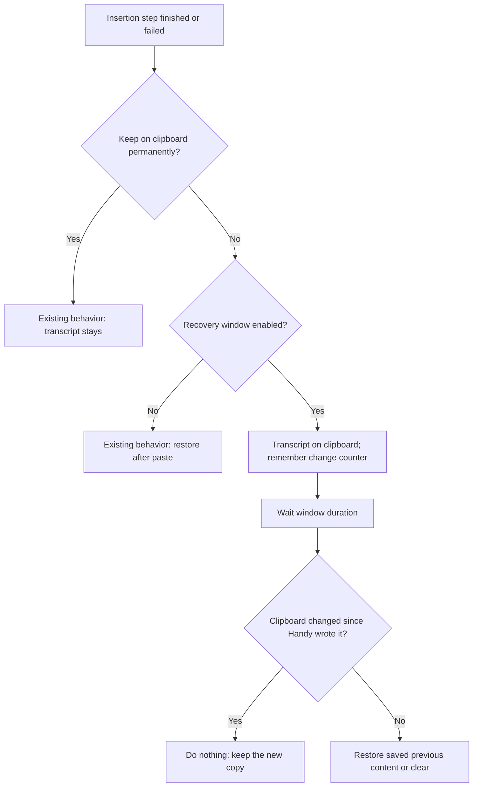
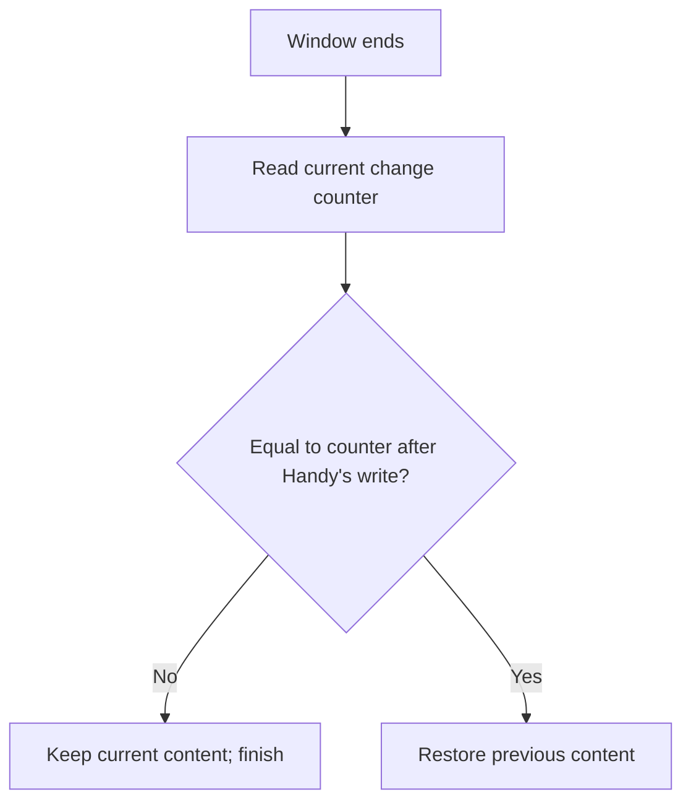
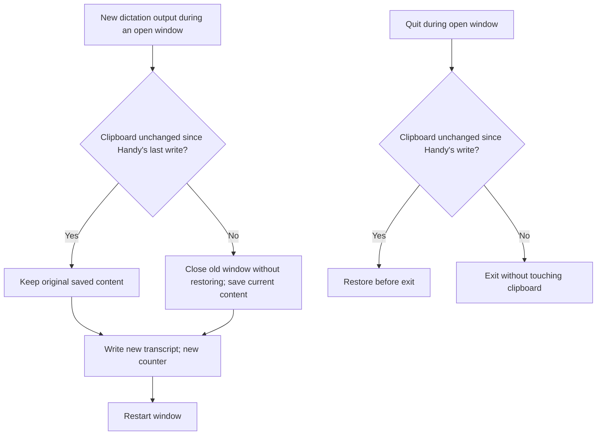
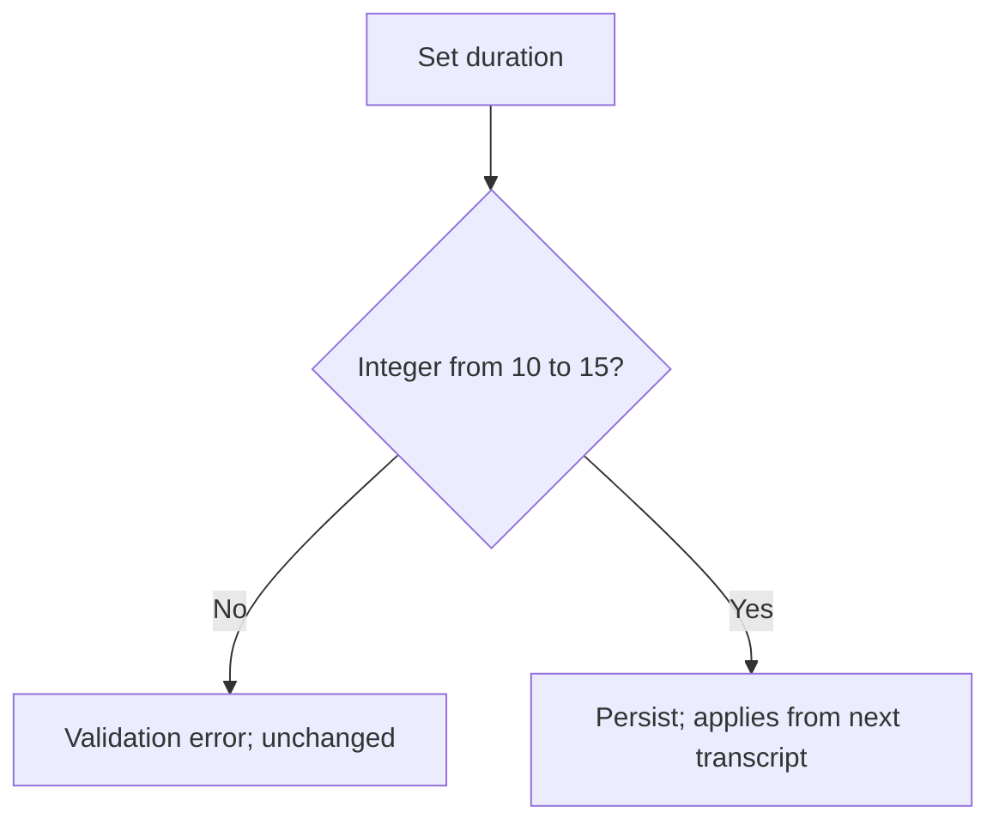

# Feature Spec: Clipboard Recovery Window

## Header

- **Feature:** Clipboard Recovery Window
- **Branch:** None — specification only (program specified before `spec-ship`)
- **Date:** 2026-10-12
- **Status:** Planned
- **Input:** Program item 7: make the transcript available for an emergency manual paste, even when permanently keeping it on the clipboard is disabled. In that case, keep the text temporarily for 10–15 seconds, then remove it or restore the previous content. Never overwrite a new copy made in the meantime. Do not delete the transcript from history. The Spokenly smart-paste analysis documents a conditional restore on `changeCount`; Spokenly's short delays do not replace the window requested for Handy. Program item 8 requires the settings CLI to read and modify output behaviors.
- **Feature Number:** 007

## User Scenarios & Testing

### Story 1 — Paste the transcript manually right after a dictation `P1`

**As a** Handy user, **I want to** find my last transcript on the clipboard for a few seconds, **so that** I can paste it myself when automatic insertion did not land where I wanted.

**Priority reason:** This is the emergency path the request asks for.
**Independent test:** With "keep on clipboard" off, dictate, then press the paste shortcut in another field within the window and after it.

```gherkin
Feature: Temporary transcript on the clipboard
  Scenario: Paste within the window
    Given clipboard handling is "don't modify the clipboard"
    And the recovery window is 12 seconds
    And the clipboard contains "previous text"
    When a dictation produces "hello world" and Handy inserts it
    Then for 12 seconds after the insertion step the clipboard contains "hello world"
    And the user can paste "hello world" manually in any application
  Scenario: Previous content restored after the window
    Given the same setup
    When 12 seconds have passed without another copy
    Then the clipboard contains "previous text" again
  Scenario: Clipboard was empty before
    Given the clipboard was empty before the dictation
    When the window ends without another copy
    Then the clipboard is empty again
```



### Story 2 — Never overwrite a newer copy `P1`

**As a** Handy user, **I want to** keep whatever I copied after dictating, **so that** the recovery window never destroys my own clipboard work.

**Priority reason:** Overwriting a fresh copy would lose user data.
**Independent test:** Dictate, copy something else within the window, wait for the window end, and paste.

```gherkin
Feature: Respect newer clipboard content
  Scenario: User copies during the window
    Given the transcript "hello world" is on the clipboard for the recovery window
    When the user copies "new text" 3 seconds later
    And the window ends
    Then the clipboard still contains "new text"
  Scenario: Another app writes the clipboard
    Given the transcript is on the clipboard for the recovery window
    When another application writes an image to the clipboard
    And the window ends
    Then the image stays on the clipboard
```



### Story 3 — Consecutive dictations and app exit `P1`

**As a** Handy user, **I want to** dictate several times in a row without losing my original clipboard, **so that** the window works when dictations follow each other within the window duration.

**Priority reason:** Consecutive dictations are common and could otherwise restore a stale transcript.
**Independent test:** Dictate twice within 12 seconds, then wait; quit Handy during a window.

```gherkin
Feature: Window lifecycle
  Scenario: Second dictation during the window
    Given the clipboard held "original" before the first dictation
    And the first transcript is on the clipboard for the recovery window
    When a second dictation produces "second" during the window
    Then the clipboard contains "second" for a new full window
    And when that window ends the clipboard contains "original"
  Scenario: User copies between two dictations
    Given the clipboard held "original" before the first dictation
    And during the first window the user copies "X"
    When a second dictation produces "second" before the first window ends
    Then the first window closes without restoring
    And "X" is saved as the content to restore
    And when the second window ends unchanged the clipboard contains "X"
  Scenario: Handy quits during the window
    Given the transcript is on the clipboard and unchanged
    When the user quits Handy
    Then the previous content is restored before exit
  Scenario: History is kept
    Given a recovery window ended and the clipboard was restored
    When the user opens history
    Then the transcript is still listed
```



### Story 4 — Configure the window `P2`

**As a** Handy user, **I want to** turn the recovery window on or off and set its duration between 10 and 15 seconds, **so that** it fits my habits.

**Priority reason:** The duration range is requested; configuration through the CLI is part of the program.
**Independent test:** Set 15 seconds in settings, set 10 through the CLI, and try 20.

```gherkin
Feature: Recovery window settings
  Scenario: Change duration in settings
    When the user sets the recovery window to 15 seconds
    Then the next transcript stays on the clipboard for 15 seconds
  Scenario: Reject an out-of-range duration from the CLI
    When the user sets the recovery window to 20 seconds through the CLI
    Then the command fails with a validation error naming the 10–15 range
    And the saved duration is unchanged
  Scenario: Window disabled
    Given the recovery window is off
    When a dictation is inserted with clipboard handling "don't modify the clipboard"
    Then the clipboard is restored right after the paste, as today
```



## Acceptance Criteria

### AC-001

**Criterion:** When clipboard handling is "don't modify the clipboard" and the recovery window is on (default on, 12 seconds), every dictation that produces a non-empty final text places that text on the clipboard as plain text at the end of the insertion step, whatever the insertion method and whether insertion succeeded, failed or was skipped. It stays there for the configured duration, measured from that write.
**Priority:** P1 | **Story:** Story 1

### AC-002

**Criterion:** Before Handy first writes the clipboard for a dictation, it saves every representation of the previous clipboard content that the platform exposes (at least text and image, as today). At the end of the window, if the clipboard change counter equals the value recorded right after Handy's last write, Handy restores the saved content, or clears the clipboard if it was empty. If saving the previous content fails, no recovery window opens and the existing behavior applies.
**Priority:** P1 | **Story:** Story 1

### AC-003

**Criterion:** If the change counter differs at the end of the window (any copy by the user or another application), Handy leaves the clipboard untouched. On platforms without a change counter, Handy restores only when the clipboard still holds exactly the transcript text it wrote.
**Priority:** P1 | **Story:** Story 2

### AC-004

**Criterion:** A new dictation output during an open window replaces the transcript and starts a new full window. If the clipboard is unchanged since Handy's last write, the originally saved content stays the content to restore; otherwise the old window closes without restoring and the current clipboard content is saved as the content to restore. Cancelling a dictation does not open a window and leaves an already open window running unchanged. Quitting Handy during an open window restores the saved content first if the clipboard is unchanged.
**Priority:** P1 | **Story:** Story 3

### AC-005

**Criterion:** The window never deletes or modifies history entries. When clipboard handling is "copy to clipboard" (permanent), the window does not apply and the transcript stays on the clipboard as today.
**Priority:** P1 | **Story:** Stories 1 and 3

### AC-006

**Criterion:** The output settings expose "Clipboard recovery window" (on/off) and its duration as an integer number of seconds from 10 to 15. Out-of-range values are rejected with an explanation. Changes apply from the next transcript.
**Priority:** P2 | **Story:** Story 4

### AC-007

**Criterion:** The settings CLI (008) reads and sets the recovery window state and duration with the same validation. With `--json`, stdout contains only the JSON envelope and an out-of-range duration returns `validation_failed`.
**Priority:** P2 | **Story:** Story 4

## Behavioral AC

Signals extracted: toggle, number input, validation, setting, loading. Official `detect_traits` returned async_action, has_validation.

### async_action

```gherkin
Feature: Recovery window setting save
  Scenario: Save in progress
    Given the user changes the duration
    When the setting is being saved
    Then the duration control matches visual state "loading"
  Scenario: Save failure
    Given the save failed
    When the user inspects the setting
    Then the previous value is shown with an error and retry
    And the duration control matches visual state "error"
  Scenario: Save success
    Given the save succeeded
    When the setting refreshes
    Then the duration control matches visual state "success"
  Scenario: Idle setting
    Given nothing is being saved
    When the user opens the output settings
    Then the duration control matches visual state "idle"
```

### has_validation

```gherkin
Feature: Duration validation
  Scenario: Empty duration
    Given the duration field is cleared
    When the user leaves the field
    Then the previous value is kept with an explanation
    And the duration field matches visual state "empty"
  Scenario: Out of range
    Given the user types 20
    When the user leaves the field
    Then an error names the 10–15 second range
    And the duration field matches visual state "invalid"
  Scenario: Valid duration
    Given the user types 15
    When the user leaves the field
    Then the duration field matches visual state "valid"
```

## Functional Requirements

### FR-001

**Requirement:** Place each final transcript on the clipboard for the configured window when permanent clipboard keeping is off, independently of the insertion method and result.
**AC References:** AC-001, AC-005

### FR-002

**Requirement:** Save all exposed representations of the previous clipboard content and restore them at the end of the window only when the clipboard is unchanged since Handy's write.
**AC References:** AC-002, AC-003

### FR-003

**Requirement:** Manage the window lifecycle across consecutive dictations, user copies between dictations, cancellation and application exit without ever restoring over content copied after Handy's last write.
**AC References:** AC-004

### FR-004

**Requirement:** Persist and validate the window state and duration (10–15 seconds) in settings UI and settings CLI.
**AC References:** AC-006, AC-007

## Key Entities

| Entity | Description | Key fields |
|---|---|---|
| Recovery window | Open period with the transcript on the clipboard | transcript, saved previous content, change counter after write, opened at, duration |
| Recovery window setting | Persistent configuration | enabled, duration seconds (10–15) |

## Clarifications

- Current code (2026-10-12): the clipboard paste path saves text (or an image when there is no text), writes the transcript, pastes and restores after `paste_delay_after_ms` (60 ms) without any change-counter check. The beta "reliable paste" path already records the macOS `changeCount` and Windows clipboard sequence number and restores only when unchanged. Clipboard handling has two values: don't modify, copy to clipboard.
- `[ASSUMED]` Default on with 12 seconds, the middle of the requested 10–15 range.
- `[ASSUMED]` The window applies to every insertion method, including direct typing, so that an emergency paste is always possible; with direct typing the clipboard is written only after typing.
- `[ASSUMED]` With the beta reliable paste path, the window takes over restoration once the target has read the clipboard; the change counter is recorded after Handy's plain-text write of the transcript.
- `[ASSUMED]` The clipboard receives the final text exactly as inserted, including an optional trailing space.
- `[ASSUMED]` On Linux, restoration at exit or after a crash is best effort because the clipboard owner is Handy's process when no clipboard manager runs.
- `[ASSUMED]` The transcript is marked as transient for clipboard-history managers where the platform supports it, as the reliable paste path does today; pasting is unaffected.
- Program context: specified in list order (001–010); the settings CLI foundation (008) ships first. Destination unavailable (006) and the recovery bubble (010) rely on this window for the clipboard part of recovery.

## QE Analysis

- **Criticality:** High; **Blast radius:** The user's clipboard after every dictation; **Primary risk:** Overwriting or losing user clipboard content; **Confidence:** Medium (paste paths read, nothing executed).
- **Dimensions:** Data integrity, functional correctness, concurrency/timing, platform compatibility, privacy (clipboard history), UX.
- **P0 gates/evidence:** Timer and change-counter tests with a fake clipboard (unchanged, user copy, other app write, consecutive dictations, cancel, quit); restore fidelity tests for text, image and multi-type content on macOS; Linux content-comparison test.
- **P1 gates/evidence:** Native manual checks on macOS and Windows with a clipboard history manager installed; setting validation in UI and CLI.
- **Non-functional expectations:** Window end handled within 500 ms of the configured duration; no clipboard content written to logs at any level.
- **Missing evidence:** No runtime test; restore fidelity for rich multi-type content unverified; mockups deferred before `spec-ship`.
- **Boundary:** QE defines risk and test sufficiency; the independent review judges requirements; Penflow governs UI design evidence; spec-test executes runtime proof.

## Screens

| Screen | Status | Reference |
|--------|--------|-----------|
| output-settings | Modified | Mockup to produce before `spec-ship` (recovery window toggle and duration) |

## Penflow Contract

- Planned `flow_id: clipboard-recovery-window`, `screen_id: output-settings`. Per the user decision of 2026-10-12 (lightweight UI contract), the Penflow flow/screen contract, semantic and test IDs and the Pencil mockup are produced in one pass for all program features before `spec-ship`; the planned IDs above are authoritative until then. No inspection READY or certification PASS is claimed.

## Edge Cases

- Previous content larger than memory limits of the platform API: saving fails, no window opens, existing behavior applies.
- Machine sleeps during the window: on wake, the window end is processed with the same change-counter check.
- Handy crashes during the window: the transcript stays on the clipboard; history still holds it.
- Paste method "none": the transcript is still placed for the window, giving a manual paste path.

## Success Criteria

### SC-001

In fake-clipboard tests covering the nine scenarios of Stories 1–3, zero cases overwrite content copied after Handy's write.

### SC-002

Native checks on macOS restore text, image and rich text previous content identically after the window in 100% of runs without interference.

### SC-003

History entry count is unchanged by any window lifecycle event in automated tests.
