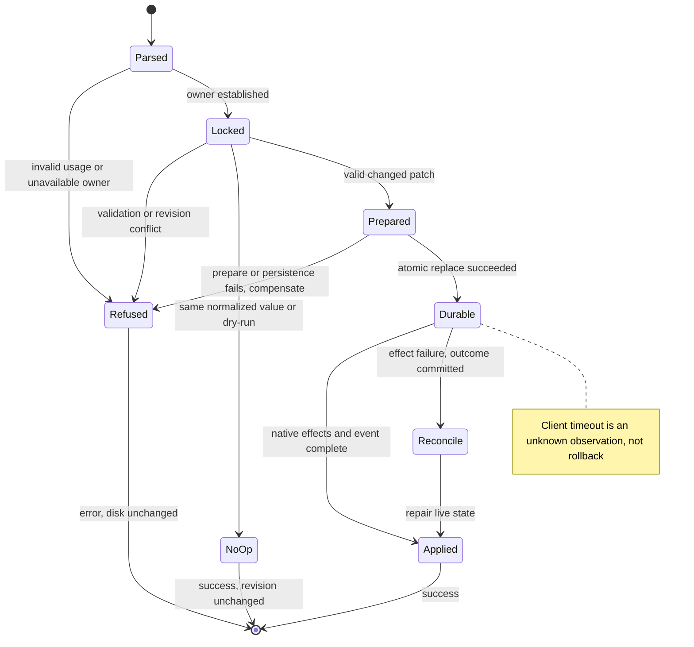
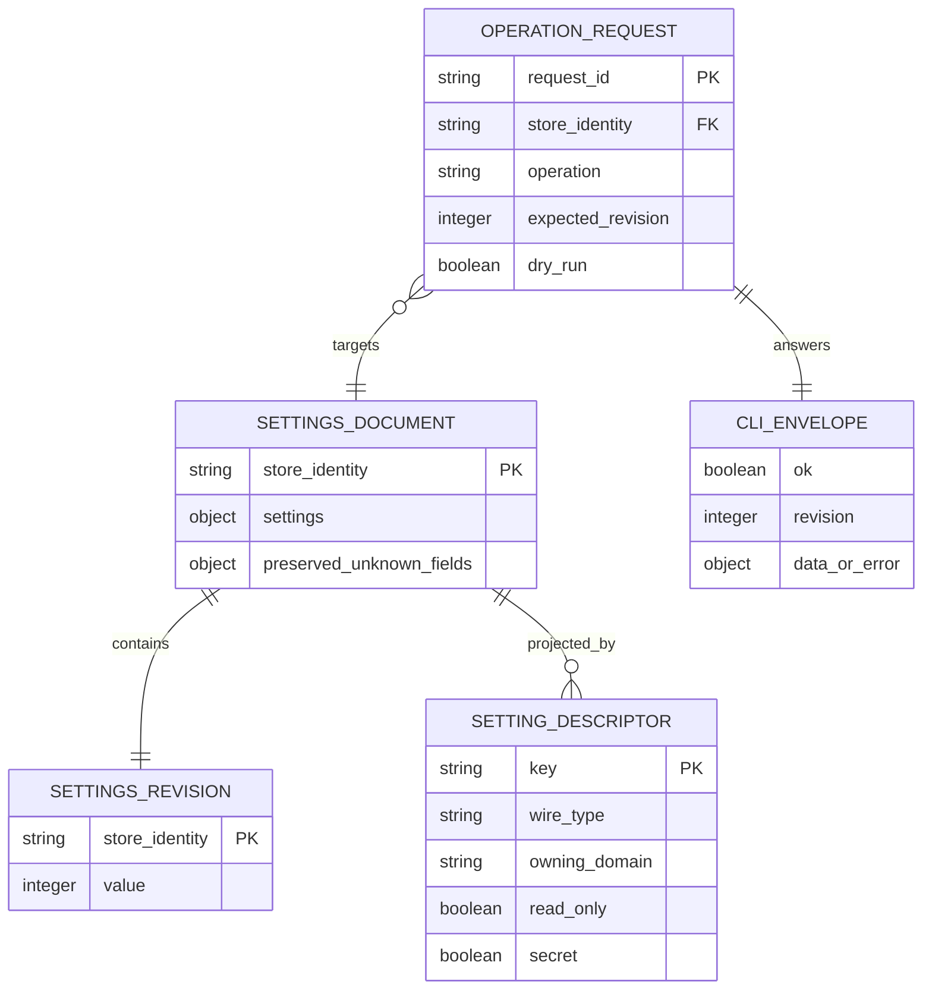

# Implementation Plan: Settings CLI

## Summary

Add a Rust-only early `handy settings` path, backed by a single validated patch/commit service, durable revision and cross-process lock; route to the live application through private local IPC, with an offline store adapter using the same service.

Inspect [the approved functional source](spec.md) for FR-001–FR-006, AC-001–AC-008 and SC-001–SC-003. Scope is **L** despite six FR: all existing writers, three OS transports, persistence migration and Windows executable compatibility. Deliver 008 before 001, 002, 003, 004, 005, 006, 007, 009, 010. No application implementation or runtime proof is claimed by this plan.

## Technical Context

| Aspect | Choice | Reason / current evidence |
|---|---|---|
| Native | Rust edition 2021, Cargo, Tauri 2.11.5 | Current stack and Cargo manifest |
| Parsing / serialization | Existing clap 4, serde / serde_json | Typed subcommands; no second CLI executable |
| Async | Existing Tokio; enable required net/io/time/sync production features | Bounded IPC worker; keep native main thread free |
| Frontend | React 18, Zustand, i18next, TypeScript | Existing UI adapters and settings-changed listener |
| Persistence | Existing settings_store.json object, settings payload plus top-level settings_revision | Preserve unknown top-level/payload fields and schema migrations; no SQL table |
| Lock | One persistent settings.lock inode/handle per canonical store; fs2 cross-platform file locking | Same lock for UI, app mutations, startup and CLI; proposed dependency must be reviewed/pinned |
| Transport | Unix domain socket (macOS/Linux); Windows named pipe | Local only, explicit owner authentication; never TCP/MCP |
| Test levels | cargo unit/integration/process, Bun adapter tests, Playwright frontend regression, native release proof | Browser mocks cannot prove process/OS behavior |
| Store identity | Canonical absolute store path + user UID/SID, SHA-256 identity | Installed and portable paths resolve identically without AppHandle |
| Infrastructure | Local user directory, lock and endpoint only | No cloud resource, credentials or provisioning |

Inspect [existing parser](../../../src-tauri/src/cli.rs), [entry point](../../../src-tauri/src/main.rs), [startup](../../../src-tauri/src/lib.rs), [settings](../../../src-tauri/src/settings.rs), [portable paths](../../../src-tauri/src/portable.rs), [UI store](../../../src/stores/settingsStore.ts) and [Cargo manifest](../../../src-tauri/Cargo.toml) for implementation context. These source inspections do not replace acceptance requirements.

## Constitution Check

| Principle | Gate / decision |
|---|---|
| Preserve source/native/frontend boundaries | PASS: native service owns validation, I/O and revision; UI translates typed errors and refreshes state |
| Derive stack/managers from manifests | PASS: retain clap/serde/Tokio/Tauri; only locking and target OS APIs are proposed additions |
| Tool availability is not runtime proof | PASS: versions below are availability only; three-platform release receipts are mandatory later |
| Specify before implementing; meaningful tests | PASS: all six FR mapped, real file/process boundaries and fault injection, no service-under-test mocks |
| Naming and minimal structure | PASS: one settings_service domain; Rust snake_case per language delta, Markdown kebab-case; preserve existing filenames |
| Project tooling overrides generic JS guidance | PASS: Bun, ESLint/Prettier and existing tests retained; no conversion to Commander, Biome or Vitest |
| i18n | PASS: backend stable English errors; UI maps code+field to translation keys and preserves English reason for parity tests |

## Requirement Inventory and Scope

| Requirement | Acceptance / measure | Implementation steps |
|---|---|---|
| FR-001 | AC-001; existing flags, no visible UI/tray/model, M1 reads ≤2 s | 1, 5, 7 |
| FR-002 | AC-002; descriptors, scalar parsing, redaction, non-creating reads | 2, 6, 7 |
| FR-003 | AC-003/004; SC-001/002, all writers, no-op/CAS | 2, 3, 4, 7 |
| FR-004 | AC-005; private IPC, 5 s, unknown outcome, older-instance refusal | 1, 3, 5, 7 |
| FR-005 | AC-006; framework plus existing output domain only | 2, 6, 7 |
| FR-006 | AC-007/008; SC-003, one envelope, channels, stable exits | 2, 5, 6, 7 |

008 does not deliver microphone priority, replacements, new vocabulary/shortcut/prompt operations, destination/PIN, smart paste execution or automatic Enter. Existing lists are readable; generic set refuses them. Their later owners register domains and aliases (`edit`→`update`, `delete`→`remove`) without changing the framework. Only `output` appears as a production domain in the 008 build. A fixture bulk/live domain is compiled only in tests.

## Architecture Decisions

### Entry point and Windows console

Use `CliArgs::try_parse_from` before any Tauri builder, specta export, model/audio manager, portable mutating initialization or single-instance callback. `settings` runs and exits here; all old invocations retain their existing run branch. Accept both JSON placements and deduplicate them. Mixed settings with recording, startup, transcription/model/device/list/repeat flags is usage_error (2); `--debug` and `--json` remain compatible. Parser failures with JSON requested use the same envelope renderer without echoing raw values. JSON help is `{ok:true,revision:N,data:{help:...}}`, human help remains readable; obtain revision using the same non-mutating read path.

Windows decision: retain one `handy.exe`, use the **console PE subsystem** so cmd/PowerShell wait and capture exits, preserve inherited redirected handles, and attach to the parent console only if no valid console/pipe handles exist. For GUI launch, detach before Tauri and hide only a newly allocated console owned solely by this process, never the parent's console. Embed detached consoleAllocationPolicy on Windows 11 24H2+; on earlier supported Windows use early native hide/FreeConsole and a regression gate for launch flash, autostart, old flags and installer behavior. AttachConsole alone in a GUI-subsystem binary cannot establish synchronous shell execution. Inspect [Microsoft console allocation policy](https://learn.microsoft.com/en-us/windows/console/console-allocation-policy) and [AttachConsole](https://learn.microsoft.com/en-us/windows/console/attachconsole) as external technical context. Step 1 must prove this choice on the oldest supported Windows and 24H2 before final wiring; a persistent console, disrupted redirected output or incorrect exit is a release blocker. No console shim is silently introduced; failure requires a separately approved alternative, not a claim of platform support.

### Paths, storage and revision

Extract side-effect-free StoreLocator from portable initialization. Read the portable marker without upgrading it or creating Data; resolve installed user app-data using the configured identifier com.pais.handy and OS APIs, not guessed HOME strings. For nonexistent paths, canonicalize the nearest existing ancestor, append validated components and reject symlink/reparse aliases that cross user boundaries. Lock identity survives atomic store replacement: lock the stable sibling lock file, never the replaced JSON inode.

SettingsRepository reads fresh disk bytes under settings.lock; missing store gives defaults/revision 0. Read only salvage/migrate/merge defaults in memory, never save, create settings_store.json, upgrade portable marker or increment revision. Startup takes the same lock and explicitly commits any initialization/migration change once. Older stores with no revision start at 0; first changed commit is 1. Preserve a valid top-level revision through payload salvage; malformed existing revision or unrecoverable revision continuity refuses writes with persistence_failed rather than reset-and-CAS. Entire unreadable JSON reports defaults with warning for read recovery, but cannot be overwritten automatically; explicit supported recovery is outside this feature. Semantic no-op after normalization does not write or increment; migrations persisted by startup are real writes. Reject revision overflow before native effects. Never silently reset the counter.

Commit a typed mutation/patch against the newly loaded settings, not the caller's stale AppSettings snapshot. Validate the whole candidate and dependencies, compare normalized persisted values (including secret changes, excluding runtime overrides), increment once, serialize the entire preserved store object to a private same-directory temporary file, flush/sync, atomically replace and sync the parent directory on Unix (Windows replacement APIs and durable flush). Crash injection must observe old or new complete generation, never partial JSON. Disable plugin-store ownership/autosave/exit-save for this particular settings file; a reload alone cannot prevent a delayed old cache write. Other plugin stores remain unchanged. A compatibility AppHandle adapter reads the service snapshot; it cannot write the settings file independently.

### All surfaces and live effects

Migrate every writer before CLI set becomes reachable, including get_settings migration/default stores, shortcut fallback/reset commands, UI setters, audio/model selection repairs, model switches and history retention. The inventory is the actual call-site scan, not a hand-selected subset. Replace write_settings(AppSettings) with `commit_mutation` closures/typed patches and propagate Result. Preexisting runtime-only flags and forced-disable-updater remain overrides, never persisted writes.

Inject LiveSettingsEffects for native validation/preparation, shortcut registration, audio/model reconfiguration, autostart, theme/log settings and settings-changed. Worker transaction serializes prepare/validate → durable persist → publish snapshot → apply live effects → notify. Prepare any fallible reversible native change before commit; compensate it on persistence failure. For effects that can fail after durable commit, do not falsely return validation_failed: return internal_error with details `{outcome:"committed", current_revision:N, field:...}`, keep committed data authoritative and reconcile live state before accepting another affected mutation. Timeout still reports outcome unknown to the caller. P0 tests require invalid/refused values and failed preparation leave both disk and revision unchanged, and injected effect failure never yields a success with stale shortcuts. UI native command adapters become async workers where needed; never wait for a worker holding the transaction lock from the main thread. Event contains revision and changed key names only, no secret values; the existing listener refreshes and discards older refresh responses by revision.

### Routing, startup fence and legacy compatibility

New app acquires a per-user/store instance lease before loading settings, under the settings lock, publishes its private endpoint before releasing startup ownership, and keeps the lease until shutdown. A headless writer acquires settings.lock, then checks lease/endpoint/legacy state again; GUI startup and headless mutation cannot pass each other unnoticed. The lease is separate from the transaction lock; a busy or starting owner never means offline permission. A stale PID/endpoint is reclaimable only after OS liveness/ownership proof and protected endpoint removal; ambiguous access errors return unavailable with no write.

| OS | Private request channel / peer verification | Older instance detection and headless-start exclusion |
|---|---|---|
| macOS | Short AF_UNIX path in owner-only runtime directory (0700), socket 0600; verify peer effective UID with getpeereid | Inspect legacy `/tmp/com_pais_handy_si.sock` owner and process/socket liveness without invoking its callback. Offline mutation reserves legacy address under lock; fail closed on any ambiguous existing socket. A compatibility guard captures startup probes for deferred handoff without executing UI callbacks while reservation is held |
| Linux | AF_UNIX under validated XDG_RUNTIME_DIR user directory or short private fallback; SO_PEERCRED UID | Query session DBus `com.pais.handy.SingleInstance` via NameHasOwner/GetNameOwner, not ExecuteCallback. Offline guard temporarily owns that name, disallowing replacement, to exclude old startup |
| Windows | Named pipe keyed by SID+store hash, protected DACL for current logon SID, reject remote clients and verify client token; no Everyone ACL | Open/query legacy `com.pais.handy-sim` mutex and `com.pais.handy-sic`/`com.pais.handy-siw` target without sending WM_COPYDATA. Offline guard reserves legacy mutex plus hidden nonactivating top-level compatibility target with the exact legacy class/title, because FindWindowW cannot locate a message-only target and mutex-only does not stop this plugin's startup branch; no displayed window or Tauri initialization |

Inspect the locked [macOS plugin source](https://raw.githubusercontent.com/tauri-apps/plugins-workspace/single-instance-v2.4.0/plugins/single-instance/src/platform_impl/macos.rs), [Windows source](https://raw.githubusercontent.com/tauri-apps/plugins-workspace/single-instance-v2.4.0/plugins/single-instance/src/platform_impl/windows.rs) and [Linux source](https://raw.githubusercontent.com/tauri-apps/plugins-workspace/single-instance-v2.4.0/plugins/single-instance/src/platform_impl/linux.rs). Cargo.lock currently resolves 2.4.0, not the manifest minimum 2.3.2. Names/protocol must be recalculated if that dependency changes. For legacy identities which do not expose store identity, conservative refusal is preferable to a write; process token/UID and path evidence must identify user scope. Never connect/send an empty command to an old singleton: macOS empty streams still invoke the show-window callback. No assumed socket absence authorizes a write.

Legacy reservations are held by a private **offline guard worker of the same executable**, never by an inert sink. The CLI starts that worker only for offline mutations through an internal authenticated inherited-handle entry point (not a public CLI flag). The worker acquires the transaction lock, rechecks instance/legacy ownership, installs the exact legacy protocol adapters, performs the typed mutation through the same service and returns its envelope to the parent CLI. It owns all reservation handles for their entire lifetime; there is no cross-process lock-handle migration. Old singleton startup messages use the legacy protocol and become queued **activation/control intents**, not settings requests. The protocol does not carry trustworthy original sender PID/executable identity on Windows (SendMessageW uses wParam=0 and the sender ignores its return). Do not claim authentication of that legacy sender or require an impossible rejection acknowledgement. The guard derives replay target exclusively from its own trusted current Handy executable path, exactly as existing singleton forwarding targets the current owner rather than selecting argv[0]. It parses only the existing control/startup flags and cwd needed to preserve behavior; it never launches an executable named by incoming argv[0], executes a script payload, applies settings mutations, returns settings data or accepts secret-bearing input through this compatibility path. The settings channel itself remains exclusively the authenticated UID/SID socket/pipe described above. Any legacy compatibility security restrictions must preserve existing official requests; the native security review separately evaluates this inherited activation/control surface, including another user's desktop/session.

Windows receives WM_COPYDATA on a hidden top-level native message loop, Linux temporarily serves the existing ExecuteCallback interface, and macOS reads the NUL-framed stream to EOF. Persist each validated official invocation into a private ordered handoff spool before acknowledging where the legacy protocol permits acknowledgement; retain messages during filesystem backpressure instead of an inert success/no-op. The macOS sender waits for no acknowledgement, so receipt means stream acceptance, not sender-visible delivery; retain a complete frame durably before closing the accepted stream. No queue-full/drop rule is introduced for valid official invocations: use private spool files and bounded per-frame memory with backpressure. Failure to prepare the spool or guard before commit returns persistence_failed/unavailable to the settings CLI without changing settings; never enable the offline writer while the capture surface is unusable.

Once the CLI has flushed its single result and exited, the worker observes parent exit via an OS process handle/liveness port, drains accepted legacy frames, removes its legacy identities under the transaction lock, and replays queued invocations in arrival order into the trusted current Handy executable with validated argv/cwd. First queued startup uses its original startup flags; later invocations use normal singleton forwarding. The real app thus loads the fully committed store, and existing toggle/post-process/cancel precedence remains unchanged. The worker never initializes Tauri, displays UI or loads a model; replay is the separately initiated legacy invocation after settings has exited. Keep a consumed-ID/spawn receipt per queue entry; distinct invocations are never deduplicated by identical text. A process crash around spawn cannot guarantee exactly-once replay: mark that entry's outcome unknown and require explicit recovery, never blind relaunch. Durable pending frames survive worker crash; replay recovery must be explicit and cannot silently execute stale recording commands on a later unrelated CLI invocation. A handoff failure reports the pending/unknown entry and committed settings revision in private diagnostics, not successful legacy delivery. Step 1 must prove normal non-lossy handoff and separate every fault/unknown path, with no success claimed for unobserved legacy delivery. This worker/spool is a technical necessity for safe legacy exclusion, not a new user-facing daemon or second CLI executable.


Offline legacy reservation is a critical spike: native adapters must prove old-start exclusion, normal non-lossy queued handoff and truthful fault outcomes, cleanup, same-user scoping and no visible UI effects. If any OS cannot provide this, disable offline mutations there and report a release blocker against AC-005; do not certify complete delivery. Requests to a running new app carry protocol version, user/store identity, opaque request ID, typed operation, expected revision and dry_run. Bound UTF-8 frame size to 1 MiB, reject malformed/oversized input without raw dumps. Domain imports have the same bounded technical limit until a future owner explicitly defines another. Requests contain no raw argv. Use a monotonic 5 s end-to-end response deadline; transport/persistence/lock wait counts toward it. Successful M1 reads must finish ≤2 s; timeout failures are recorded separately, never counted as successful reads. No fallback write or blind automatic retry after submission/timeout; reread revision and value first. Late replies cannot resurrect an expired request.

### Descriptors, output domain and contract rendering

Descriptor inventory covers every AppSettings field, with wire type, enum/range, mutable/read-only, secret/presence projection, owning domain, runtime effect and validator. Build a reviewed manifest plus an independent test inventory from serialized default settings and all UI adapters; a descriptor omission fails, not silently hides a setting. Existing scalar settings are generic-settable except internal fields (schema, revision, onboarding/migration markers, manager-only model state) and provider configuration, which remain read-only from CLI. API-key fields are secret and never generic-settable. Lists/maps return validation_failed naming their owning domain command, plus `not available in this build` when unregistered; include owning command even when unavailable to satisfy AC-002. Optional values have descriptor-defined null handling; non-null boolean accepts exactly true/false, numeric parses without overflow, enums use existing serde values, strings preserve bytes without trimming meaningful content.

Redact via explicit public projection, never AppSettings Serialize or Debug. `post_process_api_keys` becomes per-provider `{present:boolean}` only; nested/future secrets inherit the rule. All stdout, stderr, parse errors, IPC diagnostics and logs sanitize raw candidate values. Public errors use stable English text and object details, with field/issues where applicable; no OS trace, raw document or credential in details. Reject `paste_method=invalid_method` identically via UI and CLI rather than existing default-to-ctrl_v behavior. UI maps code+field to i18n keys, falling back to a translated generic error, not free-text parsing.

`output get [KEY]` and `output set KEY VALUE` delegate to the same descriptors for existing paste_method, clipboard_handling, auto_submit, auto_submit_key, paste_delay_ms, paste_delay_after_ms, reliable_paste, typing_tool, external_script_path and append_trailing_space. Existing enum values remain unchanged: ctrl_v/direct/none/shift_insert/ctrl_shift_v/external_script; dont_modify/copy_to_clipboard; enter/ctrl_enter/cmd_enter. When 007 ships, it extends the same output descriptor and validation path with paste_method=smart_paste on macOS (validation_failed outside macOS), using the existing commit_mutation service and Domain trait; 008 alone keeps the existing methods. Feature 007 owns the macOS migration/default and removal of the beta reliable_paste switch; the Windows reliable_paste switch/path and Linux methods stay unchanged. This is configuration, not insertion execution. Keep destination 006/009, insertion method and clipboard handling separate. The 007 outcome contract is: "insertion attempted, read observed", "not read", "permission missing", "typed", "clipboard handed over", "insertion failed". Only read observed and typed authorize automatic Enter in 009; not read, permission missing and insertion failed route to recovery in 010. Clipboard handed over is neither Enter nor verified insertion. Outcomes wait for the read/fallback decision and never claim text verified in a field. A committed output setting proves configuration only.

Domain trait registers command schema/help, file/`-` input, pure parsing/validation, preview, typed patch and export formatter. Valid dry-run loads latest revision, validates fully, emits preview/revision with exit 0, and does not persist or call effects. Invalid dry-run returns validation_failed/2 with issues, no success preview. `-` explicitly requests stdin, never prompts; non-UTF-8 text returns byte offset in details. Export `-` human mode is raw exchange content only; JSON is data.content. Fixture domain proves bulk merge/replace/atomic all-or-nothing and live-only unavailable behavior; it never appears in production help.

| Result | Exit |
|---|---|
| success | 0 |
| persistence_failed, internal_error | 1 |
| usage_error, validation_failed, shortcut_conflict, limit_exceeded | 2 |
| revision_conflict (`details.current_revision`) | 3 |
| not_found | 4 |
| unavailable (timeout: `details.outcome=unknown`) | 5 |

The enum+single renderer owns this mapping. Every JSON operation emits exactly one `{ok:true,revision:N,data:...}` or `{ok:false,error:{code,message,details:{...}}}` followed by newline; diagnostics go to stderr. No newly introduced HTTP endpoints: OpenAPI would misrepresent local IPC. Contract is the typed DTO/JSON-schema and command matrix in Step 2; no openapi.yaml generated.

## Gherkin Scenarios and Sequence Diagrams

```gherkin
Feature: Shared live settings transaction
  Scenario: Successful live mutation
    Given the same user's instance has revision 41 and a private channel
    When the CLI sets paste_method to ctrl_v with expected revision 41
    Then the instance persists revision 42 before confirming success
    And native effects finish and the UI receives settings-changed
  Scenario: Stale or timed-out request
    Given current revision is 42
    When expected revision is 41
    Then revision_conflict returns current_revision 42 without mutation
    When an accepted request produces no answer within 5 seconds
    Then unavailable reports outcome unknown without offline fallback
```

```mermaid
sequenceDiagram
  participant CLI
  participant IPC as Private channel
  participant Service as Live commit worker
  participant Disk as Fresh repository and lock
  participant Native as Native effects
  participant UI
  CLI->>IPC: operation, store identity, expected revision
  IPC->>Service: authenticated typed request
  Service->>Disk: lock and reread
  alt revision mismatch or invalid
    Service-->>CLI: error envelope; no write
  else changed candidate
    Service->>Native: prepare reversible effects
    Service->>Disk: atomic persist, revision plus 1
    Service->>Native: apply and confirm
    Service->>UI: settings-changed revision and keys
    Service-->>CLI: success envelope
  else no-op
    Service-->>CLI: current revision unchanged
  end
  alt no reply before deadline
    CLI->>CLI: unavailable, outcome unknown; reread before retry
  end
```

```gherkin
Feature: Safe offline settings access
  Scenario: Read missing or salvageable store
    Given no Handy instance exists
    When the CLI reads settings
    Then defaults or salvage are returned without creating or rewriting the store
    And a warning goes only to stderr when recovery was needed
  Scenario: Startup competes with offline write
    Given a GUI startup and headless write target the same store
    When both acquire shared ownership and transaction guards
    Then the write is visible at startup or routed to the new instance
    And each changed transaction increments revision exactly once
  Scenario: Older instance present
    Given an older same-user Handy instance holds its legacy identity
    When the CLI requests a mutation
    Then unavailable is returned without a callback or store write
```

```mermaid
sequenceDiagram
  participant CLI
  participant Owner as Lease and legacy probe
  participant Repo as Locked fresh repository
  participant App as Starting app
  CLI->>Owner: inspect private lease and legacy identity
  alt authenticated new instance
    Owner-->>CLI: route private request
  else old, busy, or uncertain
    Owner-->>CLI: unavailable; no write
  else proven offline
    CLI->>Repo: take transaction lock
    CLI->>Owner: recheck and reserve startup identities
    CLI->>Repo: read or validate patch
    alt read or dry-run
      Repo-->>CLI: projection or preview; no persist
    else changed write
      Repo->>Repo: durable replace with next revision
      Repo-->>CLI: success
    end
    App->>Repo: startup waits, then reads committed store
    CLI->>Owner: release reservations
  end
```

## State Model

```gherkin
Feature: Mutation outcome
  Scenario: Refusal or no-op
    Given a current durable revision
    When validation fails or expected revision is stale
    Then the durable state and revision remain unchanged
    When a valid patch changes nothing
    Then success carries the unchanged revision
  Scenario: Failure after durable commit
    When persistence commits but a live effect fails
    Then the revision remains committed and error details state outcome committed
    And the affected runtime state is reconciled before another affected mutation
  Scenario: Timeout at the caller
    When the deadline expires after submission
    Then the caller reports outcome unknown until a fresh read resolves it
```



## Data Model

Logical ER diagram only: existing JSON storage gains metadata; no new SQL tables or joins.



## Implementation Plan

### Step 1 — Prove platform startup and console mechanisms

**Prerequisite:** Current spec review complete+ready and progression plan READY; this plan independently reviewed before code.
**Required inputs:** Locked plugin 2.4.0 behavior, Windows supported OS list, existing flag parser/worker/headless paths, isolated native harness.
**Action:** New `src-tauri/src/settings_service/instance_probe.rs`, `platform_unix.rs`, `platform_windows.rs` and `offline_guard.rs`, plus `src-tauri/tests/settings_platform.rs` spike legacy non-notifying detection/reservation and owned deferred handoff and Windows same-executable console choice. Modify main.rs/build.rs/Windows manifest only during implementation after spike. Test installed/portable/user identities, stale resources, adversarial peers and old-instance startup racing offline mutation. Do not wire production CLI writes yet.
**FR covered:** FR-001.1: Console and early-path spike, FR-004.1: Private routing and legacy probes
**Execution evidence:** Platform transcript + binary hash + OS build + process/window/tray observations, old-binary version/hash, two-user access denied and old-start exclusion assertions.
**Success criteria:** No show-window callback; no displayed UI/tray/model; shell waits/exits correct; no offline write while legacy ownership can race; normal legacy launches/flags are conserved; fault paths expose pending/unknown outcomes without blind replay; all three platforms have evidence-producing mechanism.
**Failure handling:** Failed mechanism blocks that platform release; preserve exact error and missing proof; no shim or unsafe fallback without scope approval.

### Step 2 — Define descriptors, validators and DTO contracts

**Prerequisite:** Step 1 selects viable primitives; current UI and writer inventory captured.
**Required inputs:** All AppSettings fields, UI command validators and current output enums, spec error table.
**Action:** New `settings_service/{mod.rs,descriptor.rs,validation.rs,protocol.rs,errors.rs}` define SettingDescriptor, SettingsMutation, SettingsSnapshot, Revision, PublicSettings, OperationRequest and SettingsError. Build shared validators for every corresponding UI setting and existing domain operation; migrate invalid-to-default behavior to errors. New inline unit tests and `src-tauri/tests/settings_validation.rs` exercise real adapters against an independently maintained cases inventory. Generate `contracts/settings-cli.schema.json` from DTOs during implementation, plus `contracts/settings-cli.md` command matrix; schemas are not OpenAPI. Modify Cargo.toml for reviewed fs2, OS APIs and required Tokio features, not new model dependencies.
**FR covered:** FR-002.1: Complete descriptor and redaction model, FR-003.1: Shared typed validation, FR-005.1: Domain extension interface, FR-006.1: Typed errors and envelope contract
**Execution evidence:** Inventory diff, schema contract tests, valid/invalid/boundary cases including booleans, integers, enums, optional strings, read-only/secret/list keys.
**Success criteria:** Every persisted key classified; 100% settable-key UI/CLI parity including English reasons; unknown and unregistered-domain guidance deterministic; no secret serialization path.
**Failure handling:** Missing descriptor, divergent validation or leaked value is P0; repair before transaction integration.

### Step 3 — Build atomic repository, revision and locking

**Prerequisite:** Step 2 validators and mutation types stable.
**Required inputs:** StoreLocator, raw store shape, migrations/salvage helpers, stable lock and ownership guards.
**Action:** New `settings_service/{store.rs,transaction.rs}` implement non-creating `read_snapshot`, lock/reload/patch `commit_mutation`, startup migration, no-op/CAS/overflow and durable replacement. Modify portable.rs to expose pure resolution and settings.rs to use the service; separate in-memory normalization from writes. Remove plugin-store autosave/exit-save participation for settings_store.json. New `src-tauri/tests/settings_transactions.rs` uses temp stores, barriers, two subprocess writers and crash/fault injection.
**FR covered:** FR-002.2: Non-mutating fresh reads, FR-003.2: Durable revision and atomic patch, FR-004.2: Startup ownership fence
**Execution evidence:** Before/after hashes, revision sequences, independent raw-file reader, crash old-or-new snapshots, lock identity tests across rename, startup/write race transcript.
**Success criteria:** No lost fields, stale CAS always refused, no-op/read invariant, secrets/unknown fields preserved, startup sees full commit, no stale cache flush.
**Failure handling:** Persistence failure leaves old durable generation; uncertain durable outcome is explicit, never blanket retry; invalid revision continuity blocks writes.

### Step 4 — Migrate every app writer and live side effect

**Prerequisite:** Repository tests PASS; no CLI mutation entry point enabled.
**Required inputs:** Full write_settings and store.set inventory, manager repairs, startup migrations, typed native ports.
**Action:** Modify settings.rs, shortcut/mod.rs, commands/{mod.rs,audio.rs,models.rs,history.rs,transcription.rs}, managers/{audio.rs,model.rs} and lib.rs. Replace each snapshot rewrite with a minimal mutation applied to latest state; adapt fallback repairs and secret UI writes. New `settings_service/live.rs` owns ordered effects and reconciliation. Modify settingsStore.ts to consume revisions/typed errors, regenerate bindings.ts via supported specta export and add en/fr i18n keys using existing translation checks. No new screens/layout. New tests verify writer inventory closure and genuine UI adapters, compensation and post-commit failure behavior.
**FR covered:** FR-003.3: All writers and live adapters, FR-006.2: Stable UI errors and translations
**Execution evidence:** Exhaustive writer scan with no direct settings-file writer remaining, parity report, manager mutation race tests, UI event/read ordering tests and native shortcut re-registration evidence.
**Success criteria:** Every committed app write increments once; rejected values change nothing; native updates/UI refresh complete before success; runtime-only settings stay runtime-only.
**Failure handling:** Any direct writer/cache autosave remaining blocks CLI enablement; main-thread waits, rollback failure or stale effect is P0.

### Step 5 — Wire private IPC and early CLI execution

**Prerequisite:** Steps 1–4 PASS and old writer inventory empty.
**Required inputs:** Same-user/store lease and channel, absolute paths, monotonic Clock, existing cli.rs/main.rs/lib.rs routing.
**Action:** New `settings_service/{ipc.rs,cli.rs,render.rs}`; modify cli.rs with nested clap types, main.rs early return and lib.rs live endpoint lifetime. Authenticate peers and protocol, bounded frames, 5 s total deadline, no fallback after timeout, graceful endpoint/lease cleanup. Implement generic operations and all parse/error JSON paths. Existing single-instance recording forwarding stays separate. Native FFI is isolated in reviewed platform modules with SAFETY comments; no unsafe domain code.
**FR covered:** FR-001.2: Early settings subcommand path, FR-004.3: Authenticated live and offline routing, FR-006.3: Single renderer and exit boundary
**Execution evidence:** Binary process tests for all old flags and both JSON positions; mocked output ports plus real local socket/pipe process tests, different user denial and late-answer tests.
**Success criteria:** No Tauri/model setup on settings path; live-only requires owner; old or uncertain instance never permits fallback; outputs/exits obey exact contract.
**Failure handling:** Protocol, peer or liveness uncertainty returns unavailable; successful reads exceeding budget or no envelope on parser failure blocks release.

### Step 6 — Deliver output domain and bulk framework

**Prerequisite:** Step 5 generic routing operational in isolated tests.
**Required inputs:** Registered descriptor set, input reader, preview and export ports.
**Action:** New `settings_service/{domains/mod.rs,domains/output.rs,input.rs}` registers existing output get/set, extension aliases/help and bounded file/stdin processing. New test-only domain uses the production framework for import/export, merge/replace, dry-run and live-only fixture operations. New `src-tauri/tests/settings_domains.rs` asserts help contains exactly production domains and export channel behavior. Update README.md CLI usage and recovery/no-blind-retry instructions during implementation.
**FR covered:** FR-002.3: Generic list and secret denial, FR-005.2: Output and bulk framework, FR-006.4: Help export and agent recovery docs
**Execution evidence:** Valid/invalid UTF-8 and offset, invalid dry-run exit 2, valid preview zero mutations/effects, atomic bulk rejection, help snapshots and raw/JSON export tests.
**Success criteria:** Only output production domain; no premature future settings; one shared commit path, no stdin prompt, additive domain registration.
**Failure handling:** Domain-specific policy stays with owning feature; invalid preview cannot be accepted as success.

### Step 7 — Prove acceptance and regression before delivery

**Prerequisite:** Six previous steps complete; release binaries built for target OSes.
**Required inputs:** Independent AC/FR inventory, actual binaries, native harness and reviewed schema, platform test operators.
**Action:** New `src-tauri/tests/{settings_cli.rs,settings_routing.rs}` and `scripts/settings-native-proof.ts`; new `tests/settings-events.spec.ts` for frontend event/translation regression. Run commands below, capture native evidence on macOS M1/Windows/Linux, and attach AC/SC assertion matrix. Native harness is a Bun child-process orchestrator with private stores and real app, not a browser-only Tauri mock. Record leaks, native handles and absence of extra UI/model initialization. Include two-user and legacy-binary scenarios; no cross-platform delivery from one OS build.
**FR covered:** FR-001.3: Native flag and latency evidence, FR-002.4: Discovery and secret tests, FR-003.4: Parity and concurrency proof, FR-004.4: Real platform routing proof, FR-005.3: Domain acceptance proof, FR-006.5: Every owned code and exit proof
**Execution evidence:** Binary hashes, OS/tool versions, command stdout/stderr/exits, AC/FR/SC assertion matrix, native observations and raw store generations.
**Success criteria:** Every AC and SC has sufficient real evidence; P0/P1 gates PASS with no unexplained failures; all declared platform limitations resolved before release.
**Failure handling:** Preserve missing/blocked platform evidence as BLOCKED; no tool-version, fake fixture or browser pass substitutes for native proof.

## Resolved Test Commands

Availability checked 2026-10-12; tests/builds below have **not been run** by this planning command. No surfaces.yaml exists; browser testDir is `tests` from playwright.config.ts, Rust integration directory is `src-tauri/tests`.

| Action | Command | Tool / status |
|---|---|---|
| Rust unit | `cargo test --manifest-path src-tauri/Cargo.toml --lib settings_service` | Cargo 1.94.0/rustc 1.94.0 available; proposed tests not created |
| Transaction integration | `cargo test --manifest-path src-tauri/Cargo.toml --test settings_transactions` | Cargo available; target planned |
| Validation parity | `cargo test --manifest-path src-tauri/Cargo.toml --test settings_validation` | Cargo available; target planned |
| Native process/IPC | `cargo test --manifest-path src-tauri/Cargo.toml --test settings_cli --test settings_routing --test settings_platform --test settings_domains` | Cargo available; planned harness, native dependencies unverified |
| All Rust | `cargo test --manifest-path src-tauri/Cargo.toml` | Available; full native build prerequisite, no result claimed |
| Native release harness | `bun scripts/settings-native-proof.ts --binary <absolute-release-binary> --platform <macos\|windows\|linux> --out <proof-directory>` | Bun 1.3.9 available; script planned, not installed harness |
| Frontend unit/regression | `bun run test:keyboard` | Existing script; Bun available |
| Frontend adapter | `bun test src/stores/settings-errors.test.ts` | Bun available; planned pure error/refresh adapter tests |
| Browser integration | `bun run test:playwright -- tests/settings-events.spec.ts` | Declared @playwright/test, local binary absent: TOOL NEEDED `bun install`, then `bunx playwright install chromium` |
| Visual | N/A for 008; existing UI native observation and frontend regression only | No new screens/mockups; no visual certification claim |
| Type check | `bunx --no-install tsc --noEmit` | tsc 6.0.3 found in tooling resolution, differs from manifest ~5.6.3; use local pinned dependency after bun install |
| Lint | `bun run lint`; `cargo clippy --manifest-path src-tauri/Cargo.toml --all-targets -- -D warnings` | ESLint local binary absent: TOOL NEEDED `bun install`; clippy 0.1.94 available |
| Format | `bun run format:check`; `cargo fmt --manifest-path src-tauri/Cargo.toml -- --check` | Rustfmt 1.8.0 available; Prettier local install not verified |
| Build | `bun run build`; `bun run tauri build` | Defined scripts; native SDK/model resource requirements from BUILD.md to verify before implementation |
| Full acceptance suite | Rust suite + keyboard + adapter + Playwright + type/lint/format + three native release harness runs | Composite planned gate; no current suite PASS |

## Testing Strategy

| Priority / level | Behavior and concrete planned file | Requirement |
|---|---|---|
| P0 unit + parity integration | Descriptor completeness, types, ranges, null, list/read-only/secret refusals, all UI command validation reasons; `settings_validation.rs` and inline validator tests | FR-002/003; AC-002/003; SC-001 |
| P0 file/process integration | Two CLI writers and UI adapter writer with barriers; different/same keys, stale CAS, no-op, startup migration, secret writes, invalid revision, rename lock, crash/flush faults; `settings_transactions.rs` | FR-003; AC-004; SC-002 |
| P0 IPC/process | Live/no instance/older/startup/busy/stale/different-user/store; permissions, protocol/frame errors, deadline and late replies, persisted-but-no-answer reread, real queued old startup/remote flags, worker crash/durable-pending/spawn-unknown recovery checks; `settings_routing.rs`, `settings_platform.rs` | FR-004; AC-005 |
| P0 contract process | All seven owned error codes with actual stdout/stderr/exit, malformed argv, two JSON placements, redaction sentinels in every branch including panic/error diagnostics; `settings_cli.rs` | FR-001/002/006; AC-001/002/007/008; SC-003 |
| P0 unit + boundary | Bulk fixture valid/invalid/dry-run, file/stdin UTF-8, all-or-nothing, export and exact domain help; `settings_domains.rs` | FR-005/006; AC-006/007 |
| P1 frontend + native | UI refresh without restart, native shortcut registration, translated errors and late response ordering; `tests/settings-events.spec.ts`, `settings_platform.rs`, native proof script | FR-003/004; AC-003/005 |
| P1 native release | Old flags inventory, no window/tray/model/single-instance show, Windows cmd/PowerShell interactive and pipe/redirection exits, installed/portable launch | FR-001/006; AC-001/008 |
| P1 performance | M1 release wall time including process startup, 30 fresh process reads offline/live; retain every sample and require every successful read ≤2000 ms; deadline failures separately identified | AC-001/005 |

Seams: inject StoreLocator/Repository fault ports, InstanceProbe, LocalTransport, monotonic Clock/Deadline and LiveSettingsEffects. Audio enumeration is behind AudioDeviceCatalog for shared validators; shortcut registration behind ShortcutRegistry. Clipboard, workspace/activation, AX classification and LLM clients are not called by 008 configuration; reserve typed owner ports in their later features rather than create unused implementations here. Spy only on side-effect ports; test actual validation/service logic and use real filesystem/IPC/process integration. Use barriers/events and deadlines, not arbitrary sleeps.

Native proof records target OS and build, installed/portable store identity, binary SHA, command arguments with secrets omitted, start/end monotonic timestamps, exit, stdout/stderr and durable revisions, UI refresh/shortcut observations and process/window/tray/model state. On Windows test cmd and PowerShell interactive, piped and redirected invocations on oldest supported OS and 24H2; verify no parent console hidden/closed. On macOS use M1 release build and existing old app for callback/activation observation. On Linux verify session DBus plus private socket under X11/Wayland without triggering GUI. Tests never target the real user store.

## QE Analysis

Criticality High; blast radius Cross-system/shared settings; primary risk Data; confidence Medium until real implementation evidence. Dimensions: functional correctness, regression, CLI contract, data/migration integrity, security, performance, UX/focus and observability. UX is applicable through no activation and existing UI refresh, though new layout/visual baseline is N/A.

| Gate | Required evidence / owner | Known gap and blocking rule |
|---|---|---|
| Plan quality | Independent raw plan review + structural/progression; planner | Current command supplies documentation/review only |
| Data integrity P0 | Concurrency/crash/no-op/CAS transcripts and raw generations; implementer then spec-test | No code or runtime proof yet; any direct writer or lost field blocks delivery |
| Contract parity P0 | Full key inventory, genuine adapter parity and each owned code/exit; spec-test | Future domain codes owned by their features, not falsely counted covered here |
| Security P0 | Two-user ACL/peer denial, hostile endpoint and secret redaction tests; native implementer, independent security review of OS adapters | No vulnerability audit here; authentication/secret failure blocks release |
| Native compatibility P1 | Three-platform real process/window/console/old-binary and M1 latency artifacts; platform operators | Windows/Linux proof cannot be inferred from macOS; failure blocks platform support |
| Evidence integrity | Versioned binary hashes, transcripts and AC assertion mapping; verifier | Planned tests or tool versions never certify runtime success |

Expected artifacts after implementation: `proofs/008-settings-cli/<os>/commands.json`, stdout/stderr transcripts, `acceptance-matrix.json`, `store-generations.json`, `native-observations.md` and latency samples; these paths are proposed outputs, not existing evidence. QE defines sufficiency; independent review judges design, security review inspects native threat boundaries, spec-test executes and records runtime proof. No claim of insertion attempted/verified comes from configuration receipts.

## Risks & Considerations

| Spec-review finding (original 2026-10-12 plus refreshed review) | Decision/test/risk disposition |
|---|---|
| Windows GUI-subsystem shell waiting | Console-subsystem same exe with detach/manifest; Step 1 real cmd/PowerShell and GUI regression spike; release gate |
| Private channel and older instance detection | OS table + authenticated IPC + offline guard worker reservations; exact Windows hidden top-level target; non-lossy deferred replay and old-start race proof P0 |
| All writers and cached store ordering | Steps 2–4 precede CLI writes; no settings plugin autosave/exit flush, inventory closure gate |
| Retired clipboard-window example in spec Clarifications | 008 invalid-value parity uses existing paste_method=invalid_method; no clipboard_recovery_* key or recovery-window API is planned. Feature 007 extends output with smart_paste and owns platform validation/migration, six honest outcomes and native compatibility evidence |
| Store isolation and missing native harness | Injected paths for unit/integration; test-only harness binary location/portable store, Rust commands explicit |
| Salvage could write during read | In-memory read normalization only; preserve revision, refuse unrecoverable continuity on mutation |
| List owner absent in 008 | Error names owning domain plus unavailable-in-this-build; help lists only registered domains |
| Invalid bulk dry-run unspecified | Full validation; invalid → validation_failed/2, valid → preview/0 with zero effects |
| 2 s read versus 5 s timeout | Every successful M1 release read ≤2 s; hung/deadline failure measured separately, never success; no invented Windows/Linux budget |
| Revision bootstrap and downgrade | Missing legacy field→0, first commit→1; never reset valid revision. Downgrade/old writers are unsupported concurrent owners and block CLI writes; after a downgrade, prior expected revisions must not be reused until state reconciliation. Backups preserve raw files; no monotonicity promise across external edits or unsupported downgrade |
| Mixed legacy flags | usage_error/2 except debug/json; regression matrix for old-only invocations |
| i18n mapping | Stable code+field translation keys; English backend parity, translated generic fallback |
| Runtime constitution evidence | Separate release build, OS/native behavior and tests; availability table is not proof |
| Prepared effects / post-commit failure (refreshed review) | Prepare compensation and truthful committed error, reconcile before next affected mutation; inject failure paths |
| Revision continuity / overflow (refreshed review) | Valid metadata kept through salvage; corrupt revision blocks writes, overflow refused before effects |
| Deadline/redaction all error paths (refreshed review) | Monotonic total timeout, bounded frames and no argv dumps; sentinel tests in stdout/stderr/logs |

No new mockups or Penflow source is generated: 008 is nonvisual and has no Screens section. The program's approved one-pass UI contract preparation before spec-ship remains a later program gate; existing layout is unchanged by this plan. Future owner notes remain separate: 006 reason indicator ≥4 s delegates to 010 bubble when shipped; 007 restores only while changeCount still matches publication; 010 Copy writes new clipboard content, so that guard abandons smart paste restoration without a window-cancellation API; 006/009 ≤1 s activation waits must stay off native main thread; 005/006/009/010 need an early macOS nonactivating surface spike; history conservation must account for WAV-gated save in actions.rs. These are not extra 008 implementation requirements.

## Next Action

After complete+ready independent plan review and READY progression implement, the next command is `$spec-implement 008-settings-cli --model=gpt-6.1-sol`. This plan command does not execute it, commit or push. All Step 1 platform spikes and P0/P1 runtime gates remain required for implementation delivery.
