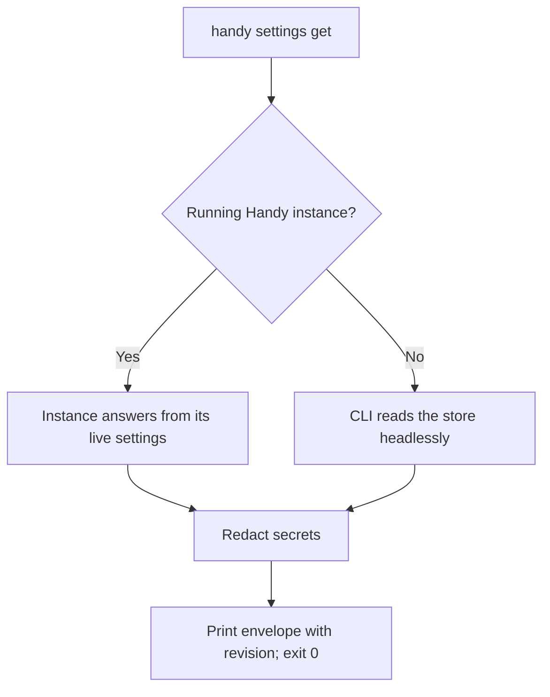
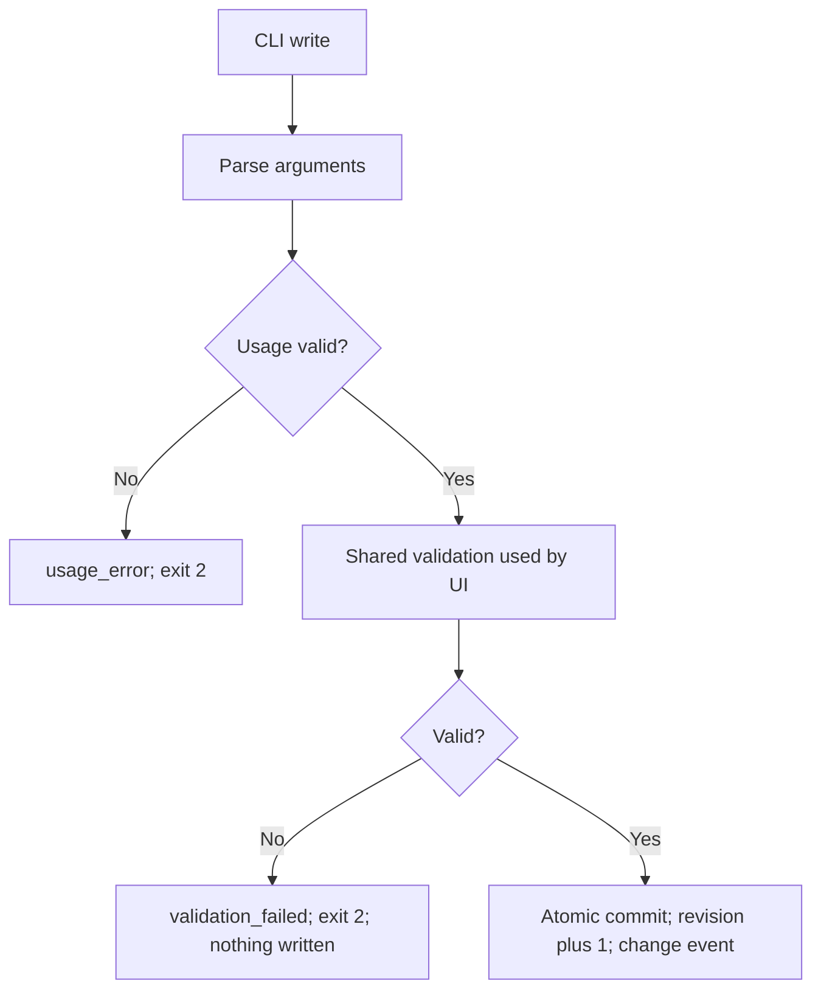
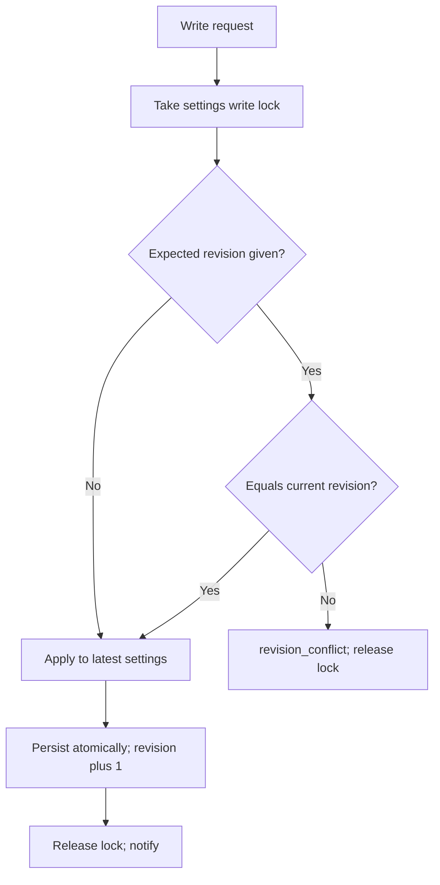
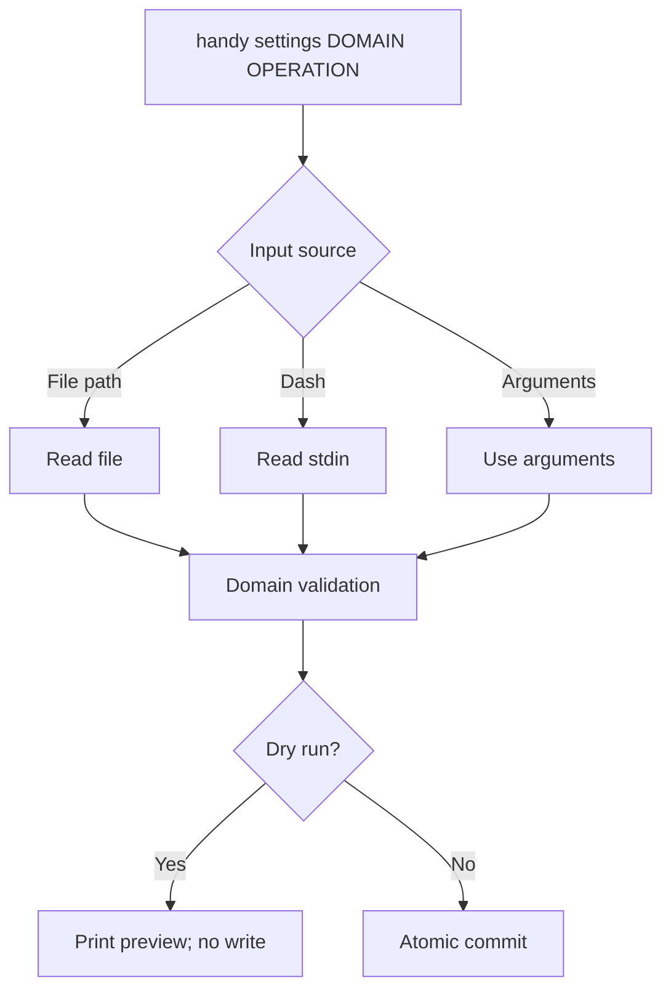
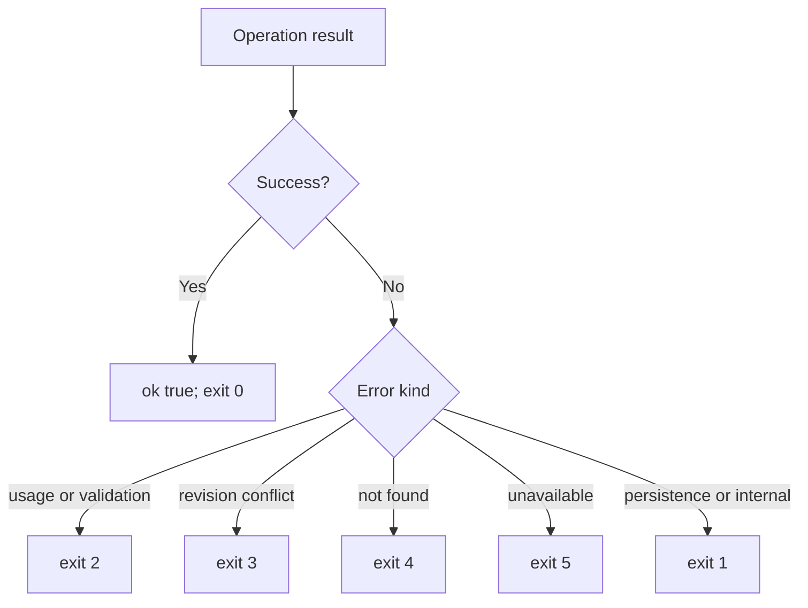

# Feature Spec: Settings CLI

## Header

- **Feature:** Settings CLI
- **Branch:** None — specification only (program specified before `spec-ship`)
- **Date:** 2026-10-12
- **Status:** Planned
- **Input:** Program item 8: the CLI must be available from the first version of these changes, even though it is eighth in the list. It reads and modifies persistent settings: microphones, shortcuts, vocabulary, prompts, destination/PIN and output behaviors. It also manages bulk replacements: add, edit, delete, import and export. Share validation with the graphical interface and offer JSON outputs usable by agents. The current recording-control flags are not this configuration CLI. The CLI was chosen; no MCP development is requested. Program guidance: prepare the CLI foundation before delivering the first features.
- **Feature Number:** 008

## User Scenarios & Testing

### Story 1 — Read settings as JSON `P1`

**As an** automation user or agent, **I want to** read Handy's persistent settings as JSON, **so that** I can inspect configuration reliably from scripts.

**Priority reason:** Reading is the first capability every agent workflow needs.
**Independent test:** Run the read operations with and without a running Handy instance on an isolated store and parse stdout with a JSON parser.

```gherkin
Feature: Read settings
  Scenario: Read all settings
    When the user runs "handy settings get --json"
    Then stdout is one JSON envelope with ok true, the settings revision and every non-secret setting
    And the exit code is 0
  Scenario: Read one setting
    When the user runs "handy settings get paste_method --json"
    Then the envelope data contains only paste_method and its value
  Scenario: Discover settings
    When the user runs "handy settings keys --json"
    Then the envelope lists each settable key with its type, allowed values or range, and whether it is read-only
  Scenario: Secrets are never output
    Given a provider API key is stored
    When the user reads all settings
    Then the key value appears nowhere in stdout or stderr
    And the provider entry reports only that a key is present
```



### Story 2 — Change settings with the same validation as the UI `P1`

**As an** automation user, **I want to** change settings from the CLI and be refused exactly when the UI would refuse, **so that** scripts cannot create a configuration the app rejects.

**Priority reason:** Shared validation is an explicit requirement and protects every feature of the program.
**Independent test:** Apply the same valid and invalid values through UI commands and CLI and compare stored results and error reasons.

```gherkin
Feature: Write settings
  Scenario: Valid scalar change
    When the user runs "handy settings set paste_method ctrl_v --json"
    Then the setting is stored, the revision increases by 1
    And the envelope reports the new value and revision
  Scenario: Invalid value
    When the user runs "handy settings set paste_delay_ms -5 --json"
    Then the exit code is 2
    And the envelope has ok false, code "validation_failed" and the same reason the UI shows
    And no setting changes
  Scenario: Running app reflects the change
    Given Handy is running with its settings open
    When a CLI write commits
    Then the settings UI shows the new value without restart
```



### Story 3 — Safe concurrent changes `P1`

**As an** automation user, **I want to** detect that settings changed since I read them, **so that** my script never silently overwrites someone else's change.

**Priority reason:** UI and CLI can write at the same time; lost updates would corrupt list settings such as replacements.
**Independent test:** Read the revision, change a setting in the UI, then write from the CLI with the old expected revision.

```gherkin
Feature: Revision checks
  Scenario: Stale expected revision
    Given the CLI read revision 41
    And the UI committed a change producing revision 42
    When the CLI writes with "--expected-revision 41"
    Then the exit code is 3 with code "revision_conflict" and the current revision 42
    And nothing is written
  Scenario: Write without expected revision
    When the CLI writes one setting without an expected revision
    Then the write applies to the latest settings without discarding other fields changed meanwhile
  Scenario: Concurrent writers
    Given the UI and the CLI commit different settings at the same moment
    When both commits finish
    Then both changes are stored and the revision increased by 2
```



### Story 4 — Domain operations for lists and bulk data `P1`

**As an** automation user, **I want to** manage list settings with dedicated operations, previews and stdin/file input, **so that** bulk changes such as replacement imports are scriptable and safe.

**Priority reason:** Replacements, vocabulary, microphones, shortcuts and prompts are lists that generic get/set cannot edit safely.
**Independent test:** Import a replacement file with dry run, then for real, then export to stdout and compare.

```gherkin
Feature: Domain commands
  Scenario: Dry run
    When the user runs "handy settings replacements import rules.txt --mode merge --dry-run --json"
    Then the envelope contains the preview and the exit code is 0
    And the revision is unchanged
  Scenario: Input from stdin
    Given rules are piped to stdin
    When the user runs "handy settings replacements import - --mode replace --json"
    Then the rules are read from stdin and committed atomically
  Scenario: Export to stdout
    When the user runs "handy settings replacements export -"
    Then stdout contains only the exchange format text
  Scenario: Help lists available domains
    Given only this feature is delivered
    When the user runs "handy settings --help"
    Then the help lists the generic operations and the output domain
    And each later program feature adds its domain to this list
```



### Story 5 — Stable errors and exit codes for agents `P1`

**As an** agent author, **I want to** rely on stable error codes and exit codes, **so that** my agent can react without parsing prose.

**Priority reason:** Agents are named consumers of the JSON output.
**Independent test:** Trigger each documented error and compare code and exit status with the documented table.

```gherkin
Feature: Error contract
  Scenario: Unknown key
    When the user runs "handy settings get not_a_key --json"
    Then the exit code is 4 with code "not_found"
  Scenario: Live state without running app
    Given Handy is not running
    When the user runs "handy settings destination status --json"
    Then the exit code is 5 with code "unavailable"
  Scenario: Human output by default
    When the user runs "handy settings get paste_method" without --json
    Then stdout shows a readable value and diagnostics go to stderr
```



## Acceptance Criteria

### AC-001

**Criterion:** `handy settings` is a subcommand group of the existing `handy` executable. Existing flags (`--toggle-transcription`, `--toggle-post-process`, `--cancel`, `--start-hidden`, `--no-tray`, `--debug`, `--transcribe-file`, `--model`, `--device-index`, `--list-devices`, `--list-models`, `--repeat`, `--json`) keep their behavior; `--json` after `settings` belongs to the subcommand. It works on macOS, Windows and Linux; on Windows, output appears in the console the command was started from. A `handy settings` invocation never shows a window, a tray icon or loads a model, never triggers the single-instance "show window" behavior, and completes reads within 2 seconds on an Apple M1 Mac in a release build.
**Priority:** P1 | **Story:** Stories 1 and 5

### AC-002

**Criterion:** `handy settings get [KEY]` returns all non-secret settings or one key; `handy settings keys` lists settable keys with type, allowed values or range and read-only flag; `handy settings set KEY VALUE` changes one scalar setting. Secret values (API keys) are never printed; reads report only their presence. Unknown keys return `not_found`. `set` parses VALUE with the key's descriptor type (boolean `true`/`false`, integer, enumeration value, string). Generic `set` on a list key returns `validation_failed` naming the domain command to use; on a secret or read-only key it returns `validation_failed` stating that the key is changed in the settings UI. A top-level `--json` before `settings` is accepted as equivalent to `--json` after it. A headless read never creates the settings store.
**Priority:** P1 | **Story:** Stories 1 and 2

### AC-003

**Criterion:** Every write goes through the same backend validation functions as the corresponding UI command, so a value the UI rejects is rejected by the CLI with the same error code and English message, and vice versa; the UI may show that message translated. UI commands that today replace an invalid value by a default (for example an unknown paste method) reject it instead. A rejected write changes nothing.
**Priority:** P1 | **Story:** Story 2

### AC-004

**Criterion:** Settings carry a persisted revision number returned by every read and incremented by 1 on every committed write from any surface, including writes made by Handy itself; a write that changes nothing and a read do not increment it. Writes accept `--expected-revision N`; a mismatch returns `revision_conflict` with the current revision in `error.details.current_revision` and writes nothing. All writers (UI commands, a running instance and a headless CLI process) are serialized by one cross-process settings lock, and each writer re-reads the stored settings under that lock before applying its change, so a write without expected revision applies to the latest settings and never discards fields changed by another writer.
**Priority:** P1 | **Story:** Story 3

### AC-005

**Criterion:** When a Handy instance of the same user and settings store is running, the CLI sends the operation to it over a local channel accessible only to that user and waits up to 5 seconds for its answer; the instance applies it with its live state, re-registers affected shortcuts and notifies its UI. If no answer arrives in time, the CLI returns `unavailable` with `error.details.outcome` set to `unknown`, and agents must read again before retrying. If a running Handy without this channel (an older version) is detected, the CLI returns `unavailable` and never writes the store itself. When none is running, the CLI applies the operation to the settings store itself under the same lock and validation. Operations that need live state (for example the current destination) return `unavailable` without a running instance. No network listener and no MCP server are introduced.
**Priority:** P1 | **Story:** Stories 2, 3 and 5

### AC-006

**Criterion:** This feature delivers the shared domain framework (argument parsing, file or `-` (stdin) input, `--dry-run` preview for bulk changes, atomic commit, help text per command) and the output domain for the existing output settings (paste method, clipboard handling, existing auto-submit). The domains microphones, replacements, vocabulary, shortcuts, prompts, destination and the new output settings (smart paste method, automatic Enter) are added on this framework by the features that own them (001–007, 009, 010). `handy settings --help` lists exactly the domains present in the build.
**Priority:** P1 | **Story:** Story 4

### AC-007

**Criterion:** With `--json`, stdout contains exactly one JSON envelope: success `{"ok": true, "revision": N, "data": …}`, failure `{"ok": false, "error": {"code": C, "message": M, "details": {…}}}` where `details` is always an object (for example `current_revision`, `outcome`, `field`, `issues` as a list of `{field, reason}`). Without `--json`, stdout shows readable text. Diagnostics, warnings and progress go to stderr in both modes. Export operations writing to `-` print only the exported content without `--json`, and put it in `data.content` of the envelope with `--json`.
**Priority:** P1 | **Story:** Stories 1 and 5

### AC-008

**Criterion:** Error codes and exit codes are stable and documented: `usage_error` and `validation_failed`, `shortcut_conflict`, `limit_exceeded` → 2; `revision_conflict` → 3; `not_found` → 4; `unavailable` → 5; `persistence_failed` and `internal_error` → 1; success → 0. New codes may be added; existing ones never change meaning.
**Priority:** P1 | **Story:** Story 5

## Functional Requirements

### FR-001

**Requirement:** Add a `settings` subcommand group to the existing executable that runs without GUI side effects and keeps existing flags unchanged.
**AC References:** AC-001

### FR-002

**Requirement:** Provide generic get, keys and set operations over non-secret settings with redaction of secrets.
**AC References:** AC-002

### FR-003

**Requirement:** Expose one shared validation and commit service used by UI commands and CLI, with a persisted revision, optional expected-revision check and a single write lock.
**AC References:** AC-003, AC-004

### FR-004

**Requirement:** Route CLI operations to a running instance over a user-only local channel with a 5-second timeout, or apply them headlessly when no instance runs.
**AC References:** AC-005

### FR-005

**Requirement:** Provide the domain command framework (file/stdin input, dry run, atomic commit, help) used by features 001–007, 009 and 010.
**AC References:** AC-006

### FR-006

**Requirement:** Produce the documented JSON envelope, human output, stderr diagnostics, stable error codes and exit codes.
**AC References:** AC-007, AC-008

## Key Entities

| Entity | Description | Key fields |
|---|---|---|
| Settings revision | Monotonic counter of committed writes | value, persisted with settings |
| CLI envelope | JSON output of one invocation | ok, revision, data or error (code, message, details) |
| Setting descriptor | Discovery entry for a key | key, type, allowed values or range, read-only, secret |
| Operation request | One CLI operation routed to a writer | domain, operation, arguments, expected revision, dry run |

## Clarifications

- Current code (2026-10-12): clap flags only; remote control flags forward raw arguments to a running instance through the single-instance plugin, which returns no answer; headless mode exists for `--transcribe-file`, `--list-devices` and `--list-models`; `--list-models --json` and `--transcribe-file --json` print JSON. Settings have a schema version but no write revision; each UI setter reads, changes and writes the whole settings without a lock; validation is per command.
- Delivery order: this feature ships before every other program feature; each later feature adds its domain operations on this framework.
- `[ASSUMED]` Command names: `handy settings <domain> <operation>`; domains as listed in AC-006. Each feature spec (001–007, 009, 010) defines its operation verbs; the CLI also accepts `edit` for `update` and `delete` for `remove` where a domain uses those verbs. Generic key names in examples (such as `clipboard_recovery_seconds`) are illustrative and fixed in the plans. Destination-related scalar settings (such as "Return to the dictation's application") are read and set through the output domain or generic `set`.
- `[ASSUMED]` Provider API keys are not settable through the CLI in this version; provider configuration stays in the settings UI.
- `[ASSUMED]` 5-second answer timeout from a running instance; the 2-second read budget applies to both headless reads and reads answered by a running instance.
- Delivery scope of 008 alone: the framework, generic `get`/`keys`/`set` and the output domain for existing output settings; other domains are added by their features. Domain examples in Stories 4 and 5 (replacements, destination) run once those features add their domains; 008 tests the framework with a test-only fixture domain.
- A starting Handy instance takes the settings lock while loading, so a concurrent headless CLI write is either fully visible to it or waits.
- No MCP server is introduced, as decided by the user.

## QE Analysis

- **Criticality:** High; **Blast radius:** All persisted settings and every program feature; **Primary risk:** Lost updates, divergent validation and secret leakage; **Confidence:** Medium (CLI and settings code mapped, nothing executed).
- **Dimensions:** API/contract compatibility, data integrity, concurrency, security (local channel, secrets), backward compatibility of existing flags, operability for agents.
- **P0 gates/evidence:** Contract tests for envelope, error codes and exit codes; UI/CLI validation parity tests per setting; concurrency tests with two writers and stale revision; routing tests with and without a running instance; secret redaction tests.
- **P1 gates/evidence:** Regression tests of existing flags; no window/tray/model on `handy settings`; read latency measurement; help text snapshot.
- **Non-functional expectations:** Reads within 2 seconds, instance answers within 5 seconds; local channel restricted to the current user; no setting values logged above debug level and secrets never logged.
- **Missing evidence:** No runtime test; the local channel mechanism per platform is chosen in the plan.
- **Boundary:** QE defines risk and test sufficiency; the independent review judges requirements; spec-test executes runtime proof; a security audit of the local channel is separate.

## Edge Cases

- Running instance hangs: the CLI times out after 5 seconds with `unavailable` and does not write the store itself, to avoid a conflicting writer.
- Settings store missing: reads return defaults with revision 0; the first write creates the store.
- Corrupted store: the existing salvage logic applies; the CLI reports a warning on stderr.
- Two CLI invocations at once without a running app: the write lock serializes them.
- Non-UTF-8 stdin for a text import: `validation_failed` with the offending byte offset.

## Success Criteria

### SC-001

Parity tests show identical accept/reject decisions and reasons between UI commands and CLI for 100% of settable keys.

### SC-002

In concurrency tests with interleaved UI and CLI writers, zero committed fields are lost and every stale expected revision is refused.

### SC-003

Every error code owned by this feature (`usage_error`, `validation_failed`, `revision_conflict`, `not_found`, `unavailable`, `persistence_failed`, `internal_error`) is produced by at least one automated test with its documented exit code; domain codes (`shortcut_conflict`, `limit_exceeded`) are tested by the features that own them.
