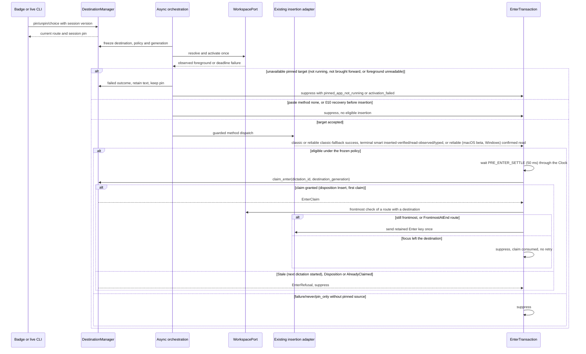
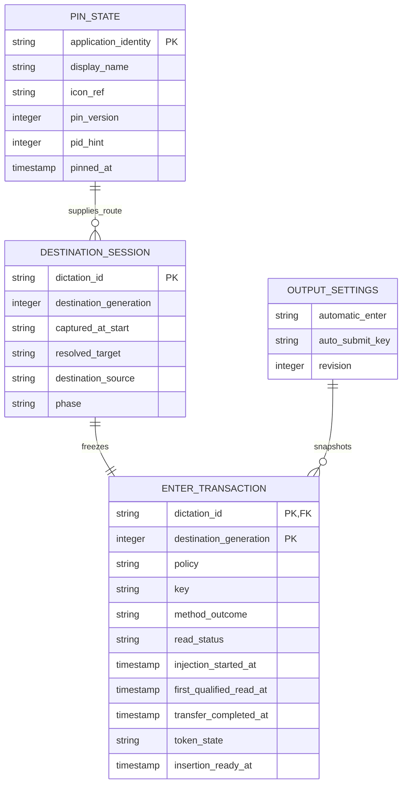

# Implementation Plan: PIN Mode and Enter Rule

## Summary

Extend the destination manager with a volatile session pin, migrate auto-submit to one persistent three-value policy, and route every classic, smart-paste and reliable-paste (macOS beta and Windows) Enter emission through one per-dictation guarded authority. All of it ships behind 006's `destination-return` Cargo feature: with the gate closed (default build) Handy keeps `dev`'s automatic Enter, settings and insertion unchanged (see [Rollout gate](#rollout-gate)).

Inspect [the functional source](spec.md). Scope **L**, despite four FR: native focus/input, asynchronous clipboard receipts, migration and cross-feature state. Deliver after 008, 006 and 007, in the approved order 008 → 001–007 → 009 → 010. This is planning only; no application changes, native tests, mockups or certification are claimed.

Inspect 008's spec (`.specs/features/008-settings-cli/spec.md`), its implementation map (`.specs/features/008-settings-cli/implementation.md`) and the delivered `src-tauri/src/settings_service/` code as the framework reference. Use only delivered names: `descriptor::SettingDescriptor` and its `descriptor_data.rs` rows, `validation::{validate_cli, validate_ui, ValidationContext, SettingsMutation}`, `errors::{SettingsError, SettingsErrorCode, ValidationReason}`, `domains::{Domain, DomainPlan, DomainRequest, DomainChange, ChangeKind, production}`, `domains::output::{OutputDomain, OUTPUT_KEYS}`, `operations::{SettingsBackend, execute}`, `route::route`, `tauri_adapter::{write, set, edit, repair}` for UI writes (output UI commands live in `shortcut/mod.rs` as `live_settings::write`), `effects.rs` live effects behind `LiveSettings`, `settings::apply_settings_migrations` (in-memory, persisted once by `SettingsRepository::initialize` at startup) and `public::PublicSettings`. `LiveSettingsEffects` does not exist. Live CLI operations use the extension delivered by 006's Step 0 (decision D2; 006's destination plan is inspected below), with the exact names fixed in that step: `DomainPlan::Live(Box<dyn LiveOperation>)`, `LiveOperation`, `LiveCall`, `LiveAnswer`, `LiveContext`, `managed_state`, `SettingsBackend::live_context`, `PlatformCapability::Destination`, `PlatformCapabilities::check`, `ErrorReason`, `SettingsError::{unsupported_platform, with_reason}`. Keep 008's persistent revision, stable inter-process lock, private same-user IPC, early `handy settings` branch, domain registration and one renderer. No parallel store writer, transport, revision or CLI executable.

Inspect [006's destination plan](../006-destination-application/plan.md) as technical context. Inspect the delivered `src-tauri/src/destination/` code and `.specs/features/006-destination-application/implementation.md` (sections "Delivered names" and "Rollout gate") for the names as shipped: `manager::DestinationManager` (`commit_start`, `freeze`, `set_disposition`, `claim_enter(dictation_id, generation) -> Result<session::EnterClaim, session::EnterRefusal { Stale, Disposition(RecoveryDisposition), AlreadyClaimed }>`), `session::{DestinationSession, Selection, badge_visible}`, `context::{DestinationContext, DestinationSource { Captured, Badge, FrontmostAtEnd }, RecoveryDisposition, RecoveryPort}`, `guard::DispatchGuard` (`check`, `context`), `insertion::{InsertionPort, Orchestrator}`, `outcome::{InsertionOutcome, DestinationFailure { AppClosed, ActivationFailed, InsertionFailed }, MethodOutcome}`, `delivery::{deliver, HistoryRecord}`, `history::save_dictation`, `workspace::WorkspacePort` and `rollout::Rollout`. Extend them with 006's identifiers `dictation_id`, `destination_generation` and `selection_version`; 006's `RecoveryDisposition` is read only, through `DestinationManager::claim_enter`, never extended; do not create a second destination manager. The key emitters are `clipboard::send_auto_submit` (classic paste, wrapping `send_return_key`) and the direct `send_return_key` calls of the reliable-paste receipt paths in `paste_tx/macos.rs` and `paste_tx/windows.rs`. Destination selection (006/009), insertion method (existing), smart-paste execution/restoration (007) and recovery presentation/classification (010) retain distinct ownership. `insertion_attempted` reports method success, never verified field contents; only 007's distinct `inserted, verified` result carries its AX readback verification. Inspect [007's current smart-paste spec](../007-smart-paste/spec.md) as technical context; its superseded clipboard-window artifacts have no active authority. Inspect [006's current badge contract](../006-destination-application/spec.md) as technical context for the 2026-10-13 decisions. Inspect [010's current recovery contract](../010-recovery-bubble/spec.md) as technical context for uncertain-result suppression and recovery handoff. Reuse 008's framework names and transactions exactly; its older illustrative six-outcome summary does not override current 007/009 requirements.

## Technical Context

| Aspect | Choice | Reason |
|---|---|---|
| Native / concurrency | Rust 2021, Tauri 2.11.5, existing Tokio | Async activation worker; short thread-bound native operations |
| Frontend | React 18, TypeScript, Zustand, i18next, existing CSS/Tailwind | Native state rendered through existing badge and output settings |
| Serialization / CLI | Existing serde/serde_json and clap; 008 domain trait | Typed policy, domain operations and exact shared envelope |
| Storage | Existing AppSettings JSON for policy/key; RAM for pin and frozen transactions | Pin ends at process exit; no new SQL table |
| Native APIs | 006 macOS/Windows WorkspacePort, existing Enigo/input and paste_tx | No AppleScript or activation workaround; preserve key semantics |
| Tests | Cargo, Bun, Playwright plus real native harness/manual checks | Browser Tauri mocks cannot prove focus, Enter counts or pasteboard reads |
| Infrastructure | Existing local user app only | No cloud, credentials, network API or provisioning |

Inspect [actions/history dispatch](../../../src-tauri/src/actions.rs), [classic paste](../../../src-tauri/src/clipboard.rs), [shared reliable transaction](../../../src-tauri/src/paste_tx/mod.rs), [macOS settle](../../../src-tauri/src/paste_tx/macos.rs), [Windows settle](../../../src-tauri/src/paste_tx/windows.rs), [settings](../../../src-tauri/src/settings.rs), [native overlay](../../../src-tauri/src/overlay.rs) and [current AutoSubmit UI](../../../src/components/settings/AutoSubmit.tsx) before implementation. Delivered 006 in `dev`: `actions.rs` hands the transcript to `destination::delivery::deliver` with `file_name: wav_saved.then_some(file_name)`, so a dictation whose WAV fails still gets a text-only history row (only the error retry row stays WAV-gated); 009 keeps this rule and adds no WAV gate around Enter or history. Paste runs through `destination/delivery.rs` (`MainThreadPaste` on the main thread); classic Enter sleeps 50 ms after paste; reliable Enter belongs to platform settle/flush with a 200 ms quiet period. These facts constrain integration; they are not runtime evidence.

## Constitution Check

| Principle | Explicit pass/deviation |
|---|---|
| Preserve native/frontend boundaries | PASS: Rust owns pin, immutable context and key emission; React requests mutations/renders snapshots |
| Stack/managers derived from manifests | PASS: reuse Tauri/Tokio/serde/clap/Enigo and 006 OS ports; no new inference or cloud dependency |
| Availability differs from runtime proof | PASS: resolved versions only; native focus, capture, activation and input gates remain required |
| Changed behavior specified before code | PASS: four FR, six AC and three SC mapped; no semantic spec change during this plan |
| Meaningful tests/current sources | PASS: real destination/Enter logic, injected external ports, actual service/files/processes for integration |
| Naming/tooling | PASS: domain-owned Rust snake_case modules; new TS/Markdown kebab-case; existing files retained; Bun/ESLint/Prettier remain project authority over generic Vitest/Biome/Commander examples |
| Privacy/i18n | PASS: metadata/opaque references only in events; no transcript/window title above debug; labels/reasons through translations |
| Native evidence and minimal scope (decision 2026-10-13) | PASS: macOS native evidence, taken on a build with `destination-return` and `smart-paste-dispatch` open, gates the steps and Implemented; Windows, Linux and older-binary checks are pending release evidence, never a gate; `destination status` limited to what AC-006 asks; 009 adds no gate of its own, rides 006's `destination-return` and adds nothing to the closed build |

## Requirement Inventory and Scope

| Requirement | Acceptance / success measure | Steps |
|---|---|---|
| FR-001 | AC-001, AC-002, AC-006; pin lifetime/current override/captured fallback; SC-003 five pinned dictations | 1, 2, 3, 6, 7 |
| FR-002 | AC-003; unavailable pin retained, no fallback, text preserved | 1, 2, 5, 7 |
| FR-003 | AC-004, AC-006; three policies, retained keys, SC-002 migration | 3, 4, 6, 7 |
| FR-004 | AC-005; SC-001 zero-or-one matrix, asynchronous guard | 1, 4, 5, 7 |

Entities are session Pin, persisted AutomaticEnter setting and per-dictation destination provenance/EnterTransaction. Interactions are badge/live CLI pin operations, output settings transaction, workspace activation and method completion/read/Enter. No HTTP endpoint; contract tables below are local DTO/CLI design. No OpenAPI file is applicable. A logical ER diagram describes new RAM entities and existing JSON fields, not database migrations.

## Design Reference

| Screen | Component breakdown | Reference/status |
|---|---|---|
| recording-indicator | DestinationBadge pin mark/name and 006 Remove destination cross; DestinationMenu Pin/Unpin entries above application list | Spec Screens; mockup deferred before spec-ship |
| output-settings | Automatic Enter policy selector; retained independent key selector | Spec Screens; mockup deferred before spec-ship |

## Penflow Contract Inputs

Planned identities are `flow_id: pin-mode-and-enter-rule`, `screen_id: recording-indicator` and `screen_id: output-settings`. The explicit 2026-10-12 user instruction overrides immediate forward-contract/mockup generation: all program flow/screen contracts, semantic/test IDs and Pencil mockups are produced in one pass before spec-ship. Do not mint or regenerate identities during planning.

Inspect [the current semantic tree](../../../penflow/semantic-ui-tree.json) as incomplete context, presently microphone-priority only. The future primary input `penflow/code-ir.json`, expected tree and desktop native geometry are missing. Inspection returned BLOCKED/certified=false, `required_contract_artifacts_missing`. No 009 accepted Penflow history or bound approval is claimed. Do not rewrite the shared root workspace or another feature's source to make this planning gate pass.

The program design owner must later complete cumulative mappings/outcome predicates for these FR/AC, theme and visual states, native geometry, homologous references and native export; produce root ui.pen/semantic/code-ir/expected trees and design registry; run review-snapshot, dispatch the immutable snapshot and all active sources to the independent plan reviewer, retain raw JSON, assemble review-result and record plan-review Done with that bound result. Then require design-profile PASS/certified=true before UI code. Today's semantic review does not substitute for that bound review. Preserve all four procedures as required in metadata; missing inputs are not N/A.

No theme.css/theme.md exists now. Before UI work consume the one-pass theme, install/import it only if its CSS variables are absent, and use its approved tokens/geometry. A 256×50 nonactivating overlay cannot be assumed to fit a menu; Pin/Unpin live in 006's existing badge menu (`src/overlay/destination-menu.tsx`, `destination_menu` command) and its nonactivating surface, and Step 1 only proves the new entries there without focus theft. Settings keyboard focus is local to the settings window; the badge menu remains pointer-operated per 006, without a global keyboard hook.

## Architecture Decisions

### Rollout gate

Orchestrator decision 2026-10-14 (round 4 review): all of 009 ships behind 006's `destination-return` Cargo feature (`destination::rollout::Rollout`, `DESTINATION_RETURN_WIRED`; `.specs/features/006-destination-application/implementation.md`, section "Rollout gate"). That covers the session pin, the three-value Automatic Enter policy with its migration, the single Enter authority and the `destination pin|unpin|status` commands. 009 adds no gate of its own: the change that opens destination return opens 009 with it. The closed build is identical to `dev` and gains nothing from 009 (spec Clarifications, decision 2026-10-14 under Julien's mandate, validated by Julien on 2026-10-15). Every 009 test, clippy and the build run in the four feature combinations of [Resolved Test Commands](#resolved-test-commands): default, `smart-paste-dispatch`, `destination-return`, and `destination-return,smart-paste-dispatch`.

| Area | Gate closed (default build) | Gate open |
|---|---|---|
| Dictation | No destination session (`capture_at_start` and `ticket_at_stop` return `None`): `delivery::paste_as_before`, or 007's `insert_at_foreground` when `smart-paste-dispatch` is open | Every dictation has a 006 session on every platform (`Rollout::opens_sessions` depends only on the gate); Linux gets the `FrontmostAtEnd` route |
| Automatic Enter | Exactly `dev`: the legacy `auto_submit`/`auto_submit_key` drive the existing emitters (the 50 ms block of `clipboard::paste`, the receipt paths of `paste_tx/macos.rs` and `paste_tx/windows.rs`, 007's `follow_without_session`); no 009 authority runs | Only 009's authority emits, after `claim_enter`; the legacy emitters receive no Enter decision. 007's delivered in-session follow-up (`smart_paste::app::session_method`, which today calls `claim_enter` and submits Enter from `auto_submit`) is one of these emitters: 009 replaces it in Step 5, whose scan test then asserts that only `automatic_enter` calls `claim_enter`. A dictation without a session in the open build (no ticket: the manager is not installed) keeps the legacy emitters, fed `automatic_enter == always` instead of the stored `auto_submit`, so a gate-open build reads only Automatic Enter (AC-004) |
| Settings | `auto_submit` and `auto_submit_key` are the descriptors, with the `AutoSubmit.tsx` toggle and the CLI as in `dev`; `automatic_enter` has no descriptor, so `get`, `set`, `output get` and `output set` answer 008's `not_found`/4 like any unknown key; no migration runs and nothing is written | `automatic_enter` and `auto_submit_key` are the descriptors; `auto_submit` has none (`not_found`/4); the one-time migration runs at the first start of an open build |
| Pin | No badge exists without a session, so no pin entry. No `destination` domain is registered (`DestinationDomain` is added to `domains::production()` under `cfg(feature = "destination-return")` only), so `handy settings destination …` is a `usage_error`/2, exactly as in `dev` | macOS and Windows as specified; Linux refuses the three actions with `validation_failed`/2, `details.reason = "unsupported_platform"` |
| Checked schema | `.specs/features/008-settings-cli/contracts/settings-cli.schema.json` stays the `dev` schema, as for 007 | The schema test substitutes `automatic_enter` for `auto_submit` and adds the `destination` domain, as 007's test strips `smart_paste` when its gate is open |

Gate-conditional mechanism: `cfg(feature = "destination-return")` selects the descriptor rows of `descriptor_data.rs` (closed: `auto_submit` and `auto_submit_key`, as in `dev`; open: `automatic_enter` and `auto_submit_key`), the `OUTPUT_KEYS` array (one key swapped for the other, same length) and the `DestinationDomain` registration. The descriptor inventory and schema tests run in each `cargo test` state with that state's expectations. `PublicSettings` follows the descriptors of the state: closed, `auto_submit` as in `dev`; open, `automatic_enter` in place of `auto_submit`, so keyless `get`, `output get` and the schema list the same keys. `AppSettings` gains `automatic_enter: Option<AutomaticEnterPolicy>`, serialized only when `Some`, which only the open build fills: its `get_default_settings` sets `Some(Never)` for a fresh install (008 runs no migration on a store without payload) and its migration fills an existing store. In the open state, 008's descriptor inventory test lists `auto_submit` as the one stored field without descriptor (kept for the closed build), and 008's salvage probes it too, so a salvage never resets it. `bindings.ts` is generated once and serves both states: `change_auto_submit_setting` and `change_automatic_enter_setting` are registered in both, each refusing `not_found` for the key its state has no descriptor for, so the generated file is identical whichever state produces it; the closed build never sends `automatic_enter`, so its UI and behavior are `dev`'s. The settings UI renders the three-value control when the settings snapshot contains `automatic_enter` (open build) and `AutoSubmit.tsx` otherwise; no new command and no setting value decide it. The single-binary migration test drives `apply_settings_migrations` with both `Rollout` values.

Migration and return to a closed build (spec AC-004 and Clarifications, decision 2026-10-14 under Julien's mandate): the migration never deletes or rewrites `auto_submit` or `auto_submit_key`. `AppSettings` keeps `auto_submit: bool` in both states. It is serialized as today; in the open state it has no descriptor and no `PublicSettings` copy, and no control or Enter decision reads it. The new field is `automatic_enter: Option<AutomaticEnterPolicy>`, serialized only when `Some`. A closed build never sets it, and a value written by an open build survives a closed build's writes as a raw field (008's `raw_merge` keeps unknown fields) without being read. A return to a closed build therefore finds exactly the previous `auto_submit`, key and Enter behavior. The migration function receives the `Rollout`, so one test binary covers both states (`automatic_enter_migration.rs`, P0). The test migrates a raw store in the open state (`auto_submit` true with `ctrl_enter`, then false with `cmd_enter`), serializes it and normalizes the result in the closed state. It asserts that `auto_submit`, `auto_submit_key` and the legacy Enter decision are identical to the pre-migration store (`clipboard::should_send_auto_submit`, the `auto_submit` inputs of `paste_tx::try_reliable_paste` and of 007's `follow_ups`). It also asserts that the closed state never creates or changes `automatic_enter` (a value written by an open build survives as a raw field). Round trip open → closed → open (spec AC-004: once stored, Automatic Enter is the only value a gate-open build reads): an `auto_submit` change made in the closed build or in an older Handy is not re-migrated when an open build starts again; the stored `automatic_enter` stays authoritative. The same test asserts this precedence, so the behavior is defined rather than accidental.

### Pin lifetime, provenance and freeze

Add `PinState {identity, display_name, icon_ref, pinned_at, pin_version, pid_hint}` to DestinationManager RAM. Stable macOS bundle ID and Windows AUMID/canonical executable identity follow 006, excluding Handy. Lifetime (spec AC-001 and Clarifications, decision 2026-10-14 under Julien's mandate, validated by Julien on 2026-10-15): no pin is persisted, exported as a setting, or restored after quit/crash/restart; it survives every dictation, never the Handy process. Status remains pinned even when its app exits. Reopening resolves the same identity using WorkspacePort, never a display name or an automatic launch. `pid_hint` is the PID of the instance pinned, passed to 006's `workspace::resolve_instance` as its captured PID (a reused PID has another identity and never matches): the pinned instance while it runs, otherwise the only running instance; several others are `Resolution::Ambiguous`, reported `activation_failed` (spec Edge Cases). A test covers each of the three cases.

Runtime support: a pin needs 006's destination platform support (macOS, Windows). Runtime readability stays out of the CLI, as in 006: when the instance's support is `Unsupported` (foreground unreadable, 006 AC-007), no badge is shown (AC-001) and `pin`, `unpin` and `status` answer as usual. A pinned dictation then fails closed (Julien's decision 5, 2026-10-15, spec Clarifications): its pinned route is still activated, an unreadable foreground can never confirm it in front, so 006's wait ends with its existing reason `activation_failed` after the 1 s deadline, as for any destination that does not come forward. No text reaches the frontmost application, no Enter is sent, the pin stays and the transcript stays recoverable through 006's failure path (history, 006's failure presentation, then 010's bubble). Without a pin, the dictation inserts as today (006 AC-007). `pin_destination.rs` tests both.

At each actual accepted recording start, obtain and retain `captured_at_start` exactly as 006 does, even when a pin wins selection: with "Return to the dictation's application" on, the frontmost application; with it off, 006 captures nothing (`FrontmostAtEnd`) and 009 adds no capture of its own (spec AC-002, decision 2026-10-14 under Julien's mandate). Read frontmost before showing Handy surfaces; resolve pin precedence before selecting the captured route. Capture the fallback once, not at unpin time. A queued dictation captures when it really starts. Failed start discards tentative context; if capture cannot be obtained, keep an explicit unavailable fallback, never invent a destination. Audio/AI/processing never recaptures.

Use 006 dictation_id/selection_version/phase/destination_generation for every mutation and atomically freeze at Inserting. 009 adds `DestinationSource::Pinned` to 006's `DestinationContext.source`. Pinning while Recording/Processing sets the current route and future pin in one manager transition. Choosing another app is a current-session badge choice only; it keeps PinState and gives source `badge`, so pin_only is false. Unpin before freeze clears PinState and restores the route 006 gave the current session at its start, replacing any badge override made while pinned: source `captured` with return on, `FrontmostAtEnd` (no destination, insertion into the frontmost application at the end) with return off. A pin accepted after a badge choice replaces that choice for the current session. A CLI pin or unpin follows the same rules as the badge (spec AC-006). Unpin/repin after freeze changes only future sessions; the displayed active-session pin mark reflects frozen provenance. Duplicate same-pin/unpin-none are no-ops. Cancellation invalidates callbacks without clearing the session pin.

The 006 cross is the same current-dictation override as its `Frontmost app at the end` menu entry: until Inserting it selects FrontmostAtEnd with source `FrontmostAtEnd` (006's route table for a chosen `FrontmostAtEnd`), removes the current destination, displays `Frontmost app` within 200 ms and retains the session pin for following dictations. It is not Unpin. With `pin_only`, this overridden dictation sends no Enter; Always may send one only after an eligible insertion outcome and the remaining AC-005 guards. Reuse 006's nonactivating control with accessible name `Remove destination`; freeze closes the menu and rejects later cross/menu changes. Tests distinguish cross, alternate-app choice and explicit Unpin before/at/after freeze.

Badge visibility follows the rule recorded in this spec's AC-001 and Clarifications (decision 2026-10-14): 009 extends 006's single predicate `badge_visible(return_enabled, support, overlay_style)` with the session pin, so the badge is visible on a supported platform with a non-none overlay when destination return is on (006 AC-003) **or** an application is pinned; with return off and no pin it stays hidden as 006 AC-003 requires. This is the only exception to 006 AC-003, owned by 009 because AC-002 makes PIN activation independent of that setting and the badge menu is where Unpin lives. Its accessible name for a pinned route is exactly localized `Destination: <name>, pinned`; a temporary other-app route shows that current destination without falsely announcing it is pinned, while the menu still offers Unpin and Pin current destination. With overlay style none, pin operations remain CLI-only; do not create an unsolicited overlay. No pin and return off retains 006 hidden-badge behavior.

### Destination failure and conservation

Freeze a pin route independently of return_enabled and of runtime support; activate its identity even when return is off or the foreground is unreadable (then `activation_failed`, see Runtime support). Reuse 006's one-shot activation and monotonic ≤1 s deadline, including scheduling/observation; async waits and timers stay off the main thread. Run short native activation/frontmost checks through channels; no worker join, sleep or 1 s loop in run_on_main_thread. Recheck cancellation/target after any configured paste delay and immediately before first method dispatch. None/empty/cancel does not activate or emit input.

A pinned application that is not running, or that is running but does not come forward within 006's deadline, is a terminal destination failure, as AC-003 requires: no current-frontmost fallback, no app launch, no method attempt and no Enter. Keep the pin. Orchestrator decision 2026-10-14: AC-003's "pinned app unavailable" is carried by two typed reasons in `InsertionOutcome.reason`, the ones 010 presents. `pinned_app_not_running` is new in 006's `outcome::DestinationFailure` (added by 009): no running instance has the pinned identity (Story 2's "pinned app closed"); `insertion::Orchestrator::resolve` maps `Resolution::Closed` of a destination whose source is `pinned` to it instead of `AppClosed`; 010 shows "<App> is pinned but not open". `activation_failed` is 006's existing reason, reused unchanged: an instance with the pinned identity runs but is not confirmed frontmost within the 1 s deadline or fails the final guard; 010 shows "Could not bring <App> forward". `destination_source = pinned` tells consumers that the failed route was the pin. No other subtype or free-text diagnostic exists. Extend 006's localization and consumer contract for `pinned_app_not_running`. Retain `InsertionOutcome` status failed and stable outcome_id, history_status and transcript_ref.

Use 006's native retained final-text slot (`recovery::RecoverySlot`) and the actual history result (`delivery::HistoryRecord`, from `history::save_dictation`); do not rely on a WAV or fabricate a history_entry_id. `history_status` is 006's, from the actual `save_entry` result only (Julien's decision 2026-10-14): a WAV failure saves a text-only row (`saved`), a save_entry failure is `failed`, `not_saved` only when no write was attempted. Test WAV failure with a text-only row saved, save_entry failure and saved history reread. Retention is volatile until superseded by a later final outcome, explicit consumer release or process exit; only an actual history save is durable. No new storage guarantee is added. Before 010, a pinned failure is presented like any 006 destination failure: its reason through 006's failure presentation (006 AC-005; the `paste-error` toast of delivered `destination/delivery.rs`), with a localized text for `pinned_app_not_running` beside 006's `appClosed` and `activationFailed` texts; once 010 acknowledges presentation, its bubble replaces that toast. 009 supplies reason/outcome and suppresses Enter; 006's outcome producer stays the only hand-off to 010, and 009 does not implement the bubble. 007 owns smart-paste restoration: 010 Copy writes the transcript as new clipboard content, changing `changeCount`, so the pending restoration guard does nothing. No clipboard-window cancellation/recovery API or `clipboard_recovery_*` setting is introduced; 010 remains the recovery-presentation owner and Copy never creates Enter.

### One setting and idempotent migration

Introduce `AutomaticEnterPolicy {Never, Always, PinOnly}` with serde values `never`, `always`, `pin_only`; retain `AutoSubmitKey` and `auto_submit_key` wire values `enter`, `ctrl_enter`, `cmd_enter`. Persist the new `automatic_enter` policy in existing AppSettings (open gate only, see [Rollout gate](#rollout-gate)). New installations default Never. On load in an open build, if valid new policy is present it wins; otherwise a missing new field maps legacy auto_submit false/missing→Never, true→Always while preserving each key, reading `auto_submit` and `auto_submit_key` from the raw payload the migration receives, never from typed fields a salvage may have reset. An invalid present `automatic_enter` is dropped by 008's salvage in `normalization::normalize`; because the raw payload holds a value, the migration does no legacy remapping and the policy is Never, so it never silently enables Enter; 008's startup normalization (`SettingsRepository::initialize`, `edit::normalize_document`) then persists that `never` once with one revision increment, as for any invalid descriptor value (tested in `automatic_enter_migration.rs`). Keep unknown keys/secrets and 008 revision continuity. In-memory reads migrate without writing (`settings::apply_settings_migrations` inside 008's `normalization::normalize`); startup persists one real migration through `SettingsRepository::initialize` under the lock and increments once. Repeated migration is a no-op; persistence failure leaves old durable generation. One normalization pass composes this migration with 007's `setting_policy::migrate` (both inside `apply_settings_migrations`), so one startup write and one revision increment cover both. The migration only adds `automatic_enter`: it never deletes or rewrites `auto_submit` or `auto_submit_key`, and a closed build runs none of it.

Remove legacy auto_submit from runtime decisions, descriptors (`descriptor_data.rs`), `OUTPUT_KEYS` (which gains `automatic_enter` in its place), UI, CLI help and command routing of the open build; it has no `PublicSettings` copy in the open build (see [Rollout gate](#rollout-gate)). The stored `auto_submit` value stays in `AppSettings` unchanged (it drives a closed build, see [Rollout gate](#rollout-gate)); in the open build it is migration input only, never a second emitter or exposed alias. **What an agent sees:** 008 resolves keys before any validation, so an unknown key is `not_found` (exit 4). In the open build, `auto_submit` is therefore `not_found`/4 on `get`, `set`, `output get` and `output set`, exactly like any unknown key of 008, and is absent from `keys` and `output get`. No requirement of 009 asks for a hint, so 009 adds no retired-key table, error reason, constructor or replacement field: the refusal is 008's unchanged `not_found` envelope, with its fixed message and no key text echoed (orchestrator decision 2026-10-14). README and `settings-cli.md` list `automatic_enter` in place of `auto_submit` for the open build and keep `auto_submit` for the closed one. In the open build the existing `change_auto_submit_setting` UI command refuses the write (`not_found`, the key has no descriptor) and no UI calls it; it stays for the closed build, and `change_automatic_enter_setting` symmetrically refuses `not_found` in the closed build, so no competing setting exists in either state; tests scan every caller in both states. Keep current key semantics, including platform-dependent Cmd/Super+Enter on Windows/Linux.

Snapshot policy/key at insertion entry (`delivery::deliver`), with the insertion context: a change made during recording or processing applies to that dictation, a later one to the next dictation (tested with a policy change during recording), so a later UI/CLI setting change cannot turn an outstanding smart-paste or Windows reliable transaction into a different send decision. Reuse 008's fresh typed mutation, descriptor validation, settings-changed revision and latest-response filter: a single UI change goes through `tauri_adapter::write`; a policy+key change in one UI action goes through one `tauri_adapter::edit`, one commit; no two-write inconsistent setting transition.

### Enter authorization and asynchronous receipts

New domain module `src-tauri/src/automatic_enter/` owns pure `evaluate_enter` and per-dictation `EnterTransaction`, identified by `(dictation_id, destination_generation)`, the same pair `DestinationManager::claim_enter` takes (orchestrator decision 2026-10-14). It does not use `InsertionOutcome.outcome_id`: delivered 006 allocates it in `delivery::publish`, after the method and its follow-ups return. Freeze `{dictation_id, destination_generation, policy, key, destination_source, method}` at insertion entry (`destination::delivery::deliver`, where the settings snapshot is read once), then record `resolved_target` from the `DestinationContext` that 006 builds at the first accepted guard check, before the method runs: `DispatchGuard::context()` for the main-thread methods (`delivery::MainThreadPaste`) and the context handed to smart paste's `SessionFollowUp`; the `RecoveryDisposition` is not frozen but read live from 006's `DestinationSession` at the atomic claim. `resolved_target` is exactly 006's `DestinationContext.target`: for captured, badge and pinned routes the activated instance (PID and stable identity); for the `FrontmostAtEnd` route (return off or unsupported with nothing pinned, no destination, chosen `FrontmostAtEnd` or the cross) the frontmost application read at the guard, `None` only when the foreground is unreadable or is Handy. Captured-at-start metadata is distinct. AC-005 checks the real insertion destination, keyed on the route, never on a source label: a dictation whose route activates a destination (captured, badge or pinned route) requires its `resolved_target` still frontmost immediately before Enter; a `FrontmostAtEnd` route has no destination, so its Enter targets the frontmost application as today, with no frontmost comparison and no identity comparison to an unused capture. Return off (Julien's decision 1, 2026-10-15): with nothing pinned the dictation is a `FrontmostAtEnd` route; with an application pinned it is a pinned route, activated as AC-002 requires, whose `resolved_target` must still be frontmost immediately before Enter (AC-005); both cases are tested. Tests retain both fields and prove this interpretation; no Enter merely because global PinState currently exists.

The Enter veto is 006's single `RecoveryDisposition { Pending, Insert, Recover, Cancelled }` (006 plan, "DestinationContext and RecoveryDisposition"; also named in 010), held by `DestinationSession` and changed only through `DestinationManager::set_disposition` with monotonic transitions. 006 sets `Recover` on destination failures and failed method results, `Insert` immediately before the first dispatch once 010's optional `RecoveryPort::before_insertion` verdict is `Insert`, and `Cancelled` on cancellation. 009 adds no second decision type and no revocation message. Its `Pending → Consumed` transition is the single call `DestinationManager::claim_enter(dictation_id, destination_generation) -> Result<EnterClaim, EnterRefusal>` defined by 006: it reads the disposition and records the claim under the session lock of `set_disposition`, grants once when the disposition is `Insert`, and refuses `Pending`, `Recover` or `Cancelled` (`EnterRefusal::Disposition`), a stale `dictation_id`/generation (`EnterRefusal::Stale`) and a second claim (`EnterRefusal::AlreadyClaimed`); every refusal suppresses the token. A later move to `Recover` after a consumed token cannot undo the key; it only governs recovery. The earlier 009 name `RecoverInstead` for the disposition is retired in favor of `Recover` (006's `guard::GuardRefusal::RecoverInstead` is a guard refusal, not a disposition).

Where the pause, claim, frontmost check and key run (the Enter worker): for the main-thread methods, on 006's insertion worker after `Orchestrator::deliver` returns and before `delivery::publish`, so 006 publishes the outcome after the Enter attempt, as `dev` sends Enter inside `clipboard::paste` before returning; for smart paste, in the `SessionFollowUp` that replaces 007's interim hook in `smart_paste/app.rs` (`claim_enter` and `submit_enter` of `session_method`); for Windows reliable paste, on its worker when the read/completion rendezvous completes, which can be after `publish`. The key itself goes through a brief main-thread call where the platform requires it. Next dictation before the claim (spec AC-005, Story 4 and Edge Cases, decision 2026-10-14 under Julien's mandate, validated by Julien on 2026-10-15): `claim_enter` reads the manager's current session, and `commit_start` replaces it at the next accepted recording start. A claim of dictation A made after dictation B started is therefore refused `EnterRefusal::Stale`, and A sends no Enter, even after a successful insertion. This is the accepted limit case of the spec: the user has moved on, an Enter would land in B's context, and AC-005 allows at most one Enter, never requires one. The same holds after a cancellation (`Disposition(Cancelled)`). Tests: start B between A's method success and A's claim, for classic, smart paste and Windows reliable receipt orders; A gets `Stale`, zero Enter, and B's own claim is unaffected.

Eligibility is the conjunction: active generation; method not none; nonempty completed insertion; method success; disposition `Insert`; for a captured, badge or pinned route, resolved target still frontmost immediately before emission (no comparison for `FrontmostAtEnd`, as AC-005 allows); policy Always or PinOnly with frozen source pin. Never is always false. Consume 007's terminal `method_outcome` preserved by 006: only "inserted, verified", "insertion attempted, read observed" (`read observed`) and "typed" satisfy smart-paste success. "Not read", "permission missing", "uncertain", "clipboard handed over" and "insertion failed" always suppress Enter. Await the terminal read/fallback decision asynchronously; transaction enqueue, clipboard publication and a raw read callback alone are not terminal success. Failed smart paste routes not read/permission missing/uncertain/insertion failed to 006/010 recovery; clipboard handed over retains 007's informational outcome, without local insertion, Enter or failure recovery from that result alone. Windows reliable paste keeps its existing transfer/read and pre-transfer classic fallback contracts: classic fallback uses its own completion success; transferred reliable paste additionally requires qualifying target-read confirmation. Enqueue Ok is not confirmation; after transfer/no-read/failure never retry or create a second insertion. 007 owns the AX-first attempt for destinations outside its remote-strategy exceptions, with the focused element belonging to the destination process: reread equality to the selected-range replacement produces inserted, verified without touching the clipboard; unreadable/secure fields skip AX, and value still unchanged at the end of the 150 ms readback window falls back once regardless of the write return status; an unexpected changed value produces uncertain without fallback or retry, preventing duplicate insertion. Its permission check precedes clipboard effects. 009 preserves the publication-time not-read decision even if the retained transcript is read later; 007 discards that saved snapshot, and 010 reports possible late insertion without authorizing Enter. 009 consumes that outcome; it does not implement or redo AX writes. No macOS smart-paste failure is converted to classic success.

One atomic `Pending → Consumed` transition keyed by `(dictation_id, destination_generation)` controls every emitter. In the open build, on the session path, classic method completion, the terminal macOS smart-paste result and Windows reliable worker/flush all call that authority, and their direct send_return_key paths are removed there; the closed build keeps `dev`'s emitters (see [Rollout gate](#rollout-gate)). Order, decided 2026-10-14 for AC-005's "immediately before the Enter press": after the 50 ms pause, `claim_enter` (which also covers cancellation and recovery through the disposition), then the frontmost check of a route with a destination, then send_return_key once. A claim consumed before a failed frontmost check is not retried: no Enter for that dictation. If focus, input availability or key injection fails, record Suppressed/EmissionFailed and do not retry, even when OS delivery is unknown. Duplicate settle, a new paste flushing the old transaction, stale outcome and callback after quit/cancel cannot generate a second key. Thread-bound main-thread work is short; no lock inversion between paste state, manager, settings lock and Enigo. Copy state out before cross-port calls.

Keep macOS snapshot/publication/read/outcome/restoration entirely in 007 and Windows reliable quiet-period restoration in its existing paste_tx adapter. Smart paste publishes one terminal result for AX verification, Unicode completion or the clipboard read/no-read decision. For inserted, verified, 009 waits for the verified readback result only, with no clipboard-read or Cmd+V prerequisite. For the clipboard branch, 009 awaits its terminal result, successful method completion and chord release before claiming the token; typed waits for Unicode completion. Restoration completion is never a prerequisite for any of these three successes. A post-keystroke read while Cmd+V is held is latched by 007, but a later chord failure must produce insertion failed, never eligible read observed. Windows reliable readiness remains a rendezvous between two independently recorded signals: successful chord/transfer completion and the first qualifying target-read receipt at or after injection start. A target may read while the chord is held for about 100 ms, before send_chord returns. Latch that qualifying receipt and its timestamp immediately, even when completion is pending; exclude pre-injection reads. Record injection_started_at before sending, then completion status and transfer_completed_at from the actual chord result, not try_reliable_paste's outer Ok (which can coexist with injection_failed). Either callback order wakes the same authority once both signals exist. A receipt alone never authorizes Enter; chord failure after an early receipt, cancellation or recovery suppresses the token. Release the held chord/input access before attempting Enter. Platform settle/flush retains the same token and must not discard, relabel or independently emit from this latch. Windows `outer Ok`: delivered `paste_tx::windows::run` returns `Ok(())` after a chord failure (it only sets `injection_failed`), and 006 maps that `Ok` to `insertion_attempted`. 009 does not change this outcome, since 006 states that Windows reliable paste stays unchanged: the authority reads the actual chord result latched for the rendezvous, so a chord failure never reaches Eligible and sends no Enter (tested with an early receipt). The macOS beta reliable paste (`paste_tx/macos.rs`, on the session path when `destination-return` is open and `smart-paste-dispatch` closed) follows the same rendezvous; its receipt Enter is replaced by the authority.

Separate Enter readiness from clipboard restoration: preserve 007's macOS restoration only after a confirmed post-Cmd+V read, 300 ms quiet after the LAST read, capped at 8 s after the first read (Jump Desktop 1.5 s quiet); 800 ms without a read (3 s for Jump Desktop) produces not read, NEVER restores the previous clipboard for that dictation, leaves the transcript until replaced, and routes to 010; 007's 50 ms input-source switch wait and independent restoration 100 ms after the chord's last key release, and unchanged-changeCount guard; preserve Windows' 200 ms quiet period. Neither 009 nor Enter reschedules restoration. Classic reference time t0 is successful method return (including configured delays); smart-paste inserted-verified t0 is terminal outcome publication after successful AX readback equality (not AX write return), read-observed t0 is terminal successful outcome publication after read and successful chord completion/release, typed t0 is terminal successful Unicode-typing completion; Windows reliable t0 is `max(transfer_completed_at, first_qualified_read_at)` for its two latched signals; Windows classic fallback t0 is fallback return. A read during the chord therefore becomes eligible only at successful completion, and a read after success becomes eligible when it arrives. Stabilization pause (orchestrator decision 2026-10-14): before every eligible Enter, the authority keeps `dev`'s 50 ms pause after t0, the value of the classic block in `clipboard.rs` (`std::thread::sleep(Duration::from_millis(50))` before `send_auto_submit`) and of `AUTO_SUBMIT_SETTLE` in `smart_paste/app.rs`, so applications slow to process a paste do not regress. It is one `PRE_ENTER_SETTLE` constant waited through the monotonic Clock on the Enter worker, never as a main-thread sleep; `claim_enter` and then the frontmost check run after the pause, immediately before the key. For every eligible dispatched Enter, measure the actual native key attempt within 100 ms of t0, including the 50 ms pause, scheduling/input access, the claim and the immediate frontmost check. Never claim this budget for an intentionally suppressed Enter or OS text rendering. Use monotonic Clock and timestamp evidence; tests assert key attempt ≥50 ms and ≤100 ms after t0 with a fake Clock, a focus switch during the pause or after the claim suppresses Enter, and the macOS native harness records the real t0 and key-attempt timestamps of every eligible Enter. Tests exercise receipt-before-success, success-before-receipt, receipt-before-chord-failure, pre-injection read, cancellation/recovery between signals, duplicate callbacks and late settle/next-paste flush, in automated tests for both platforms; SC-001 requires exact expected 0/1 for all orders and all eight smart-paste outcomes, including inserted, verified and typed with no clipboard read, uncertain with no retry/key, and clipboard handed over with no key. Add probe-then-read timing tests: Enter is not delayed by subsequent reads, LAST-read quiet, the 8 s cap or input-source restoration; not read stays ineligible even if a late read arrives, and Copy changes changeCount so 007 abandons pending restoration without another outcome or Enter.

007's inserted-verified outcome alone proves its field readback matched the expected replacement; its read-observed outcome proves post-keystroke pasteboard consumption, not field contents or reader process identity; 009 consumes that exact outcome without adding an unsupported PID-attribution contract. Step 1 tests pre-keystroke/third-party reads and actual target text separately, retaining 007's native compatibility limitations. For Windows reliable paste, the runtime rule is per dictation: a reliable transfer without a latched qualifying target-read receipt sends no Enter for that dictation, and a confirmed one may. Windows automatic Enter stays enabled in the code; the native observation that the receipt attributes the read to the target is pending release evidence that blocks only the Windows release (D1), never a code path or a step. A cooperative native field proves its tested scenario, not all applications.

The final focus check cannot atomically bind OS input consumption to a process. Document the residual switch-after-check race; no second activation to force Enter and no retry after uncertainty. Existing external script/direct/clipboard methods outside smart paste retain their existing success contract; they do not verify target text, and partial typing cannot be retracted. Native fixtures compare actual received text/key count separately from method-return evidence.

### CLI domain and local contract

Register a `destination` domain in `settings_service/domains/destination.rs` (`DestinationDomain`, added to `domains::production()`) and extend the existing output domain; no new IPC or renderer. The three destination actions are D2 live operations: `DestinationDomain::plan` is pure and returns `DomainPlan::Live(Box::new(PinOperation { target }))`, `DomainPlan::Live(Box::new(UnpinOperation))` or `DomainPlan::Live(Box::new(StatusOperation))`; each `run` obtains the manager with `managed_state::<Arc<DestinationManager>>(context)` inside the running instance and answers `LiveAnswer::Read(data)` at the current persisted revision. Pin state is volatile: these operations never call `context.commit_change`, never advance the settings revision and never persist the pin. Pin mutations are serialized by `DestinationManager` with session/pin versions; an expected persistent revision is not a pin-version token. Change options (Julien's decision 4, 2026-10-15): `pin`, `unpin` and `status` take neither `--dry-run` nor `--expected-revision`. Like `get` or `microphones list`, they declare no `ChangeOptions`, so clap refuses either flag and 008's `parse_failure` answers its standard `usage_error`/2 before any routing, offline and routed alike; their `LiveCall` therefore always carries `dry_run: false` and `expected: None`. The `<identifier>` of `pin` is the `value` of 006's stable identity (bundle ID on macOS; AUMID, otherwise canonical executable path, on Windows), matched against the identities of the running applications. The wire form of `identity` in `status` and `pin` answers is 006's serde form of `ApplicationIdentity`: `{"kind": "bundle_id" | "aumid" | "executable_path", "value": "…"}`. Persistent policy/key writes use the output domain's `DomainPlan::Change` (`ChangeKind::Scalar`), the shared validator and 008's commit path, no-op/CAS and effects. Generic settings commands reject volatile pin fields (they are not descriptors: `not_found`).

Error precedence, decided in this order so it is identical offline and routed:

1. Syntax, action and options: `usage_error`/2 (clap and `domains::execute`), including `--dry-run` or `--expected-revision` on any of the three actions.
2. Platform (open build only; the closed build registers no `destination` domain, so step 1 already answers `usage_error`/2 as in `dev`): the pure `plan` calls `request.platform.check(Some(PlatformCapability::Destination), None)`; on Linux `pin`, `unpin` and `status` return `SettingsError::unsupported_platform(None)`: `validation_failed`/2, `details.reason = "unsupported_platform"` (D4), with or without a running instance. Never `unavailable`/5.
3. Liveness: without a running instance the `Live` plan returns the delivered live-only refusal: `unavailable`/5, empty details.
4. Lookup inside the instance: an identifier that matches no running non-Handy application is `not_found`/4 with a fixed message naming the application lookup ("No running application matches."), not 008's unknown-key message; no new error reason; nothing changes.

Timeout (orchestrator decision 2026-10-14): once the request may have left, a routed call that gets no valid reply before 008's client deadline returns 008's `SettingsError::unknown_outcome()` (`settings_service::ipc::exchange`): `unavailable`/5 with `details.outcome = "unknown"`. It is distinct from the no-instance refusal (`unavailable`/5, empty details). The CLI never retries it; the caller rereads `destination status` before resubmitting. A routed test stalls the instance's answer past the deadline and asserts the exact envelope and exit.

| Command under `handy settings` | Data / effect | Error / exit |
|---|---|---|
| `destination pin <identifier>` | Resolve running non-Handy stable ID; apply pin now before freeze, otherwise next; return the pinned application (`{pinned: {identity, display_name}}`) | closed build: `usage_error`/2 (no domain, as `dev`); open: usage 2 (`--dry-run`, `--expected-revision`) → platform 2 → no instance 5 → absent ID/not running/Handy 4; no mutation; never a name, PID or launch |
| `destination unpin` | Clear pin, restore the route 006 gave the current session at its start, before freeze; return `{pinned: null}`; no-op allowed | closed build: `usage_error`/2; open: usage 2 (`--dry-run`, `--expected-revision`) → platform 2 → no instance 5; no persistent write |
| `destination status` | `{pinned: {identity, display_name} \| null}`, the pinned application or none, exactly what AC-006 asks | closed build: `usage_error`/2; open: usage 2 (`--dry-run`, `--expected-revision`) → platform 2 → no instance 5, even when status would be null |
| `output get [automatic_enter\|auto_submit_key]` (open build) | Public descriptor values and persisted revision | Read-only, live or offline; no file creation |
| `output set automatic_enter never\|always\|pin_only` (open build) | Shared exact enum validation and commit | Invalid → `validation_failed`/2 (`canonical_value`) |
| `output set auto_submit_key enter\|ctrl_enter\|cmd_enter` | Existing key validation/semantics and commit | Invalid → `validation_failed`/2 |
| `get\|set auto_submit`, `output get\|set auto_submit` | Open build: removed key. Closed build: `dev`'s descriptor, unchanged | Open: `not_found`/4, 008's envelope for any unknown key; no reason or replacement hint |
| `get\|set automatic_enter`, `output get\|set automatic_enter` (closed build) | No descriptor while the gate is closed | `not_found`/4, 008's envelope for any unknown key |

007 already extends the same 008 `settings_service/domains/output.rs` and descriptors with `paste_method=smart_paste`; 009 consumes it rather than registering a second method/key or using retired clipboard-window settings. `output get paste_method` / `output set paste_method smart_paste` retain 007 validation (macOS only, `validation_failed`/2 elsewhere), revision/commit path and the single 008 renderer. Windows reliable_paste and Linux existing methods remain unchanged.

Handy never becomes a target.

With the gate open, Always/Never work on Linux with existing insertion; pin_only remains offered and persistable with no extra hint (decision 2026-10-14): 006 AC-007 already shows destination return as unavailable on this system with its reason, no pin can exist there, so pin_only sends no Enter (spec Edge Cases). Pin UI entries are absent there; no silently rewritten policy. Output setting works offline; all three destination operations are live-only and cannot launch Handy or fall back offline. Shared envelope is exactly `{ok:true,revision:N,data:...}` or `{ok:false,error:{code,message,details:{...}}}` and one newline; diagnostics stderr. Reuse exits 0 success, 1 persistence/internal, 2 usage/validation, 3 revision_conflict, 4 not_found, 5 unavailable; a timeout is `unavailable`/5 with `details.outcome = "unknown"`, with no blind retry. Reread live status/value before resubmission. No key injection or app activation occurs as a side effect of pin/status itself.

## Gherkin Scenarios and Sequence Diagrams

```gherkin
Feature: Pin selection and asynchronous insertion
  Scenario: Pin and temporary override
    Given ChatGPT is pinned and a dictation captures Safari at start
    When the badge selects Comet for this dictation
    Then the current destination source is badge and the pin stays ChatGPT
    And pin_only sends no Enter for this dictation
  Scenario: Unpin before insertion
    Given a dictation captured Safari and selected pinned ChatGPT
    When unpin is accepted before insertion freezes
    Then the captured Safari route is restored with source captured
    And the next dictation captures its own frontmost application
  Scenario: Unpin after a badge override
    Given ChatGPT is pinned, the dictation captured Safari and the badge chose Comet for it
    When unpin is accepted before insertion freezes
    Then the route is the captured Safari with source captured and the Comet choice is dropped
  Scenario: Unpin with return off
    Given "Return to the dictation's application" is off and ChatGPT is pinned
    When unpin is accepted before insertion freezes
    Then the dictation has the FrontmostAtEnd route with no destination
    And pin_only sends no Enter for it
  Scenario: Remove current destination while pinned
    Given ChatGPT is pinned and automatic Enter is pin_only
    When the user clicks the Remove destination cross before insertion
    Then the current route is Frontmost app at the end with source FrontmostAtEnd
    And no Enter is sent for this dictation
    And following dictations still use the ChatGPT pin
  Scenario: Pinned application unavailable
    Given ChatGPT is pinned and final text exists without a saved WAV
    When ChatGPT is not running at insertion time
    Then no method or Enter is dispatched and the pin stays ChatGPT
    And the 006 retained transcript has reason pinned_app_not_running
  Scenario: Pinned application running but not brought forward
    Given ChatGPT is pinned and running
    When it cannot be activated within 1 second
    Then no method or Enter is dispatched and the pin stays ChatGPT
    And the 006 retained transcript has reason activation_failed with source pinned
```



```gherkin
Feature: Shared output mutation and live-only pin
  Scenario: Policy update
    Given current revision is 12 and automatic_enter is never
    When output sets automatic_enter to pin_only with expected revision 12
    Then the shared transaction commits revision 13 before confirmation
    And the next insertion snapshots pin_only
  Scenario: Unavailable instance and invalid policy
    Given a macOS build with the destination-return gate open and Handy is not running
    When destination status is requested with JSON
    Then unavailable returns exit 5 with empty details and one error envelope
    When output sets automatic_enter to sometimes
    Then validation_failed with canonical_value is returned and no revision changes
  Scenario: Unsupported platform precedes liveness
    Given a Linux build with the destination-return gate open, with or without a running Handy
    When destination status is requested with JSON
    Then validation_failed returns exit 2 with details.reason "unsupported_platform"
  Scenario: Closed gate has no destination commands
    Given a build with the destination-return gate closed, with or without a running Handy
    When destination status is requested with JSON
    Then usage_error returns exit 2, exactly as in dev
  Scenario: Pin reply and failed lookup
    Given a running macOS instance with the gate open and Comet running
    When an agent pins the Comet identifier with JSON
    Then data.pinned has identity kind "bundle_id" with its value and display_name "Comet"
    When an agent pins an identifier of no running application
    Then not_found returns exit 4 and the pin is unchanged
  Scenario: Change options refused on pin operations
    Given a running instance with the gate open and nothing pinned
    When an agent runs destination pin with an identifier and --dry-run, or with --expected-revision 12, with JSON
    Then usage_error returns exit 2 before any routing and the pin is unchanged
  Scenario: Retired auto_submit key
    Given a build with the destination-return gate open
    When an agent runs handy settings set auto_submit true --json
    Then not_found returns exit 4 with the same envelope as any unknown key
    And nothing is written and the key text is not echoed
  Scenario: Closed gate keeps dev settings
    Given a build with the destination-return gate closed
    When an agent runs handy settings output set automatic_enter always --json
    Then not_found returns exit 4 with the same envelope as any unknown key
    When an agent runs handy settings output set auto_submit true --json
    Then the change commits exactly as in dev
  Scenario: Live call timeout
    Given a running instance that does not answer before the client deadline
    When an agent runs handy settings destination unpin --json
    Then unavailable returns exit 5 with details.outcome "unknown"
    And the CLI does not retry
```

```mermaid
sequenceDiagram
  participant CLI
  participant Router as 008 private routing
  participant Domain as Registered domain
  participant Service as 008 transaction service
  participant Manager as DestinationManager
  CLI->>Router: typed domain OperationRequest
  alt gate closed, destination command
    Router-->>CLI: usage_error exit 2, no destination domain, as in dev
  end
  Router->>Domain: pure plan with platform capabilities
  alt destination unsupported on this build (Linux, gate open)
    Domain-->>CLI: validation_failed exit 2, unsupported_platform
  else live destination operation (DomainPlan::Live)
    Router->>Domain: instance only; offline gives unavailable exit 5
    Domain->>Manager: LiveOperation run via managed_state
    Manager-->>CLI: state plus unchanged persisted revision
  else persistent output setting
    Router->>Domain: live or protected offline route
    Domain->>Service: SettingsMutation with expected revision
    Service-->>CLI: normalized value and committed revision or typed error
  end
```

## Gherkin Scenarios and State Diagram

```gherkin
Feature: Pin lifetime and one Enter authority
  Scenario: App restart does not clear pin
    Given the session pin is ChatGPT
    When ChatGPT closes and reopens with a new PID
    Then the pin identity stays and following dictations resolve the running app
    When Handy exits and restarts
    Then no pin is restored
  Scenario: Next dictation starts before the claim
    Given automatic Enter is Always and dictation A's insertion succeeded
    When dictation B starts before A's Enter is claimed
    Then claim_enter refuses A with Stale and no Enter is sent for A
    And B's own Enter is decided by B's outcome only
  Scenario: Only in PIN mode without a pinned source
    Given automatic Enter is pin_only and the dictation was unpinned before insertion
    When the insertion succeeds
    Then the transaction is suppressed and no Enter is sent
  Scenario: Focus leaves the destination after the claim
    Given automatic Enter is Always and claim_enter granted the claim for a pinned route
    When the frontmost check finds another application in front
    Then no Enter is sent and the claim is not retried
  Scenario: Closed gate keeps dev's automatic Enter
    Given a build with the destination-return gate closed and auto_submit on
    When a classic paste succeeds
    Then exactly one Enter is sent 50 milliseconds after the paste returns, as in dev
    And no 009 authority or claim_enter is involved
  Scenario: Return to a closed build after migration
    Given an open build migrated auto_submit true with ctrl_enter to automatic_enter always
    When a closed build reads the same store
    Then auto_submit is still true with ctrl_enter and the Enter decision is identical to before
  Scenario: Duplicate asynchronous completions
    Given an eligible smart-paste terminal result or Windows reliable confirmed read
    When receipt, settle and next-paste flush each notify completion
    Then the transaction emits at most one Enter
  Scenario: Verified AX insertion has no clipboard prerequisite
    Given automatic Enter is Always with a frontmost eligible destination
    When 007 publishes inserted, verified after the field equals its expected replacement
    Then exactly one Enter is attempted within 100 milliseconds of that outcome
    And neither a clipboard read nor clipboard restoration is awaited
  Scenario: Unexpected AX change is uncertain
    Given 007's AX write changes the field to an unexpected value
    When 007 publishes uncertain
    Then no clipboard fallback, duplicate insertion or Enter is attempted
    And the outcome reaches 010 recovery with possible partial insertion
  Scenario: No read never becomes a restoration success
    Given the clipboard branch has no post-keystroke read within 800 milliseconds
    When 007 publishes not read and a later read or settle callback arrives
    Then Enter remains suppressed and no previous clipboard restoration occurs
    And 010 receives the failure while the transcript stays until replaced
  Scenario: No acknowledgement or late recovery
    Given smart paste reports not read or a Windows transfer has no qualifying target read or recovery replaces insertion
    When a settle callback runs
    Then Enter stays suppressed
  Scenario: Target reads while the chord is held
    Given a smart-paste or Windows reliable transaction has started injection
    When a qualifying read arrives before send_chord returns successfully
    Then the receipt is latched and no Enter is sent yet
    When send_chord succeeds and releases the input chord
    Then readiness starts at the later completion timestamp
    And one eligible Enter is attempted within 100 milliseconds
  Scenario: Chord fails after an early read
    Given a qualifying receipt was latched while the chord was held
    When send_chord reports failure or the dictation is cancelled
    Then Enter is suppressed even if the outer adapter returns Ok
  Scenario Outline: All smart-paste terminal outcomes
    Given automatic Enter is Always with an active frontmost destination and no recovery
    When smart paste reports <outcome>
    Then the Enter count is <count>
    Examples:
      | outcome                          | count |
      | inserted, verified               | 1     |
      | insertion attempted, read observed | 1   |
      | typed                            | 1     |
      | not read                         | 0     |
      | permission missing               | 0     |
      | uncertain                        | 0     |
      | clipboard handed over            | 0     |
      | insertion failed                 | 0     |
```



```mermaid
stateDiagram-v2
  state PinLifecycle {
    [*] --> Unpinned
    Unpinned --> PinnedAvailable: explicit pin
    PinnedAvailable --> PinnedUnavailable: no instance of the identity runs
    PinnedUnavailable --> PinnedAvailable: same identity running again
    PinnedAvailable --> PinnedAvailable: activation failed for one dictation, retried at the next
    PinnedAvailable --> Unpinned: unpin or Handy exit
    PinnedUnavailable --> Unpinned: unpin or Handy exit
  }
  state EnterLifecycle {
    [*] --> Frozen
    Frozen --> WaitingSignals: smart paste or reliable paste (macOS beta, Windows) starts
    Frozen --> Eligible: classic method success or reliable paste's classic fallback success
    WaitingSignals --> WaitingSignals: latch qualifying read or success in either order
    WaitingSignals --> Eligible: terminal smart inserted-verified, read-observed or typed, or reliable success and read; input released
    Frozen --> Suppressed: error none cancel never pin_only without pinned source or recovery
    WaitingSignals --> Suppressed: not read permission missing uncertain handover failure cancel or recovery
    Eligible --> Suppressed: claim_enter refused Stale Disposition or AlreadyClaimed
    Eligible --> Consumed: 50 ms pause then claim_enter granted
    Consumed --> Suppressed: frontmost check failed, no retry
    Consumed --> Sent: one key attempt succeeded
    Consumed --> EmissionFailed: native error or unknown delivery
    Sent --> [*]
    EmissionFailed --> [*]
    Suppressed --> [*]
  }
```

## Data Model

Logical entities only; no new SQL tables or joins, no persisted pin.



## Implementation Plan

### Step 1 — Prove native surface, capture and receipt feasibility

**Prerequisite:** Independent semantic plan review complete+ready; implement progression and deferred program design gates resolved before UI production.
**Required inputs:** Existing overlay/workspace/paste_tx, 006/008 delivered interfaces, native test field and safe private fixtures.
**Action:** Extend the existing `src-tauri/tests/destination_platform.rs` (delivered by 006) with pin capture/unpin/no-focus cases; new `src-tauri/tests/enter_platform.rs` and `scripts/pin-enter-native-proof.ts` spike Enter timing against 007's three eligible terminal outcomes (inserted, verified; read observed; typed), Windows reliable receipt attribution, key timing and focus switches. 007's own internals (AX readback fallback, probe/read ordering, no-read non-restoration) are not re-spiked: 007's suite and native evidence own them. Reuse 006's badge menu surface; no production pin wiring yet. Prove capture fallback while pinned, return-off badge, pointer menu and keyboard settings separately. Measure UI heartbeat during ≤1 s activation and pending reads, real key counts and foreground traces on macOS, on a build with `destination-return` and `smart-paste-dispatch` open. Windows code paths build and pass their automated tests; the Windows native run (receipt attribution, key timing, focus) is pending release evidence with the exact check of Step 7 (D1).
**FR covered:** FR-001.1: Capture and surface feasibility, FR-002.1: Activation failure feasibility, FR-004.1: Receipt and Enter feasibility
**Execution evidence:** Binary/OS/app hashes, focus/heartbeat/receipt/key timestamps, native observer attribution notes and geometry export after the later design pass.
**Success criteria:** On macOS: no menu focus theft or activation wait freeze; fallback captured once; eligible Enter ≤100 ms; on ChatGPT and Comet (007's Chromium targets that read twice, 150 ms apart) the full transcript is in the field when Enter lands; only terminal inserted-verified/read-observed/typed consumed, third-party-read limitations explicit. Windows: automated tests pass, including the per-dictation rule that a reliable transfer without a qualifying read receipt sends no Enter.
**Failure handling:** A macOS native feasibility failure blocks Step 2; a Windows native failure blocks only the Windows release (D1). Do not infer terminal smart-paste success, verified field content or Windows target attribution from browser callbacks or a raw observer read.

### Step 2 — Extend destination manager with session pin

**Prerequisite:** Step 1 viable macOS capture/surface mechanics; 006 DestinationManager, `DestinationContext` and `RecoveryDisposition` delivered.
**Required inputs:** session phases/versions, WorkspacePort identities, capture fallback and outcome/recovery contracts.
**Action:** New `src-tauri/src/destination/pin.rs`; modify `destination/{mod.rs,manager.rs,session.rs,context.rs,insertion.rs,guard.rs,menu.rs,workspace.rs,outcome.rs}`, `actions.rs` and `transcription_coordinator.rs` to add PinState (manager), `DestinationSource::Pinned` (context), the pinned route that `insertion::activation_route` activates even when `return_enabled` is false or the runtime support is `Unsupported`, `capture`/`commit_start` keeping 006's captured_at_start while a pin wins (none with return off), the guard expecting the activated pin (never the `FrontmostAtEnd` branch), `pid_hint` passed to `workspace::resolve_instance`, Pin/Unpin menu entries (menu), `badge_visible` extended with the pin (session), atomic current/future transitions and the typed reason `pinned_app_not_running` (`Resolution::Closed` of a pinned destination; a running pin not brought forward, several instances without the pinned one, or an unreadable foreground keeps `activation_failed`), with its localized text beside 006's reason texts (en, fr; other locales through the translation check). All of it is compiled in both gate states; with the gate closed no session exists, so nothing of it runs. Reuse native adapters; register no second manager. Inline unit tests and new `src-tauri/tests/pin_destination.rs` test real manager through fake workspace/clock/output ports, including the current-only cross override while a pin remains active; 006's badge tests that assert a hidden badge with return off gain a pinned variant.
**FR covered:** FR-001.2: Volatile pin and frozen provenance, FR-002.2: Retained unavailable pin
**Execution evidence:** Transition matrix including before/at/after freeze, unpin after a badge override, unpin with return off (`FrontmostAtEnd`), queued actual starts, cancellation, restart identity, several instances, runtime support `Unsupported` with a pin (nothing inserted, `activation_failed`), no pin serialization; each pinned failure sets `Recover` and goes through 006's single hand-off; the exact reason asserted per case: `pinned_app_not_running` when no instance of the pinned identity runs, `activation_failed` when it runs but is not brought forward.
**Success criteria:** Pin wins despite return off; an unreadable foreground with a pin inserts nowhere; override affects current only; unpin restores the route 006 gave the dictation at its start; unavailable never falls back or clears pin; restart Handy resets it; each pinned failure carries its exact reason.
**Failure handling:** Lost fallback, stale mutation or wrong application dispatch is P0; block downstream wiring until repaired.

### Step 3 — Migrate settings and register CLI domains

**Prerequisite:** 008 delivered service/domain framework, 006 Step 0 (live operations, platform capability, `ErrorReason`) delivered, and Step 2 typed manager commands.
**Required inputs:** Raw legacy/new settings, descriptors/validators, private live routing and output renderer.
**Action:** Modify `settings.rs` (`AutomaticEnterPolicy`, `automatic_enter: Option<AutomaticEnterPolicy>` serialized only when `Some`, `get_default_settings` giving `Some(Never)` in the open build, `auto_submit` kept and never rewritten, migration in `apply_settings_migrations` taking the `Rollout` and reading the raw legacy values, see [Rollout gate](#rollout-gate)), `settings_service/{descriptor_data.rs,public.rs,normalization.rs (salvage also probes the stored `auto_submit` in the open build),domains/mod.rs (production registry),domains/output.rs (OUTPUT_KEYS with automatic_enter instead of auto_submit in the open build, unchanged in the closed build)}`; new `settings_service/domains/destination.rs` (`DestinationDomain`, `PinOperation`, `UnpinOperation`, `StatusOperation` as D2 live operations, platform check first; registered in `domains::production()` only under `cfg(feature = "destination-return")`). Output policy/key get/set sit alongside 007's existing smart_paste descriptor (no clipboard_recovery_* key), volatile projection and no-op/CAS rules. Modify `commands/destination.rs` (006 badge commands gain pin/unpin), `shortcut/mod.rs` (`change_automatic_enter_setting` via `live_settings::write`, policy+key batch via `tauri_adapter::edit`; it and `change_auto_submit_setting` are registered in both states, each refusing `not_found` for the key its state has no descriptor for), `commands/mod.rs` and `lib.rs` (command registration; no gate-state command, the UI reads the presence of `automatic_enter`); regenerate bindings.ts and the checked schema file `.specs/features/008-settings-cli/contracts/settings-cli.schema.json` (closed state, identical to `dev`'s) through the supported generators only during implementation, the open-state schema test comparing the generator's output with that file after the substitution of the [Rollout gate](#rollout-gate) table; update `settings-cli.md`. New `src-tauri/tests/{pin_enter_cli.rs,automatic_enter_migration.rs}` use real production service and isolated stores/process channels. Update application README during implementation for commands and the unknown-outcome caveat.
**FR covered:** FR-001.3: Live pin domain and UI parity, FR-003.1: Policy migration and descriptors
**Execution evidence:** Each legacy bool × key migration, new/old precedence, no-op/read hashes, failure/CAS/concurrency transcripts, JSON/exit fixtures and binding caller inventory, in both gate states; the open-then-closed reread proving `auto_submit`, key and legacy Enter decision unchanged; the closed-state `not_found` for `automatic_enter` and `usage_error`/2 for the three destination actions (no domain, as `dev`); the open-state Linux `unsupported_platform`; `usage_error`/2 at parse for `pin`, `unpin` and `status` with `--dry-run` or `--expected-revision`; the three actions answered while the runtime support is `Unsupported`; the timeout envelope `unavailable`/5 with `details.outcome = "unknown"`; routed `pin`/`status` reply shapes (identity `{kind, value}`, display name, null), lookup `not_found`/4 with no mutation; an invalid stored `automatic_enter` giving Never, persisted once by 008's startup normalization, with no legacy remapping; a fresh open install answering `never`; keyless `get` without `auto_submit` in the open build; the open → closed → open precedence.
**Success criteria:** One canonical setting/emitter source per gate state; unknown fields preserved; reads do not write; a closed build writes no `automatic_enter` and registers no `destination` domain; the checked schema of the closed state equals `dev`'s; pin never increments persistent revision; usage/unsupported/absent instance/lookup precedence exact.
**Failure handling:** Independent writer, bool writable shadow, false success or secret/text stdout blocks CLI/UI exposure; persistence/timeout outcome stays truthful with no blind retry.

### Step 4 — Centralize pure Enter policy and token

**Prerequisite:** Stable frozen destination/outcome and new policy types; all old emitter call sites inventoried.
**Required inputs:** Exact AC-005 conjunction, monotonic Clock, native KeyEmitter, workspace/recovery/cancel ports.
**Action:** New `src-tauri/src/automatic_enter/{mod.rs,policy.rs,transaction.rs}` implement evaluate_enter, immutable context keyed by `(dictation_id, destination_generation)`, one atomic claim through 006's `DestinationManager::claim_enter` (a claim after the next dictation's start is `Stale`, zero Enter), all eight terminal smart-paste outcomes (three eligible, five suppressed), verified-AX readiness without clipboard/chord prerequisites, uncertain suppression, the Windows independently latched success/read rendezvous and timestamps; expose crate-local API in lib.rs. The order after readiness is the 50 ms pause, `claim_enter`, then the frontmost check of a route with a destination, then the key. Inline table/property-style exhaustive tests cover all option × source × outcome branches, false predicates individually and combined, all keys and duplicate concurrent callbacks. New `src-tauri/tests/enter_gate.rs` tests real state with output spies only, not a mock gate; include read-before-success, success-before-read, chord-failure-after-read, cancel/recovery between signals, focus lost after the claim, and return off with a pin (pinned route, frontmost check) versus without (`FrontmostAtEnd`, no check). The `claim_enter` caller scan runs in Step 5, which replaces 007's interim caller (Julien's decision 2, 2026-10-15).
**FR covered:** FR-003.2: Retained policy and key semantics, FR-004.2: Guarded zero-or-one authority
**Execution evidence:** Independent expected decision matrix, claim-race barriers, ready-at/send-at timestamps and failure reason assertions.
**Success criteria:** Exactly expected 0/1 for 100% of enumerated matrix (SC-001); stale/cancel/recovery/not read/permission missing/uncertain/clipboard handed over/insertion failed/none/focus/never prevent key; inserted, verified and typed need no clipboard receipt; source badge/captured/FrontmostAtEnd never qualifies pin_only.
**Failure handling:** Any extra/missing eligible key or mutable global pin/settings dependency is P0; repair before platform emitters migrate.

### Step 5 — Integrate methods and preserve transcripts

**Prerequisite:** Steps 2–4 PASS; native spike validates allowed receipt/dispatch paths.
**Required inputs:** Existing clipboard/input and platform paste_tx, 006 outcome producer, 007 terminal outcome/restore ownership, optional 010 recovery decision.
**Action:** Modify `clipboard.rs`, `paste_tx/{mod.rs,macos.rs,windows.rs}`, `actions.rs`, `destination/{delivery.rs,outcome.rs}`, `smart_paste/app.rs` (the interim `claim_enter`/`submit_enter` hook of `session_method`) and `smart_paste/dispatch.rs` (`FollowUps.auto_submit`) to pass the frozen EnterTransaction on the session path and replace every session-path auto-submit call. The no-session path of the closed build (`delivery::paste_as_before`, the macOS beta reliable paste that 007 keeps while `smart-paste-dispatch` is closed, `smart_paste::app::follow_without_session`) keeps `dev`'s legacy `auto_submit` emitters byte for byte. In the open build, the receipt Enter of `paste_tx/macos.rs` and `paste_tx/windows.rs` on the session path is replaced by the authority (same rendezvous), the no-ticket path feeds the legacy emitters `automatic_enter == always`, and `paste_tx::windows::run` keeps its outcome: a chord failure only withholds the rendezvous (see Enter authorization). Then emit readiness at classic return, terminal smart-paste inserted-verified/read-observed/typed, or the Windows reliable qualified success/read rendezvous; await 007's branch-specific terminal outcome without blocking UI and keep restore ownership/timings independent (LAST-read quiet, read-required restoration, no-read transcript retention, 8 s cap). Do not repeat AX insertion or fall back on uncertain; suppress Enter only: 006's outcome producer stays the single hand-off of that outcome to 010, and 009 adds no second hand-off. Preserve Windows classic pre-transfer fallback and other configured method semantics. Use 006 async worker/brief main-thread calls, not a 1 s wait or any sleep in a main-thread callback; the 50 ms pre-Enter pause (`PRE_ENTER_SETTLE`, see Enter authorization) runs on the Enter worker through the Clock. Preserve outcome/transcript when the WAV fails (text-only row) or save_entry fails; handoff reason to 006/010 without clipboard policy changes. New `src-tauri/tests/enter_insertion.rs` exercises real adapter completion/flush/cancel/restore ordering.
**FR covered:** FR-002.3: Failure conservation and no fallback, FR-004.3: One Enter authority across method outcomes
**Execution evidence:** Remaining-emitter scan over `clipboard.rs`, `paste_tx/`, `smart_paste/app.rs` and `smart_paste/dispatch.rs` in both gate states (open: only 009's authority emits; closed: exactly `dev`'s emitters), the scan proving that only `automatic_enter` calls `claim_enter` in the open build (moved from Step 4, Julien's decision 2), the Windows chord-failure zero-Enter test, start-B-before-claim-A tests, actual path tests in the automated suites of macOS, Windows and Linux and on native macOS, fallback/no-read/third-party-read/partial-failure matrix, saved-history reread and RAM lifetime evidence; Windows native path listed as pending release evidence.
**Success criteria:** No competing key path; never Enter before classic success, terminal smart inserted-verified/read-observed/typed or Windows reliable confirmation; eligible key within 100 ms of defined t0; restoration stays 007-owned; generation/recovery guards hold at final dispatch.
**Failure handling:** Unknown key delivery consumes token without retry; missing eligible terminal smart outcome or Windows target read/focus evidence suppresses key and blocks corresponding release proof; partial text is reported truthfully.

### Step 6 — Deliver badge and one accessible settings control

**Prerequisite:** Program one-pass Penflow/code-ir/theme, bound review and design-profile certificate; native nonactivating surface spike PASS; backend commands stable; 006's badge, menu and Remove destination cross delivered (present in `dev`: `src/overlay/destination-badge.tsx`, `destination-menu.tsx`, `destination-model.ts`, `use-destination.ts`).
**Required inputs:** Planned flow/screen IDs, cumulative approved semantic/test IDs, generated bindings and revisioned snapshots.
**Action:** Modify 006's `src/overlay/{destination-badge.tsx,destination-menu.tsx,destination-model.ts,use-destination.ts}`, existing RecordingOverlay.tsx/CSS and overlay.rs for pin mark/entries/return-off visibility and reuse of 006's Remove destination cross as a current-only override, never Unpin; new `src/components/settings/automatic-enter.tsx` renders in place of AutoSubmit.tsx when the settings snapshot contains `automatic_enter` (open build); AutoSubmit.tsx stays for the closed build, so each state shows exactly one control. Modify settingsStore.ts/useSettings.ts and en/fr translations, reconcile locales through existing translation checks. Add policy and key controls with existing Dropdown/SettingContainer, Tab order, visible focus and announcements. New `src/overlay/pin-state.test.ts`, `src/components/settings/automatic-enter-state.test.ts` and `tests/pin-enter-ui.spec.ts` follow actual tests directory. Narrow Tauri capability only if reused surface/command needs it.
**FR covered:** FR-001.4: Badge pin entries and accessible name, FR-003.3: One policy and retained key UI
**Execution evidence:** Current approved IDs/IR + UI snapshots, keyboard/a11y assertions, stale-event/version tests and real native focus timeline.
**Success criteria:** Pin/Unpin above list; no duplicate legacy control; exact pinned accessible name; selection saved/announced, selectors focus in reading order; none/unsupported behavior exact.
**Failure handling:** Missing design proof blocks UI code; focus theft/hidden active pin/duplicate control or inaccurate pinned route label blocks release.

### Step 7 — Prove acceptance and neighboring regressions

**Prerequisite:** Steps 1–6 PASS; macOS release binary available; Windows and Linux builds compile and pass their automated tests.
**Required inputs:** Independent AC/FR/SC inventory, safe test phrases, private settings, native transcript/key observer.
**Action:** Run resolved commands, in the four feature combinations, and the macOS native harness below on a release binary built with `destination-return` and `smart-paste-dispatch` open. SC-003 protocol: pin ChatGPT, then start five consecutive dictations from three other applications (for example Safari, Notes and TextEdit, at least one dictation from each), and record per dictation the frontmost application at start, the application that received the text, the received text and the Enter count. Also capture Comet/Notes quit/reopen, none/off, all keys/options/methods, multiple windows/Spaces, temp override/unpin timing and CLI parity. Record the pending release evidence list with exact checks: (a) Windows: `bun scripts/pin-enter-native-proof.ts --binary <absolute-windows-release-binary> --platform windows --out <proof-directory>` covering pin activation, reliable-paste target-read confirmation and Enter count, menu without activation; (b) Linux, native observation only (the same behavior is already a gate through the automated tests): on a gate-open build, `handy settings destination status --json` returns `validation_failed`/2 with `details.reason = "unsupported_platform"`, Always/Never insert as today and `pin_only` sends no Enter; (c) an older Handy binary with legacy `auto_submit` true upgrades to `automatic_enter = always` with its key kept: after a first start of the gate-open binary on that store, `handy settings output get automatic_enter --json` answers `always` and `handy settings output get auto_submit_key --json` the kept key. Test a 010 `Recover` verdict and stale delivery through the injected `RecoveryPort::before_insertion` before 010 ships; rerun actual 010 bubble/Copy integration after delivery. Keep 007 restore policy untouched. Attach actual assertion matrix/timing/focus/history evidence to spec-test; no program code/commit from this plan.
**FR covered:** FR-001.5: Pin route native acceptance, FR-002.4: Unavailable preservation acceptance, FR-003.4: Migration UI CLI acceptance, FR-004.4: Native matrix and timing proof
**Execution evidence:** Build hash, commands/exits/raw test reports, per-app text and native Enter counts, every timing sample, screenshots/export and AC/SC matrix.
**Success criteria:** Every AC/SC has sufficient zero-failure macOS native or automated evidence; every eligible key meets ≤100 ms on macOS; five dictations reach pinned ChatGPT; Windows/Linux/older-binary observations listed as pending, never claimed; no false history/read certification.
**Failure handling:** A macOS failure blocks the step; pending Windows/Linux/older-binary evidence blocks only the corresponding release (D1), never feature completion on the integration branch or the merge into `dev`; missing 010 integration is rerun when 010 ships. No tool version, browser mock or method-return assertion substitutes for native behavior.

## Resolved Test Commands

Cargo/Bun availability and manifest scripts rechecked 2026-10-13; other tool versions retain the 2026-10-12 observation; no application tests/builds run by this planning command. No surfaces.yaml exists; Playwright testDir is `tests`, Rust integration target directory is `src-tauri/tests`. `destination_platform.rs` exists (delivered by 006) and 009 extends it; the other targets and the harness below do not exist yet.

| Action | Command | Tool / availability |
|---|---|---|
| Rust units | `cargo test --manifest-path src-tauri/Cargo.toml --lib automatic_enter`; `cargo test --manifest-path src-tauri/Cargo.toml --lib destination` | Cargo/rustc 1.94.0 available; tests planned |
| Pin and gate integration | `cargo test --manifest-path src-tauri/Cargo.toml --test pin_destination --test enter_gate --test enter_insertion` | Cargo available; targets planned/native build unverified |
| Migration and CLI | `cargo test --manifest-path src-tauri/Cargo.toml --test automatic_enter_migration --test pin_enter_cli` | Same real 008 service/IPC; planned |
| Native adapters | `cargo test --manifest-path src-tauri/Cargo.toml --test destination_platform --test enter_platform -- --include-ignored` | Planned; execute on macOS and Windows |
| Full Rust, four feature combinations | `cargo test --manifest-path src-tauri/Cargo.toml`; `cargo test --manifest-path src-tauri/Cargo.toml --features smart-paste-dispatch`; `cargo test --manifest-path src-tauri/Cargo.toml --features destination-return`; `cargo test --manifest-path src-tauri/Cargo.toml --features destination-return,smart-paste-dispatch` | Resolved, not executed; the two runs without `destination-return` prove `dev`'s Enter, settings, CLI and schema unchanged (with 007's sessionless path for `smart-paste-dispatch`); the combined run drives real smart-paste dispatch into 009's Enter authority |
| Frontend state | `bun test src/overlay/pin-state.test.ts src/components/settings/automatic-enter-state.test.ts`; `bun run test:keyboard`; `bun run test:indicator`; `bun run test:output-settings` | Bun 1.3.9 available; state tests planned, the three scripts existing (badge/menu and output settings regressions) |
| Browser/UI/visual | `bun run test:playwright -- tests/pin-enter-ui.spec.ts` | Local playwright binary absent; TOOL NEEDED `bun install`, then `bunx playwright install chromium`; no visual baseline yet |
| Native proof binary | `bun run tauri build --features destination-return,smart-paste-dispatch` | The macOS native evidence is taken on this gate-open binary only |
| Native proof/manual | `bun scripts/pin-enter-native-proof.ts --binary <absolute-release-binary> --platform <macos\|windows> --out <proof-directory>` | Bun available; proposed harness, manual observations required; the Windows run is pending release evidence |
| Type/build | `bunx --no-install tsc --noEmit`; `bun run build`; `cargo check --manifest-path src-tauri/Cargo.toml` with each of the four feature combinations | Local tsc absent; install pinned ~5.6.3 deps; native SDK/model prerequisites remain unverified |
| Lint | `bun run lint`; `cargo clippy --manifest-path src-tauri/Cargo.toml --all-targets -- -D warnings`, then the same with `--features smart-paste-dispatch`, `--features destination-return` and `--features destination-return,smart-paste-dispatch` | Local eslint absent; clippy 0.1.94 available |
| Format | `bun run format:check`; `cargo fmt --manifest-path src-tauri/Cargo.toml -- --check` | Frontend deps absent; rustfmt 1.8.0 available |
| Translations | `bun run check:translations` | Existing script; run after locale changes |
| Full acceptance | Rust (four combinations) + state/keyboard/indicator/output-settings + UI + type/lint/format/translations on every target + macOS native evidence on the gate-open binary; Linux non-PIN behavior is gated by automated tests only; Windows and Linux native observations are pending release evidence (D1) and never claimed | Future composite gate; no runtime PASS claimed |

## Testing Strategy

| Priority/level | Concrete planned file and assertions | FR/AC/SC |
|---|---|---|
| P0 unit/integration | pin.rs / pin_destination.rs: capture even pinned (none with return off), current/future pin, temp override and cross (current-only, pin retained), unpin before/freeze/after, unpin after a badge override, unpin with return off (`FrontmostAtEnd`), CLI pin during a dictation, quit/reopen/Handy exclusion, several instances (`pid_hint`, ambiguous → `activation_failed`), runtime support `Unsupported` (pin, unpin and status answered; a pinned dictation inserts nowhere, `activation_failed`), return off with a pin (pinned route activated), return off/none/queued start; the exact reason per case: `pinned_app_not_running` (no instance runs) and `activation_failed` (instance runs, not brought forward) | FR-001/002; AC-001, AC-002, AC-003 |
| P0 pure gate/race | policy.rs / transaction.rs / enter_gate.rs: full option × frozen source × all eight smart outcomes / Windows reliable outcomes × key matrix; falsify each predicate, duplicate concurrent receipt/settle/flush, stale token, claim of dictation A after dictation B started (`Stale`, zero Enter), pin_only with a captured, badge or `FrontmostAtEnd` source, return off with a pin (frontmost check before Enter) versus without (`FrontmostAtEnd`, no check), policy change during recording, 50 ms pause then claim then frontmost check (focus lost after the claim: zero Enter, no retry), input failure | FR-004; AC-005; SC-001 |
| P0 real method boundary | enter_insertion.rs: Enter decisions over 007's terminal outcomes injected through its delivered ports (no assertion of 007's AX timers, 8 s cap, 800 ms no-read or Jump Desktop timing, which 007's own suite owns), plus one real-adapter macOS integration; classic/direct/script success/failure/partial, inserted, verified with zero read prerequisite, uncertain without fallback/key, none, reliable transfer/read/no-read/fallback/error/cancel, read-before-success and success-before-read rendezvous, chord failure after receipt despite outer Ok (outcome unchanged, zero Enter), macOS beta reliable paste on the session path, pre-injection/observer read, cancel/recovery between signals, focus switch before Enter, no duplicate classic + smart result + settle; typed without read, Enter not delayed by later reads or restoration, not read never authorizes Enter (late read included), handover without Enter/recovery, not read/permission missing/uncertain/insertion failed recovery, Copy changeCount during pending restore | FR-004; AC-005; SC-001 |
| P0 migration/file | automatic_enter_migration.rs: 2 bool × 3 key combos, missing/new fields, new precedence/invalid, unknown fields/secrets, repeated migration/no-op, one pass with 007's migration, startup failure/CAS/races against genuine 008 service; open-state migration then closed-state reread with identical `auto_submit`, key and legacy Enter decision; closed state writes no `automatic_enter`; open → closed → open keeps the stored `automatic_enter`; invalid stored `automatic_enter` gives Never with no write | FR-003; AC-004; SC-002 |
| P0 real CLI | pin_enter_cli.rs: live/identifier/status (pinned app or null only)/unpin, closed gate: every `destination` action `usage_error`/2 as in `dev` (no domain), offline and routed; open gate: precedence usage (2, including `--dry-run` and `--expected-revision` on pin, unpin and status, refused at parse) → unsupported_platform (2, injected `PlatformCapabilities::only(&[])`, offline and routed) → no instance (5, empty details) → not_found/Handy (4, lookup message, no mutation), the three actions answered while the runtime support is `Unsupported`, reply shape with identity `{kind, value}`, timeout (5, `details.outcome = "unknown"`, no retry), closed-gate `automatic_enter` (4), invalid enums, removed `auto_submit` (4, envelope identical to an unknown key, no reason or field) on get/set/output, one JSON envelope, codes/revisions/no persisted pin, UI parity | FR-001/003; AC-004, AC-006 |
| P0 conservation | pin_destination.rs + enter_insertion.rs: closed/timeout and WAV failure with a text-only row saved/save_entry error failed/saved with audio; actual history reread, retained native ref, no fallback, pin stays, 006's `paste-error` toast before 010 and 010's acknowledgement after it | FR-002/004; AC-003, AC-005 |
| P1 frontend/visual | pin-state.test.ts / automatic-enter-state.test.ts / pin-enter-ui.spec.ts: every menu entry/current mark/name/pin label, return-off/none/unsupported, keyboard/Tab/announcement, selector values, duplicate control absence | FR-001/003; AC-001, AC-004; Behavioral AC |
| P1 native acceptance (macOS) | destination_platform.rs / enter_platform.rs / pin-enter-native-proof.ts: real focus/read/key count, five ChatGPT dictations from three other apps, Comet/Notes restart, menu no activation, heartbeat | FR-001–004; AC-001–006; SC-003 |
| Pending release evidence (Windows, Linux, older binary) | Windows restricted activation, reliable-paste read confirmation and Enter count; Linux native observation of the unsupported refusal, Always/Never and pin_only; legacy-binary upgrade; automated tests on every target are required, the native runs are not step gates (D1) | AC-001–006; platform release only |
| P1 latency/regression/privacy | same native harness: each t0→key ≤100 ms, activation ≤1 s, old methods/keys/delays/clipboard policy, no text/title non-debug logs, smart_paste macOS-only CLI validation through the genuine 008 output descriptor, 010 Copy changes changeCount so 007 skips restoration and creates no key | FR-002–004; AC-004, AC-005, AC-006; QE expectations |

Inject the delivered seams: 006's `WorkspacePort` (frontmost/enumeration/activation/identity), `Clock` and `Pause` (deadlines, ready/send, the 50 ms pause), `InsertionPort`, `RecoveryPort` and `OutcomeConsumer`, and 007's `PasteboardPort` (read/restore effects) and `AxTextPort`; the only new seam is 009's `KeyEmitter`. History uses 006's `history::save_dictation` with a private store. Real manager/policy/migration/service logic is never mocked. AX write/readback stays with 007 and AX classification with 010; 009 adds no calls to them. Pipeline tests drive the dictation with injected 006/007 outcomes and delays to prove the pin remains stable across successive dictations. Use barriers/callbacks/deadlines, not arbitrary sleeps. Real file/channel/process integration uses private stores and native fixtures, never the production user store.

Native proof records binary SHA/OS/app versions, method/policy/key and return/overlay style, frozen source and target/capture, actual activation/frontmost timeline, transfer/read provenance, t0 and key-attempt timestamp/result/count, event-loop heartbeat, actual received text (safe fixtures), history_status/ref lifetime and reason visible start/end. Manually observe app switching, multiple windows/Spaces, menu focus and settings screen-reader behavior on macOS; the same observations on Windows are pending release evidence. Clipboard/read receipts, method completion and actual field contents are three distinct evidence levels. Windows proof cannot be inferred from macOS, and Linux has no PIN support claim.

## QE Analysis

Criticality **High**; blast radius **Shared** (pin and Enter policy apply to every dictation and are exposed through the settings CLI); primary risk **Functional** (wrong or duplicate Enter, text sent to the wrong application), with privacy leakage as its consequence; this is the classification of the spec's `## Quality Engineering` section read by `livespec delivery lane` (full lane through High criticality); confidence **Medium in planned logic, low in native receipt/focus proof**. Consider functional correctness, regression, contract compatibility, data/migration/conservation, privacy/security, performance, accessibility/UX and observability.

| Gate | Owner/evidence | Gap and blocking rule |
|---|---|---|
| Plan quality | Planner/independent reviewer: current raw semantic receipt + structural/Analyze/progression | Documentation only; bound Penflow review remains later program gate |
| Native feasibility P0 | Native implementer: Step 1 macOS smart terminal outcomes, foreground/menu/heartbeat traces; Windows automated tests | A macOS missing terminal result or UI freeze blocks Step 2; Windows reader attribution is pending release evidence that blocks only the Windows release (D1); at runtime a Windows reliable transfer without a qualifying read receipt sends no Enter for that dictation |
| Enter safety P0 | Implementer then spec-test: matrix, token race, final guard, every emitter inventory | Any duplicate/unauthorized key blocks release; method success is not text verification |
| Migration/contract P0 | Real 008 service/process tests, raw generations, UI parity and CLI exits | Shadow bool/store writer/CAS loss/false revision blocks delivery |
| Conservation P0 | History matrix + volatile retention and 006/010 handoff proof | A failed save_entry never called saved history; a WAV failure is a saved text-only row |
| UI/visual P1 | Program design owner: cumulative planned IDs, code-ir, bound snapshot/result, design certification; spec-test runtime | Current Penflow incomplete; no UI code before program design gate |
| Native timing/a11y P1 | Platform operator: all t0 samples ≤100 ms including AX-readback-ready, no clipboard prerequisite for verified AX/typed, uncertain/no-read zero-key evidence, activation ≤1 s, native focus/key/screenshots and keyboard announcement | A missed macOS budget or focus theft blocks the step; non-macOS observations pending release evidence block only their release |
| Evidence integrity | Verifier: actual build-bound acceptance matrix/transcripts | Planned commands/tool versions/fixture receipts do not certify runtime |

Expected later artifacts under `proofs/009-pin-mode-and-enter-rule/<os>/`: acceptance-matrix.json, enter-matrix.json, focus-timeline.json, read-attribution.json, timing.json, migration-generations.json, history-matrix.json, native-observations.md and raw commands/screenshots/native export. These are proposed outputs, not existing proof. QE chooses sufficiency; independent review judges design, native security review inspects FFI/input/privacy boundaries, Penflow owns visual authority and spec-test executes runtime proof. This plan is not a security audit or a certification of focus/read/input behavior.

## Risks & Considerations

Disposition covers every original spec-review warning/info and the refreshed review:

| Finding / risk | Decision, test or documented boundary |
|---|---|
| 006/008/010 dependency | Implement after 006 (including Step 0)/008/007; 006's `RecoveryDisposition` read at the claim and injected 010 `before_insertion` verdict tests; actual 010 integration rerun after its later delivery |
| Mockups/undefined visual trait states | Stable planned flow/screen IDs; one-pass cumulative contracts/states/IDs/Pencil + bound review/design gate before UI code; no design produced now |
| Pin hidden when return off | Decision 2026-10-14 recorded in this spec (AC-001, Clarifications): 009 extends 006's `badge_visible` predicate so an active pin shows the badge with return off; no pin and return off stays hidden (006 AC-003); style none stays CLI-only; native/UI tests |
| Closed versus unavailable reason label | Orchestrator decision 2026-10-14: AC-003 "pinned app unavailable" is carried by `pinned_app_not_running` (pin not running; 010: "<App> is pinned but not open") and `activation_failed` (pin running, not brought forward within 1 s; 010: "Could not bring <App> forward"), the reasons 010 expects; no untyped subtype |
| AC-005 captured app with return off | Return off with nothing pinned is `FrontmostAtEnd`; return off with a pin is a pinned route with the frontmost check (Julien's decision 1, 2026-10-15). Distinguish unused capture from effective insertion target; `resolved_target` is 006's `DestinationContext.target` (FrontmostAtEnd: frontmost read at the guard, `None` if unreadable or Handy), recorded without a frontmost requirement, so today's route is preserved; explicit pin always has target; test source/target pair |
| 2026-10-14 plan correction: pause before Enter | Orchestrator decision: keep `dev`'s 50 ms stabilization pause (`clipboard.rs` classic block, `AUTO_SUBMIT_SETTLE` in `smart_paste/app.rs`) as `PRE_ENTER_SETTLE` after t0 on every eligible path, waited off the main thread through the Clock; claim then frontmost check after it; included in the 100 ms budget; fake-Clock tests for ≥50 ms, ≤100 ms and focus switch during the pause |
| 100 ms asynchronous anchor | Classic/Windows fallback success return; smart terminal inserted, verified after AX readback equality, read observed after successful chord/release, or typed completion; Windows reliable max(successful transfer completion, first qualifying latched read); independent Enter scheduler with 007 restoration unchanged; every eligible timestamp tested |
| Independent plan review: receipt arrives during chord | Latch post-injection-start receipt before return, rendezvous with actual chord success, release chord before Enter; failure despite outer Ok suppresses; both orders/duplicates/cancel tested for AC-005/FR-004/SC-001 |
| Missing Rust/native runner strategy | Commands, planned targets/harness and real manual protocol explicit here; shared strategy intentionally untouched during concurrent plans |
| Async global pin/settings races | Freeze provenance/policy/key per transaction; current changes affect future after insertion freeze; atomic token + cancel/recovery/focus final guard |
| No `pin current` (Julien's decision 3, 2026-10-15) | `destination pin` takes an identifier only, and its answer reports only the pinned application; a script or hotkey passes the identifier of the application to pin |
| Linux pin_only/error precedence | Keep value, with no extra hint (decision 2026-10-14; 006 AC-007 already shows destination return unavailable with its reason) and zero eligible PIN routes; unsupported platform is decided in the pure plan before liveness (`validation_failed`/2, `unsupported_platform`, D4), then no instance `unavailable`/5; Never/Always unchanged |
| 2026-10-14 independent review: live CLI operations impossible with delivered `LiveOnly` | Use 006 Step 0 D2 live operations (`DomainPlan::Live`, `LiveOperation`, `managed_state`); offline gives the delivered live-only refusal |
| 2026-10-14 review: `auto_submit` contract | Removed descriptor → `not_found`/4, as 008 resolves keys before validation; round 3 review and orchestrator decision 2026-10-14: no retired-key hint (no `RETIRED_KEYS`, `ErrorReason::RetiredKey` or `details.field`), since no 009 requirement asks for one; legacy value still migrated by `settings::apply_settings_migrations` |
| 2026-10-14 review: two Enter-veto contracts | One `RecoveryDisposition` owned by 006 (`Pending/Insert/Recover/Cancelled`), shared with 010; 009 reads it only through 006's `DestinationManager::claim_enter`; `RecoverInstead` retired |
| 2026-10-14 round 2 review: plan review and coverage | 008 sources cited as code paths, so they stay context; AC references written one by one (AC-006 explicit, coverage 13/13); atomic read named `DestinationManager::claim_enter` in 006 and here; pinned reasons aligned with 010; shared names recorded in the 006 plan only |
| 2026-10-14 review: Windows proofs as blockers; QE classification | D1 pending release evidence (Steps 1, 5, 7); QE aligned on the spec (High, Shared, Functional) |
| 2026-10-14 round 4 review: rollout gate | Orchestrator decision: all of 009 behind 006's `destination-return`; closed build = `dev` (legacy `auto_submit` emitters, `automatic_enter` `not_found`/4, no `destination` domain so `usage_error`/2 as in `dev`, `dev` schema; decision 2026-10-14 under Julien's mandate, validated by Julien on 2026-10-15, in the spec Clarifications); open build = 009; full suite in four feature combinations ([Rollout gate](#rollout-gate)) |
| 2026-10-14 round 4: return to a closed build | Orchestrator decision: the migration never deletes or rewrites `auto_submit`/`auto_submit_key`; `automatic_enter` is optional and absent from a closed build's writes; open-then-closed reread test proves identical Enter behavior |
| 2026-10-14 round 4: `outcome_id` lifecycle | `EnterTransaction` keyed by `(dictation_id, destination_generation)`, the `claim_enter` pair; `outcome_id` (allocated in `delivery::publish` after the method) is not used; ER key aligned |
| 2026-10-14 round 4 and round 5: next dictation before the claim | Accepted limit case now written in the spec (AC-005, Story 4, Edge Cases; decision 2026-10-14 under Julien's mandate, validated by Julien on 2026-10-15): `claim_enter` refuses A with `Stale` once B's `commit_start` replaced the session; zero Enter for A, tested for classic, smart paste and Windows receipt orders |
| 2026-10-14 round 4: Windows `outer Ok` with `injection_failed` | Round 6 review: the open-build method-error change is withdrawn, since 006 keeps Windows reliable paste unchanged; the rendezvous on the latched chord result already suppresses Enter; zero-Enter test with an early receipt |
| 2026-10-14 round 5: decisions under Julien's mandate | Pin lifetime (until unpin or Handy quits, not restored; the Input's restarts are the transcription's), closed build identical to `dev`, `Stale` limit case, unpin with return off (`FrontmostAtEnd`), legacy `auto_submit` kept and `automatic_enter` authoritative once stored, CLI keys, CLI pin during a dictation: recorded in the spec Clarifications. Pin lifetime, closed build identical to `dev` and the `Stale` limit case were validated by Julien (maintainer) on 2026-10-15; the four others remain to be confirmed (see [Next Action](#next-action)) |
| 2026-10-14 round 5: frontmost check order | After the 50 ms pause, `claim_enter`, then the frontmost check, then the key; a failed check after the claim sends no Enter and is not retried |
| 2026-10-14 round 5: several instances of a pinned app | `pid_hint` passed to 006's `resolve_instance` as its captured PID; several instances without the pinned one are ambiguous → `activation_failed` (spec Edge Cases) |
| 2026-10-14 round 5: keyboard path to pin | 009's spec requires no keyboard path for the badge menu, which stays pointer-operated per 006; the live CLI is the non-pointer path; the settings controls are keyboard-operable (Behavioral AC) |
| 2026-10-14 round 5: gate combinations | Tests, clippy and checks run with `smart-paste-dispatch` alone and with `destination-return,smart-paste-dispatch`; the macOS native proof binary is built with both features |
| 2026-10-14 round 4: live CLI timeout and expected revision | Timeout = 008's `unknown_outcome()` (`unavailable`/5, `details.outcome = "unknown"`), no retry; `pin`, `unpin` and `status` declare no change options: `--dry-run` and `--expected-revision` are refused at parse with `usage_error`/2 (Julien's decision 4, 2026-10-15) |
| 2026-10-14 round 4: `destination status` scope | Returns only the pinned application or null (AC-006); route, source, phase and support removed |
| 2026-10-14 round 4: delivered names and files | Plan names aligned on the delivered code (`delivery::HistoryRecord`, `history::save_dictation`, `outcome::DestinationFailure`, `clipboard::send_auto_submit`, `session::badge_visible`); Step 2 lists `manager.rs`, `insertion.rs`, `guard.rs`, `context.rs`, `menu.rs`; Step 5 lists `delivery.rs`, `smart_paste/app.rs`, `smart_paste/dispatch.rs` |
| Refreshed fallback capture/unpin race | Capture once at actual start as 006 does (return on only; nothing with return off), even pinned; serialized manager version and Inserting freeze; never recapture at unpin |
| Refreshed native focus race | One authority, foreground check after `claim_enter` and immediately before the key, no forced second activation; unavoidable post-check input race recorded as residual risk, no field verification claim |
| Refreshed WAV-gated conservation | 006 volatile retained text independent of WAV; history_status from the actual save_entry result only, text-only row when the WAV fails (decision 2026-10-14); release/supersession/exit lifetime explicit |
| Refreshed migration all emitters | Open build only: remove the classic, macOS settle/flush and Windows worker/flush bool paths, setters, UI and CLI descriptor from the session path; the closed build keeps `dev`'s emitters and the 50 ms pause stays as `PRE_ENTER_SETTLE`; matrix/scan proves no second authority |
| Smart paste / third-party read and Windows reliable receipt | Consume 007 terminal inserted-verified/read-observed/typed without claiming PID or field verification; the macOS native compatibility and pre-keystroke-reader tests are required; the Windows native receipt checks are pending release evidence (D1) with the exact check of Step 7 (a). At runtime, a Windows reliable transfer without a qualifying read receipt sends no key for that dictation |
| Decision 2026-10-13 / restoration | Consume 007 outcomes without taking restoration ownership: confirmed post-Cmd+V read required, 300 ms since LAST read, 8 s first-read cap, no read at 800 ms means not read and no restoration; Jump Desktop 1.5 s / 3 s. Probe/late-read/Copy race regressions in enter_insertion.rs; independent t0 timer |
| Decision 2026-10-13 / AX | 007 owns AXSelectedText and exact selected-range readback; inserted, verified is eligible without clipboard/chord wait; unchanged failure falls back once; unexpected change is uncertain, zero Enter, no retry/fallback, 010 recovery. Test actual adapter through injected AX port and require native readback/clipboard/key evidence |
| Decision 2026-10-13 / cross | Reuse 006 current-only Remove destination command; preserve PinState, its source `FrontmostAtEnd` (006) prevents pin_only Enter; explicit Unpin still restores capture. Unit/UI/native tests before and at freeze |
| Refreshed spec review / simplified Story 4 diagram | Current AC-005 is authoritative; plan scenario table and state diagram enumerate all eight outcomes, including AX verified and typed without read; no spec ID or diagram edited here |
| Retired clipboard window dependency | No 10–15 s window, cancellation API, clipboard_recovery_* key or 007 recovery consumer; consume all eight current results via 006 method_outcome, reuse 008 smart_paste descriptor, Copy abandons restoration through changeCount |
| 2026-10-15 decisions of Julien (maintainer) | (1) return off: `FrontmostAtEnd` without pin, pinned route with the AC-005 frontmost check with a pin; (2) `claim_enter` scan in Step 5; (3) no `pin current`, no current/next effect report; (4) no `--dry-run` or `--expected-revision` on pin, unpin and status (008 parse refusal); (5) pin with an unreadable foreground fails closed with `activation_failed`. Recorded in the spec Clarifications |
| 2026-10-15 round 6 review warnings | Reliable-paste emitters named (macOS beta included); open-build `PublicSettings` without `auto_submit`; fresh open install `never`; migration reads raw legacy values; salvage and inventory keep `auto_submit`; startup normalization write stated; runtime readability out of the CLI (006); both UI commands in both states; open-state schema test; `test:indicator`, `test:output-settings`, `--include-ignored`; Chromium double-read check; legacy-binary exact check; sessionless open path reads Automatic Enter |
| Direct/script partial failure | Existing method contracts retained, cannot retract delivered characters; no retry/fallback to wrong app, recovery and emission uncertainty truthful |

## Next Action

After current complete+ready semantic review and READY implement progression, and after Julien confirms the four decisions still marked to be confirmed in the spec Clarifications (unpin with return off, legacy `auto_submit` kept, CLI keys, CLI pin during a dictation; an overturned one reopens `/spec-refine 009-pin-mode-and-enter-rule` before any code), the implementation entry is `/spec-implement 009-pin-mode-and-enter-rule` (Claude Code) or `$spec-implement 009-pin-mode-and-enter-rule` (Codex) with the model resolved at that time, after 006 (including its Step 0) and 007, respecting the program's deferred UI contract/design gate. This command is a plan only; it does not run implementation, modify other features, commit or push. Global registry/changelogs are finalized only by LiveSpec with lock retry.
