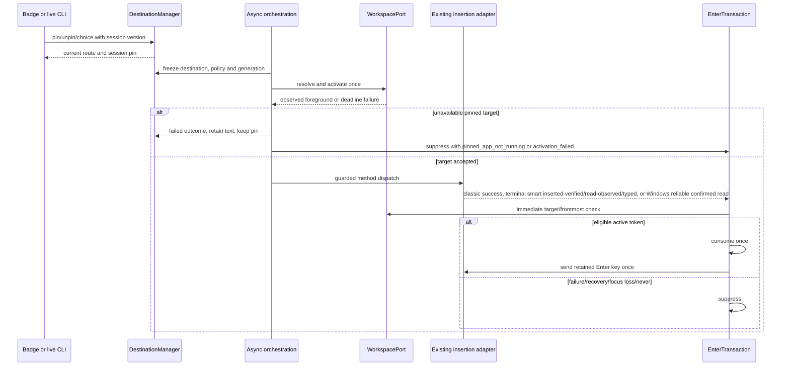
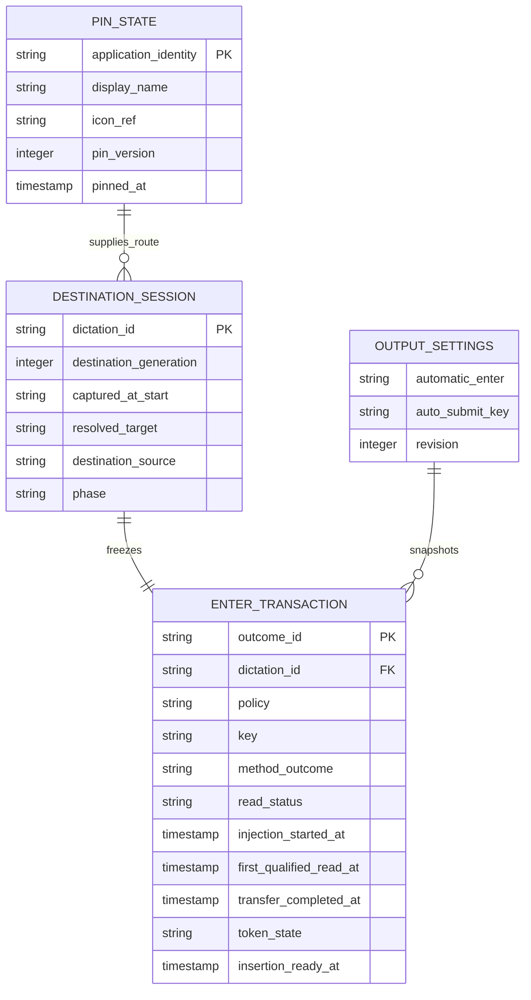

# Implementation Plan: PIN Mode and Enter Rule

## Summary

Extend the destination manager with a volatile session pin, migrate auto-submit to one persistent three-value policy, and route every classic/smart-paste/Windows-reliable Enter emission through one per-dictation guarded authority.

Inspect [the functional source](spec.md). Scope **L**, despite four FR: native focus/input, asynchronous clipboard receipts, migration and cross-feature state. Deliver after 008, 006 and 007, in the approved order 008 → 001–007 → 009 → 010. This is planning only; no application changes, native tests, mockups or certification are claimed.

Inspect 008's spec (`.specs/features/008-settings-cli/spec.md`), its implementation map (`.specs/features/008-settings-cli/implementation.md`) and the delivered `src-tauri/src/settings_service/` code as the framework reference. Use only delivered names: `descriptor::SettingDescriptor` and its `descriptor_data.rs` rows, `validation::{validate_cli, validate_ui, ValidationContext, SettingsMutation}`, `errors::{SettingsError, SettingsErrorCode, ValidationReason}`, `domains::{Domain, DomainPlan, DomainRequest, DomainChange, ChangeKind, production}`, `domains::output::{OutputDomain, OUTPUT_KEYS}`, `operations::{SettingsBackend, execute}`, `route::route`, `tauri_adapter::{write, set, edit, repair}` for UI writes (output UI commands live in `shortcut/mod.rs` as `live_settings::write`), `effects.rs` live effects behind `LiveSettings`, `settings::apply_settings_migrations` (in-memory, persisted once by `SettingsRepository::initialize` at startup) and `public::PublicSettings`. `LiveSettingsEffects` does not exist. Live CLI operations use the extension delivered by 006's Step 0 (decision D2; 006's destination plan is inspected below), with the exact names fixed in that step: `DomainPlan::Live(Box<dyn LiveOperation>)`, `LiveOperation`, `LiveCall`, `LiveAnswer`, `LiveContext`, `managed_state`, `SettingsBackend::live_context`, `PlatformCapability::Destination`, `PlatformCapabilities::check`, `ErrorReason`, `SettingsError::{unsupported_platform, with_reason}`. Keep 008's persistent revision, stable inter-process lock, private same-user IPC, early `handy settings` branch, domain registration and one renderer. No parallel store writer, transport, revision or CLI executable.

Inspect [006's destination plan](../006-destination-application/plan.md) as technical context. Extend `DestinationManager`, `DestinationSession`, `DestinationContext`, `RecoveryDisposition`, `WorkspacePort`, `InsertionPort`, `InsertionOutcome`, `HistoryPort` and `RecoveryPort`, with 006's identifiers `dictation_id`, `destination_generation` and `selection_version`; do not create a second destination manager. Destination selection (006/009), insertion method (existing), smart-paste execution/restoration (007) and recovery presentation/classification (010) retain distinct ownership. `insertion_attempted` reports method success, never verified field contents; only 007's distinct `inserted, verified` result carries its AX readback verification. Inspect [007's current smart-paste spec](../007-smart-paste/spec.md) as technical context; its superseded clipboard-window artifacts have no active authority. Inspect [006's current badge contract](../006-destination-application/spec.md) as technical context for the 2026-10-13 decisions. Inspect [010's current recovery contract](../010-recovery-bubble/spec.md) as technical context for uncertain-result suppression and recovery handoff. Reuse 008's framework names and transactions exactly; its older illustrative six-outcome summary does not override current 007/009 requirements.

## Technical Context

| Aspect | Choice | Reason |
|---|---|---|
| Native / concurrency | Rust 2021, Tauri 2.11.5, existing Tokio | Async activation worker; short thread-bound native operations |
| Frontend | React 18, TypeScript, Zustand, i18next, existing CSS/Tailwind | Native state rendered through existing badge and output settings |
| Serialization / CLI | Existing serde/serde_json and clap; 008 domain trait | Typed policy, domain operations and exact shared envelope |
| Storage | Existing AppSettings JSON for policy/key; RAM for pin and frozen transactions | Pin ends at process exit; no new SQL table |
| Native APIs | 006 macOS/Windows WorkspacePort, existing Enigo/input and paste_tx | No AppleScript or activation workaround; preserve key semantics |
| Tests | Cargo, Bun, Playwright plus real native harness/manual checks | Browser Tauri mocks cannot prove focus, Enter counts or pasteboard reads |
| Infrastructure | Existing local user app only | No cloud, credentials, network API or provisioning |

Inspect [actions/history dispatch](../../../src-tauri/src/actions.rs), [classic paste](../../../src-tauri/src/clipboard.rs), [shared reliable transaction](../../../src-tauri/src/paste_tx/mod.rs), [macOS settle](../../../src-tauri/src/paste_tx/macos.rs), [Windows settle](../../../src-tauri/src/paste_tx/windows.rs), [settings](../../../src-tauri/src/settings.rs), [native overlay](../../../src-tauri/src/overlay.rs) and [current AutoSubmit UI](../../../src/components/settings/AutoSubmit.tsx) before implementation. Currently history depends on `wav_saved`; actions queues paste on `run_on_main_thread`; classic Enter sleeps 50 ms after paste; reliable Enter belongs to platform settle/flush with a 200 ms quiet period. These facts constrain integration; they are not runtime evidence.

## Constitution Check

| Principle | Explicit pass/deviation |
|---|---|
| Preserve native/frontend boundaries | PASS: Rust owns pin, immutable context and key emission; React requests mutations/renders snapshots |
| Stack/managers derived from manifests | PASS: reuse Tauri/Tokio/serde/clap/Enigo and 006 OS ports; no new inference or cloud dependency |
| Availability differs from runtime proof | PASS: resolved versions only; native focus, capture, activation and input gates remain required |
| Changed behavior specified before code | PASS: four FR, six AC and three SC mapped; no semantic spec change during this plan |
| Meaningful tests/current sources | PASS: real destination/Enter logic, injected external ports, actual service/files/processes for integration |
| Naming/tooling | PASS: domain-owned Rust snake_case modules; new TS/Markdown kebab-case; existing files retained; Bun/ESLint/Prettier remain project authority over generic Vitest/Biome/Commander examples |
| Privacy/i18n | PASS: metadata/opaque references only in events; no transcript/window title above debug; labels/reasons through translations |

## Requirement Inventory and Scope

| Requirement | Acceptance / success measure | Steps |
|---|---|---|
| FR-001 | AC-001, AC-002, AC-006; pin lifetime/current override/captured fallback | 1, 2, 3, 6, 7 |
| FR-002 | AC-003; unavailable pin retained, no fallback, text preserved | 1, 2, 5, 7 |
| FR-003 | AC-004, AC-006; three policies, retained keys, SC-002 migration | 3, 4, 6, 7 |
| FR-004 | AC-005; SC-001 zero-or-one matrix, asynchronous guard | 1, 4, 5, 7 |

Entities are session Pin, persisted AutomaticEnter setting and per-dictation destination provenance/EnterTransaction. Interactions are badge/live CLI pin operations, output settings transaction, workspace activation and method completion/read/Enter. No HTTP endpoint; contract tables below are local DTO/CLI design. No OpenAPI file is applicable. A logical ER diagram describes new RAM entities and existing JSON fields, not database migrations.

## Design Reference

| Screen | Component breakdown | Reference/status |
|---|---|---|
| recording-indicator | DestinationBadge pin mark/name and 006 Remove destination cross; DestinationMenu Pin/Unpin entries above application list | Spec Screens; mockup deferred before spec-ship |
| output-settings | Automatic Enter policy selector; retained independent key selector; unsupported pin hint | Spec Screens; mockup deferred before spec-ship |

## Penflow Contract Inputs

Planned identities are `flow_id: pin-mode-and-enter-rule`, `screen_id: recording-indicator` and `screen_id: output-settings`. The explicit 2026-10-12 user instruction overrides immediate forward-contract/mockup generation: all program flow/screen contracts, semantic/test IDs and Pencil mockups are produced in one pass before spec-ship. Do not mint or regenerate identities during planning.

Inspect [the current semantic tree](../../../penflow/semantic-ui-tree.json) as incomplete context, presently microphone-priority only. The future primary input `penflow/code-ir.json`, expected tree and desktop native geometry are missing. Inspection returned BLOCKED/certified=false, `required_contract_artifacts_missing`. No 009 accepted Penflow history or bound approval is claimed. Do not rewrite the shared root workspace or another feature's source to make this planning gate pass.

The program design owner must later complete cumulative mappings/outcome predicates for these FR/AC, theme and visual states, native geometry, homologous references and native export; produce root ui.pen/semantic/code-ir/expected trees and design registry; run review-snapshot, dispatch the immutable snapshot and all active sources to the independent plan reviewer, retain raw JSON, assemble review-result and record plan-review Done with that bound result. Then require design-profile PASS/certified=true before UI code. Today's semantic review does not substitute for that bound review. Preserve all four procedures as required in metadata; missing inputs are not N/A.

No theme.css/theme.md exists now. Before UI work consume the one-pass theme, install/import it only if its CSS variables are absent, and use its approved tokens/geometry. A 256×50 nonactivating overlay cannot be assumed to fit a menu; Step 1 proves a dedicated nonactivating panel or approved resize without focus theft. Settings keyboard focus is local to the settings window; the badge menu remains pointer-operated per 006, without a global keyboard hook.

## Architecture Decisions

### Pin lifetime, provenance and freeze

Add `PinState {identity, display_name, icon_ref, pinned_at, pin_version}` to DestinationManager RAM. Stable macOS bundle ID and Windows AUMID/canonical executable identity follow 006, excluding Handy. No pin is persisted, exported as a setting, or restored after quit/crash/restart. Status remains pinned even when its app exits. Reopening resolves the same identity using WorkspacePort, not an old PID/display name or an automatic launch; multiple processes follow 006's validated OS activation semantics.

At each actual accepted recording start, obtain and retain `captured_at_start` even when a pin wins selection. Read frontmost before showing Handy surfaces; resolve pin precedence before selecting the captured route. Capture the fallback once, not at unpin time. A queued dictation captures when it really starts. Failed start discards tentative context; if capture cannot be obtained, keep an explicit unavailable fallback, never invent a destination. Audio/AI/processing never recaptures.

Use 006 dictation_id/selection_version/phase/destination_generation for every mutation and atomically freeze at Inserting. 009 adds `DestinationSource::Pinned` to 006's `DestinationContext.source`. Pinning while Recording/Processing sets the current route and future pin in one manager transition. Choosing another app is a current-session badge choice only; it keeps PinState and gives source `badge`, so pin_only is false. Unpin before freeze clears PinState and restores captured-at-start source `captured` for the current session, including after a badge override. Preserve 006 return-off behavior for that captured route. Unpin/repin after freeze changes only future sessions; CLI returns the truthful frozen-current/next effect, while the displayed active-session pin mark reflects frozen provenance. Duplicate same-pin/unpin-none are no-ops. Cancellation invalidates callbacks without clearing the session pin.

The 006 cross is the same current-dictation override as its `Frontmost app at the end` menu entry: until Inserting it selects FrontmostAtEnd with source `badge`, removes the current destination, displays `Frontmost app` within 200 ms and retains the session pin for following dictations. It is not Unpin. With `pin_only`, this overridden dictation sends no Enter; Always may send one only after an eligible insertion outcome and the remaining AC-005 guards. Reuse 006's nonactivating control with accessible name `Remove destination`; freeze closes the menu and rejects later cross/menu changes. Tests distinguish cross, alternate-app choice and explicit Unpin before/at/after freeze.

Badge visibility follows the rule recorded in this spec's AC-001 and Clarifications (decision 2026-10-14): 009 extends 006's single predicate `badge_visible(return_enabled, support, overlay_style)` with the session pin, so the badge is visible on a supported platform with a non-none overlay when destination return is on (006 AC-003) **or** an application is pinned; with return off and no pin it stays hidden as 006 AC-003 requires. This is the only exception to 006 AC-003, owned by 009 because AC-002 makes PIN activation independent of that setting and the badge menu is where Unpin lives. Its accessible name for a pinned route is exactly localized `Destination: <name>, pinned`; a temporary other-app route shows that current destination without falsely announcing it is pinned, while the menu still offers Unpin and Pin current destination. With overlay style none, pin operations remain CLI-only; do not create an unsolicited overlay. No pin and return off retains 006 hidden-badge behavior.

### Destination failure and conservation

Freeze a pin route independently of return_enabled; activate its identity even when return is off. Reuse 006's one-shot activation and monotonic ≤1 s deadline, including scheduling/observation; async waits and timers stay off the main thread. Run short native activation/frontmost checks through channels; no worker join, sleep or 1 s loop in run_on_main_thread. Recheck cancellation/target after any configured paste delay and immediately before first method dispatch. None/empty/cancel does not activate or emit input.

A pinned application that is not running, or that is running but does not come forward within 006's deadline, is a terminal destination failure, as AC-003 requires: no current-frontmost fallback, no app launch, no method attempt and no Enter. Keep the pin. Orchestrator decision 2026-10-14: AC-003's "pinned app unavailable" is carried by two typed reasons in `InsertionOutcome.reason`, the ones 010 presents. `pinned_app_not_running` is new in 006's reason enum (added by 009): no running instance has the pinned identity (Story 2's "pinned app closed"); 010 shows "<App> is pinned but not open". `activation_failed` is 006's existing reason, reused unchanged: an instance with the pinned identity runs but is not confirmed frontmost within the 1 s deadline or fails the final guard; 010 shows "Could not bring <App> forward". `destination_source = pinned` tells consumers that the failed route was the pin. No other subtype or free-text diagnostic exists. Extend 006's localization and consumer contract for `pinned_app_not_running`. Retain `InsertionOutcome` status failed and stable outcome_id, history_status and transcript_ref.

Use 006's native retained final-text slot and HistoryPort result; do not rely on a WAV or fabricate a history_entry_id. Test WAV disabled, save failure and saved history reread. Retention is volatile until superseded by a later final outcome, explicit consumer release or process exit; only an actual history save is durable. No new storage guarantee is added. Before 010, 006 displays the reason ≥4 s from visible presentation and retains its existing style-none limitation; when 010 acknowledges presentation its bubble replaces the indicator and inherits ≥4 s. 009 supplies reason/outcome and suppresses Enter; it does not implement the bubble. 007 owns smart-paste restoration: 010 Copy writes the transcript as new clipboard content, changing `changeCount`, so the pending restoration guard does nothing. No clipboard-window cancellation/recovery API or `clipboard_recovery_*` setting is introduced; 010 remains the recovery-presentation owner and Copy never creates Enter.

### One setting and idempotent migration

Introduce `AutomaticEnterPolicy {Never, Always, PinOnly}` with serde values `never`, `always`, `pin_only`; retain `AutoSubmitKey` and `auto_submit_key` wire values `enter`, `ctrl_enter`, `cmd_enter`. Persist the new `automatic_enter` policy in existing AppSettings. New installations default Never. On load, if valid new policy is present it wins; otherwise a missing new field maps legacy auto_submit false/missing→Never, true→Always while preserving each key. Invalid present new value is a typed validation/recovery error, never silently enabling Enter. Keep unknown keys/secrets and 008 revision continuity. In-memory reads migrate without writing (`settings::apply_settings_migrations` inside 008's `normalization::normalize`); startup persists one real migration through `SettingsRepository::initialize` under the lock and increments once. Repeated migration is a no-op; persistence failure leaves old durable generation.

Remove legacy auto_submit from runtime decisions, descriptors (`descriptor_data.rs`), `OUTPUT_KEYS` (which gains `automatic_enter` in its place), `PublicSettings`, UI, CLI help and command routing in the 009 build. Its raw old key is migration input only (`settings::apply_settings_migrations` reads it from the raw payload; the raw document keeps it as an unknown field), never a second emitter or exposed alias. **What an agent sees:** 008 resolves keys before any validation, so an unknown key is `not_found` (exit 4). `auto_submit` is therefore `not_found`/4 on `get`, `set`, `output get` and `output set`, and is absent from `keys` and `output get`. The hint is carried by D3 without changing that precedence: a retired-key table `descriptor::RETIRED_KEYS = [("auto_submit", "automatic_enter")]`, consulted by `operations::known_key` and `domains::output` only when the key is not a descriptor, returns `SettingsError::new(SettingsErrorCode::NotFound).with_reason(ErrorReason::RetiredKey)` plus `details.field = "automatic_enter"` (the replacing key) through a new constructor `SettingsError::retired_key(replacement)`; message stays the fixed `not_found` message, no key text is echoed. `ErrorReason::RetiredKey` (`"retired_key"`) is added by 009 Step 3. README and `settings-cli.md` document it. The existing `change_auto_submit_setting` UI command is retired with the bindings regeneration, not kept as a competing setting; tests scan every caller. Keep current key semantics, including platform-dependent Cmd/Super+Enter on Windows/Linux.

Snapshot policy/key with insertion context, so a later UI/CLI setting change cannot turn an outstanding smart-paste or Windows reliable transaction into a different send decision. Reuse 008's fresh typed mutation, descriptor validation, settings-changed revision and latest-response filter: a single UI change goes through `tauri_adapter::write`; a policy+key change in one UI action goes through one `tauri_adapter::edit`, one commit; no two-write inconsistent setting transition.

### Enter authorization and asynchronous receipts

New domain module `src-tauri/src/automatic_enter/` owns pure `evaluate_enter` and per-dictation `EnterTransaction`. Freeze `{dictation_id, destination_generation, outcome_id, policy, key, resolved_target, destination_source, method}` at insertion entry; the `RecoveryDisposition` is not frozen but read live from 006's `DestinationSession` at the atomic claim. resolved_target is the actual selected application identity or None for 006 FrontmostAtEnd/off/unsupported routes; captured-at-start metadata is distinct. Thus AC-005 checks the real insertion destination: no identity comparison to an unused capture in the return-off legacy route. Tests retain both fields and prove this interpretation; no Enter merely because global PinState currently exists.

The Enter veto is 006's single `RecoveryDisposition { Pending, Insert, Recover, Cancelled }` (006 plan, "DestinationContext and RecoveryDisposition"; also named in 010), held by `DestinationSession` and changed only through `DestinationManager::set_disposition` with monotonic transitions. 006 sets `Recover` on destination failures and failed method results, `Insert` immediately before the first dispatch once 010's optional `RecoveryPort::before_insertion` verdict is `Insert`, and `Cancelled` on cancellation. 009 adds no second decision type and no revocation message. Its `Pending → Consumed` transition is the single call `DestinationManager::claim_enter(dictation_id, destination_generation) -> Result<EnterClaim, EnterRefusal>` defined by 006: it reads the disposition and records the claim under the session lock of `set_disposition`, grants once when the disposition is `Insert`, and refuses `Pending`, `Recover` or `Cancelled` (`EnterRefusal::Disposition`), a stale `dictation_id`/generation (`EnterRefusal::Stale`) and a second claim (`EnterRefusal::AlreadyClaimed`); every refusal suppresses the token. A later move to `Recover` after a consumed token cannot undo the key; it only governs recovery. The earlier name `RecoverInstead` is retired in favor of `Recover`.

Eligibility is the conjunction: active generation; method not none; nonempty completed insertion; method success; disposition `Insert`; resolved target still frontmost immediately before emission when present; policy Always or PinOnly with frozen source pin. Never is always false. Consume 007's terminal `method_outcome` preserved by 006: only "inserted, verified", "insertion attempted, read observed" (`read observed`) and "typed" satisfy smart-paste success. "Not read", "permission missing", "uncertain", "clipboard handed over" and "insertion failed" always suppress Enter. Await the terminal read/fallback decision asynchronously; transaction enqueue, clipboard publication and a raw read callback alone are not terminal success. Failed smart paste routes not read/permission missing/uncertain/insertion failed to 006/010 recovery; clipboard handed over retains 007's informational outcome, without local insertion, Enter or failure recovery from that result alone. Windows reliable paste keeps its existing transfer/read and pre-transfer classic fallback contracts: classic fallback uses its own completion success; transferred reliable paste additionally requires qualifying target-read confirmation. Enqueue Ok is not confirmation; after transfer/no-read/failure never retry or create a second insertion. 007 owns the AX-first attempt for destinations outside its remote-strategy exceptions, with the focused element belonging to the destination process: reread equality to the selected-range replacement produces inserted, verified without touching the clipboard; unreadable/secure fields skip AX, and value still unchanged at the end of the 150 ms readback window falls back once regardless of the write return status; an unexpected changed value produces uncertain without fallback or retry, preventing duplicate insertion. Its permission check precedes clipboard effects. 009 preserves the publication-time not-read decision even if the retained transcript is read later; 007 discards that saved snapshot, and 010 reports possible late insertion without authorizing Enter. 009 consumes that outcome; it does not implement or redo AX writes. No macOS smart-paste failure is converted to classic success.

One atomic `Pending → Consumed` transition keyed by dictation/outcome controls every emitter. Classic method completion, the terminal macOS smart-paste result and Windows reliable worker/flush all call that authority; remove their direct send_return_key paths. Obtain native input access, evaluate final cancellation/recovery/frontmost under the current token, consume once, then invoke send_return_key once. If focus, input availability or key injection fails, record Suppressed/EmissionFailed and do not retry, even when OS delivery is unknown. Duplicate settle, a new paste flushing the old transaction, stale outcome and callback after quit/cancel cannot generate a second key. Thread-bound main-thread work is short; no lock inversion between paste state, manager, settings lock and Enigo. Copy state out before cross-port calls.

Keep macOS snapshot/publication/read/outcome/restoration entirely in 007 and Windows reliable quiet-period restoration in its existing paste_tx adapter. Smart paste publishes one terminal result for AX verification, Unicode completion or the clipboard read/no-read decision. For inserted, verified, 009 waits for the verified readback result only, with no clipboard-read or Cmd+V prerequisite. For the clipboard branch, 009 awaits its terminal result, successful method completion and chord release before claiming the token; typed waits for Unicode completion. Restoration completion is never a prerequisite for any of these three successes. A post-keystroke read while Cmd+V is held is latched by 007, but a later chord failure must produce insertion failed, never eligible read observed. Windows reliable readiness remains a rendezvous between two independently recorded signals: successful chord/transfer completion and the first qualifying target-read receipt at or after injection start. A target may read while the chord is held for about 100 ms, before send_chord returns. Latch that qualifying receipt and its timestamp immediately, even when completion is pending; exclude pre-injection reads. Record injection_started_at before sending, then completion status and transfer_completed_at from the actual chord result, not try_reliable_paste's outer Ok (which can coexist with injection_failed). Either callback order wakes the same authority once both signals exist. A receipt alone never authorizes Enter; chord failure after an early receipt, cancellation or recovery suppresses the token. Release the held chord/input access before attempting Enter. Platform settle/flush retains the same token and must not discard, relabel or independently emit from this latch.

Separate Enter readiness from clipboard restoration: preserve 007's macOS restoration only after a confirmed post-Cmd+V read, 300 ms quiet after the LAST read, capped at 8 s after the first read (Jump Desktop 1.5 s quiet); 800 ms without a read (3 s for Jump Desktop) produces not read, NEVER restores the previous clipboard for that dictation, leaves the transcript until replaced, and routes to 010; 007's 50 ms input-source switch wait and independent restoration 100 ms after the chord's last key release, and unchanged-changeCount guard; preserve Windows' 200 ms quiet period. Neither 009 nor Enter reschedules restoration. Classic reference time t0 is successful method return (including configured delays); smart-paste inserted-verified t0 is terminal outcome publication after successful AX readback equality (not AX write return), read-observed t0 is terminal successful outcome publication after read and successful chord completion/release, typed t0 is terminal successful Unicode-typing completion; Windows reliable t0 is `max(transfer_completed_at, first_qualified_read_at)` for its two latched signals; Windows classic fallback t0 is fallback return. A read during the chord therefore becomes eligible only at successful completion, and a read after success becomes eligible when it arrives. For every eligible dispatched Enter, measure the actual native key attempt within 100 ms of t0, including scheduling/input access and the immediate frontmost check. Never claim this budget for an intentionally suppressed Enter or OS text rendering. Use monotonic Clock and timestamp evidence; no 50 ms main-thread sleep. Tests exercise receipt-before-success, success-before-receipt, receipt-before-chord-failure, pre-injection read, cancellation/recovery between signals, duplicate callbacks and late settle/next-paste flush, in automated tests for both platforms; SC-001 requires exact expected 0/1 for all orders and all eight smart-paste outcomes, including inserted, verified and typed with no clipboard read, uncertain with no retry/key, and clipboard handed over with no key. Add probe-then-read timing tests: Enter is not delayed by subsequent reads, LAST-read quiet, the 8 s cap or input-source restoration; not read stays ineligible even if a late read arrives, and Copy changes changeCount so 007 abandons pending restoration without another outcome or Enter.

007's inserted-verified outcome alone proves its field readback matched the expected replacement; its read-observed outcome proves post-keystroke pasteboard consumption, not field contents or reader process identity; 009 consumes that exact outcome without adding an unsupported PID-attribution contract. Step 1 tests pre-keystroke/third-party reads and actual target text separately, retaining 007's native compatibility limitations. For Windows reliable paste, establish whether the platform receipt plus foreground/transfer context satisfies the retained target-read confirmation; an unconfirmed Windows path sends no Enter; its native confirmation is pending release evidence that blocks only the Windows release (D1). A cooperative native field proves its tested scenario, not all applications.

The final focus check cannot atomically bind OS input consumption to a process. Document the residual switch-after-check race; no second activation to force Enter and no retry after uncertainty. Existing external script/direct/clipboard methods outside smart paste retain their existing success contract; they do not verify target text, and partial typing cannot be retracted. Native fixtures compare actual received text/key count separately from method-return evidence.

### CLI domain and local contract

Register a `destination` domain in `settings_service/domains/destination.rs` (`DestinationDomain`, added to `domains::production()`) and extend the existing output domain; no new IPC or renderer. The three destination actions are D2 live operations: `DestinationDomain::plan` is pure and returns `DomainPlan::Live(Box::new(PinOperation { target }))`, `DomainPlan::Live(Box::new(UnpinOperation))` or `DomainPlan::Live(Box::new(StatusOperation))`; each `run` obtains the manager with `managed_state::<Arc<DestinationManager>>(context)` inside the running instance and answers `LiveAnswer::Read(data)` at the current persisted revision. Pin state is volatile: these operations never call `context.commit_change`, never advance the settings revision and never persist the pin. Pin mutations are serialized by `DestinationManager` with session/pin versions; an expected persistent revision is not a pin-version token. With `--dry-run`, `pin`/`unpin` report the effect they would have without changing the manager. Persistent policy/key writes use the output domain's `DomainPlan::Change` (`ChangeKind::Scalar`), the shared validator and 008's commit path, no-op/CAS and effects. Generic settings commands reject volatile pin fields (they are not descriptors: `not_found`).

Error precedence, decided in this order so it is identical offline and routed:

1. Syntax and action: `usage_error`/2 (clap and `domains::execute`).
2. Platform: the pure `plan` calls `request.platform.check(Some(PlatformCapability::Destination), None)`; on a build without destination support (Linux) `pin`, `unpin` and `status` return `SettingsError::unsupported_platform(None)`: `validation_failed`/2, `details.reason = "unsupported_platform"` (D4), with or without a running instance. Never `unavailable`/5.
3. Liveness: without a running instance the `Live` plan returns the delivered live-only refusal: `unavailable`/5, empty details.
4. Lookup inside the instance: an identifier that is not a running non-Handy application, or `current` with no application, is `not_found`/4; nothing changes.

| Command under `handy settings` | Data / effect | Error / exit |
|---|---|---|
| `destination pin <identifier>` | Resolve running non-Handy stable ID; apply pin now before freeze, otherwise next; return pin and current-session effect | platform 2 → no instance 5 → absent ID/not running/Handy 4; no mutation |
| `destination pin current` | Recording/processing: current effective application destination; idle: frontmost non-Handy app | same precedence; never arbitrary name/PID or launch |
| `destination unpin` | Clear pin, restore captured current route before freeze; return state; no-op allowed | platform 2 → no instance 5; no persistent write |
| `destination status` | pinned identity/name or null, current route/source/phase, support | platform 2 → no instance 5, even when status would be null |
| `output get [automatic_enter\|auto_submit_key]` | Public descriptor values and persisted revision | Read-only, live or offline; no file creation |
| `output set automatic_enter never\|always\|pin_only` | Shared exact enum validation and commit | Invalid → `validation_failed`/2 (`canonical_value`) |
| `output set auto_submit_key enter\|ctrl_enter\|cmd_enter` | Existing key validation/semantics and commit | Invalid → `validation_failed`/2 |
| `get\|set auto_submit`, `output get\|set auto_submit` | Retired key | `not_found`/4 with `details.reason = "retired_key"` and `details.field = "automatic_enter"` |

007 already extends the same 008 `settings_service/domains/output.rs` and descriptors with `paste_method=smart_paste`; 009 consumes it rather than registering a second method/key or using retired clipboard-window settings. `output get paste_method` / `output set paste_method smart_paste` retain 007 validation (macOS only, `validation_failed`/2 elsewhere), revision/commit path and the single 008 renderer. Windows reliable_paste and Linux existing methods remain unchanged.

Handy never becomes a target. Current while idle in a terminal pins that terminal; document explicitly for script/hotkey users. A running current session with FrontmostAtEnd resolves its current non-Handy foreground at the pin request, with captured fallback unchanged.

Always/Never work on Linux with existing insertion; pin_only remains offered/persistable with an explanatory localized hint that unsupported PIN cannot activate it. Pin UI entries are absent there; no silently rewritten policy. Output setting works offline; all three destination operations are live-only and cannot launch Handy or fall back offline. Shared envelope is exactly `{ok:true,revision:N,data:...}` or `{ok:false,error:{code,message,details:{...}}}` and one newline; diagnostics stderr. Reuse exits 0 success, 1 persistence/internal, 2 usage/validation, 3 revision_conflict, 4 not_found, 5 unavailable; timeout exposes outcome unknown with no blind retry. Reread live status/value before resubmission. No key injection or app activation occurs as a side effect of pin/status itself.

## Gherkin Scenarios and Sequence Diagrams

```gherkin
Feature: Pin selection and asynchronous insertion
  Scenario: Pin and temporary override
    Given ChatGPT is pinned and a dictation captures Safari at start
    When the badge selects Comet for this dictation
    Then the current destination source is badge and the pin stays ChatGPT
    And pin_only sends no Enter for this dictation
  Scenario: Unpin before insertion
    Given a dictation captured Safari and selected pinned ChatGPT
    When unpin is accepted before insertion freezes
    Then the captured Safari route is restored with source captured
    And the next dictation captures its own frontmost application
  Scenario: Remove current destination while pinned
    Given ChatGPT is pinned and automatic Enter is pin_only
    When the user clicks the Remove destination cross before insertion
    Then the current route is Frontmost app at the end with source badge
    And no Enter is sent for this dictation
    And following dictations still use the ChatGPT pin
  Scenario: Pinned application unavailable
    Given ChatGPT is pinned and final text exists without a saved WAV
    When ChatGPT is not running at insertion time
    Then no method or Enter is dispatched and the pin stays ChatGPT
    And the 006 retained transcript has reason pinned_app_not_running
  Scenario: Pinned application running but not brought forward
    Given ChatGPT is pinned and running
    When it cannot be activated within 1 second
    Then no method or Enter is dispatched and the pin stays ChatGPT
    And the 006 retained transcript has reason activation_failed with source pinned
```



```gherkin
Feature: Shared output mutation and live-only pin
  Scenario: Policy update
    Given current revision is 12 and automatic_enter is never
    When output sets automatic_enter to pin_only with expected revision 12
    Then the shared transaction commits revision 13 before confirmation
    And the next insertion snapshots pin_only
  Scenario: Unavailable instance and invalid policy
    Given a macOS build and Handy is not running
    When destination status is requested with JSON
    Then unavailable returns exit 5 with empty details and one error envelope
    When output sets automatic_enter to sometimes
    Then validation_failed with canonical_value is returned and no revision changes
  Scenario: Unsupported platform precedes liveness
    Given a Linux build, with or without a running Handy
    When destination pin current is requested with JSON
    Then validation_failed returns exit 2 with details.reason "unsupported_platform"
  Scenario: Retired auto_submit key
    Given a 009 build
    When an agent runs handy settings set auto_submit true --json
    Then not_found returns exit 4 with details.reason "retired_key" and details.field "automatic_enter"
    And nothing is written and the key text is not echoed
```

```mermaid
sequenceDiagram
  participant CLI
  participant Router as 008 private routing
  participant Domain as Registered domain
  participant Service as 008 transaction service
  participant Manager as DestinationManager
  CLI->>Router: typed domain OperationRequest
  Router->>Domain: pure plan with platform capabilities
  alt destination unsupported on this build
    Domain-->>CLI: validation_failed exit 2, unsupported_platform
  else live destination operation (DomainPlan::Live)
    Router->>Domain: instance only; offline gives unavailable exit 5
    Domain->>Manager: LiveOperation run via managed_state
    Manager-->>CLI: state plus unchanged persisted revision
  else persistent output setting
    Router->>Domain: live or protected offline route
    Domain->>Service: SettingsMutation with expected revision
    Service-->>CLI: normalized value and committed revision or typed error
  end
```

## Gherkin Scenarios and State Diagram

```gherkin
Feature: Pin lifetime and one Enter authority
  Scenario: App restart does not clear pin
    Given the session pin is ChatGPT
    When ChatGPT closes and reopens with a new PID
    Then the pin identity stays and following dictations resolve the running app
    When Handy exits and restarts
    Then no pin is restored
  Scenario: Duplicate asynchronous completions
    Given an eligible smart-paste terminal result or Windows reliable confirmed read
    When receipt, settle and next-paste flush each notify completion
    Then the transaction emits at most one Enter
  Scenario: Verified AX insertion has no clipboard prerequisite
    Given automatic Enter is Always with a frontmost eligible destination
    When 007 publishes inserted, verified after the field equals its expected replacement
    Then exactly one Enter is attempted within 100 milliseconds of that outcome
    And neither a clipboard read nor clipboard restoration is awaited
  Scenario: Unexpected AX change is uncertain
    Given 007's AX write changes the field to an unexpected value
    When 007 publishes uncertain
    Then no clipboard fallback, duplicate insertion or Enter is attempted
    And the outcome reaches 010 recovery with possible partial insertion
  Scenario: No read never becomes a restoration success
    Given the clipboard branch has no post-keystroke read within 800 milliseconds
    When 007 publishes not read and a later read or settle callback arrives
    Then Enter remains suppressed and no previous clipboard restoration occurs
    And 010 receives the failure while the transcript stays until replaced
  Scenario: No acknowledgement or late recovery
    Given smart paste reports not read or a Windows transfer has no qualifying target read or recovery replaces insertion
    When a settle callback runs
    Then Enter stays suppressed
  Scenario: Target reads while the chord is held
    Given a smart-paste or Windows reliable transaction has started injection
    When a qualifying read arrives before send_chord returns successfully
    Then the receipt is latched and no Enter is sent yet
    When send_chord succeeds and releases the input chord
    Then readiness starts at the later completion timestamp
    And one eligible Enter is attempted within 100 milliseconds
  Scenario: Chord fails after an early read
    Given a qualifying receipt was latched while the chord was held
    When send_chord reports failure or the dictation is cancelled
    Then Enter is suppressed even if the outer adapter returns Ok
  Scenario Outline: All smart-paste terminal outcomes
    Given automatic Enter is Always with an active frontmost destination and no recovery
    When smart paste reports <outcome>
    Then the Enter count is <count>
    Examples:
      | outcome                          | count |
      | inserted, verified               | 1     |
      | insertion attempted, read observed | 1   |
      | typed                            | 1     |
      | not read                         | 0     |
      | permission missing               | 0     |
      | uncertain                        | 0     |
      | clipboard handed over            | 0     |
      | insertion failed                 | 0     |
```



```mermaid
stateDiagram-v2
  state PinLifecycle {
    [*] --> Unpinned
    Unpinned --> PinnedAvailable: explicit pin
    PinnedAvailable --> PinnedUnavailable: app exits or activation fails
    PinnedUnavailable --> PinnedAvailable: same identity running again
    PinnedAvailable --> Unpinned: unpin or Handy exit
    PinnedUnavailable --> Unpinned: unpin or Handy exit
  }
  state EnterLifecycle {
    [*] --> Frozen
    Frozen --> WaitingSignals: smart paste or Windows reliable starts
    Frozen --> Eligible: classic method success
    WaitingSignals --> WaitingSignals: latch qualifying read or success in either order
    WaitingSignals --> Eligible: terminal smart inserted-verified, read-observed or typed, or Windows success and read; input released
    Frozen --> Suppressed: error none cancel never or recovery
    WaitingSignals --> Suppressed: not read permission missing uncertain handover failure cancel focus loss or recovery
    Eligible --> Suppressed: final guard failed
    Eligible --> Consumed: guard passed and claim_enter granted
    Consumed --> Sent: one key attempt succeeded
    Consumed --> EmissionFailed: native error or unknown delivery
    Sent --> [*]
    EmissionFailed --> [*]
    Suppressed --> [*]
  }
```

## Data Model

Logical entities only; no new SQL tables or joins, no persisted pin.



## Implementation Plan

### Step 1 — Prove native surface, capture and receipt feasibility

**Prerequisite:** Independent semantic plan review complete+ready; implement progression and deferred program design gates resolved before UI production.
**Required inputs:** Existing overlay/workspace/paste_tx, 006/008 delivered interfaces, native test field and safe private fixtures.
**Action:** Extend planned `src-tauri/tests/destination_platform.rs` with pin capture/unpin/no-focus cases; new `src-tauri/tests/enter_platform.rs` and `scripts/pin-enter-native-proof.ts` spike all three eligible smart-paste outcomes, AX verified readback/unchanged-after-readback fallback regardless of write return/uncertain no-fallback, clipboard probe/read ordering and no-read non-restoration, Windows reliable receipt attribution, key timing and focus switches. Reuse 006 nonactivating menu surface; no production pin wiring yet. Prove capture fallback while pinned, return-off badge, pointer menu and keyboard settings separately. Measure UI heartbeat during ≤1 s activation and pending reads, real key counts and foreground traces on macOS. Windows code paths build and pass their automated tests; the Windows native run (receipt attribution, key timing, focus) is pending release evidence with the exact check of Step 7 (D1).
**FR covered:** FR-001.1: Capture and surface feasibility, FR-002.1: Activation failure feasibility, FR-004.1: Receipt and Enter feasibility
**Execution evidence:** Binary/OS/app hashes, focus/heartbeat/receipt/key timestamps, native observer attribution notes and geometry export after the later design pass.
**Success criteria:** On macOS: no menu focus theft or activation wait freeze; fallback captured once; eligible Enter ≤100 ms; only terminal inserted-verified/read-observed/typed consumed, third-party-read limitations explicit. Windows: automated tests pass; until its native run, an unconfirmed Windows reliable path sends no Enter.
**Failure handling:** A macOS native feasibility failure blocks Step 2; a Windows native failure blocks only the Windows release (D1). Do not infer terminal smart-paste success, verified field content or Windows target attribution from browser callbacks or a raw observer read.

### Step 2 — Extend destination manager with session pin

**Prerequisite:** Step 1 viable macOS capture/surface mechanics; 006 DestinationManager, `DestinationContext` and `RecoveryDisposition` delivered.
**Required inputs:** session phases/versions, WorkspacePort identities, capture fallback and outcome/recovery contracts.
**Action:** New `src-tauri/src/destination/pin.rs`; modify `destination/{mod.rs,session.rs,workspace.rs,outcome.rs}`, `actions.rs` and `transcription_coordinator.rs` to add PinState, frozen source pin, saved captured_at_start, atomic current/future transitions and the typed reason `pinned_app_not_running` (closed pin; a running pin not brought forward keeps `activation_failed`). Reuse native adapters; register no second manager. Inline unit tests and new `src-tauri/tests/pin_destination.rs` test real manager through fake workspace/clock/output ports, including the current-only cross override while a pin remains active.
**FR covered:** FR-001.2: Volatile pin and frozen provenance, FR-002.2: Retained unavailable pin
**Execution evidence:** Transition matrix including before/at/after freeze, queued actual starts, cancellation, restart identity, no pin serialization.
**Success criteria:** Pin wins despite return off; override affects current only; unpin restores capture with source captured; unavailable never falls back or clears pin; restart Handy resets it.
**Failure handling:** Lost fallback, stale mutation or wrong application dispatch is P0; block downstream wiring until repaired.

### Step 3 — Migrate settings and register CLI domains

**Prerequisite:** 008 delivered service/domain framework, 006 Step 0 (live operations, platform capability, `ErrorReason`) delivered, and Step 2 typed manager commands.
**Required inputs:** Raw legacy/new settings, descriptors/validators, private live routing and output renderer.
**Action:** Modify `settings.rs` (`AutomaticEnterPolicy`, `automatic_enter` field, migration in `apply_settings_migrations`), `settings_service/{descriptor_data.rs,descriptor.rs (RETIRED_KEYS),operations.rs (known_key),errors.rs (ErrorReason::RetiredKey, SettingsError::retired_key),public.rs,domains/mod.rs (production registry),domains/output.rs (OUTPUT_KEYS with automatic_enter instead of auto_submit)}`; new `settings_service/domains/destination.rs` (`DestinationDomain`, `PinOperation`, `UnpinOperation`, `StatusOperation` as D2 live operations, platform check first). Output policy/key get/set sit alongside 007's existing smart_paste descriptor (no clipboard_recovery_* key), volatile projection and no-op/CAS rules. Modify `commands/destination.rs` (006 badge commands gain pin/unpin), `shortcut/mod.rs` (`change_automatic_enter_setting` via `live_settings::write`, policy+key batch via `tauri_adapter::edit`, `change_auto_submit_setting` retired), `commands/mod.rs`, `lib.rs`; regenerate bindings.ts and the checked schema file `.specs/features/008-settings-cli/contracts/settings-cli.schema.json` through the supported generators only during implementation; update `settings-cli.md`. New `src-tauri/tests/{pin_enter_cli.rs,automatic_enter_migration.rs}` use real production service and isolated stores/process channels. Update application README during implementation for commands and current-terminal/unknown-outcome caveat.
**FR covered:** FR-001.3: Live pin domain and UI parity, FR-003.1: Policy migration and descriptors
**Execution evidence:** Each legacy bool × key migration, new/old precedence, no-op/read hashes, failure/CAS/concurrency transcripts, JSON/exit fixtures and binding caller inventory.
**Success criteria:** One canonical setting/emitter source; unknown fields preserved; reads do not write; pin never increments persistent revision; absent instance/unsupported/lookup precedence exact.
**Failure handling:** Independent writer, bool writable shadow, false success or secret/text stdout blocks CLI/UI exposure; persistence/timeout outcome stays truthful with no blind retry.

### Step 4 — Centralize pure Enter policy and token

**Prerequisite:** Stable frozen destination/outcome and new policy types; all old emitter call sites inventoried.
**Required inputs:** Exact AC-005 conjunction, monotonic Clock, native KeyEmitter, workspace/recovery/cancel ports.
**Action:** New `src-tauri/src/automatic_enter/{mod.rs,policy.rs,transaction.rs}` implement evaluate_enter, immutable context, one atomic claim through 006's `DestinationManager::claim_enter`, all eight terminal smart-paste outcomes (three eligible, five suppressed), verified-AX readiness without clipboard/chord prerequisites, uncertain suppression, the Windows independently latched success/read rendezvous and timestamps; expose crate-local API in lib.rs. Inline table/property-style exhaustive tests cover all option × source × outcome branches, false predicates individually and combined, all keys and duplicate concurrent callbacks. New `src-tauri/tests/enter_gate.rs` tests real state with output spies only, not a mock gate; include read-before-success, success-before-read, chord-failure-after-read and cancel/recovery between signals.
**FR covered:** FR-003.2: Retained policy and key semantics, FR-004.2: Guarded zero-or-one authority
**Execution evidence:** Independent expected decision matrix, claim-race barriers, ready-at/send-at timestamps and failure reason assertions.
**Success criteria:** Exactly expected 0/1 for 100% of enumerated matrix (SC-001); stale/cancel/recovery/not read/permission missing/uncertain/clipboard handed over/insertion failed/none/focus/never prevent key; inserted, verified and typed need no clipboard receipt; source badge/captured never qualifies pin_only.
**Failure handling:** Any extra/missing eligible key or mutable global pin/settings dependency is P0; repair before platform emitters migrate.

### Step 5 — Integrate methods and preserve transcripts

**Prerequisite:** Steps 2–4 PASS; native spike validates allowed receipt/dispatch paths.
**Required inputs:** Existing clipboard/input and platform paste_tx, 006 outcome producer, 007 terminal outcome/restore ownership, optional 010 recovery decision.
**Action:** Modify `clipboard.rs`, `paste_tx/{mod.rs,macos.rs,windows.rs}`, `actions.rs` and `destination/outcome.rs` to pass frozen EnterTransaction, replace every direct auto-submit call, emit readiness at classic return, terminal smart-paste inserted-verified/read-observed/typed, or the Windows reliable qualified success/read rendezvous; await 007's branch-specific terminal outcome without blocking UI and keep restore ownership/timings independent (LAST-read quiet, read-required restoration, no-read transcript retention, 8 s cap). Do not repeat AX insertion or fall back on uncertain; forward it to 010 and suppress Enter. Preserve Windows classic pre-transfer fallback and other configured method semantics. Use 006 async worker/brief main-thread calls, not a 1 s wait or 50 ms sleep in main callback. Preserve outcome/transcript when WAV/save fails; handoff reason to 006/010 without clipboard policy changes. New `src-tauri/tests/enter_insertion.rs` exercises real adapter completion/flush/cancel/restore ordering.
**FR covered:** FR-002.3: Failure conservation and no fallback, FR-004.3: One Enter authority across method outcomes
**Execution evidence:** Remaining-emitter scan, actual path tests in the automated suites of both OSes and on native macOS, fallback/no-read/third-party-read/partial-failure matrix, saved-history reread and RAM lifetime evidence; Windows native path listed as pending release evidence.
**Success criteria:** No competing key path; never Enter before classic success, terminal smart inserted-verified/read-observed/typed or Windows reliable confirmation; eligible key within 100 ms of defined t0; restoration stays 007-owned; generation/recovery guards hold at final dispatch.
**Failure handling:** Unknown key delivery consumes token without retry; missing eligible terminal smart outcome or Windows target read/focus evidence suppresses key and blocks corresponding release proof; partial text is reported truthfully.

### Step 6 — Deliver badge and one accessible settings control

**Prerequisite:** Program one-pass Penflow/code-ir/theme, bound review and design-profile certificate; native nonactivating surface spike PASS; backend commands stable.
**Required inputs:** Planned flow/screen IDs, cumulative approved semantic/test IDs, generated bindings and revisioned snapshots.
**Action:** Modify 006 `src/overlay/{destination-badge.tsx,destination-menu.tsx,destination-state.ts}`, existing RecordingOverlay.tsx/CSS and overlay.rs for pin mark/entries/return-off visibility and reuse of 006's Remove destination cross as a current-only override, never Unpin; new `src/components/settings/automatic-enter.tsx` replaces AutoSubmit.tsx at every import. Modify settingsStore.ts/useSettings.ts and en/fr translations, reconcile locales through existing translation checks. Add policy and key controls with existing Dropdown/SettingContainer, Tab order, visible focus and announcements. New `src/overlay/pin-state.test.ts`, `src/components/settings/automatic-enter-state.test.ts` and `tests/pin-enter-ui.spec.ts` follow actual tests directory. Narrow Tauri capability only if reused surface/command needs it.
**FR covered:** FR-001.4: Badge pin entries and accessible name, FR-003.3: One policy and retained key UI
**Execution evidence:** Current approved IDs/IR + UI snapshots, keyboard/a11y assertions, stale-event/version tests and real native focus timeline.
**Success criteria:** Pin/Unpin above list; no duplicate legacy control; exact pinned accessible name; selection saved/announced, selectors focus in reading order; none/unsupported behavior exact.
**Failure handling:** Missing design proof blocks UI code; focus theft/hidden active pin/duplicate control or inaccurate pinned route label blocks release.

### Step 7 — Prove acceptance and neighboring regressions

**Prerequisite:** Steps 1–6 PASS; macOS release binary available; Windows and Linux builds compile and pass their automated tests.
**Required inputs:** Independent AC/FR/SC inventory, safe test phrases, private settings, native transcript/key observer.
**Action:** Run resolved commands and the macOS native harness below; capture ChatGPT five consecutive dictations from three other apps (SC-003), Comet/Notes quit/reopen, none/off, all keys/options/methods, multiple windows/Spaces, temp override/unpin timing and CLI parity. Record the pending release evidence list with exact checks: (a) Windows: `bun scripts/pin-enter-native-proof.ts --binary <absolute-windows-release-binary> --platform windows --out <proof-directory>` covering pin activation, reliable-paste target-read confirmation and Enter count, menu without activation; (b) Linux: `handy settings destination status --json` returns `validation_failed`/2 with `details.reason = "unsupported_platform"`, Always/Never insert as today and `pin_only` sends no Enter; (c) an older Handy binary with legacy `auto_submit` true upgrades to `automatic_enter = always` with its key kept. Test a 010 `Recover` verdict and stale delivery through the injected `RecoveryPort::before_insertion` before 010 ships; rerun actual 010 bubble/Copy integration after delivery. Keep 007 restore policy untouched. Attach actual assertion matrix/timing/focus/history evidence to spec-test; no program code/commit from this plan.
**FR covered:** FR-001.5: Pin route native acceptance, FR-002.4: Unavailable preservation acceptance, FR-003.4: Migration UI CLI acceptance, FR-004.4: Native matrix and timing proof
**Execution evidence:** Build hash, commands/exits/raw test reports, per-app text and native Enter counts, every timing sample, screenshots/export and AC/SC matrix.
**Success criteria:** Every AC/SC has sufficient zero-failure macOS native or automated evidence; every eligible key meets ≤100 ms on macOS; five dictations reach pinned ChatGPT; Windows/Linux/older-binary observations listed as pending, never claimed; no false history/read certification.
**Failure handling:** A macOS failure blocks the step; pending Windows/Linux/older-binary evidence blocks only the corresponding release (D1), never feature completion on the integration branch or the merge into `dev`; missing 010 integration is rerun when 010 ships. No tool version, browser mock or method-return assertion substitutes for native behavior.

## Resolved Test Commands

Cargo/Bun availability and manifest scripts rechecked 2026-10-13; other tool versions retain the 2026-10-12 observation; no application tests/builds run by this planning command. No surfaces.yaml exists; Playwright testDir is `tests`, Rust integration target directory is `src-tauri/tests`. Proposed targets/harness below do not exist yet.

| Action | Command | Tool / availability |
|---|---|---|
| Rust units | `cargo test --manifest-path src-tauri/Cargo.toml --lib automatic_enter`; `cargo test --manifest-path src-tauri/Cargo.toml --lib destination` | Cargo/rustc 1.94.0 available; tests planned |
| Pin and gate integration | `cargo test --manifest-path src-tauri/Cargo.toml --test pin_destination --test enter_gate --test enter_insertion` | Cargo available; targets planned/native build unverified |
| Migration and CLI | `cargo test --manifest-path src-tauri/Cargo.toml --test automatic_enter_migration --test pin_enter_cli` | Same real 008 service/IPC; planned |
| Native adapters | `cargo test --manifest-path src-tauri/Cargo.toml --test destination_platform --test enter_platform` | Planned; execute on macOS and Windows |
| Full Rust | `cargo test --manifest-path src-tauri/Cargo.toml` | Resolved, not executed |
| Frontend state | `bun test src/overlay/pin-state.test.ts src/components/settings/automatic-enter-state.test.ts`; `bun run test:keyboard` | Bun 1.3.9 available; state tests planned, keyboard script existing |
| Browser/UI/visual | `bun run test:playwright -- tests/pin-enter-ui.spec.ts` | Local playwright binary absent; TOOL NEEDED `bun install`, then `bunx playwright install chromium`; no visual baseline yet |
| Native proof/manual | `bun scripts/pin-enter-native-proof.ts --binary <absolute-release-binary> --platform <macos\|windows> --out <proof-directory>` | Bun available; proposed harness, manual observations required |
| Type/build | `bunx --no-install tsc --noEmit`; `bun run build`; `cargo check --manifest-path src-tauri/Cargo.toml` | Local tsc absent; install pinned ~5.6.3 deps; native SDK/model prerequisites remain unverified |
| Lint | `bun run lint`; `cargo clippy --manifest-path src-tauri/Cargo.toml --all-targets -- -D warnings` | Local eslint absent; clippy 0.1.94 available |
| Format | `bun run format:check`; `cargo fmt --manifest-path src-tauri/Cargo.toml -- --check` | Frontend deps absent; rustfmt 1.8.0 available |
| Translations | `bun run check:translations` | Existing script; run after locale changes |
| Full acceptance | Rust + state/keyboard + UI + type/lint/format/translations + macOS/Windows native evidence + Linux non-PIN regression | Future composite gate; no runtime PASS claimed |

## Testing Strategy

| Priority/level | Concrete planned file and assertions | FR/AC/SC |
|---|---|---|
| P0 unit/integration | pin.rs / pin_destination.rs: capture even pinned, current/future pin, temp override and cross (current-only, pin retained), unpin before/freeze/after, quit/reopen/Handy exclusion, return off/none/queued start | FR-001/002; AC-001, AC-002, AC-003 |
| P0 pure gate/race | policy.rs / transaction.rs / enter_gate.rs: full option × frozen source × all eight smart outcomes / Windows reliable outcomes × key matrix; falsify each predicate, duplicate concurrent receipt/settle/flush, stale token, input failure | FR-004; AC-005; SC-001 |
| P0 real method boundary | enter_insertion.rs: classic/direct/script success/failure/partial, smart AX equality with untouched clipboard and zero read prerequisite, unchanged AX value at 150 ms falling back once even after successful write return, foreign-process focused element excluded from AX, unexpected AX value producing uncertain without fallback/key, none, reliable transfer/read/no-read/fallback/error/cancel, read-before-success and success-before-read rendezvous, chord failure after receipt despite outer Ok, pre-injection/observer read, cancel/recovery between signals, focus switch before Enter, no duplicate classic + smart result + settle; typed without read, probe then read resets LAST-read quiet without delaying Enter, read-required restoration capped at 8 s, no read at 800 ms never restores or authorizes Enter (late read included), Jump Desktop timing variant, handover without Enter/recovery, not read/permission missing/uncertain/insertion failed recovery, Copy changeCount during pending restore | FR-004; AC-005; SC-001 |
| P0 migration/file | automatic_enter_migration.rs: 2 bool × 3 key combos, missing/new fields, new precedence/invalid, unknown fields/secrets, repeated migration/no-op, startup failure/CAS/races against genuine 008 service | FR-003; AC-004; SC-002 |
| P0 real CLI | pin_enter_cli.rs: live/current/identifier/status/null/unpin, precedence usage → unsupported_platform (2, injected `PlatformCapabilities::only(&[])`, offline and routed) → no instance (5, empty details) → not_found/Handy (4), invalid enums, retired `auto_submit` (4, `retired_key`, field `automatic_enter`) on get/set/output, one JSON envelope, codes/revisions/no persisted pin, UI parity | FR-001/003; AC-004, AC-006 |
| P0 conservation | pin_destination.rs + enter_insertion.rs: closed/timeout and WAV off/save error/saved; actual history reread, retained native ref, no fallback, pin stays, 006 reason ≥4 s and later 010 ack | FR-002/004; AC-003, AC-005 |
| P1 frontend/visual | pin-state.test.ts / automatic-enter-state.test.ts / pin-enter-ui.spec.ts: every menu entry/current mark/name/pin label, return-off/none/unsupported, keyboard/Tab/announcement, selector values, duplicate control absence | FR-001/003; AC-001, AC-004; Behavioral AC |
| P1 native acceptance (macOS) | destination_platform.rs / enter_platform.rs / pin-enter-native-proof.ts: real focus/read/key count, five ChatGPT dictations from three other apps, Comet/Notes restart, menu no activation, heartbeat | FR-001–004; AC-001–006; SC-003 |
| Pending release evidence (Windows, Linux, older binary) | Windows restricted activation, reliable-paste read confirmation and Enter count; Linux unsupported refusal and Always/Never; legacy-binary upgrade; automated tests on every target are required, the native runs are not step gates (D1) | AC-001–006; platform release only |
| P1 latency/regression/privacy | same native harness: each t0→key ≤100 ms, activation ≤1 s, old methods/keys/delays/clipboard policy, no text/title non-debug logs, Linux Always/Never/pin_only, smart_paste macOS-only CLI validation through the genuine 008 output descriptor, 010 Copy changes changeCount so 007 skips restoration and creates no key | FR-002–004; AC-004, AC-005, AC-006; QE expectations |

Inject WorkspacePort (frontmost/enumeration/activation/identity), Clock (deadlines/ready/send), KeyEmitter, InsertionPort/ClipboardPort (method/read/restore effects), HistoryPort and RecoveryPort; real manager/policy/migration/service logic is never mocked. Audio enumeration uses its owning AudioDeviceCatalog seam; AX write/readback belongs to 007's injected direct-insertion port and AX classification to 010's classifier seam and LLM completions to the existing post-process client seam. 009 does not add calls to these three owners; pipeline tests inject completions/failures to prove pin remains stable through audio/AX/recovery/LLM delay. Use barriers/callbacks/deadlines, not arbitrary sleeps. Real file/channel/process integration uses private stores and native fixtures, never the production user store.

Native proof records binary SHA/OS/app versions, method/policy/key and return/overlay style, frozen source and target/capture, actual activation/frontmost timeline, transfer/read provenance, t0 and key-attempt timestamp/result/count, event-loop heartbeat, actual received text (safe fixtures), history_status/ref lifetime and reason visible start/end. Manually observe app switching, multiple windows/Spaces, menu focus and settings screen-reader behavior on macOS; the same observations on Windows are pending release evidence. Clipboard/read receipts, method completion and actual field contents are three distinct evidence levels. Windows proof cannot be inferred from macOS, and Linux has no PIN support claim.

## QE Analysis

Criticality **High**; blast radius **Shared** (pin and Enter policy apply to every dictation and are exposed through the settings CLI); primary risk **Functional** (wrong or duplicate Enter, text sent to the wrong application), with privacy leakage as its consequence; this is the classification of the spec's `## Quality Engineering` section read by `livespec delivery lane` (full lane through High criticality); confidence **Medium in planned logic, low in native receipt/focus proof**. Consider functional correctness, regression, contract compatibility, data/migration/conservation, privacy/security, performance, accessibility/UX and observability.

| Gate | Owner/evidence | Gap and blocking rule |
|---|---|---|
| Plan quality | Planner/independent reviewer: current raw semantic receipt + structural/Analyze/progression | Documentation only; bound Penflow review remains later program gate |
| Native feasibility P0 | Native implementer: Step 1 macOS smart terminal outcomes, foreground/menu/heartbeat traces; Windows automated tests | A macOS missing terminal result or UI freeze blocks Step 2; Windows reader attribution is pending release evidence, and an unconfirmed Windows path sends no Enter (D1) |
| Enter safety P0 | Implementer then spec-test: matrix, token race, final guard, every emitter inventory | Any duplicate/unauthorized key blocks release; method success is not text verification |
| Migration/contract P0 | Real 008 service/process tests, raw generations, UI parity and CLI exits | Shadow bool/store writer/CAS loss/false revision blocks delivery |
| Conservation P0 | History matrix + volatile retention and 006/010 handoff proof | WAV/save absence never called durable saved history |
| UI/visual P1 | Program design owner: cumulative planned IDs, code-ir, bound snapshot/result, design certification; spec-test runtime | Current Penflow incomplete; no UI code before program design gate |
| Native timing/a11y P1 | Platform operator: all t0 samples ≤100 ms including AX-readback-ready, no clipboard prerequisite for verified AX/typed, uncertain/no-read zero-key evidence, activation ≤1 s, native focus/key/screenshots and keyboard announcement | A missed macOS budget or focus theft blocks the step; non-macOS observations pending release evidence block only their release |
| Evidence integrity | Verifier: actual build-bound acceptance matrix/transcripts | Planned commands/tool versions/fixture receipts do not certify runtime |

Expected later artifacts under `proofs/009-pin-mode-and-enter-rule/<os>/`: acceptance-matrix.json, enter-matrix.json, focus-timeline.json, read-attribution.json, timing.json, migration-generations.json, history-matrix.json, native-observations.md and raw commands/screenshots/native export. These are proposed outputs, not existing proof. QE chooses sufficiency; independent review judges design, native security review inspects FFI/input/privacy boundaries, Penflow owns visual authority and spec-test executes runtime proof. This plan is not a security audit or a certification of focus/read/input behavior.

## Risks & Considerations

Disposition covers every original spec-review warning/info and the refreshed review:

| Finding / risk | Decision, test or documented boundary |
|---|---|
| 006/008/010 dependency | Implement after 006 (including Step 0)/008/007; 006's `RecoveryDisposition` read at the claim and injected 010 `before_insertion` verdict tests; actual 010 integration rerun after its later delivery |
| Mockups/undefined visual trait states | Stable planned flow/screen IDs; one-pass cumulative contracts/states/IDs/Pencil + bound review/design gate before UI code; no design produced now |
| Pin hidden when return off | Decision 2026-10-14 recorded in this spec (AC-001, Clarifications): 009 extends 006's `badge_visible` predicate so an active pin shows the badge with return off; no pin and return off stays hidden (006 AC-003); style none stays CLI-only; native/UI tests |
| Closed versus unavailable reason label | Orchestrator decision 2026-10-14: AC-003 "pinned app unavailable" is carried by `pinned_app_not_running` (pin not running; 010: "<App> is pinned but not open") and `activation_failed` (pin running, not brought forward within 1 s; 010: "Could not bring <App> forward"), the reasons 010 expects; no untyped subtype |
| AC-005 captured app with return off | Distinguish unused capture from effective insertion target; FrontmostAtEnd target None preserves today's route; explicit pin always has target; test source/target pair |
| 100 ms asynchronous anchor | Classic/Windows fallback success return; smart terminal inserted, verified after AX readback equality, read observed after successful chord/release, or typed completion; Windows reliable max(successful transfer completion, first qualifying latched read); independent Enter scheduler with 007 restoration unchanged; every eligible timestamp tested |
| Independent plan review: receipt arrives during chord | Latch post-injection-start receipt before return, rendezvous with actual chord success, release chord before Enter; failure despite outer Ok suppresses; both orders/duplicates/cancel tested for AC-005/FR-004/SC-001 |
| Missing Rust/native runner strategy | Commands, planned targets/harness and real manual protocol explicit here; shared strategy intentionally untouched during concurrent plans |
| Async global pin/settings races | Freeze provenance/policy/key per transaction; current changes affect future after insertion freeze; atomic token + cancel/recovery/focus final guard |
| pin current in terminal | CLI help explicitly says idle current is the frontmost terminal if typed there; script/hotkey invocation or stable identifier needed for another app |
| Linux pin_only/error precedence | Keep value with explanatory hint and zero eligible PIN routes; unsupported platform is decided in the pure plan before liveness (`validation_failed`/2, `unsupported_platform`, D4), then no instance `unavailable`/5; Never/Always unchanged |
| 2026-10-14 independent review: live CLI operations impossible with delivered `LiveOnly` | Use 006 Step 0 D2 live operations (`DomainPlan::Live`, `LiveOperation`, `managed_state`); offline gives the delivered live-only refusal |
| 2026-10-14 review: `auto_submit` contract | Removed descriptor → `not_found`/4 first, as 008 resolves keys before validation; hint via D3 `details.reason = "retired_key"` and `details.field = "automatic_enter"` |
| 2026-10-14 review: two Enter-veto contracts | One `RecoveryDisposition` owned by 006 (`Pending/Insert/Recover/Cancelled`), shared with 010; 009 reads it only through 006's `DestinationManager::claim_enter`; `RecoverInstead` retired |
| 2026-10-14 round 2 review: plan review and coverage | 008 sources cited as code paths, so they stay context; AC references written one by one (AC-006 explicit, coverage 13/13); atomic read named `DestinationManager::claim_enter` in 006 and here; pinned reasons aligned with 010; shared names recorded in the 006 plan only |
| 2026-10-14 review: Windows proofs as blockers; QE classification | D1 pending release evidence (Steps 1, 5, 7); QE aligned on the spec (High, Shared, Functional) |
| Refreshed fallback capture/unpin race | Capture once at actual start even pinned; serialized manager version and Inserting freeze; never recapture at unpin |
| Refreshed native focus race | One authority, immediate foreground check, no forced second activation; unavoidable post-check input race recorded as residual risk, no field verification claim |
| Refreshed WAV-gated conservation | 006 volatile retained text independent of WAV; actual history save only; release/supersession/exit lifetime explicit |
| Refreshed migration all emitters | Remove classic + macOS settle/flush + Windows worker/flush bool paths/setters/UI/CLI descriptor; matrix/scan proves no second authority |
| Smart paste / third-party read and Windows reliable receipt | Consume 007 terminal inserted-verified/read-observed/typed without claiming PID or field verification; native compatibility/pre-keystroke-reader tests remain required. Windows target-read attribution gate retained; unconfirmed Windows path sends no key |
| Decision 2026-10-13 / restoration | Consume 007 outcomes without taking restoration ownership: confirmed post-Cmd+V read required, 300 ms since LAST read, 8 s first-read cap, no read at 800 ms means not read and no restoration; Jump Desktop 1.5 s / 3 s. Probe/late-read/Copy race regressions in enter_insertion.rs; independent t0 timer |
| Decision 2026-10-13 / AX | 007 owns AXSelectedText and exact selected-range readback; inserted, verified is eligible without clipboard/chord wait; unchanged failure falls back once; unexpected change is uncertain, zero Enter, no retry/fallback, 010 recovery. Test actual adapter through injected AX port and require native readback/clipboard/key evidence |
| Decision 2026-10-13 / cross | Reuse 006 current-only Remove destination command; preserve PinState, source badge prevents pin_only Enter; explicit Unpin still restores capture. Unit/UI/native tests before and at freeze |
| Refreshed spec review / simplified Story 4 diagram | Current AC-005 is authoritative; plan scenario table and state diagram enumerate all eight outcomes, including AX verified and typed without read; no spec ID or diagram edited here |
| Retired clipboard window dependency | No 10–15 s window, cancellation API, clipboard_recovery_* key or 007 recovery consumer; consume all eight current results via 006 method_outcome, reuse 008 smart_paste descriptor, Copy abandons restoration through changeCount |
| Direct/script partial failure | Existing method contracts retained, cannot retract delivered characters; no retry/fallback to wrong app, recovery and emission uncertainty truthful |

## Next Action

After current complete+ready semantic review and READY implement progression, the implementation entry is `/spec-implement 009-pin-mode-and-enter-rule` (Claude Code) or `$spec-implement 009-pin-mode-and-enter-rule` (Codex) with the model resolved at that time, after 006 (including its Step 0) and 007, respecting the program's deferred UI contract/design gate. This command is a plan only; it does not run implementation, modify other features, commit or push. Global registry/changelogs are finalized only by LiveSpec with lock retry.
