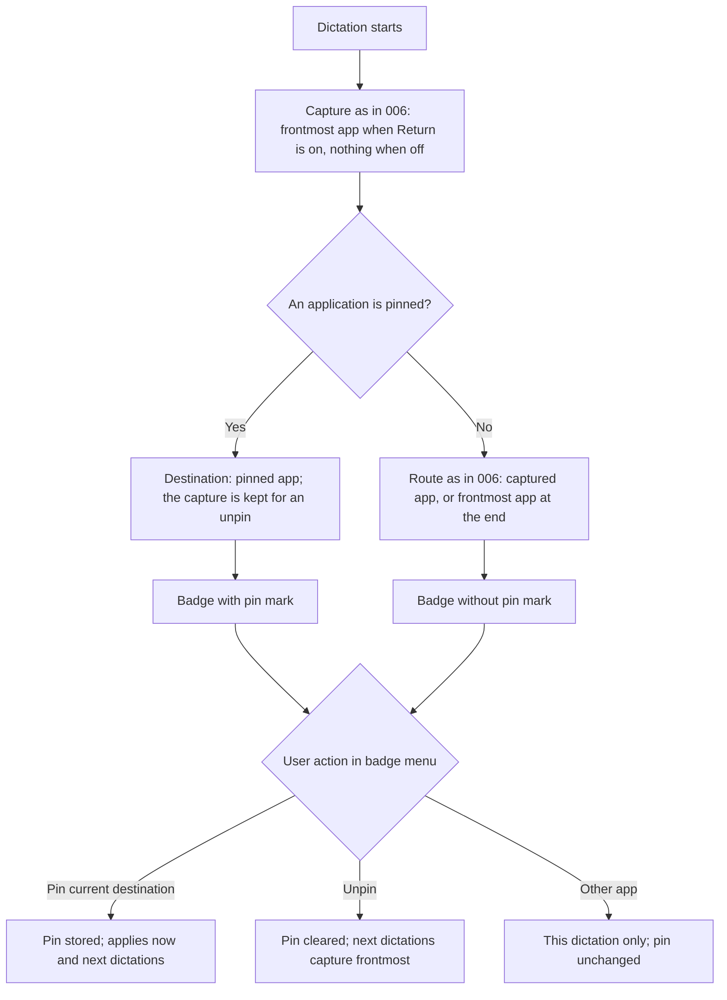
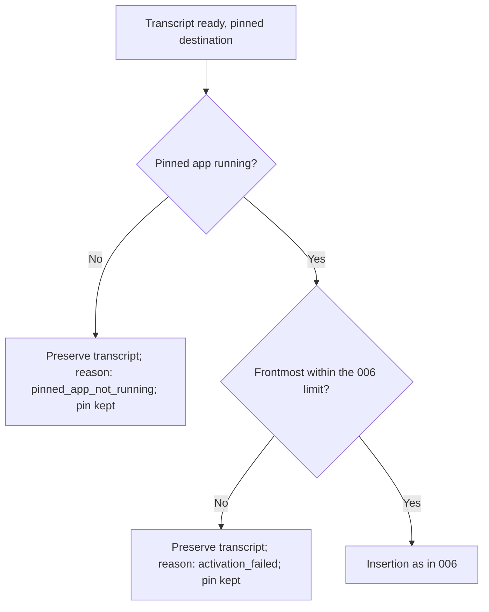
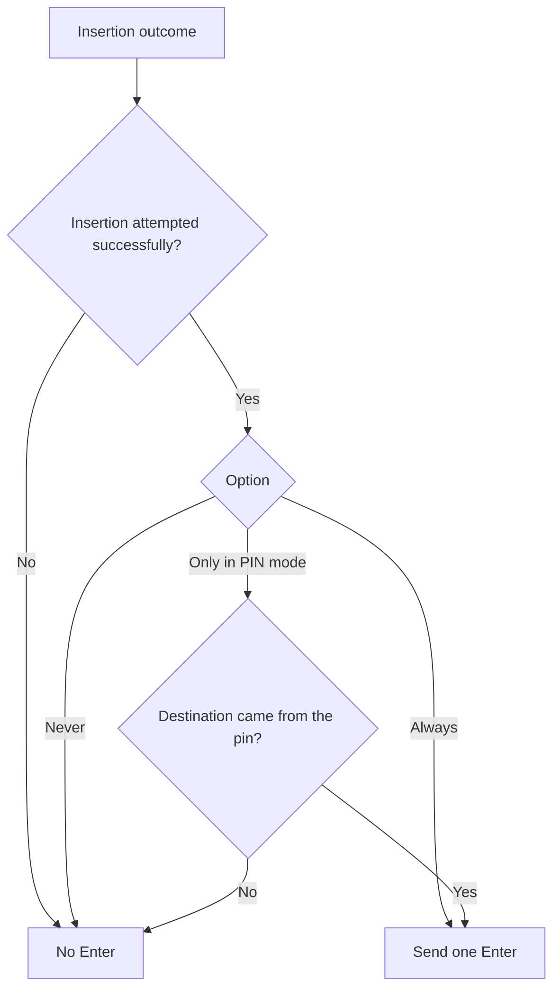
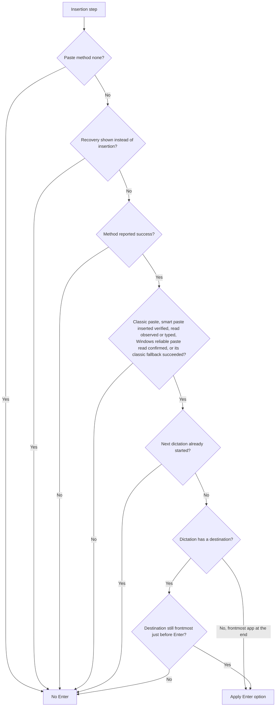
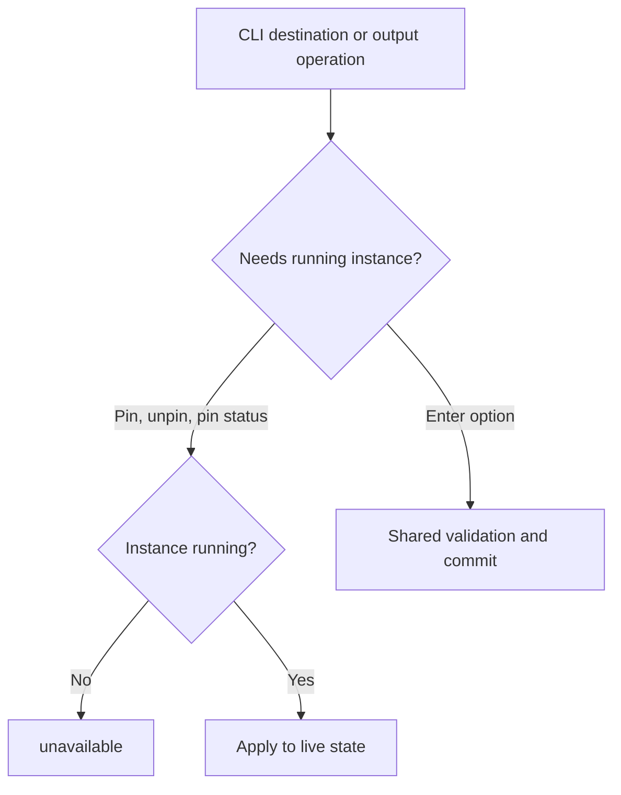

# Feature Spec: PIN Mode and Enter Rule

## Header

- **Feature:** PIN Mode and Enter Rule
- **Branch:** None — specification only (program specified before `spec-ship`)
- **Date:** 2026-10-12
- **Status:** Planned
- **Input:** Program item 9: from the destination badge, pin an application so that following dictations keep being sent to it, despite application switches and transcription stops/restarts, until it is unpinned. Provide a single automatic Enter option: Never; Always; Only in PIN mode. Avoid any duplicate with the existing automatic Enter mechanism. Trigger Enter only after a successful insertion according to the chosen contract. Program item 8 requires the settings CLI to read and modify destination/PIN and output behaviors.
- **Feature Number:** 009

## User Scenarios & Testing

### Story 1 — Pin a destination from the badge `P1`

**As a** Handy user, **I want to** pin the destination application from the badge, **so that** all my next dictations go there while I read or work elsewhere.

**Priority reason:** Pinning is the core of this item.
**Independent test:** Pin ChatGPT during a dictation, then dictate three times from other applications and check where each text lands.

```gherkin
Feature: Pin a destination
  Scenario: Pin from the badge
    Given a dictation is recording with destination ChatGPT
    When the user opens the badge menu and chooses "Pin ChatGPT"
    Then the badge shows ChatGPT with a pin mark
    And this dictation and the following ones are sent to ChatGPT
  Scenario: Pinned across app switches and new dictations
    Given ChatGPT is pinned
    When the user starts a dictation while Safari is frontmost
    Then the destination of this dictation is ChatGPT
    And at the end Handy activates ChatGPT and inserts the text there
  Scenario: Unpin
    Given ChatGPT is pinned
    When the user chooses "Unpin" in the badge menu
    Then the pin mark disappears
    And the next dictation captures the frontmost application again
```



### Story 2 — Pinned application unavailable `P1`

**As a** Handy user, **I want to** keep my text when the pinned application is closed, **so that** a stale pin never sends text to the wrong window.

**Priority reason:** A pin outliving its application is the main failure mode.
**Independent test:** Pin Notes, quit Notes, dictate.

```gherkin
Feature: Pinned app unavailable
  Scenario: Pinned app closed
    Given Notes is pinned and Notes is not running
    When the user dictates
    Then no text is inserted into any application
    And the transcript is preserved as in feature 006
    And the pin stays until the user unpins it
  Scenario: Pinned app running but not brought forward
    Given Notes is pinned and running
    When Notes does not become frontmost within the 006 limit at insertion time
    Then no text is inserted into any application
    And the transcript is preserved as in feature 006 with the reason "activation_failed"
    And the pin stays until the user unpins it
  Scenario: Pinned app reopened
    Given Notes is pinned and was closed
    When Notes is reopened and the user dictates
    Then the text is inserted into Notes
```



### Story 3 — One automatic Enter option `P1`

**As a** Handy user, **I want to** choose Never, Always or Only in PIN mode for automatic Enter, **so that** messages are sent automatically only where I want.

**Priority reason:** The single option replaces today's on/off auto-submit and prevents duplicate Enter presses.
**Independent test:** For each value, dictate once pinned and once not pinned, and count Enter presses received by a test field.

```gherkin
Feature: Automatic Enter option
  Scenario: Only in PIN mode, pinned
    Given automatic Enter is "Only in PIN mode"
    And ChatGPT is pinned
    When a dictation is inserted into ChatGPT successfully
    Then exactly one Enter key press is sent after the insertion
  Scenario: Only in PIN mode, not pinned
    Given automatic Enter is "Only in PIN mode"
    And nothing is pinned
    When a dictation is inserted successfully
    Then no Enter key press is sent
  Scenario: Always
    Given automatic Enter is "Always"
    When a dictation is inserted successfully
    Then exactly one Enter key press is sent
  Scenario: Never
    Given automatic Enter is "Never"
    When a dictation is inserted successfully
    Then no Enter key press is sent
  Scenario: Upgrade from the existing auto-submit
    Given the existing auto-submit was on with key Ctrl+Enter
    When settings load after upgrade
    Then automatic Enter is "Always" with key Ctrl+Enter
    And no other auto-submit control remains in the settings
```



### Story 4 — Enter only after a successful insertion `P1`

**As a** Handy user, **I want to** never have Enter pressed when my text did not land, **so that** an empty or wrong message is never sent.

**Priority reason:** An Enter after a failed insertion can send an empty message or trigger an unintended action.
**Independent test:** Inject activation failure, insertion failure and recovery display, with automatic Enter "Always".

```gherkin
Feature: Enter after a successful insertion only
  Scenario: Destination unavailable
    Given automatic Enter is "Always"
    When the destination is unavailable at insertion time
    Then no Enter key press is sent
  Scenario: Insertion method failed
    Given automatic Enter is "Always"
    When the insertion method reports failure
    Then no Enter key press is sent
  Scenario: Paste method none
    Given the paste method is "none"
    When a dictation completes
    Then no Enter key press is sent
  Scenario: Smart paste without observed read
    Given the paste method is smart paste
    When the target never reads the clipboard and the outcome is "not read"
    Then no Enter key press is sent
  Scenario: Destination left before Enter
    Given automatic Enter is "Always" and the text was inserted into ChatGPT
    When another application becomes frontmost before the Enter press
    Then no Enter key press is sent
  Scenario: Next dictation starts before the Enter press
    Given automatic Enter is "Always" and dictation A was inserted successfully
    When dictation B starts before the Enter press of dictation A is decided
    Then no Enter key press is sent for dictation A
```



### Story 5 — PIN and Enter from the CLI `P2`

**As an** automation user, **I want to** pin, unpin, read the pin and set the Enter option from the CLI, **so that** I can switch modes from scripts.

**Priority reason:** Program item 8 lists destination/PIN and output behaviors for the CLI.
**Independent test:** Pin by application identifier through the CLI on a running instance, dictate, unpin, and set each Enter option.

```gherkin
Feature: PIN and Enter through the settings CLI
  Scenario: Pin by identifier
    Given Handy is running and Comet is running
    When the user pins the Comet application identifier through the CLI with JSON output
    Then stdout reports the pinned application and the badge shows the pin mark at the next dictation
  Scenario: Pin status without a running app
    Given Handy is not running
    When the user reads the pin status through the CLI
    Then the command returns the stable code "unavailable"
  Scenario: Invalid Enter option
    When the user sets automatic Enter to "sometimes"
    Then the command fails with "validation_failed" listing never, always and pin_only
```



## Acceptance Criteria

### AC-001

**Criterion:** The badge menu of feature 006 offers "Pin <destination>" when nothing or another app is pinned and "Unpin" when an app is pinned. Pinning stores the destination's identity and makes it the destination of the current dictation and of every following dictation, whatever application is frontmost at their start, until unpinned or until Handy quits. The badge shows a pin mark and the accessible name "Destination: <name>, pinned". While an application is pinned, the badge is shown even when the 006 setting "Return to the dictation's application" is off (the only exception to 006 AC-003); with that setting off and nothing pinned, no badge is shown, and with the overlay style none or without destination support no badge is shown.
**Priority:** P1 | **Story:** Story 1

### AC-002

**Criterion:** While an app is pinned, choosing another application in the badge menu changes the destination of the current dictation only; the pin is unchanged. Unpinning before insertion begins makes the current dictation's destination the application captured at its start as in 006 (source "captured", so "Only in PIN mode" sends no Enter for it); when the 006 setting "Return to the dictation's application" is off, 006 captured nothing, so the dictation has no destination and inserts into the frontmost application at the end, as in 006. The next dictation captures the frontmost application as in 006. Pinning is an explicit choice: a pinned destination is activated even when the 006 "Return to the dictation's application" setting is off.
**Priority:** P1 | **Story:** Story 1

### AC-003

**Criterion:** When the pinned application is not running, or cannot be activated within the 006 limit, no text is inserted anywhere, the transcript is preserved as specified by 006, and the pin remains. The reason is `pinned_app_not_running` when no application with the pinned identity is running, and `activation_failed` when it is running but does not become frontmost within the 006 limit; these are the two reasons the recovery bubble (`.specs/features/010-recovery-bubble/spec.md`) expects. When an application with the pinned identity runs again, following dictations go to it.
**Priority:** P1 | **Story:** Story 2

### AC-004

**Criterion:** A single setting "Automatic Enter" with values Never, Always and Only in PIN mode replaces the existing auto-submit switch; the existing key choice (Enter, Ctrl+Enter, Cmd+Enter) is kept as the key to press. Upgrade maps auto-submit off to Never and on to Always and keeps the key. The upgrade leaves the stored auto-submit switch and key unchanged, so a build with the `destination-return` gate closed, or an older Handy, keeps the user's Enter behavior; once Automatic Enter is stored, it is the only value a gate-open build reads. No other automatic Enter or auto-submit control remains, so at most one Enter press is sent per dictation.
**Priority:** P1 | **Story:** Story 3

### AC-005

**Criterion:** The Enter press is sent at most once, after the insertion step, only when: the dictation has a destination and it is still frontmost immediately before the Enter press, or the dictation has no destination (insertion targets the frontmost application as today); the insertion method reported success; with smart paste (007), its outcome was "inserted, verified", "insertion attempted, read observed" or "typed"; with the Windows reliable paste, the target's read was confirmed, and when it fell back to the classic paste, the classic paste reported success; no recovery display (010) replaced the insertion; and the paste method is not "none". "Only in PIN mode" additionally requires that the dictation's destination came from the pin. Otherwise no Enter is sent. When the next dictation starts before the Enter press of the previous one is decided (for example while smart paste still waits for the clipboard read), the previous dictation sends no Enter, even after a successful insertion.
**Priority:** P1 | **Story:** Stories 3 and 4

### AC-006

**Criterion:** The settings CLI (008) offers `destination pin <identifier>` (the identifier must belong to a running application, otherwise `not_found`), `destination unpin` and `destination status` (pinned app or none) against a running instance, returning `unavailable` without one, and reads and sets the Automatic Enter option and key with the UI validation (`never`, `always`, `pin_only`). The keys are `automatic_enter` and the existing `auto_submit_key`; `auto_submit` is refused with `not_found` like any unknown key. A pin or unpin through the CLI has the same effect on the current dictation as the badge menu. With `--json`, stdout contains only the JSON envelope.
**Priority:** P2 | **Story:** Story 5

## Behavioral AC

Signals extracted: badge, menu, dropdown, select, toggle, pin, keyboard navigation. Official `detect_traits` returned has_dropdown, is_keyboard_navigable.

### has_dropdown

<!-- WARNING: No visual states defined for trait "has_dropdown" in ui-behavioral-taxonomy.md -->

```gherkin
Feature: Pin entries in the badge menu
  Scenario: Pin entry shown
    Given nothing is pinned and the badge menu is open
    When the user reads the menu
    Then "Pin <destination>" is listed above the application list
  Scenario: Automatic Enter selector
    Given the output settings are open
    When the user opens the Automatic Enter selector
    Then Never, Always and Only in PIN mode are listed with the current value marked
```

### is_keyboard_navigable

<!-- WARNING: No visual states defined for trait "is_keyboard_navigable" in ui-behavioral-taxonomy.md -->

```gherkin
Feature: Keyboard access to Automatic Enter
  Scenario: Change the option with the keyboard
    Given the Automatic Enter selector has focus
    When the user picks Only in PIN mode with arrow keys and Enter
    Then the option is saved and announced
  Scenario: Tab order
    Given the output settings are open
    When the user presses Tab
    Then the Automatic Enter selector and its key selector receive visible focus in reading order
```

## Functional Requirements

### FR-001

**Requirement:** Store a session pin (application identity) set and cleared from the badge menu or CLI, and resolve each dictation's destination from the pin, which takes precedence over the route captured at its start as in 006 (that capture is still made, for an unpin).
**AC References:** AC-001, AC-002, AC-006

### FR-002

**Requirement:** Treat an unavailable pinned application as an unavailable destination without clearing the pin.
**AC References:** AC-003

### FR-003

**Requirement:** Replace the auto-submit switch by one three-value Automatic Enter setting with migration and a retained key choice.
**AC References:** AC-004, AC-006

### FR-004

**Requirement:** Send at most one Enter press per dictation, gated by the insertion outcome contract and the option value.
**AC References:** AC-005

## Key Entities

| Entity | Description | Key fields |
|---|---|---|
| Pin | Session-level pinned destination | application identity, display name, icon, pinned at |
| Automatic Enter setting | Persistent option | value (never, always, pin_only), key (Enter, Ctrl+Enter, Cmd+Enter) |
| Dictation destination source | Origin of a dictation's destination | captured, badge choice, pin |

## Clarifications

- Current code (2026-10-12): `auto_submit` (on/off) with `auto_submit_key` (Enter, Ctrl+Enter, Cmd+Enter); on the normal path Enter fires 50 ms after the paste returns whenever auto-submit is on and the paste method is not none; on the beta reliable path it fires only after a confirmed read.
- Decision 2026-10-14 (decided by the orchestrator under Julien's mandate, validated by Julien (maintainer) on 2026-10-15; AC-001): the pin lasts until it is unpinned or until Handy quits; it is not restored after a restart. Interpretation: the Input's "despite application switches and transcription stops/restarts" is about stopping and restarting the transcription (successive dictations), not about quitting and relaunching Handy, so the pin survives every dictation but not the end of the Handy process; a forgotten pin never sends text after a reboot.
- `[ASSUMED]` Pinning requires destination support (006, macOS and Windows); where the platform is unsupported, pin entries are not offered and the CLI returns `validation_failed` with the platform reason. Where the frontmost application cannot be read at run time (006 AC-007), no badge is shown, the CLI pin operations still answer (006 keeps run-time readability out of the CLI), and a pinned dictation inserts nowhere (decision `pinned_with_unreadable_foreground` below). With the overlay style none, pinning is available through the CLI only.
- `[ASSUMED]` New installations default to Automatic Enter "Never", matching today's auto-submit default (off).
- Decision 2026-10-14 (program orchestrator, after the independent review): 006 AC-003 hides the badge when "Return to the dictation's application" is off, but a pin activates its application even then (AC-002) and the badge menu is where Unpin is offered. Rule: an active pin shows the badge whatever that setting is; without a pin, 006 AC-003 applies unchanged. 006's spec is not modified; this feature owns the exception.
- The migration covers every current auto-submit path (classic paste, smart paste of 007 on macOS, reliable paste on Windows, settings commands and UI) so that no second Enter mechanism remains.
- "Successful insertion" follows the 006 contract: insertion attempted with the method reporting success; it is not a verification of the field content.
- Program context: specified in list order (001–010); depends on 006 (destination, badge) and 008 (CLI); 010 recovery display suppresses Enter.
- Decision 2026-10-14 (program orchestrator, before the independent review): the single reason "pinned app unavailable" of AC-003 is split in two. `pinned_app_not_running`: no application with the pinned identity is running. `activation_failed`: it is running but does not become frontmost within the 006 limit. These are the reasons expected by `.specs/features/010-recovery-bubble/spec.md` ("<App> is pinned but not open" and "Could not bring <App> forward"). No other pinned reason exists.
- Decision 2026-10-14 (program orchestrator, delivery precision): all of 009 (pin, pin badge, Automatic Enter setting and its migration, Enter authority, CLI `destination` operations and Automatic Enter keys) ships behind the `destination-return` gate of `.specs/features/006-destination-application/spec.md`. Gate closed, Handy behaves exactly as `dev`: the existing auto-submit switch, key and Enter paths, no pin entries, no Automatic Enter setting. Gate open, this specification applies. No AC, FR or SC changes; the requirements describe the gate-open build.
- Decision 2026-10-14 (decided by the orchestrator under Julien's mandate, validated by Julien (maintainer) on 2026-10-15; build with the gate closed): the closed build is identical to `dev` and gains nothing from 009. The settings CLI has no `destination` commands (`handy settings destination …` is a `usage_error`, as in `dev`), `automatic_enter` is `not_found` like any unknown key, and no migration runs; an open build's migration never modifies `auto_submit` or `auto_submit_key` (AC-004).
- Decision 2026-10-14 (decided by the orchestrator under Julien's mandate, validated by Julien (maintainer) on 2026-10-15; AC-005): when the next dictation starts before the Enter press of the previous one is decided, the previous dictation sends no Enter, even after a successful insertion. This is an accepted limit case: the user has moved on and an Enter would land in the new dictation's context; AC-005 allows at most one Enter and never requires one.

- Decision `009-pin-mode-and-enter-rule:AC-002` / `unpin_with_return_setting_off`: 2026-10-14, decided by the orchestrator under Julien's mandate, validated by Julien (maintainer) on 2026-10-15: unpinning restores the route that 006 gave the dictation at its start. With "Return to the dictation's application" on, that is the application captured at its start (source "captured"). With that setting off, 006 captures nothing, so the dictation has no destination and its text goes to the frontmost application at the end, as in 006; "Only in PIN mode" sends no Enter for it. 009 adds no capture of its own.
<!-- livespec-clarification:{"requirement_id": "009-pin-mode-and-enter-rule:AC-002", "decision_key": "unpin_with_return_setting_off", "evidence_hash": "fd4bfc0e2301e768c304af618e2375608ea3f7413f0fc9506f26e5aa9ec94f29", "answer": "2026-10-14, decided by the orchestrator under Julien's mandate, validated by Julien (maintainer) on 2026-10-15: unpinning restores the route that 006 gave the dictation at its start. With \"Return to the dictation's application\" on, that is the application captured at its start (source \"captured\"). With that setting off, 006 captures nothing, so the dictation has no destination and its text goes to the frontmost application at the end, as in 006; \"Only in PIN mode\" sends no Enter for it. 009 adds no capture of its own."} -->

- Decision `009-pin-mode-and-enter-rule:AC-004` / `legacy_auto_submit_after_migration`: 2026-10-14, decided by the orchestrator under Julien's mandate, validated by Julien (maintainer) on 2026-10-15: the upgrade only adds the Automatic Enter value; it never deletes or rewrites the stored auto-submit switch and key. A build with the `destination-return` gate closed, or an older Handy, therefore reads exactly the previous auto-submit value and key and keeps the user's Enter behavior. Once the Automatic Enter value exists, a gate-open build uses it and no longer reads auto-submit.
<!-- livespec-clarification:{"requirement_id": "009-pin-mode-and-enter-rule:AC-004", "decision_key": "legacy_auto_submit_after_migration", "evidence_hash": "91685e4a989eac202ec4fca62c32c4abb0289a52d99e372fdeabcb9e2ed2de33", "answer": "2026-10-14, decided by the orchestrator under Julien's mandate, validated by Julien (maintainer) on 2026-10-15: the upgrade only adds the Automatic Enter value; it never deletes or rewrites the stored auto-submit switch and key. A build with the `destination-return` gate closed, or an older Handy, therefore reads exactly the previous auto-submit value and key and keeps the user's Enter behavior. Once the Automatic Enter value exists, a gate-open build uses it and no longer reads auto-submit."} -->

- Decision `009-pin-mode-and-enter-rule:AC-006` / `cli_legacy_auto_submit_key`: 2026-10-14, decided by the orchestrator under Julien's mandate, validated by Julien (maintainer) on 2026-10-15: with the gate open, the CLI keys are `automatic_enter` (`never`, `always`, `pin_only`) and the existing `auto_submit_key` (`enter`, `ctrl_enter`, `cmd_enter`); `auto_submit` is no longer a key and is refused with `not_found` like any unknown key, without alias or hint. With the gate closed, the keys are those of `dev` (`auto_submit`, `auto_submit_key`) and `automatic_enter` is `not_found`.
<!-- livespec-clarification:{"requirement_id": "009-pin-mode-and-enter-rule:AC-006", "decision_key": "cli_legacy_auto_submit_key", "evidence_hash": "4af7c5f6bf345eeab201de66d6500b83a344c48c9d925bdac509c0e370fcac73", "answer": "2026-10-14, decided by the orchestrator under Julien's mandate, validated by Julien (maintainer) on 2026-10-15: with the gate open, the CLI keys are `automatic_enter` (`never`, `always`, `pin_only`) and the existing `auto_submit_key` (`enter`, `ctrl_enter`, `cmd_enter`); `auto_submit` is no longer a key and is refused with `not_found` like any unknown key, without alias or hint. With the gate closed, the keys are those of `dev` (`auto_submit`, `auto_submit_key`) and `automatic_enter` is `not_found`."} -->

- Decision `009-pin-mode-and-enter-rule:AC-006` / `cli_pin_during_dictation`: 2026-10-14, decided by the orchestrator under Julien's mandate, validated by Julien (maintainer) on 2026-10-15: a CLI pin or unpin has the same effect as the badge menu. Accepted before the dictation's insertion begins, it changes that dictation's destination (AC-001, AC-002); accepted later, it applies from the next dictation.
<!-- livespec-clarification:{"requirement_id": "009-pin-mode-and-enter-rule:AC-006", "decision_key": "cli_pin_during_dictation", "evidence_hash": "470879930f7d974ad895cf0df920a69c2eb97a123bd82fc52497e5d022de776c", "answer": "2026-10-14, decided by the orchestrator under Julien's mandate, validated by Julien (maintainer) on 2026-10-15: a CLI pin or unpin has the same effect as the badge menu. Accepted before the dictation's insertion begins, it changes that dictation's destination (AC-001, AC-002); accepted later, it applies from the next dictation."} -->

- Decision `009-pin-mode-and-enter-rule:AC-002` / `return_off_and_pin`: Validated by Julien (maintainer) on 2026-10-15: with "Return to the dictation's application" off and nothing pinned, the dictation has no destination and inserts into the frontmost application at the end (route `FrontmostAtEnd`), as in 006. With an application pinned, that application is activated and receives the text even with the setting off; as a dictation with a destination, its Enter press requires the pinned application to be still frontmost immediately before it (AC-005).
<!-- livespec-clarification:{"requirement_id": "009-pin-mode-and-enter-rule:AC-002", "decision_key": "return_off_and_pin", "evidence_hash": "92b7b70054d54c3a314dee3a7955ed27d8b7428ceef6947ddbe548bfa3e6f637", "answer": "Validated by Julien (maintainer) on 2026-10-15: with \"Return to the dictation's application\" off and nothing pinned, the dictation has no destination and inserts into the frontmost application at the end (route `FrontmostAtEnd`), as in 006. With an application pinned, that application is activated and receives the text even with the setting off; as a dictation with a destination, its Enter press requires the pinned application to be still frontmost immediately before it (AC-005)."} -->

- Decision `009-pin-mode-and-enter-rule:FR-004` / `claim_enter_scan_step`: Validated by Julien (maintainer) on 2026-10-15 (plan step order, no behavior change): the scan proving that only the Automatic Enter authority claims the Enter press runs at the end of the plan step that replaces the interim smart-paste caller (Step 5), not at the end of Step 4.
<!-- livespec-clarification:{"requirement_id": "009-pin-mode-and-enter-rule:FR-004", "decision_key": "claim_enter_scan_step", "evidence_hash": "6eae4a8d94467fd28e77226afe67d60d636a377646dde3572f3b5f6a266ddc20", "answer": "Validated by Julien (maintainer) on 2026-10-15 (plan step order, no behavior change): the scan proving that only the Automatic Enter authority claims the Enter press runs at the end of the plan step that replaces the interim smart-paste caller (Step 5), not at the end of Step 4."} -->

- Decision `009-pin-mode-and-enter-rule:AC-006` / `cli_pin_target`: Validated by Julien (maintainer) on 2026-10-15: `destination pin` takes an application identifier only; the `current` target is removed, since the Input does not ask for it. The answer of `pin` reports the pinned application only, without a report of its effect on the current or next dictation.
<!-- livespec-clarification:{"requirement_id": "009-pin-mode-and-enter-rule:AC-006", "decision_key": "cli_pin_target", "evidence_hash": "ccd8311b69148f0949faaed386934cc9f936d3a877d2cc30c92a5db42ef9eb1d", "answer": "Validated by Julien (maintainer) on 2026-10-15: `destination pin` takes an application identifier only; the `current` target is removed, since the Input does not ask for it. The answer of `pin` reports the pinned application only, without a report of its effect on the current or next dictation."} -->

- Decision `009-pin-mode-and-enter-rule:AC-006` / `cli_pin_change_options`: Validated by Julien (maintainer) on 2026-10-15: `destination pin`, `destination unpin` and `destination status` accept neither `--dry-run` nor `--expected-revision`; either option gets the standard answer of the 008 settings CLI for an option an action does not accept, `usage_error` (exit 2), before any routing and with no change.
<!-- livespec-clarification:{"requirement_id": "009-pin-mode-and-enter-rule:AC-006", "decision_key": "cli_pin_change_options", "evidence_hash": "2d06394c767983d8c08c1d73db104737c67fcd48903c831c58c7ca5f6d407d46", "answer": "Validated by Julien (maintainer) on 2026-10-15: `destination pin`, `destination unpin` and `destination status` accept neither `--dry-run` nor `--expected-revision`; either option gets the standard answer of the 008 settings CLI for an option an action does not accept, `usage_error` (exit 2), before any routing and with no change."} -->

- Decision `009-pin-mode-and-enter-rule:AC-003` / `pinned_with_unreadable_foreground`: Validated by Julien (maintainer) on 2026-10-15: when an application is pinned and the frontmost application cannot be read at the dictation (006 destination support unsupported), Handy inserts the text nowhere, never into the frontmost application, and sends no Enter press. The dictation fails closed with the existing 006 reason `activation_failed` (the pinned application cannot be confirmed in front within the 006 limit), the pin stays, and the transcript stays recoverable as in 006: in history, through the 006 failure presentation and, with feature 010, its recovery bubble.
<!-- livespec-clarification:{"requirement_id": "009-pin-mode-and-enter-rule:AC-003", "decision_key": "pinned_with_unreadable_foreground", "evidence_hash": "20e6a963a53e36e85c83169828e428b2517ae8b2b6e7f01687ab5965c4c476ab", "answer": "Validated by Julien (maintainer) on 2026-10-15: when an application is pinned and the frontmost application cannot be read at the dictation (006 destination support unsupported), Handy inserts the text nowhere, never into the frontmost application, and sends no Enter press. The dictation fails closed with the existing 006 reason `activation_failed` (the pinned application cannot be confirmed in front within the 006 limit), the pin stays, and the transcript stays recoverable as in 006: in history, through the 006 failure presentation and, with feature 010, its recovery bubble."} -->

- Decision `009-pin-mode-and-enter-rule:AC-006` / `cli_pin_identifier_format`: Precision of 2026-10-15 derived from feature 006, recorded by the orchestrator agent while applying the round 6 review (not a new product choice and not a decision of Julien): the identifier is the stable application identity that 006 records, the bundle identifier on macOS and, on Windows, the application user model ID or, for an application without one, its executable path. `destination pin` and `destination status` return that identity with its kind (`bundle_id`, `aumid` or `executable_path`) and the application's display name.
<!-- livespec-clarification:{"requirement_id": "009-pin-mode-and-enter-rule:AC-006", "decision_key": "cli_pin_identifier_format", "evidence_hash": "694f99da054f6223927050dd3c588186681a97172257d478f5cf6e0f5c43bf59", "answer": "Precision of 2026-10-15 derived from feature 006, recorded by the orchestrator agent while applying the round 6 review (not a new product choice and not a decision of Julien): the identifier is the stable application identity that 006 records, the bundle identifier on macOS and, on Windows, the application user model ID or, for an application without one, its executable path. `destination pin` and `destination status` return that identity with its kind (`bundle_id`, `aumid` or `executable_path`) and the application's display name."} -->

## QE Analysis

- **Criticality:** High; **Blast radius:** Text routing and automatic message sending; **Primary risk:** Enter sent after a failed or misrouted insertion; **Confidence:** Medium (auto-submit paths read, nothing executed).
- **Dimensions:** Functional correctness, safety of automatic actions, data migration, regression, accessibility, UX.
- **P0 gates/evidence:** Gate table tests for AC-005 (each condition false blocks Enter); option × pin matrix tests; migration tests from auto-submit on/off with each key; pin resolution and unpin timing tests.
- **P1 gates/evidence:** Native checks pinning ChatGPT and Comet with application switches; Enter count measured by a test field; CLI pin operations against a running instance.
- **Non-functional expectations:** Exactly zero or one Enter per dictation; Enter sent within 100 ms after a successful insertion step (a QE target measured by the plan's macOS native timing samples, not an acceptance criterion); no window titles or text logged above debug level.
- **Missing evidence:** No runtime test; mockups deferred before `spec-ship`.
- **Boundary:** QE defines risk and test sufficiency; the independent review judges requirements; Penflow governs UI design evidence; spec-test executes runtime proof.

## Quality Engineering

- **Risk:** High criticality (rated so by the QE Analysis: an automatic Enter after a failed or misrouted insertion can send a message); Shared blast radius (a pin routes every following dictation, the single Enter option migrates the existing auto-submit setting, and both are exposed through the settings CLI); primary risk Functional (Enter sent after a failed or misrouted insertion).
- **Applicable dimensions:** functional correctness, safety of automatic actions, data migration, regression, accessibility, UX.
- **P0 gates/evidence:** Gate table tests for AC-005 (each condition false blocks Enter); option × pin matrix tests; migration tests from auto-submit on/off with each key; pin resolution and unpin timing tests.
- **Boundary:** QE defines risk and test sufficiency only. The independent spec review judges requirements, Penflow governs UI design evidence, spec-test executes runtime proof and the end-of-feature delivery review looks for defects.

## Screens

| Screen | Status | Reference |
|--------|--------|-----------|
| recording-indicator | Modified | Mockup to produce before `spec-ship` (pin entries and pin mark) |
| output-settings | Modified | Mockup to produce before `spec-ship` (Automatic Enter selector) |

## Penflow Contract

- Planned `flow_id: pin-mode-and-enter-rule`, `screen_id: recording-indicator` and `screen_id: output-settings`. Per the user decision of 2026-10-12 (lightweight UI contract), the Penflow flow/screen contract, semantic and test IDs and the Pencil mockups are produced in one pass for all program features before `spec-ship`; the planned IDs above are authoritative until then. No inspection READY or certification PASS is claimed.

## Edge Cases

- Pinned application is Handy's own window: not possible, Handy is excluded from destinations.
- Pin set while no dictation is running (CLI): applies from the next dictation.
- Pin or unpin through the CLI during a dictation: same effect as the badge menu (AC-002, AC-006).
- "Return to the dictation's application" off and nothing pinned: no badge is shown (AC-001), so pinning starts from the CLI.
- Several instances of the pinned application (same identity): resolved as in 006: the pinned instance while it runs, otherwise the only running instance; with several and none of them the pinned one, Handy cannot choose one, so the pinned application is not brought forward and the reason is `activation_failed` (AC-003).
- An application is pinned and the frontmost application cannot be read at the dictation: no text is inserted anywhere, the reason is `activation_failed` and the transcript is preserved as in 006 (AC-003).
- The 006 Remove destination cross while an application is pinned: like choosing another destination in the badge menu, it changes the current dictation only (frontmost application at the end) and the pin is unchanged (AC-002).
- Next dictation started before the previous dictation's Enter press is decided: no Enter for the previous dictation (AC-005).
- "Only in PIN mode" where pinning is unsupported (Linux): kept as chosen; no pin can exist there, so it sends no Enter; 006 AC-007 already shows destination return as unavailable with its reason.
- Automatic Enter key Cmd+Enter on Windows/Linux: kept as stored; the key choice behaves as today per platform.

## Success Criteria

### SC-001

Across the full option × pin × outcome matrix in automated tests, the number of Enter presses equals the expected value (0 or 1) in 100% of cases.

### SC-002

Upgrade tests map every existing auto-submit combination to the documented Automatic Enter value with the same key, and a build with the gate closed rereads the upgraded settings with an unchanged auto-submit switch, key and Enter behavior.

### SC-003

In native checks, a pinned ChatGPT receives five consecutive dictations started from three other applications.
