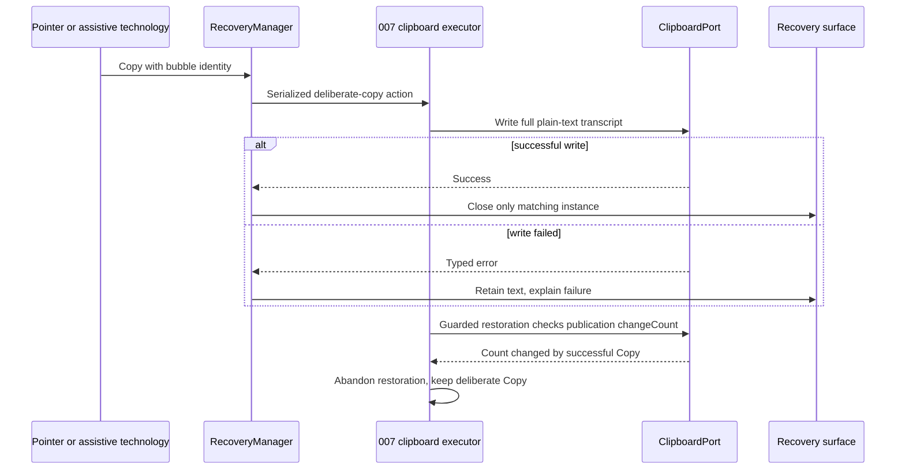
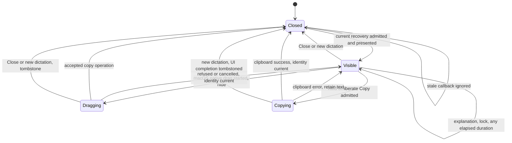
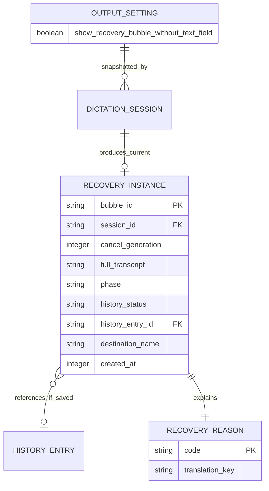

# Implementation Plan: Recovery Bubble

## Summary

Add a Rust recovery state machine before and after insertion, a nonactivating recovery surface, bounded macOS AX classification and native plain-text dragging; extend 008's existing output domain for the no-text-field setting and make deliberate Copy supersede pending 007 smart paste restoration through its changeCount guard.

Inspect [the functional source](spec.md) for FR-001–FR-005, AC-001–AC-007 and SC-001–SC-003. Scope **L** despite five FR: shared insertion, clipboard, native focus and three OS surfaces. Delivery order is 008 first, then 001, 002, 003, 004, 005, 006, 007, 009, 010. This command produces planning/review evidence only; runtime and design proof remain future gates.

## Technical Context

| Aspect | Choice | Basis |
|---|---|---|
| Native | Existing Rust 2021, Tauri 2.11.5, Tokio | Cargo manifest and default stack |
| macOS | Existing objc2/app-kit bindings, NSPanel, native NSView, ApplicationServices AX | Native drag and focus cannot be proved by DOM drag events |
| Windows/Linux | Existing nonactivating native overlay platform adapters, reduced actions | No drag or AX classifier outside macOS |
| Frontend | React 18, TypeScript, Zustand, i18next, existing CSS/Tailwind | Existing recording overlay and settings boundaries |
| Settings | 008 transactional service and registered output domain | One store, lock, revision, transport and renderer |
| Storage | One volatile current recovery; existing history and settings | No new SQL table or cloud resource |
| Testing | Cargo unit/integration, Bun projection tests, Playwright UI, native release observations | Native focus and drag require real platform proof |

Inspect [008's plan](../008-settings-cli/plan.md) as the framework reference. Reuse its exact `SettingDescriptor`, `SettingsMutation`, `SettingsSnapshot`, `Revision`, `PublicSettings`, `OperationRequest`, `SettingsError`, `StoreLocator`, `SettingsRepository`, `LiveSettingsEffects`, `read_snapshot`, `commit_mutation` and `settings_service/{descriptor.rs,validation.rs,protocol.rs,store.rs,transaction.rs,live.rs,domains/mod.rs,domains/output.rs}`. Extend its existing output registration; do not create a parallel settings service or recovery configuration writer.

Inspect [006's plan](../006-destination-application/plan.md) as integration context for `DestinationManager`, `WorkspacePort`, `DestinationSession` and `InsertionOutcome`. Inspect [destination contract](../006-destination-application/contracts/destination-contract.md) as informative local boundary context. Inspect [007's spec](../007-smart-paste/spec.md) for smart paste outcomes and clipboard restoration context. Inspect [009's spec](../009-pin-mode-and-enter-rule/spec.md) for Enter context. These inspected documents do not import their entire obligation inventories into 010's review. Inspect [the recovery contract](contracts/recovery-contract.md) for 010's own planned native/API boundaries.

Inspect [actions](../../../src-tauri/src/actions.rs), [native overlay](../../../src-tauri/src/overlay.rs), [insertion](../../../src-tauri/src/clipboard.rs), [reliable paste](../../../src-tauri/src/paste_tx/mod.rs), [frontend overlay](../../../src/overlay/RecordingOverlay.tsx), [settings store](../../../src/stores/settingsStore.ts) and [manifest](../../../src-tauri/Cargo.toml) before implementation. Current actions queues paste on `run_on_main_thread` and saves history only if the WAV save succeeds. The default overlay is 256×50; existing streaming resizing does not prove interactive bubble/drag compatibility.

## Constitution Check

| Principle | Result and concrete decision |
|---|---|
| Preserve native/frontend boundaries | PASS: native manager owns transcript, decision and lifecycle; UI renders typed recovery projection |
| Derive stack/manager choices from manifests | PASS: retain Tauri/Tokio/objc2; review required AX feature flags rather than introduce a new framework |
| Tool availability differs from runtime | PASS: versions below certify availability only; real first-click, drag and platform checks remain mandatory |
| Specify changed behavior before code | PASS: no functional spec change; every FR/AC mapped below, explicit interpretation of review warnings |
| Meaningful tests/current source verification | PASS: real decision/state/service logic, injected OS ports, real CLI/native boundary proof |
| Naming/tooling | PASS: existing Rust snake_case and React names preserved; new UI files kebab-case; project Bun/ESLint/Prettier supersede generic Vitest/Biome preferences |
| i18n/privacy | PASS: all labels/reasons/explanations use translation keys; no transcript or foreign window titles in logs |
| Infrastructure | PASS: local APIs only; no new credentials, network service or provisioning |

## Requirement Inventory

| FR | Acceptance and measures | Steps |
|---|---|---|
| FR-001 | AC-001/002; SC-001 decision table, classification deadline | 1, 2, 4, 7 |
| FR-002 | AC-001/003/005; SC-003, first click, 300 ms presentation | 1, 2, 4, 5, 7 |
| FR-003 | AC-004; SC-002, native full-payload drag, stale callbacks | 1, 2, 6, 7 |
| FR-004 | AC-005/006; clipboard, close, history, reduced platforms | 1, 2, 4, 5, 6, 7 |
| FR-005 | AC-002/007; default and shared UI/CLI validation | 3, 5, 7 |

Entities: RecoveryInstance, RecoveryReason, FocusClassification and one existing settings boolean. API/service interactions: 006 output handoff, classification, surface actions, 007 smart paste outcome and clipboard integration, 009 Enter authorization and 008 settings. No HTTP endpoints: create the local contract below, no OpenAPI. Logical ER is included for the new volatile entity; no database migration beyond the existing settings default.

## Design Reference

| Screen | Component breakdown | Reference |
|---|---|---|
| recovery-bubble | Two-line transcript preview, reason, macOS native handle, Copy, Close, explanation | Spec Screens; shared mockup pass deferred before spec-ship |
| output-settings | NoTextFieldToggle, label, platform capability explanation | Spec Screens; shared mockup pass deferred before spec-ship |

## Penflow Contract Inputs

Authoritative planned IDs: `flow_id: recovery-bubble`, `screen_id: recovery-bubble`, `screen_id: output-settings`. The user decision of 2026-10-12 defers flow/screen contracts, semantic/test IDs and Pencil mockups to one program pass before spec-ship. No IDs are minted here, no mockups generated and no root Penflow files modified.

Inspect [the semantic tree](../../../penflow/semantic-ui-tree.json) as current incomplete context: it contains microphone-priority only. Future primary input is `penflow/code-ir.json`, currently absent; expected tree and native desktop frame geometry are also absent. Inspection reports BLOCKED, certified=false; it is neither readiness nor certification for 010. No accepted 010 Penflow approval history is present. Semantic plan review may complete under this explicit deferral; it cannot approve absent UI sources.

Before UI implementation/spec-ship, the program owner must complete the cumulative contracts, stable IDs/bindings/outcome predicates, `penflow/ui.pen`, semantic tree, expected tree, code IR and homologous mockups. Complete authority prepare and bound `review-snapshot` → actual reviewer raw JSON → `review-result` → `pipeline update --phase plan-review --status done --review-result ...`, then design-profile run and PASS/certified=true status. The policy metadata preserves all four required procedures for that producing mode; absence is never N/A. Freeze identities after approval and re-review precise deltas on later source changes.

No theme.css/theme.md currently exists. At the shared UI pass, inspect/install its theme once if variables are absent; UI uses approved variables and geometry, never a fabricated bubble design or an assumed 256×50 fit. The final native/UI adapter must preserve semantic/test identities and native accessibility identifiers from those sources.

## Architecture Decisions

### Recovery decision table

Evaluate the first matching row using the frozen dictation settings, current 006 target and pre-dispatch authorization. Revalidate after configured paste delay; never capture a new destination in 010. Empty/cancelled transcripts produce no recovery; preserve the existing no-output/clipboard behavior without creating a 007 transaction. This classifier does not change insertion method or clipboard policy.

| Priority / input | Decision | Reason and Enter policy |
|---|---|---|
| Empty text or cancelled session | No bubble/no insertion | No Enter; no new smart paste transaction |
| Method none / no insertion due, all platforms | No bubble; existing no-insertion output | Existing clipboard_handling applies independently; no smart paste transaction, AX/activation/Enter |
| Linux or unsupported capture/no selected target | Existing insertion path | No destination failure fabricated; post-method failure can recover |
| macOS/Windows target closed, captured or explicitly selected | Recover before insertion | app_closed; no insert/Enter |
| Pinned target not running | Recover before insertion | pinned_app_closed; no insert/Enter |
| Running pinned/captured target not confirmed frontmost, including final guard failure | Recover before insertion | activation_failed; no insert/Enter |
| macOS target available/frontmost, permission granted, setting on, definitely not editable | Recover before insertion | no_text_field; no insert/Enter |
| Editable, undetermined, focus PID differs, AX timeout/error, permission missing, setting off, non-macOS | Insert as usual | No field-based recovery; 009 evaluates truthful method outcome |
| Smart paste reports not read, permission missing, uncertain or insertion failed | Recover at terminal outcome | insertion_failed; disclose possible partial insertion; no Enter |
| Smart paste reports inserted, verified / insertion attempted, read observed / typed | No recovery | 009 may evaluate Enter for these three outcomes; only direct AX is field-verified |
| Smart paste reports clipboard handed over | No recovery; preserve hand-over indicator | Neither insertion success nor failure; no Enter, transcript remains on clipboard for remote screen |
| Other actual insertion method reports failure (including Linux) | Recover after attempt | insertion_failed; disclose possible partial insertion; no Enter |
| Other method returns success | insertion_attempted | No bubble; never claim field text verified |

On macOS with permission classify even when the setting is off, but skip work entirely if no insertion is due; the setting only gates recovery. If destination return is off/FrontmostAtEnd, use 006's resolved current actual dispatch target for classification without activating it. Readable Handy foreground/no valid non-Handy target follows 006's no-destination path; no availability failure invented. Classification cannot upgrade an invalid 006 authorization.

### Bounded AX classification and threading

`FocusedElementPort::classify` returns editable/not_editable/undetermined/permission_missing plus non-text diagnostics. Read system focused element, its PID, role and settable AXValue/AXSelectedText/AXSelectedTextRange for the resolved target. PID mismatch or missing/unsupported attribute is undetermined unless positive native evidence proves a noneditable role; do not infer not-editable just because an attribute query failed. Secure/protected and unknown roles remain undetermined. A known text role plus supported editable attribute is editable; known nontext focus with successful attribute checks and no edit affordance is not_editable. Finder, browser unfocused page, plain/rich fields and unknown custom controls form the early native calibration matrix.

Plan constants: total classification deadline **150 ms**, per-message timeout **min(50 ms, remaining budget)**. Apply timeout on each actual queried AX object; do not assume setting it on a parent propagates. Check the monotonic remaining budget before each query. Failure to set timeout, timeout or deadline expiry maps to undetermined/inserts normally; publish no late decision. Run on a bounded worker, at most one active classification job per session and a bounded pending latest slot; obsolete work is discarded rather than spawning unbounded blocking tasks. Recheck session/cancel generation and foreground authorization before actual input after classification. If the native API cannot enforce the budget, the spike fails; never block the UI while waiting.

Inspect [Apple AX timeout API](https://developer.apple.com/documentation/applicationservices/1459345-axuielementsetmessagingtimeout) as informative technical context for object-specific messaging limits. All 006/009 activation waiting (≤1 s), AX, clipboard lifecycle and pre-paste delay waiting remain off `run_on_main_thread`; only brief required native requests/drag construction run there. No thread join/sleep/poll loop on the UI thread. No automatic AX retries or activation retries are introduced.

### Recovery ownership, history and 006/009 handoff

`RecoveryManager` retains a full immutable final transcript in one current RecoveryInstance with bubble_id, session_id, cancel_generation, reason, target display name, created_at, phase, history_status and optional history_entry_id. Native trusted handoff resolves 006's opaque transcript_ref before acknowledging ownership; UI receives only a targeted projection to the recovery window with preview and metadata, never an app-wide plaintext event. A manager-held full copy survives expiry of the upstream reference. No process-restart/crash durability is promised unless a real history entry exists.

Consume 006's `InsertionOutcome` v1 unchanged: session_id, cancel_generation, outcome_id, target, destination_source, status, reason, history_status, history_entry_id, transcript_ref, completed_at. Dedupe outcome_id and reject stale session/generation, not equal text. Map app_closed/activation_failed/insertion_failed plus 009 pinned context and 010 field decision into typed RecoveryReason. Enter authorization goes through 009's common output gate: a recovery decision revokes automatic submission before surface presentation; method failure, drag and Copy never authorize Enter, regardless of Always. An already queued Enter checks session generation/recovery decision immediately before sending.

007 supplies its terminal method outcome through an identity-bound adapter beside the unchanged 006 v1 envelope. Match session_id/cancel_generation and dedupe the terminal outcome before deciding recovery or Enter; do not flatten all outcomes into attempted/failed. The eight outcomes are `inserted, verified`, `insertion attempted, read observed`, `not read`, `permission missing`, `uncertain`, `typed`, `clipboard handed over` and `insertion failed`. Consume direct AX readback or the clipboard read/no-read decision (800 ms after Cmd+V ordinarily, 3 s for Jump Desktop) without blocking the main thread; restoration timing is independent of this terminal outcome; the 300 ms bubble presentation budget begins at the terminal recovery decision. Preflight AX permission missing still means ordinary authorized method dispatch under AC-002; when smart paste itself reports permission missing it sends no keystroke and recovers under AC-001. Only inserted, verified/read observed/typed permit 009's policy evaluation; clipboard handed over retains 007's remote-screen indicator without bubble or Enter. Only the direct AX result proves the expected replacement was observed in the field; a clipboard read, typing dispatch and drop acceptance do not. macOS smart paste replaces its beta reliable paste path; Windows reliable paste and Linux methods remain unchanged. No recovery transfer to 007 or 10–15 s clipboard window is planned. Under 007 AC-017/018, direct AXSelectedText insertion runs first outside its special-app strategies: read value/range, write selected text, reread and compare the exact expected replacement. Unchanged value permits the clipboard fallback; unexpected changed value reports uncertain with no fallback, avoiding duplicate text. Current 007 AC-017/018 bounds direct AX, including its up-to-150 ms readback window for asynchronous updates, to at most 250 ms before fallback; this is distinct from 010's 150 ms field-classification budget. 007 owns the destination-PID guard for direct AX and the clipboard-handling setting; 010 consumes their terminal outcome without changing execution. 010 neither repeats the AX write nor retries paste. An uncertain result always presents Insertion failed with possible-partial-insertion details and revokes Enter, even when no-text-field recovery is off. The older blanket no-verification wording in 007/009 context and the inspected 006 v1 method enumeration are superseded for this handoff by current 007 AC-012/017/018 and 009 AC-005; carry the exact terminal method detail alongside 006's unchanged envelope, never infer success from legacy insertion_attempted status.

006 reason-presentation capability transfers to 010 only after native manager has retained the transcript and the surface acknowledges visible presentation. Suppress the duplicate 006 indicator and its old timer then, including style none. Before acknowledgement, preserve 006's visible-overlay fallback and retained reference; presentation failure must not discard text or produce a false shown acknowledgement. Retry is an explicit error path with current identity, not duplicate outcomes. The bubble replaces the 006 ≥4 s timed display with **indefinite passive reason visibility**, therefore remains visible ≥4 s without user action. Explicit Copy/Close/new-dictation/accepted-drop closure follows 010 AC-004/005 immediately; do not delay these actions to satisfy the prior indicator timer. This records the surface/lifecycle override, including the old 006 new-recording minimum-display rule, without editing 006. Test unchanged old fallback while consumer absent, single reason when present, 4 s passive visibility and no automatic timeout after 60 s or screen lock.

Carry history_status from actual WAV and save_entry results: saved only after a successful save; not_saved for disabled/unavailable WAV, failed for attempted save failure. Explanations say kept in history only for saved; otherwise show a factual not-saved warning and that closing loses this in-memory recovery. No new modal confirmation or automatic history store is introduced. Close/new dictation still close as specified, never delete history; successive recoveries do not guarantee earlier persistence. The precondition for Story 4's history assertion is successful saving. Insertion_failed additionally says some text may already have reached the app, even if the transcript is in history.

### Read-confirmed restoration boundary

007 alone owns restoration: count only reads after Cmd+V; a read result can authorize 009 without waiting for restoration. Wait for 300 ms of quiet after the LAST read (1.5 s for Jump Desktop), resetting quiet on each later read, with an 8 s cap after the FIRST read. No read within 800 ms (3 s for Jump Desktop) reports not read and permanently forbids restoration for that dictation, including quit, new-output and late-read callbacks; the published transcript stays until another write. Copy from 010 is such a deliberate write. Existing copy-to-clipboard handling replaces restoration by keeping the transcript. 010 observes terminal outcomes and uses the same serialized clipboard executor; it creates no read timer or restoration owner.

### Surface and native drag

Choose a **dedicated nonactivating recovery surface** colocated with the indicator; never make the recording surface focusable or squeeze the bubble into 256×50. One surface arbiter excludes recording/menu/recovery overlap and coordinates 005/006/009 menus through their existing surface port. Spike a native NSPanel with an NSView drag handle beside the webview first: first mouse acceptance, no key/main-window acquisition, pointer/AT controls and a native drag source. Retain native objects on the main thread with correct ownership and SAFETY comments, typed snapshots across workers. Windows nonactivating first-click surface and Linux layer-shell KeyboardMode::None/hit region or explicit supported fallback are separately proven; a focus-stealing fallback is a failed gate, not platform support.

Native drag uses NSView mouseDown event → NSPasteboardItem plain string → NSDraggingItem full-copy payload and separate preview image → beginDraggingSession. Advertise only copy, independent of modifier keys; do not mutate general clipboard or 007's smart paste restoration for drag. Hide the source after drag starts, retain source/session objects to callback completion. Operation none restores the unchanged current instance; accepted copy closes it and logs `drop accepted` without transcript. No foreign-field inspection or text_verified state. A nil/failed drag start leaves visible state and reports a localized error. New dictation/Close tombstones bubble identity; late drag callbacks cannot reshow it or affect a newer bubble. Pointer actions use exact bubble_id and session generation.

Inspect [Apple drag start](https://developer.apple.com/documentation/appkit/nsview/begindraggingsession(with:event:source:)) and [drag end](https://developer.apple.com/documentation/appkit/nsdraggingsource/draggingsession(_:endedat:operation:)) as informative API context. Native accepted operation proves protocol acceptance only. Foreign drop-target indication is manual native observation; automated visual assertions cover Handy's open/closing/closed, handle idle and preview dragging states only.

### Copy, close and settings

Copy uses the existing deliberate plain-text clipboard write, serialized with 007's guarded restore check-and-write on the same clipboard executor. Successful Copy advances the general pasteboard changeCount even when its text equals the published transcript; pending smart paste restoration then sees a count different from publication and abandons naturally. Do not invoke a window-cancellation API, invalidate smart paste timers from 010, or add a second clipboard lock/executor. If restoration finishes first, Copy writes last; if Copy finishes first, read-confirmed quiet/cap/quit/new-output restoration cannot overwrite it. Close only after the full-text write succeeds. Windows and Linux keep their existing deliberate Copy paths; 010 does not extend macOS smart paste or invent a Linux change counter.

On clipboard write error, remain visible with the full text and a localized retryable error; do not announce copied or close. Do not fabricate a cancellation or restart of smart paste restoration: its original changeCount guard still decides whether restoration owns the clipboard, including a partially changed pasteboard on failure. A late Copy completion for a tombstoned instance cannot close a new bubble. New dictation/Copy commands serialize at recovery action admission; a new dictation admitted before Copy invalidates that command. Once Copy is admitted its clipboard operation finishes, but its UI completion is still identity-guarded. Close and explanation do not alter 007's pending smart paste restoration. There is no recovery timeout; lock/unlock alone never closes it. Plain keyboard-only operation of the bubble is outside approved scope; pointer and assistive-technology focus are required. The settings toggle supports ordinary Tab/Space.

Add `show_recovery_bubble_without_text_field: bool` default true via 008's SettingDescriptor, validation and PublicSettings. Register in existing output domain: `handy settings output get show_recovery_bubble_without_text_field --json` and `handy settings output set show_recovery_bubble_without_text_field true|false --json`, plus generic get/set. UI uses the same SettingsMutation/commit_mutation, CAS and revision listener. Read defaults without writing; startup migration through 008 only. Invalid/null/nonbool → validation_failed/2, stale revision → revision_conflict/3/current_revision, no-op keeps revision, actual change increments once; persistence/internal error=1, not_found=4, unavailable=5. Preserve exact `{ok:true,revision:N,data:{...}}` / `{ok:false,error:{code,message,details:{...}}}`; JSON stdout is one envelope only. No transcript in CLI output.

007 registers `paste_method=smart_paste` in 008's existing output descriptor/framework via read_snapshot/commit_mutation and Domain, with UI/CLI validation parity and validation_failed outside macOS. 010 consumes that frozen method setting; it adds only its own no-text-field boolean and no clipboard_recovery_* keys. Method migration/default ownership stays in 007; reliable_paste Windows remains intact.

The setting is readable/settable on all platforms; it gates only macOS field detection, never unavailable destination/method failure recovery. UI explains that field detection is macOS-only rather than disabling cross-platform configuration or changing its saved value. Snapshot at accepted dictation start; changes affect the next dictation and never dismiss the current bubble. Output help adds the descriptor without changing 008's domain trait/transport. Method, destination, Enter and clipboard settings remain separate.

## Gherkin Scenarios and Sequence Diagrams

```gherkin
Feature: Recovery insertion handoff
  Scenario: No insertion requested
    Given paste method is none and final text is nonempty
    When output completes
    Then no recovery bubble, AX classification, activation or Enter occurs
    And ordinary clipboard_handling applies without a smart paste transaction
  Scenario: Noneditable focus
    Given macOS permission and field recovery are on and the target is frontmost
    When bounded classification says not editable
    Then no insertion or Enter occurs and the bubble is visible within 300 ms of the decision
  Scenario: Undetermined or wrong process focus
    When AX expires or the focused element belongs to another process
    Then classification is undetermined and insertion follows the ordinary authorized path
  Scenario Outline: Smart paste terminal outcome
    Given smart paste runs after the authorized destination preflight
    When its terminal outcome is <outcome>
    Then recovery is <recovery> and automatic Enter eligibility is <enter>
    And only inserted, verified records direct AX readback matching the expected replacement
    Examples:
      | outcome                          | recovery                  | enter                 |
      | insertion attempted, read observed | absent                  | 009 policy evaluation |
      | inserted, verified               | absent                    | 009 policy evaluation |
      | typed                            | absent                    | 009 policy evaluation |
      | not read                         | Insertion failed bubble   | never                 |
      | permission missing               | Insertion failed bubble   | never                 |
      | clipboard handed over            | absent; hand-over indicator | never               |
      | insertion failed                 | Insertion failed bubble   | never                 |
      | uncertain                        | Insertion failed bubble   | never                 |
  Scenario: Unexpected AX change
    Given direct AX insertion changed the value differently from the expected replacement
    When 007 reports uncertain with the current session identity
    Then no clipboard fallback or second insertion occurs
    And the bubble explains possible partial insertion and no Enter is sent
  Scenario: No clipboard read
    Given Cmd+V was dispatched and no post-keystroke read occurred
    When the 800 ms no-read deadline expires
    Then the terminal not read result shows the bubble
    And old clipboard content is never restored, even on quit or a late read
  Scenario: Method failure
    Given the method may have partly dispatched text
    When it reports failure
    Then the bubble says Insertion failed with a possible-partial-insertion explanation and no Enter
```

```mermaid
sequenceDiagram
  participant O as 006 output orchestrator
  participant AX as Bounded FocusedElementPort
  participant R as RecoveryManager
  participant I as Existing method
  participant E as 009 Enter gate
  participant UI as Nonactivating surface
  O->>R: Frozen session, target, history, full text reference
  alt no insertion due
    R-->>O: No recovery; ordinary skipped outcome
  else unavailable or activation not confirmed
    R->>E: Revoke submission for session
    R->>UI: Present recovery projection
    UI-->>O: Reason ownership acknowledgement
  else target authorized
    O->>AX: Classify with 150 ms total deadline
    AX-->>R: Classification or undetermined
    alt definitely not editable and setting on
      R->>E: Revoke submission
      R->>UI: Present no text field reason
    else ordinary insertion
      O->>I: Guarded dispatch after preserved delay
      I-->>O: Terminal method outcome, AX readback explicit
      alt not read, permission missing, uncertain or insertion failed
        O->>R: insertion_failed recovery decision
        R->>E: Revoke submission
        R->>UI: Present possible partial insertion
      else inserted verified, read observed or typed
        O->>E: Evaluate policy with current guards
      else clipboard handed over
        O->>O: Preserve remote clipboard indication, no Enter
      end
    end
  end
```

```gherkin
Feature: Deliberate Copy dominates restoration
  Scenario: Deliberate Copy supersedes smart paste
    Given macOS smart paste has a pending restoration with its publication changeCount
    When Copy writes the full transcript, including identical text, before restoration
    Then changeCount advances and the bubble closes after successful write
    And any eligible last-read quiet, 8 s cap or quit restoration abandons without overwriting Copy
  Scenario: Copy during repeated reads
    Given post-keystroke reads keep resetting 007's 300 ms quiet timer
    When deliberate Copy advances changeCount before the quiet deadline or 8 s cap
    Then 007 abandons restoration and the full copied transcript remains
  Scenario: Copy fails
    When writing the clipboard fails
    Then the bubble stays visible, its transcript stays available and a localized error appears
    And no copied announcement or false history guarantee is given
```



## State Model

```gherkin
Feature: Recovery lifetime
  Scenario: Refused drag
    Given bubble A is visible
    When native drag begins and ends with no accepted operation
    Then A hides during drag and returns with identical text and reason
  Scenario: New dictation while dragging
    Given bubble A is dragging
    When a new dictation starts and its result creates bubble B
    Then A is permanently closed and A's late callback cannot show A or close B
  Scenario: Passive lifetime
    Given the bubble is visible without user action
    When 4 seconds, 60 seconds or a screen lock passes
    Then the same bubble remains until an explicit closure event
```



## Data Model

Logical relations only; no new database table.



## Implementation Plan

### Step 1 — Prove native recovery surface and AX limits

**Prerequisite:** Complete+ready independent plan review and shared progression; cumulative UI preparation/design gate before application UI code.
**Required inputs:** Existing 256×50 panel, platform APIs, 006 WorkspacePort, planned screen IDs and isolated native proof app/build.
**Action:** New `src-tauri/src/recovery/{mod.rs,platform/macos.rs,platform/windows.rs,platform/linux.rs}` and `src-tauri/tests/recovery_native.rs` spike a dedicated surface, actual first-click controls, NSView drag/session lifetime and bounded AX. Modify `overlay.rs` only for common surface arbitration during implementation. Record TextEdit/Notes full drop, ChatGPT/Comet outcomes, cancellation, stale callbacks, VoiceOver and Windows/Linux click/focus behavior before production UI work.
**FR covered:** FR-001.1: Bounded AX classification spike, FR-002.1: Nonactivating surface feasibility, FR-003.1: Native drag proof, FR-004.1: Reduced platform feasibility
**Execution evidence:** OS/build hashes, frontmost PID/key-window observations, payload comparison, timing samples, native matrix in `proofs/010-recovery-bubble/<os>/native-spike.md`.
**Success criteria:** Real first click without activation, full TextEdit/Notes transfer, native copy operation and refusal recovery; AX ≤150 ms or undetermined without UI stall; supported Linux/Windows actions work. Any native deficiency is explicit, not an inferred pass.
**Failure handling:** Stop dependent UI/native wiring on failed gate; record exact platform/criterion and separately approved alternative needed, no focusable fallback or silent removal of drag.

### Step 2 — Define recovery model and pure policy

**Prerequisite:** Step 1 mechanism proven; final upstream insertion contracts stable.
**Required inputs:** Decision/reason table, 006 InsertionOutcome, 007 smart paste outcomes/changeCount guard, history status, 009 Enter authorization.
**Action:** New `recovery/{types.rs,decision.rs,manager.rs,ports.rs}` define RecoveryInstance/Reason/Phase, pure decide_recovery, session-bound actions and latest slot. Add inline Rust unit tests plus `src-tauri/tests/recovery_lifecycle.rs`; implement retained native transcript lookup and explicit ownership acknowledgement with surface errors.
**FR covered:** FR-001.2: Complete decision table, FR-002.2: Reason and Enter ownership, FR-003.2: Identity guarded drag lifecycle, FR-004.2: Copy close and history lifecycle
**Execution evidence:** Zero-mismatch exhaustive decision cases, stale callbacks, duplicate outcomes, Copy errors/restoration races and saved/not_saved/failed cases.
**Success criteria:** Each first-match row covered; no fabricated verification (only 007 direct AX readback), automatic timeout or history mutation; no stale action affects newer instance.
**Failure handling:** Any text-loss race, Enter leak or contradictory reason is P0; repair policy before integration.

### Step 3 — Extend 008 settings without another writer

**Prerequisite:** 008 shipped service/descriptor framework and Step 2 policy key stable.
**Required inputs:** SettingDescriptor/SettingsMutation, output registration, revision/CAS semantics, existing UI settings adapters.
**Action:** Modify `src-tauri/src/settings.rs`, `settings_service/{descriptor.rs,validation.rs,domains/output.rs,live.rs}` for the default-on bool/public projection and next-dictation effects. Use read_snapshot/commit_mutation and existing private transport/renderer. Add `src-tauri/tests/recovery_settings.rs` for real domain and UI command adapters with isolated stores.
**FR covered:** FR-005.1: Shared descriptor CLI and validation
**Execution evidence:** JSON stdout/exits, invalid/null/type tests, no-op/CAS/concurrent independent-field mutations, persisted revision and UI refresh.
**Success criteria:** Generic/domain/UI agree; one changed commit/one increment, reads do not persist; no unrelated setting overwritten, no new transport.
**Failure handling:** Shared service mismatch/JSON contamination/direct store write blocks; never modify 008 plan as an integration shortcut.

### Step 4 — Integrate output, clipboard and Enter guards

**Prerequisite:** Steps 2/3 complete; 006/007/009 shipped consumer contracts and typed ports.
**Required inputs:** actions.rs terminal lifecycle, WorkspacePort, actual history save result, existing insertion methods/delays, 007 clipboard executor.
**Action:** Modify `actions.rs`, `lib.rs` manager/command registration, 006 destination consumer/pre-dispatch hooks and 009 Enter authorization to consume terminal 007 smart paste outcomes and connect deliberate Copy through the existing clipboard port/changeCount guard. Preserve upstream separation: no second activation orchestrator, clipboard timer or Enter sender. Carry WAV/save status and final transcript before scheduling; async classification/waits remain off main thread. Add `src-tauri/tests/recovery_output.rs` and `recovery_clipboard.rs`.
**FR covered:** FR-001.3: Guarded preflight and method failure, FR-002.3: Indicator handoff and Enter veto, FR-004.3: Serialized Copy and history handoff
**Execution evidence:** None/default/delayed insertion regressions, late Enter guard, 006 ack/fallback, 007 direct AX verified/unchanged/unexpected-change outcomes, post-keystroke read/no-read and quiet/cap/quit restoration races on macOS; unchanged Windows reliable paste/Linux method regression, failed write and genuine WAV/history failures.
**Success criteria:** Before-recovery inserts zero; after-failure never submits; at most one presenter, indefinite passive reason; deliberate Copy never restored, no history deletion.
**Failure handling:** Abort release on lost text, doubled insertion, incorrect history claim or restoration overwrite; preserve current transcript on surface/clipboard failure.

### Step 5 — Render accessible bubble and output setting

**Prerequisite:** Step 1 and shared pre-ship Penflow/theme/bound review/design gate PASS; typed projection from Steps 2–4.
**Required inputs:** Approved code IR, flow/screens/semantic/test IDs, theme variables, nonactivating first-click port, i18n.
**Action:** New `src/overlay/recovery-bubble.tsx`, `recovery-bubble.css`, `recovery-preview.ts`, `recovery-preview.test.ts` and `src/components/settings/recovery-bubble-toggle.tsx`; modify overlay entry/RecordingOverlay visibility arbiter, actual output settings composition, settingsStore and specta bindings via supported generator. Add English/French keys and run translation checks. Native targeted projection carries first two visible lines with ellipsis; full text never replaced by preview. Explanation and error text honor history outcome; hide drag entirely on Windows/Linux.
**FR covered:** FR-002.4: Preview reason and first click UI, FR-004.4: Explanation close and platform actions, FR-005.2: UI setting parity and refresh
**Execution evidence:** Playwright states/labels/Tab-Space toggle/RTL-long-Unicode preview checks and native AT/focus transcript.
**Success criteria:** All controls named, pointer/AT operate without stealing keyboard focus; exact canonical reason table, no unconditional history text; ordinary keyboard settings operation, two-line preview and full Copy payload.
**Failure handling:** Missing approved IDs/theme/certification, focus capture, truncating payload or incorrect platform controls blocks acceptance; no new shortcut invented.

### Step 6 — Finish native drag and action binding

**Prerequisite:** Steps 1/2/4/5 pass with current bubble identity and approved geometry.
**Required inputs:** AppKit native drag handle, full manager-owned text, preview geometry and 007 unchanged clipboard policy.
**Action:** Complete `recovery/platform/macos.rs` and native drag view with retained source/session, only-copy mask, plain text/preview, visible restore on refused/cancelled operation and nil-start errors. Windows/Linux adapters remain Copy/Close/explanation only. Extend native lifecycle/action test hooks using the same manager, not a parallel fake behavior.
**FR covered:** FR-003.3: Full payload drag and callbacks, FR-004.5: Explicit closure and failure behavior
**Execution evidence:** Native four-app payload/results matrix, accepted/refused/cancelled/new-dictation race, unchanged general clipboard during drag and transcript-free outcome logs.
**Success criteria:** TextEdit/Notes full transfer; every ChatGPT/Comet result recorded; only drop accepted claimed, stale events ignored; no automatic Enter after drag.
**Failure handling:** Failed supported-app/native lifecycle proof blocks SC-002/AC-004; third-party rejection is recorded without false text-transfer certification.

### Step 7 — Prove regression, AC/SC and platform evidence

**Prerequisite:** Steps 1–6 complete, target release builds available, reviewed design inputs frozen.
**Required inputs:** Independent acceptance matrix, real OS sessions, private test store/clipboard fixtures with cleanup, executable build hashes.
**Action:** New `tests/recovery-bubble.spec.ts`, `scripts/recovery-native-proof.ts` (Bun orchestration, no shell script) and finalized Rust targets below. Run deterministic Rust/frontend/CLI suite; execute native manual matrix for macOS AX/drag/focus, Windows reduced bubble and Linux X11/Wayland/layer-shell. Produce latency/no-Enter/history/privacy evidence and AC/FR/SC assertion matrix; run design/runtime visual comparison via the approved Penflow adapter later.
**FR covered:** FR-001.4: Decision and AX regression proof, FR-002.5: No Enter and presentation evidence, FR-003.4: Native drop acceptance matrix, FR-004.6: Clipboard history and OS proof, FR-005.3: Real CLI UI parity proof
**Execution evidence:** Commands/exits, binary hashes, all timing samples, screenshots/native observations, clipboard generations and assertion matrix under `proofs/010-recovery-bubble/<os>/`.
**Success criteria:** AC-006 explicitly requires Windows reduced actions and Linux method-failure-only recovery, without drag, in the native platform matrix. All seven AC and three SC covered by suitable real evidence; P0/P1 gates pass without unexplained failure; no native acceptance inferred from browser mocks/tool versions.
**Failure handling:** Report missing/failed OS or design proof as BLOCKED; no app delivery certification until completed.

## Resolved Test Commands

Availability rechecked 2026-10-13: Cargo 1.94.0 and Bun 1.3.9. Proposed tests/harnesses do not exist yet and no app tests/builds were executed during planning. No surfaces.yaml; use Playwright config `testDir: ./tests` and Cargo `src-tauri/tests`.

| Action | Command | Status |
|---|---|---|
| Rust unit/policy | `cargo test --manifest-path src-tauri/Cargo.toml --lib recovery` | Cargo available; tests planned, native build prerequisites unverified |
| Lifecycle/insertion | `cargo test --manifest-path src-tauri/Cargo.toml --test recovery_lifecycle --test recovery_output` | Targets planned |
| Clipboard/settings | `cargo test --manifest-path src-tauri/Cargo.toml --test recovery_clipboard --test recovery_settings` | Targets planned; real isolated transaction boundaries |
| Native harness adapter | `cargo test --manifest-path src-tauri/Cargo.toml --test recovery_native` | Target planned; does not replace interactive native checks |
| Frontend pure logic | `bun test src/overlay/recovery-preview.test.ts` | Bun available; file planned |
| Existing frontend regression | `bun run test:keyboard` | Script observed; not run |
| Browser/visual UI | `bun run test:playwright -- tests/recovery-bubble.spec.ts` | Local Playwright absent; TOOL NEEDED `bun install`, then `bunx playwright install chromium`; no visual baseline exists yet |
| Native/manual recording | `bun scripts/recovery-native-proof.ts --binary <absolute-binary> --platform <macos\|windows\|linux> --out <proof-dir>` | New harness planned; operator supplies native observations, not synthesized results |
| Typecheck | `bunx --no-install tsc --noEmit`; `cargo check --manifest-path src-tauri/Cargo.toml` | Local tsc absent; install pinned deps; Cargo available |
| Lint/format | `bun run lint`; `bun run format:check`; `cargo clippy --manifest-path src-tauri/Cargo.toml --all-targets -- -D warnings` | Local ESLint absent; install dependencies, native clippy build unverified |
| Translation | `bun run check:translations` | Script observed, not run |
| Full suite | `cargo test --manifest-path src-tauri/Cargo.toml` plus frontend/CLI/browser/native proof above | Required composite implementation gate; no present PASS |
| Release | `bun run build`; `bun run tauri build` | Scripts observed; SDK/model resource setup from BUILD.md required later |

## Testing Strategy

| Priority/level | Cases and concrete planned files | Mapping |
|---|---|---|
| P0 unit | First-match decision table across none/empty/cancelled, absent target, macOS/Windows/Linux, closed/pinned/activation, editable/noneditable/unknown/PID mismatch/permission/off, method success/failure and all eight smart paste outcomes; inline decision.rs tests | FR-001; AC-001/002/006; SC-001 |
| P0 state/integration | Current identity, duplicate outcomes, late drag/action/Enter, new dictation during drag/Copy, nil drag start, no 4/60 s timeout, lock/unlock; recovery_lifecycle.rs/recovery_output.rs | FR-002/003/004; AC-001/004/005; SC-003 |
| P0 clipboard integration | Copy before/concurrent/after repeated post-keystroke reads, last-read quiet/8 s cap and read-confirmed quit restoration; no read at 799/800/801 ms (Jump 3 s), late read after not read never restores; AX verified/unchanged/unexpected change maps to Enter/fallback/recovery without duplicate dispatch; identical transcript with changed changeCount; failed/partial write and old-generation callback; unchanged Windows/Linux copy paths; recovery_clipboard.rs | FR-004; AC-005/006 |
| P0 history integration | WAV absent/failure, history disabled/save failure/success, repeated recoveries/close; assert no history delete and correct explanation/status; recovery_output.rs | FR-004; AC-005 |
| P0 settings/process | Real UI/domain/generic validation and JSON-only stdout, default true, invalid/null, CAS/no-op/change and two writers, next-dictation snapshot, all OS saved configuration; recovery_settings.rs | FR-005; AC-002/007 |
| P1 projection/browser | Actual two-line/ellipsis Unicode/RTL/very-long preview, reason/explanation, open/closing/closed, tooltip, stale event and first-click request wiring; recovery-preview.test.ts and tests/recovery-bubble.spec.ts | FR-002/004/005; AC-003/005/007 |
| P1 native macOS | TextEdit/Notes full payload; ChatGPT/Comet recorded outcomes; native drag preview/refusal/cancel/modifiers, focused PID unchanged, first click and VoiceOver names/actions; native proof script and manual observations | FR-001/002/003; AC-002/003/004; SC-002 |
| P1 native other OS | Windows destination unavailable/activation/method failure without drag; Narrator; Linux only method failure, X11/Wayland click/Orca, style none; proof script/manual observations | FR-002/004; AC-003/006 |
| P1 timing/privacy | AX 149/150/151 ms and per-object errors; decision-to-visible every sample ≤300 ms, slow/busy app UI heartbeat; zero transcript sentinel in outcome/error/debug logs | FR-001/002/003; AC-001/002/004; QE |

Inject `WorkspacePort` from 006, monotonic `Clock`/Deadline, `FocusedElementPort`, `RecoverySurfacePort`, native `DragSourcePort`, 007 `ClipboardPort`/smart paste restoration executor, `HistorySaveOutcomePort`, existing `InsertionPort` and `EnterPort`. Test actual manager/policy/validators; fake only native boundaries, spy only on side-effect ports. Audio enumeration and LLM processing are upstream seams (`AudioDeviceCatalog`, LLM client port) used to simulate start/processing/failure and new-dictation timing, not new audio/LLM logic in 010. No arbitrary sleeps; controlled clock/event barriers and bounded native condition observations.

Native proof records OS/version, actual app versions, permission/capability, binary hash, safe fixture identity, full-payload expected/observed comparison in private test evidence, before/after foreground/key focus, native accepted/refused status, timings and operator observation. Production logs contain reason/outcome and minimized opaque correlation only, never text even at debug. Restore only harness-owned fixture clipboard state at test cleanup, never user copies. Browser mocks certify component behavior only; foreign drop-target visuals remain manual evidence. Performance gate is measured from recovery decision to visible acknowledgement, separate from activation/classification budgets.

## QE Analysis

Criticality **High**; blast radius shared/cross-system output; primary risk **Data** (text loss/clipboard overwrite); confidence **Low-medium** until native proofs.

| Dimension / gate | Required evidence and owner | Known gap / blocking rule |
|---|---|---|
| Functional/regression P0 | Decision/state/Enter transcripts, complete AC/SC map; implementer then spec-test | No tests run; any false recovery, repeated insertion or Enter leak blocks |
| Data integrity P0 | Clipboard changeCount/restoration ordering and real history-save failure observations; native owner | Copy overwrite/history falsehood blocks; volatile recovery has no crash guarantee |
| Contract compatibility P0 | 008 UI/CLI descriptor/envelope/exit parity, 006 ack and eight 007 outcomes/read-confirmed last-read quiet/changeCount guard; service owners | No independent writer/lock/renderer; smart paste terminal outcome and guarded restore contracts must exist before wiring |
| Performance P1 | AX total deadline, main-thread heartbeat, every decision→visible sample ≤300 ms; native operator | Unsupported native timeout enforcement or UI stalls block |
| Accessibility/UX P1 | First-click/nonactivation, VoiceOver/Narrator/Orca and settings Tab/Space, approved visual states; UI/platform operators | AT operation mandatory; plain keyboard bubble shortcuts outside approved scope |
| Platform compatibility P1 | Real TextEdit/Notes full drop and four-app outcomes; Windows/Linux reduced surface; OS operators | No inference across platforms or from static typecheck |
| Security/privacy P0 | Targeted projection, raw-text log sentinels, typed native action IDs and FFI ownership review; reviewer | Full text needed only at recovery/clipboard boundary; never global broadcast/log |
| Operability/evidence integrity | Build/OS hashes, raw outcomes, gate receipts and screenshots; verifier | Tool availability/planned harness never substitutes for runtime proof |
| Design preparation | Cumulative Penflow bound review + actual design PASS before UI implementation; program owner | Deferred per user; current incomplete root tree cannot certify 010 |

`qe_dimensions_considered`: functional correctness, regression, contract compatibility, data integrity, security/privacy, performance, accessibility/UX, platform compatibility and operability. `qe_gates_required`: P0 policy/state/clipboard/Enter/history/settings, P1 native/timing/AT and deferred design. `qe_expected_evidence`: native-spike.md, commands.json/stdout-stderr, acceptance-matrix.json, native-observations.md, clipboard-generations.json and latency-samples.json under future `proofs/010-recovery-bubble/<os>/`, plus independent review and Penflow receipts. `qe_gaps_or_missing_evidence`: no native prototype/test execution/approved mockup/code IR now, Linux/Windows behavior unproven. `qe_boundary_note`: QE sets sufficiency; independent review judges design/coverage, native FFI/security review inspects lifetime/privacy, spec-test executes runtime proofs, Penflow owns cumulative design/runtime certification. This planning goal certifies none of those future runtime behaviors.

## Risks & Considerations

### Canonical reason table

AC-003 wording is authoritative over Story 1 shorthand; reasons and details use i18n parameters, not raw concatenation.

| Cause | Exact English reason | Detail |
|---|---|---|
| Captured/selected target closed | `<App> is no longer open` | No insertion dispatched |
| Pinned target not running | `<App> is pinned but not open` | Never auto-launch |
| Running pinned/captured target not activated/frontmost | `Could not bring <App> forward` | Not mislabeled as not open |
| Method reports failure | `Insertion failed` | Some text may have reached application |
| Definitely not editable with setting on | `No text field is focused` | Classification heuristic; configure setting |
| Foreign-process focus | No recovery reason | Undetermined → ordinary authorized insertion |

Missing native display name uses localized application noun; retain cause, never invent an app identity. Linux emits only insertion_failed recovery.

### Spec-review findings disposition

Original receipt warnings and refreshed review warnings are all addressed without changing functional spec text. Decisions of 2026-10-13 preserve all 010 FR/AC/SC IDs and add no destination or insertion implementation to this planning command.

| Finding | Decision, test or documented risk |
|---|---|
| Cross-process focus entity inconsistency | AC-002 wins; exclude it from RecoveryReason, undetermined row and SC-001 test |
| 006 timed reason versus bubble | Explicit ack ownership; indefinite passive display replaces timer/minimum rule, explicit actions close immediately; absent consumer fallback tested |
| Retired 007 cancellation interface and same-text copy | Current 007 owns smart paste; successful Copy changes changeCount even for identical text, guarded restoration abandons; no window cancellation API or Linux counter fallback introduced |
| Method none ambiguity | First-match no insertion due row; no activation/AX/bubble/Enter, retain 007 behavior |
| Nonactivating drag/webview/GTK feasibility | Step 1 go/no-go native spike; dedicated surface, no focusable fallback |
| AX bound and 300 ms target | 150 ms total/≤50 ms remaining per actual object; late results ignored; 300 ms visible acknowledgement P1 gate |
| Divergent/pinned reason wording | AC-003 canonical table distinguishes closed pinned from running activation failure |
| Unconditional history/explanation and no saved entry | Saved-only statement; visible factual warning otherwise; Close remains explicit, no modal/new persistence; actual WAV/save outcome tests |
| Foreign drop-target visual assertion | Manual foreign indication; automated assertions limited to Handy surface/preview |
| Plain keyboard versus accessibility focus | Approved pointer/AT scope; no new shortcut; VoiceOver/Narrator/Orca and ordinary settings Tab/Space proof |
| Missing UI references/IDs | Planned IDs stay authoritative; shared pre-ship generation and bound design gate, no readiness/certification claim |
| ChatGPT/Comet/static-only evidence | Early four-app native outcomes, TextEdit/Notes full payload required, external acceptance never text verified |
| Refreshed Copy errors/atomicity | Direct full-text write under existing clipboard executor; changed changeCount makes restore abandon; failed/partial write retains full text, no false copied/close; stale UI completion guarded |
| 2026-10-13 AX outcome and read timing | Eight-outcome decision/Enter matrix, uncertain → possible-partial-insertion bubble with no fallback, direct AX-only verification; read observed separated from last-read quiet/cap restoration; no-read/late-read/quit guards and Copy races in recovery_output.rs/recovery_clipboard.rs |
| Refreshed Rust/native test gap | Explicit Cargo targets, injected ports, real native harness/manual evidence; no global strategy edits |

Further risks: clipboard write admitted before new dictation may finish after it starts; serialize admission and clipboard ordering, guard UI completion, test event permutations. Native app message calls/secure fields remain heuristic: timeout/unknown bypass field recovery and cannot certify insertion. History saving may fail, so close/new dictation can lose the sole in-memory text; disclose this truthfully, do not silently claim conservation. A Copy/drag payload must preserve full Unicode regardless of preview length. UI budget, unknown native capability and missing design artifacts remain delivery gates, not excuses for runtime success.

## Next Action

After independent plan review and progression, the next command is `$spec-implement 010-recovery-bubble --model=gpt-6`, only after dependencies 008/006/007/009 and the shared pre-ship UI preparation/design gate are satisfied. No implementation, commit, push or mockup production is performed by this plan command.
