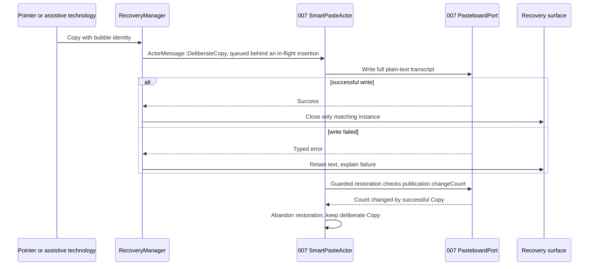
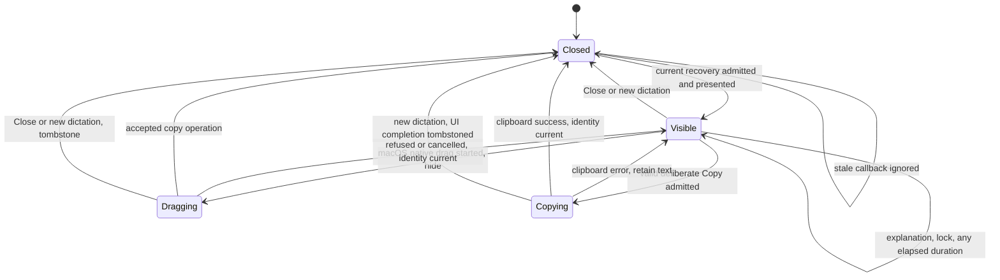
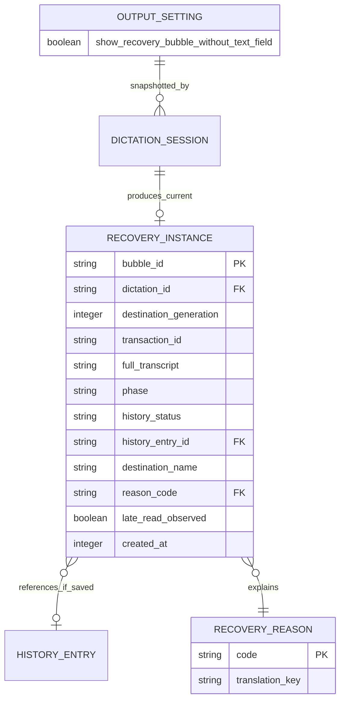

# Implementation Plan: Recovery Bubble

## Summary

Add a Rust recovery state machine before and after insertion, a nonactivating recovery surface, bounded macOS AX classification and native plain-text dragging; extend 008's existing output domain for the no-text-field setting and make deliberate Copy supersede pending 007 smart paste restoration through its changeCount guard. All of it ships behind 006's `destination-return` Cargo feature: with the gate closed (default build) a failed paste shows the existing `paste-error` message, as in `dev` (see [Rollout gate](#rollout-gate)).

Inspect [the functional source](spec.md) for FR-001–FR-005, AC-001–AC-007 and SC-001–SC-003. Scope **L** despite five FR: shared insertion, clipboard, native focus and three OS surfaces. 008, 006 (including its step 0) and 007 are delivered in `dev`; 010 comes last and integrates with them and with 009 once 009 ships. The shared contracts it consumes (`InsertionOutcome`, `DestinationContext`, `RecoveryDisposition`, `RecoveryPort::before_insertion`, `PreInsertionVerdict`) are fixed by the 006 plan and its destination contract. This command produces planning/review evidence only; runtime and design proof remain future gates.

## Technical Context

| Aspect | Choice | Basis |
|---|---|---|
| Native | Existing Rust 2021, Tauri 2.11.5, Tokio | Cargo manifest and default stack |
| macOS | Existing objc2/app-kit bindings, NSPanel, native NSView, ApplicationServices AX | Native drag and focus cannot be proved by DOM drag events |
| Windows/Linux | Existing nonactivating native overlay platform adapters, reduced actions | No drag or AX classifier outside macOS |
| Frontend | React 18, TypeScript, Zustand, i18next, existing CSS/Tailwind | Existing recording overlay and settings boundaries |
| Settings | Merged 008 service: descriptor row, `validation::validate_cli`/`validate_ui`, `PublicSettings`, output domain `OUTPUT_KEYS`, `tauri_adapter::write` for the UI | One store, lock, revision, transport and renderer |
| Storage | One volatile current recovery; existing history and settings | No new SQL table or cloud resource |
| Testing | Cargo unit/integration, Bun projection tests, Playwright UI, native release observations | Native focus and drag require real platform proof |

Inspect 008's implementation record (`.specs/features/008-settings-cli/implementation.md`) and the merged `src-tauri/src/settings_service/` as the framework reference; 008's plan (`.specs/features/008-settings-cli/plan.md`) is historical context only, and names it announced but never shipped (`commit_mutation`, `LiveSettingsEffects`) are not used. Reuse the merged `SettingDescriptor` (`descriptor_data.rs` rows), `SettingsMutation`, `validation::{validate_cli, validate_ui}`, `PublicSettings`, `Revision`, `SettingsError`, `tauri_adapter::write` and `settings_service/domains/output.rs` (`OUTPUT_KEYS`). Extend its existing output registration; do not create a parallel settings service or recovery configuration writer.

Inspect [006's plan](../006-destination-application/plan.md) as integration context for `DestinationManager`, `WorkspacePort`, `DestinationSession`, `DestinationContext`, `RecoveryDisposition` with `DestinationManager::set_disposition`, `RecoveryPort::before_insertion` and `InsertionOutcome`. Inspect [destination contract](../006-destination-application/contracts/destination-contract.md) as informative local boundary context. Inspect [007's spec](../007-smart-paste/spec.md) for smart paste outcomes and clipboard restoration context. Inspect [009's spec](../009-pin-mode-and-enter-rule/spec.md) for Enter context. These inspected documents do not import their entire obligation inventories into 010's review. Inspect [the recovery contract](contracts/recovery-contract.md) for 010's own planned native/API boundaries. Its rows on the 006 reason presenter, deliberate Copy, the 007 late read, the no-text-field reason and the setting predate the round 5 decisions of 2026-10-14; where they differ, this plan prevails until the contract is aligned in a later pass.

Inspect [actions](../../../src-tauri/src/actions.rs), [native overlay](../../../src-tauri/src/overlay.rs), [insertion](../../../src-tauri/src/clipboard.rs), [reliable paste](../../../src-tauri/src/paste_tx/mod.rs), [frontend overlay](../../../src/overlay/RecordingOverlay.tsx), [settings store](../../../src/stores/settingsStore.ts) and [manifest](../../../src-tauri/Cargo.toml) before implementation. Delivered 006 in `dev`: paste runs through `destination/delivery.rs` (`MainThreadPaste` on the main thread, `paste-error` toast on failure), and `actions.rs` hands the transcript to `destination::delivery::deliver` with `file_name: wav_saved.then_some(file_name)`, so a dictation whose WAV fails still gets a text-only history row. The default overlay is 256×50; existing streaming resizing does not prove interactive bubble/drag compatibility.

## Constitution Check

| Principle | Result and concrete decision |
|---|---|
| Preserve native/frontend boundaries | PASS: native manager owns transcript, decision and lifecycle; UI renders typed recovery projection |
| Derive stack/manager choices from manifests | PASS: retain Tauri/Tokio/objc2; review required AX feature flags rather than introduce a new framework |
| Tool availability differs from runtime | PASS: versions below certify availability only; real first-click, drag and platform checks remain mandatory |
| Specify changed behavior before code | PASS: no functional spec change; every FR/AC mapped below, explicit interpretation of review warnings |
| Meaningful tests/current source verification | PASS: real decision/state/service logic, injected OS ports, real CLI/native boundary proof |
| Naming/tooling | PASS: existing Rust snake_case and React names preserved; new UI files kebab-case; project Bun/ESLint/Prettier supersede generic Vitest/Biome preferences |
| i18n/privacy | PASS: all labels/reasons/explanations use translation keys; no transcript or foreign window titles in logs |
| Infrastructure | PASS: local APIs only; no new credentials, network service or provisioning |
| Native platform evidence (decision 2026-10-13) | PASS: macOS native evidence, taken on a build with `destination-return` and `smart-paste-dispatch` open, gates the steps and Implemented; Windows and Linux native checks are pending release evidence with their exact command (Step 1 and Step 7), never a step gate or a merge gate |
| Minimal scope (decision 2026-10-13) | PASS: only what the Input, the AC and the recorded decisions ask; no hover hint, closing animation, "closing loses" wording, platform note or extra recovery mechanism; seams limited to delivered ones plus 010's own surface, drag and classifier ports |

## Requirement Inventory

| FR | Acceptance and measures | Steps |
|---|---|---|
| FR-001 | AC-001/002; SC-001 decision table, classification deadline | 1, 2, 4, 7 |
| FR-002 | AC-001/003/005; SC-003, first click, 300 ms presentation | 1, 2, 4, 5, 7 |
| FR-003 | AC-004; SC-002, native full-payload drag, stale callbacks | 1, 2, 6, 7 |
| FR-004 | AC-005/006; clipboard, close, history, reduced platforms | 1, 2, 4, 5, 6, 7 |
| FR-005 | AC-002/007; default and shared UI/CLI validation | 3, 5, 7 |

Entities: RecoveryInstance, BubbleReason, FocusClassification and one new settings boolean. API/service interactions: 006 output handoff (`InsertionOutcome` with `method_outcome`), 010's `RecoveryPort::before_insertion` verdict feeding 006's single `RecoveryDisposition` (read by 009 for Enter), classification, surface actions, 007 late-read diagnostic and clipboard integration, and 008 settings. No HTTP endpoints: create the local contract below, no OpenAPI. Logical ER is included for the new volatile entity; no database migration beyond the existing settings default.

## Design Reference

| Screen | Component breakdown | Reference |
|---|---|---|
| recovery-bubble | Two-line transcript preview, reason, macOS native handle, Copy, Close, explanation | Spec Screens; shared mockup pass deferred before spec-ship |
| output-settings | NoTextFieldToggle and its label | Spec Screens; shared mockup pass deferred before spec-ship |

## Penflow Contract Inputs

Authoritative planned IDs: `flow_id: recovery-bubble`, `screen_id: recovery-bubble`, `screen_id: output-settings`. The user decision of 2026-10-12 defers flow/screen contracts, semantic/test IDs and Pencil mockups to one program pass before spec-ship. No IDs are minted here, no mockups generated and no root Penflow files modified.

Inspect [the semantic tree](../../../penflow/semantic-ui-tree.json) as current incomplete context: it contains microphone-priority only. Future primary input is `penflow/code-ir.json`, currently absent; expected tree and native desktop frame geometry are also absent. Inspection reports BLOCKED, certified=false; it is neither readiness nor certification for 010. No accepted 010 Penflow approval history is present. Semantic plan review may complete under this explicit deferral; it cannot approve absent UI sources.

Before UI implementation/spec-ship, the program owner must complete the cumulative contracts, stable IDs/bindings/outcome predicates, `penflow/ui.pen`, semantic tree, expected tree, code IR and homologous mockups. Complete authority prepare and bound `review-snapshot` → actual reviewer raw JSON → `review-result` → `pipeline update --phase plan-review --status done --review-result ...`, then design-profile run and PASS/certified=true status. The policy metadata preserves all four required procedures for that producing mode; absence is never N/A. Freeze identities after approval and re-review precise deltas on later source changes.

No theme.css/theme.md currently exists. At the shared UI pass, inspect/install its theme once if variables are absent; UI uses approved variables and geometry, never a fabricated bubble design or an assumed 256×50 fit. The final native/UI adapter must preserve semantic/test identities and native accessibility identifiers from those sources.

## Architecture Decisions

### Rollout gate

Orchestrator decision 2026-10-14 (round 4 review): all of 010 ships behind 006's `destination-return` Cargo feature (`destination::rollout::Rollout`; `.specs/features/006-destination-application/implementation.md`, section "Rollout gate"), like 009. 010 adds no gate of its own. Delivered 006 publishes an `InsertionOutcome`, retains a transcript and calls `RecoveryPort` only inside a destination session, and a session opens only with the gate open (`Rollout::opens_sessions`, on every platform). Every 010 test, clippy and the build run in the four feature combinations of [Resolved Test Commands](#resolved-test-commands): default, `smart-paste-dispatch`, `destination-return`, and `destination-return,smart-paste-dispatch`.

| Area | Gate closed (default build) | Gate open |
|---|---|---|
| Failed paste | Exactly `dev`: `delivery::paste_as_before` emits `paste-error` (the existing toast); with `smart-paste-dispatch` open, 007's `follow_without_session` emits the same `paste-error` for `not_read`, `permission_missing`, `uncertain` and `insertion_failed` (spec Clarifications, decision 2026-10-14: that combination is 010's closed build, so 007 AC-018's hand-off to the bubble is certified only with `destination-return` open); no bubble, no transcript retention, no `InsertionOutcome` | `delivery::publish` hands the outcome to 010; the bubble replaces `paste-error` once 010 acknowledges ownership (see [Recovery ownership](#recovery-ownership-history-and-006009-handoff)) |
| Pre-insertion check | None: no guard runs, so no `RecoveryPort` and no AX classification | 010's `RecoveryPort::before_insertion` at the first accepted guard check |
| Linux | Method failure shows `paste-error`, as in `dev` | A session opens with the `FrontmostAtEnd` route (no capture, destination unsupported); a method failure becomes `failed`/`insertion_failed` and shows the reduced bubble (AC-006); no other Linux recovery |
| Late read (007) | `smart-paste-late-read` keeps its current consumers; 010 registers nothing | 010's native sink updates the matching bubble |
| Setting | `show_recovery_bubble_without_text_field` does not exist: `get`, `set`, `output get` and `output set` answer 008's `not_found`/4 like any unknown key, as in `dev`, where the key never existed; no toggle; the checked 008 schema stays `dev`'s (as for 007 and 009) | Descriptor and CLI on every platform; on macOS the toggle and writes as specified; on Windows and Linux writes are refused `validation_failed`/2, `details.reason = "unsupported_platform"`, and no toggle is shown (spec Clarifications, decision 2026-10-14); the schema test adds the key when the gate is open |

Gate-conditional mechanism: the stored `AppSettings` field, its descriptor row and its `OUTPUT_KEYS` entry exist only under `cfg(feature = "destination-return")`, so `OUTPUT_KEYS` keeps `dev`'s length in the closed build and gains one entry in the open build; the inventory and schema tests assert each state's own count in its `cargo test` run. A value written by an open build survives a closed build's writes through 008's `raw_merge`. `PublicSettings` gains `show_recovery_bubble_without_text_field: Option<bool>`, serialized only when `Some`, which only a macOS build with the gate open fills; `bindings.ts` is generated once and serves both states, and the toggle renders only when that field is present. Generators (`bindings.ts`, `settings-cli.md`, README key list) run in the closed state, so checked artifacts equal `dev`'s; an open-state test asserts that the only difference is the added key, and the README names the key as available with destination return.

### Recovery decision table

Evaluate the first matching row, gate open, using the frozen dictation settings, current 006 target and pre-dispatch authorization. Revalidate after configured paste delay; never capture a new destination in 010. Empty/cancelled transcripts produce no recovery; preserve the existing no-output/clipboard behavior without creating a 007 transaction. This classifier does not change insertion method or clipboard policy. **Enter has one veto in the program, 006's `RecoveryDisposition { Pending, Insert, Recover, Cancelled }`** (shared with 009, see [Recovery ownership](#recovery-ownership-history-and-006009-handoff)); "no Enter" below means the disposition is not `Insert` when 009 claims its token, never a message from 010.

| Priority / input | Decision | Reason and Enter policy |
|---|---|---|
| Empty text or cancelled session | No bubble/no insertion | Disposition `Cancelled`: delivered 006 ends both through `delivery::abandon` (`DestinationManager::cancel`); no new smart paste transaction |
| Method none / no insertion due, all platforms | No bubble; existing no-insertion output, whatever the destination's state (spec AC-001, decision 2026-10-14) | Existing clipboard_handling applies independently; no smart paste transaction, AX/activation/Enter |
| Linux or a build without destination support (`FrontmostAtEnd` route, no classifier) | Existing insertion path | No destination failure fabricated, no classification; post-method failure can recover |
| macOS/Windows target closed, captured or explicitly selected | Recover before insertion | `InsertionOutcome.status = failed`, reason `app_closed`; 006 sets `Recover`; no insert/Enter |
| Pinned target not running | Recover before insertion | reason `pinned_app_not_running` (added by 009 to 006's reason enum); 006 sets `Recover`; no insert/Enter |
| Running pinned/captured target not confirmed frontmost, including final guard failure | Recover before insertion | reason `activation_failed` (009 reuses it for a running pin, with `destination_source = pinned`); 006 sets `Recover`; no insert/Enter |
| macOS target available/frontmost (any route, `FrontmostAtEnd` included), permission granted, setting on, definitely not editable | Recover before insertion | 010's `RecoveryPort::before_insertion(&DestinationContext)` returns `PreInsertionVerdict::Recover(RecoveryReason::NoTextField)` (006's `context::RecoveryReason`, reused unchanged); 006 sets `Recover` before any dispatch and the guard refuses with `GuardRefusal::RecoverInstead(RecoveryReason::NoTextField)`; 010 extends delivered 006 so this refusal is published as `status = failed` with the typed reason `no_text_field` (new `outcome::DestinationFailure::NoTextField`), never as a generic `insertion_failed` (see No-text-field reason below); 010 presents `No text field is focused`, without the partial-insertion detail; no insert/Enter |
| Editable; undetermined: focused element owned by another process (always, whatever its role), no focused element, AX error or timeout, 50 ms budget spent, or a destination with a 007 per-application strategy (`smart_paste::strategy`: Screen Sharing, iPhone Mirroring, Windows App, Jump Desktop, whose remote field cannot be read locally; spec AC-002); permission missing; setting off; non-macOS | Insert as usual | `before_insertion` returns `PreInsertionVerdict::Insert`; 006 sets `Insert`; 009 evaluates the truthful method outcome |
| `InsertionOutcome.method_outcome` is `not_read`, `uncertain` or `insertion_failed` | Recover at terminal outcome | `insertion_failed` reason; 006 moves the disposition to `Recover`; disclose possible partial insertion; no Enter |
| `InsertionOutcome.method_outcome` is `permission_missing` | Recover at terminal outcome | `insertion_failed` reason; 006 moves the disposition to `Recover`; no partial-insertion detail, since 007 checks the permission before any keystroke or clipboard change: the explanation says nothing was sent to the application (spec AC-001, Clarification 2026-10-14); no Enter |
| `method_outcome` is `inserted_verified`, `read_observed` or `typed` | No recovery | 009 may evaluate Enter for these three outcomes; only `inserted_verified` is field-verified |
| `method_outcome` is `clipboard_handed_over` | No recovery; 007's hand-over indicator | Neither insertion success nor failure; no Enter, transcript remains on clipboard for remote screen |
| Other actual insertion method reports failure: classic, direct or script method, or the Windows reliable paste (including the chord failure that 009 reports as a method error in the open build); Linux included, gate open | Recover after attempt | `status = failed`, reason `insertion_failed`, `method_outcome` absent; disclose possible partial insertion ("Some text may have reached the application"); no Enter |
| Other method returns success | `insertion_attempted` | No bubble; never claim field text verified |

Classify only when the verdict can matter: macOS, permission granted, setting on (frozen at dictation start), an insertion due and a destination without a 007 per-application strategy; otherwise answer `Insert` at once without any AX call (minimal scope: the classifier runs on the dispatching thread, often the main thread). A missing permission answers `Insert` before any AX query, and a per-application strategy destination is undetermined by rule (spec AC-002), so no AX query is made for it. If destination return is off/FrontmostAtEnd, use 006's resolved current actual dispatch target for classification without activating it. Readable Handy foreground/no valid non-Handy target follows 006's no-destination path; no availability failure invented. Classification cannot upgrade an invalid 006 authorization.

### Bounded AX classification and threading

`FocusedElementPort::classify` returns editable/not_editable/undetermined/permission_missing plus non-text diagnostics. Read `AXFocusedUIElement` of the destination's application element (`AXUIElementCreateApplication(target pid)`), never of the system-wide element, then that element's PID, role and settable AXValue/AXSelectedText/AXSelectedTextRange. A focused element whose PID differs from the destination's is undetermined, always and before any role check (spec AC-002, decision 2026-10-14): a proven noneditable role never overrides it. No focused element, a missing/unsupported attribute, an AX error or a timeout is undetermined; do not infer not-editable just because an attribute query failed. Secure/protected and unknown roles remain undetermined. A known text role plus supported editable attribute is editable; known nontext focus in the destination's own process, with successful attribute checks and no edit affordance, is not_editable. Finder, browser unfocused page, plain/rich fields and unknown custom controls form the early native calibration matrix.

Threading and budget (orchestrator decisions 2026-10-14, delivered 006): `RecoveryPort::before_insertion` is synchronous. Delivered 006 calls it inside `DispatchGuard::check()` (`first_pass`), at the first accepted guard check, after the method's `paste_delay_ms` and immediately before the first dispatch. That check runs on the main thread for every method dispatched by `delivery::MainThreadPaste` (the `check` closure of `clipboard::paste`), and on the insertion worker for smart paste (`smart_paste::dispatch`). The classification therefore runs on that thread, fast and bounded. Its total budget is one monotonic deadline of 50 ms (`CLASSIFY_BUDGET`) across all queries. `AXUIElementSetMessagingTimeout` is set per element: on the destination's application element and on every element obtained from it, each time to the remaining budget, as 007's `smart_paste::macos_ax` does. It is never set on the system-wide element (that timeout would apply to every later system-wide call of the Handy process) and never with the value 0 (which means the default timeout): when the remaining budget is spent, the classifier stops and answers `Insert` without another query. Check the remaining budget before each query; do not assume a parent's timeout propagates. A failure to set the timeout, an AX error, a timeout, an expired deadline or any doubt answers `Insert`, as `dev` inserts today: an uncertainty never blocks or delays a dictation beyond the budget, and no late decision is published. Because the timeouts are per element, 006's own reads keep their behavior: `destination/macos_focus.rs` and `guard.rs` read the foreground through their own system-wide element, which 010 never touches; a test reads the foreground through 006 right after a classification that hit its deadline and asserts an unchanged result. No worker, job slot, pending queue or post-classification recheck exists. 006's own `recheck()` (cancellation, supersession, foreground) runs in the same `check()` call just before the verdict. The at most 50 ms between that foreground read and the first dispatch is a documented residual window, of the same nature as 006's guard race. Tests with an injected clock assert that an expired deadline answers `Insert` and that each query's timeout equals the remaining budget. The Step 1 spike measures the classification on the main thread with a UI heartbeat; it passes when no sample exceeds 60 ms (the 50 ms budget plus one scheduling tolerance) over at least 30 runs across the calibration apps. If it cannot, field detection is not delivered: the verdict stays `Insert` (AC-002's undetermined path) and the gap is escalated to the user, never hidden by a longer wait.

Inspect [Apple AX timeout API](https://developer.apple.com/documentation/applicationservices/1459345-axuielementsetmessagingtimeout) as informative technical context for object-specific messaging limits. All 006/009 activation waiting (≤1 s) stays on 006's insertion worker, and clipboard lifecycle and pre-paste delays stay where 006 and 007 run them. 010 adds only its bounded classification inside `check()`, plus brief native requests and drag construction on the main thread. No thread join, sleep or poll loop on the UI thread. No automatic AX retries or activation retries are introduced.

### Recovery ownership, history and 006/009 handoff

`RecoveryManager` retains a full immutable final transcript in one current RecoveryInstance with bubble_id, dictation_id, destination_generation, transaction_id (when smart paste ran; 006's `Option<String>`, the decimal form of 007's `TransactionId(u64)`), `BubbleReason`, target display name, created_at, phase, history_status and optional history_entry_id. Native trusted handoff resolves 006's opaque transcript_ref before acknowledging ownership; UI receives only a targeted projection to the recovery window with preview and metadata, never an app-wide plaintext event. A manager-held full copy survives expiry of the upstream reference. No process-restart/crash durability is promised unless a real history entry exists.

Consume 006's `InsertionOutcome` exactly as the 006 plan defines it: `{dictation_id, destination_generation, outcome_id, target, destination_source, status, method_outcome, transaction_id, reason, history_status, history_entry_id, transcript_ref, completed_at}`. Dedupe `outcome_id` and reject a `dictation_id`/`destination_generation` that is not current, never by equal text. Map `app_closed`/`activation_failed`/`insertion_failed`, 009's `pinned_app_not_running` and 010's typed `no_text_field` into 010's presentation type `BubbleReason { AppClosed, PinnedAppNotRunning, ActivationFailed, InsertionFailed, NoTextField }`. `decide_recovery` takes `(status, reason, method_outcome or absent, platform)`: a failed outcome without `method_outcome` is classified from its reason alone, never from a method outcome. The name avoids 006's `destination::context::RecoveryReason`, which 010 reuses unchanged as the verdict reason of `PreInsertionVerdict::Recover`.

No-text-field reason (decision 2026-10-14): the `NoTextField` refusal reaches 010 as a typed reason, never as a generic failure. Delivered 006 drops the verdict reason: `guard::GuardRefusal::RecoverInstead` carries nothing and `insertion::refusal_report` maps it to `InsertionFailed`. 010 therefore extends 006 at these three points: `GuardRefusal::RecoverInstead(RecoveryReason)` keeps the verdict reason from `first_pass`, `outcome::DestinationFailure` gains `NoTextField` (wire value `no_text_field`), and `refusal_report` maps `RecoverInstead(RecoveryReason::NoTextField)` to it. 006's `context::RecoveryReason` itself stays as delivered (`NoTextField` only). The bubble is presented only from the outcome, after the transcript is retained, never from the verdict alone, and no side record or correlation table exists. A reason decided before insertion (`app_closed`, `pinned_app_not_running`, `activation_failed`, `no_text_field`) never shows the partial-insertion detail; a test publishes a `no_text_field` outcome and a legacy method error for the same dictation shape and asserts two distinct bubble texts.

Displayed application name: `InsertionOutcome.target` carries an `ApplicationIdentity` without a name. 010 reads the name when it consumes the outcome. `delivery::publish` calls the consumers before `DestinationManager::finish`, so `DestinationManager::snapshot()` still holds the session; 010 uses the `display_name` of its `Selection::Application` when its `dictation_id` and generation match. For a `FrontmostAtEnd` target, 010 uses the `display_name` of `WorkspacePort::instances(&target)`. Otherwise it uses the localized application noun, never an invented identity.

**One Enter veto, shared with 009.** The program has a single "insert or recover" decision: 006's `destination::RecoveryDisposition { Pending, Insert, Recover, Cancelled }`, carried by `DestinationSession` and changed only by `DestinationManager::set_disposition(dictation_id, destination_generation, next)` with monotonic transitions (`Pending → Insert | Recover | Cancelled`, `Insert → Recover | Cancelled`). 010 neither defines another disposition type nor sends a revocation message, and it never calls `set_disposition` itself. Its only input to that decision is the pre-insertion verdict it answers when 006 asks: 010 implements `RecoveryPort::before_insertion(&DestinationContext) -> PreInsertionVerdict { Insert, Recover(RecoveryReason) }` (the bounded no-text-field classification runs synchronously inside it, within `DispatchGuard::check()`, before 006 dispatches; see Bounded AX classification and threading). 006 records `Recover` for that verdict, for destination failures and for failed method results, and `Insert` immediately before the first dispatch; 009 consumes its Enter token only if the disposition read by 006's atomic `DestinationManager::claim_enter` is `Insert`. Consequently a recovery decision always precedes, or wins against, a pending Enter; drag and Copy never authorize Enter, regardless of Always; a late recovery event cannot undo a consumed token.

**Method outcome: no separate 007 adapter.** The terminal smart-paste result reaches 010 only through `InsertionOutcome.method_outcome`, which carries 007's `PasteOutcome.kind` wire value unchanged: `inserted_verified`, `read_observed`, `not_read`, `permission_missing`, `uncertain`, `typed`, `clipboard_handed_over` or `insertion_failed`. Do not flatten them into attempted/failed. 006 waits for 007's direct AX readback or clipboard read/no-read decision (800 ms after Cmd+V ordinarily, 3 s for Jump Desktop) before producing the outcome, without blocking the main thread; restoration timing is independent of this terminal outcome; the 300 ms bubble presentation budget begins at the terminal recovery decision. Preflight AX permission missing still means ordinary authorized method dispatch under AC-002; when smart paste itself reports `permission_missing` it sends no keystroke and recovers under AC-001 without the possible-partial-insertion detail. Only `inserted_verified`/`read_observed`/`typed` let 009 evaluate its policy; `clipboard_handed_over` retains 007's remote-screen indicator without bubble or Enter. Only `inserted_verified` proves the expected replacement was observed in the field; a clipboard read, typing dispatch and drop acceptance do not. macOS smart paste replaces its beta reliable paste path; Windows reliable paste and Linux methods remain unchanged. No recovery transfer to 007 or 10–15 s clipboard window is planned. Under 007 AC-017/018, direct AXSelectedText insertion runs first outside its special-app strategies: read value/range, write selected text, reread and compare the exact expected replacement. Unchanged value permits the clipboard fallback; unexpected changed value reports `uncertain` with no fallback, avoiding duplicate text. Current 007 AC-017/018 bounds direct AX, including its up-to-150 ms readback window for asynchronous updates, to at most 250 ms before fallback; this is distinct from 010's ~50 ms field-classification budget. 007 owns the destination-PID guard for direct AX (it reads `DestinationContext.target`) and the clipboard-handling setting; 010 consumes the terminal outcome without changing execution. 010 neither repeats the AX write nor retries paste. An `uncertain` result always presents Insertion failed with possible-partial-insertion details, even when no-text-field recovery is off; Enter is already excluded by the disposition. Never infer success from a bare `insertion_attempted` status.

**Late read after `not_read` (007 "may have been pasted after all").** A target can read the clipboard after 007 declared `not_read`; 007 then serves the transcript still on the clipboard, keeps the terminal outcome `not_read` (no Enter, no restoration) and publishes its idempotent `PasteDiagnostic { dictation_id, transaction_id, late_read_observed }`. That diagnostic is a 007 event, not a terminal outcome, so it is not a second outcome adapter: 010 matches it to the current recovery instance by `dictation_id` and the `transaction_id` that 006's `InsertionOutcome` carried: the outcome holds it as a decimal `String`, the diagnostic as 007's `TransactionId(u64)`, so 010 compares `diagnostic.transaction_id.0.to_string()` with the outcome's value. Delivered 007 publishes the diagnostic only as the webview event `smart-paste-late-read` (`smart_paste::app::EventDiagnostics`); with the gate open 010 adds a native sink to that `DiagnosticSink`, without changing the event. In clipboard handling "copy to clipboard", 007 produces no diagnostic (known 007 limitation), so the bubble keeps the plain not-read wording there. A diagnostic can arrive before 010 has admitted or shown the matching instance (007 emits it right after `not_read`, before 006 publishes the outcome). 010 therefore keeps such a diagnostic in a one-entry buffer keyed by `(dictation_id, transaction_id)` until the matching outcome is admitted, and applies it to an admitted instance even before it is visible; the buffer is cleared at the next dictation. 007's single `DiagnosticSink` is wrapped by a fan-out (`smart_paste::app::FanOutDiagnostics`, added by 010 in the open build) that forwards each diagnostic to `EventDiagnostics` unchanged and to 010's native sink. When it matches an admitted, visible or dragging instance, 010 updates that instance in place: the explanation (translated) adds that the text may have been pasted after all, so the user checks the application before copying again. It creates no second bubble, does not close or re-show the bubble, does not recopy automatically, never changes the reason, the disposition or the terminal outcome, and never authorizes Enter. A diagnostic for a closed, tombstoned or superseded instance, or with a stale identity, is ignored; a repeated diagnostic is a no-op. Before 010 ships, 007's diagnostic has no consumer and changes nothing.

006 reason-presentation capability transfers to 010 through delivered 006's synchronous `OutcomeConsumer::consume` (`destination::recovery::OutcomeRegistry`, called by `delivery::publish` on 006's insertion worker, never on the main thread). 010's consumer copies the transcript from `RecoverySlot` through `transcript_ref` into its own instance, then releases 006's slot, admits the instance and asks the surface to present it. `ConsumerAck::ReasonPresented` is returned only once the surface confirms that the bubble is actually visible (decision 2026-10-14); `consume` waits for that confirmation for at most the 300 ms presentation budget. `delivery::publish` uses the returned `Delivery { reason_presented }`, and `report_outcome` skips the `paste-error` toast only when it is true; today it ignores the result and always emits. If the confirmation misses the budget, 010 cancels the presentation (a late show is refused by the instance identity) and returns no acknowledgement, so delivered 006 emits its existing `paste-error` toast, whose payload already says whether the transcript is in history, and no bubble follows: a failure is reported exactly once, by the toast or by the bubble, never both (spec AC-001). That toast is delivered 006's only reason display: `dev` has no timed ≥4 s indicator reason, so no stronger fallback exists to preserve. Suppress the duplicate 006 indicator, including style none. Retry is an explicit error path with current identity, not duplicate outcomes. The bubble has no timeout, so its passive display lasts at least 4 s and the 006 ≥4 s rule is not weakened: only explicit Copy/Close/accepted-drop and a new dictation close it earlier, as spec AC-005 and its 2026-10-14 decision state; do not delay these actions to satisfy the prior indicator timer. Test the unchanged `paste-error` while no consumer is registered, a single report when present (toast or bubble), a missed presentation budget (toast, no later bubble), 4 s and 60 s passive visibility, screen lock, and a new dictation closing a bubble visible for less than 4 s.

Carry history_status unchanged from 006's `InsertionOutcome`, which derives it only from the actual `save_entry` result, never from the WAV (Julien's decision 2026-10-14, 006 history rule): saved when save_entry committed the row, including a text-only row when the WAV is disabled, unavailable or failed; failed when save_entry was attempted and failed; not_saved only when no history write was attempted (cancellation observed before the write). A recovery always follows a non-cancelled transcript, so not_saved is not expected there; if it arrives it gets the same no-history explanation as failed. The explanation text says kept in history only for saved; otherwise it says that the transcript is not in history (spec AC-005), with no further element. No new modal confirmation or automatic history store is introduced. Close/new dictation still close as specified, never delete history; successive recoveries do not guarantee earlier persistence. The precondition for Story 4's history assertion is successful saving. Insertion_failed additionally says some text may already have reached the app, even if the transcript is in history, except for `permission_missing`, where it says nothing was sent to the application.

### Read-confirmed restoration boundary

007 alone owns restoration: count only reads after Cmd+V; a read result can authorize 009 without waiting for restoration. Wait for 300 ms of quiet after the LAST read (1.5 s for Jump Desktop), resetting quiet on each later read, with an 8 s cap after the FIRST read. No read within 800 ms (3 s for Jump Desktop) reports not read and permanently forbids restoration for that dictation, including quit, new-output and late-read callbacks; the published transcript stays until another write. Copy from 010 is such a deliberate write. Existing copy-to-clipboard handling replaces restoration by keeping the transcript. 010 observes terminal outcomes and writes Copy through 007's actor (`ActorMessage::DeliberateCopy`); it creates no read timer or restoration owner.

### Surface and native drag

Choose a **dedicated nonactivating recovery surface** colocated with the indicator; never make the recording surface focusable or squeeze the bubble into 256×50. One surface arbiter excludes recording/menu/recovery overlap and coordinates 005/006/009 menus through their existing surface port. Spike a native NSPanel with an NSView drag handle beside the webview first: first mouse acceptance, no key/main-window acquisition, pointer/AT controls and a native drag source. Retain native objects on the main thread with correct ownership and SAFETY comments, typed snapshots across workers. Windows nonactivating first-click surface and Linux layer-shell KeyboardMode::None/hit region or explicit supported fallback are written and covered by automated tests; their native observation is pending release evidence (Step 1), which never blocks a step or the merge into `dev`. A focus-stealing fallback observed there is a release finding for that platform, not platform support.

Native drag uses NSView mouseDown event → NSPasteboardItem plain string → NSDraggingItem full-copy payload and separate preview image → beginDraggingSession. Advertise only copy, independent of modifier keys; do not mutate general clipboard or 007's smart paste restoration for drag. Hide the source after drag starts, retain source/session objects to callback completion. Operation none restores the unchanged current instance; accepted copy closes it and logs `drop accepted` without transcript. No foreign-field inspection or text_verified state. A nil/failed drag start leaves visible state and reports a localized error. New dictation/Close tombstones bubble identity; late drag callbacks cannot reshow it or affect a newer bubble. Pointer actions use exact bubble_id and destination generation.

Inspect [Apple drag start](https://developer.apple.com/documentation/appkit/nsview/begindraggingsession(with:event:source:)) and [drag end](https://developer.apple.com/documentation/appkit/nsdraggingsource/draggingsession(_:endedat:operation:)) as informative API context. Native accepted operation proves protocol acceptance only. Foreign drop-target indication is manual native observation; automated visual assertions cover Handy's open/closed, handle idle and preview dragging states only.

### Copy, close and settings

On macOS, Copy goes through 007's actor (`smart_paste::actor::SmartPasteActor`): 010 adds one request to 007's code, `ActorMessage::DeliberateCopy(text, reply)` behind a `SmartPasteActor::deliberate_copy(text)` method, which writes the full plain text through 007's `PasteboardPort`. The actor serializes it with 007's insertions, served reads, restoration check-and-write and timers, so Copy waits behind an in-flight insertion; that wait is bounded by 007's insertion allowance, and `recovery_clipboard.rs` measures it. Successful Copy advances the general pasteboard changeCount even when its text equals the published transcript; pending smart paste restoration then sees a count different from publication and abandons naturally. Do not invoke a window-cancellation API, invalidate smart paste timers from 010, or add a second clipboard lock/executor. If restoration finishes first, Copy writes last; if Copy finishes first, read-confirmed quiet/cap/quit/new-output restoration cannot overwrite it. Close only after the full-text write succeeds. Windows and Linux keep their existing deliberate Copy paths; 010 does not extend macOS smart paste or invent a Linux change counter.

On clipboard write error, remain visible with the full text and a localized retryable error; do not announce copied or close. Do not fabricate a cancellation or restart of smart paste restoration: its original changeCount guard still decides whether restoration owns the clipboard, including a partially changed pasteboard on failure. A late Copy completion for a tombstoned instance cannot close a new bubble. New dictation/Copy commands serialize at recovery action admission; a new dictation admitted before Copy invalidates that command. Once Copy is admitted its clipboard operation finishes, but its UI completion is still identity-guarded. Close and explanation do not alter 007's pending smart paste restoration. There is no recovery timeout; lock/unlock alone never closes it. Plain keyboard-only operation of the bubble is outside approved scope; pointer and assistive-technology focus are required. The settings toggle supports ordinary Tab/Space.

Add `show_recovery_bubble_without_text_field: bool` default true (open build only, see [Rollout gate](#rollout-gate)) via a reviewed `descriptor_data.rs` row (`Boolean`, owner `output`, no runtime effect: read at dictation start), `validate_cli`/`validate_ui` and `PublicSettings`. Register in the existing output domain by adding the key to `domains::output::OUTPUT_KEYS`: `handy settings output get show_recovery_bubble_without_text_field --json` and `handy settings output set show_recovery_bubble_without_text_field true|false --json`, plus generic get/set. The UI writes it with `tauri_adapter::write` (the same `SettingsMutation`, ordered write and `settings-changed` revision listener as every 008 scalar). Read defaults without writing; any startup migration goes through 008's normalization only. Invalid/null/nonbool → validation_failed/2, stale revision → revision_conflict/3/current_revision, no-op keeps revision, actual change increments once; persistence/internal error=1, not_found=4, unavailable=5. Preserve exact `{ok:true,revision:N,data:{...}}` / `{ok:false,error:{code,message,details:{...}}}`; JSON stdout is one envelope only. No transcript in CLI output.

007 registers `paste_method=smart_paste` in 008's existing output descriptor and domain, with UI/CLI validation parity and, outside macOS, the D4 refusal `SettingsError::unsupported_platform(Some("paste_method"))` (`validation_failed`, `details.reason = "unsupported_platform"`). 010 consumes that frozen method setting; it adds only its own no-text-field boolean and no clipboard_recovery_* keys. Method migration/default ownership stays in 007; reliable_paste Windows remains intact.

With the gate open, the setting acts only on macOS field detection, never on unavailable destination/method failure recovery. On Windows and Linux it is refused (spec Clarifications, decision 2026-10-14): a `KEY_CAPABILITIES` row ties the key to a new `PlatformCapability::FocusedFieldDetection`, which only macOS builds with the gate open declare, so the shared validator refuses UI and CLI writes there with `validation_failed`/2, `details.reason = "unsupported_platform"`, and the toggle is not shown. Snapshot at accepted dictation start; changes affect the next dictation and never dismiss the current bubble. Output help adds the descriptor without changing 008's domain trait/transport. Method, destination, Enter and clipboard settings remain separate.

## Gherkin Scenarios and Sequence Diagrams

```gherkin
Feature: Recovery insertion handoff
  Scenario: No insertion requested
    Given paste method is none and final text is nonempty
    When output completes
    Then no recovery bubble, AX classification, activation or Enter occurs
    And ordinary clipboard_handling applies without a smart paste transaction
  Scenario: Noneditable focus
    Given macOS permission and field recovery are on and the target is frontmost
    When bounded classification says not editable
    Then no insertion or Enter occurs and the bubble is visible within 300 ms of the decision
  Scenario: Undetermined or wrong process focus
    When AX expires or the focused element belongs to another process, even with a proven noneditable role
    Then classification is undetermined and insertion follows the ordinary authorized path
  Scenario: Per-application strategy destination
    Given the destination is Screen Sharing, handled by a 007 per-application strategy
    When insertion is due with field recovery on
    Then no AX query is made, the verdict is Insert and smart paste runs its strategy
  Scenario: Classification over budget
    Given the check runs on the main thread after the paste delay
    When the AX queries have not answered within the 50 millisecond deadline
    Then the verdict is Insert and the dictation is inserted as in dev, with no later decision
    And 006's next foreground read through its own system-wide element is unchanged
  Scenario: No text field reported through 006 as a typed reason
    Given 010 answered Recover(NoTextField) for dictation D at generation G
    When 006 publishes D at G as failed
    Then the outcome reason is no_text_field, not insertion_failed
    And the bubble says "No text field is focused" without the partial-insertion detail
  Scenario: Overlay style none
    Given the overlay style is none and the destination closed before insertion
    When the outcome is published
    Then the bubble is shown and acknowledged, and no paste-error toast is emitted
  Scenario: Windows reliable paste failure
    Given a Windows build with the gate open and the reliable paste chord fails
    When 006 publishes the outcome failed with insertion_failed and no method_outcome
    Then the bubble says "Insertion failed" with the detail "Some text may have reached the application"
  Scenario: Closed gate keeps the dev error
    Given a build with the destination-return gate closed
    When the paste fails
    Then the existing paste-error message is shown and no bubble, retention or classification occurs
  Scenario: Linux method failure with the gate open
    Given a Linux build with the destination-return gate open
    When the insertion method reports failure
    Then the reduced bubble shows "Insertion failed" with Copy, Close and the explanation, without drag
  Scenario Outline: Smart paste terminal outcome
    Given smart paste runs after the authorized destination preflight
    When 006's InsertionOutcome carries method_outcome <outcome>
    Then recovery is <recovery> and automatic Enter eligibility is <enter>
    And only inserted_verified records direct AX readback matching the expected replacement
    Examples:
      | outcome               | recovery                    | enter                 |
      | read_observed         | absent                      | 009 policy evaluation |
      | inserted_verified     | absent                      | 009 policy evaluation |
      | typed                 | absent                      | 009 policy evaluation |
      | not_read              | Insertion failed bubble     | never                 |
      | permission_missing    | Insertion failed bubble     | never                 |
      | clipboard_handed_over | absent; hand-over indicator | never                 |
      | insertion_failed      | Insertion failed bubble     | never                 |
      | uncertain             | Insertion failed bubble     | never                 |
  Scenario: Unexpected AX change
    Given direct AX insertion changed the value differently from the expected replacement
    When 007 reports uncertain with the current session identity
    Then no clipboard fallback or second insertion occurs
    And the bubble explains possible partial insertion and no Enter is sent
  Scenario: Permission missing
    Given smart paste reports permission_missing before any keystroke
    When the bubble is shown
    Then the explanation says nothing was sent to the application, without the possible-partial-insertion detail, and no Enter is sent
  Scenario: No clipboard read
    Given Cmd+V was dispatched and no post-keystroke read occurred
    When the 800 ms no-read deadline expires
    Then the terminal not read result shows the bubble
    And old clipboard content is never restored, even on quit or a late read
  Scenario: Method failure
    Given the method may have partly dispatched text
    When it reports failure
    Then the bubble says Insertion failed with a possible-partial-insertion explanation and no Enter
  Scenario: Late read after not read
    Given a bubble shows Insertion failed for a not_read outcome of transaction T
    When 007 publishes PasteDiagnostic with late_read_observed for the same dictation and transaction T
    Then the same bubble's explanation says the text may have been pasted after all
    And no second bubble appears, the outcome stays not_read and no Enter is sent
  Scenario: One Enter veto
    Given automatic Enter is Always
    When 010 answers before_insertion with Recover(no_text_field)
    Then 006 sets the disposition to Recover before any dispatch
    And 009 finds no Insert disposition at its claim and sends no Enter
```

```mermaid
sequenceDiagram
  participant O as 006 orchestrator (DestinationManager)
  participant R as 010 RecoveryPort and RecoveryManager
  participant AX as Bounded FocusedElementPort
  participant I as Existing method or 007 smart paste
  participant E as 009 Enter authority
  participant UI as Nonactivating surface
  alt destination-return gate closed
    O->>O: No session; dev insertion, failure shows paste-error
  else no insertion due
    O->>O: Skipped outcome; no recovery, no Enter
  else unavailable or activation not confirmed
    O->>O: set_disposition(Recover)
    O->>R: InsertionOutcome failed (app_closed / activation_failed / pinned_app_not_running) and transcript_ref
    R->>UI: Present recovery projection after retaining the transcript
    UI-->>R: Visible within 300 ms
    R-->>O: ConsumerAck::ReasonPresented, so no paste-error
  else target authorized
    O->>I: Hand the method its guard (006 insertion worker)
    I->>I: Preserved paste_delay_ms
    I->>O: First DispatchGuard::check() (main thread, or smart paste worker)
    O->>O: recheck() cancellation, supersession and foreground
    O->>R: before_insertion(DestinationContext), synchronous
    R->>AX: Classify the app element's focus, 50 ms deadline, per-element timeouts
    AX-->>R: Classification, or undetermined on timeout, foreign PID or doubt
    alt definitely not editable and setting on
      R-->>O: PreInsertionVerdict::Recover(NoTextField)
      O->>O: set_disposition(Recover); GuardRefusal::RecoverInstead(NoTextField), no dispatch
      O->>R: InsertionOutcome failed, reason no_text_field, transcript_ref
      R->>UI: Present no text field reason
      UI-->>R: Visible
      R-->>O: ConsumerAck::ReasonPresented
    else ordinary insertion
      R-->>O: PreInsertionVerdict::Insert
      O->>O: set_disposition(Insert) inside check()
      O-->>I: Context accepted; first dispatch follows at once
      I-->>O: Terminal PasteOutcome.kind or method result
      alt not_read, uncertain or insertion_failed
        O->>O: set_disposition(Recover)
        O->>R: InsertionOutcome failed with method_outcome
        R->>UI: Present Insertion failed, possible partial insertion
        R-->>O: ConsumerAck::ReasonPresented once visible
      else permission_missing
        O->>O: set_disposition(Recover)
        O->>R: InsertionOutcome failed with method_outcome
        R->>UI: Present Insertion failed, nothing sent to the application
        R-->>O: ConsumerAck::ReasonPresented once visible
      else inserted_verified, read_observed or typed
        E->>O: Atomic claim reads disposition Insert, then 009 policy
      else clipboard_handed_over
        O->>O: 007 remote clipboard indication, no Enter
      end
    end
  end
```

```gherkin
Feature: Deliberate Copy dominates restoration
  Scenario: Deliberate Copy supersedes smart paste
    Given macOS smart paste has a pending restoration with its publication changeCount
    When Copy writes the full transcript, including identical text, before restoration
    Then changeCount advances and the bubble closes after successful write
    And any eligible last-read quiet, 8 s cap or quit restoration abandons without overwriting Copy
  Scenario: Copy during repeated reads
    Given dictation A's smart paste succeeded and its restoration is pending while post-keystroke reads keep resetting 007's 300 ms quiet timer
    And dictation B then produced a bubble before its own insertion, for example no_text_field
    When deliberate Copy advances changeCount before the quiet deadline or 8 s cap
    Then 007 abandons restoration and the full copied transcript remains
  Scenario: Copy fails
    When writing the clipboard fails
    Then the bubble stays visible, its transcript stays available and a localized error appears
    And no copied announcement or false history guarantee is given
```



## State Model

```gherkin
Feature: Recovery lifetime
  Scenario: Refused drag
    Given bubble A is visible
    When native drag begins and ends with no accepted operation
    Then A hides during drag and returns with identical text and reason
  Scenario: New dictation while dragging
    Given bubble A is dragging
    When a new dictation starts and its result creates bubble B
    Then A is permanently closed and A's late callback cannot show A or close B
  Scenario: Passive lifetime
    Given the bubble is visible without user action
    When 4 seconds, 60 seconds or a screen lock passes
    Then the same bubble remains until an explicit closure event
  Scenario: New dictation before 4 seconds
    Given the bubble has been visible for 1 second
    When a new dictation starts
    Then the bubble closes at once and the live indicator appears
  Scenario: Late read before the bubble is shown
    Given 007 published a late-read diagnostic for dictation D and transaction T
    When the not_read outcome of D and T is admitted afterwards
    Then the bubble is shown with the "may have been pasted after all" explanation
```



## Data Model

Logical relations only; no new database table.



## Implementation Plan

### Step 1 — Prove native recovery surface and AX limits

**Prerequisite:** Complete+ready independent plan review and shared progression; cumulative UI preparation/design gate before application UI code.
**Required inputs:** Existing 256×50 panel, platform APIs, 006 WorkspacePort, planned screen IDs and isolated native proof app/build.
**Action:** New `src-tauri/src/recovery/{mod.rs,platform/macos.rs,platform/windows.rs,platform/linux.rs}`, `src-tauri/tests/recovery_native.rs` and the native proof harness `scripts/recovery-native-proof.ts` (Bun orchestration, no shell script) spike a dedicated surface, actual first-click controls, NSView drag/session lifetime and bounded AX. Modify `overlay.rs` only for common surface arbitration during implementation. Record TextEdit/Notes full drop, ChatGPT/Comet outcomes, cancellation, stale callbacks and VoiceOver on macOS before production UI work, on a binary built with `destination-return` and `smart-paste-dispatch` open. The AX spike reads the destination's application element with per-element timeouts only and checks that 006's foreground read is unchanged afterwards. The Windows and Linux first-click/focus spikes of the same harness are pending release evidence; their adapters are written and compiled, and their policy is covered by automated tests.
**FR covered:** FR-001.1: Bounded AX classification spike, FR-002.1: Nonactivating surface feasibility, FR-003.1: Native drag proof, FR-004.1: Reduced platform feasibility
**Execution evidence:** OS/build hashes, frontmost PID/key-window observations, payload comparison, timing samples, native matrix in `proofs/010-recovery-bubble/<os>/native-spike.md`.
**Success criteria:** On macOS: real first click without activation, full TextEdit/Notes transfer, native copy operation and refusal recovery; AX classification within its 50 ms deadline on the main thread (no sample above 60 ms over at least 30 runs), or `Insert`, without UI stall; 006's foreground read unchanged after a classification. Windows/Linux code builds and passes its automated tests. Any native deficiency is explicit, not an inferred pass.
**Failure handling:** Stop dependent UI/native wiring on a failed macOS gate; record exact criterion and separately approved alternative needed, no focusable fallback or silent removal of drag. A Windows/Linux failure observed later is a release finding for that platform, not a step gate. Per the constitution (decision 2026-10-13), checks that need Windows, Linux, an older Handy binary or a second user account are recorded as **pending release evidence** with the exact command (`bun scripts/recovery-native-proof.ts --binary <absolute-binary> --platform windows|linux --out <proof-dir>`: Windows reduced bubble on unavailable destination, activation and method failure, Narrator, no drag; Linux method-failure-only bubble on X11, Wayland and with layer-shell disabled, Orca, overlay style none); they never block a step, feature completion on the integration branch or the merge into `dev`, and are never claimed as passed.

### Step 2 — Define recovery model and pure policy

**Prerequisite:** Step 1 mechanism proven on macOS; upstream contracts fixed by the 006 plan (`InsertionOutcome`, `DestinationContext`, `RecoveryDisposition`, `RecoveryPort::before_insertion`, `PreInsertionVerdict`) and 007's `PasteOutcome`/`PasteDiagnostic`.
**Required inputs:** Decision/reason table, 006 `InsertionOutcome` with `method_outcome`, 006 `RecoveryPort`/`PreInsertionVerdict`, 007 `PasteDiagnostic` and changeCount guard, history status.
**Action:** New `recovery/{types.rs,decision.rs,manager.rs,ports.rs}` define RecoveryInstance/Reason/Phase, pure decide_recovery over `(status, reason, method_outcome or absent, platform)`, the `RecoveryPort::before_insertion` implementation returning `PreInsertionVerdict`, the late-read update of an admitted instance with its one-entry pre-admission buffer, dictation-bound actions and latest slot. Add inline Rust unit tests plus `src-tauri/tests/recovery_lifecycle.rs`; implement retained native transcript lookup and explicit ownership acknowledgement with surface errors.
**FR covered:** FR-001.2: Complete decision table, FR-002.2: Reason and Enter ownership, FR-003.2: Identity guarded drag lifecycle, FR-004.2: Copy close and history lifecycle
**Execution evidence:** Zero-mismatch exhaustive decision cases over the eight `method_outcome` values and over an absent `method_outcome` with each reason (`app_closed`, `activation_failed`, `pinned_app_not_running`, `no_text_field`, `insertion_failed` from a classic, direct, script or Windows reliable method), the detail split ("Some text may have reached the application" for method failures, "nothing was sent" for `permission_missing`, none for pre-insertion reasons), foreign-process focus always undetermined, overlay style none presenting the bubble, stale callbacks, duplicate outcomes, `PasteDiagnostic` matching/stale/repeated cases, Copy errors/restoration races and saved/not_saved/failed cases.
**Success criteria:** Each first-match row covered; no fabricated verification (only 007 direct AX readback), automatic timeout or history mutation; no stale action affects newer instance.
**Failure handling:** Any text-loss race, Enter leak or contradictory reason is P0; repair policy before integration.

### Step 3 — Extend 008 settings without another writer

**Prerequisite:** 008 merged (`e9f96df`) and Step 2 policy key stable.
**Required inputs:** `descriptor_data.rs` row, `SettingsMutation`, `validate_cli`/`validate_ui`, `domains::output::OUTPUT_KEYS`, revision/CAS semantics, `tauri_adapter::write`.
**Action:** Modify `src-tauri/src/settings.rs`, `settings_service/{descriptor_data.rs,public.rs,domains/output.rs,platform_capability.rs}` for the default-on bool, its public projection and its `KEY_CAPABILITIES` row with `PlatformCapability::FocusedFieldDetection`, present only in the open build (closed: `not_found`/4, checked schema unchanged from `dev`; the schema test adds the key when the gate is open; Windows and Linux refuse writes with `unsupported_platform`), with the gate-conditional mechanism of [Rollout gate](#rollout-gate), then regenerate bindings and update `settings-cli.md` and the README output-key list through the supported generators, run in the closed state; the value is read at dictation start, so no `effects.rs` entry. The UI command uses `tauri_adapter::write`; the CLI uses the existing output domain, generic `set`, private transport and renderer. Add `src-tauri/tests/recovery_settings.rs` for real domain and UI command adapters with isolated stores.
**FR covered:** FR-005.1: Shared descriptor CLI and validation
**Execution evidence:** JSON stdout/exits, invalid/null/type tests, no-op/CAS/concurrent independent-field mutations, persisted revision and UI refresh; per gate state the descriptor and `OUTPUT_KEYS` counts; open-state `unsupported_platform` refusal with an injected non-macOS capability set; closed-state `not_found`/4.
**Success criteria:** Generic/domain/UI agree; one changed commit/one increment, reads do not persist; no unrelated setting overwritten, no new transport.
**Failure handling:** Shared service mismatch/JSON contamination/direct store write blocks; never modify 008 plan as an integration shortcut.

### Step 4 — Integrate output, clipboard and Enter guards

**Prerequisite:** Steps 2/3 complete; 006 (including step 0), 007 and 009 merged into `dev`.
**Required inputs:** actions.rs terminal lifecycle, WorkspacePort, actual history save result, existing insertion methods/delays, 007's `SmartPasteActor` and `PasteboardPort`.
**Action:** Modify `lib.rs` (manager and command registration, open build only) and the 006 and 007 files at the delivered integration points. In `destination/delivery.rs`, `orchestrator()` takes 010's `RecoveryPort` from managed state instead of `NoRecoveryConsumer`, and `publish`/`report_outcome` skip `paste-error` when `Delivery { reason_presented }` is true. In `destination/app.rs`, 010's `OutcomeConsumer` is registered in `OutcomeRegistry`. In `smart_paste/app.rs`, `FanOutDiagnostics` forwards each diagnostic to `EventDiagnostics` and to 010's native late-read sink. In `destination/guard.rs`, `GuardRefusal::RecoverInstead` carries the verdict's `RecoveryReason`; in `destination/outcome.rs`, `DestinationFailure` gains `NoTextField`; in `destination/insertion.rs`, `refusal_report` maps `RecoverInstead(NoTextField)` to it (see No-text-field reason). In `smart_paste/actor.rs`, `ActorMessage::DeliberateCopy` and `SmartPasteActor::deliberate_copy` carry Copy on macOS. Consume `InsertionOutcome` and 007's `PasteDiagnostic`, and connect deliberate Copy through 007's actor and changeCount guard. 009's Enter authority is not modified: it already reads 006's `RecoveryDisposition`. Preserve upstream separation: no second activation orchestrator, clipboard timer, Enter sender or veto. Read the transcript only through `InsertionOutcome.transcript_ref` and the history status only from `InsertionOutcome.history_status` (no second retention path in `actions.rs`); the bounded classification runs inside `check()` as specified, and no other wait is added to the main thread. With the gate closed none of this is registered and `dev`'s `paste-error` path runs unchanged. Add `src-tauri/tests/recovery_output.rs` and `recovery_clipboard.rs`.
**FR covered:** FR-001.3: Guarded preflight and method failure, FR-002.3: Indicator handoff and Enter veto, FR-004.3: Serialized Copy and history handoff
**Execution evidence:** The four feature combinations (closed: a failed paste shows `paste-error` exactly as `dev`, with no classification, no consumer, no `RecoveryPort` and no bubble, asserted by a default-build test in `recovery_output.rs`; open: bubble), None/default/delayed insertion regressions, `Recover(NoTextField)` verdict before dispatch with Always Enter (zero Enter) and its typed `no_text_field` outcome presented as `No text field is focused`, main-thread classification within its 50 ms deadline with heartbeat and 006's unchanged foreground read afterwards, overlay style none presenting the bubble, `ReasonPresented` only after the surface is visible, `paste-error` suppression and the missed-budget toast without a later bubble, late-read update of the same bubble including a diagnostic received before admission, Copy queued behind an in-flight insertion with its measured wait, 007 direct AX verified/unchanged/unexpected-change outcomes, post-keystroke read/no-read and quiet/cap/quit restoration races on macOS; unchanged Windows reliable paste/Linux method regression (automated), failed write, genuine WAV failure with a text-only row saved and genuine save_entry failure.
**Success criteria:** Before-recovery inserts zero; after-failure never submits; exactly one report per failure (toast or bubble), indefinite passive reason; deliberate Copy never restored, no history deletion.
**Failure handling:** Abort release on lost text, doubled insertion, incorrect history claim or restoration overwrite; preserve current transcript on surface/clipboard failure.

### Step 5 — Render accessible bubble and output setting

**Prerequisite:** Step 1 and shared pre-ship Penflow/theme/bound review/design gate PASS; typed projection from Steps 2–4.
**Required inputs:** Approved code IR, flow/screens/semantic/test IDs, theme variables, nonactivating first-click port, i18n.
**Action:** New `src/overlay/recovery-bubble.tsx`, `recovery-bubble.css`, `recovery-preview.ts`, `recovery-preview.test.ts` and `src/components/settings/recovery-bubble-toggle.tsx`; modify overlay entry/RecordingOverlay visibility arbiter, actual output settings composition, settingsStore and specta bindings via supported generator. Add the new keys to all 26 locales (English and French translated, English text in the others until translated), since `bun run check:translations` fails when any locale lacks a key. The toggle renders only when the settings snapshot carries `show_recovery_bubble_without_text_field` (macOS, gate open). Native targeted projection carries first two visible lines with ellipsis; full text never replaced by preview. Explanation and error text honor history outcome and the late-read "may have been pasted after all" update; hide drag entirely on Windows/Linux.
**FR covered:** FR-002.4: Preview reason and first click UI, FR-004.4: Explanation close and platform actions, FR-005.2: UI setting parity and refresh
**Execution evidence:** Playwright states (open, closed)/labels/Tab-Space toggle/RTL-long-Unicode preview checks and native AT/focus transcript; a sentinel-transcript test proving the preview is emitted only by the targeted event to the recovery window, never in an app-wide event, an `InsertionOutcome` payload or a non-debug log; decision-to-visible samples within 300 ms on macOS.
**Success criteria:** All controls named, pointer/AT operate without stealing keyboard focus; exact canonical reason table, no unconditional history text; ordinary keyboard settings operation, two-line preview and full Copy payload.
**Failure handling:** Missing approved IDs/theme/certification, focus capture, truncating payload or incorrect platform controls blocks acceptance; no new shortcut invented.

### Step 6 — Finish native drag and action binding

**Prerequisite:** Steps 1/2/4/5 pass with current bubble identity and approved geometry.
**Required inputs:** AppKit native drag handle, full manager-owned text, preview geometry and 007 unchanged clipboard policy.
**Action:** Complete `recovery/platform/macos.rs` and native drag view with retained source/session, only-copy mask, plain text/preview, visible restore on refused/cancelled operation and nil-start errors. Windows/Linux adapters remain Copy/Close/explanation only. Extend native lifecycle/action test hooks using the same manager, not a parallel fake behavior.
**FR covered:** FR-003.3: Full payload drag and callbacks, FR-004.5: Explicit closure and failure behavior
**Execution evidence:** Native four-app payload/results matrix, accepted/refused/cancelled/new-dictation race, unchanged general clipboard during drag and transcript-free outcome logs.
**Success criteria:** TextEdit/Notes full transfer; every ChatGPT/Comet result recorded; only drop accepted claimed, stale events ignored; no automatic Enter after drag.
**Failure handling:** Failed supported-app/native lifecycle proof blocks SC-002/AC-004; third-party rejection is recorded without false text-transfer certification.

### Step 7 — Prove regression, AC/SC and platform evidence

**Prerequisite:** Steps 1–6 complete, target release builds available, reviewed design inputs frozen.
**Required inputs:** Independent acceptance matrix, real OS sessions, private test store/clipboard fixtures with cleanup, executable build hashes.
**Action:** New `tests/recovery-bubble.spec.ts`, completion of `scripts/recovery-native-proof.ts` (created in Step 1) and finalized Rust targets below. Run the deterministic Rust/frontend/CLI suite in the four feature combinations; execute the native manual matrix for macOS AX/drag/focus on the binary built with `destination-return` and `smart-paste-dispatch` open. The Windows reduced bubble and Linux X11/Wayland/layer-shell matrices are pending release evidence. Produce latency/no-Enter/history/privacy evidence and AC/FR/SC assertion matrix; run design/runtime visual comparison via the approved Penflow adapter later.
**FR covered:** FR-001.4: Decision and AX regression proof, FR-002.5: No Enter and presentation evidence, FR-003.4: Native drop acceptance matrix, FR-004.6: Clipboard history and OS proof, FR-005.3: Real CLI UI parity proof
**Execution evidence:** Commands/exits, binary hashes, all timing samples, screenshots/native observations, clipboard generations and assertion matrix under `proofs/010-recovery-bubble/<os>/`.
**Success criteria:** On macOS, AC-001 to AC-005, AC-007 and the three SC are covered by suitable real evidence. This step does not prove AC-006 on macOS: its Windows and Linux policy (reduced actions, Linux method-failure-only recovery, no drag) is covered by the automated per-platform decision-table tests, and its native observation on Windows and Linux is pending release evidence, never claimed here; P0/P1 gates pass without unexplained failure; no native acceptance inferred from browser mocks/tool versions.
**Failure handling:** Missing or failed macOS native or design proof keeps the feature from Implemented, with its exact cause. Per the constitution (decision 2026-10-13), checks that need Windows, Linux, an older Handy binary or a second user account are recorded as **pending release evidence** with the exact command (`bun scripts/recovery-native-proof.ts --binary <absolute-binary> --platform windows|linux --out <proof-dir>`: Windows reduced bubble on unavailable destination, activation and method failure, Narrator, no drag; Linux method-failure-only bubble on X11, Wayland and with layer-shell disabled, Orca, overlay style none); they never block a step, feature completion on the integration branch or the merge into `dev`, and are never claimed as passed.

## Resolved Test Commands

Availability rechecked 2026-10-13: Cargo 1.94.0 and Bun 1.3.9. Proposed tests/harnesses do not exist yet and no app tests/builds were executed during planning. No surfaces.yaml; use Playwright config `testDir: ./tests` and Cargo `src-tauri/tests`.

| Action | Command | Status |
|---|---|---|
| Rust unit/policy | `cargo test --manifest-path src-tauri/Cargo.toml --lib recovery` | Cargo available; tests planned, native build prerequisites unverified |
| Lifecycle/insertion | `cargo test --manifest-path src-tauri/Cargo.toml --test recovery_lifecycle --test recovery_output` | Targets planned |
| Clipboard/settings | `cargo test --manifest-path src-tauri/Cargo.toml --test recovery_clipboard --test recovery_settings` | Targets planned; real isolated transaction boundaries |
| Native harness adapter | `cargo test --manifest-path src-tauri/Cargo.toml --test recovery_native` | Target planned; does not replace interactive native checks |
| Frontend pure logic | `bun test src/overlay/recovery-preview.test.ts` | Bun available; file planned |
| Existing frontend regression | `bun run test:keyboard` | Script observed; not run |
| Browser/visual UI | `bun run test:playwright -- tests/recovery-bubble.spec.ts` | Local Playwright absent; TOOL NEEDED `bun install`, then `bunx playwright install chromium`; no visual baseline exists yet |
| Native/manual recording | `bun scripts/recovery-native-proof.ts --binary <absolute-binary> --platform <macos\|windows\|linux> --out <proof-dir>` | Harness created in Step 1; operator supplies native observations, not synthesized results; the Windows and Linux runs are pending release evidence |
| Typecheck | `bunx --no-install tsc --noEmit`; `cargo check --manifest-path src-tauri/Cargo.toml` with each of the four feature combinations | Local tsc absent; install pinned deps; Cargo available |
| Lint/format | `bun run lint`; `bun run format:check`; `cargo clippy --manifest-path src-tauri/Cargo.toml --all-targets -- -D warnings`, then the same with `--features smart-paste-dispatch`, `--features destination-return` and `--features destination-return,smart-paste-dispatch` | Local ESLint absent; install dependencies, native clippy build unverified |
| Translation | `bun run check:translations` | Script observed, not run |
| Full suite | `cargo test --manifest-path src-tauri/Cargo.toml`; `cargo test --manifest-path src-tauri/Cargo.toml --features smart-paste-dispatch`; `cargo test --manifest-path src-tauri/Cargo.toml --features destination-return`; `cargo test --manifest-path src-tauri/Cargo.toml --features destination-return,smart-paste-dispatch`, plus frontend/CLI/browser/native proof above | Required composite implementation gate; the two runs without `destination-return` prove `dev`'s `paste-error` path (including 007's sessionless path), the combined run drives real smart-paste outcomes into the bubble; no present PASS |
| Release | `bun run build`; `bun run tauri build`; native proof binary: `bun run tauri build --features destination-return,smart-paste-dispatch` | Scripts observed; SDK/model resource setup from BUILD.md required later; the macOS native evidence is taken on the gate-open binary only |

## Testing Strategy

| Priority/level | Cases and concrete planned files | Mapping |
|---|---|---|
| P0 unit | First-match decision table across none/empty/cancelled, absent target, macOS/Windows/Linux, closed/pinned/activation, editable/noneditable/unknown/PID mismatch (always undetermined, even with a noneditable role)/no focused element/AX error or timeout/permission (no AX query)/off, overlay style none (bubble shown, AC-001), the Windows reliable paste failure with its detail, method success/failure and all eight `method_outcome` values, absent `method_outcome` with each reason, `app_closed`, `activation_failed`, `pinned_app_not_running`, typed `no_text_field` (never the partial-insertion detail), foreign-process focus, 007 per-application strategy bundles (undetermined, `Insert`, no AX call), setting off (no AX call); `before_insertion` verdicts; inline decision.rs tests | FR-001; AC-001/002/006; SC-001 |
| P0 state/integration | Current identity, duplicate outcomes, late drag/action, `Recover` verdict or failed outcome never leaves an `Insert` disposition for 009 (zero Enter), `PasteDiagnostic` late-read update of the same bubble, including a diagnostic received before admission (stale/repeated ignored, no outcome change), new dictation during drag/Copy and on a plain visible bubble younger than 4 s, nil drag start, no 4/60 s timeout, lock/unlock, `ReasonPresented` only after visible, one report per failure (toast or bubble, never both), closed-gate default build keeping `paste-error` without classification or bubble; recovery_lifecycle.rs/recovery_output.rs | FR-002/003/004; AC-001/004/005; SC-003 |
| P0 clipboard integration | Copy before/concurrent/after repeated post-keystroke reads, last-read quiet/8 s cap and read-confirmed quit restoration; no read at 799/800/801 ms (Jump 3 s), late read after not read never restores; AX verified/unchanged/unexpected change maps to Enter/fallback/recovery without duplicate dispatch; identical transcript with changed changeCount; failed/partial write and old-generation callback; unchanged Windows/Linux copy paths; recovery_clipboard.rs | FR-004; AC-005/006 |
| P0 history integration | WAV absent/failure with a text-only row saved, save_entry failure (failed), save with audio, repeated recoveries/close; assert no history delete and correct explanation/status; recovery_output.rs | FR-004; AC-005 |
| P0 settings/process | Real UI/domain/generic validation and JSON-only stdout, default true, invalid/null, CAS/no-op/change and two writers, next-dictation snapshot, Windows/Linux writes refused `unsupported_platform` with the gate open (injected capability set), closed gate `not_found`/4 with the `dev` schema; recovery_settings.rs | FR-005; AC-002/007 |
| P1 projection/browser | Actual two-line/ellipsis Unicode/RTL/very-long preview, reason/explanation, open/closed, stale event and first-click request wiring, toggle absent when the snapshot lacks the key; recovery-preview.test.ts and tests/recovery-bubble.spec.ts | FR-002/004/005; AC-003/005/007 |
| P1 native macOS | TextEdit/Notes full payload; ChatGPT/Comet recorded outcomes; native drag preview/refusal/cancel/modifiers, focused PID unchanged, first click and VoiceOver names/actions; native proof script and manual observations | FR-001/002/003; AC-002/003/004; SC-002 |
| P1 native other OS (pending release evidence) | Windows destination unavailable/activation/method failure without drag; Narrator; Linux only method failure, X11/Wayland click/Orca, style none; proof script/manual observations recorded as pending release evidence, never a step gate; the platform policy itself is P0 automated (decision table per platform) | FR-002/004; AC-003/006 |
| P1 timing/privacy | AX deadline at 49/50/51 ms with an injected clock and on the main thread with a UI heartbeat (no native sample above 60 ms), per-element errors and timeouts answering `Insert`, no timeout ever set on the system-wide element or to 0, 006's foreground read unchanged after classification; decision-to-visible every sample ≤300 ms on macOS, slow/busy app UI heartbeat; sentinel transcript absent from app-wide events and non-debug logs, delivered only to the recovery window; zero transcript sentinel in outcome/error/debug logs | FR-001/002/003; AC-001/002/004; QE |

Inject only delivered seams plus 010's own new ports: from 006, `WorkspacePort`, the monotonic `Clock` and `Pause`, `InsertionPort`, `RecoveryPort`, `OutcomeConsumer` and the `DestinationManager` disposition (read to assert that no `Recover` case ever reaches 009 as `Insert`); from 007, `PasteboardPort` with the `SmartPasteActor` (restoration and deliberate Copy) and the `DiagnosticSink` of `PasteDiagnostic`; 010's own `FocusedElementPort`, `RecoverySurfacePort` and native `DragSourcePort`. History uses 006's `history::save_dictation` with a private store, read back through `InsertionOutcome.history_status`. Dictation timing (start, processing, failure, new dictation) is driven through 006's session and the transcription coordinator's existing entry points, with no audio or LLM seam. Test actual manager/policy/validators; fake only native boundaries, spy only on side-effect ports. No arbitrary sleeps; controlled clock/event barriers and bounded native condition observations.

Native proof records OS/version, actual app versions, permission/capability, binary hash, safe fixture identity, full-payload expected/observed comparison in private test evidence, before/after foreground/key focus, native accepted/refused status, timings and operator observation. Production logs contain reason/outcome and minimized opaque correlation only, never text even at debug. Restore only harness-owned fixture clipboard state at test cleanup, never user copies. Browser mocks certify component behavior only; foreign drop-target visuals remain manual evidence. Performance gate is measured from recovery decision to visible acknowledgement, separate from activation/classification budgets.

## QE Analysis

Criticality **High**; blast radius shared/cross-system output; primary risk **Data** (text loss/clipboard overwrite); confidence **Low-medium** until native proofs.

| Dimension / gate | Required evidence and owner | Known gap / blocking rule |
|---|---|---|
| Functional/regression P0 | Decision/state/Enter transcripts, complete AC/SC map; implementer then spec-test | No tests run; any false recovery, repeated insertion or Enter leak blocks |
| Data integrity P0 | Clipboard changeCount/restoration ordering and real history-save failure observations; native owner | Copy overwrite/history falsehood blocks; volatile recovery has no crash guarantee |
| Contract compatibility P0 | 008 UI/CLI descriptor/envelope/exit parity, 006 ack and eight 007 outcomes/read-confirmed last-read quiet/changeCount guard; service owners | No independent writer/lock/renderer; smart paste terminal outcome and guarded restore contracts must exist before wiring |
| Performance P1 | AX total deadline, main-thread heartbeat, every decision→visible sample ≤300 ms; native operator | Unsupported native timeout enforcement or UI stalls block |
| Accessibility/UX P1 | First-click/nonactivation, VoiceOver/Narrator/Orca and settings Tab/Space, approved visual states; UI/platform operators | AT operation mandatory; plain keyboard bubble shortcuts outside approved scope |
| Platform compatibility P1 | Real TextEdit/Notes full drop and four-app outcomes on macOS; Windows/Linux reduced surface as pending release evidence; OS operators | No inference across platforms or from static typecheck; Windows/Linux native observations never gate a step (constitution) |
| Security/privacy P0 | Targeted projection, raw-text log sentinels, typed native action IDs and FFI ownership review; reviewer | Full text needed only at recovery/clipboard boundary; never global broadcast/log |
| Operability/evidence integrity | Build/OS hashes, raw outcomes, gate receipts and screenshots; verifier | Tool availability/planned harness never substitutes for runtime proof |
| Design preparation | Cumulative Penflow bound review + actual design PASS before UI implementation; program owner | Deferred per user; current incomplete root tree cannot certify 010 |

`qe_dimensions_considered`: functional correctness, regression, contract compatibility, data integrity, security/privacy, performance, accessibility/UX, platform compatibility and operability. `qe_gates_required`: P0 policy/state/clipboard/Enter/history/settings, P1 native/timing/AT and deferred design. `qe_expected_evidence`: native-spike.md, commands.json/stdout-stderr, acceptance-matrix.json, native-observations.md, clipboard-generations.json and latency-samples.json under future `proofs/010-recovery-bubble/<os>/`, plus independent review and Penflow receipts. `qe_gaps_or_missing_evidence`: no native prototype/test execution/approved mockup/code IR now; Linux/Windows native behavior is pending release evidence (constitution), not a step gate. `qe_boundary_note`: QE sets sufficiency; independent review judges design/coverage, native FFI/security review inspects lifetime/privacy, spec-test executes runtime proofs, Penflow owns cumulative design/runtime certification. This planning goal certifies none of those future runtime behaviors.

## Risks & Considerations

### Canonical reason table

AC-003 wording is authoritative over Story 1 shorthand; reasons and details use i18n parameters, not raw concatenation.

| Cause | Exact English reason | Detail |
|---|---|---|
| Captured/selected target closed | `<App> is no longer open` | No insertion dispatched |
| Pinned target not running (`pinned_app_not_running`) | `<App> is pinned but not open` | Never auto-launch |
| Running pinned/captured target not activated/frontmost (`activation_failed`) | `Could not bring <App> forward` | Not mislabeled as not open |
| Method reports failure (classic, direct or script method; smart paste `not_read`, `uncertain`, `insertion_failed`) | `Insertion failed` | Some text may have reached the application |
| Smart paste `permission_missing` (no keystroke, clipboard unchanged) | `Insertion failed` | Nothing was sent to the application; no partial-insertion detail |
| Windows reliable paste failure (pre-transfer failure whose classic fallback failed, or the chord failure that 009 reports as a method error in the open build) | `Insertion failed` | Some text may have reached the application (spec Clarifications, decision 2026-10-14) |
| Definitely not editable with setting on (typed reason `no_text_field`) | `No text field is focused` | Classification heuristic; configure setting; never the partial-insertion detail |
| Foreign-process focus, no focused element, AX error or timeout, 007 per-application strategy destination | No recovery reason | Undetermined → ordinary authorized insertion |

Missing native display name uses localized application noun; retain cause, never invent an app identity. Linux emits only insertion_failed recovery.

### Spec-review findings disposition

Original receipt warnings and refreshed review warnings are all addressed without changing functional spec text. Decisions of 2026-10-13 preserve all 010 FR/AC/SC IDs and add no destination or insertion implementation to this planning command.

| Finding | Decision, test or documented risk |
|---|---|
| Cross-process focus entity inconsistency | AC-002 wins; exclude it from `BubbleReason`, undetermined row and SC-001 test |
| 006 timed reason versus bubble | Explicit ack ownership, sent only once the bubble is visible; indefinite passive display keeps the ≥4 s rule (no timeout), only explicit actions and a new dictation close earlier (spec AC-005 decision); absent consumer and missed budget keep delivered 006's `paste-error`, never both |
| Retired 007 cancellation interface and same-text copy | Current 007 owns smart paste; successful Copy changes changeCount even for identical text, guarded restoration abandons; no window cancellation API or Linux counter fallback introduced |
| Method none ambiguity | First-match no insertion due row; no activation/AX/bubble/Enter, retain 007 behavior |
| Nonactivating drag/webview/GTK feasibility | Step 1 go/no-go native spike on macOS; dedicated surface, no focusable fallback; the Windows Narrator, Linux Orca and GTK layer-shell observations are pending release evidence with the exact command of Step 1, never a step gate |
| AX bound and 300 ms target | Round 4 and round 5 decisions: one 50 ms deadline across all queries, `AXUIElementSetMessagingTimeout` per element (application element of the destination and its descendants), never on the system-wide element and never 0, synchronous in `DispatchGuard::check()`; doubt or timeout answers `Insert`; 006's foreground reads unaffected and tested; 300 ms visible acknowledgement P1 gate |
| Divergent/pinned reason wording | AC-003 canonical table distinguishes closed pinned (`pinned_app_not_running`) from running activation failure (`activation_failed`); the 009 plan emits exactly these two reasons (orchestrator decision 2026-10-14) |
| Unconditional history/explanation and no saved entry | Saved-only statement; otherwise the explanation text says the transcript is not in history, with no other element and no "closing loses" wording (decision 2026-10-14); Close remains explicit, no modal/new persistence; actual save_entry outcome tests, WAV failure included |
| Foreign drop-target visual assertion | Manual foreign indication; automated assertions limited to Handy surface/preview |
| Plain keyboard versus accessibility focus | Approved pointer/AT scope; no new shortcut; VoiceOver/Narrator/Orca and ordinary settings Tab/Space proof |
| Missing UI references/IDs | Planned IDs stay authoritative; shared pre-ship generation and bound design gate, no readiness/certification claim |
| ChatGPT/Comet/static-only evidence | Early four-app native outcomes, TextEdit/Notes full payload required, external acceptance never text verified |
| Refreshed Copy errors/atomicity | Direct full-text write through 007's actor (`DeliberateCopy`); changed changeCount makes restore abandon; failed/partial write retains full text, no false copied/close; stale UI completion guarded |
| 2026-10-13 AX outcome and read timing | Eight-outcome decision/Enter matrix, uncertain → possible-partial-insertion bubble with no fallback, direct AX-only verification; read observed separated from last-read quiet/cap restoration; no-read/late-read/quit guards and Copy races in recovery_output.rs/recovery_clipboard.rs |
| 2026-10-14 review: Windows/Linux native proof as gates (Steps 1, 7, changelog) | macOS native proof gates the steps and Implemented; Windows/Linux recorded as pending release evidence with the exact command (constitution); AC-006 platform policy proven by automated tests |
| 2026-10-14 review: separate 007 adapter beside 006 v1 | Removed: the terminal result is `InsertionOutcome.method_outcome` (007 `PasteOutcome.kind` wire values), with 006's current field names |
| 2026-10-14 review: late read "may have been pasted after all" | 007 `PasteDiagnostic` updates the existing correlated bubble (by `dictation_id` and `transaction_id`) without a second bubble, outcome change or Enter |
| 2026-10-14 review: Enter veto vs 009 `RecoveryDisposition` | One contract: 006's `RecoveryDisposition { Pending, Insert, Recover, Cancelled }`; 010 answers `RecoveryPort::before_insertion` with `PreInsertionVerdict`, never calls `set_disposition` and publishes no other veto (006 plan and destination contract) |
| 2026-10-14 review: names announced by the 008 plan but not shipped | `commit_mutation`, `LiveSettingsEffects`, `read_snapshot` usage replaced by the merged descriptor row, `OUTPUT_KEYS`, `validate_cli`/`validate_ui` and `tauri_adapter::write` |
| 2026-10-14 round 2 review: plan review could not be prepared; pinned reason | 008 sources cited as code paths, so the 008 plan stays historical context and imports no normative closure; shared contracts cited from the 006 plan only; pinned reasons aligned with the 009 plan (`pinned_app_not_running`, `activation_failed`) |
| 2026-10-14 round 4 review: rollout gate | Orchestrator decision: 010 behind 006's `destination-return`; closed build shows `dev`'s `paste-error` (including Linux and 007's sessionless path), no bubble, classification or setting; open build: Linux method failure gets the reduced bubble ([Rollout gate](#rollout-gate)) |
| 2026-10-14 round 4: order and thread of the verdict | Orchestrator decision: `before_insertion` runs synchronously in the first accepted `DispatchGuard::check()`, after `paste_delay_ms`, where `Insert` is set; main thread for main-thread methods; classification within a 50 ms deadline with per-element `AXUIElementSetMessagingTimeout` (round 5), doubt or timeout → `Insert`; worker and post-classification recheck removed; diagram reordered |
| 2026-10-14 round 4: delivered names | Superseded in round 5 for `NoTextField`: it now reaches 010 as the typed reason `no_text_field` (006 extended at `GuardRefusal::RecoverInstead`, `DestinationFailure`, `refusal_report`), with no correlation record; 010's presentation type stays `BubbleReason` (006's `context::RecoveryReason` reused for the verdict, unchanged); display name from the session snapshot, then `WorkspacePort::instances`, then the localized noun; `transaction_id` compared as a decimal string |
| 2026-10-14 round 4: integration points | Step 4 lists `destination/delivery.rs` (`RecoveryPort`, `paste-error` suppression on `reason_presented`), `destination/app.rs` (consumer registration) and `smart_paste/app.rs` (native late-read sink); transcript read only through `transcript_ref` |
| 2026-10-14 round 4: settings note | Superseded: with the gate open the key is refused outside macOS (`unsupported_platform`, `KEY_CAPABILITIES` row) and no toggle is shown there; with the gate closed it does not exist (spec Clarifications, decision 2026-10-14); no platform note |
| 2026-10-14 round 4: classification scope | No AX call when the setting is off, permission is missing or no insertion is due; a 007 per-application strategy destination is undetermined by spec AC-002 (remote field not readable locally), so no AX call either |
| Refreshed Rust/native test gap | Explicit Cargo targets, injected ports, real native harness/manual evidence; no global strategy edits |
| 2026-10-14 round 5: decisions under Julien's mandate | Hover hint and closing state removed; per-application strategy destinations undetermined; Windows reliable paste failure shows the detail; bubble replaces `paste-error`, never both; key refused outside macOS with the gate open, absent with it closed; paste method none shows no bubble; no focused element/AX error/timeout undetermined: recorded in the spec Clarifications, to be confirmed at the final review |
| 2026-10-14 round 5: AX timeout scope | Per-element timeouts on the destination's application element only, never on the system-wide element, never 0; foreign-process focus always undetermined before any role check |
| 2026-10-14 round 5: Copy through 007's actor | `ActorMessage::DeliberateCopy` added to 007's actor by 010; Copy queues behind an in-flight insertion, wait measured |
| 2026-10-14 round 5: gate combination smart paste open, destination closed | 007's sessionless failures keep `paste-error` (010's closed build); 007 AC-018's hand-off to the bubble is certified only with `destination-return` open |
| 2026-10-14 round 5: 007 late read under "copy to clipboard" | 007 emits no diagnostic in that mode (007 limitation); the bubble keeps the plain not-read wording there; the 007 owner decides whether to change it, outside this feature |

Further risks: clipboard write admitted before new dictation may finish after it starts; serialize admission and clipboard ordering, guard UI completion, test event permutations. Native app message calls/secure fields remain heuristic: timeout/unknown bypass field recovery and cannot certify insertion. History saving may fail, so close/new dictation can lose the sole in-memory text; disclose this truthfully, do not silently claim conservation. A Copy/drag payload must preserve full Unicode regardless of preview length. UI budget, unknown native capability and missing design artifacts remain delivery gates, not excuses for runtime success.

## Next Action

After independent plan review and progression, the next command is `/spec-implement 010-recovery-bubble` with `--review-max-chars 180000` and the model resolved at implementation time, only after 006 (including step 0), 007 and 009 are merged and the shared pre-ship UI preparation/design gate is satisfied. No implementation, commit, push or mockup production is performed by this plan command.
