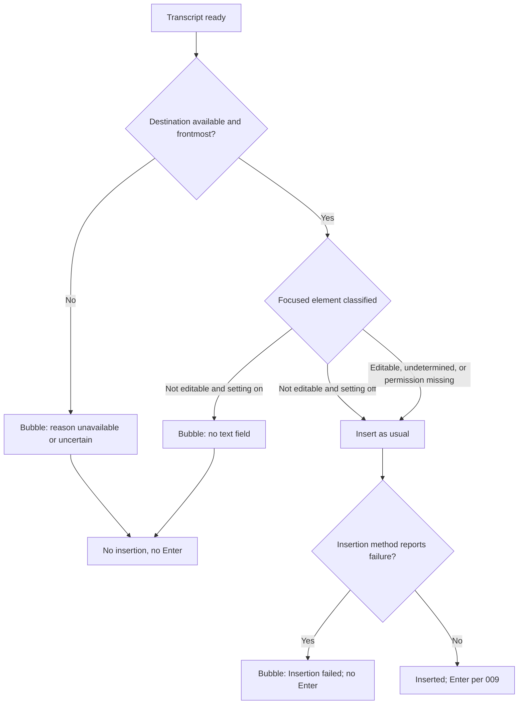
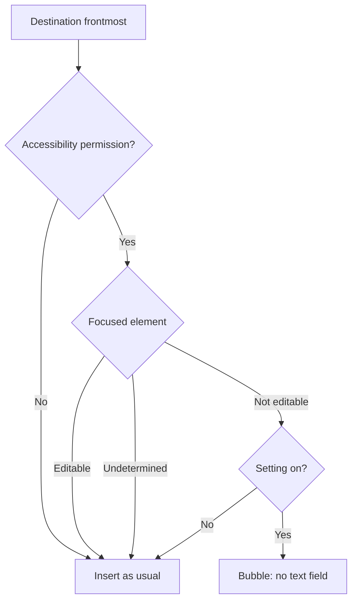
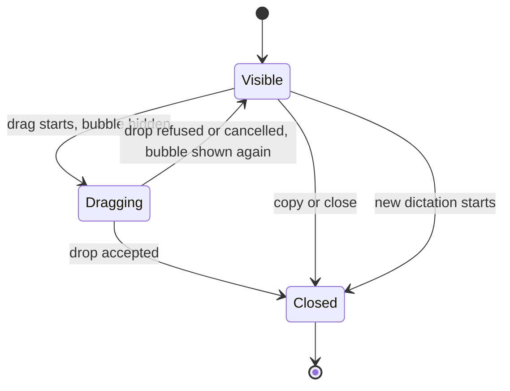
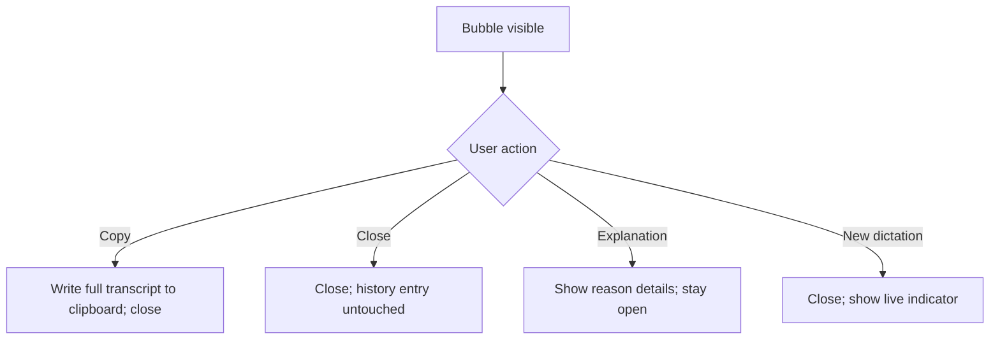
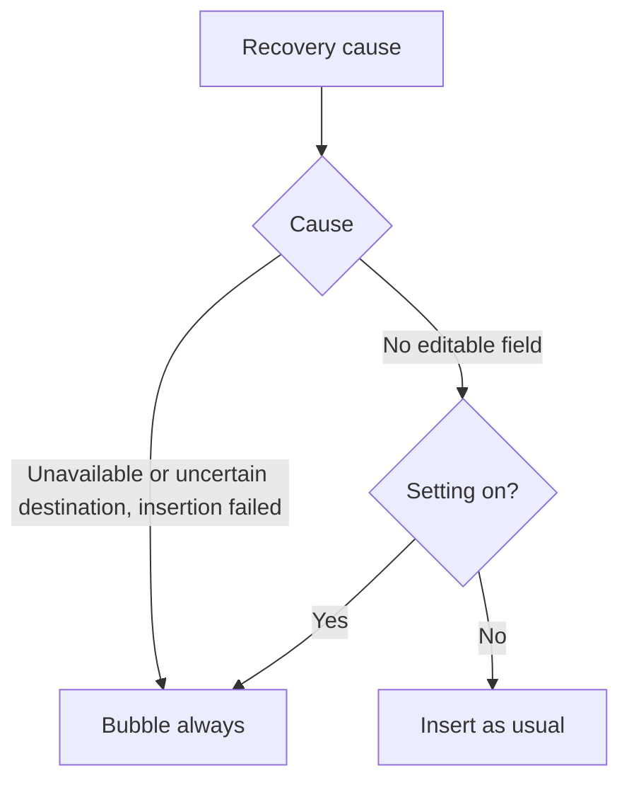

# Feature Spec: Recovery Bubble

## Header

- **Feature:** Recovery Bubble
- **Branch:** None — specification only (program specified before `spec-ship`)
- **Date:** 2026-10-12
- **Status:** Planned
- **Input:** Program item 10: if the destination is unavailable, uncertain or has no editable field, keep the text and show a small bubble in place of the live indicator. It lets the user drag the transcript into a field, copy it, close the panel and understand why it appears. The Spokenly analysis shows a native AppKit mechanism: text payload in an `NSPasteboardItem`, preview image in an `NSDraggingItem`, then a drag session in copy mode; the source window is hidden during the drag and a refused drop shows it again for another attempt. Spokenly may show this panel before attempting a paste. An accepted drop does not by itself prove the final field content. Its 60-second timeout is a statically observed behavior, not a duration decided for Handy. The independent AppKit example was only typechecked, not tested in real fields. Program item 8 requires the settings CLI to read and modify output behaviors.
- **Feature Number:** 010

## User Scenarios & Testing

### Story 1 — Recover the text when the destination is unavailable `P1`

**As a** Handy user, **I want to** see my transcript in a bubble when Handy cannot insert it, **so that** I can still put it where I want.

**Priority reason:** This is the recovery path for every insertion failure of features 006 and 009.
**Independent test:** Quit the destination app during a dictation and check that the bubble replaces the indicator with the transcript and the reason.

```gherkin
Feature: Recovery bubble on unavailable destination
  Scenario: Destination closed
    Given a dictation started in Notes
    When Notes quits before the dictation ends
    Then nothing is inserted
    And a bubble appears in place of the live indicator with the beginning of the transcript
    And the bubble states "Notes is no longer open"
  Scenario: Activation not confirmed
    Given a dictation started in Notes
    And Notes did not become frontmost within the 006 limit
    When insertion is due
    Then the bubble appears with the reason "Could not bring Notes forward"
  Scenario: No automatic Enter
    Given automatic Enter is "Always"
    When the bubble is shown instead of an insertion
    Then no Enter key press is sent
```



### Story 2 — Recover the text when no text field is focused `P1`

**As a** Handy user, **I want to** be warned instead of having text pasted into nothing, **so that** my dictation does not vanish when no field has focus.

**Priority reason:** Pasting with no editable field loses the text silently.
**Independent test:** Dictate into Finder with no text field focused, then into TextEdit with the cursor in the document.

```gherkin
Feature: Recovery bubble when no field is editable
  Scenario: Focus is not editable
    Given accessibility permission is granted
    And the focused element of the destination is classified not editable
    When insertion is due
    Then the bubble appears with the reason "No text field is focused"
    And nothing is pasted
  Scenario: Classification undetermined
    Given the focused element cannot be classified
    When insertion is due
    Then Handy inserts as usual and no bubble appears
  Scenario: Setting off
    Given "Show the bubble when no text field is focused" is off
    When the focused element is not editable
    Then Handy inserts as usual
```



### Story 3 — Drag the transcript into a field `P1`

**As a** Handy user, **I want to** drag the transcript from the bubble into any text field, **so that** I choose the exact place where it goes.

**Priority reason:** Drag and drop is the requested recovery gesture.
**Independent test:** Drag from the bubble into TextEdit, a ChatGPT field and a Comet field; then drag onto the desktop and release.

```gherkin
Feature: Drag the transcript
  Scenario: Accepted drop
    Given the bubble shows a transcript
    When the user drags from the bubble and drops on a text field that accepts text
    Then the field receives the full transcript, not only the preview
    And the bubble closes
  Scenario: Bubble hidden during the drag
    Given the user starts dragging from the bubble
    When the drag is in progress
    Then the bubble is hidden and a preview of the text follows the pointer
  Scenario: Refused drop
    Given the user is dragging the transcript
    When the user releases over a place that refuses the drop
    Then the bubble reappears with the same transcript for another attempt
```



### Story 4 — Copy, close and understand `P1`

**As a** Handy user, **I want to** copy the transcript, close the bubble and read why it appeared, **so that** I can recover even without drag and drop and trust what happened.

**Priority reason:** Copy and explanation are explicitly requested and cover platforms without drag support.
**Independent test:** Use Copy, then reopen a recovery and use Close and the explanation.

```gherkin
Feature: Bubble actions
  Scenario: Copy
    Given the bubble shows a transcript
    When the user activates Copy
    Then the full transcript is on the clipboard
    And the bubble closes
  Scenario: Close
    Given the bubble is visible
    When the user activates Close
    Then the bubble closes
    And the history entry is untouched: the transcript is in history only if its history save succeeded
  Scenario: Explanation
    Given the bubble is visible with reason "No text field is focused"
    When the user activates the explanation control
    Then a short text explains the reason
    And it says the transcript is kept in history only if the history save succeeded; otherwise it says the transcript is not in history
  Scenario: New dictation
    Given the bubble is visible, even for less than 4 seconds
    When the user starts a new dictation
    Then the bubble closes and the live indicator appears
```



### Story 5 — Configure from settings and CLI `P2`

**As a** Handy user, **I want to** control whether the bubble appears when no text field is focused, **so that** I can avoid it in apps where detection is wrong.

**Priority reason:** Field detection is heuristic; users need a switch, and the CLI covers output behaviors.
**Independent test:** Turn the setting off from the CLI, repeat Story 2, and read the setting back.

```gherkin
Feature: Recovery settings
  Scenario: Turn off from the CLI
    When the user turns "Show the bubble when no text field is focused" off through the CLI with JSON output
    Then stdout reports the new value and settings revision
  Scenario: Unavailable destinations always recover
    Given the setting is off
    When the destination is unavailable
    Then the bubble still appears
```



## Acceptance Criteria

### AC-001

**Criterion:** Before insertion, Handy shows the bubble in place of the live indicator instead of inserting when the destination is unavailable (closed, or pinned app not running: `pinned_app_not_running`) or uncertain (not confirmed frontmost before insertion, as defined by 006, including a running pinned app not brought forward: `activation_failed`); nothing is inserted. After insertion, when the insertion method reports failure (including the smart paste outcomes "not read", "permission missing" and "uncertain" of 007), Handy shows the bubble with the reason "Insertion failed". The explanation adds "Some text may have reached the application" only for failures where input may have been sent: a failure reported by the classic, direct or script methods or by the Windows reliable paste, and the smart paste outcomes "not read", "uncertain" and "insertion failed". For "permission missing", no keystroke is sent, so the explanation says nothing was sent to the application instead. Reasons decided before insertion never show this detail. In both cases no Enter is sent. The bubble is shown even when the overlay style is none, and it replaces the 006 reason display on the indicator and the existing `paste-error` notification, so a failure is reported once. With the paste method "none", no insertion is due and no bubble appears.
**Priority:** P1 | **Story:** Story 1

### AC-002

**Criterion:** On macOS with accessibility permission, before insertion Handy classifies the destination's focused element as editable, not editable or undetermined. Keyboard focus owned by another process than the destination counts as undetermined, whatever its role. No focused element, an Accessibility error or timeout, and the remote view of a destination that 007 handles with a per-application strategy (Screen Sharing, iPhone Mirroring, Windows App, Jump Desktop), whose field cannot be read locally, are undetermined too. Only "not editable" with the setting "Show the bubble when no text field is focused" on (default on) shows the bubble with reason "No text field is focused". Undetermined, editable, missing permission, other platforms or setting off insert as usual.
**Priority:** P1 | **Story:** Story 2

### AC-003

**Criterion:** The bubble shows the first two lines of the transcript (ellipsis when longer), the reason in one sentence ("<App> is no longer open", "<App> is pinned but not open", "Could not bring <App> forward", "Insertion failed", "No text field is focused"), a drag handle (macOS only, AC-006), Copy, Close and an explanation control. The transcript is exactly the text that would have been inserted. It does not take keyboard focus from other applications, accepts the first click, and has accessible names for every control.
**Priority:** P1 | **Story:** Stories 1 and 4

### AC-004

**Criterion:** On macOS, dragging from the bubble starts a native drag session in copy mode carrying the full transcript as plain text with a preview image. The bubble is hidden while dragging. If the drop is refused or cancelled, the bubble reappears unchanged. If a drop is accepted, the bubble closes and the outcome is logged as "drop accepted" without the transcript, never as text verified in a field. Each bubble has its own identity: drag callbacks or actions belonging to a closed bubble are ignored, and a new dictation during a drag closes the bubble for good.
**Priority:** P1 | **Story:** Story 3

### AC-005

**Criterion:** Copy writes the full transcript to the clipboard as a deliberate user copy, which also makes any pending smart paste restoration (007) abandon through its changeCount guard, and closes the bubble. Close closes it. The explanation control shows the reason details and states that the transcript is kept in history only when history saving succeeded (006 `history_status` saved); otherwise it states that the transcript is not in history. Starting a new dictation closes the bubble immediately, even if it has been visible for less than 4 seconds. The bubble has no automatic timeout. Closing the bubble never deletes the history entry.
**Priority:** P1 | **Story:** Story 4

### AC-006

**Criterion:** On Windows, the bubble offers Copy, Close and the explanation without drag, for destination unavailable, activation not confirmed and insertion failed. On Linux, where no destination is captured, it appears only for insertion failed, with the same actions.
**Priority:** P2 | **Story:** Story 4

### AC-007

**Criterion:** The settings CLI (008) reads and sets "Show the bubble when no text field is focused" with the UI validation; with `--json`, stdout contains only the JSON envelope.
**Priority:** P2 | **Story:** Story 5

## Behavioral AC

Signals extracted: drag-drop, copy button, dismiss, close button, explanation, keyboard navigation. Official `detect_traits` returned dismissible_layer, has_drag_drop, has_tooltip, is_keyboard_navigable.

### dismissible_layer

```gherkin
Feature: Dismiss the bubble
  Scenario: Open
    Given a recovery cause occurred
    When the bubble is shown
    Then the bubble matches visual state "open"
  Scenario: Closed
    Given the bubble is visible
    When the user activates Close
    Then the bubble matches visual state "closed"
```

### has_drag_drop

```gherkin
Feature: Drag states
  Scenario: Idle
    Given the bubble is visible
    When no drag is in progress
    Then the drag handle matches visual state "idle"
  Scenario: Dragging
    Given the user starts dragging the transcript
    When the pointer moves
    Then the drag preview matches visual state "dragging"
  Scenario: Drop target
    Given the user drags over a field that accepts text
    When the field signals it can accept the drop
    Then the field shows its native drop indication
    And the drop target matches visual state "drop-target"
```

### has_tooltip

<!-- WARNING: No visual states defined for trait "has_tooltip" in ui-behavioral-taxonomy.md -->

```gherkin
Feature: Bubble explanation
  Scenario: Explanation content
    Given the user opens the explanation
    When it is displayed
    Then it names the reason and says the transcript is kept in history only if the history save succeeded
```

### is_keyboard_navigable

<!-- WARNING: No visual states defined for trait "is_keyboard_navigable" in ui-behavioral-taxonomy.md -->

```gherkin
Feature: Keyboard access to bubble actions
  Scenario: Actions reachable without drag
    Given the bubble is visible and the user prefers the keyboard
    When the user activates Copy with the accessibility focus
    Then the transcript is copied and the bubble closes
  Scenario: Settings toggle
    Given the output settings are open
    When the user tabs to "Show the bubble when no text field is focused" and presses Space
    Then the setting toggles and is announced
```

## Functional Requirements

### FR-001

**Requirement:** Decide before insertion whether to insert or recover, using destination availability, frontmost confirmation and, on macOS with permission, focused-element classification gated by a setting; after insertion, recover when the insertion method reports failure.
**AC References:** AC-001, AC-002

### FR-002

**Requirement:** Show a non-activating bubble in place of the live indicator with transcript preview, reason, drag handle, Copy, Close and explanation, and suppress insertion and automatic Enter.
**AC References:** AC-001, AC-003, AC-005

### FR-003

**Requirement:** Provide a native macOS drag source carrying the full transcript in copy mode, hiding the bubble during the drag and restoring it on refusal.
**AC References:** AC-004

### FR-004

**Requirement:** Provide Copy, Close, explanation and new-dictation closing behaviors without timeout and without touching history, and the reduced bubble on Windows and Linux.
**AC References:** AC-005, AC-006

### FR-005

**Requirement:** Expose the "no text field" setting through settings UI and settings CLI.
**AC References:** AC-002, AC-007

## Key Entities

| Entity | Description | Key fields |
|---|---|---|
| Recovery state | One bubble instance | dictation id, transcript (the text that would have been inserted), reason, destination name, created at |
| Recovery reason | Why insertion was replaced | app closed, pinned app not running (`pinned_app_not_running`), activation not confirmed (`activation_failed`), insertion failed, no text field |
| Focus classification | macOS focused element result | editable, not editable, undetermined (including keyboard focus owned by another process, no focused element, Accessibility error or timeout and a 007 per-application strategy destination, AC-002; verdict `Insert`, no recovery reason), permission missing |

## Clarifications

- Investigation basis (2026-10-12, static analysis of Spokenly 2.30.9): the panel is a pre-insertion recovery and a drag source; reasons include app changed and no focused text field; focus classification uses `AXFocusedUIElement`, role and settable `AXValue`/`AXSelectedText`/`AXSelectedTextRange`, with an undetermined result that does not force the panel; drag uses a string pasteboard item, a dragging item with preview image, copy mode, source hidden during drag and shown again on refusal; Copy writes the general pasteboard directly. Handy's implementation is original; the AppKit example was typechecked only.
- "Uncertain destination" means: not confirmed frontmost before insertion. Keyboard focus owned by another process is treated as undetermined, as in the Spokenly analysis, to avoid false recoveries.
- `[ASSUMED]` The bubble never takes keyboard focus; its controls are operable by pointer and by assistive technologies, which keeps the user's application focused for the drop.
- `[ASSUMED]` No automatic timeout; the bubble closes on Copy, Close, accepted drop or a new dictation. The 60-second Spokenly timer is not adopted.
- `[ASSUMED]` The undetermined classification inserts as usual, to avoid false recoveries.
- `[ASSUMED]` Drag is macOS only; Windows and Linux get Copy, Close and explanation.
- Real behavior of drops into ChatGPT, Comet and other fields is unverified; the plan includes native checks.
- Program context: specified in list order (001–010); depends on 006 (destination and outcomes), 007 (smart paste outcomes "not read", "permission missing" and "uncertain" count as insertion failure), 009 (Enter suppression) and 008 (CLI).

- Decision `010-recovery-bubble:AC-003` / `pinned-running-activation-failure-reason`: 2026-10-14 (program orchestrator): "Could not bring <App> forward". A pinned application that is running but does not become frontmost within the 006 limit carries the reason `activation_failed`; "<App> is pinned but not open" is reserved for `pinned_app_not_running` (the pinned application is not running). These are the two reasons into which `.specs/features/009-pin-mode-and-enter-rule/spec.md` AC-003 splits "pinned app unavailable".
<!-- livespec-clarification:{"requirement_id": "010-recovery-bubble:AC-003", "decision_key": "pinned-running-activation-failure-reason", "evidence_hash": "de2dc486f9b942517c77204e51bdcc7570bb8a91e97f5686deb029267b251e3f", "answer": "2026-10-14 (program orchestrator): \"Could not bring <App> forward\". A pinned application that is running but does not become frontmost within the 006 limit carries the reason `activation_failed`; \"<App> is pinned but not open\" is reserved for `pinned_app_not_running` (the pinned application is not running). These are the two reasons into which `.specs/features/009-pin-mode-and-enter-rule/spec.md` AC-003 splits \"pinned app unavailable\"."} -->

- Decision 2026-10-14 (program orchestrator, Key Entities): keyboard focus owned by another process than the destination is not a recovery reason. As AC-002 states, it counts as undetermined, so the verdict is `Insert` and Handy inserts as usual; the Key Entities table lists it under Focus classification, not under Recovery reason.
- Decision 2026-10-14 (program orchestrator, Story 4 and AC-005): the bubble never claims history it does not have. "Kept in history" is said only when the history save succeeded, as in `.specs/features/006-destination-application/spec.md` AC-005, read from the outcome's `history_status` (saved); when the save failed or was not attempted, the explanation says the transcript is not in history. Close never deletes a history entry either way.
- Decision 2026-10-14 (program orchestrator, AC-001): the detail "Some text may have reached the application" is shown only for "Insertion failed" outcomes where input may have been sent: a failure reported by the classic, direct or script methods, and the smart paste outcomes "not read", "uncertain" and "insertion failed" of `.specs/features/007-smart-paste/spec.md`. It is not shown for "permission missing", where the permission check precedes any keystroke and the clipboard is unchanged; that explanation says nothing was sent to the application. Reasons decided before insertion (app closed, pinned app not running, activation not confirmed, no text field) never show it.
- Decision 2026-10-14 (program orchestrator, delivery precision): all of 010 (bubble, focus classification, drag, Copy, Close, explanation, "Show the bubble when no text field is focused" setting and its CLI key) ships behind the `destination-return` gate of `.specs/features/006-destination-application/spec.md`. Gate closed, Handy behaves exactly as `dev`: no bubble, no classification, the existing `paste-error` notification on a paste failure, and no new setting. Gate open, this specification applies. No AC, FR or SC changes; the requirements describe the gate-open build.
- Decision 2026-10-14 (program orchestrator, AC-005 and the 006 minimum display): a new dictation closes the bubble immediately, even if it has been visible for less than 4 seconds; Copy, Close and an accepted drop close it immediately too. The "at least 4 seconds" of `.specs/features/006-destination-application/spec.md` AC-005 applies to passive display, which the bubble satisfies since it has no timeout. Verified 2026-10-14: the 006 spec states the 4-second minimum without a new-dictation rule; the delivered 006 code builds no timed reason display (it hides the indicator after insertion and shows the `paste-error` notification, `src-tauri/src/destination/delivery.rs`), so no delivered behavior keeps a reason over a new dictation; the 006 plan's unbuilt rule that kept a reason across a new recording is replaced for the bubble, which 010 owns.
- Decision 2026-10-14 (decided by the orchestrator under Julien's mandate, validated by Julien on 2026-10-15; Behavioral AC): the drag-handle hover hint "Drag into a text field" and the animated "closing" state are removed. No Input sentence, AC or FR asks for them; the bubble has the visual states "open" and "closed".
- Decision 2026-10-14 (decided by the orchestrator under Julien's mandate, validated by Julien on 2026-10-15; AC-002): a destination that 007 handles with a per-application strategy (Screen Sharing, iPhone Mirroring, Windows App, Jump Desktop) shows a remote field that cannot be read locally. Its classification is therefore undetermined and Handy inserts as usual. This is a consequence of AC-002's undetermined rule, not a business exemption: an unavailable destination or an insertion failure still shows the bubble there.
- Decision 2026-10-14 (decided by the orchestrator under Julien's mandate, validated by Julien on 2026-10-15; AC-001): a failure reported by the Windows reliable paste shows "Insertion failed" with the detail "Some text may have reached the application", since its keystroke may have been sent; this completes the list of the earlier AC-001 decision.
- Decision 2026-10-14 (decided by the orchestrator under Julien's mandate, validated by Julien on 2026-10-15; AC-001 and AC-007): with the gate open, the bubble replaces the `paste-error` notification, so a failure is never reported by both. "Show the bubble when no text field is focused" exists only on macOS: with the gate open, Windows and Linux refuse it as unsupported on this platform and show no toggle (writes are refused and reads return `false`, decision `010-recovery-bubble:AC-007` below); with the gate closed it does not exist (not found, as in `dev`). With 007's `smart-paste-dispatch` gate open and the `destination-return` gate closed, smart paste failures keep the existing `paste-error` notification, without bubble: this build combination is the closed build of 010.

- Decision `010-recovery-bubble:AC-001` / `paste-method-none-recovery`: 2026-10-14, decided by the orchestrator under Julien's mandate, validated by Julien on 2026-10-15: with the paste method "none" no insertion is due, so 006 activates nothing and no recovery applies: no bubble appears, whatever the destination's state, and the existing clipboard handling applies as today.
<!-- livespec-clarification:{"requirement_id": "010-recovery-bubble:AC-001", "decision_key": "paste-method-none-recovery", "evidence_hash": "6a75e101a855f7adde6c6378f6791004b8ce217dcac5d051f80fc75a7673763e", "answer": "2026-10-14, decided by the orchestrator under Julien's mandate, validated by Julien on 2026-10-15: with the paste method \"none\" no insertion is due, so 006 activates nothing and no recovery applies: no bubble appears, whatever the destination's state, and the existing clipboard handling applies as today."} -->

- Decision `010-recovery-bubble:AC-002` / `no-focused-element-classification`: 2026-10-14, decided by the orchestrator under Julien's mandate, validated by Julien on 2026-10-15: no focused element, an Accessibility error or an Accessibility timeout is undetermined, so Handy inserts as usual. Only a positive "not editable" result shows the bubble.
<!-- livespec-clarification:{"requirement_id": "010-recovery-bubble:AC-002", "decision_key": "no-focused-element-classification", "evidence_hash": "e0fb8dd5bf99da0a0e0dc124ef2d44fef8d7aefd7e681329243b0a9b47192cb9", "answer": "2026-10-14, decided by the orchestrator under Julien's mandate, validated by Julien on 2026-10-15: no focused element, an Accessibility error or an Accessibility timeout is undetermined, so Handy inserts as usual. Only a positive \"not editable\" result shows the bubble."} -->

- Decision `010-recovery-bubble:AC-002` / `foreign-nonactivating-panel-focus`: validated by Julien (maintainer) on 2026-10-15: accepted limit of AC-002. When a non-activating panel of another process (Spotlight, a launcher) has keyboard focus while the destination application stays frontmost, the classifier cannot see that panel, because it queries only the destination application and never the system-wide element. It may therefore classify the destination's own focused element as not editable and show the bubble ("No text field is focused") instead of inserting. No text is lost: the bubble lets the user copy or drag it. Handy makes no system-wide Accessibility query, so that an unresponsive application can never freeze Handy. The rule that keyboard focus owned by another process is undetermined applies to the focus the classifier can observe through the destination application.
<!-- livespec-clarification:{"requirement_id": "010-recovery-bubble:AC-002", "decision_key": "foreign-nonactivating-panel-focus", "evidence_hash": "4463a63ea393b16346e9f67047b871e531b7de4444e771445d52af389d6a88a4", "answer": "validated by Julien (maintainer) on 2026-10-15: accepted limit of AC-002. When a non-activating panel of another process (Spotlight, a launcher) has keyboard focus while the destination application stays frontmost, the classifier cannot see that panel, because it queries only the destination application and never the system-wide element. It may therefore classify the destination's own focused element as not editable and show the bubble (\"No text field is focused\") instead of inserting. No text is lost: the bubble lets the user copy or drag it. Handy makes no system-wide Accessibility query, so that an unresponsive application can never freeze Handy. The rule that keyboard focus owned by another process is undetermined applies to the focus the classifier can observe through the destination application."} -->

- Decision `010-recovery-bubble:AC-001` / `late-read-after-not-read`: validated by Julien (maintainer) on 2026-10-15: late read, as in `.specs/features/007-smart-paste/spec.md` AC-012. If the application reads the clipboard after smart paste declared "not read", the bubble shown for that dictation states that the text may have been pasted after all ("may have been pasted after all"). The outcome stays "not read" for automatic Enter, so no Enter is sent.
<!-- livespec-clarification:{"requirement_id": "010-recovery-bubble:AC-001", "decision_key": "late-read-after-not-read", "evidence_hash": "9571dd91bb6fdf5a21cab2a327cf8a9a2be0bcb7f041d573b52ceb32fbb0b7fd", "answer": "validated by Julien (maintainer) on 2026-10-15: late read, as in `.specs/features/007-smart-paste/spec.md` AC-012. If the application reads the clipboard after smart paste declared \"not read\", the bubble shown for that dictation states that the text may have been pasted after all (\"may have been pasted after all\"). The outcome stays \"not read\" for automatic Enter, so no Enter is sent."} -->

- Decision `010-recovery-bubble:AC-007` / `non-macos-read-value`: validated by Julien (maintainer) on 2026-10-15: with the `destination-return` gate open on Windows and Linux, reading "Show the bubble when no text field is focused" (`get`, `output get`, `get-all`) returns the JSON boolean `false`; reads are not refused. Every write is refused with `validation_failed` and the platform reason (`details.reason = "unsupported_platform"`).
<!-- livespec-clarification:{"requirement_id": "010-recovery-bubble:AC-007", "decision_key": "non-macos-read-value", "evidence_hash": "5f9095c99baf8d3a040740684458e4f1b07a8c0928a1859bf48cf1e9a478229b", "answer": "validated by Julien (maintainer) on 2026-10-15: with the `destination-return` gate open on Windows and Linux, reading \"Show the bubble when no text field is focused\" (`get`, `output get`, `get-all`) returns the JSON boolean `false`; reads are not refused. Every write is refused with `validation_failed` and the platform reason (`details.reason = \"unsupported_platform\"`)."} -->

- Decision `010-recovery-bubble:AC-007` / `no-text-field-read-off-macos`: validated by Julien (maintainer) on 2026-10-15: same decision as `non-macos-read-value`. On Windows and Linux with the gate open, `get` and `output get` of the key return `false`; only writes are refused, with `validation_failed` and `details.reason = "unsupported_platform"`.
<!-- livespec-clarification:{"requirement_id": "010-recovery-bubble:AC-007", "decision_key": "no-text-field-read-off-macos", "evidence_hash": "b4c7b3f83f0a2cb09b4f45b3d4c672202fb670712f8cb500c2977c19fa34b3df", "answer": "validated by Julien (maintainer) on 2026-10-15: same decision as `non-macos-read-value`. On Windows and Linux with the gate open, `get` and `output get` of the key return `false`; only writes are refused, with `validation_failed` and `details.reason = \"unsupported_platform\"`."} -->

## QE Analysis

- **Criticality:** High; **Blast radius:** Every failed or risky insertion; **Primary risk:** Lost text or false recoveries interrupting normal dictation; **Confidence:** Low-medium (static analysis only, no native prototype run).
- **Dimensions:** Functional correctness, data integrity, accessibility, platform compatibility, UX, regression of normal insertion.
- **P0 gates/evidence:** Decision table tests for AC-001/AC-002 with fake destination and classification seams; state-machine tests for drag begin/refuse/accept, copy, close, new dictation; no Enter while the bubble is shown.
- **P1 gates/evidence:** Native macOS drops into TextEdit, Notes, ChatGPT and Comet with recorded outcomes; focus-classification checks in Finder, a browser page without focus and a text field; screen-reader names for bubble controls; Windows/Linux reduced bubble check.
- **Non-functional expectations:** Bubble shown within 300 ms of the recovery decision (a QE target measured by the plan's macOS timing samples, not an acceptance criterion); full transcript transported regardless of length; no transcript text logged above debug level.
- **Missing evidence:** No native drag test; classification accuracy unknown per application; mockups deferred before `spec-ship`.
- **Boundary:** QE defines risk and test sufficiency; the independent review judges requirements; Penflow governs UI design evidence; spec-test executes runtime proof.

## Quality Engineering

- **Risk:** High criticality (rated so by the QE Analysis: the transcript can be lost, or a false recovery can interrupt normal dictation); Shared blast radius (the recovery decision sits on every failed or risky insertion and must not regress normal insertion); primary risk Data (lost text), followed by Regression (false recoveries).
- **Applicable dimensions:** functional correctness, data integrity, accessibility, platform compatibility, UX, regression of normal insertion.
- **P0 gates/evidence:** Decision table tests for AC-001/AC-002 with fake destination and classification seams; state-machine tests for drag begin/refuse/accept, copy, close and new dictation; no Enter while the bubble is shown.
- **Boundary:** QE defines risk and test sufficiency only. The independent spec review judges requirements, Penflow governs UI design evidence, spec-test executes runtime proof and the end-of-feature delivery review looks for defects.

## Screens

| Screen | Status | Reference |
|--------|--------|-----------|
| recovery-bubble | New | Mockup to produce before `spec-ship` (bubble with preview, reason and actions) |
| output-settings | Modified | Mockup to produce before `spec-ship` (no-text-field setting) |

## Penflow Contract

- Planned `flow_id: recovery-bubble`, `screen_id: recovery-bubble` and `screen_id: output-settings`. Per the user decision of 2026-10-12 (lightweight UI contract), the Penflow flow/screen contract, semantic and test IDs and the Pencil mockups are produced in one pass for all program features before `spec-ship`; the planned IDs above are authoritative until then. No inspection READY or certification PASS is claimed.

## Edge Cases

- Very long transcript: the preview shows two lines; drag and Copy carry the full text.
- Drop into a field that filters input (for example a numeric field): the drop may be accepted with altered content; Handy only records "drop accepted".
- Bubble visible when the screen locks: it stays until an explicit action or a new dictation.
- Several recoveries in a row: each new dictation closes the previous bubble, even before 4 seconds; earlier transcripts remain in history when their history save succeeded.
- A drag in progress when a new dictation starts: the bubble closes for good; the drag session the system already carries may still deliver its text to a drop target, and Handy ignores that drag's later callbacks (AC-004).
- Destination handled by a 007 per-application strategy (Screen Sharing, iPhone Mirroring, Windows App, Jump Desktop): its remote field cannot be read locally, so the classification is undetermined and Handy inserts as usual (AC-002); unavailable destination and insertion failure still show the bubble.
- A non-activating panel of another process (Spotlight, a launcher) has keyboard focus while the destination stays frontmost: the classifier cannot see it (accepted limit of AC-002, decision 2026-10-15); if the destination's own focused element is not editable, the bubble appears instead of an insertion, and the text stays available through Copy or drag.

## Success Criteria

### SC-001

Decision-table tests cover every recovery reason and every "insert as usual" case with zero mismatches.

### SC-002

In native macOS checks, dragging into TextEdit, Notes, ChatGPT and Comet transfers the full transcript in at least TextEdit and Notes, and each application's result is recorded.

### SC-003

No automated scenario sends an Enter key press while the bubble is shown.
