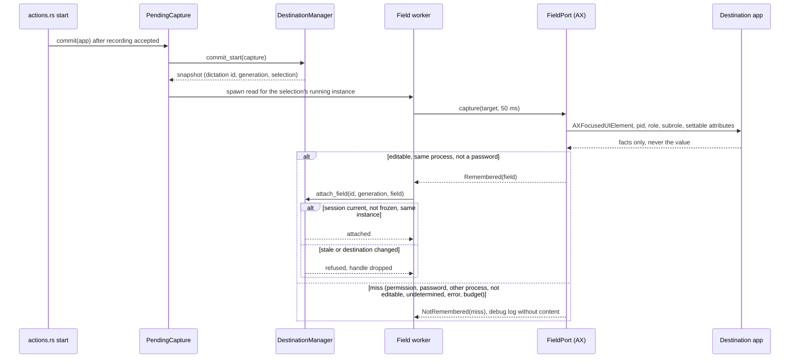
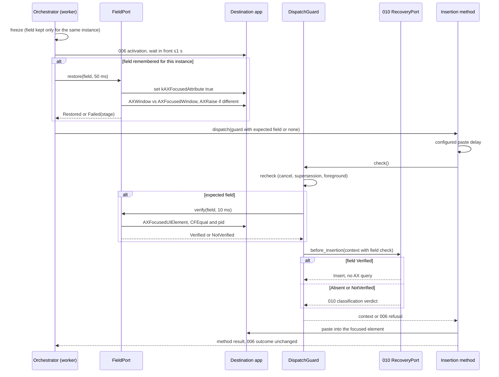
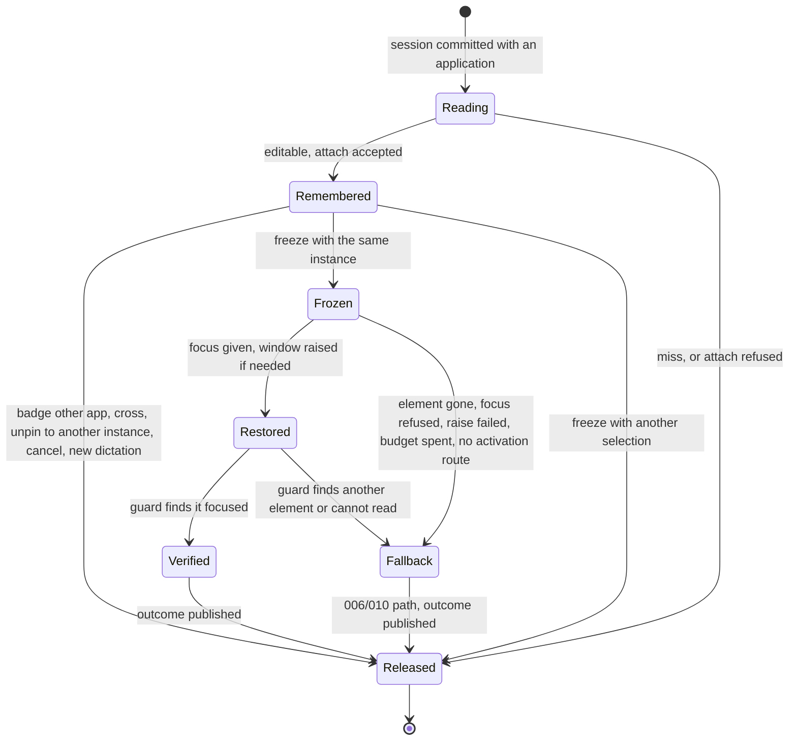
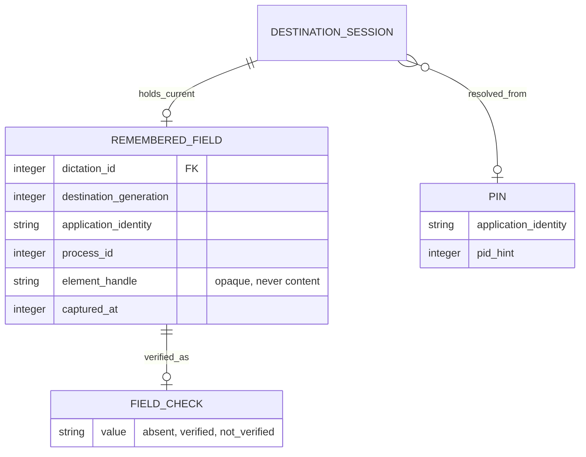

# Implementation Plan: Dictation Field Return

## Summary

Remember an opaque Accessibility reference to the destination's focused input right after 006 commits a dictation's session, keep it with the session only while the destination stays that running instance, then, after 006's activation, give it focus, raise its window when needed, verify it at 006's pre-dispatch guard and let the unchanged insertion method paste; every failed stage silently continues on the existing 006/010 path. Everything ships behind 006's `destination-return` Cargo feature: with the gate closed no focused element is read and the build is `dev`'s (see [Rollout gate](#rollout-gate)).

Inspect [spec.md](spec.md) for FR-001–FR-005, AC-001–AC-008 and SC-001–SC-004. Scope **M**: five FR, one volatile entity, no setting, no UI, but native focus on two platforms and three neighboring features. 006 is delivered in `dev`; 009 and 010 must be merged into `dev` before 011's implementation starts ([Next Action](#next-action)), because 011 reads 009's pinned instance and 010's editable rule. This command produces planning evidence only; no code, test run or native proof is claimed.

## Technical Context

| Aspect | Choice | Basis |
|---|---|---|
| Native | Existing Rust 2021, Tauri 2.11.5, std threads and channels | Cargo manifest and default stack |
| macOS | ApplicationServices AX through the same FFI style as `destination/macos_focus.rs` (own `Owned` CF wrapper) | `AXFocusedUIElement`, `kAXFocusedAttribute`, `AXWindow`, `AXFocusedWindow`, `AXRaise`, `CFEqual`, `AXUIElementSetMessagingTimeout` |
| Windows | `windows` crate UI Automation (`IUIAutomation`, `IUIAutomationElement::SetFocus`, `CompareElements`) on a dedicated COM MTA thread | Adds the `Win32_UI_Accessibility` and `Win32_System_Com` features of the existing `windows` dependency |
| Linux | No adapter: 006 opens a `FrontmostAtEnd` session without destination | 006 AC-007 |
| Frontend | None | No screen, control or event (spec Screens) |
| Settings | None | No descriptor, CLI key, schema or `bindings.ts` change (spec AC-006) |
| Storage | RAM only, one reference for the current dictation | Spec AC-008 |
| Testing | Cargo unit and integration tests with fake ports, native macOS harness and manual matrix with Julien | Native focus cannot be proved by fakes |

Inspect the delivered 006 code as the integration reference: [guard.rs](../../../src-tauri/src/destination/guard.rs) (`DispatchGuard::check`, `recheck`, `first_pass`), [insertion.rs](../../../src-tauri/src/destination/insertion.rs) (`Orchestrator::deliver`, `activate`, `activation_route`), [manager.rs](../../../src-tauri/src/destination/manager.rs) (`commit_start`, `freeze`, `cancel`, `finish`), [context.rs](../../../src-tauri/src/destination/context.rs) (`DestinationContext`, `RecoveryPort`), `destination/app.rs` (`capture_at_start`, `PendingCapture::commit`), `destination/delivery.rs` (`deliver`, `orchestrator`, `publish`), `destination/macos.rs` and `destination/macos_focus.rs`. Where the 006 documents differ from that code, the code is the reference.

Other features' documents are cited as paths for context only and import no obligation inventory into 011's review: 006's spec and plan (`.specs/features/006-destination-application/spec.md`, `.specs/features/006-destination-application/plan.md`), 009's spec and plan (`.specs/features/009-pin-mode-and-enter-rule/spec.md`, `.specs/features/009-pin-mode-and-enter-rule/plan.md`: pin resolution with `pid_hint`, Enter authority behind `claim_enter`), 010's spec and plan (`.specs/features/010-recovery-bubble/spec.md`, `.specs/features/010-recovery-bubble/plan.md`: `FocusedElementPort`, the editable rule, the 50 ms `CLASSIFY_BUDGET` inside `before_insertion`) and 007's direct insertion (`src-tauri/src/smart_paste/direct.rs`), which reads the destination's focused element after the guard.

## Constitution Check

| Principle | Result and concrete decision |
|---|---|
| Preserve native/frontend boundaries | PASS: Rust only; no event, command or UI change |
| Derive stack/manager choices from manifests | PASS: extends the existing `DestinationManager`, `Orchestrator` and `DispatchGuard`; the only manifest change adds two features of the existing `windows` crate |
| Tool availability differs from runtime | PASS: versions below certify availability only; native focus, raise and verification remain mandatory macOS evidence |
| Specify changed behavior before code | PASS: spec committed; every FR/AC mapped below; no spec change in this plan |
| Meaningful tests/current source verification | PASS: real manager, orchestrator and guard with injected `WorkspacePort`, `FieldPort` and `RecoveryPort`; native harness on real applications |
| Naming/tooling | PASS: Rust snake_case modules in the existing `destination/` domain; no new top-level folder |
| Privacy | PASS: no element value, selection, title or transcript is read or logged; only the stage and elapsed time at debug level |
| Infrastructure | PASS: local OS APIs only; no network, credential or provisioning |
| Native platform evidence (decision 2026-10-13) | PASS: macOS native evidence on a `destination-return` build gates Steps 1 and 6 and Implemented; Windows native observation is pending release evidence (D1 of `.specs/features/006-destination-application/plan.md`), never a step or merge gate |
| Minimal scope (decision 2026-10-13) | PASS: no setting, no UI, no new reason or message, no retry, no read of a field chosen later from the badge; seams limited to delivered 006 ones plus 011's own `FieldPort` |

## Requirement Inventory

| FR | Acceptance and measures | Steps |
|---|---|---|
| FR-001 | AC-001, AC-008; SC-002 capture cases, SC-004 sentinel | 1, 2, 3, 6 |
| FR-002 | AC-002, AC-005; SC-001 native matrix | 1, 4, 6 |
| FR-003 | AC-003; pin and destination-change cases | 2, 3, 6 |
| FR-004 | AC-004, AC-005; SC-002 fault injection | 1, 2, 4, 6 |
| FR-005 | AC-006, AC-007; SC-003 closed gate | 2, 3, 5, 6 |

Entities: RememberedField (volatile) and FieldCheck (per insertion). Service interactions: 006 session commit, freeze, activation and guard; 009 pinned instance; 010 pre-insertion verdict; native AX/UIA. No HTTP endpoint, so no OpenAPI contract; no database table, so the ER diagram is logical only.

## Penflow Contract Inputs

None. 011 has no screen, control or visual state (spec Screens, decision 2026-10-15, Julien), so no Penflow flow, semantic tree, code IR or mockup applies and no Penflow review snapshot is prepared.

## Architecture Decisions

### Rollout gate

011 adds no gate of its own and rides 006's `destination-return` Cargo feature (`destination::rollout::Rollout`). With the gate closed, `capture_at_start` and `ticket_at_stop` return `None`, so no session exists, the field port is never called and the build is `dev`'s; `RememberedField`, `FieldPort` and the adapters stay compiled and tested in both states. With the gate open, the field return applies on macOS and Windows to any dictation whose 006/009 selection names an application. Linux opens a `FrontmostAtEnd` session and never reaches the port. Every 011 test, clippy and the build run in the four feature combinations of [Resolved Test Commands](#resolved-test-commands): default, `smart-paste-dispatch`, `destination-return`, `destination-return,smart-paste-dispatch`. A closed-gate test asserts zero `FieldPort` calls over a full dictation (SC-003).

### Capture right after the session commit

The read runs on a short-lived worker spawned by `PendingCapture::commit` immediately after `DestinationManager::commit_start`, for the committed `dictation_id` and `destination_generation`. It is the same start event as 006's capture: the user has just pressed the shortcut, the recording overlay is non-activating, and an application's own `AXFocusedUIElement` does not change when another application comes forward. Running it off the start path keeps 006's capture under its 50 ms QE target and adds no keypress-to-recording latency; a recording that fails to start commits no session and reads nothing.

The worker resolves the running instance of the committed `Selection::Application`: 006's `workspace::resolve_instance(identity, captured_pid, instances)` for a captured or badge destination, and 009's pinned resolution (its `pid_hint` passed as captured PID) for a pin. No running instance, `Selection::FrontmostAtEnd`, destination return off without pin, or `DestinationSupport::Unsupported` read nothing. Paste method "none" is not known at start; it is handled at insertion, where no activation and therefore no restoration happens (AC-006).

`FieldPort::capture(target, FIELD_CAPTURE_BUDGET)` returns `Remembered(RememberedField)` or `NotRemembered(CaptureMiss)`. On macOS: `AXIsProcessTrusted` false → `PermissionMissing` without any AX query; otherwise `AXUIElementCreateApplication(pid)`, `AXFocusedUIElement`, its PID (`AXUIElementGetPid`), `AXRole`, `AXSubrole` and `AXUIElementIsAttributeSettable` for `AXValue`, `AXSelectedText` and `AXSelectedTextRange`. Role or subrole `AXSecureTextField` → `PasswordField`; another PID → `OtherProcess`; the facts are then passed to 010's pure editable rule, and only `Editable` is remembered (`NotEditable` and `Undetermined` are misses). No value, selected text, range or title is ever copied. The result is attached with `DestinationManager::attach_field(dictation_id, generation, field)`, accepted only while that session is current, not frozen, and its selection still names the same identity and PID; otherwise the field is dropped at once.

### Budgets and Accessibility timeouts

| Operation | Thread | Budget | Rule |
|---|---|---|---|
| Capture | 011's start worker | `FIELD_CAPTURE_BUDGET` 50 ms | Off the start path |
| Restore (focus, window check, raise) | 006's insertion worker, after activation | `FIELD_RESTORE_BUDGET` 50 ms | Never the main thread |
| Verify | Inside `DispatchGuard::check` (main thread for `MainThreadPaste`, insertion worker for smart paste) | `FIELD_VERIFY_BUDGET` 10 ms | Before 010's verdict |

Each budget is one monotonic deadline across all queries of the operation. On macOS, `AXUIElementSetMessagingTimeout` is set on the application element and on every element obtained from it (focused element, window), each time to the remaining budget, as 007's `smart_paste::macos_ax` and 010 do. It is never set on the system-wide element (that would change 006's `macos_focus` reads for the whole process) and never to 0 (the default timeout): when less than `MIN_AX_TIMEOUT` (5 ms, 007's `MIN_READ_TIMEOUT` value) remains, the operation stops with `BudgetSpent`. Any AX error, timeout or expired deadline is a miss or a failed stage, never a retry. A test with an injected clock asserts each query's timeout equals the remaining budget and that no call is made below `MIN_AX_TIMEOUT`.

Main-thread bound: in the guard, 011's verification (≤10 ms) precedes 010's classification (≤50 ms) only when it fails; when it succeeds, 010 makes no AX query. The composed worst case is therefore 60 ms of AX plus overhead; the Step 1 spike passes when no main-thread sample of the whole `check()` exceeds 70 ms over at least 30 runs (010's 60 ms threshold plus 011's 10 ms), and the gap is escalated to Julien otherwise.

### Lifetime and destination match

`RememberedField { dictation_id, destination_generation, identity, pid, element: FieldElement, captured_at }` lives in `ManagerState` next to the session (never in `DestinationSession`, `DestinationSnapshot`, an event, the CLI or history). `FieldElement` is an opaque, `Send + Sync` handle owning one retained platform reference (macOS `AXUIElementRef` released once on drop; Windows `IUIAutomationElement` released on its COM thread); its `Debug` prints nothing but the platform name.

| Event | Effect |
|---|---|
| Badge choice of another application, destination removal (006 cross), unpin that changes the selected identity or PID (009) | `ManagerState.field` dropped at once (AC-003) |
| Same application chosen again, pin or unpin keeping the same instance | Kept |
| `freeze` | Moved into `FrozenDestination.field` only when the frozen selection names the same identity and PID; otherwise dropped |
| `cancel`, `commit_start` of a new dictation, `finish` after `publish`, process exit | Dropped (AC-008) |
| Late `attach_field` after freeze, cancel or supersession | Refused, handle dropped |

### Restore after activation, verify at the guard

`Orchestrator` gains `field: Arc<dyn FieldPort>`. In `deliver`, after `activate` returns the running instance in front (with or without an activation request), and only when `frozen.field` names that instance's identity and PID, the worker calls `FieldPort::restore(field, FIELD_RESTORE_BUDGET)`, once: (1) `AXUIElementSetAttributeValue(element, kAXFocusedAttribute, kCFBooleanTrue)`; (2) read the element's `AXWindow` and the application's `AXFocusedWindow`, and when they differ (`CFEqual` false), `AXUIElementPerformAction(window, kAXRaiseAction)`. `Restored` hands the field to `DispatchGuard::new` as `expected_field`; `Failed(stage)` (element gone, focus refused, raise failed, budget spent) passes `None`. `activation_route` returning `None` (paste method "none", `FrontmostAtEnd`, return off without pin, unsupported) never restores. No restoration step is retried and no other element ever receives focus.

In `first_pass`, after 006's `recheck()` and before `RecoveryPort::before_insertion`, the guard calls `FieldPort::verify(expected_field, FIELD_VERIFY_BUDGET)`: the destination application's `AXFocusedUIElement`, compared with the remembered element by `CFEqual` and PID. The result is carried in the new `DestinationContext.field: FieldCheck { Absent, Verified, NotVerified }`. 011 never refuses a dispatch: whatever `FieldCheck` is, the guard continues exactly as delivered (010's verdict, then `set_disposition`). Later `check()` calls of the same method (a fallback path) only rerun `recheck()`, as delivered.

The method then pastes unchanged: classic, direct, script and Windows reliable paste send their input to the focused element, now the verified input; 007's direct insertion reads the destination's `AXFocusedUIElement`, now that input, under its own PID guard. The outcome is 006's (`insertion_attempted` unless the method verified the text); 011 adds no outcome field. One debug log line per dictation records `field_return` as `not_remembered(<miss>)`, `fallback(<stage>)` or `verified`, with elapsed times, never content.

### Articulation with 010 and 009

- **010 (AC-005):** when `context.field == FieldCheck::Verified`, 010's `before_insertion` answers `PreInsertionVerdict::Insert` at once, without any AX query: the verified element counts as editable, so the "No text field is focused" bubble never replaces that insertion. With `Absent` or `NotVerified`, 010 classifies exactly as its plan states. Every 011 fallback therefore reaches 010's decision table unchanged, including its bubble for a non-editable focus and for method failures.
- **010's editable rule:** 011's capture calls 010's pure rule over the attribute facts (role, subrole, settable attributes, PID match). 010 exposes it as a crate-visible pure function; if 010's delivered names differ, the code is the reference.
- **009 (AC-005):** Enter stays behind `DestinationManager::claim_enter` and 009's foreground check immediately before the Enter press. 011 neither reads nor changes the disposition, adds no Enter condition and does not re-verify the field before Enter.
- **009 pin:** the pinned instance resolved at start is the one whose element is read; `pinned_app_not_running` at start reads nothing and 009's failure is unchanged.

### Windows adapter (pending release evidence)

`windows_field.rs` owns one COM MTA thread created on first use, holding Handy's own `IUIAutomation` client, with `IUIAutomation2::{SetConnectionTimeout, SetTransactionTimeout}` set on that client object to the operation budget (never 0; no system-wide state exists on Windows). `FieldPort` calls post a request and wait with `recv_timeout(budget)`; an expired wait is `BudgetSpent` and the late answer is discarded. Capture uses `GetFocusedElement`, accepted only when `CurrentProcessId` equals the destination PID, `CurrentControlType` is Edit or Document, `CurrentIsPassword` is false and the `ValuePattern` is not read-only when present. Because UI Automation exposes only the system focus, a pinned application that is not frontmost at the start remembers nothing on Windows (AC-007's process rule). Restore is `SetFocus` (no separate raise); verify is `GetFocusedElement` with `CompareElements`. The adapter compiles and its pure mapping is unit-tested on every CI run; its native observation is pending release evidence.

## Gherkin Scenarios and Sequence Diagrams

```gherkin
Feature: Remember the input at dictation start
  Scenario: Editable input of the captured application
    Given destination return is on and Comet is frontmost with its ChatGPT input focused
    When the dictation's 006 session is committed
    Then 011's worker reads the focused element of Comet's application element within 50 ms
    And the element is attached to the session without reading its value
  Scenario: Password field
    Given the focused element of the destination has the subrole AXSecureTextField
    When the start read runs
    Then nothing is remembered and no further attribute is read
  Scenario: Pinned application in the background
    Given Comet is pinned and running and Notes is frontmost
    When the dictation's session is committed
    Then the focused element of Comet's running instance is read and remembered if editable
  Scenario: Late read after a badge choice
    Given the start read is still running
    When the user chooses TextEdit from the badge before it completes
    Then attach_field is refused and the handle is released
```



```gherkin
Feature: Return to the input at insertion
  Scenario: Verified input
    Given an input of Comet is remembered and Notes is frontmost
    When 006 brings Comet in front at insertion
    Then the worker sets kAXFocusedAttribute on the input and raises its window if it is not focused
    And after the paste delay the guard finds the input as Comet's focused element
    And DestinationContext.field is Verified, 010 answers Insert without an AX query, and the method pastes
  Scenario: Element destroyed
    Given the remembered input's page was reloaded
    When restore runs
    Then the stage element_gone is logged, the guard receives no expected field
    And the context field is Absent and insertion continues as 006 and 010 decide
  Scenario: Focus moved before the paste
    Given the input was restored
    When the guard's verification finds another focused element
    Then the context field is NotVerified and 010 classifies as usual
  Scenario: Destination already in front
    Given Comet is still frontmost at insertion
    When 006 sends no activation request
    Then restore and verification still run before the paste
  Scenario: Paste method none
    Given the paste method is none
    When insertion is due
    Then no activation, restore or verification happens
```



## Gherkin Scenarios and State Diagram

```gherkin
Feature: Remembered input lifetime
  Scenario: Destination changed from the badge
    Given an input of Comet is remembered for dictation D
    When the user chooses TextEdit from the badge before insertion
    Then the remembered input is dropped and D inserts into TextEdit as in 006
  Scenario: Same instance at insertion
    Given an input of Comet is remembered for dictation D
    When D is frozen with Comet's same running instance
    Then the input moves into the frozen destination
  Scenario: Cancel or new dictation
    Given an input is remembered for dictation D
    When D is cancelled or dictation E commits
    Then D's reference is released and no late callback can attach it again
  Scenario: Outcome published
    Given D's input was verified and the method ran
    When 006 publishes D's outcome and finishes the session
    Then the reference is released
```



## Data Model

Logical relations only; no database table or setting.



## Implementation Plan

### Step 1 — Prove native focus return on macOS

**Prerequisite:** Complete and ready independent plan review; 009 and 010 merged into `dev`.
**Required inputs:** Delivered 006 guard and orchestrator, a `destination-return` build, Notes, TextEdit, ChatGPT desktop and Comet with a ChatGPT page.
**Action:** New `src-tauri/tests/destination_field_native.rs` (`#[ignore]`, macOS only) drives the real AX calls of a spike adapter: read the focused element of a background application, set `kAXFocusedAttribute`, compare `AXWindow`/`AXFocusedWindow`, `AXRaise`, verify with `CFEqual` after a 60 ms delay. Record per application: remembered or miss, restore result, verification, a second window, a changed Comet tab, a reloaded page, a password field, timings of capture/restore/verify and the main-thread `check()` duration with a UI heartbeat. The Windows UIA spike is written and compiled; its native run is pending release evidence.
**FR covered:** FR-001.1: Background focused element read, FR-002.1: Focus, raise and verify spike, FR-004.1: Fallback stages observed
**Execution evidence:** OS and build hashes, per-application matrix and timing samples in `proofs/macos/native-spike.md`.
**Success criteria:** Notes and ChatGPT desktop restore and verify; every Comet result recorded; no main-thread `check()` sample above 70 ms over at least 30 runs.
**Failure handling:** A macOS application where focus cannot be returned is recorded as a fallback case, not hidden; if Notes or ChatGPT desktop cannot be verified, or the 70 ms bound fails, stop and escalate to Julien before Step 2.

### Step 2 — Model, port and lifetime rules

**Prerequisite:** Step 1 passed.
**Required inputs:** `destination/manager.rs`, `session.rs`, `workspace.rs`.
**Action:** New `src-tauri/src/destination/field.rs` (`RememberedField`, `FieldElement`, `FieldCheck`, `CaptureMiss`, `RestoreStage`, `FieldPort` with `capture`/`restore`/`verify`, budget constants, `UnsupportedFieldPort`) and `destination/fake_field.rs` (test only, a scripted port whose element value accessor panics if read). Modify `manager.rs`: `ManagerState.field`, `attach_field`, drop rules on `choose`, cross, 009's pin/unpin, `cancel`, `commit_start`, `finish`; `FrozenDestination.field` set by `freeze` for the same identity and PID only. Modify `context.rs`: `DestinationContext.field: FieldCheck`. Tests in `destination/field_tests.rs` and `manager_tests.rs`.
**FR covered:** FR-001.2: Remembered field type and handle, FR-003.1: Same-instance keep and drop rules, FR-004.2: Field check carried in context, FR-005.1: Unsupported port
**Execution evidence:** `cargo test --lib destination` in the four feature combinations.
**Success criteria:** Every lifetime row of [Lifetime and destination match](#lifetime-and-destination-match) has a passing test; no handle survives cancel, supersession or finish.
**Failure handling:** A lifetime rule that cannot be enforced under the manager lock blocks Step 3.

### Step 3 — Capture at the session commit

**Prerequisite:** Step 2.
**Required inputs:** `destination/app.rs`, 009's pinned resolution, 010's pure editable rule.
**Action:** New `destination/macos_field.rs` (AX FFI with its own `Owned` wrapper, per-element timeouts, capture facts). Modify `app.rs`: `install` manages the platform `FieldPort`; `PendingCapture::commit` spawns the start worker for the committed selection's running instance and calls `attach_field`. Tests in `src-tauri/tests/destination_field.rs` with fake workspace and port: editable, password, other process, not editable, undetermined, permission missing (no AX call), AX error, budget spent, pin in background, pinned app not running, return off without pin, Handy frontmost, late attach after badge choice, freeze and cancel.
**FR covered:** FR-001.3: Bounded capture after commit, FR-003.2: Pinned instance read at start, FR-005.2: No read without a destination
**Execution evidence:** Integration test output in the four combinations; timeout-per-element test with injected clock.
**Success criteria:** SC-002 capture cases pass; zero element value reads in every case (fake accessor never called).
**Failure handling:** A capture that blocks the start path or reads content blocks Step 4.

### Step 4 — Restore, verify and hand off to 010

**Prerequisite:** Step 3.
**Required inputs:** `insertion.rs`, `guard.rs`, `delivery.rs`, 010's `RecoveryPort` implementation.
**Action:** Modify `insertion.rs`: `Orchestrator.field`, restore after `activate` when the frozen field names the activated instance; modify `guard.rs`: `expected_field`, verification in `first_pass` before `before_insertion`, `DestinationContext.field`; modify `delivery.rs::orchestrator` to pass the platform port; modify 010's `before_insertion` to answer `Insert` without AX for `FieldCheck::Verified` (delta below). Extend `src-tauri/tests/destination_field.rs`: verified path, each restore stage, verification failure, focus moved after restore, destination already in front, method none, cancellation during restore, guard refusal unchanged, 010 verdict for `Absent`/`NotVerified`, 009 Enter count unchanged (zero with another app in front before Enter), 007 direct insertion targeting the verified element.
**FR covered:** FR-002.2: Restore and guard verification, FR-004.3: Silent fallback to 006/010, FR-002.3: Verified counts editable for 010
**Execution evidence:** Integration tests in the four combinations; debug log assertions without content.
**Success criteria:** SC-002: zero insertions into another element; every failed stage reaches 010's unchanged verdict; outcome identical to 006's for the same method result.
**Failure handling:** Any path where a failed stage changes the disposition, refuses a dispatch or changes Enter blocks Step 5.

### Step 5 — Windows adapter

**Prerequisite:** Step 4.
**Required inputs:** `destination/windows.rs`, `windows` crate.
**Action:** New `destination/windows_field.rs` (COM MTA thread, UIA client timeouts, capture/restore/verify per [Windows adapter](#windows-adapter-pending-release-evidence)); add `Win32_UI_Accessibility` and `Win32_System_Com` to the `windows` features in `src-tauri/Cargo.toml`; pure mapping tests (control type, password, read-only, process) run on every platform.
**FR covered:** FR-005.3: UIA adapter and pure mapping
**Execution evidence:** Windows compilation in `.github/workflows/pr-test-build.yml`; mapping tests on the Linux CI job.
**Success criteria:** Builds and mapping tests pass; Windows native run recorded as pending release evidence with its exact command.
**Failure handling:** A Windows native failure blocks only the Windows release (D1).

### Step 6 — Prove acceptance with Julien

**Prerequisite:** Steps 1–5; a `destination-return,smart-paste-dispatch` release build.
**Required inputs:** Native matrix of Step 1, Julien available for the macOS session.
**Action:** Run the full suite in the four combinations, the closed-gate zero-call test, the sentinel log test, then the native macOS matrix with Julien: Comet (ChatGPT page, same tab, changed tab, reloaded page), Notes (two windows), ChatGPT desktop, a password field, a pinned Comet in the background, a badge change, method none. Record five runs per application for SC-001.
**FR covered:** FR-001.4: Capture and privacy proof, FR-002.4: Native return matrix, FR-003.3: Pin native proof, FR-004.4: Fallback native proof, FR-005.4: Closed gate and platform proof
**Execution evidence:** Commands and exits, binary hash, per-run results and log excerpts without content under `proofs/macos/`.
**Success criteria:** SC-001 to SC-004 met on macOS; AC-007 Windows native observation recorded as pending release evidence (`cargo test --manifest-path src-tauri/Cargo.toml --features destination-return` on Windows plus the same manual matrix with Notepad and a browser).
**Failure handling:** A missed SC-001 run is reported to Julien with its stage; the feature stays out of Implemented until he decides.

## Resolved Test Commands

Availability checked 2026-10-15: Cargo 1.94.0 and Bun 1.3.9. Planned tests do not exist yet; nothing was executed during planning. No surfaces.yaml; Cargo integration tests live in `src-tauri/tests`.

| Action | Command | Status |
|---|---|---|
| Unit | `cargo test --manifest-path src-tauri/Cargo.toml --lib destination` | Cargo available; tests planned |
| Integration | `cargo test --manifest-path src-tauri/Cargo.toml --test destination_field` | Target planned |
| Native harness | `cargo test --manifest-path src-tauri/Cargo.toml --features destination-return --test destination_field_native -- --ignored` | Target planned; macOS only; does not replace the manual matrix |
| Typecheck | `cargo check --manifest-path src-tauri/Cargo.toml` with each of the four feature combinations | Cargo available |
| Lint/format | `cargo clippy --manifest-path src-tauri/Cargo.toml --all-targets -- -D warnings`, then with `--features smart-paste-dispatch`, `--features destination-return`, `--features destination-return,smart-paste-dispatch`; `bun run format:check` | Not run |
| Full suite | `cargo test --manifest-path src-tauri/Cargo.toml` in the four feature combinations | Required composite gate; no present PASS |
| Release | `bun run tauri build --features destination-return,smart-paste-dispatch` for the native proof binary | Scripts observed; BUILD.md setup required |
| Other platforms | Linux CI `.github/workflows/test.yml` (`cargo test`, extended to the four combinations); Windows compilation in `.github/workflows/pr-test-build.yml`; Windows `cargo test --manifest-path src-tauri/Cargo.toml --features destination-return` | The Windows test and native runs are pending release evidence |
| Frontend, E2E, visual | None | No frontend change |

## Testing Strategy

| Priority/level | Cases and planned files | Mapping |
|---|---|---|
| P0 unit | Capture miss mapping (permission, password by role and subrole, other process, not editable, undetermined, error, budget), per-element timeout equal to the remaining budget, no call below 5 ms, never system-wide; lifetime rows; `FieldCheck` serialization; `field_tests.rs`, `manager_tests.rs` | FR-001/003/004; AC-001/003/008 |
| P0 integration | Orchestrator and guard with fake workspace, field port and 010 port: verified path, each restore stage, verification failure, focus moved, already in front, method none, cancel during restore, 006 refusals unchanged, 010 verdict per `FieldCheck`, 009 Enter count, closed-gate zero calls; `tests/destination_field.rs` | FR-002/004/005; AC-002/004/005/006; SC-002/003 |
| P0 privacy | Fake element whose value accessor panics; captured debug logs contain stage names only; sentinel absent from logs and events | FR-001; AC-008; SC-004 |
| P1 native macOS | Spike and acceptance matrix (Notes, ChatGPT desktop, Comet tabs and reload, second window, password, pin, badge change), main-thread timing with heartbeat; `tests/destination_field_native.rs` plus manual matrix with Julien | FR-001/002/003/004; AC-001–AC-005; SC-001 |
| P1 Windows (pending release evidence) | UIA capture, `SetFocus`, `CompareElements` with Notepad and a browser; pure mapping tests are P0 on every CI | FR-005; AC-007 |

Inject only delivered 006 seams (`WorkspacePort`, `Clock`, `Pause`, `InsertionPort`, `RecoveryPort`, `DestinationManager`) and 011's `FieldPort`; test the real manager, orchestrator and guard. No arbitrary sleeps: injected clock and scripted port answers.

## QE Analysis

Criticality **High**; blast radius every insertion with a destination on macOS and Windows; primary risk **Security/privacy** (text in a wrong field), then **Regression** of 006/009/010; confidence **Low-medium** until Step 1.

| Dimension / gate | Required evidence and owner | Known gap / blocking rule |
|---|---|---|
| Functional/regression P0 | Integration matrix of Step 4; implementer then spec-test | Any failed stage that changes disposition, refuses dispatch or alters Enter blocks |
| Security/privacy P0 | Verification by `CFEqual` and PID before any paste; panic-on-read fake; log sentinel; FFI ownership review | A paste into a non-verified element outside the 006/010 path blocks |
| Performance P1 | Capture off the start path; restore on the worker; main-thread `check()` ≤70 ms over 30 runs | Bound exceeded → escalate to Julien, never widened silently |
| Platform compatibility P1 | macOS native matrix with Julien; Windows as pending release evidence | Chromium tab behavior unknown until Step 1 |
| Contract compatibility P0 | 006 outcome and refusals unchanged; 010 verdict table unchanged except `Verified`; 009 Enter unchanged | Deltas below must be realigned in their owners' documents |

`qe_dimensions_considered`: functional correctness, regression, security/privacy, performance, platform compatibility, contract compatibility. `qe_gates_required`: P0 capture/lifetime/restore/verify/privacy/closed-gate tests, P1 native macOS matrix and timing. `qe_expected_evidence`: `proofs/macos/native-spike.md`, test outputs per feature combination, native acceptance matrix and timing samples. `qe_gaps_or_missing_evidence`: no native run, Chromium focus across tabs unknown, Windows native pending release evidence. `qe_boundary_note`: QE sets sufficiency; the independent review judges coverage; spec-test executes runtime proof; no design certification applies.

## Risks & Considerations

| Risk | Mitigation |
|---|---|
| Chromium (Comet) may accept focus on an element of a background tab without showing it | Verification compares the application's focused element; a hidden-tab case that still verifies is recorded in Step 1 and escalated to Julien, since the text would land in a tab he does not see |
| Focus change propagates asynchronously in web content | Verification runs after the configured paste delay, inside the guard |
| `AXRaise` on another window of the same application changes which window is in front | Only within the destination application already activated by 006; recorded in Step 1 |
| A stale `AXUIElementRef` may answer for a recycled element | PID and `CFEqual` checks; any doubt is `NotVerified` |
| Main-thread time grows by up to 10 ms | Verify budget 10 ms, skipped 010 query on success, 70 ms spike bound |
| Windows UIA from the UI thread can deadlock | All UIA calls on 011's MTA thread with bounded waits |

### Deltas for other features' owners

011's Steps 2 to 4 change delivered 006 code and 010's planned code. Their documents are realigned through their own LiveSpec flow in the same delivery (`/spec-refine 006-destination-application plan`, `/spec-refine 010-recovery-bubble plan`), never edited silently by 011:

| Owner | Delta |
|---|---|
| 006 (`.specs/features/006-destination-application/plan.md`, `contracts/destination-contract.md`) | `DestinationContext.field: FieldCheck`; `DispatchGuard` `expected_field` and verification in `first_pass` before the 010 verdict; `Orchestrator.field` and restoration after activation; `ManagerState.field`, `attach_field`, `FrozenDestination.field` and their drop rules. `DestinationContext` is not exported in `bindings.ts`, so no generated binding changes |
| 010 (`.specs/features/010-recovery-bubble/plan.md`) | `before_insertion` answers `Insert` without AX query for `FieldCheck::Verified`; the pure editable rule is crate-visible for 011's capture; the main-thread spike bound of the composed `check()` becomes 70 ms when a field verification fails before classification |
| 009, 007 | None: 009's pin resolution and Enter authority, and 007's direct insertion, are used unchanged |

## Next Action

After an independent plan review that is complete and ready and a progression whose implement outcome is READY (the spec Clarifications' four former assumptions, editable-only capture, input remembered once at the start, input dropped on a change of destination application and silent fallback, were validated by Julien (maintainer) on 2026-10-15; none is left to confirm), the next command is `/spec-implement 011-dictation-field-return` with `--review-max-chars 180000` and the model resolved at implementation time, only after 009 and 010 are merged into `dev`. No implementation, commit of code, push or mockup is performed by this plan command.
