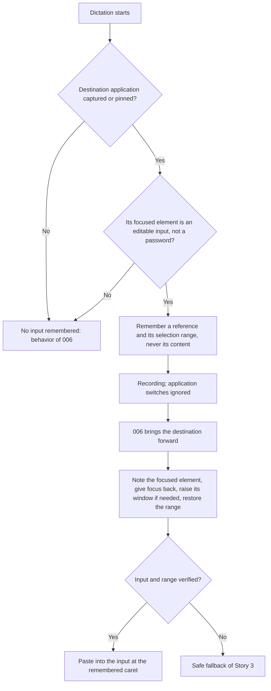
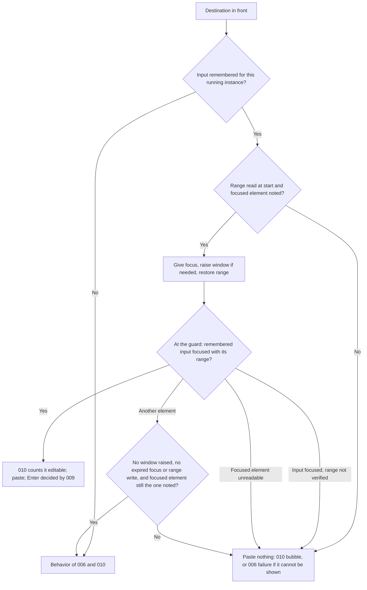
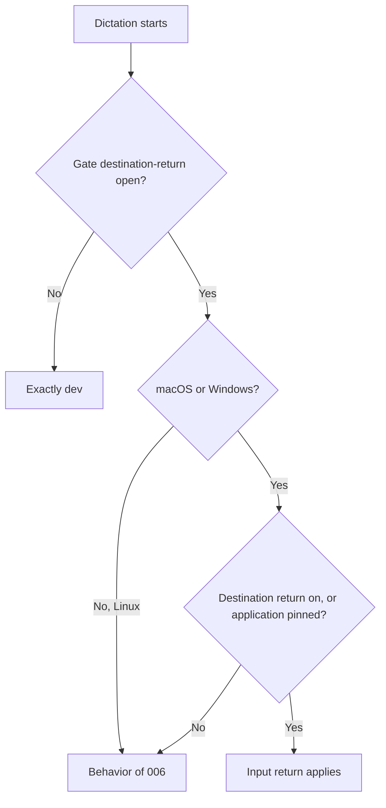

# Feature Spec: Dictation Field Return

## Header

- **Feature:** Dictation Field Return
- **Branch:** None — specification only (committed on `dev`)
- **Date:** 2026-10-15
- **Status:** In Progress
- **Input:** Request from Julien, 2026-10-15: "I often click in the application's input field, for example the input of the ChatGPT session in Comet, then I start the transcription. When I start the transcription, we already record which application it is; we must also record whether we are already in an input, in the component that receives the text. That way, if I then go to another application, when I stop the transcription the text is pasted directly back into that input. It also works when an application is pinned (PIN)."
- **Feature Number:** 011

## User Scenarios & Testing

### Story 1 — Return to the input where the dictation started `P1`

**As a** Handy user, **I want to** have my text pasted back into the input I was in when I started dictating, at the place where my caret was, **so that** I can work in another application while I speak without losing my place or my draft.

**Priority reason:** This is the behavior requested.
**Independent test:** Type a draft in the ChatGPT input of Comet, leave the caret inside it, start a dictation, switch to Notes, stop, and check that the text lands at the caret with the draft intact.

```gherkin
Feature: Return to the dictation's input
  Scenario: Switch application during the recording
    Given the ChatGPT input of a Comet page has keyboard focus with the caret inside a draft
    And Comet is the frontmost application
    When the user starts a dictation, switches to Notes, and stops the dictation
    Then Handy brings Comet forward as in feature 006
    And Handy gives keyboard focus back to the ChatGPT input and restores its selection range
    And Handy checks that this input is the focused element and that its range is the remembered one
    And the text is pasted at the remembered caret with the configured insertion method, the draft intact
  Scenario: Another window of the same application
    Given the note editor of a Notes window has keyboard focus
    When the user starts a dictation, brings another Notes window forward, and stops
    Then Handy gives focus back to the remembered editor, raises its window and restores its range
    And the text is pasted into the remembered editor
  Scenario: No input focused at the start
    Given Finder is frontmost with no text field focused
    When the user starts a dictation, switches to TextEdit, and stops
    Then no input is remembered
    And Handy behaves as in features 006 and 010: it brings Finder forward and applies their insertion or bubble
```



### Story 2 — Return to the input of a pinned application `P1`

**As a** Handy user, **I want to** have my text pasted into the input of the pinned application, **so that** pinning keeps sending my words to the exact place I left.

**Priority reason:** The request states that it also works when an application is pinned.
**Independent test:** Pin Comet with its ChatGPT input focused, move to Notes, dictate twice, and check where each text lands.

```gherkin
Feature: Input of the pinned application
  Scenario: Pinned application with a focused input
    Given Comet is pinned and its ChatGPT input is its focused element
    And Notes is the frontmost application
    When the user starts a dictation and stops it
    Then Handy remembers the ChatGPT input of Comet and its selection range at the start
    And the text is pasted into the ChatGPT input after Comet is brought forward
  Scenario: Pinned application not running at the start
    Given Notes is pinned and Notes is not running
    When the user dictates
    Then no input is remembered
    And the failure of feature 009 applies unchanged
  Scenario: Destination changed from the badge
    Given a dictation started with the ChatGPT input of Comet remembered
    When the user chooses TextEdit as destination from the badge
    Then the remembered input is dropped
    And the text goes to TextEdit as in feature 006
```


### Story 3 — Never lose the text, never paste elsewhere, never overwrite a draft `P1`

**As a** Handy user, **I want to** keep today's behavior only when Handy made a return attempt that changed nothing, and get the recovery bubble with my text in every other case where the remembered input cannot be used, including when its caret could not be read at the start, even if I never switched application, **so that** my text is never lost, never typed into a field I did not choose and never written over my draft.

**Priority reason:** Giving focus to a stale or wrong element could put the text in the wrong place or replace a draft.
**Independent test:** Reload the Comet page during a dictation, stop, and check that Handy inserts into Comet as today; select another Comet tab during a dictation, stop, and check that nothing is pasted and the recovery bubble shows the text; dictate from an input whose caret cannot be read, without switching application, and check that the bubble shows the text.

```gherkin
Feature: Safe fallback
  Scenario: Input destroyed and attempt changed nothing
    Given the ChatGPT input of Comet was remembered
    When the page is reloaded before the dictation stops
    And giving focus to the input fails at once, no window is raised, no focus or range write expired its deadline and Comet's focused element is still the one noted before the attempt
    Then Handy inserts into Comet as in feature 006, with the classification and bubble of feature 010
  Scenario: Selection range unreadable at the start
    Given an editable input of Comet was remembered but its selection range could not be read at the start
    When the user stops the dictation, with or without switching application
    Then Handy makes no return attempt and pastes nothing
    And the bubble of feature 010 shows the transcript with the reason "Insertion failed"
  Scenario: Focus or range write without an answer in time
    Given Handy gave focus back or restored the range and the target did not answer before the deadline
    When Handy decides at the guard
    Then the attempt counts as having changed something, since the target may still apply it later
    And nothing is pasted and the bubble of feature 010 appears
  Scenario: Attempt moved the focus
    Given the remembered input is in a Comet tab that is no longer selected
    When Handy gives focus back and Comet's focused element is then neither the remembered input nor the element noted before the attempt
    Then nothing is pasted
    And the bubble of feature 010 shows the transcript with the reason "Insertion failed" and the explanation that nothing was sent to the application
  Scenario: Selection range not restored
    Given the remembered input is focused, given focus back by Handy or already focused when Handy noted the focused element
    When its selection range cannot be restored or verified
    Then nothing is pasted, even when the focused element did not change, and the bubble of feature 010 appears
  Scenario: Bubble unavailable
    Given Handy's attempt moved the focus and the verification failed
    When feature 010 cannot present the bubble
    Then nothing is pasted and the paste-error notification of feature 006 appears, with the transcript in history as today
  Scenario: Verified input counts as a text field
    Given the remembered input was given focus, its range restored and both verified
    When feature 010 classifies the focused element before insertion
    Then the element counts as editable and no "No text field is focused" bubble appears
  Scenario: Automatic Enter still checks the foreground
    Given the text was pasted into the verified input of ChatGPT and automatic Enter is "Always"
    When another application becomes frontmost before the Enter press
    Then no Enter key press is sent, as in feature 009
```



### Story 4 — Same build, settings and platforms as before `P2`

**As a** Handy user, **I want to** keep the current behavior where this feature does not apply, **so that** nothing else changes.

**Priority reason:** The feature rides on 006 and 009 without a new setting; regressions would affect every dictation.
**Independent test:** Run the same dictation on a build with the `destination-return` gate closed, with "Return to the dictation's application" off and nothing pinned, and on Linux.

```gherkin
Feature: Scope of the input return
  Scenario: Gate closed
    Given a build with the destination-return gate closed
    When the user dictates from an input and switches application
    Then Handy behaves exactly as dev and reads no focused element
  Scenario: Destination return off and nothing pinned
    Given "Return to the dictation's application" is off and nothing is pinned
    When the user dictates
    Then no input is remembered and the text goes to the frontmost application at the end
  Scenario: Linux
    Given Handy runs on Linux
    When the user dictates from an input
    Then no input is remembered and the behavior of feature 006 applies
```



## Acceptance Criteria

### AC-001

**Criterion:** On macOS, with the `destination-return` gate open, when a dictation starts with a destination application (captured by 006, or pinned as in AC-003), Handy reads, right after the 006 capture and off the recording start path, the focused element of that application: `AXFocusedUIElement` of its application element, the facts 010's rule needs, then its selection range (`AXSelectedTextRange`: position and length only). These reads share one deadline of 50 ms, the value of 010's classification budget; as in 010, the messaging timeout is set on each element queried to the remaining budget, never on the system-wide element and never with the value 0. The recording starts without waiting for this read. Handy remembers a reference to that element only when it belongs to the destination's process and the classification rule of 010 (`.specs/features/010-recovery-bubble/spec.md`, AC-002) finds it editable; it keeps the range with it, or notes that the range could not be read, in which case AC-004 applies at insertion. A password field (role or subrole `AXSecureTextField`), a non-editable or undetermined element, an element of another process, a missing Accessibility permission, an Accessibility error and a deadline expired before the classification remember nothing. When nothing is remembered, the dictation behaves as in 006.
**Priority:** P1 | **Story:** Stories 1 and 2

### AC-002

**Criterion:** At insertion, after 006 has confirmed the destination frontmost, and only when an input with its selection range is remembered for the running instance (same identity and process) that 006 brought forward, Handy, once and without retry: (1) notes the application's focused element; (2) gives keyboard focus back to the remembered element (`kAXFocusedAttribute` set to true); (3) raises its window (`AXRaise` on its `AXWindow`) when that window is not the application's focused window; (4) restores the remembered selection range (`AXSelectedTextRange` set to the remembered position and length); (5) immediately before the first dispatch, at 006's pre-dispatch guard, verifies that the application's focused element is the remembered element and that its selection range is the remembered one; (6) then inserts with the configured insertion method, unchanged, so the text lands at the remembered caret or replaces the selection made before the start, as it would have then. Steps (1) to (4) share one 50 ms deadline and step (5) a 10 ms deadline, with per-element timeouts as in AC-001. A step that fails ends the attempt without the following steps; when step (1) fails, no attempt is made. AC-004 then decides. The attempt has changed something as soon as a window raise is sent, whatever its result, or a focus or range write (steps 2 and 4) gets no answer before its deadline or its messaging timeout, because the target may still apply it later; a focus or range write refused at once with an error changes nothing. The outcome is reported as 006 reports it: "insertion attempted" unless the method itself verified the text.
**Priority:** P1 | **Story:** Story 1

### AC-003

**Criterion:** With an application pinned (009), the element read at the start is the focused element of the pinned application's running instance, whatever application is frontmost. When the pinned application is not running at the start, nothing is remembered and 009's failure applies unchanged. The remembered input is kept only while the dictation's destination is that same running instance: a badge choice of another application, the removal of the destination, or an unpin that changes the destination's application drops it, and the dictation then behaves as in 006 and 009.
**Priority:** P1 | **Story:** Story 2

### AC-004

**Criterion:** When an input with its selection range, or with a range that could not be read, is remembered for the running instance that 006 brought forward and is not verified as in AC-002 step (5), Handy decides once, at 006's pre-dispatch guard, without retry and without giving focus to any other element. Exactly one of the two branches applies. (a) Unchanged attempt, only when all of the following hold: the range was read at the start, the focused element was noted in AC-002 step (1), no window was raised, every focus or range write sent was answered in time (AC-002), and the application's focused element read at the guard is not the remembered input and is the element noted in step (1) (for example the element no longer exists and giving it focus failed at once): Handy inserts exactly as without this feature, into the destination application (006), with 010's classification and recovery bubble. (b) Every other case, in particular: the range was not read at the start (no attempt is then made), the focused element could not be noted, the focused element cannot be read at the guard, the remembered input is focused (given focus back, or already focused when noted) but its range could not be restored or verified, the focused element differs from the one noted, a window was raised, or a focus or range write got no answer in time: Handy pastes nothing and presents 010's recovery bubble with the transcript, the existing reason "Insertion failed" and 010's existing explanation that nothing was sent to the application. When 010 cannot present the bubble (presentation confirmed impossible: lock, platform or overlay), the existing 006 failure applies: the `paste-error` notification, with the transcript in history as today; nothing is pasted. No reason or message is added, no Enter is sent after (b), and the transcript is never lost. 006's own guard refusals are unchanged.
**Priority:** P1 | **Story:** Story 3

### AC-005

**Criterion:** When the remembered element and its range are verified at 006's pre-dispatch guard, 010's classification counts the element as editable, so the "No text field is focused" bubble never replaces that insertion. Automatic Enter (009, `.specs/features/009-pin-mode-and-enter-rule/spec.md` AC-005) is unchanged: it still requires the destination to be frontmost immediately before the Enter press, and this feature adds no Enter condition and removes none.
**Priority:** P1 | **Story:** Story 3

### AC-006

**Criterion:** No input is remembered and no focused element is read when the `destination-return` gate is closed (the build behaves exactly as `dev`), when "Return to the dictation's application" is off and nothing is pinned, or when no destination is captured (Handy frontmost, foreground unreadable). When the dictation is cancelled, or the paste method is "none" at insertion (no activation), the reference remembered at the start is dropped and never used: no focus change, no range restoration and no verification. No setting, settings CLI key, screen, control or visual state is added: the behavior belongs to 006's "Return to the dictation's application" and to 009's pin.
**Priority:** P2 | **Story:** Story 4

### AC-007

**Criterion:** On Windows, the same behavior uses UI Automation: the focused element is remembered only when it belongs to the destination's process and is a text input that is neither a password nor read-only. A text input is an element whose UI Automation `ControlType` is Edit or Document and that exposes `ValuePattern` or `TextPattern`; it is a password when `IsPassword` is true and read-only when its `ValuePattern` reports `IsReadOnly` (010 classifies on macOS only, so this definition is 011's own on Windows). Its selection is read through `TextPattern` (`GetSelection`, endpoints only, never `GetText`); when `TextPattern` is unavailable, the selection is not read and AC-004 (b) applies. At insertion Handy notes the focused element, calls `SetFocus` on the remembered element, restores its selection (`Select`), then verifies the focused element and its selection before inserting, with the fallback of AC-004. Every UI Automation call is bounded by the deadlines of AC-001 and AC-002; a call that does not answer in time counts as an expired deadline and its late answer is ignored; when that call is `SetFocus` or `Select`, the attempt has changed something, as in AC-002, and AC-004 (b) applies. Its native observation is pending release evidence, never a gate. On Linux, where 006 captures no destination, nothing is remembered and 006's behavior applies.
**Priority:** P2 | **Story:** Story 4

### AC-008

**Criterion:** Handy never reads, stores or logs the content of the remembered element (its value, selected text or title). It holds only the fields of the Remembered input entity: an opaque reference to the element, the dictation's identity and destination generation, the destination's application identity and process id, the selection's position and length or the fact that it could not be read (on Windows, an opaque copy of the selection's endpoints), and the capture time; during insertion, it adds an opaque reference to the element noted before the attempt and the attempt's facts (stage reached, window raised, focus or range write without an answer in time). These live only for the current dictation and are released when its outcome is published, when it is cancelled or superseded, or when Handy quits; none of them, the range included, appears in an event, the settings CLI, history or a log. Only the Input return result (its outcome, the stage that failed and elapsed times) is logged, without content or range.
**Priority:** P1 | **Story:** Story 1

## Functional Requirements

### FR-001

**Requirement:** Remember, at dictation start, a reference to the destination application's focused input and its selection range (position and length) when it is an editable element of the destination's process that is not a password field, with Accessibility reads bounded to 50 ms off the recording start path and without reading its content.
**AC References:** AC-001, AC-008

### FR-002

**Requirement:** At insertion, after the destination is in front, note the application's focused element, give focus back to the remembered input, raise its window when needed, restore its selection range, verify input and range at the pre-dispatch guard, then insert with the configured method.
**AC References:** AC-002, AC-005

### FR-003

**Requirement:** Read the remembered input from the pinned application when one is pinned, and keep it only while the dictation's destination stays that running instance.
**AC References:** AC-003

### FR-004

**Requirement:** Whenever the remembered input cannot be used, insert through the existing 006/010 path only when Handy's attempt changed nothing (a raised window or a focus or range write without an answer in time is a change; an unread range or an unverified range on the focused input never qualifies); otherwise paste nothing and present 010's recovery bubble with its existing reason, or 006's failure when the bubble cannot be presented. Never paste into the input without its verified range, never into an element reached by the attempt, never lose the transcript.
**AC References:** AC-004, AC-005

### FR-005

**Requirement:** Limit the behavior to the gate-open build, to dictations with a destination on macOS and Windows (UI Automation calls bounded as on macOS), without a new setting, CLI key or user interface.
**AC References:** AC-006, AC-007

## Key Entities

| Entity | Description | Key fields |
|---|---|---|
| Remembered input | Opaque reference to the destination's focused input, held for one dictation | dictation id, destination generation, application identity, process id, opaque element reference, selection position and length (or not read; on Windows an opaque copy of the selection's endpoints), captured at; during insertion, the noted element and the attempt's facts (stage, window raised, write without an answer in time); never content |
| Input return result | What happened at insertion, logged without content or range | verified; not remembered (with its miss); fallback through 006/010 because the attempt changed nothing; recovery bubble or 006 failure because the attempt changed something (focus moved, window raised, focus or range write without an answer in time), the range is missing or unverified, or the focus could not be read or noted; each with the stage that failed and elapsed times |
| Destination (006) and Pin (009) | Application the dictation goes to, captured or pinned | identity, process id, source |
| Focus classification (010) | Editable, not editable or undetermined | used at capture to decide whether to remember; a verified input counts as editable |

## Clarifications

- Technical frame validated by Julien (2026-10-15): macOS only as a gate. At dictation start, together with the 006 capture, read `AXFocusedUIElement` of the destination's application element; the messaging timeout is set per element, never on the system-wide element and never to 0, as decided for 010. Keep a reference, never read or log its content. With a pin (009), the element is that of the pinned application at the start. At insertion, after 006 has brought the application back: give focus (`kAXFocusedAttribute = true`), raise the window (`AXRaise` on `AXWindow`) if needed, verify that the focused element is that element, then paste. Fallback: the current behavior with 010's classification and bubble; never text loss, never insertion into another field than the verified remembered one or the existing 006/010 path. Windows through UI Automation (`SetFocus`) as pending release evidence (decision D1 of `.specs/features/006-destination-application/plan.md`); Linux unsupported. Everything behind the `destination-return` Cargo gate. The fallback and the caret are refined by decisions `fallback-after-partial-return` and `caret-after-focus-restore` below.
- Decision 2026-10-15 (Julien): no new setting. The behavior is part of 006's "Return to the dictation's application" and of 009's pin.
- Decision 2026-10-15 (Julien): no Penflow mockup. The feature adds no screen, control, badge mark or visual state.
- Current behavior (2026-10-15): 006 records an application, not a field (`.specs/features/006-destination-application/spec.md`, Clarifications); activation returns to the application's last active window and the application decides which element has focus. 011 adds the field level only for the input focused at the start.
- Decision 2026-10-15 (validated by Julien (maintainer) on 2026-10-15; AC-001): only an element that 010's rule finds editable is remembered; an undetermined element is not, so an uncertain read never changes where the text goes.
- Decision 2026-10-15 (validated by Julien (maintainer) on 2026-10-15; AC-001 and AC-003): the input is remembered once, at the start. A different field of the same application clicked during the recording does not replace it, as application switches do not change the 006 destination.
- Decision 2026-10-15 (validated by Julien (maintainer) on 2026-10-15; AC-003): a badge choice of another application, the removal of the destination or an unpin that changes the destination's application drops the remembered input; Handy does not read the focused element of the newly chosen application.
- Decision 2026-10-15 (validated by Julien (maintainer) on 2026-10-15; AC-004 and AC-008): no new reason or message is added; a fallback through 006/010 is silent and only a log without content records the stage that failed. Amended on 2026-10-15 by decision `fallback-after-partial-return` below: when Handy's attempt changed something, the existing 010 bubble appears instead, with an existing reason.
- Program context: depends on 006 (capture, `DestinationContext`, pre-dispatch guard), 009 (pin, foreground check before Enter) and 010 (focus classification, bubble). 011 is implemented after 009 and 010 are merged into `dev`.

- Decision `011-dictation-field-return:FR-004` / `fallback-after-partial-return`: validated by Julien (maintainer) on 2026-10-15 (mechanism: answer given by Julien to this round-1 review question, recorded through LiveSpec's source-bound clarification answer). Before giving focus back, Handy notes the application's focused element. If the verification fails, Handy inserts through the existing 006/010 path only when its attempt changed nothing: no window was raised and the application's focused element is still the one noted before the attempt. Otherwise (focus moved or a window raised), Handy does not paste and shows the 010 bubble with the transcript, to copy or drag, with 010's existing reason "Insertion failed" and its existing explanation that nothing was sent to the application. When 010 cannot present the bubble (lock, platform or overlay), the existing 006 failure applies (`paste-error` notification, transcript in history as today), never a paste. Applied in AC-004, FR-004 and SC-002.
<!-- livespec-clarification:{"requirement_id": "011-dictation-field-return:FR-004", "decision_key": "fallback-after-partial-return", "evidence_hash": "4d7ccb6af087536a382f227c6bce720971749d8a51d3cea85b69e206cbd831cd", "answer": "validated by Julien (maintainer) on 2026-10-15 (mechanism: answer given by Julien to this round-1 review question, recorded through LiveSpec's source-bound clarification answer). Before giving focus back, Handy notes the application's focused element. If the verification fails, Handy inserts through the existing 006/010 path only when its attempt changed nothing: no window was raised and the application's focused element is still the one noted before the attempt. Otherwise (focus moved or a window raised), Handy does not paste and shows the 010 bubble with the transcript, to copy or drag, with 010's existing reason \"Insertion failed\" and its existing explanation that nothing was sent to the application. When 010 cannot present the bubble (lock, platform or overlay), the existing 006 failure applies (`paste-error` notification, transcript in history as today), never a paste. Applied in AC-004, FR-004 and SC-002."} -->

- Decision `011-dictation-field-return:AC-002` / `caret-after-focus-restore`: validated by Julien (maintainer) on 2026-10-15 (mechanism: answer given by Julien to this round-1 review question, recorded in LiveSpec's clarification format). At dictation start Handy remembers the input's selection range (`AXSelectedTextRange`: position and length only, never the text). After giving focus back it restores that range, verifies it, then pastes. If the range cannot be read at the start, or cannot be restored and verified at insertion, Handy does not paste into the input and applies decision `fallback-after-partial-return`: the 010 bubble, or the 006 failure when 010 cannot present it. A draft is never overwritten. On Windows (UI Automation), the `TextPattern` selection is used when available; otherwise the same no-paste rule applies; this remains release evidence. Applied in AC-002 and AC-007.
<!-- livespec-clarification:{"requirement_id": "011-dictation-field-return:AC-002", "decision_key": "caret-after-focus-restore", "evidence_hash": "1bfa86e39035ab0d08ff3c94509d4d2a116e3467d104b170f8241821b0ea9b09", "answer": "validated by Julien (maintainer) on 2026-10-15 (mechanism: answer given by Julien to this round-1 review question, recorded in LiveSpec's clarification format). At dictation start Handy remembers the input's selection range (`AXSelectedTextRange`: position and length only, never the text). After giving focus back it restores that range, verifies it, then pastes. If the range cannot be read at the start, or cannot be restored and verified at insertion, Handy does not paste into the input and applies decision `fallback-after-partial-return`: the 010 bubble, or the 006 failure when 010 cannot present it. A draft is never overwritten. On Windows (UI Automation), the `TextPattern` selection is used when available; otherwise the same no-paste rule applies; this remains release evidence. Applied in AC-002 and AC-007."} -->

## QE Analysis

- **Criticality:** High; **Blast radius:** Every dictation with a destination on macOS and Windows; **Primary risk:** Text pasted into a wrong field or over a draft (privacy, data loss) or lost; **Confidence:** Low-medium (no native prototype; browser focus and Chromium Accessibility exposure unverified).
- **Dimensions:** Functional correctness, security/privacy (wrong field, draft overwrite, no content read), reliability, performance (start latency, main-thread Accessibility time), platform compatibility, regression of 006/009/010.
- **P0 gates/evidence:** Decision tests for capture (editable, password field, other process, undetermined, permission, error, deadline, range read or not read) and for insertion (verified with range, element gone with nothing changed, focus moved, window raised, focus or range write without an answer in time, range not read at the start, range not restored or not verified (including on an input already focused when noted), focused element unreadable or not noted, destination changed, method none, cancelled, bubble unpresentable); proof that an unchanged attempt reaches the 006/010 path and every other failure pastes nothing and reaches 010's bubble or 006's `paste-error`; a start path that completes while the field port does not answer; gate-closed build with zero focused-element reads.
- **P1 gates/evidence:** Native macOS checks with Comet (ChatGPT page), Notes and ChatGPT desktop, with a draft and the caret inside it, including a reloaded page, a changed tab, a second window and a pinned application; the native proof records whether Chromium exposes Comet's web input to Accessibility; Windows UI Automation run recorded as pending release evidence.
- **Non-functional expectations:** The start read runs off the recording start path within 50 ms; the restoration within 50 ms and the verification within 10 ms; Accessibility and UI Automation calls bounded per element; no element content, range, window title or transcript logged at any level.
- **Missing evidence:** No runtime test; Chromium tab, focus and Accessibility exposure unknown; Windows native behavior unverified.
- **Boundary:** QE defines risk and test sufficiency; the independent review judges requirements; spec-test executes runtime proof. No UI design evidence applies.

## Quality Engineering

- **Risk:** High criticality (rated so by the QE Analysis: a wrong focus or a lost caret could put the text in another field or over a draft); Shared blast radius (the step sits on every insertion with a destination); primary risk Security/privacy (wrong field, draft overwrite), followed by Regression of 006/009/010.
- **Applicable dimensions:** functional correctness, security/privacy, reliability, performance, platform compatibility, regression.
- **P0 gates/evidence:** Capture and insertion decision tests with fake Accessibility seams; an unchanged attempt reaches the existing path, any other failure pastes nothing and shows the bubble or 006's failure; zero reads with the gate closed; start path never waits for the read.
- **Boundary:** QE defines risk and test sufficiency only. The independent spec review judges requirements, spec-test executes runtime proof and the end-of-feature delivery review looks for defects.

## Screens

None. This feature adds no screen, control or visual state, so no mockup is produced (decision 2026-10-15, Julien). The recovery bubble of AC-004 is 010's, with its existing reason and explanation.

## Edge Cases

- Browser tab changed during the recording: giving focus may move Comet's focus without bringing the tab back; the focused element then differs from the one noted, so nothing is pasted and the bubble appears (AC-004 b).
- Password field (role or subrole `AXSecureTextField`) focused at the start: never remembered, never targeted (AC-001).
- Page reloaded, tab or window closed, dialog dismissed: the element is gone and giving it focus fails; when nothing changed, 006/010 insert (AC-004 a), otherwise the bubble (AC-004 b).
- Destination restarted during the recording (new process, same identity): the remembered input belongs to the old process, no attempt is made and nothing changes; 006/010 apply (AC-002).
- Input in another window of the destination: its window is raised (AC-002); if the verification then fails, a window was raised, so nothing is pasted and the bubble appears (AC-004 b).
- Another field of the same application clicked during the recording: the remembered input wins (Clarifications); its focus and range are restored before the paste.
- Draft in the input: the caret or selection of the start is restored, so the text lands at the caret, or replaces the selection made before the start as it would have then.
- Range not exposed (no readable `AXSelectedTextRange`, or no `TextPattern` on Windows): no attempt, nothing pasted, the bubble (AC-004 b), even when the user never switched application (decision `caret-after-focus-restore`).
- Focused element unreadable before the attempt or at the guard: nothing can prove the attempt changed nothing; the bubble (AC-004 b).
- Chromium (Comet) not exposing its web input to Accessibility: the focused element is not an editable input, nothing is remembered and 006 applies (AC-001); Handy does not change the application's accessibility mode.
- 010 cannot present the bubble: 006's `paste-error`, nothing pasted (AC-004).
- Input disabled or read-only after the start but still focusable: the verification checks focus and range, not editability; the method's own result decides, and a failure reaches 010's bubble.
- Slow or busy destination: a deadline expires; at the start nothing is remembered when it expires before the classification, or the input is remembered without its range when it expires during the range read (then the bubble at insertion); at insertion, a focus or range write without an answer in time counts as a change, since the target may still apply it, so nothing is pasted and the bubble appears (AC-004 b).
- Remembered input still focused when Handy notes the focused element, but its range cannot be restored or verified: the focused element did not change, yet nothing is pasted and the bubble appears (AC-004 b).
- Smart paste (007) direct insertion reads the destination's focused element: after a verified return, that element is the remembered input with its restored range.

## Success Criteria

### SC-001

In native macOS checks, starting in the input holding a draft with the caret inside it, switching to another application and stopping puts the full transcript at the caret, draft intact, in 5 of 5 runs for Notes and ChatGPT desktop, and for Comet with the ChatGPT page in the same tab. For Comet, Chromium exposing its web input to Accessibility is a precondition verified by the native proof; when it is not exposed, the 5 runs must follow the safe fallback (nothing remembered, behavior of 006) and the result is reported to Julien. Each run and each fallback case is recorded.

### SC-002

In fault-injection tests (element gone, focus refused, window raised, focus moved, range not read at the start, remembered input already focused with its range not restored, range not restored, range not verified, focused element unreadable or not noted, focus or range write without an answer in time, deadline expired, password field, destination changed, bubble unpresentable), zero insertions target an element other than the verified remembered input or, when the attempt changed nothing, the 006/010 target; 100% of the unchanged cases follow the 006/010 path, 100% of the other cases paste nothing and show 010's bubble (or 006's `paste-error` when it cannot be presented), and the transcript is preserved in every case.

### SC-003

With the `destination-return` gate closed, automated tests observe zero focused-element reads and the same insertion as `dev`.

### SC-004

A sentinel text placed in the remembered input never appears in logs, events or CLI output during automated and native checks. In automated checks whose fake port remembers a selection with distinctive sentinel position and length values, neither value appears in captured logs (all levels), events or CLI output.

### SC-005

In automated tests whose field port never answers, the recording start path completes without waiting for it, and the start read is abandoned at its 50 ms deadline with nothing remembered.
