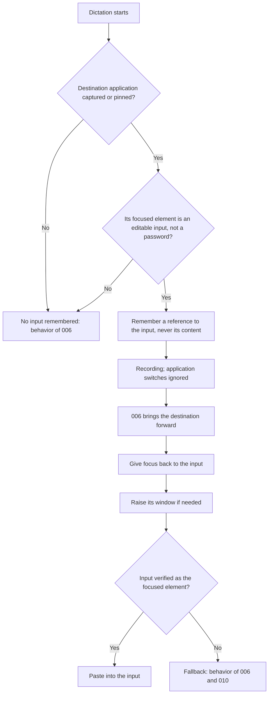
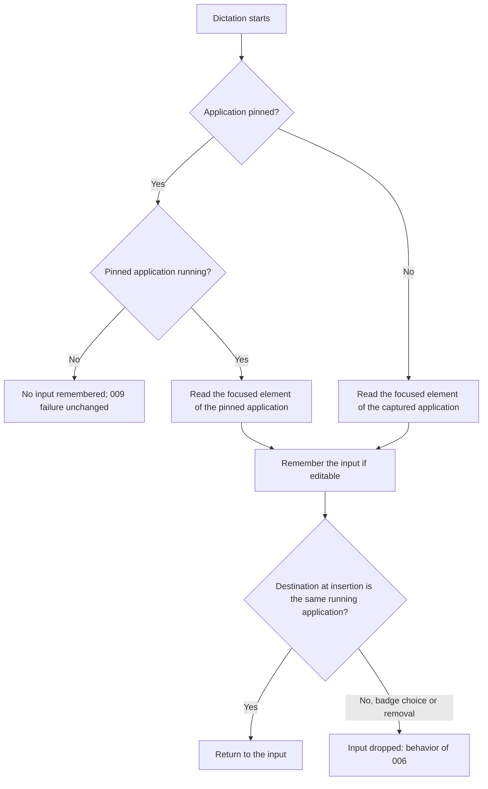
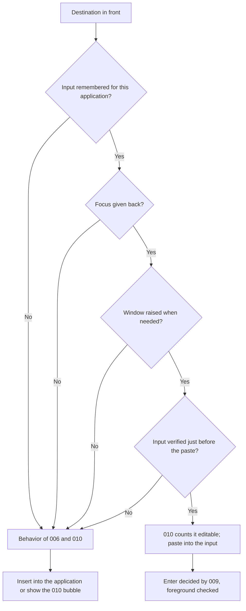
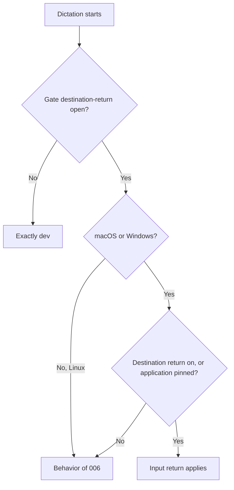

# Feature Spec: Dictation Field Return

## Header

- **Feature:** Dictation Field Return
- **Branch:** None — specification only (committed on `dev`)
- **Date:** 2026-10-15
- **Status:** Planned
- **Input:** Request from Julien, 2026-10-15: "I often click in the application's input field, for example the input of the ChatGPT session in Comet, then I start the transcription. When I start the transcription, we already record which application it is; we must also record whether we are already in an input, in the component that receives the text. That way, if I then go to another application, when I stop the transcription the text is pasted directly back into that input. It also works when an application is pinned (PIN)."
- **Feature Number:** 011

## User Scenarios & Testing

### Story 1 — Return to the input where the dictation started `P1`

**As a** Handy user, **I want to** have my text pasted back into the input I was in when I started dictating, **so that** I can work in another application while I speak without losing my place.

**Priority reason:** This is the behavior requested.
**Independent test:** Click in the ChatGPT input of Comet, start a dictation, switch to Notes, stop, and check that the text lands in the ChatGPT input.

```gherkin
Feature: Return to the dictation's input
  Scenario: Switch application during the recording
    Given the ChatGPT input of a Comet page has keyboard focus
    And Comet is the frontmost application
    When the user starts a dictation, switches to Notes, and stops the dictation
    Then Handy brings Comet forward as in feature 006
    And Handy gives keyboard focus back to the ChatGPT input
    And Handy checks that this input is the focused element
    And the text is pasted into the ChatGPT input with the configured insertion method
  Scenario: Another window of the same application
    Given the note editor of a Notes window has keyboard focus
    When the user starts a dictation, brings another Notes window forward, and stops
    Then Handy gives focus back to the remembered editor and raises its window
    And the text is pasted into the remembered editor
  Scenario: No input focused at the start
    Given Finder is frontmost with no text field focused
    When the user starts a dictation, switches to TextEdit, and stops
    Then no input is remembered
    And Handy behaves as in features 006 and 010: it brings Finder forward and applies their insertion or bubble
```



### Story 2 — Return to the input of a pinned application `P1`

**As a** Handy user, **I want to** have my text pasted into the input of the pinned application, **so that** pinning keeps sending my words to the exact place I left.

**Priority reason:** The request states that it also works when an application is pinned.
**Independent test:** Pin Comet with its ChatGPT input focused, move to Notes, dictate twice, and check where each text lands.

```gherkin
Feature: Input of the pinned application
  Scenario: Pinned application with a focused input
    Given Comet is pinned and its ChatGPT input is its focused element
    And Notes is the frontmost application
    When the user starts a dictation and stops it
    Then Handy remembers the ChatGPT input of Comet at the start
    And the text is pasted into the ChatGPT input after Comet is brought forward
  Scenario: Pinned application not running at the start
    Given Notes is pinned and Notes is not running
    When the user dictates
    Then no input is remembered
    And the failure of feature 009 applies unchanged
  Scenario: Destination changed from the badge
    Given a dictation started with the ChatGPT input of Comet remembered
    When the user chooses TextEdit as destination from the badge
    Then the remembered input is dropped
    And the text goes to TextEdit as in feature 006
```



### Story 3 — Never lose the text and never paste elsewhere `P1`

**As a** Handy user, **I want to** keep today's behavior whenever the remembered input cannot be used, **so that** my text is never lost and never typed into a field I did not choose.

**Priority reason:** Giving focus to a stale or wrong element could put the text in the wrong place.
**Independent test:** Reload the Comet page during a dictation, stop, and check that Handy pastes into Comet as today, with the recovery bubble when no text field is focused.

```gherkin
Feature: Fallback to the existing behavior
  Scenario: Input destroyed during the recording
    Given the ChatGPT input of Comet was remembered
    When the page is reloaded before the dictation stops
    Then the input cannot be given focus
    And Handy inserts into Comet as in feature 006, with the classification and bubble of feature 010
  Scenario: Focus not verified
    Given the remembered input is in a Comet tab that is no longer selected
    When Handy gives focus back and the focused element of Comet is another element
    Then the text is not pasted into the remembered input
    And Handy continues as in features 006 and 010
  Scenario: Verified input counts as a text field
    Given the remembered input was given focus and verified
    When feature 010 classifies the focused element before insertion
    Then the element counts as editable and no "No text field is focused" bubble appears
  Scenario: Automatic Enter still checks the foreground
    Given the text was pasted into the verified input of ChatGPT and automatic Enter is "Always"
    When another application becomes frontmost before the Enter press
    Then no Enter key press is sent, as in feature 009
```



### Story 4 — Same build, settings and platforms as before `P2`

**As a** Handy user, **I want to** keep the current behavior where this feature does not apply, **so that** nothing else changes.

**Priority reason:** The feature rides on 006 and 009 without a new setting; regressions would affect every dictation.
**Independent test:** Run the same dictation on a build with the `destination-return` gate closed, with "Return to the dictation's application" off and nothing pinned, and on Linux.

```gherkin
Feature: Scope of the input return
  Scenario: Gate closed
    Given a build with the destination-return gate closed
    When the user dictates from an input and switches application
    Then Handy behaves exactly as dev and reads no focused element
  Scenario: Destination return off and nothing pinned
    Given "Return to the dictation's application" is off and nothing is pinned
    When the user dictates
    Then no input is remembered and the text goes to the frontmost application at the end
  Scenario: Linux
    Given Handy runs on Linux
    When the user dictates from an input
    Then no input is remembered and the behavior of feature 006 applies
```



## Acceptance Criteria

### AC-001

**Criterion:** On macOS, with the `destination-return` gate open, when a dictation starts with a destination application (captured by 006, or pinned as in AC-003), Handy reads at the same time as the 006 capture the focused element of that application: `AXFocusedUIElement` of its application element, with a messaging timeout set on each element queried, never on the system-wide element and never with the value 0, within a bounded budget that does not delay the start of recording. Handy remembers a reference to that element only when it belongs to the destination's process and the classification rule of 010 (`.specs/features/010-recovery-bubble/spec.md`, AC-002) finds it editable. A password field (role or subrole `AXSecureTextField`), a non-editable or undetermined element, an element of another process, a missing Accessibility permission, an Accessibility error and an expired budget remember nothing. When nothing is remembered, the dictation behaves as in 006.
**Priority:** P1 | **Story:** Stories 1 and 2

### AC-002

**Criterion:** At insertion, after 006 has confirmed the destination frontmost, and only when an input is remembered for the running instance (same identity and process) that 006 brought forward, Handy, once and without retry: (1) gives keyboard focus back to the remembered element (`kAXFocusedAttribute` set to true); (2) raises its window (`AXRaise` on its `AXWindow`) when that window is not the application's focused window; (3) immediately before the first dispatch, at 006's pre-dispatch guard, verifies that the application's focused element is the remembered element; (4) inserts with the configured insertion method, unchanged. Each Accessibility call is bounded as in AC-001. The outcome is reported as 006 reports it: "insertion attempted" unless the method itself verified the text.
**Priority:** P1 | **Story:** Story 1

### AC-003

**Criterion:** With an application pinned (009), the element read at the start is the focused element of the pinned application's running instance, whatever application is frontmost. When the pinned application is not running at the start, nothing is remembered and 009's failure applies unchanged. The remembered input is kept only while the dictation's destination is that same running instance: a badge choice of another application, the removal of the destination, or an unpin that changes the destination's application drops it, and the dictation then behaves as in 006 and 009.
**Priority:** P1 | **Story:** Story 2

### AC-004

**Criterion:** When the remembered element no longer exists (page reloaded, tab or window closed), focus cannot be given, the window cannot be raised, the verification of AC-002 fails or cannot be read, or the budget expires, Handy inserts exactly as without this feature: into the destination application (006), with 010's classification and recovery bubble. No step is retried, no other element is given focus, no new reason or message is shown, and the transcript is never lost. The text is inserted only into the verified remembered element or through the existing 006/010 path.
**Priority:** P1 | **Story:** Story 3

### AC-005

**Criterion:** When the remembered element is verified at 006's pre-dispatch guard, 010's classification counts it as editable, so the "No text field is focused" bubble never replaces that insertion. Automatic Enter (009, `.specs/features/009-pin-mode-and-enter-rule/spec.md` AC-005) is unchanged: it still requires the destination to be frontmost immediately before the Enter press, and this feature adds no Enter condition and removes none.
**Priority:** P1 | **Story:** Story 3

### AC-006

**Criterion:** No input is remembered and no focused element is read when the `destination-return` gate is closed (the build behaves exactly as `dev`), when "Return to the dictation's application" is off and nothing is pinned, when no destination is captured (Handy frontmost, foreground unreadable), when the paste method is "none" (no activation, no focus change), or when the dictation is cancelled. No setting, settings CLI key, screen, control or visual state is added: the behavior belongs to 006's "Return to the dictation's application" and to 009's pin.
**Priority:** P2 | **Story:** Story 4

### AC-007

**Criterion:** On Windows, the same behavior uses UI Automation: the focused element is remembered only when it belongs to the destination's process and is a text input that is neither a password nor read-only; at insertion Handy calls `SetFocus` on it, then verifies that the focused element is that element before inserting, with the fallback of AC-004. Its native observation is pending release evidence, never a gate. On Linux, where 006 captures no destination, nothing is remembered and 006's behavior applies.
**Priority:** P2 | **Story:** Story 4

### AC-008

**Criterion:** Handy never reads, stores or logs the content of the remembered element (value, selection or title): it holds only an opaque reference with the dictation's identity, process and application identity. The reference lives only for the current dictation and is released when its outcome is published, when it is cancelled or superseded, or when Handy quits; it never appears in an event, the settings CLI, history or a log.
**Priority:** P1 | **Story:** Story 1

## Functional Requirements

### FR-001

**Requirement:** Remember, at dictation start, a reference to the destination application's focused input when it is an editable element of the destination's process that is not a password field, with bounded Accessibility reads and without reading its content.
**AC References:** AC-001, AC-008

### FR-002

**Requirement:** At insertion, after the destination is in front, give focus back to the remembered input, raise its window when needed, verify it at the pre-dispatch guard, then insert with the configured method.
**AC References:** AC-002, AC-005

### FR-003

**Requirement:** Read the remembered input from the pinned application when one is pinned, and keep it only while the dictation's destination stays that running instance.
**AC References:** AC-003

### FR-004

**Requirement:** Fall back to the existing 006/010 insertion whenever the remembered input cannot be focused or verified, never inserting into any other field and never losing the transcript.
**AC References:** AC-004, AC-005

### FR-005

**Requirement:** Limit the behavior to the gate-open build, to dictations with a destination on macOS and Windows, without a new setting, CLI key or user interface.
**AC References:** AC-006, AC-007

## Key Entities

| Entity | Description | Key fields |
|---|---|---|
| Remembered input | Opaque reference to the destination's focused input, held for one dictation | dictation id, destination generation, application identity, process id, opaque element reference, captured at; never content |
| Input return result | What happened at insertion, logged without content | restored and verified; not remembered; fallback with its stage (element gone, focus refused, raise failed, not verified, budget spent, destination changed) |
| Destination (006) and Pin (009) | Application the dictation goes to, captured or pinned | identity, process id, source |
| Focus classification (010) | Editable, not editable or undetermined | used at capture to decide whether to remember; a verified input counts as editable |

## Clarifications

- Technical frame validated by Julien (2026-10-15): macOS only as a gate. At dictation start, together with the 006 capture, read `AXFocusedUIElement` of the destination's application element; the messaging timeout is set per element, never on the system-wide element and never to 0, as decided for 010. Keep a reference, never read or log its content. With a pin (009), the element is that of the pinned application at the start. At insertion, after 006 has brought the application back: give focus (`kAXFocusedAttribute = true`), raise the window (`AXRaise` on `AXWindow`) if needed, verify that the focused element is that element, then paste. Fallback: the current behavior with 010's classification and bubble; never text loss, never insertion into another field than the verified remembered one or the existing 006/010 path. Windows through UI Automation (`SetFocus`) as pending release evidence (decision D1 of `.specs/features/006-destination-application/plan.md`); Linux unsupported. Everything behind the `destination-return` Cargo gate.
- Decision 2026-10-15 (Julien): no new setting. The behavior is part of 006's "Return to the dictation's application" and of 009's pin.
- Decision 2026-10-15 (Julien): no Penflow mockup. The feature adds no screen, control, badge mark or visual state.
- Current behavior (2026-10-15): 006 records an application, not a field (`.specs/features/006-destination-application/spec.md`, Clarifications); activation returns to the application's last active window and the application decides which element has focus. 011 adds the field level only for the input focused at the start.
- Decision 2026-10-15 (validated by Julien (maintainer) on 2026-10-15; AC-001): only an element that 010's rule finds editable is remembered; an undetermined element is not, so an uncertain read never changes where the text goes.
- Decision 2026-10-15 (validated by Julien (maintainer) on 2026-10-15; AC-001 and AC-003): the input is remembered once, at the start. A different field of the same application clicked during the recording does not replace it, as application switches do not change the 006 destination.
- Decision 2026-10-15 (validated by Julien (maintainer) on 2026-10-15; AC-003): a badge choice of another application, the removal of the destination or an unpin that changes the destination's application drops the remembered input; Handy does not read the focused element of the newly chosen application.
- Decision 2026-10-15 (validated by Julien (maintainer) on 2026-10-15; AC-004 and AC-008): the fallback is silent: no new reason, message or bubble; only a log without content records the stage that failed.
- Program context: depends on 006 (capture, `DestinationContext`, pre-dispatch guard), 009 (pin, foreground check before Enter) and 010 (focus classification, bubble). 011 is implemented after 009 and 010 are merged into `dev`.

## QE Analysis

- **Criticality:** High; **Blast radius:** Every dictation with a destination on macOS and Windows; **Primary risk:** Text pasted into a wrong field (privacy) or lost; **Confidence:** Low-medium (no native prototype; browser focus behavior unverified).
- **Dimensions:** Functional correctness, security/privacy (wrong field, no content read), reliability, performance (start latency, main-thread Accessibility time), platform compatibility, regression of 006/009/010.
- **P0 gates/evidence:** Decision tests for capture (editable, password field, other process, undetermined, permission, error, budget) and for insertion (verified, element gone, focus refused, raise failed, not verified, destination changed, method none, cancelled); proof that a failed stage always reaches the 006/010 path; gate-closed build with zero focused-element reads.
- **P1 gates/evidence:** Native macOS checks with Comet (ChatGPT page), Notes and ChatGPT desktop, including a reloaded page, a changed tab, a second window and a pinned application; Windows UI Automation run recorded as pending release evidence.
- **Non-functional expectations:** The start read does not delay the start of recording; Accessibility calls bounded per element; no element content, window title or transcript logged at any level.
- **Missing evidence:** No runtime test; Chromium tab and focus behavior unknown; Windows native behavior unverified.
- **Boundary:** QE defines risk and test sufficiency; the independent review judges requirements; spec-test executes runtime proof. No UI design evidence applies.

## Quality Engineering

- **Risk:** High criticality (rated so by the QE Analysis: a wrong focus could put the text in another field); Shared blast radius (the step sits on every insertion with a destination); primary risk Security/privacy (wrong field), followed by Regression of 006/009/010.
- **Applicable dimensions:** functional correctness, security/privacy, reliability, performance, platform compatibility, regression.
- **P0 gates/evidence:** Capture and insertion decision tests with fake Accessibility seams; every failed stage reaches the existing path; zero reads with the gate closed.
- **Boundary:** QE defines risk and test sufficiency only. The independent spec review judges requirements, spec-test executes runtime proof and the end-of-feature delivery review looks for defects.

## Screens

None. This feature adds no screen, control or visual state, so no mockup is produced (decision 2026-10-15, Julien).

## Edge Cases

- Browser tab changed during the recording: giving focus to the element may not bring its tab back; the verification then fails and the fallback applies (AC-004).
- Password field (role or subrole `AXSecureTextField`) focused at the start: never remembered, never targeted (AC-001).
- Page reloaded, tab or window closed, dialog dismissed: the element is gone; fallback (AC-004).
- Destination restarted during the recording (new process, same identity): the remembered element belongs to the old process; fallback (AC-002, AC-004).
- Input in another window of the destination: its window is raised (AC-002).
- Another field of the same application clicked during the recording: the remembered input wins (Clarifications).
- Input disabled or read-only after the start but still focusable: the verification checks focus, not editability; the method's own result decides, and a failure reaches 010's bubble.
- Slow or busy destination: the budget expires; nothing is remembered at the start, or the fallback applies at insertion.
- Smart paste (007) direct insertion reads the destination's focused element: after a verified return, that element is the remembered input.

## Success Criteria

### SC-001

In native macOS checks, starting in the input, switching to another application and stopping puts the full transcript in the remembered input in 5 of 5 runs for Notes and ChatGPT desktop, and for Comet with the ChatGPT page in the same tab; each run and each fallback case is recorded.

### SC-002

In fault-injection tests (element gone, focus refused, raise failed, verification failed, budget spent, password field, destination changed), zero insertions target another element and 100% of the cases follow the existing 006/010 path with the transcript preserved.

### SC-003

With the `destination-return` gate closed, automated tests observe zero focused-element reads and the same insertion as `dev`.

### SC-004

A sentinel text placed in the remembered input never appears in logs, events or CLI output during automated and native checks.
