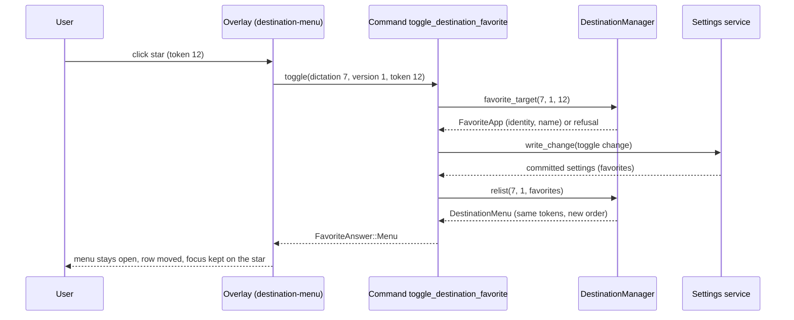
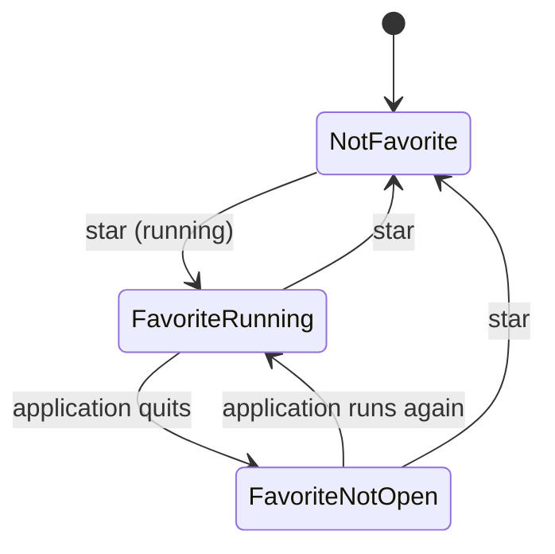
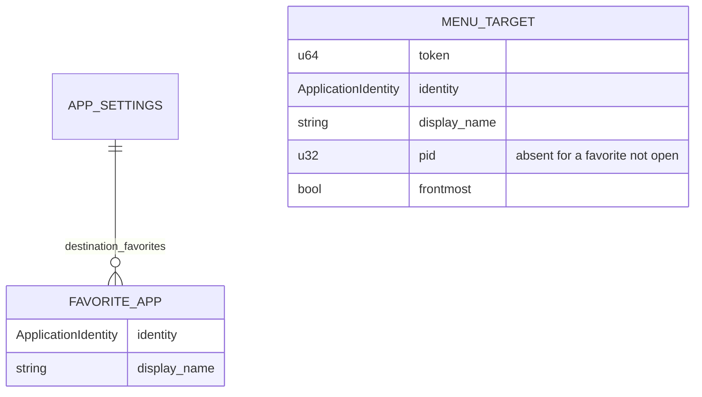

# Plan: Destination Favorites

## Summary

Add a validated `destination_favorites` settings collection (owner domain `destination`), a pure menu-ordering function in the destination manager that merges running applications and favorites (bottom-up), a `toggle_destination_favorite` command that commits through the settings service and answers the re-ordered menu with stable tokens, a star toggle in the badge menu with a fixed favorites section and a fixed footer holding "Frontmost app at the end" and 009's Pin/Unpin, and CLI actions `destination favorite-add|favorite-remove`.

## Technical Context

- **Languages:** Rust (Tauri 2 backend), TypeScript/React (overlay webview).
- **Storage:** `settings_store.json` through `settings_service` (revisioned atomic commit, cross-process lock). No direct store write.
- **Testing:** `cargo test --lib` (pure order, manager toggle, validation, domain), `bun test` (overlay models and markup), Playwright (layout without scrolling, keyboard), `bun run lint`, `cargo fmt`, `cargo clippy --all-targets`.
- **Platform:** macOS and Windows (destination support); Linux refuses the destination domain (unchanged).
- **Gate:** the badge exists only with the `destination-return` gate open; the setting field and its descriptor exist in every build (like `return_to_dictation_app`), the CLI domain actions only with the gate open.

## Constitution Check

- Settings through the service only (AGENTS.md "Settings System"): the toggle uses `tauri_adapter::write_change` with a `DomainChange`; the CLI uses `DomainPlan::Change` (remove) and `LiveContext::commit_change` (add). Pass.
- i18n: every visible string through i18next, all locales. Pass.
- One concept per file, small functions: `destination/favorites.rs` (entity + validation), `destination/menu_order.rs` (pure order), `destination/favorite_toggle.rs` (manager glue). Pass.
- No hardcoded expectations in tests: tests build fixtures and assert on computed orders. Pass.
- `src-tauri/src/smart_paste/` untouched. Pass.

## Sequence — star toggle

```gherkin
Feature: Toggle a favorite from the menu
  Scenario: Accepted
    Given the menu of dictation 7 version 1 is open with token 12 for Claude
    When the overlay calls toggle_destination_favorite(7, 1, 12)
    Then the settings service commits the new list
    And the command answers the re-ordered menu with the same tokens
  Scenario: Refused
    Given the favorites list already holds 10 entries
    When the overlay toggles an application that is not a favorite
    Then nothing is committed and the answer is not_saved with reason full
```



## State — favorite of an application

```gherkin
Feature: Favorite lifecycle
  Scenario: Star then quit
    Given Claude is not a favorite
    When the user stars Claude and later quits Claude
    Then Claude is a favorite that is not open
  Scenario: Unstar
    Given Claude is a favorite that is not open
    When the user clicks its star
    Then Claude is not a favorite
```



## Data model



## Implementation Plan

1. **Entity and validation** — `src-tauri/src/destination/favorites.rs`: `FavoriteApp`, `FAVORITES_KEY`, `MAX_FAVORITES = 10`, `validate_favorites`, `toggle`, `remove_identifier`, `add` and the `DomainChange` builders. `ApplicationIdentity` gains `Deserialize`. `ValidationReason` gains `DestinationDomain`, `FavoritesFull`, `FavoriteInvalid`. Field `destination_favorites` in `AppSettings` (default empty), public settings, descriptor `(Array, owner "destination")`, generic `set` refusal naming the domain.
2. **Pure order** — `src-tauri/src/destination/menu_order.rs`: `order_menu(frontmost, running, favorites) -> Vec<MenuTarget>`; tests for every case.
3. **Manager** — `menu.rs` keeps `MenuTarget`s (with optional pid) instead of `RunningApp`s; `open` takes the favorites; `favorite_toggle.rs`: `favorite_target`, `relist`. `MenuEntry` gains `favorite`, `running`. `chosen_application` resolves a non-running target to `Unavailable` unless an instance now runs.
4. **Command** — `commands/destination.rs`: `destination_menu` passes the saved favorites; new `toggle_destination_favorite` answering `FavoriteAnswer` (`menu` | `refused` | `not_saved`). Registered in `lib.rs`; `bindings.ts` regenerated (`HANDY_WRITE_BINDINGS=1`).
5. **CLI** — `cli_destination.rs` and `settings_service/cli/destination.rs`: `favorite-add <identifier>` (live, commit), `favorite-remove <identifier>` (change). Domain tests.
6. **Overlay** — `destination-model.ts` (`menuSections` with favorites), `destination-menu.tsx` (scroll area, favorites section, star toggle, fixed footer with Pin/Unpin), `use-destination.ts` (`toggleFavorite`), `pin-state.ts` comments, CSS, translations in every locale.
7. **Tests** — Rust unit tests; bun model and markup tests updated; Playwright harness `tests/harness/destination-menu.*` and `tests/destination-favorites.spec.ts`.
8. **Specs** — 009 spec amended (AC-001, Behavioral AC, decision 2026-10-29), README, roadmap, changelogs, implementation.md, progress.md.

## Testing Strategy

| Part | Level | Proof |
|---|---|---|
| Menu order | Rust unit | `destination::menu_order` tests |
| Toggle (session unchanged, stable tokens, refusals) | Rust unit | `destination::favorite_toggle` tests |
| Shared validation, commit, CLI | Rust unit | `destination::favorites` tests, `settings_service::domains::destination` tests |
| Sections, labels, star markup | bun | `indicator-models.test.ts`, `indicator-render.test.tsx`, `pin-state.test.ts` |
| Layout without scrolling, keyboard, aria-pressed | Playwright | `tests/destination-favorites.spec.ts` |

## Risks & Considerations

- A `button` inside `role="menu"` is not a menu item; the request asks for a pressed toggle button, kept as such (the menu is pointer-first per 006).
- Penflow mockup not regenerated in this run (Pencil session needed): recorded as a gap.
- The overlay window height follows the stack's measured extent; the scrolling area is bounded by `--ov-menu-max-h`.
