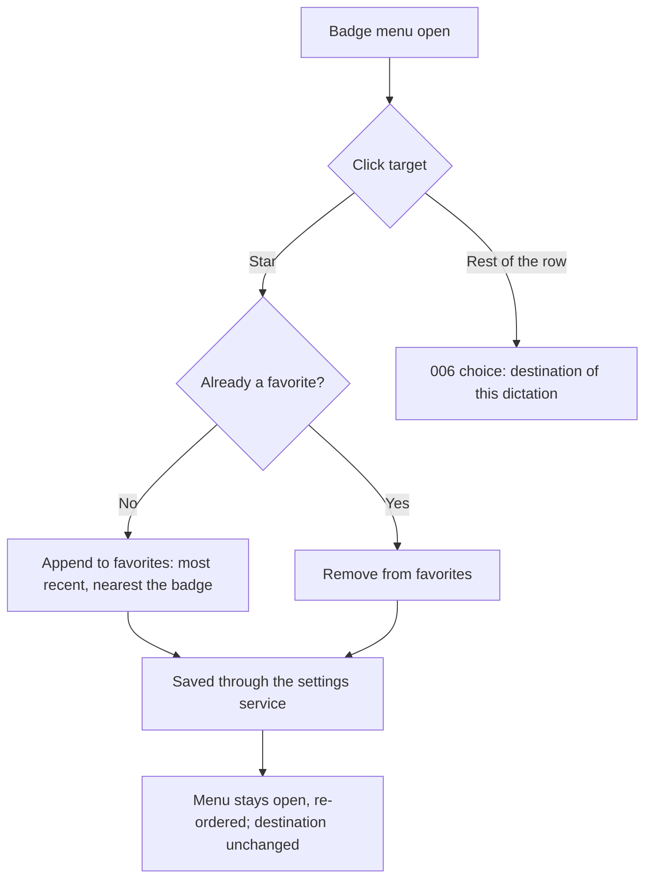
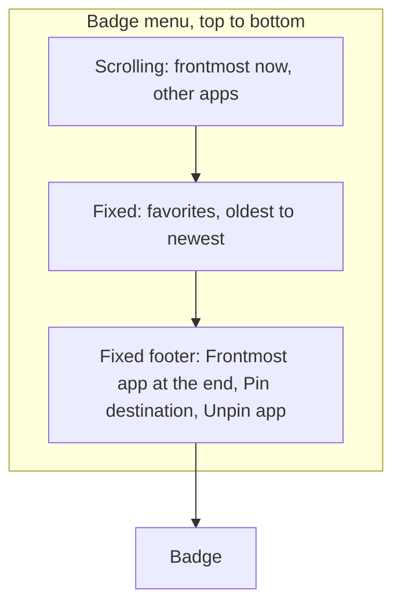
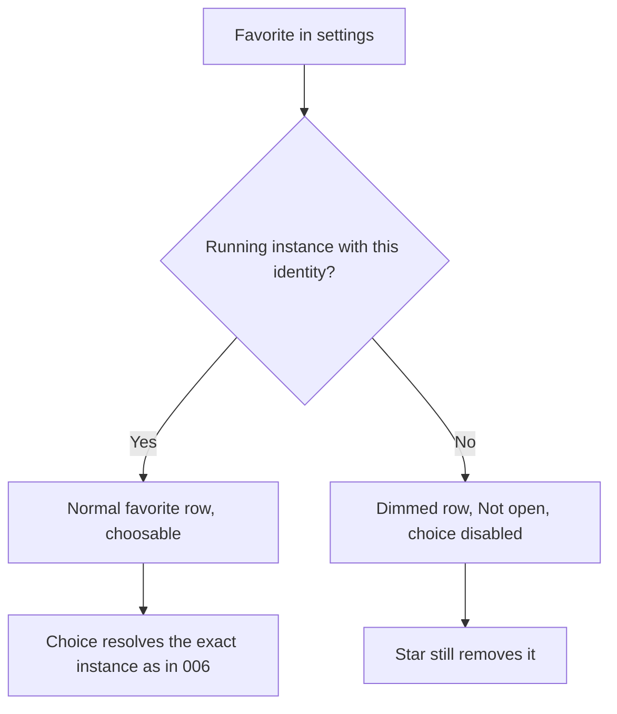
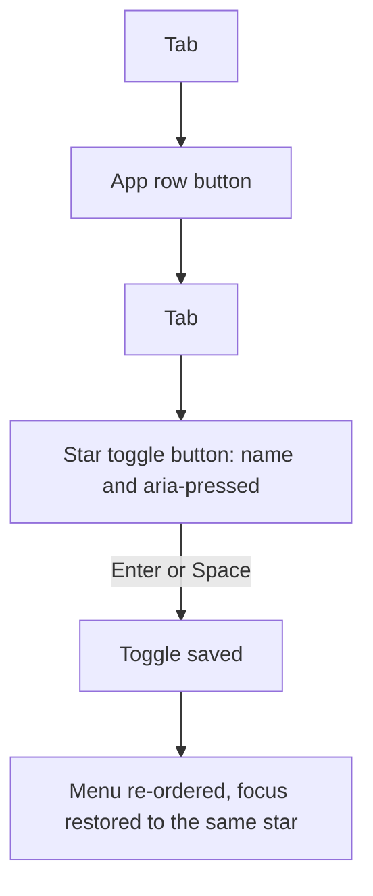
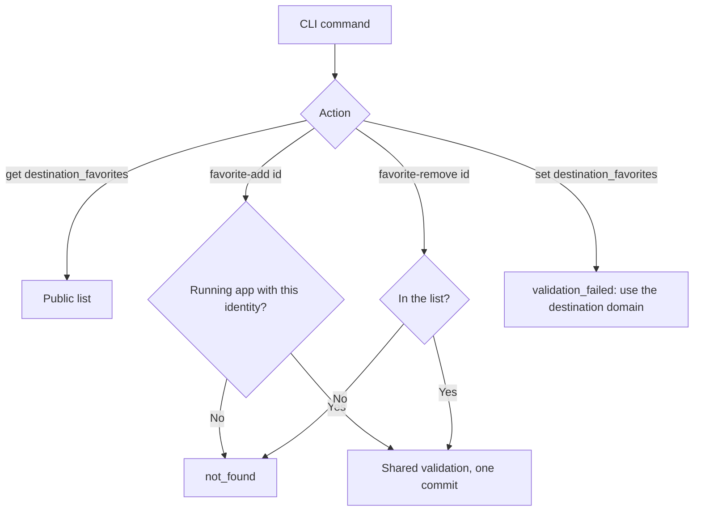

# Feature Spec: Destination Favorites

## Header

- **Feature:** Destination Favorites
- **Branch:** `feat/destination-favorites` (from `dev`)
- **Date:** 2026-10-29
- **Status:** In Progress
- **Input:** Request from Julien, 2026-10-29. During a dictation the indicator shows the destination badge (for example "Claude"); clicking it opens a menu of the open applications (initial letter, name) followed by "Frontmost app at the end". His words: "quand je veux pinner, dans la liste des applications, avoir un petit pin sur le côté. C'est-à-dire que j'ai toujours mes favoris… pour pouvoir en sélectionner rapidement. Et les favoris doivent être du bas vers le haut, pour que ce soit rapide à accéder. Comme ça je peux pinner le live directement sur une app." Follow-up from the coordinator the same day: favorites use a **star** (never a pin, never the word "pin", which belongs to 009's PIN mode); and Julien's native finding that the 009 entry "Pin <destination>" is invisible because it sits above a long application list that opens upwards from the badge.
- **Feature Number:** 012
- **Extends:** [006 Destination Application](../006-destination-application/spec.md) (badge menu, exact instance, never auto-launched) and [009 PIN Mode and Enter Rule](../009-pin-mode-and-enter-rule/spec.md) (Pin/Unpin entries, amended by this feature on 2026-10-29).

## User Scenarios & Testing

### Story 1 — Star an application in the badge menu `P1`

**As a** Handy user, **I want to** star an application from the badge menu, **so that** it stays in my favorites for the next dictations.

**Priority reason:** The star is the whole interaction Julien asked for.
**Independent test:** Open the badge menu, click the star of Claude, check that the menu stays open, the destination is unchanged and Claude now sits in the favorites section; reopen the menu at the next dictation and find Claude there.

```gherkin
Feature: Star an application
  Scenario: Add a favorite without choosing it
    Given a dictation is recording with destination ChatGPT
    And the badge menu lists Claude among the other apps
    When the user clicks the star of Claude
    Then Claude is listed in the favorites section, just above "Frontmost app at the end"
    And the menu stays open
    And the destination of the dictation is still ChatGPT
  Scenario: Remove a favorite
    Given Claude is a favorite and the badge menu is open
    When the user clicks the filled star of Claude
    Then Claude is no longer a favorite and is listed with the other apps
    And the menu stays open and the destination is unchanged
  Scenario: Choose the row, not the star
    Given the badge menu is open
    When the user clicks the name of Claude
    Then Claude becomes the destination of this dictation only, as in 006
```



### Story 2 — Favorites from the bottom up, Pin always visible `P1`

**As a** Handy user, **I want** my favorites and the Pin/Unpin entries right above the badge, **so that** I reach them without scrolling when the list of open applications is long.

**Priority reason:** "Du bas vers le haut, pour que ce soit rapide à accéder", and the native finding that Pin is invisible today.
**Independent test:** With 20 open applications, 3 favorites and a small overlay height, the favorites, "Frontmost app at the end", "Pin <destination>" and "Unpin <app>" are visible without scrolling; only the other applications scroll.

```gherkin
Feature: Bottom-up menu
  Scenario: Favorites nearest the badge
    Given Notes, Claude and Comet were starred in this order
    When the user opens the badge menu
    Then the favorites section lists Notes, Claude, Comet from top to bottom
    And Comet, the most recent favorite, is the closest to the badge
    And a separator and the label "Favorites" set them apart from the other apps
  Scenario: Pin and Unpin in the fixed footer
    Given 20 applications are open and ChatGPT is pinned while the destination is Claude
    When the user opens the badge menu
    Then "Frontmost app at the end", "Pin Claude" and "Unpin ChatGPT" are in the menu footer, below the favorites
    And they are visible without scrolling; only the other applications scroll
```



### Story 3 — A favorite that is not open `P2`

**As a** Handy user, **I want** a starred application that is not running to stay in my favorites, **so that** my list is stable, without Handy launching anything behind my back.

**Priority reason:** Favorites must not vanish when an app is quit; 006 never launches an application.
**Independent test:** Star Notes, quit Notes, open the menu: Notes is in the favorites, dimmed, marked "Not open", cannot be chosen, and its star can still remove it.

```gherkin
Feature: Favorite not running
  Scenario: Shown, not choosable
    Given Notes is a favorite and Notes is not running
    When the user opens the badge menu
    Then Notes is listed in the favorites, dimmed, with "Not open"
    And choosing Notes is unavailable and nothing is launched
  Scenario: Removed with its star
    Given Notes is a favorite that is not running
    When the user clicks its filled star
    Then Notes is no longer a favorite
  Scenario: Running again
    Given Notes is a favorite and Notes is started again
    When the user opens the badge menu
    Then Notes is a normal favorite row and can be chosen
```



### Story 4 — Keyboard and screen readers `P2`

**As a** keyboard or screen reader user, **I want** each star to be a named toggle button reachable in the menu, **so that** I can manage favorites without a pointer.

**Priority reason:** Accessibility requirement of the request.
**Independent test:** Tab through the open menu: each application row is followed by its star; the star announces "Add Claude to favorites" with pressed false, Enter toggles it, focus stays on the star of Claude.

```gherkin
Feature: Accessible star
  Scenario: Named toggle button
    Given the badge menu is open
    When a screen reader reads the star of Claude
    Then it is a button named "Add Claude to favorites" with pressed state false
  Scenario: Keyboard toggle keeps focus
    Given the star of Claude has keyboard focus
    When the user presses Enter
    Then Claude becomes a favorite, its star is named "Remove Claude from favorites" with pressed state true
    And keyboard focus stays on the star of Claude
```



### Story 5 — Favorites from the settings CLI `P3`

**As a** power user, **I want** to read and edit favorites from `handy settings`, **so that** scripts and the UI share one validated list.

**Priority reason:** The key must be exposed to the settings CLI with the shared validation.
**Independent test:** `handy settings get destination_favorites --json`, `handy settings destination favorite-remove com.apple.Notes`, `handy settings set destination_favorites x` (refused, pointing to the domain).

```gherkin
Feature: Favorites from the CLI
  Scenario: Read and remove
    Given Notes and Claude are favorites
    When the user runs "handy settings destination favorite-remove com.apple.Notes"
    Then only Claude remains, through the same validation and transaction as the badge
  Scenario: Generic set refused
    When the user runs "handy settings set destination_favorites x"
    Then it is refused with validation_failed and a reason naming "handy settings destination"
```



## Acceptance Criteria

### AC-001

**Criterion:** Each application row of the 006 badge menu (running applications and favorites that are not running) has a star toggle button on its right. Clicking the star adds the application to the favorites or removes it from them; it never changes the destination of the dictation, never changes the selection version and never closes the menu. Clicking the rest of the row keeps the 006 behavior (destination of this dictation only). The star icon is a star (filled when the application is a favorite); the words "pin" and "épingler" are never used for favorites.
**Priority:** P1 | **Story:** Story 1

### AC-002

**Criterion:** Favorites are persisted through the settings service as the key `destination_favorites`: an ordered list, oldest first, of `{identity: {kind, value}, display_name}` where the identity is 006's stable application identity (bundle identifier on macOS; AUMID, otherwise executable path, on Windows). Every write (badge star, CLI) goes through one shared validation and one revisioned commit; nothing writes the store directly. The list holds at most 10 favorites, with unique identities, a non-blank identity value and a non-blank display name of at most 100 characters; a refused change leaves the list unchanged and the menu explains it.
**Priority:** P1 | **Story:** Stories 1 and 5

### AC-003

**Criterion:** The menu lists, from top to bottom: a scrolling area with the application frontmost now (when it is not a favorite) then the other running applications that are not favorites; then a fixed favorites section, set apart by a separator and the label "Favorites", in stored order so the most recently added favorite is the last one, nearest the badge; then a fixed footer with "Frontmost app at the end", "Pin <destination>" (009) and "Unpin <app>" (009). An application appears once: a favorite is listed only in the favorites section (deduplicated by identity), even when it is frontmost. The favorites and the footer stay visible without scrolling whatever the number of open applications; only the scrolling area scrolls.
**Priority:** P1 | **Story:** Story 2

### AC-004

**Criterion:** A favorite with no running instance is listed in the favorites section, dimmed, with the hint "Not open"; its row cannot be chosen (disabled for pointer and keyboard) and nothing is ever launched, as 006 requires. Its star still removes it. If the backend receives a choice for an application that has no running instance, it refuses it as `unavailable` and the session is unchanged. When an application with that identity runs again, the next menu shows it as a normal, choosable favorite.
**Priority:** P2 | **Story:** Story 3

### AC-005

**Criterion:** The star is a native button with `aria-pressed` (true for a favorite) and the accessible name "Add <name> to favorites" or "Remove <name> from favorites", in every locale. It is reachable with Tab right after its row and activated with Enter or Space; after a toggle, keyboard focus returns to the star of the same application. Pointer use never takes keyboard focus from the user's application (006 AC-004 unchanged).
**Priority:** P2 | **Story:** Story 4

### AC-006

**Criterion:** With the `destination-return` gate open, the settings CLI reads the list with `handy settings get destination_favorites`, adds a running application with `handy settings destination favorite-add <identifier>` (running Handy needed, like `destination pin`; `not_found` for an identity no running application has) and removes one with `handy settings destination favorite-remove <identifier>` (offline or routed; `not_found` when absent), both with the shared validation of AC-002. Generic `set destination_favorites` is refused with `validation_failed` and a reason naming `handy settings destination`. On Linux the destination domain answers `validation_failed`/`unsupported_platform` as in 009.
**Priority:** P3 | **Story:** Story 5

## Functional Requirements

### FR-001

**Requirement:** Store favorites as an ordered, validated settings collection owned by the destination domain, written only through the settings service with one shared validation for the badge and the CLI.
**AC References:** AC-002, AC-006

### FR-002

**Requirement:** Build the badge menu order in one pure function from the frontmost application, the running applications and the favorites: deduplicated by identity, favorites last in stored order, non-running favorites included and marked.
**AC References:** AC-003, AC-004

### FR-003

**Requirement:** Toggle a favorite from a menu token of the exact dictation and version without changing the session, and answer the re-ordered menu with stable tokens.
**AC References:** AC-001, AC-002

### FR-004

**Requirement:** Render the star toggle, the favorites section and the fixed footer (with 009's Pin and Unpin moved into it), accessible and translated in every locale.
**AC References:** AC-001, AC-003, AC-004, AC-005

### FR-005

**Requirement:** Expose the favorites to the settings CLI (`get`, `destination favorite-add`, `destination favorite-remove`) and refuse the generic `set` with a reason naming the domain.
**AC References:** AC-006

## Key Entities

- **FavoriteApp** — `{identity: ApplicationIdentity, display_name: String}`; stored in `destination_favorites` (oldest first).
- **MenuEntry** (006, extended) — adds `favorite: bool` and `running: bool`; a non-running favorite has a token but no process.
- **MenuTarget** (manager RAM) — what a token designates: identity, display name, icon, optional process id, frontmost mark.

## Clarifications

- Decision `012-destination-favorites:AC-004` / `favorite_not_running` (2026-10-29, decided by the implementing agent under Julien's autonomous mandate, to be confirmed by Julien): a favorite that is not running is shown, dimmed, "Not open", and cannot be chosen; Handy never launches it. Reason: 006 resolves the exact running instance and refuses (`app_closed`) instead of launching; launching an application from a dictation menu would also steal focus and add a launch wait that 006's 1-second activation bound does not cover. The safest option keeps 006's contract intact.
- Decision `012-destination-favorites:AC-001` / `star_not_pin` (2026-10-29, coordinator's instruction): favorites use a star icon and the labels "Add <name> to favorites" / "Remove <name> from favorites"; the pin glyph and the words "pin"/"épingler" stay reserved to 009's PIN mode.
- Decision `012-destination-favorites:AC-003` / `pin_entries_in_fixed_footer` (2026-10-29, Julien's native finding relayed by the coordinator; amends 009 AC-001 and its Behavioral AC): "Pin <destination>" moves from above the application list to the fixed footer of the menu, with "Unpin <app>" and "Frontmost app at the end", nearest the badge and always visible without scrolling; the application list above scrolls. The order of the footer, top to bottom, is "Frontmost app at the end", "Pin <destination>", "Unpin <app>", so the PIN actions are the closest to the badge.
- Decision `012-destination-favorites:AC-003` / `favorites_fixed` (2026-10-29, agent): the favorites section does not scroll, so it is always visible next to the footer; the cap of 10 favorites (AC-002) bounds its height (10 rows of 36 px).
- Decision `012-destination-favorites:AC-002` / `favorites_cap` (2026-10-29, agent): at most 10 favorites. Reason: they are a fixed, non-scrolling section; ten rows plus the footer fit a 768-pixel-high screen above the indicator.
- Decision `012-destination-favorites:AC-005` / `star_accessible_name` (2026-10-29, agent): the accessible name includes the application name ("Add Claude to favorites") so that each of the many stars of the menu is distinguishable; the request's "Ajouter aux favoris" / "Retirer des favoris" are the French base of these labels.
- Decision `012-destination-favorites:AC-003` / `top_placement` (2026-10-29, agent): with the overlay placed at the top of the screen, the menu keeps the same internal order (it then opens below the indicator, so the footer is the farthest part); reversing the menu for that placement is left out of this feature.
- Decision `012-destination-favorites:AC-001` / `toggle_stays_open` (2026-10-29, agent): after a toggle the menu is re-ordered at once (the row moves into or out of the favorites section) with the same tokens, without a new read of the running applications.

## QE Analysis

- **Criticality:** Medium; **Blast radius:** the badge menu of every dictation and one new settings collection; **Primary risk:** a star click that changes the destination or closes the menu, or a favorite that launches an application.
- **Dimensions:** functional correctness, persistence and migration (absent key), accessibility, UX layout (visibility without scrolling), regression of 006/009 menu behavior, CLI contract.
- **P0 gates/evidence:** Rust unit tests of the pure menu order (favorites running or not, ordinary apps, dedup, frontmost); manager tests of the toggle (session and version unchanged, tokens stable, refusals); settings-service tests of the shared validation and commit; bun model and markup tests; Playwright layout and keyboard test with 20 apps and a small height.
- **P1 gates/evidence:** native macOS check by Julien (star in the live overlay, Pin visible, favorite not open).
- **Non-functional expectations:** the toggle answers within one settings commit (no native enumeration); no window title or transcript stored or logged.
- **Missing evidence:** native overlay proof; Penflow mockup update (see Screens).
- **Boundary:** QE defines risk and test sufficiency; spec-test runs the runtime proofs; Penflow governs mockups.

## Screens

| Screen | Status | Reference |
|--------|--------|-----------|
| recording-indicator-destination-menu | Modified | Penflow `penflow/ui.pen` not updated by this run (gap recorded in `implementation.md`): favorites section, star toggle, fixed footer |
| recording-indicator-pinned | Modified | Same gap: Pin/Unpin footer |

## Edge Cases

- The frontmost application is a favorite: listed once, in the favorites section.
- Two instances of a favorite: 006's instance resolution applies at choice time (the frontmost/listed instance, else the only one; several are `unavailable`).
- An application starred from the CLI while the menu is open: the open menu keeps its order; the next menu shows it.
- The 11th star: refused, the list is unchanged, the menu shows "You can keep up to 10 favorites." and stays open.
- A favorite whose display name changed (application update): the stored name is shown while it is not running; the running instance's name is shown otherwise; the stored name is not rewritten.
- Insertion begins while the menu is open: the menu closes as in 006; a late star answer is ignored (stale).
- Gate `destination-return` closed: no badge, no destination domain; the stored key is kept unchanged.

## Success Criteria

### SC-001

The pure ordering function passes every case of the table (favorites running and not running, ordinary apps, duplicates, frontmost favorite or not) in automated tests.

### SC-002

In the Playwright layout test with 20 applications, 3 favorites and a 600-pixel-high page, Pin, Unpin, "Frontmost app at the end" and every favorite are within the viewport without scrolling.

### SC-003

A star toggle never changes the session snapshot (destination, version, source) in automated tests.
