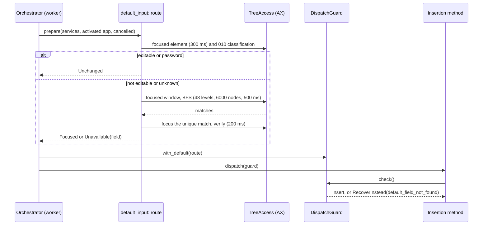
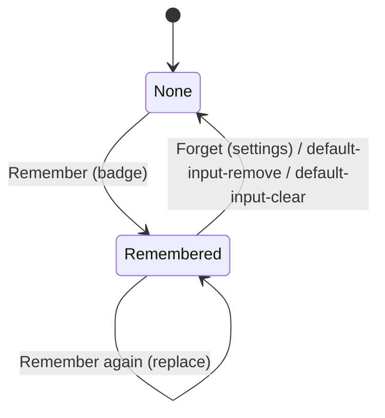
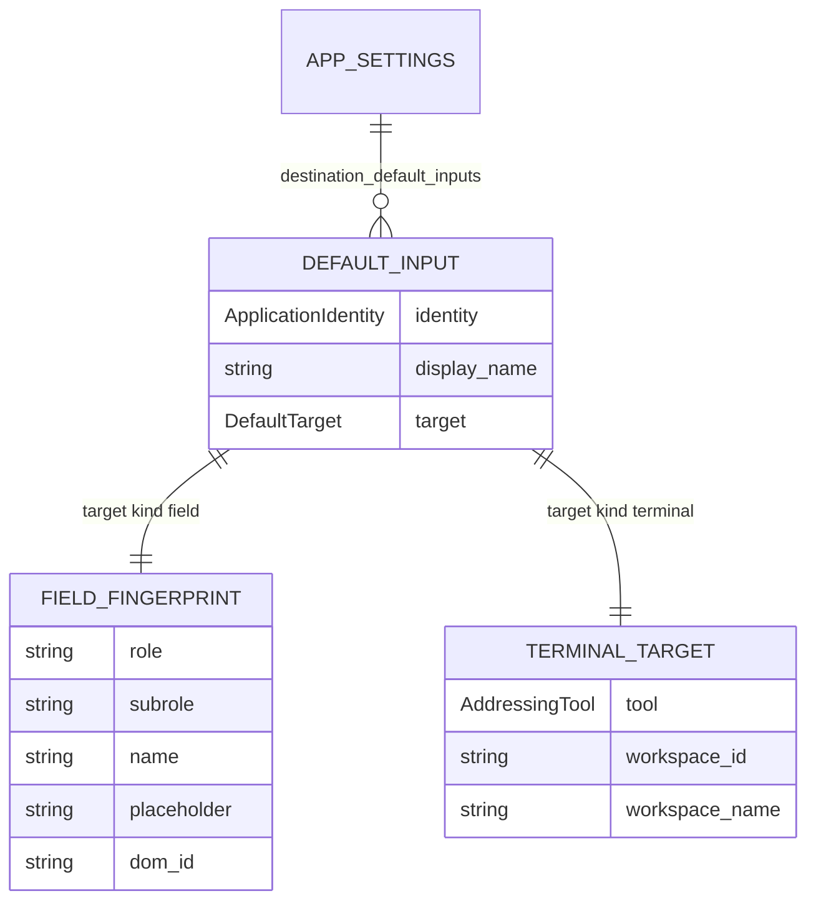

# Plan: Default Input per App

## Summary

Add a `destination::default_input` module: a validated `destination_default_inputs` settings collection (owner domain `destination`), a field fingerprint captured from the destination's focused element and found again by a bounded breadth-first accessibility search, and a terminal target captured and delivered through an addressing CLI found in the application's bundle (cmux). The insertion orchestrator decides the route once after 006's activation (only without a 011 attempt and when the focused element is not editable), hands it to the pre-dispatch guard, and an insertion-method wrapper types a terminal delivery through the CLI. The badge menu gets one "Remember" entry, the settings window a list with Forget, the settings CLI `default-input-remove` and `default-input-clear`.

## Technical Context

- **Languages:** Rust (Tauri 2 backend), TypeScript/React (overlay and settings webviews).
- **Storage:** `settings_store.json` through `settings_service` (revisioned commit); no direct store write.
- **External process:** the addressing tool of the running instance's bundle, run by `std::process::Command` with an argument vector, closed stdin, removed `CMUX_*` target variables, a polled bounded wait and a kill on timeout.
- **Accessibility:** macOS `AXUIElementCopyMultipleAttributeValues` (role, subrole, title, description, placeholder, DOM id, children) per element of the focused window; `AXFocused` write; reads bounded per message by the remaining budget (never below 5 ms, 011's floor).
- **Testing:** `cargo test --lib` with `destination-return,smart-paste-dispatch` (pure functions, fake tree, fake runner, guard and orchestrator routes, settings domain), integration suites of the settings CLI, `bun test` (menu entry, settings section, bubble texts), `bun run lint`, `tsc`, translations check.
- **Gate:** sessions exist only with `destination-return` open, so the menu entry and the insertion route exist only there; the setting field, its descriptor and its lenient read exist in every build, the CLI actions only with the gate open (destination domain).

## Constitution Check

- Settings through the service only: badge capture and settings Forget use `tauri_adapter::write_change` with a `DomainChange`; CLI actions use `DomainPlan::Change`. Pass.
- i18n: every string through i18next in all locales. Pass.
- One concept per file, small functions: `model.rs` (entity, validation, changes), `fingerprint.rs` (pure fingerprint and match), `search.rs` (bounded BFS over a port), `terminal.rs` (tool commands, parsing, chunking), `runner.rs` (bounded process), `route.rs` (insertion decision), `capture.rs` (remember), `dispatch.rs` (method wrapper), `macos_tree.rs` and `macos_bundle.rs` (adapters). Pass.
- No hardcoded expectations or application lists: tests build their fixtures; the terminal type is detected by the tool inside the bundle; the fingerprint comes from the user's field at run time. Pass.
- `src-tauri/src/smart_paste/` untouched (its CF helpers are only imported). Pass.

## Sequence — field route at insertion

```gherkin
Feature: Field route
  Scenario: Unique match focused
    Given Codex is in front after 006's activation and its focus is the conversation group
    When the orchestrator prepares the default route
    Then it classifies the focus as not editable, searches the focused window, finds one match
    And focuses it, verifies it, and the guard lets the configured method paste
  Scenario: No match
    Given the search finds no element with the fingerprint
    When the guard runs its first pass
    Then it recovers with reason default_field_not_found and nothing is dispatched
```



## Sequence — terminal route at insertion

```gherkin
Feature: Terminal route
  Scenario: Delivered by the CLI
    Given a cmux workspace is remembered and exists
    When the dictation is inserted
    Then the orchestrator resolves workspace and surface with the CLI
    And the method wrapper checks the guard, then runs cmux send per chunk, and no Enter follows
  Scenario: Workspace gone
    Given the remembered workspace does not exist
    When the guard runs its first pass
    Then it recovers with reason default_terminal_gone and nothing is typed
```

```mermaid
sequenceDiagram
    participant O as Orchestrator (worker)
    participant T as terminal (CLI runner)
    participant G as DispatchGuard
    participant W as AddressedMethod wrapper
    participant E as 009 Enter transaction
    O->>T: tree --workspace <uuid> --json (2 s)
    T-->>O: workspace and focused terminal surface, or not found
    O->>G: with_default(Terminal or Unavailable(terminal))
    O->>W: dispatch(guard)
    W->>G: check() (cancellation, foreground; 010 skipped)
    W->>T: send --workspace --surface -- chunk (2 s each)
    W->>G: mark_addressed()
    O-->>E: report.addressed = true
    E-->>E: Suppression::AddressedTerminal (no Enter)
```

## State — remembered input of an application

```gherkin
Feature: Remembered input lifecycle
  Scenario: Remember then forget
    Given Codex has no remembered input
    When the user remembers its field and later forgets it in the settings
    Then Codex has no remembered input again
  Scenario: Remember again replaces
    Given Codex has a remembered field
    When the user remembers another field of Codex
    Then the new fingerprint replaces the old one
```



## Data model



## Implementation Plan

1. **Entity and settings** — `destination/default_input/model.rs`: `DefaultInput`, `DefaultTarget`, `FieldFingerprint`, `TerminalTarget`, `AddressingTool`, `DEFAULT_INPUTS_KEY`, `MAX_DEFAULT_INPUTS = 20`, validation, `remember_change`, `remove_change`, `clear_change`. `AppSettings.destination_default_inputs` (lenient read), descriptor (Array, owner `destination`), public projection, schema item, `ValidationReason::{DefaultInputsFull, DefaultInputInvalid}`, `SettingsError::no_default_input`, the destination-domain refusal message names every action.
2. **Pure logic** — `fingerprint.rs` (facts → fingerprint, generated id rule, match), `terminal.rs` (tool path in bundle, argument vectors, `identify`/`tree` parsing, chunking), `route.rs` (route choice table).
3. **Ports and bounded work** — `tree.rs` (`TreeNode`, `TreeAccess`), `search.rs` (BFS with depth, node and time bounds), `runner.rs` (`CliRunner`, `ProcessRunner`), `services.rs` (`DefaultInputServices` held by `DestinationManager`, default without inputs).
4. **Insertion** — orchestrator prepares the route after 011's `begin`; `DispatchGuard::with_default`, verdict per route, `mark_addressed`; `InsertionReport.addressed`; `DestinationFailure`/`RecoveryReason`/`BubbleReason` gain `default_field_not_found` and `default_terminal_gone`; 009 `Completion::AddressedTerminal` → `Suppression::AddressedTerminal`; `dispatch.rs` wrapper used by `delivery::insertion_method`.
5. **Remember** — `capture.rs` (offer by capability, field capture with 010's rule, terminal capture), manager lookup of the destination instance, commands `default_input_offer`, `remember_default_input`, `forget_default_input`, `forget_all_default_inputs`; macOS adapters `macos_tree.rs`, `macos_bundle.rs`; install in `destination::app::install`.
6. **CLI** — `default-input-remove <identifier>`, `default-input-clear` (clap, wire operation, domain plan), integration counts and 008 schema.
7. **Front** — menu entry (`default-input-entry.tsx`, `use-default-input.ts`), settings section (`default-inputs-setting.tsx` + model), bubble reasons (`recovery-preview.ts`), translations in every locale, tests.
8. **Specs** — README, roadmap, changelogs, implementation.md, progress.md, proofs.

## Testing Strategy

| Part | Level | Proof |
|---|---|---|
| Fingerprint, generated id, match | Rust unit | `default_input::fingerprint` tests |
| BFS bounds, unique/none/several, password | Rust unit (fake tree) | `default_input::search` tests |
| Route choice, focus verification | Rust unit (fake tree) | `default_input::route` tests |
| CLI parsing, chunking, arguments, gone, failure | Rust unit (fake runner) | `default_input::terminal` and `dispatch` tests |
| Process bound and kill | Rust unit (real `/bin/sleep`, unix) | `default_input::runner` tests |
| Guard verdicts, no Enter | Rust unit | `destination::guard`/`automatic_enter::policy` tests |
| Validation, changes, CLI actions | Rust unit + integration | `default_input::model` tests, `settings_service::domains` tests, `tests/settings_*` |
| Menu entry, settings section, bubble texts | bun | `default-input-*.test.ts(x)`, `recovery-preview.test.ts` |

## Risks & Considerations

- Workspace UUID stability across a cmux restart is unverified (native proof item); an unknown UUID shows the bubble.
- Electron trees may grow with long conversations; an incomplete search never pastes and logs its counts for calibration.
- `cmux send` escape handling is documented only by its help; chunking is verified by tests, native proof required.
- Penflow mockups not regenerated in this run (Pencil session needed): recorded as a gap.
