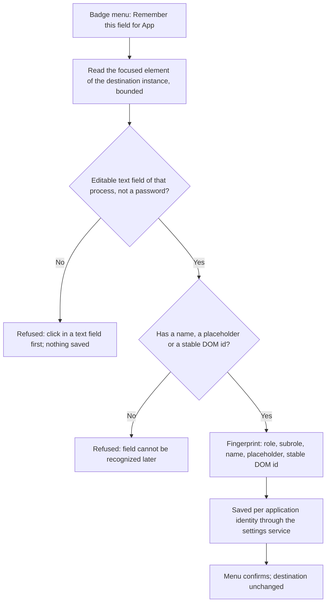
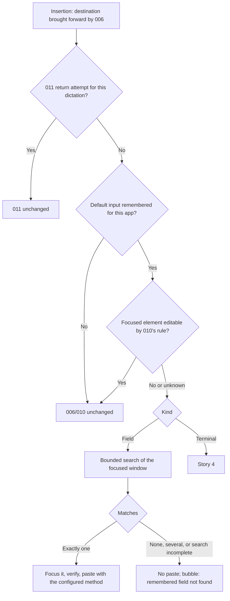
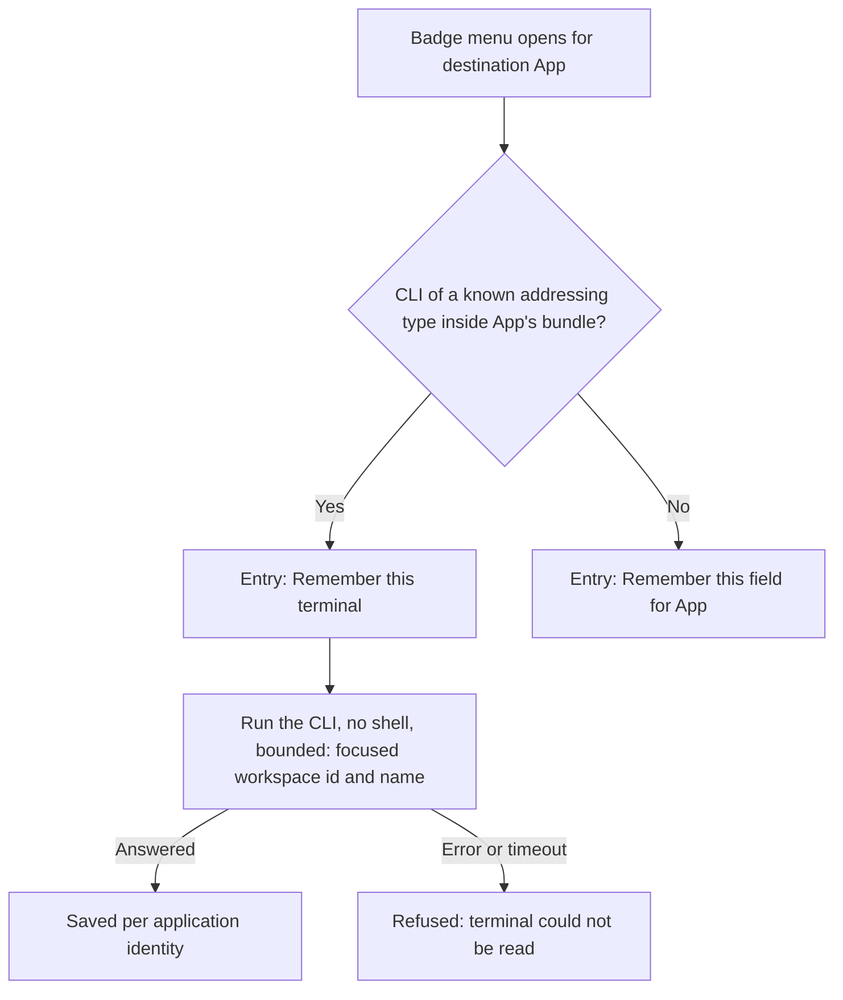
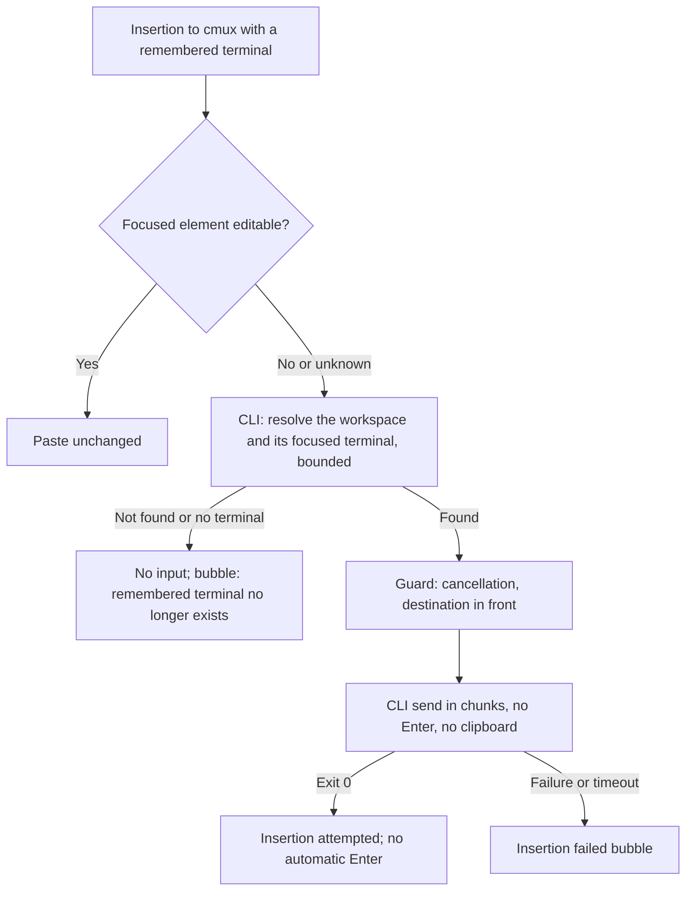
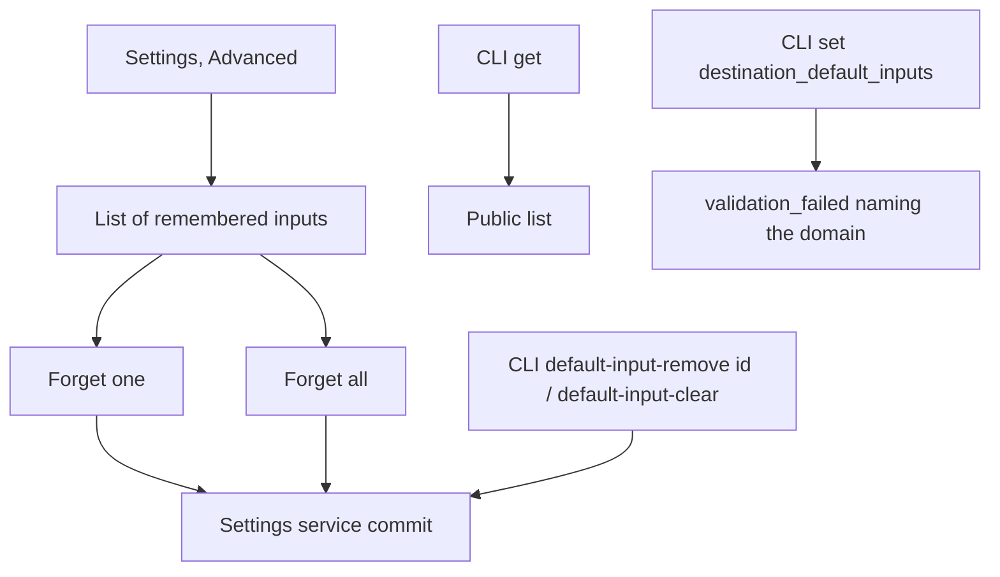

# Feature Spec: Default Input per App

## Header

- **Feature:** Default Input per App
- **Branch:** `feat/default-input-per-app` (from `dev`)
- **Date:** 2026-10-29
- **Status:** In Progress
- **Input:** Request from Julien, 2026-10-29, relayed by the coordinator. When a dictation goes to an application (pinned with 009, captured by 006 or chosen in the badge) and the active element of that application is not a text field (he clicked elsewhere), Handy must know where to paste. For some applications he wants to **remember a default field**, through a mechanism **per type of application**, with types added over time. Native measurements already made (macOS 26): in Codex (Electron, `com.openai.codex`) the composer of every session has the same identity — `AXTextArea`, accessible name "Work with Codex" (title and description), DOM class `ProseMirror`, generated parent class, no `AXIdentifier` and no DOM id, one composer per window; a click in the conversation leaves the focus on an `AXGroup` "Conversation". In cmux (`com.cmuxterm.app`, Ghostty terminal) the focus is the window and no text element is exposed, but the CLI shipped in the bundle (`Contents/Resources/bin/cmux`) addresses every terminal and `cmux send` types text without Enter, without the clipboard and without bringing cmux forward.
- **Feature Number:** 013
- **Extends:** [006 Destination Application](../006-destination-application/spec.md) (destination, activation, pre-dispatch guard), [009 PIN Mode and Enter Rule](../009-pin-mode-and-enter-rule/spec.md) (pinned destination, automatic Enter), [010 Recovery Bubble](../010-recovery-bubble/spec.md) (editable-field rule, bubble reasons), [011 Dictation Field Return](../011-dictation-field-return/spec.md) (focus given back to an input), [012 Destination Favorites](../012-destination-favorites/spec.md) (per-application list in the settings service, badge menu entry).

## User Scenarios & Testing

### Story 1 — Remember the field of an application `P1`

**As a** Handy user, **I want to** remember, from the badge menu, the text field I am in for the destination application, **so that** later dictations to that application land in it even when I clicked elsewhere.

**Priority reason:** Remembering is the entry point of the whole feature.
**Independent test:** Click in the Codex composer, start a dictation, open the badge menu, choose "Remember this field for Codex"; the menu confirms and the settings list shows Codex with "Work with Codex".

```gherkin
Feature: Remember a field
  Scenario: Text field of the destination remembered
    Given a dictation is recording with destination Codex
    And the Codex composer "Work with Codex" has keyboard focus in Codex
    When the user chooses "Remember this field for Codex" in the badge menu
    Then the default input of Codex is saved through the settings service
    And it holds the role, subrole, accessible name and placeholder of the composer, never its text
    And the menu says "Field remembered for Codex" and the destination is unchanged
  Scenario: Focus is not a text field
    Given a dictation is recording with destination Codex
    And the focus of Codex is the "Conversation" group
    When the user chooses "Remember this field for Codex"
    Then nothing is saved and the menu says "Click in a text field of Codex first"
  Scenario: Password field refused
    Given the focused element of the destination is a password field
    When the user chooses "Remember this field"
    Then nothing is saved and the menu says the field cannot be remembered
```



### Story 2 — Dictate into the remembered field `P1`

**As a** Handy user, **I want** Handy to find the remembered field when the active element of the destination is not a text field, **so that** my text lands in the composer instead of nowhere.

**Priority reason:** This is the outcome Julien asked for.
**Independent test:** With the Codex field remembered, click in the Codex conversation, pin Codex, dictate from another application: the text lands in the composer.

```gherkin
Feature: Paste into the default field
  Scenario: Unique match
    Given the default field of Codex is remembered
    And the focus of Codex is the "Conversation" group
    When a dictation to Codex is inserted
    Then Handy brings Codex forward as in 006
    And Handy searches the focused window of Codex for the remembered field within its bounds
    And it finds exactly one match, gives it keyboard focus and pastes with the configured method
  Scenario: Active field already editable
    Given the default field of Codex is remembered
    And a text field of Codex already has keyboard focus
    When a dictation to Codex is inserted
    Then Handy pastes into the focused field exactly as without this feature
  Scenario: No match or several matches
    Given the default field of Codex is remembered
    And the focused window of Codex has no field with that fingerprint, or two of them
    When a dictation to Codex is inserted
    Then nothing is pasted
    And the recovery bubble of 010 says "The remembered field of Codex was not found"
```



### Story 3 — Remember a cmux terminal `P1`

**As a** cmux user, **I want to** remember the terminal I am working in, **so that** dictations to cmux reach it even though cmux exposes no text field.

**Priority reason:** cmux cannot be served by an accessibility fingerprint at all.
**Independent test:** Start a dictation to cmux, choose "Remember this terminal" in the badge menu, open the settings: cmux is listed with the workspace name.

```gherkin
Feature: Remember a terminal
  Scenario: Application with an addressing CLI
    Given a dictation is recording with destination cmux
    And the cmux bundle contains its command-line tool
    When the user opens the badge menu
    Then the menu offers "Remember this terminal" instead of "Remember this field"
  Scenario: Remember the focused workspace
    Given the focused cmux terminal belongs to the workspace "roam-radar"
    When the user chooses "Remember this terminal"
    Then the workspace identifier and name are saved for cmux through the settings service
    And the menu says "Terminal remembered for cmux"
  Scenario: CLI unavailable
    Given the cmux tool cannot answer within its bound
    When the user chooses "Remember this terminal"
    Then nothing is saved and the menu says the terminal could not be read
```



### Story 4 — Dictate into the remembered terminal `P1`

**As a** cmux user, **I want** my dictation typed into the remembered terminal through cmux's CLI, without Enter, **so that** it reaches the right session whatever cmux shows.

**Priority reason:** The only reliable delivery path for cmux.
**Independent test:** With a terminal remembered, pin cmux and dictate with another application in front: the text appears in that terminal, not submitted.

```gherkin
Feature: Deliver to the remembered terminal
  Scenario: Terminal still exists
    Given the workspace "roam-radar" of cmux is remembered
    When a dictation to cmux is inserted
    Then Handy resolves the workspace's focused terminal with the CLI, bounded, without a shell
    And types the text there with "cmux send", without Enter and without the clipboard
    And no automatic Enter is pressed
  Scenario: Terminal gone
    Given the remembered workspace no longer exists
    When a dictation to cmux is inserted
    Then nothing is typed
    And the recovery bubble of 010 says "The remembered terminal of cmux no longer exists"
```



### Story 5 — See and forget remembered inputs `P2`

**As a** Handy user, **I want to** see and forget remembered fields and terminals in the settings and from the CLI, **so that** a stale or wrong default never surprises me.

**Priority reason:** A remembered default must be reversible.
**Independent test:** Open Settings, Advanced: the "Remembered fields" list shows Codex and cmux; "Forget" on Codex removes it; `handy settings destination default-input-clear` removes the rest.

```gherkin
Feature: Manage remembered inputs
  Scenario: Settings list
    Given Codex and cmux have a remembered input
    When the user opens the advanced settings
    Then the list shows "Codex — field Work with Codex" and "cmux — terminal roam-radar"
    And each row has a "Forget" button named for its application
  Scenario: Forget one from the settings
    When the user clicks "Forget" on Codex
    Then only cmux remains, through the settings service
  Scenario: CLI
    When the user runs "handy settings get destination_default_inputs"
    Then the list is printed
    When the user runs "handy settings destination default-input-remove com.openai.codex"
    Then Codex is removed with the shared validation
    When the user runs "handy settings set destination_default_inputs x"
    Then it is refused with validation_failed and a reason naming "handy settings destination"
```



## Acceptance Criteria

### AC-001

**Criterion:** With the `destination-return` gate open on macOS, during a dictation whose destination is an application, the badge menu offers one entry for that destination: "Remember this terminal" when the running instance's bundle contains the command-line tool of a known addressing type (cmux: `Contents/Resources/bin/cmux`, a regular executable file inside the bundle), otherwise "Remember this field for <app>". No entry is offered without an application destination, on Windows or on Linux. Choosing it never changes the destination, the selection version or the pin.
**Priority:** P1 | **Story:** Stories 1 and 3

### AC-002

**Criterion:** "Remember this field" reads, within 300 ms, the focused element of the destination's running instance (`AXFocusedUIElement` of its application element, never system-wide). It is saved only when it belongs to that process, is editable by 010's rule and is not a password field (role or subrole `AXSecureTextField`); the saved fingerprint holds its role, subrole, accessible name (`AXTitle`, else `AXDescription`), placeholder (`AXPlaceholderValue`) and DOM id (`AXDOMIdentifier`) only when it is present and does not look generated; never its value, selected text, DOM classes or any content. A fingerprint without a name, a placeholder or a stable DOM id is refused (it could not be told apart later). Attribute strings longer than 200 UTF-16 units are treated as absent.
**Priority:** P1 | **Story:** Story 1

### AC-003

**Criterion:** "Remember this terminal" runs the addressing tool found in the bundle, without a shell, with a 2-second bound per call: `cmux --json --id-format both identify --no-caller` for the focused workspace, then `cmux --json --id-format both tree --workspace <id>` for its name. It saves the workspace UUID and name; references such as `workspace:N` and `surface:N` are never saved. A call that fails, times out or answers unreadable output saves nothing and the menu says the terminal could not be read.
**Priority:** P1 | **Story:** Story 3

### AC-004

**Criterion:** Remembered inputs are persisted through the settings service as `destination_default_inputs`: a list of at most 20 entries `{identity, display_name, target}`, one per application identity (remembering again replaces the previous entry), with `target` either `{kind: "field", role, subrole, name, placeholder, dom_id}` or `{kind: "terminal", tool: "cmux", workspace_id, workspace_name}`. Every write (badge, settings window, CLI) goes through one shared validation and one revisioned commit; the stored list is read leniently (an unreadable entry is dropped). A refused write leaves the list unchanged.
**Priority:** P1 | **Story:** Stories 1, 3 and 5

### AC-005

**Criterion:** At insertion, after 006 has brought the destination's running instance forward, and only when no 011 return attempt exists for this dictation and a default input is remembered for that identity, Handy reads the instance's focused element within 300 ms and classifies it with 010's rule. When it is editable, or is a password field, nothing changes: the insertion is exactly the one without this feature. Otherwise (not editable, undetermined, no focused element, permission missing) the remembered target applies (AC-006 or AC-007). Paste method "none", the frontmost-at-the-end route, a cancelled dictation and the closed gate never read anything.
**Priority:** P1 | **Story:** Stories 2 and 4

### AC-006

**Criterion:** For a field target, Handy searches the instance's focused window breadth-first, at most 48 levels deep, 6000 elements and 500 ms, each accessibility message bounded by the remaining budget (never below 5 ms), skipping the children of static texts and images, and counts the elements whose role, subrole, name, placeholder and DOM id equal the fingerprint (absent attributes must be absent on both sides) and that are not password fields. Exactly one match, found by a complete search: Handy gives it keyboard focus (`AXFocused`), checks within 200 ms that it is the application's focused element, then the configured method inserts after 006's guard. No match, several matches, an incomplete search or a focus that could not be verified: nothing is pasted, no Enter is sent, the transcript is kept and 010's bubble shows "The remembered field of <app> was not found".
**Priority:** P1 | **Story:** Story 2

### AC-007

**Criterion:** For a terminal target, Handy resolves, before the guard, the workspace with `cmux --json --id-format both tree --workspace <uuid>` (no shell, 2 s bound) and its focused pane's selected terminal surface; the environment variables `CMUX_WORKSPACE_ID`, `CMUX_SURFACE_ID` and `CMUX_PANE_ID` are removed so cmux's defaults never choose the target. After 006's guard accepts (cancellation and foreground checks unchanged, 010's field check skipped), Handy types the final text with `cmux send --workspace <uuid> --surface <uuid> -- <chunk>`: line breaks and tabs become spaces and the text is split so that no chunk contains a backslash followed by `n`, `r` or `t` (cmux's Enter and Tab escapes); the clipboard is never used and 009's automatic Enter is suppressed. A workspace that no longer exists or has no terminal surface: nothing is typed and 010's bubble shows "The remembered terminal of <app> no longer exists". A `cmux send` failure or timeout is 010's "Insertion failed".
**Priority:** P1 | **Story:** Story 4

### AC-008

**Criterion:** The settings window (Advanced, under "Return to the dictation's application", only in builds offering destination return) lists the remembered inputs with the application name and a description of the target ("Field: <name or placeholder>", "Terminal: <workspace name>"); each row has a "Forget" button named "Forget the remembered input of <app>", and "Forget all" clears the list after no confirmation dialog (the action is reversible by remembering again). Removing goes through the settings service. The list is empty-state labelled "No remembered field yet. Use the badge menu during a dictation." All strings are translated in every locale.
**Priority:** P2 | **Story:** Story 5

### AC-009

**Criterion:** With the `destination-return` gate open, `handy settings get destination_default_inputs` prints the list; `handy settings destination default-input-remove <identifier>` removes the entry of that identity (`not_found`, exit 4, when absent) and `handy settings destination default-input-clear` empties the list, both offline or routed, through the shared validation. A generic `handy settings set destination_default_inputs` is refused with `validation_failed` and a reason naming `handy settings destination`. On Linux these actions answer `validation_failed`/`unsupported_platform` as the other destination actions.
**Priority:** P2 | **Story:** Story 5

### AC-010

**Criterion:** Handy never logs, emits or stores a field's value, selected text or a transcript; the fingerprint and the workspace name are stored only in settings and are never logged; logs carry the kind, the match count, the elapsed time and error codes only. The command-line tool is always run with an argument vector (never through a shell), from the path discovered in the running instance's bundle, with its standard input closed and a bounded wait after which it is killed; its output is read only for identifiers and names and is never logged.
**Priority:** P1 | **Story:** All

## Functional Requirements

### FR-001

**Requirement:** Offer one "Remember" entry in the badge menu per destination, by target type: an addressing CLI found in the application's bundle (terminal) or an accessibility fingerprint (field).
**AC References:** AC-001

### FR-002

**Requirement:** Capture a field fingerprint (role, subrole, name, placeholder, stable DOM id) of the destination's focused editable, non-password element, bounded and without content.
**AC References:** AC-002, AC-010

### FR-003

**Requirement:** Capture a terminal target (workspace UUID and name) through the bundle's addressing CLI, bounded, without a shell.
**AC References:** AC-003, AC-010

### FR-004

**Requirement:** Persist remembered inputs per application identity through the settings service with one shared validation for the badge, the settings window and the CLI.
**AC References:** AC-004, AC-008, AC-009

### FR-005

**Requirement:** Decide at insertion, after activation, whether the remembered target applies: only without a 011 attempt and when the focused element is not editable by 010's rule.
**AC References:** AC-005

### FR-006

**Requirement:** Find the unique matching field by a bounded breadth-first search of the focused window, focus and verify it, or divert to 010's bubble with a dedicated reason.
**AC References:** AC-006

### FR-007

**Requirement:** Deliver to a remembered terminal through the addressing CLI (resolve, then send in escape-safe chunks without Enter), or divert to 010's bubble when the terminal is gone.
**AC References:** AC-007, AC-010

### FR-008

**Requirement:** Show, forget and clear remembered inputs in the settings window and through the settings CLI, translated in every locale.
**AC References:** AC-008, AC-009

## Key Entities

- **DefaultInput** — `{identity: ApplicationIdentity, display_name: String, target: DefaultTarget}`, stored in `destination_default_inputs` (one per identity, at most 20).
- **DefaultTarget** — `Field(FieldFingerprint)` or `Terminal(TerminalTarget)`; tagged `kind` on the wire.
- **FieldFingerprint** — `{role, subrole?, name?, placeholder?, dom_id?}`; never a value, never DOM classes.
- **TerminalTarget** — `{tool: AddressingTool, workspace_id, workspace_name}`; `AddressingTool` is an extensible enum (`cmux` today) holding the tool's path inside a bundle and its commands.
- **DefaultRoute** (insertion RAM) — `Unchanged`, `Focused` (field focused and verified), `Terminal(resolved workspace and surface)`, `Unavailable(field | terminal)`.

## Clarifications

- Decision `013-default-input-per-app:AC-003` / `terminal_identity_workspace` (2026-10-29, agent, autonomous mandate, to be confirmed by Julien): the workspace UUID is the stable key of a cmux target. Reasons: refs `workspace:N`/`surface:N` are runtime indexes (observed: `workspace:10` holds `surface:11`), so they are never stored; a workspace outlives its surfaces (a tab or split closed and reopened gets a new surface UUID), and Julien works with one named workspace per task. At delivery the workspace's focused pane's selected terminal surface receives the text. Whether workspace UUIDs survive a cmux restart (`restore-session`) is not verified: a native proof item; an unknown UUID shows the bubble, never another terminal.
- Decision `013-default-input-per-app:AC-007` / `terminal_text_escapes` (2026-10-29, agent): `cmux send` turns `\n` and `\r` into Enter and `\t` into Tab (its help). To keep "without Enter", real line breaks and tabs become spaces, and the text is split after any backslash followed by `n`, `r` or `t` so that no single argument contains such an escape; the text is otherwise typed verbatim. Native proof item: dictate a text containing a backslash followed by n.
- Decision `013-default-input-per-app:AC-007` / `terminal_no_enter` (2026-10-29, agent): 009's automatic Enter is suppressed for a terminal delivery (new suppression `addressed_terminal`): a key press would go to cmux's focused surface, which may not be the remembered one.
- Decision `013-default-input-per-app:AC-005` / `activation_kept` (2026-10-29, agent): 006 still brings the destination forward before a terminal delivery although `cmux send` does not need it, so the destination contract (and its failure reasons) stays the same for every application.
- Decision `013-default-input-per-app:AC-005` / `secure_focus_unchanged` (2026-10-29, agent): a focused password field keeps today's behavior (no default applies), so Handy never moves the focus away from a field the user deliberately chose; the default target itself can never be a password field (AC-002, AC-006).
- Decision `013-default-input-per-app:AC-006` / `search_bounds` (2026-10-29, agent): 48 levels, 6000 elements, 500 ms. Measured on Codex (macOS 26, one session open): 1572 elements, composer at depth 31, full traversal 108 ms with one multi-attribute message per element. An incomplete search never pastes, because uniqueness is not proven.
- Decision `013-default-input-per-app:AC-002` / `generated_dom_id` (2026-10-29, agent): a DOM id is kept only when it is at most 64 characters, has no `:`, and no segment (split on `-`, `_`, `.`) mixes letters and digits or holds three digits in a row; ids such as `_ComposerLayoutBody_1q7o3_2`, `radix-:r3:` or a UUID are dropped.
- Decision `013-default-input-per-app:AC-001` / `capability_by_bundle` (2026-10-29, agent): the terminal type is detected by the presence of the tool in the running instance's bundle, never by a list of bundle identifiers; adding a type means adding an `AddressingTool` variant with its relative path and commands.
- Decision `013-default-input-per-app:AC-004` / `cap_twenty` (2026-10-29, agent): at most 20 remembered inputs (one per application), a bound for the settings list and the store; remembering for a 21st application is refused with "You can remember up to 20 inputs."
- Decision `013-default-input-per-app:AC-001` / `macos_only` (2026-10-29, agent): Windows has 011's UI Automation adapter but no tree search; the entry is not offered there in this feature, the stored list is kept unchanged.

## QE Analysis

- **Criticality:** High; **Blast radius:** every dictation to an application with a remembered input, the badge menu, one settings collection, a new external process call; **Primary risks:** typing into the wrong terminal or field, an Enter sent to a terminal, a password field targeted, content logged, an unbounded external call.
- **Dimensions:** functional correctness (match unique/none/several, route choice), safety (no shell, bounded process, no Enter, no password), privacy (no content in logs), persistence (shared validation, lenient read), regression of 006/010/011 (editable focus unchanged, 011 priority), accessibility (menu entry and settings buttons named), i18n (every locale).
- **P0 gates/evidence:** Rust unit tests of the pure functions (fingerprint, generated id, match counting, route decision, chunking, CLI output parsing), search over a fake accessibility tree (unique, none, several, depth, node and time budgets, password excluded), terminal delivery with a fake runner (resolve, send arguments, gone, failure, no Enter), settings validation and domain actions; front tests of the menu entry and the settings section; `cargo fmt`, `cargo clippy --all-targets --features destination-return,smart-paste-dispatch`, `cargo test --lib` with the same features, `bun run lint`, `tsc`, front tests.
- **P1 gates/evidence:** native macOS proof by Julien (Codex conversation click then dictation; cmux with another application in front).
- **Non-functional expectations:** capture under 300 ms (field) or 4 s (terminal, two bounded calls); insertion adds at most 300 ms + 500 ms + 200 ms (field) or 2 s + 2 s per chunk (terminal) on the insertion worker, never on the main thread.
- **Missing evidence:** native runs; Penflow mockup of the menu entry and the settings section.
- **Boundary:** QE defines risk and test sufficiency; spec-test runs the runtime proofs; Penflow governs mockups.

## Screens

| Screen | Status | Reference |
|--------|--------|-----------|
| recording-indicator-destination-menu | Modified | Penflow `penflow/ui.pen` not updated by this run (gap in `implementation.md`): "Remember this field for <app>" / "Remember this terminal" entry in the footer |
| advanced-settings | Modified | Same gap: "Remembered fields" section under "Return to the dictation's application" |
| recovery-bubble | Modified | Two reason lines: remembered field not found, remembered terminal gone |

## Edge Cases

- Several windows of Codex: only the focused window is searched (one composer per window).
- The remembered field is in another tab of a browser: not in the focused window, so not found (bubble).
- The application was renamed: the stored display name is shown in the settings until the next "Remember".
- Remembering while the 011 attempt exists: the capture is independent; at insertion 011 wins.
- cmux not running at insertion: 006's `app_closed`/`pinned_app_not_running` happen first (unchanged).
- The cmux socket refuses the CLI (password): resolve fails, bubble "terminal no longer exists" — logged with the exit code only.
- Paste method "none": no activation, nothing read, nothing typed.
- Gate closed: no session, no menu, no insertion change; the stored key is kept unchanged.

## Success Criteria

### SC-001

The pure match, route and chunking functions pass every case of their tables in automated tests.

### SC-002

With a fake accessibility tree, the search finds a unique field, refuses zero and two matches, stops at its depth, element and time bounds, and never matches a password field.

### SC-003

With a fake CLI runner, a terminal delivery runs no shell, removes cmux's target variables, passes `--` before the text, never sends an escape that cmux turns into Enter, and suppresses 009's Enter.
