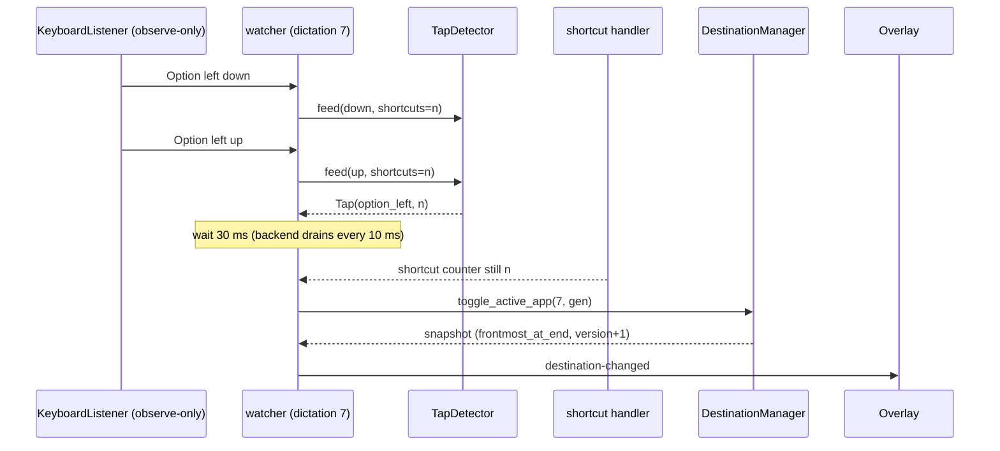
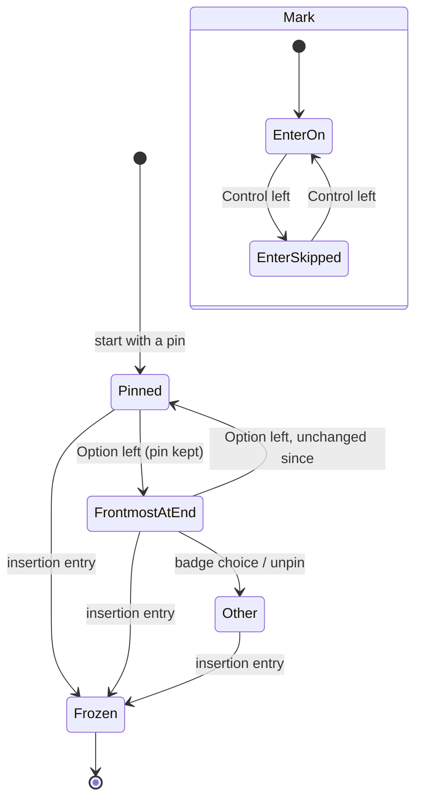

# Plan: Keys During a Dictation

## Summary

Two new default bindings (`retarget_to_active_app`, `skip_automatic_enter`) hold one modifier key each; a per-dictation observe-only HandyKeys listener (`dictation_keys/watcher.rs`) feeds a pure lone-press detector (`dictation_keys/tap.rs`) and, on a lone press, calls two new manager methods (`destination/dictation_toggles.rs`) that re-route the session to « Frontmost app at the end » or switch a skip mark read by 006's Enter claim (`EnterRefusal::UserSkipped` → `Suppression::UserSkipped`). The conflict checker gets a lone-press rule; the settings list both actions and the indicator shows the skip mark.

## Technical Context

- **Languages:** Rust (Tauri 2 backend), TypeScript/React (settings and overlay webviews).
- **Input:** `handy-keys` 0.3.4 `KeyboardListener` (observe-only; `changed_modifier` gives the side of each modifier change; macOS direction derived from `CGEventSourceFlagsState`).
- **Storage:** `settings_store.json` through `settings_service`: the bindings reach existing stores by the load-time merge of missing defaults; edits go through `shortcut::edits` (`edit_prepared`, preparation `Nothing` for these actions since nothing is registered).
- **Testing:** `cargo test --lib --features destination-return,smart-paste-dispatch`; integration `in_dictation_keys`, `shortcuts_cli` and the settings, pin and Enter suites; bun tests of the shortcut list and the indicator; `bun run lint`, `tsc`, `bun run check:translations`; `cargo fmt`, `cargo clippy --all-targets`.
- **Platform:** macOS and Windows (destination support); the bindings exist everywhere.

## Constitution Check

- Settings through the service only (AGENTS.md « Settings System »): defaults merged at load; edits via `apply_shortcut_edit` and `edit_prepared`. Pass.
- i18n in every locale (names, descriptions, mark). Pass.
- Isolation from parallel work: no change to `src/overlay/destination-menu.tsx` or `pin-state.ts`; new files `destination/dictation_toggles.rs`, `dictation_keys/*`; `manager.rs`, `session.rs`, `snapshot.rs`, `app.rs` changed by a few lines. Pass.
- One concept per file, small functions, no hardcoded expectations in tests. Pass.

## Sequence — a lone press during a dictation

```gherkin
Feature: Lone press applied to the dictation in progress
  Scenario: Option left re-routes
    Given the observer of dictation 7 runs and Claude is pinned
    When the listener reports Option left down then up with nothing between
    Then 30 ms later, with no Handy shortcut counted since the press, the manager re-routes dictation 7
    And the UI receives destination-changed with source frontmost_at_end
  Scenario: Option+Space
    Given the observer of dictation 7 runs
    When Option left goes down, Handy's Option+Space fires, and Option left goes up
    Then no key action runs
```



## State — route and mark of one dictation

```gherkin
Feature: Key toggles of a dictation
  Scenario: Re-route then restore
    Given a pinned dictation routed to Claude
    When Option left is pressed alone twice before insertion
    Then the route goes to frontmost at the end and back to Claude
  Scenario: Frozen
    Given insertion began
    When either key is pressed alone
    Then nothing changes
```



## Implementation Plan

1. **Actions and syntax** — `src-tauri/src/dictation_keys/mod.rs` (ids, defaults, `parse_key`, `is_dictation_key`); `settings.rs` inserts the defaults; `lib.rs` declares the module.
2. **Lone press** — `dictation_keys/tap.rs` (`TapDetector`, `ModifierState`, `is_configured_key`) and `tap_tests.rs`.
3. **Session state** — `destination/dictation_toggles.rs` (`KeyToggles`, `toggle_active_app`, `toggle_skip_enter`, `accepts_keys`) and tests; `session.rs` (`keys` field, `EnterRefusal::UserSkipped` in `claim_enter`); `snapshot.rs` (`enter_skipped`, optional in TS); `manager.rs` initializes the field.
4. **Enter** — `automatic_enter/policy.rs` (`Suppression::UserSkipped`), `transaction.rs` maps the claim refusal.
5. **Observer** — `dictation_keys/watcher.rs` (listener thread, 30 ms confirmation, macOS flags), `shortcut/handler.rs` counts shortcut events, `destination/app.rs` returns the committed snapshot, `actions.rs` starts the observer.
6. **Shortcut rules** — `shortcut/mod.rs` (`is_statically_registered`, suspend), `edits.rs` (`preparation_for` → `Nothing`), `action_shortcuts.rs` (one key or none, `parse_key` validation, `find_conflict_of`), `conflicts.rs` (lone-press rule, HandyKeys parser for these actions).
7. **Settings UI and overlay** — `shortcut-list-model.ts`, `shortcut-list-feedback.ts`, `shortcut-list.tsx`, `shortcut-list-rows.tsx`, `GeneralSettings.tsx`; `src/overlay/enter-skipped-mark.{tsx,css}`, `indicator-stack.tsx`; `bindings.ts`; 26 locales; `package.json` test script.
8. **Docs and registry** — README (CLI and pin sections), `.specs` registry, roadmap, changelogs, `implementation.md`, `progress.md`.

## Testing Strategy

- Unit (Rust): lone-press table and edge cases; macOS direction; key defaults and syntax; conflict rule with Julien's bindings; settings validation through `check_shortcut_edit`; manager toggles (re-route, restore, no pin, frontmost route, unpin, badge choice, freeze, stale, skip claim, snapshot mark, next dictation).
- Integration (Rust): `tests/in_dictation_keys.rs` (re-route and next dictation; Enter matrix Always/Only in PIN mode/Never × re-route × skip through the real transaction); `tests/shortcuts_cli.rs` (limit 1, remove, invalid key, add, reset).
- Front: `shortcut-list-model.test.ts`, `shortcut-list-feedback.test.ts`, `shortcut-list-render.test.tsx`, `src/overlay/enter-skipped-render.test.tsx`.
- Native (Julien): protocol in `implementation.md`.

## Risks & Considerations

- A second CGEventTap per dictation: created off the start path, dropped when the dictation stops accepting choices; on failure the dictation is unchanged.
- False lone presses from events the listener does not report (scroll, gestures, Secure Input): documented; Secure Input is filtered.
- Merge: the locale files and `.specs` registry are also edited by other branches.
