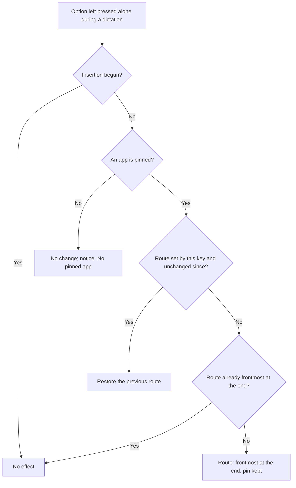
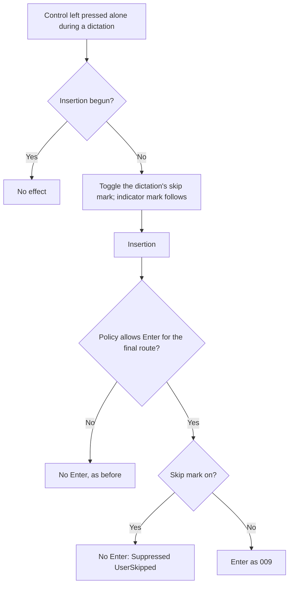
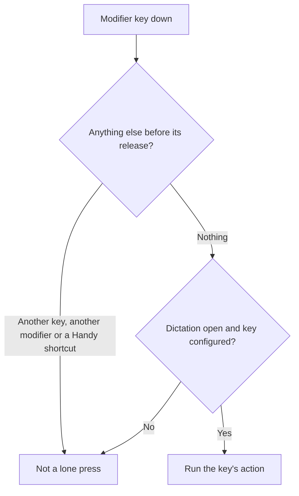
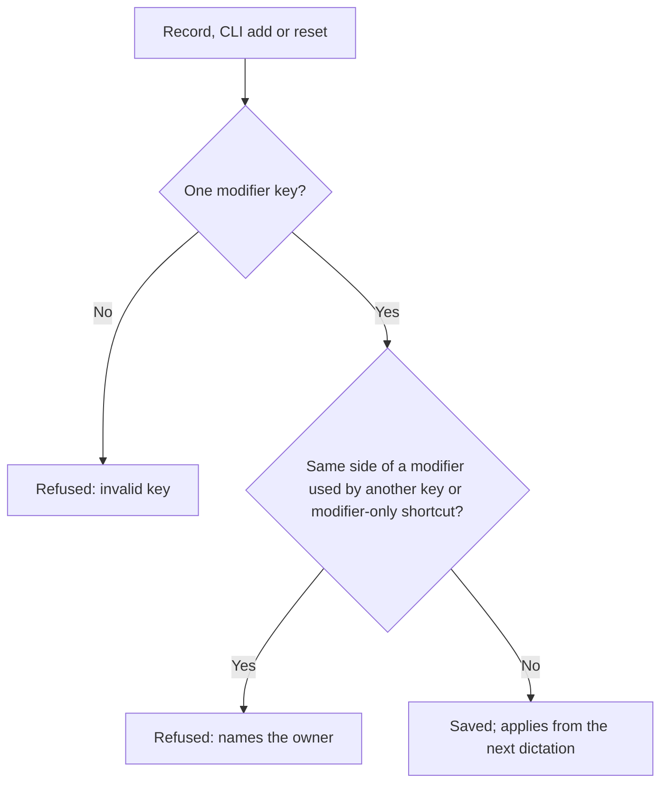

# Feature Spec: Keys During a Dictation — Send to the App in Front, Insert without Enter

## Header

- **Feature:** Keys During a Dictation (« Touches pendant la dictée : réorienter vers l'app active, insérer sans Entrée »)
- **Branch:** `feat/dictate-to-active-app` (from `dev`; the branch name was given before the change of target)
- **Date:** 2026-10-29
- **Status:** In Progress
- **Input:** Requests from Julien, 2026-10-29, relayed by the coordinator.
  1. « J'ai épinglé sur Claude, mais ponctuellement j'ai envie de parler à Codex, sans désépingler pour réépingler après. » First built as a separate start shortcut, then retargeted by Julien (option 2): **a key pressed during a dictation in progress** re-routes that dictation to the application in front at the end, without touching the pin.
  2. « Si on a activé l'Entrée à chaque fois à la fin du transcript, parfois j'ai envie de donner un peu plus de contexte, une image ou autre, donc je n'ai pas envie que ça fasse Entrée. Il faut que je puisse appuyer sur une touche, comme ça ça rentre le transcript sans faire la touche Entrée. »
  3. Defaults: Julien is right-handed (right hand on the mouse), so both keys are on the left of the keyboard, each pressed alone: **Option left** re-routes, **Control left** skips Enter. Julien will remove his Option+Space binding himself; until then both must coexist.
- **Feature Number:** 014 (013 is reserved by the « default field per app » feature on another branch)
- **Extends:** [004 Multiple Dictation Shortcuts](../004-multiple-dictation-shortcuts/spec.md) (shortcut settings, conflict check, CLI), [006 Destination Application](../006-destination-application/spec.md) (session, badge, « Frontmost app at the end », insertion freeze), [009 PIN Mode and Enter Rule](../009-pin-mode-and-enter-rule/spec.md) (pin, Automatic Enter transaction).

## User Scenarios & Testing

### Story 1 — Send one dictation to the app in front without unpinning `P1`

**As a** Handy user with Claude pinned, **I want to** press a key during a dictation so that it goes to the application in front when it ends, **so that** I can talk to Codex once without unpinning and pinning again.

**Priority reason:** First request.
**Independent test:** Pin Claude, bring Codex to the front, start a dictation with the usual shortcut, tap Option left: the badge shows « Frontmost app » without the pin mark and the text goes to Codex; the next dictation goes to Claude.

```gherkin
Feature: Send the dictation in progress to the app in front
  Scenario: Re-route a pinned dictation
    Given Claude is pinned
    And a dictation started with the plain shortcut shows the badge "Claude" with the pin mark
    When the user presses Option left alone before insertion begins
    Then this dictation's destination becomes "Frontmost app at the end"
    And the badge shows "Frontmost app" without the pin mark
    And Claude is still pinned
  Scenario: A second press undoes it
    Given the dictation was re-routed by Option left
    When the user presses Option left alone again before insertion begins
    Then the destination is Claude again, with the pin mark
  Scenario: The next dictation follows the pin
    Given the previous dictation was re-routed and inserted into Codex
    When the user starts a new dictation
    Then its destination is Claude
  Scenario: Without a pin
    Given nothing is pinned
    When the user presses Option left alone during a dictation
    Then the destination does not change
    And the recording indicator shows the notice "No pinned app" for at least 4 seconds
  Scenario: Already frontmost with a pin
    Given Claude is pinned
    And the badge cross set this dictation's destination to "Frontmost app at the end"
    When the user presses Option left alone before insertion begins
    Then nothing changes and no notice is shown
  Scenario: After insertion began
    Given insertion of the dictation has begun
    When the user presses Option left alone
    Then nothing changes
```



### Story 2 — Insert without the automatic Enter, once `P1`

**As a** Handy user with Automatic Enter on, **I want to** press a key during a dictation so that this transcript is inserted without Enter, **so that** I can add an image or more context before sending.

**Priority reason:** Second request.
**Independent test:** Set Automatic Enter to Always, dictate, tap Control left: the indicator shows the « Enter off » mark, the text is inserted and no Enter follows; the next dictation sends Enter again.

```gherkin
Feature: Skip Automatic Enter for the dictation in progress
  Scenario: Skip the Enter
    Given Automatic Enter is "Always"
    When the user presses Control left alone during a dictation, before insertion begins
    Then the indicator shows the "Automatic Enter off for this dictation" mark
    And the text is inserted normally
    And no Enter is pressed, logged as Suppressed(UserSkipped)
    And the stored Automatic Enter setting is unchanged
  Scenario: A second press restores the policy
    Given Control left was pressed once during this dictation
    When the user presses Control left alone again before insertion begins
    Then the mark disappears and Automatic Enter applies as usual
  Scenario: Policy Never
    Given Automatic Enter is "Never"
    When the user presses Control left alone during a dictation
    Then no Enter is pressed, as without the key
  Scenario: Combined with the re-routing
    Given Automatic Enter is "Always" and Claude is pinned
    When the user presses Option left alone and Control left alone during a dictation
    Then the text goes to the app in front at the end and no Enter is pressed
```



### Story 3 — Keys that never get in the way `P1`

**As a** Handy user, **I want** these keys to act only when pressed alone during a dictation, **so that** Shift for capitals, Control in Ctrl+C or Option in Option+Space keep working.

**Priority reason:** The keys are ordinary modifiers used all the time.
**Independent test:** During a dictation type a capital, press Ctrl+C, and press Option+Space; nothing re-routes or skips Enter. Outside a dictation, Option left and Control left do nothing.

```gherkin
Feature: Lone press only, during a dictation only
  Scenario: Combination
    Given a dictation is recording
    When the user presses Option+Space, Control+C or Shift+A
    Then neither key action runs
  Scenario: Option+Space still a dictation shortcut
    Given "option+space" is a dictation shortcut
    When the user presses Option left alone
    Then Option+Space keeps starting and stopping dictations as before
  Scenario: Outside a dictation
    Given no dictation is in progress
    When the user presses Option left alone
    Then nothing happens in Handy
```



### Story 4 — Configure the keys `P2`

**As a** Handy user, **I want to** change or turn off each key in the shortcut settings and the CLI.

```gherkin
Feature: Configure the keys used during a dictation
  Scenario: Change a key
    When the user records "shift_left" for "Send to the App in Front"
    Then Shift left pressed alone re-routes from the next dictation
  Scenario: Refuse a combination
    When the user records "option+space" for "Insert without Enter"
    Then it is refused: a key used during a dictation is one modifier key pressed alone
  Scenario: Same key for two things
    Given "Send to the App in Front" uses Option left
    When the user records Option left for "Insert without Enter"
    Then it is refused because "Send to the App in Front" uses it
  Scenario: Turn a key off and back on from the CLI
    When the user runs "handy settings shortcuts remove skip_automatic_enter control_left"
    And then "handy settings shortcuts reset skip_automatic_enter"
    Then the key is off, then back to Control left
```



## Acceptance Criteria

### AC-001

**Criterion:** While a dictation accepts destination choices (recording and processing, before 006's insertion freeze) and an application is pinned, a lone press of the « Send to the App in Front » key sets this dictation's selection to « Frontmost app at the end » through the badge's versioned choice path (new `selection_version`); the badge shows « Frontmost app » without the pin mark and still offers Unpin; the pin (application, version) is unchanged and routes the next dictations. A second lone press restores the previous route when nothing moved it since (no badge choice, pin or unpin) and the app is still pinned. Without a pin, on a frontmost-at-the-end route the key did not set, after the freeze, or for a finished or cancelled dictation, the key does not change the route (without a pin the indicator says so, AC-007).
**Priority:** P1 | **Story:** Story 1

### AC-002

**Criterion:** Automatic Enter follows the final route of the dictation: after a re-routing, « Only in PIN mode » sends no Enter (route not pinned) and « Always » sends it to the application in front at the end, as 009 AC-005 says for that route.
**Priority:** P1 | **Story:** Story 1

### AC-003

**Criterion:** While a dictation accepts choices, a lone press of the « Insert without Enter » key switches a per-dictation mark; at insertion the text is inserted as usual and, when the mark is on, 009's Enter claim is refused and the transaction result is `Suppressed(UserSkipped)` whatever the policy that would have allowed it (Always, Only in PIN mode); « Never » stays `PolicyNever`. A second press clears the mark. The stored `automatic_enter` setting is never changed and the next dictation starts without the mark.
**Priority:** P1 | **Story:** Story 2

### AC-004

**Criterion:** While the mark is on, the recording indicator shows a struck-through Enter glyph in the destination segment, with the accessible name and tooltip « Automatic Enter off for this dictation », translated in every locale, even when the destination badge is hidden.
**Priority:** P2 | **Story:** Story 2

### AC-005

**Criterion:** Two shortcut actions exist in every build: « Send to the App in Front » (`retarget_to_active_app`, default `option_left` on macOS, `shift_left` elsewhere) and « Insert without Enter » (`skip_automatic_enter`, default `control_left`). Each holds one key or none: one modifier key (a side, or both sides), in the HandyKeys syntax whatever keyboard implementation is active; a combination or a non-modifier key is refused (`invalid_shortcut` in the settings, `validation_failed` in the CLI). The General shortcut settings list both (in builds with Automatic Enter) with Change, Remove, Add (when empty) and Reset; the CLI `settings shortcuts list|add|remove|reset` manages them with the 004 codes (`limit_exceeded` with limit 1). A key acts only when pressed alone (down then up, no other key, modifier or Handy shortcut in between), only during a dictation, and is never registered with a keyboard backend nor blocked for other applications.
**Priority:** P1 | **Story:** Story 3, Story 4

### AC-006

**Criterion:** A key used during a dictation conflicts only with a modifier-only shortcut or key that the same press would also fire (same modifier, a shared side); combinations holding that modifier never conflict (Option left and Option+Space coexist, Control left and Ctrl+C too). Pressing Option+Space (a dictation shortcut) during a dictation never re-routes it, and a lone press of Option left never triggers Option+Space nor changes its push-to-talk end; the auto-repeat of a held key (Space of a push-to-talk Option+Space) does not cancel a lone press of another key.
**Priority:** P1 | **Story:** Story 3

### AC-007

**Criterion:** When a lone press of « Send to the App in Front » reaches a dictation that accepts choices while nothing is pinned, the route is unchanged and the recording indicator shows a transient notice « No pinned app » (« Aucune application épinglée » in French, translated in every locale, test id `recording-indicator-no-pin-notice`) for at least 4 seconds, like the other indicator notices; a newer press replaces it. The press is logged at debug level. The manager reports this case apart from the frontmost-at-the-end route the key did not set with a pin, which stays silent, as do a press after the freeze (`Frozen`) and a press for another dictation (`Stale`).
**Priority:** P2 | **Story:** Story 1

## Functional Requirements

### FR-001

**Requirement:** Define both actions among the default bindings, with one key or none (removable, reset to the default), validated as one modifier key in HandyKeys syntax, never statically registered, and listed in the settings and the CLI.
**AC References:** AC-005

### FR-002

**Requirement:** Detect a lone press purely from the observed key stream and the count of Handy shortcut events (press, release of the same modifier, nothing in between, key repeats ignored).
**AC References:** AC-005, AC-006

### FR-003

**Requirement:** Re-route or restore the dictation's route in the destination manager under its lock, through the versioned choice path, refusing after the freeze and never changing the pin; report a press without a pin apart from a silent no-op, so the observer raises the indicator's no-pin notice.
**AC References:** AC-001, AC-002, AC-007

### FR-004

**Requirement:** Keep the skip mark in the dictation's destination session, show it in the snapshot, and refuse 009's Enter claim with `UserSkipped`, reported as `Suppressed(UserSkipped)`.
**AC References:** AC-003, AC-004

### FR-005

**Requirement:** Observe the keys with an observe-only HandyKeys listener per dictation, from the recording start until the dictation stops accepting choices, with the modifier state read from the system on macOS.
**AC References:** AC-001, AC-003, AC-005

### FR-006

**Requirement:** Apply the lone-press conflict rule to these actions in the shared conflict checker (UI, CLI, stored-conflict warnings, implementation switch).
**AC References:** AC-006

## Key Entities

| Entity | Description | Key fields |
|---|---|---|
| In-dictation key action | Stored binding of each key | id, one modifier key or none, default key |
| Key toggles | Per-dictation state in the destination session | route replaced by the re-routing and the version it set; skip mark |
| Lone press | A modifier pressed and released alone | side bit, Handy shortcut count at the press |

## Clarifications

- Decision `014-in-dictation-keys:AC-001` / `key_during_dictation` (Julien, option 2, relayed 2026-10-29): not a separate start shortcut; a key pressed during the dictation in progress. The start shortcut « Dictate to the active app » built first was removed before commit.
- Decision `014-in-dictation-keys:AC-001` / `frontmost_at_end` (coordinator): the re-routed route is « Frontmost app at the end » (`Selection::FrontmostAtEnd`, the badge cross's route), not the app in front at the press. The badge then shows « Frontmost app ».
- Decision `014-in-dictation-keys:AC-001` / `second_press_restores` (coordinator, then agent): a second press restores the route before the first one (the pinned app in the normal case), but only while nothing moved the route since (same selection version) and the app is still pinned; otherwise the press follows the first-press rule.
- Decision `014-in-dictation-keys:AC-001` / `badge_keeps_unpin` (agent): the snapshot keeps the pin view, so the badge menu still offers Unpin and choosing the pinned row returns to the pin (009 rule).
- Decision `014-in-dictation-keys:AC-003` / `skip_at_claim` (agent): the mark is read by 006's atomic Enter claim, after the insertion freeze closed the toggles, so the decision is the one in force at insertion; the claim is not consumed by the refusal.
- Decision `014-in-dictation-keys:AC-005` / `left_hand_defaults` (Julien, final 2026-10-29): Option left re-routes, Control left skips Enter, pressed alone. On Windows and Linux the re-routing default is Shift left, because a lone Alt press opens the menu bar of Windows applications.
- Decision `014-in-dictation-keys:AC-005` / `single_modifier_taps` (agent): a key used during a dictation is one modifier key. Reason: a lone modifier press does nothing in other applications; a letter or function key would reach the application in front, since the key is never blocked.
- Decision `014-in-dictation-keys:AC-005` / `observe_only_listener` (agent; replaces « registered and unregistered like cancel »): the keys are read by a HandyKeys `KeyboardListener` in observe-only mode, one per dictation, not registered with the keyboard backend like `cancel`. Reason: a registered HandyKeys hotkey fires on the modifier going down, cannot tell a lone press from Shift+A, Ctrl+C or Option+Space, and is blocked for other applications (Shift would stop typing capitals during a dictation); the Tauri implementation cannot register a lone modifier at all. The listener uses HandyKeys whichever implementation is active; recording a new key in the settings window uses the recorder of the active implementation, so with the Tauri implementation the keys are changed from the CLI.
- Decision `014-in-dictation-keys:AC-005` / `one_key_or_none` (agent): each action holds one key or none, so the CLI can change it (`remove`, then `add`) and a user can turn it off; Reset restores the default.
- Decision `014-in-dictation-keys:AC-005` / `gate` (agent): the settings rows are shown in builds with Automatic Enter (the `destination-return` rollout gate, where the destination session exists); the observer only runs for a dictation with a destination session. The bindings exist in every build (CLI `list` shows them).
- Decision `014-in-dictation-keys:AC-006` / `option_space_coexistence` (Julien, final): Option+Space is a combination, never a lone press. If HandyKeys hides Space from the observer (it owns Option+Space), the shortcut event counted by Handy cancels the press; the observer confirms a lone press 30 ms after its release so the backend (10 ms drain) has counted it. The observer never blocks Option, so Option+Space detection and its push-to-talk end are unchanged.
- Decision `014-in-dictation-keys:AC-007` / `no_pin_notice` (Julien, 2026-10-30): pressing « Send to the App in Front » with nothing pinned did nothing visible, so the key looked broken. In that case only, the indicator shows the transient notice « No pinned app » (existing notice system, 4 s minimum, a newer one replaces it) and the press is logged at debug level. The manager returns a result that tells « no pin » apart from « frontmost route this key did not set, with a pin », which stays silent with `Stale` and `Frozen`. With the overlay style none no indicator is shown, so there is no notice and no toast: the key acts only during a dictation, whose badge is not visible either.
- Known limits (agent): a modifier pressed with a scroll or a trackpad gesture (Control+scroll zoom) is seen as a lone press, because the listener does not report those; while Secure Input is on, lone presses are ignored (key presses do not reach the observer); a lone press released less than 30 ms before the insertion freeze is refused as frozen.

## QE Analysis

- **Criticality:** Medium; **Blast radius:** the route and Enter of the dictation in progress, the shortcut lists and the conflict checker shared by all actions; **Primary risk:** a false lone press (re-routing or skipping Enter without intent), or a regression of Option+Space.
- **Dimensions:** functional correctness, input handling (lone press against combination, repeats, held modifiers), regression of 006/009 routing and Enter, conflicts and CLI contract, i18n, accessibility of the mark.
- **P0 gates/evidence:** pure lone-press tests (combinations, repeats, held modifier, shortcut fired, lost release, macOS direction); manager tests (re-route, second press, no pin, after freeze, unpin, badge choice, pin intact, skip claim); Enter matrix through the real transaction; conflict tests with Julien's bindings; CLI process test; bun tests of the list and the mark; translation check.
- **P1 gates/evidence:** native macOS run by Julien (protocol in `implementation.md`).
- **Non-functional expectations:** no added latency at dictation start (the observer starts on its own thread); no key content logged.
- **Missing evidence:** native run; Penflow mockups of the shortcut screen and the indicator mark not updated.
- **Boundary:** QE defines risk and test sufficiency; spec-test runs the proofs; Penflow governs mockups.

## Screens

| Screen | Status | Reference |
|--------|--------|-----------|
| shortcut-settings | Modified | Penflow `penflow/ui.pen` not updated by this run (gap in `implementation.md`): two rows `shortcut-settings-active-app-key-*`, `shortcut-settings-no-enter-key-*` |
| recording-indicator | Modified | Same gap: mark `recording-indicator-enter-skipped` in the destination segment; notice `recording-indicator-no-pin-notice` (screen `recording-indicator-no-pin` when shown alone, AC-007) |

## Edge Cases

- Push-to-talk on a lone modifier (Command right): the modifier held since before the observer started does not hide a lone press of Option left.
- The pinned app is not running: the re-routed dictation goes to the app in front at the end, so 009's `pinned_app_not_running` does not apply to it.
- The user unpins after re-routing: the route stays « Frontmost app at the end »; a second press does not change it and shows « No pinned app » (AC-007).
- Keyboard implementation switch: the keys are not repaired or re-registered (they are not registered).
- Linux: no destination support; the session still exists in builds with the gate, so Insert without Enter works if the listener can read the keyboard; failure is logged and the dictation is unchanged.

## Success Criteria

### SC-001

In automated tests, a re-routed dictation reaches the app in front and the next dictation reaches the pinned app, with the pin version unchanged.

### SC-002

The lone-press detector accepts 100% of lone presses and refuses 100% of the combinations of its table (Option+Space, Ctrl+C, Shift+A, two modifiers, a key released during the press, a Handy shortcut fired).
