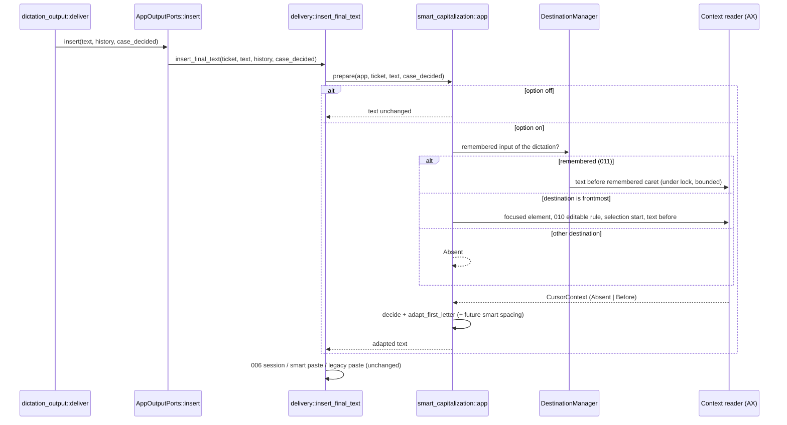
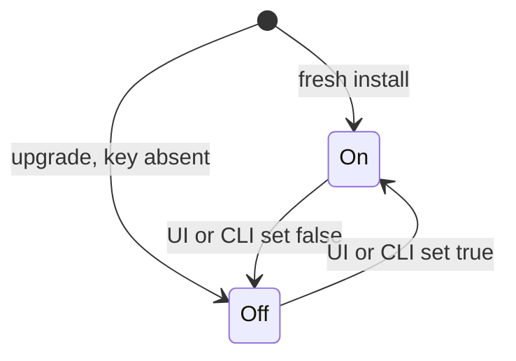

# Plan: Smart Capitalization

## Summary

A new Rust module `smart_capitalization` holds a pure decision (context → Capitalize, Lower, Keep), a pure first-letter transformation with protections and Unicode title/lower mappings, and a bounded macOS context reader behind a port; the Tauri glue runs the reader on a blocking worker and adapts the final text in `destination::delivery::insert_final_text`, the convergence point of every insertion path, after AI post-processing and before activation. A boolean setting `smart_capitalization` (output domain) goes through the settings service, the UI Output group and the settings CLI.

## Technical Context

- **Language:** Rust 2021 (Tauri 2 backend), TypeScript/React 18 (settings UI).
- **Dependencies:** none added; macOS ApplicationServices FFI already linked (`AXUIElementCopyParameterizedAttributeValue` added to the extern block); CoreFoundation helpers of `smart_paste::macos_cf`.
- **Storage:** `settings_store.json` through `settings_service` (one new key).
- **Testing:** `cargo test --lib` (pure tables, scripted reader port, settings), integration tests in `src-tauri/tests/` (settings domains), bun render tests, ESLint, `tsc`.
- **Platform:** macOS reader; Windows and Linux compile the port with an unsupported reader (Absent).

## Constitution Check

- Specify before implementing: this spec and plan precede code. ✅
- Preserve source and native/frontend boundaries: the decision and transformation are pure Rust; the native read is an adapter behind a port; the UI writes through the settings service only. ✅
- Every platform builds and tests: pure code is platform-independent; adapters are `cfg`-gated with an unsupported fallback. ✅
- macOS native evidence before Implemented: protocol provided in `implementation.md`; recorded as pending Julien's run (status reflects it). ✅
- Minimal scope: no Windows UIA reader, no smart spacing (extension point only). ✅

## Sequence — insertion with smart capitalization

```gherkin
Feature: Adapt the first letter at insertion preparation
  Scenario: Option on, readable field
    Given the AI step returned the final text or the native text
    And smart_capitalization is on
    When insert_final_text prepares the insertion
    Then the context is read on a worker within 50 ms
    And the first letter is adapted before any insertion path runs

  Scenario: Option off
    Given smart_capitalization is off
    When insert_final_text prepares the insertion
    Then no accessibility query is made and the text is unchanged
```



## State — the setting across install and upgrade

```gherkin
Feature: smart_capitalization default
  Scenario: Fresh install
    Given no settings payload
    When the store is created
    Then smart_capitalization is true

  Scenario: Upgrade
    Given a payload without smart_capitalization
    When it is normalized
    Then smart_capitalization is false
```



No new data entity (no ER diagram): one scalar setting.

## Implementation Plan

1. **Pure decision** — `src-tauri/src/smart_capitalization/decision.rs`: `CursorContext`, `CaseDecision`, `decide()` (AC-002, AC-005); tests `decision_tests.rs`.
2. **Pure transformation** — `transform.rs`: `CaseInputs`, `adapt_first_letter()` with protections (acronym, inner capital, "I", replacements, custom words, repeated capitalized word, AI-decided) and title/lower mappings (AC-001, AC-003, AC-004, AC-011); tests `transform_tests.rs`.
3. **Pipeline and extension point** — `mod.rs`: `prepare_text(text, inputs, context)`, the ordered steps (capitalization, then a documented slot for smart spacing) (AC-009).
4. **Reader port** — `reader.rs`: `CaretElement` (010's `FocusedElement` + selection start + text in range), `CaretPort`, `read_frontmost()` with one `Deadline` of 50 ms, 010's `classify_focused`, secure-field refusal, 64-unit window (AC-005..AC-007); tests `reader_tests.rs` with a scripted port.
5. **macOS adapter** — `macos.rs`: `MacCaretPort` (focused element through `MacFocusedElement`, `AXSelectedTextRange`, `AXStringForRange`); `FieldNode::text_before` default `Unsupported`, implemented by `MacFieldNode` through the same helper (011 remembered caret).
6. **Manager access** — `destination/field_context.rs`: `insertion_target()` (frontmost, application pid, none) and `read_remembered_before_caret()` under the lock.
7. **Glue** — `smart_capitalization/app.rs`: settings snapshot, worker read, decision, transform; called from `insert_final_text`; `OutputPorts::insert` gains `case_decided` from `dictation_output::deliver` (AI result used).
8. **Setting** — `settings.rs` field + default (true) + migration (absent → false); `descriptor_data.rs`, `public.rs`, `domains/output.rs` keys; `shortcut::change_smart_capitalization_setting` registered in `lib.rs`; `bindings.ts`, `settingsStore.ts`.
9. **UI** — `src/components/settings/text-formatting/` (options list, reusable row, section) after the Output group on the Advanced page, optional `icon` slot in `SettingContainer`/`ToggleSwitch`, test ids `${screen}-text-formatting` and `${screen}-smart-capitalization`; translations in every locale; render test.
10. **Docs** — README settings/CLI section if it lists output keys; `implementation.md`, changelogs, registry.

## Testing Strategy

- **Unit (pure, every platform):** decision and transformation tables named in the spec Provenance; pipeline order.
- **Unit (port):** scripted `CaretPort` for absent/empty/secure/non-editable/budget/window/selection.
- **Settings:** default on fresh install, migration off, stored value kept, CLI validation, output domain key list (`tests/settings_domains.rs`, `tests/settings_validation`).
- **Frontend:** render test of the toggle (test id, checked state), ESLint, `tsc`, translation check.
- **Native (pending Julien):** TextEdit, Chrome, Codex, cmux protocol in `implementation.md`.

## QE Analysis

- Risks mapped to gates: wrong case (pure tables, P0); privacy (reader tests: secure never read, nothing logged; code review of log lines, P0); latency (50 ms deadline test, P0); regression of insertion paths (`cargo test --lib` full, P0); settings contract (settings tests, P0); native fidelity (P1, protocol).
- Evidence gaps: native macOS run; Penflow mockup of the Output group (one row).

## Risks & Considerations

- The remembered-field read (≤ 50 ms) runs outside the manager lock: the input is moved out, read, then put back only while its dictation is current (independent review finding, 2026-10-29).
- Electron/Chromium fields may not implement `AXStringForRange`: the read fails and the context is Absent (no change).
- Context read before activation: text typed into the remembered field after the stop is not seen (accepted, spec decision `read_at_preparation`).
- Proper nouns: documented limitation.
