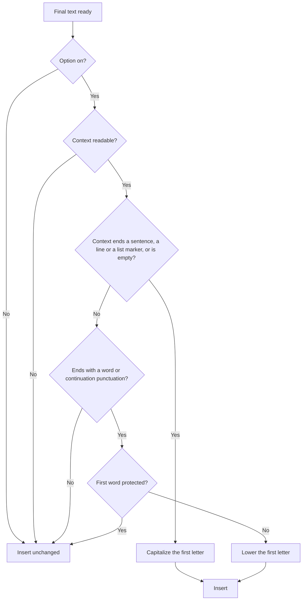
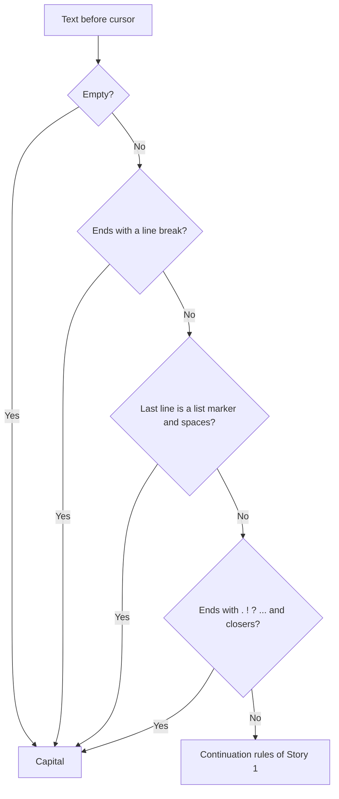
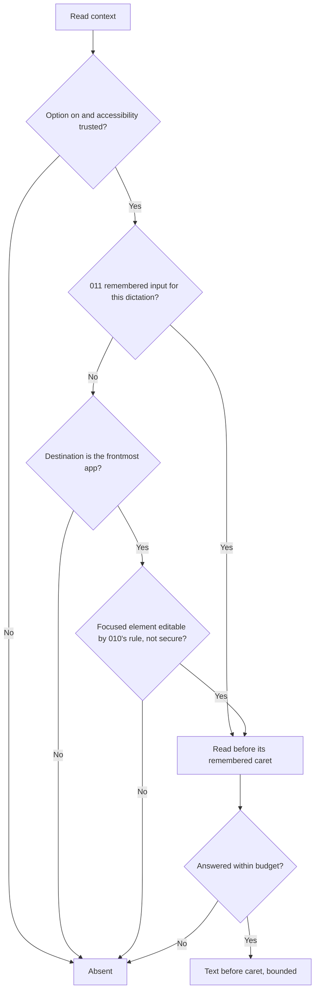
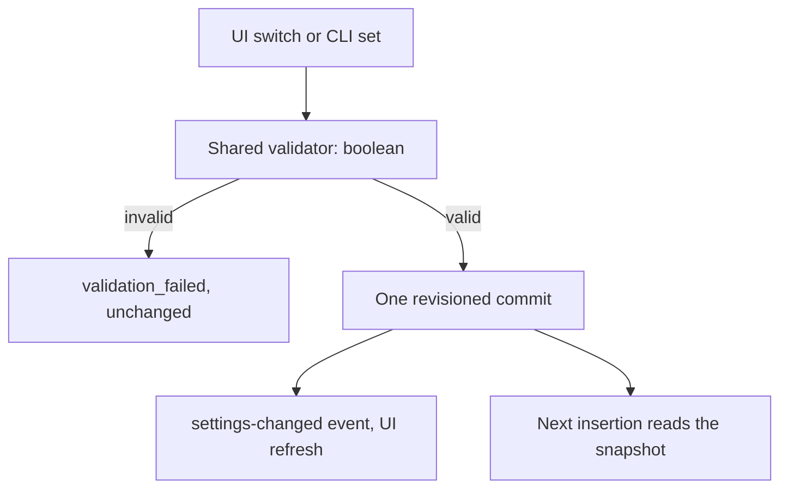

# Feature Spec: Smart Capitalization

## Header

- **Feature:** Smart Capitalization
- **Branch:** `feat/smart-capitalization` (from `dev`)
- **Date:** 2026-10-29
- **Status:** In Progress (automated evidence complete; macOS native proof pending with Julien)
- **Input:** Request from the coordinator for Julien, 2026-10-29: an option "Majuscules intelligentes" (on for a new installation, off for an existing one: AC-010, clean-room contract of 2026-10-29) that adapts **only the first character** of a transcription to the text that precedes the cursor in the destination field. Capital at the start of a field, after a line break, after the end of a sentence and after a list marker; lower case when the dictation continues a sentence; never touch an acronym, a word with an inner capital, the English pronoun "I", the result of a custom replacement (002) or of a corrected custom word (003), or a case already decided earlier (AI post-processing, 005). Absent context changes nothing; empty context capitalizes.
- **Feature Number:** 015
- **Extends:** [002 Word Replacements](../002-word-replacements/spec.md), [003 Recognition Vocabulary](../003-recognition-vocabulary/spec.md), [005 Custom AI Prompts](../005-custom-ai-prompts/spec.md), [006 Destination Application](../006-destination-application/spec.md), [010 Recovery Bubble](../010-recovery-bubble/spec.md) (editable-field rule) and [011 Dictation Field Return](../011-dictation-field-return/spec.md) (remembered input and caret).
- **Independent design (clean room, contract of 2026-10-29):** the algorithm, its rules and its context reading were designed for this feature by the implementing agent. Authorized sources only: Handy's instructions, specs and code; the public Spokenly documentation S1 (<https://spokenly.app/docs/macos/smart-spacing>, read 2026-10-29); public API documentation (macOS accessibility `AXSelectedTextRange`, `AXStringForRange`, `AXSecureTextField`; Unicode case mappings). Excluded and never opened: `.investigations/`, any disassembly or pseudo-code, any constant or architecture deduced from a binary. Nothing here describes or claims to reproduce Spokenly's internal algorithm; the Provenance table separates (1) publicly documented behavior, (2) product requirement and (3) independent technical choice. Accidental exposure report: Handy's conventions baseline (`.specs/conventions/baseline.json`) lists one file *path* under `.investigations/`; that path appeared in a command output while reading the baseline, the file was never opened, and no decision depends on it.
- **Processing:** entirely local; no network call.

## User Scenarios & Testing

### Story 1 — Continue a sentence in lower case `P1`

**As a** Handy user who dictates in pieces, **I want** a dictation that continues a sentence to start in lower case, **so that** I do not fix a stray capital after every pause.

**Priority reason:** This is the main annoyance the option removes: recognition engines always capitalize the first word.
**Independent test:** With the option on, type "I bought apples, " in TextEdit, dictate "Pears and plums" and check that "pears and plums" is inserted.

```gherkin
Feature: Lower case in continuation
  Scenario: After a comma
    Given smart capitalization is on
    And the text before the cursor is "I bought apples, "
    When the transcription "Pears and plums" is inserted
    Then the inserted text is "pears and plums"

  Scenario: After a word
    Given smart capitalization is on
    And the text before the cursor is "We will meet "
    When the transcription "Tomorrow at noon" is inserted
    Then the inserted text is "tomorrow at noon"

  Scenario: Protected first word stays
    Given smart capitalization is on
    And the text before the cursor is "I just bought an "
    When the transcription "iPhone" or "API" or "I'm" is inserted
    Then the first word is inserted unchanged
```



### Story 2 — Start a sentence with a capital `P1`

**As a** user, **I want** a dictation that starts a field, a line, a sentence or a list item to start with a capital, **so that** an engine or an AI step that returned lower case still produces a proper sentence.

**Priority reason:** Symmetric half of the rule; also covers engines that never capitalize.
**Independent test:** With the option on, dictate "hello there" into an empty TextEdit document, then after "Done. ", then after "- " at the start of a line.

```gherkin
Feature: Capital at the start of a sentence
  Scenario: Empty field
    Given smart capitalization is on
    And the field is readable and empty before the cursor
    When the transcription "hello there" is inserted
    Then the inserted text is "Hello there"

  Scenario: After the end of a sentence
    Given smart capitalization is on
    And the text before the cursor is "It works. "
    When the transcription "now test it" is inserted
    Then the inserted text is "Now test it"

  Scenario: After a line break or a list marker
    Given smart capitalization is on
    And the text before the cursor ends with a line break, or with "- " or "1. " alone at the start of its line
    When the transcription "buy milk" is inserted
    Then the inserted text is "Buy milk"
```



### Story 3 — Never guess when the context is unknown `P1`

**As a** user, **I want** Handy to leave the transcription untouched when it cannot read the destination field, **so that** the option never makes things worse in a terminal, a password field or an unreadable application.

**Priority reason:** Safety: a wrong guess is worse than no change.
**Independent test:** With the option on, dictate into cmux (a terminal) and into a field Handy cannot read; the transcription is inserted exactly as without the option.

```gherkin
Feature: Absent context
  Scenario: Unreadable field
    Given smart capitalization is on
    And the destination field cannot be read (no accessibility access, terminal, unknown role, timeout)
    When the transcription "Hello there" is inserted
    Then the inserted text is "Hello there"

  Scenario: Password field
    Given smart capitalization is on
    And the focused field is a password field
    When a transcription is inserted
    Then the field content is never read
    And the transcription is inserted unchanged

  Scenario: Destination is another application
    Given smart capitalization is on
    And the dictation goes to an application that is not in front and has no remembered input
    When the transcription is inserted
    Then it is inserted unchanged
```



### Story 4 — Turn the option on or off `P2`

**As a** user, **I want** a switch in the settings and a CLI key, **so that** I can enable the feature where I need it.

**Priority reason:** Off by default; it must be discoverable and scriptable.
**Independent test:** Toggle "Smart capitalization" in Advanced > Text formatting; run `handy settings output get smart_capitalization` and `handy settings set smart_capitalization true`.

```gherkin
Feature: Smart capitalization setting
  Scenario: On for a new installation
    Given no settings payload exists yet
    When the settings are created
    Then smart_capitalization is true

  Scenario: Off after an upgrade
    Given an existing settings store without the key smart_capitalization
    When the settings are loaded
    Then smart_capitalization is false
    And a stored value, true or false, is kept as is

  Scenario: Change from the UI or the CLI
    Given smart capitalization is off
    When the user turns it on in Advanced > Text formatting, or runs "handy settings set smart_capitalization true"
    Then the value is validated by the shared validator and committed once with a new revision
    And the next insertion uses it

  Scenario: Invalid CLI value
    When the user runs "handy settings set smart_capitalization maybe"
    Then it is refused with validation_failed and nothing is written
```



## Acceptance Criteria

### AC-001

**Criterion:** With `smart_capitalization` off, the inserted text is byte-for-byte the text produced before this feature and no field content is read. With it on, only the first cased letter of the text may change; every other character, the length of the rest of the text and the trailing space of `append_trailing_space` are unchanged.
**Priority:** P1 | **Story:** Stories 1, 2

### AC-002

**Criterion:** The context decision, from the text before the cursor (horizontal whitespace at its end ignored): **Capitalize** when the context is empty and reaches the start of the field; when it ends with a line break (followed only by horizontal whitespace); when its last line is a list marker alone (`-`, `*`, `•`, `‣`, `◦`, `▪`, `–`, `—`, or one to three digits followed by `.` or `)`) followed by at least one whitespace; or when it ends with a sentence terminator (`.`, `!`, `?`, `…`, `‽`, `。`, `！`, `？`, `．`, `｡`, `؟`, `।`, `॥`) optionally followed by closing quotes or brackets. **Lower** when it ends (after optional closing quotes or brackets) with a letter, a digit or a combining mark, or with continuation punctuation (`,`, `;`, `:`, `、`, `，`, `；`, `：`). **Keep** in every other case (an opening quote or bracket, a symbol, only whitespace in a window that does not reach the start of the field).
**Priority:** P1 | **Story:** Stories 1, 2

### AC-003

**Criterion:** The first word (from the first letter, through letters, digits, combining marks, apostrophes and inner hyphens) is never changed when: it contains an upper-case letter after its first character ("API", "iPhone", "LiveSpec"); it is the English pronoun "I" alone or followed by an apostrophe ("I'm", "I'll", "I’d"); it is capitalized and the same word appears again, capitalized, later in the text and not at a sentence start (a sign of a proper noun or brand: "Paris is nice, I love Paris"); the text starts with a custom replacement result (002 `replacement` value) or a custom word (003), matched case-sensitively and ending on a word boundary; or the final text is the AI post-processing result (005), whose case is already decided. A first character without case (CJK, digits, symbols) is never changed.
**Priority:** P1 | **Story:** Story 1

### AC-004

**Criterion:** Case conversion works on whole characters and never truncates: a capital uses the title case of the letter (the first character of its upper-case mapping followed by the rest of that mapping in lower case, and the four Latin digraphs DŽ, Lj, Nj, Dz in their title-case forms), so "ß" becomes "Ss", "fi" becomes "Fi" and "dž" becomes "Dž"; a lower case uses the full lower-case mapping, so "İ" becomes "i̇". Combining marks after the letter are kept. Leading opening punctuation ("¿", "¡", quotes, brackets) and leading whitespace are kept and the first letter after them is the one adapted.
**Priority:** P1 | **Story:** Stories 1, 2

### AC-005

**Criterion:** **Absent** context (no change) and **empty** context (capital) are distinct: absent when the option is off, accessibility is not trusted, the platform has no reader (Windows and Linux in this feature), the destination is an application that is not in front and has no 011 remembered input for this dictation, Handy itself is in front, the focused element is not editable by 010's rule (a terminal, an unknown role, a read-only text) or is a password field, any query fails or the budget is spent. Empty when a readable editable field has its caret at position 0, or only whitespace between position 0 and the caret.
**Priority:** P1 | **Story:** Story 3

### AC-006

**Criterion:** The context is read once per dictation, at the final preparation of the insertion (after AI post-processing, before the 006 activation and before the insertion method), on a worker thread, within a single 50 ms budget (010's classification budget); each accessibility query's timeout is the remaining budget. It reads at most 64 UTF-16 units before the caret with `AXStringForRange`, never `AXValue`, never a password field, and never the system-wide element. The context is never logged, never stored, never sent in an event and dropped after the decision; logs carry only the decision kind.
**Priority:** P1 | **Story:** Story 3

### AC-007

**Criterion:** The context source: when 011 remembered an input for this dictation, the text before its remembered caret (its selection start) in that element, which is where the paste returns; otherwise, when the text goes to the application in front now (no destination session, "frontmost app at the end", or a destination whose process is the frontmost one), the text before the selection start of that application's focused element, provided 010's rule classifies it editable. With a selection, the context is the text before the selection, which the paste replaces.
**Priority:** P2 | **Story:** Story 3

### AC-008

**Criterion:** The setting `smart_capitalization` (boolean, output domain, default per AC-010) is written only through the settings service with the shared validator: the settings UI, `handy settings set smart_capitalization <bool>` and `handy settings output get|set smart_capitalization`. In the UI it is the row "Aa Smart capitalization (i)" of a new section "Text formatting" of the Advanced page, placed right after the Output group: a small icon on the left, the label, an info button that shows the description, and an independent on/off switch on the right (test ids `<screen>-text-formatting` for the section, `<screen>-smart-capitalization` for the row, `<screen>-smart-capitalization-toggle` for the switch). The section is built from a list of options, so the future rows "¶ Smart paragraphs" and "␣ Smart spacing" are one entry each. A change applies from the next dictation. Its group title, label and description exist in every locale.
**Priority:** P2 | **Story:** Story 4

### AC-009

**Criterion:** The transformation runs in the final preparation of the insertion, after replacements (002), custom-word correction (003), filler removal, normalization and AI post-processing (005), on every insertion path (006 session, smart paste at the foreground, legacy paste). History keeps the native and AI texts unchanged; a retained transcript for recovery (010) is the adapted text. A documented extension point after the capitalization step is reserved for a future "smart spacing" step, which will run after it.
**Priority:** P2 | **Story:** Stories 1, 2

### AC-010

**Criterion:** A new installation (no settings payload yet) starts with `smart_capitalization` on. An existing installation whose stored settings have no `smart_capitalization` key is migrated to off, so an upgrade never changes the user's output without consent; a stored value (on or off) is always kept.
**Priority:** P1 | **Story:** Story 4

### AC-011

**Criterion:** Reference example of the clean-room contract: with the text before the cursor "Je souhaite" (caret right after the last letter) and the transcription "Vérifier ce point.", the first letter becomes "v" ("vérifier ce point."). The space between "souhaite" and "vérifier" is not this feature's job: it comes from the future smart spacing step (or from `append_trailing_space` of the previous dictation); with it, the field reads "Je souhaite vérifier ce point.".
**Priority:** P1 | **Story:** Story 1

## Functional Requirements

### FR-001

**Requirement:** Provide a pure, platform-independent decision function from the context to Capitalize, Lower or Keep, following AC-002 and AC-005.
**AC References:** AC-002, AC-005

### FR-002

**Requirement:** Provide a pure transformation of the final text that adapts only its first cased letter, honoring the protections and Unicode rules.
**AC References:** AC-001, AC-003, AC-004, AC-011

### FR-003

**Requirement:** Read the bounded text before the caret on macOS through an accessibility port, from 011's remembered input or the frontmost application's editable focused element, never from a password field, within the budget, without logging.
**AC References:** AC-005, AC-006, AC-007

### FR-004

**Requirement:** Apply the step in the final insertion preparation for every insertion path, with the AI-decided flag and the protected words of the dictation's settings snapshot, and keep an extension point for smart spacing after it.
**AC References:** AC-001, AC-003, AC-009

### FR-005

**Requirement:** Expose the `smart_capitalization` setting through the settings service, the settings UI (Output group) and the settings CLI, translated in every locale.
**AC References:** AC-008, AC-010

## Key Entities

- **CursorContext** — `Absent`, or `Before { text, reaches_start }`: at most 64 UTF-16 units before the caret, decoded (an unpaired surrogate at the window start becomes U+FFFD, which never decides), and whether the window starts at position 0. Lives only during the decision.
- **CaseDecision** — `Capitalize`, `Lower` or `Keep`.
- **CaseInputs** — the text, whether the AI step decided its case, and the protected phrases (002 `replacement` values and 003 custom words of the insertion's settings snapshot).
- **Setting `smart_capitalization`** — boolean, output domain; on for a new installation, migrated to off when absent from an existing store.

## Clarifications

- Decision `015-smart-capitalization:AC-008` / `text_formatting_section` (2026-10-29, Julien's UI instruction with a reference capture; placement chosen by the agent): the three text formatting options (smart spacing, smart capitalization, smart paragraphs) appear together, one row each with an icon, a label, an info button and an independent switch. They get their own section "Text formatting" on the Advanced page, right after Output, because they act on the inserted text at insertion time like the Output settings, but form a family Julien wants grouped. The rows reuse `ToggleSwitch`/`SettingContainer` and its "More information" button; the only shared-component change is an optional decorative `icon` slot. The CLI keeps the key in the `output` domain (the CLI has no UI sections).
- Decision `015-smart-capitalization:AC-006` / `read_at_preparation` (2026-10-29, agent): the context is read once at the final preparation of the insertion, before 006's activation, rather than after the field return inside each insertion method. Reason: every insertion path (006 session, smart paste, legacy paste) then shares one step, the methods and their guard stay unchanged, and the text a method receives is fixed before it starts (the clipboard is written before 006's guard). 011's remembered input supplies the exact field and caret the paste returns to, so the read stays correct when another application is in front at the stop. Residual risk, accepted: text typed in that field between the stop and the paste is not seen.
- Decision `015-smart-capitalization:AC-006` / `budget_50ms_64_units` (2026-10-29, agent): 50 ms is 010's and 011's classification budget, already accepted for the start of a dictation; 64 UTF-16 units cover a sentence end, closing marks, a list marker and indentation with room to spare while keeping the read short.
- Decision `015-smart-capitalization:AC-003` / `protection_by_content` (2026-10-29, agent): the first word is protected when the text starts with any 002 replacement value or 003 custom word (case-sensitive, word boundary), whether or not the replacement actually fired in this dictation. Reason: replacement and correction provenance is not carried past normalization; a configured spelling is by definition the case the user wants, so protecting it whenever it appears is safe.
- Decision `015-smart-capitalization:AC-003` / `ai_case_decided` (2026-10-29, agent): when the AI step (005) returned the final text, the step changes nothing; when the AI step failed and the native text is inserted, the step applies.
- Decision `015-smart-capitalization:AC-002` / `abbreviations_and_proper_nouns` (2026-10-29, agent, independent strategy for ambiguous cases): a period after an abbreviation ("etc. ", "Dr. ") counts as a sentence end; an unknown proper noun or brand that starts a continuation ("Paris", "Notion") is lowered unless a protection applies (inner capital, custom word or replacement, or the same capitalized word repeated later in the text). **Known limitation, no perfect detection claimed:** a single-occurrence unknown proper noun after a comma or a word is wrongly lowered; adding it to the custom words (003) protects it from then on. Reason: no language model or dictionary runs at insertion, and the case received from the engine does not tell a proper noun from a sentence-initial word.
- Decision `015-smart-capitalization:AC-010` / `default_new_vs_upgrade` (2026-10-29, Julien's clean-room contract; migration choice as Julien recommended): on for a new installation, off when the key is absent from an existing store, with the first-run-versus-upgrade pattern already used by `chinese_script` and `whats_new_last_seen_version`.
- Decision `015-smart-capitalization:AC-002` / `capitalize_beyond_s1` (2026-10-29, product requirement): S1 documents only lowering after a letter and keeping the case after a terminator, and no forced capital; this feature also restores a capital at a sentence start (empty field, line break, terminator, list marker) and lowers after continuation punctuation, as the product brief and the contract ("conserver ou rétablir la majuscule") require.
- Decision `015-smart-capitalization:AC-004` / `turkish_default_mapping` (2026-10-29, agent): Unicode default mappings are used, not language-specific ones (Turkish dotted/dotless i, Lithuanian), because the destination language is not known at insertion; the full mappings never lose a character.
- Decision `015-smart-capitalization:AC-004` / `title_case_limits` (2026-10-29, agent, from the independent review): the title case is the first character of the full upper-case mapping followed by the rest in lower case, plus the four Latin digraphs. Known differences from Unicode's own title case, accepted as rare: "ʼn" gives "ʼn" (Unicode "ʼN") and Greek letters with iota subscript give the iota as a separate lower-case letter ("ᾳ" gives "Αι", Unicode "ᾼ"). No character is ever cut or lost.
- Decision `015-smart-capitalization:AC-003` / `protection_limits` (2026-10-29, agent, from the independent review): a word whose only capital is its first letter and that contains digits ("X11") is not an acronym by the inner-capital rule and is lowered in a continuation; a sentence-initial capital "I" in another language (Italian "I ragazzi") is kept as the English pronoun. Both are accepted heuristics; a custom word protects a specific spelling.
- Decision `015-smart-capitalization:AC-002` / `marker_needs_line_start` (2026-10-29, agent, from the independent review): a list marker counts only when the start of its line is inside the read window (a line break before it, or the window starts the field), so a dash in the middle of a sentence at the window edge is never taken for a bullet.
- Decision `015-smart-capitalization:AC-005` / `macos_only_reader` (2026-10-29, agent): only macOS reads the context in this feature; Windows and Linux report Absent, so the option has no effect there (the code builds and its pure tests run on every platform). A UI Automation reader is left to a later feature and is recorded as pending release evidence, not claimed.
- Decision `015-smart-capitalization:AC-009` / `smart_spacing_extension` (2026-10-29, agent): the preparation is a list of steps with capitalization first; a future smart spacing step is added after it and receives the same context.

## Provenance

Source kinds: **(1)** publicly documented behavior (S1 = Spokenly public documentation, smart spacing page); **(2)** product requirement (Julien's brief and clean-room contract, 2026-10-29); **(3)** independent technical choice of this feature. Evidence kinds: **T** transformation result (pure unit test, every platform), **C** compilation and lint (`cargo clippy --all-targets`, `tsc`, ESLint), **U** real use (native macOS protocol in `implementation.md`, pending Julien).

| Requirement | Source | Test / evidence |
|-------------|--------|-----------------|
| Lower the first letter when a letter precedes the cursor (AC-002) | (1) S1; (2) brief | T `lowers_after_a_word`, `reference_example_je_souhaite`; U TextEdit, Chrome, Codex |
| Keep the capital after `.` `?` `!` (AC-002) | (1) S1 | T `capitalizes_after_sentence_end` |
| Capital at an empty field, after a line break, a terminator or a list marker (AC-002, AC-005) | (2) brief and contract ("rétablir la majuscule"); S1 does not force capitals | T `empty_context_capitalizes`, `capitalizes_after_newline`, `capitalizes_after_list_markers` |
| Lower after `,` `;` `:` (AC-002) | (2) brief | T `lowers_after_comma` |
| Keep after an opening mark, a symbol or unproven whitespace (AC-002) | (2) contract "contexte insuffisant"; (3) rule set | T `keeps_after_opening_quote`, `keeps_whitespace_window_not_at_start` |
| Absent context changes nothing: no permission, terminal, unreadable field (AC-005) | (1) S1 (apps without cursor context skip lowering); (2) brief | T `absent_context_changes_nothing`; reader tests `non_editable_is_absent`, `foreign_destination_is_absent`; U cmux unchanged |
| Absent and empty are distinct (AC-005) | (2) brief | T `absent_and_empty_differ` |
| Acronyms, inner capitals, "I", "I'm" untouched (AC-003) | (2) brief and contract | T `keeps_acronym`, `keeps_inner_capital`, `keeps_english_i` |
| 002 replacements and 003 custom words untouched (AC-003) | (2) contract | T `keeps_protected_replacement`, `keeps_custom_word` |
| Proper nouns: repeated capitalized word kept; single unknown proper noun lowered (limitation) (AC-003) | (3) independent strategy, limitation documented | T `keeps_repeated_proper_noun`, `lowers_unknown_single_proper_noun` |
| AI-decided case untouched (AC-003) | (2) brief | T `ai_decided_case_is_kept` |
| Unicode: whole characters, title case, combining marks (AC-004) | (2) contract; (3) Unicode default mappings | T `sharp_s_title_case`, `ligature_title_case`, `digraph_title_case`, `dotted_capital_i_lowers_fully`, `combining_mark_kept`, `cjk_unchanged` |
| Only the first letter changes (AC-001) | (2) brief and contract | T `only_first_letter_changes` and the tail of every case |
| Bounded read: 64 UTF-16 units, 50 ms, `AXStringForRange`, no password field, no log (AC-006) | (3) choice; macOS AX public docs; (1) S1 reads context through the Accessibility API after dictation | T `secure_field_is_never_read`, `budget_spent_is_absent`, `reads_at_most_window_units`; C clippy; U logs inspected |
| Context source: 011 remembered caret, else frontmost editable field (AC-007) | (3) choice on Handy 010/011 | T `remembered_caret_is_used`, `selection_start_is_used` |
| After 002/003/005, before smart spacing, on every insertion path (AC-009) | (2) brief and contract | T `dictation_output` tests; C build of every path |
| Local processing, no network | (1) S1 (on-device); (2) contract | C no network dependency added (review) |
| Setting via settings service, UI, CLI, i18n (AC-008) | (2) brief | T settings-service and render tests; `check:translations` |
| New install on, upgrade off (AC-010) | (2) contract; (3) migration pattern | T `fresh_install_enables_smart_capitalization`, `upgrade_without_key_disables_it`, `stored_value_is_kept` |
| Reference example "Je souhaite" (AC-011) | (2) contract | T `reference_example_je_souhaite` |

## QE Analysis

- **Criticality:** Medium; **Blast radius:** the first character of every inserted dictation when the option is on; nothing when off. **Primary risks:** a wrong case in a terminal or unreadable field; reading field content (privacy); a slow read delaying the paste; a broken character after a case change.
- **Dimensions:** functional correctness (decision table, protections), Unicode safety, privacy (no content in logs, events, history; no password field), latency (50 ms bound), regression of insertion paths (002/003/005/006/007/011), settings contract (UI, CLI, validation), i18n.
- **P0 gates/evidence:** Rust unit tests of the pure decision and transformation (absent vs empty, period, line break, list markers, comma, word, acronym, iPhone, I, I'm, replacement and custom word protected, AI-decided, ß/fi/dž/İ, CJK unchanged, leading punctuation, combining marks); reader tests with a scripted port (secure field never read, non-editable is absent, budget spent is absent, remembered caret used, foreign destination absent); settings-service tests (default, validation, domain keys); `cargo fmt`, `cargo clippy --all-targets --features destination-return,smart-paste-dispatch`, `cargo test --lib` with those features; `bun run lint`, `tsc`, output-settings render test, translation check.
- **P1 gates/evidence:** native macOS proof by Julien (TextEdit, Chrome, Codex, cmux unchanged) following the protocol in `implementation.md`.
- **Non-functional expectations:** at most 50 ms added to an insertion with the option on, none with it off; no field content in any log.
- **Missing evidence:** native macOS proof (pending, protocol provided); Windows/Linux readers not built (Absent by design); Penflow mockup of the Output group not regenerated for one switch row.
- **Boundary:** QE defines risk and test sufficiency; spec-test runs the proofs; Penflow governs mockups.

## Screens

| Screen | Status | Reference |
|--------|--------|-----------|
| output-settings | Modified | New "Text formatting" section after the Output group of `output-settings.png`, with the row "Aa Smart capitalization (i)" and its switch (layout per Julien's reference capture of 2026-10-29); Penflow `penflow/ui.pen` not updated by this run (gap recorded in `implementation.md`) |

## Edge Cases

- The transcription starts with whitespace or opening punctuation: they are kept; the first letter after them is adapted.
- The transcription has no letter at all ("42", "…", "東京"): unchanged.
- The context window is 64 units of spaces after older text: Keep (the start of the field is not proven).
- The caret is inside a word ("hel|lo"): the context ends with a letter: Lower.
- The context ends with an opening quote or bracket (`He said "`): Keep.
- `append_trailing_space` is on: the space is added after the step, as before.
- The AI step failed and the native text is inserted: the step applies to the native text.
- A selection is active: the context is the text before the selection start.
- The field returns a range beyond its text, or a non-string: Absent.

## Success Criteria

### SC-001

Every case of the decision and transformation table passes in automated tests on every platform.

### SC-002

With the option off, all existing insertion tests pass unchanged and no accessibility query is made by this feature.

### SC-003

On macOS, with the option on, the native protocol shows the expected case in TextEdit, Chrome and Codex, and cmux unchanged, with no transcript or field text in the logs.
