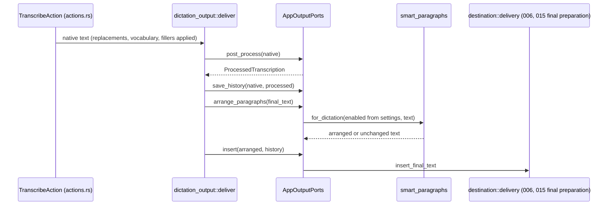
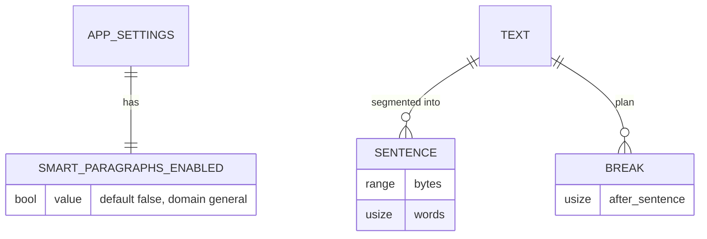

# Plan: Smart Paragraphs

**Feature:** [016 Smart Paragraphs](spec.md) · **Branch:** `feat/smart-paragraphs` · **Date:** 2026-10-29 · **Status:** Planned (autonomous run; independent plan review not run)

## Summary

A new isolated Rust module `smart_paragraphs` turns sentence ranges and word counts into paragraph breaks (pure, testable without Tauri), behind a `Segmenter` port with two implementations: Apple NaturalLanguage on macOS (`NLTokenizer`, `NLLanguageRecognizer` through `objc2` messaging) and UAX #29 (`unicode-segmentation`, already in the lock file) elsewhere. `dictation_output::deliver` gains one port call between the history entry and insertion. A boolean setting `smart_paragraphs_enabled` (default `false`, domain `general`) goes through the settings service; a standalone React row exposes it.

## Technical Context

- **Language:** Rust 2021 (Tauri 2 backend), TypeScript/React (frontend).
- **New direct dependency:** `unicode-segmentation = "1.12"` (already resolved at 1.12.0 in `Cargo.lock` as a transitive dependency; no new download). macOS uses the existing `objc2` / `objc2-foundation` and links the system `NaturalLanguage` framework.
- **Storage:** `settings_store.json` through `settings_service` (no direct writes).
- **Testing:** `cargo test --lib` (unit), `cargo test --test settings_validation --test settings_live --test settings_domains` (integration), `bun test` (front), ESLint, `tsc`, `check:translations`.
- **Platforms:** macOS (NaturalLanguage), Windows and Linux (UAX #29, CJK unchanged).

## Constitution Check

- Settings: every write through the settings service, same validation for UI and CLI (AGENTS.md Settings System) — yes, generic boolean descriptor in `general`.
- i18n: every user-facing string in `en/translation.json` and all locales — yes.
- Explicit error handling, no `unwrap` in production — the macOS port returns `Option` and falls back to UAX #29 when a class or call fails.
- Small focused files (< 300 lines) and functions; domain folder `smart_paragraphs/` (no catch-all folder).
- Privacy: no transcript content in logs; only the preservation reason at debug level.

## Sequence — delivery of a finished dictation

```gherkin
Scenario: Arranged text reaches insertion after history
  Given a finished dictation whose AI step returned its final text
  When the output stages run
  Then history records the native and AI texts unchanged
  And the final text is arranged into paragraphs when the option is on
  And insertion receives the arranged text
```



## State — none

The step is stateless: no entity with a lifecycle. The setting has no live effect (read at each delivery).

## Data model



## Implementation Plan

### Step 1 — Pure layout and structure rules
- `src-tauri/src/smart_paragraphs/mod.rs` — module doc, `arrange(text, segmenter) -> Arrangement`, `Preserved` reasons.
- `src-tauri/src/smart_paragraphs/layout.rs` — limits (`WORD_LIMIT = 45`, `SENTENCE_LIMIT = 4`, `SUBSTANTIAL_MIN_WORDS = 4`, all from S2), `plan_breaks`, `apply_breaks`.
- `src-tauri/src/smart_paragraphs/structure.rs` — line breaks, list markers, code fence, indentation.
- `src-tauri/src/smart_paragraphs/quotes.rs` — quote balance across sentences.
- Tests: `layout_tests.rs`, `structure_tests.rs`, `quotes` cases inside `arrange_tests.rs`.

### Step 2 — Segmenters
- `segmenter.rs` — `Segmenter` trait (`sentences`, `word_count`, `supports`), `platform_segmenter()`.
- `unicode_segmenter.rs` — UAX #29 sentences (`split_sentence_bound_indices`) and words (`unicode_words`), CJK majority rule.
- `apple_segmenter.rs` (`cfg(target_os = "macos")`) — `NLLanguageRecognizer dominantLanguageForString:`, `NLTokenizer initWithUnit:` / `setString:` / `setLanguage:` / `tokensForRange:`, UTF-16 → byte conversion; `None` on any missing class so the caller falls back to UAX #29.
- Tests: UAX #29 tests on every platform; NaturalLanguage tests on macOS (English, French, Japanese, Chinese).

### Step 3 — Pipeline integration
- `dictation_output.rs` — `OutputPorts::arrange_paragraphs(&self, text: String) -> String`, called after `save_history` and before `insert`; `dictation_output_tests.rs` asserts the order and that history receives the unarranged text.
- `actions.rs` — `AppOutputPorts::arrange_paragraphs` reads `get_settings(app).smart_paragraphs_enabled` and calls `smart_paragraphs::for_dictation`.

### Step 4 — Setting
- `settings.rs` — field `smart_paragraphs_enabled: bool` (`#[serde(default)]` → `false`), default in `get_default_settings`.
- `settings_service/descriptor_data.rs` — `"smart_paragraphs_enabled" => (Boolean,false,None,&[],false,false,"general",None)`.
- `settings_service/public.rs` — public field.
- `shortcut/mod.rs` + `lib.rs` — command `change_smart_paragraphs_enabled_setting` via `live_settings::write`.
- Integration tests: `settings_validation/scalars.rs` boolean list (UI/CLI parity), `contracts.rs` property count, regenerated `008-settings-cli/contracts/settings-cli.schema.json`, default tests.

### Step 5 — Frontend
- `src/bindings.ts` regenerated, `src/stores/settingsStore.ts` updater.
- `src/components/settings/SmartParagraphsToggle.tsx` — standalone row: ¶ icon, label, tooltip, switch; `smart-paragraphs-state.ts` (description key per OS) + tests.
- `AdvancedSettings.tsx` — row in the Output group.
- Locales: `settings.advanced.smartParagraphs.{title,description,descriptionLimited}` in all 26 locales.
- `package.json` — `test:smart-paragraphs`.

### Step 6 — Docs and LiveSpec artifacts
- `README.md` — short "Smart paragraphs" section next to the settings CLI notes.
- `implementation.md`, `progress.md`, `changelog.md`, `.specs/changelog.md`, `.specs/README.md` row.

## Testing Strategy

| Level | What | Files |
|---|---|---|
| Unit (pure) | Limits, interjections, lone long sentence, blank line, spacing kept, quotes, structure, empty | `smart_paragraphs/*_tests.rs` |
| Unit (segmenter) | UAX #29 sentences/words/CJK rule; NaturalLanguage on macOS | `unicode_segmenter_tests.rs`, `apple_segmenter_tests.rs` |
| Unit (pipeline) | Order: AI → history → arrange → insert; history unarranged | `dictation_output_tests.rs` |
| Integration | Default false, UI/CLI parity, schema contract | `tests/settings_validation`, `tests/settings_live` |
| Front | Description per OS, row render | `src/components/settings/smart-paragraphs-*.test.ts(x)` |
| Native (Julien) | Real dictations on macOS, Windows/Linux | protocol in `implementation.md` |

## Risks & Considerations

- **Merge with 015:** both features add one boolean setting (schema count 70 → 71 each, contract JSON regenerated) and touch `AdvancedSettings.tsx`; conflicts are mechanical. This feature does not touch `destination/delivery.rs`, where 015 places its step.
- **NaturalLanguage availability:** called through dynamic class lookup; a missing class falls back to UAX #29 instead of crashing.
- **UTF-16 ranges:** conversion is checked; an out-of-range token aborts the macOS segmentation and falls back.
- **Abbreviations:** may move a break; never cuts a word.

## QE Analysis

- Risks from the spec map to gates: layout and structure rules → Rust unit tests (blocking); settings contract → integration tests (blocking); pipeline order → `dictation_output` unit test (blocking); i18n → `check:translations` (blocking); native behaviour → Julien's protocol (non-blocking evidence gap, recorded).
- Proof artifacts: `proofs/final/summary.txt` with exit codes, conventions receipt `proofs/conventions-verify-repo.json`.
- Boundary ownership: 015 owns final insertion preparation; this plan stops at the `insert` port.
