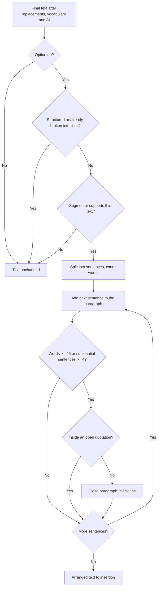
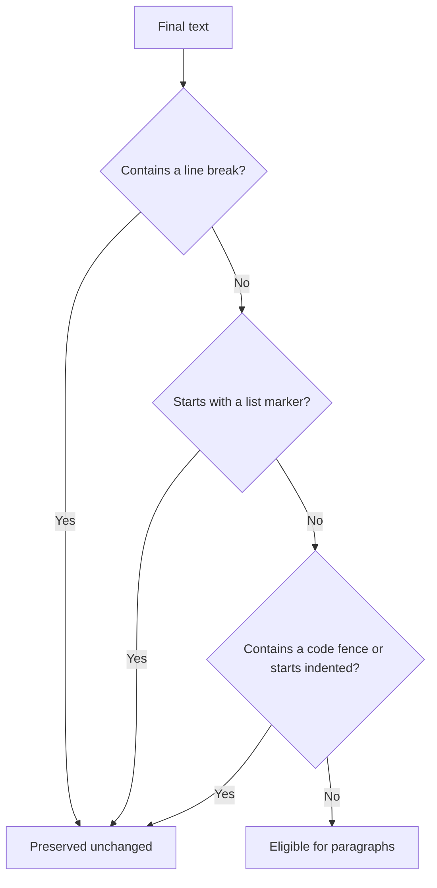
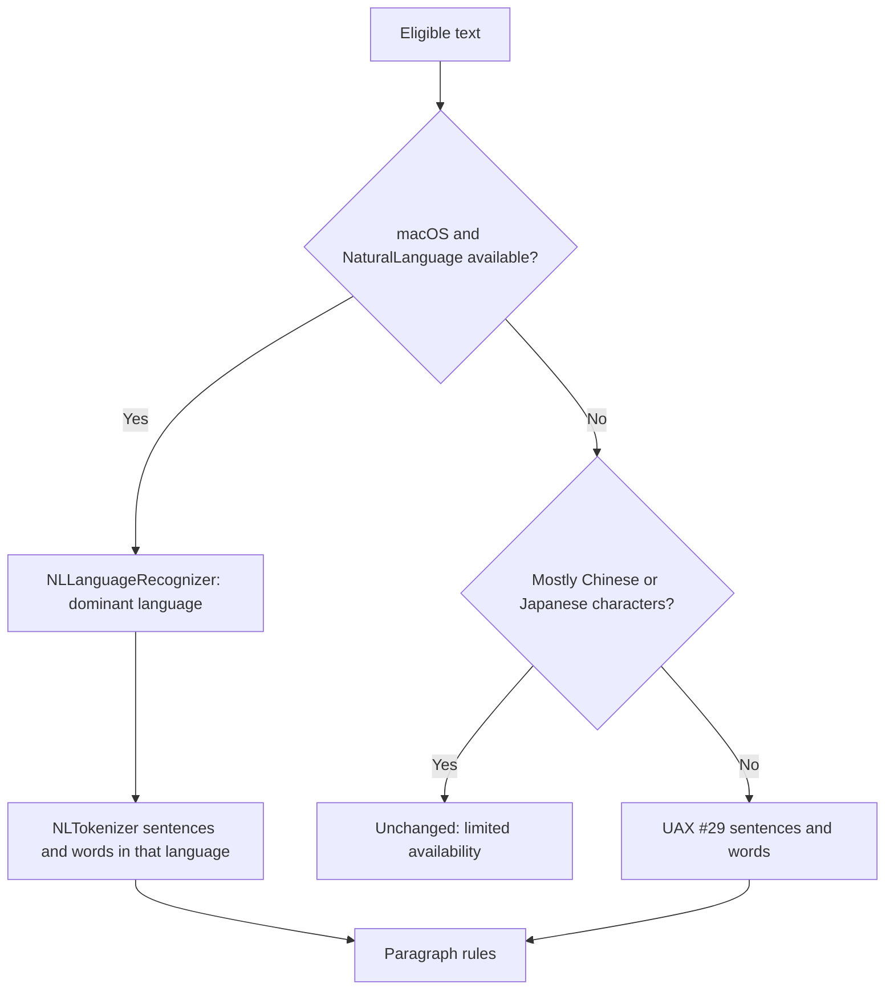
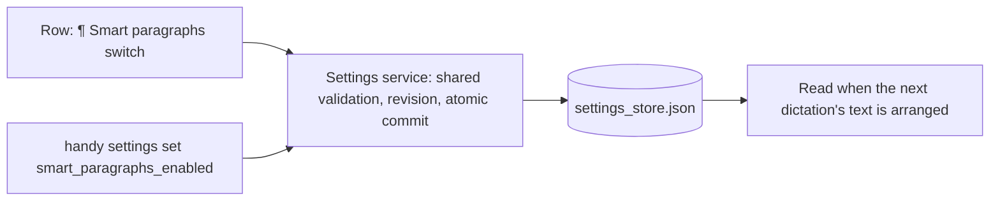

# Feature Spec: Smart Paragraphs

## Header

- **Feature:** Smart Paragraphs
- **Branch:** `feat/smart-paragraphs` (from `dev` `00f2ec6c`)
- **Date:** 2026-10-29
- **Status:** In Progress
- **Feature Number:** 016 (013 `default-input-per-app`, 014 reserved by `feat/dictate-to-active-app`, 015 `smart-capitalization` are in progress on other branches)
- **Input:** Request from Julien, 2026-10-29: make long dictations readable with automatic paragraphs, without any generative model, as a local option off by default, with a clean-room contract (public sources only: S1, S2, S3 below, Handy's own specs and code, public library documentation). UI instruction from the coordinator the same day: the option is one row « ¶ Paragraphes intelligents (i) » with its own on/off switch, an icon on the left, an information button and the switch on the right, built as a standalone component placed near the output settings until it joins the shared "text formatting" section of 015 at integration.
- **Related:** [002 Word Replacements](../002-word-replacements/spec.md) and [003 Recognition Vocabulary](../003-recognition-vocabulary/spec.md) (run before), [005 Custom AI Prompts](../005-custom-ai-prompts/spec.md) (runs before), [006 Destination Application](../006-destination-application/spec.md) and [010 Recovery Bubble](../010-recovery-bubble/spec.md) (receive the arranged text), [008 Settings CLI](../008-settings-cli/spec.md) (settings contract), 015 Smart Capitalization (other branch; runs after, at the final preparation of the insertion).

### Public sources

| Id | Source | Used for |
|---|---|---|
| S1 | https://spokenly.app/docs/macos/smart-spacing | Context only: a separate formatting option that acts at insertion |
| S2 | https://spokenly.app/docs/macos/smart-paragraphs | Reference behaviour: thresholds, blank line, CJK joining, off by default, local |
| S3 | https://developer.apple.com/documentation/naturallanguage/nltokenizer (and `NLLanguageRecognizer` in the same framework) | macOS sentence and word segmentation, dominant language |
| S4 | Unicode Standard Annex #29, *Unicode Text Segmentation*, through the `unicode-segmentation` crate documentation (https://docs.rs/unicode-segmentation) | Sentence and word boundaries outside macOS |

Nothing in this spec describes or claims Spokenly's internal algorithm: S2 is a public description of observable behaviour, and every rule below is either that public behaviour, a Handy product requirement, or an independent technical choice (see the provenance table).

## User Scenarios & Testing

### Story 1 — A long dictation arrives in paragraphs `P1`

**As a** Handy user who dictates long notes, **I want** the inserted text split into paragraphs at sentence boundaries, **so that** I can read it without reformatting it by hand.

**Priority reason:** It is the whole feature.
**Independent test:** Turn the option on, dictate about 120 words in 8 sentences, and check that the inserted text has blank lines between paragraphs, each paragraph ending at a sentence boundary, no sentence cut.

```gherkin
Feature: Smart paragraphs
  Scenario: The word limit closes a paragraph at the next sentence boundary
    Given smart paragraphs are on
    And a dictation of three sentences of 20, 24 and 5 words
    When the text is inserted
    Then a blank line follows the third sentence, not the second
    And no sentence is cut

  Scenario: Four substantial sentences close a paragraph
    Given smart paragraphs are on
    And a dictation of six sentences of 5 words each
    When the text is inserted
    Then the first paragraph holds the first four sentences
    And the last two sentences form the second paragraph

  Scenario: Short interjections do not count as sentences
    Given smart paragraphs are on
    And a dictation "Yes. OK. Right." followed by four sentences of 5 words
    When the text is inserted
    Then the first paragraph ends after the fourth sentence of 5 words

  Scenario: A short dictation is unchanged
    Given smart paragraphs are on
    And a dictation of two short sentences
    When the text is inserted
    Then the inserted text is exactly the dictated text

  Scenario: A single long sentence stays whole
    Given smart paragraphs are on
    And a dictation made of one sentence of 80 words
    When the text is inserted
    Then the inserted text is exactly that sentence
```



### Story 2 — Structure the user chose is never reorganized `P1`

**As a** Handy user, **I want** lists, code and line breaks I dictated or got from my AI prompt kept exactly as they are, **so that** the option never damages a deliberate layout.

**Priority reason:** A destructive reformatting is worse than no formatting.
**Independent test:** With the option on, dictate "first line, new line, second line" (or use an AI prompt that returns a bulleted list), and check the inserted text is byte-identical to the text before this step.

```gherkin
Feature: Preserve deliberate structure
  Scenario: Existing line breaks
    Given smart paragraphs are on
    And the final text already contains a line break
    When the text is inserted
    Then the inserted text is exactly the final text

  Scenario: A list item or a code block
    Given smart paragraphs are on
    And the final text starts with "- ", "* ", "• " or "1. ", or contains "```", or starts with a tab or four spaces
    When the text is inserted
    Then the inserted text is exactly the final text

  Scenario: A quotation is never split
    Given smart paragraphs are on
    And a limit is reached at a sentence boundary inside an open quotation
    When the text is inserted
    Then the paragraph closes at the first later boundary outside the quotation
```



### Story 3 — Languages and platforms `P2`

**As a** Handy user dictating in French, English, Chinese or Japanese, **I want** paragraphs that respect my language, **so that** CJK text does not get stray spaces and other languages break at real sentence ends.

**Priority reason:** Handy is multilingual; S2 documents the CJK joining.
**Independent test:** On macOS, dictate a long Japanese text: paragraphs are separated by a blank line and no space is added anywhere. On Windows or Linux, the same text is unchanged and the setting says so.

```gherkin
Feature: Languages and platforms
  Scenario: Chinese and Japanese get no extra space
    Given smart paragraphs are on
    And a long Japanese dictation on macOS
    When the text is inserted
    Then paragraphs are separated by a blank line only
    And no space is added between sentences

  Scenario: Chinese or Japanese outside macOS
    Given smart paragraphs are on Windows or Linux
    And a dictation written mostly in Chinese or Japanese characters
    When the text is inserted
    Then the inserted text is unchanged
    And the setting description tells that these languages are left unchanged on this system

  Scenario: French on every platform
    Given smart paragraphs are on
    And a long French dictation with « guillemets »
    When the text is inserted
    Then paragraphs end at sentence boundaries outside the quotation marks
```



### Story 4 — One independent switch, same rules in the app and the CLI `P2`

**As a** Handy user, **I want** to turn smart paragraphs on or off from its own row in the settings or with `handy settings set`, **so that** the next dictation follows my choice.

**Priority reason:** The option must stay off unless chosen and be scriptable like every other setting.
**Independent test:** On a fresh install and on an existing store, `handy settings get smart_paragraphs_enabled` prints `false`; turning the row on makes `get` print `true`; `handy settings set smart_paragraphs_enabled maybe` is refused with the same error as the UI path.

```gherkin
Feature: Smart paragraphs setting
  Scenario: Off by default
    Given a fresh install, or a settings store written before this feature
    When the settings are read
    Then smart_paragraphs_enabled is false

  Scenario: Same validation for the UI and the CLI
    Given the settings service
    When the UI writes true and the CLI writes "true"
    Then both store true
    When the CLI writes "maybe"
    Then it is refused like an invalid boolean from the UI

  Scenario: The next dictation follows the switch
    Given smart paragraphs were off
    When the user turns the switch on
    Then the next dictation that finishes is arranged in paragraphs
```



## Acceptance Criteria

### AC-001
**Given** the option is on and a text of plain prose, **when** the running word count of the current paragraph reaches 45 or more at the end of a sentence, **then** the paragraph closes after that sentence; a paragraph never closes inside a sentence (20 + 24 words: no break; 20 + 25: break after the second; 20 + 24 + 5: break after the third).

### AC-002
**Given** the option is on, **when** the current paragraph holds 4 substantial sentences (4 words or more each), **then** it closes after the fourth; sentences of fewer than 4 words (interjections such as "Yes." or "OK.") add their words to the running count but are not counted as sentences.

### AC-003
**Given** the option is on, **when** paragraphs are closed, **then** the separator between them is exactly one blank line (`\n\n`) replacing the spaces between the two sentences, every other character of the text is kept unchanged (including the original spacing inside a paragraph and the leading and trailing spaces of the whole text), so Chinese and Japanese sentences stay joined without any added space.

### AC-004
**Given** the option is on, **when** a single sentence alone exceeds the word limit, or the text has fewer than two sentences, or the text is empty or only whitespace, **then** the text is returned unchanged.

### AC-005
**Given** the option is on, **when** the text contains a line break (`\n` or `\r`), a code fence (```` ``` ````), starts with a tab or four spaces, or starts (after leading spaces) with a list marker (`-`, `*`, `•` or a number followed by `.` or `)`, then a space), **then** the text is returned unchanged.

### AC-006
**Given** the option is on, **when** a limit is reached at a sentence boundary that lies inside an open quotation (`"…"`, `“…”`, `«…»`, `„…“`, `「…」`, `『…』`), **then** no break is placed there and the paragraph closes at the first later boundary where every quotation is closed.

### AC-007
**Given** macOS with the NaturalLanguage framework, **when** a text is arranged, **then** sentences and words come from `NLTokenizer` set to the dominant language from `NLLanguageRecognizer`; **given** another platform (or NaturalLanguage unavailable), **then** sentences and words come from Unicode UAX #29 segmentation, and a text whose letters are mostly Chinese or Japanese characters is returned unchanged; the setting's description says so on those platforms. No text leaves the computer.

### AC-008
**Given** a finished dictation, **when** its text is delivered, **then** the step runs after word replacements (002), vocabulary correction (003), filler removal, normalization and AI post-processing (005), and before the insertion's final preparation (015 smart capitalization, the trailing space, 006 activation and the paste method), on every insertion path (destination session, smart paste at the foreground, legacy paste); the history entry keeps the native and AI texts unchanged; the text retained for recovery (010) is the arranged text.

### AC-009
**Given** a fresh install or an existing settings store without the key, **when** settings are read, **then** `smart_paragraphs_enabled` is `false`; the UI and `handy settings set smart_paragraphs_enabled <value>` go through the same settings-service validation (booleans only), and the value is read at each dictation's delivery, so a change applies from the next dictation.

### AC-010
**Given** the settings window, **when** the user opens the Advanced settings, **then** a standalone row shows the ¶ icon, the translated label "Smart paragraphs", an information tooltip and an independent on/off switch, in every supported locale.

## Functional Requirements

### FR-001
Arrange a text into paragraphs from its sentences and word counts: close a paragraph after a sentence when the running word count is at least 45 or it holds 4 substantial sentences (at least 4 words); never split a sentence. → AC-001, AC-002, AC-004

### FR-002
Insert breaks as a blank line replacing only the whitespace between the two sentences, keeping every other character. → AC-003

### FR-003
Leave structured or already broken text unchanged (line breaks, list markers, code fences, indented code) and never break inside an open quotation. → AC-005, AC-006

### FR-004
Segment with NaturalLanguage on macOS (NLTokenizer, NLLanguageRecognizer) and with UAX #29 elsewhere; outside macOS leave Chinese and Japanese text unchanged; all processing local. → AC-007

### FR-005
Apply the step in the dictation output stages after AI post-processing and the history entry, before insertion, on every insertion path, without changing history. → AC-008

### FR-006
Store `smart_paragraphs_enabled` (boolean, default `false`) in the settings service with the shared UI/CLI validation, and read it at each delivery. → AC-009

### FR-007
Show a standalone settings row (icon, label, tooltip, switch) translated in all locales, with the platform limitation in the description outside macOS. → AC-010, AC-007

## Key Entities

- **Sentence** — a byte range of the text and its word count, from the platform segmenter.
- **Paragraph plan** — the sentence indexes after which a blank line is inserted.
- **Preservation reason** — why a text is left unchanged (empty, line break, list, code, too short, unsupported script); logged without content.
- **Setting `smart_paragraphs_enabled`** — boolean, owner domain `general`, default `false`, no live effect.

## Provenance

| Requirement | Source | Kind | Validation |
|---|---|---|---|
| Find sentence boundaries, count words | S2 | (1) Public behaviour | `layout` unit tests; macOS segmenter tests |
| Close at ≥ 45 words, at the next sentence boundary | S2 | (1) Public behaviour | AC-001 tests (44/45/49 words) |
| Close at 4 substantial sentences (≥ 4 words); short interjections not counted | S2 | (1) Public behaviour | AC-002 tests |
| Blank line between paragraphs | S2 | (1) Public behaviour | AC-003 tests |
| Chinese and Japanese joined without extra space | S2 | (1) Public behaviour, met by keeping the original inter-sentence spacing (3) | CJK tests (UAX #29 core, macOS NaturalLanguage) |
| Short inputs and a lone long sentence unchanged | S2 + prompt | (1) + (2) | AC-004 tests |
| Off by default, local, offline | S2 + prompt | (1) + (2) | default tests, no network code |
| NLTokenizer / NLLanguageRecognizer on macOS | S3 + prompt | (3) Technical choice using public API | macOS segmenter tests |
| UAX #29 outside macOS; CJK unchanged there, shown in the UI | S4 + prompt | (3) Technical choice; (2) limited availability | fallback tests, UI state test |
| Lists, code, existing line breaks preserved | Prompt | (2) Handy product requirement | AC-005 tests |
| No break inside an open quotation | Prompt ("citations") | (2) Product requirement, (3) quote-balance rule | AC-006 tests (English, French) |
| Replace only the whitespace at a break; keep all other characters | — | (3) Technical choice | AC-003 tests |
| Pipeline position after AI, before 015 and insertion; history unchanged | Prompt | (2) Product requirement | `dictation_output` order test |
| Setting through the settings service, same UI/CLI validation, all locales | AGENTS.md + prompt | (2) Product requirement | settings integration tests, `check:translations` |
| Standalone row: icon, label, info, switch | Coordinator instruction | (2) Product requirement | render test |

## Clarifications

Autonomous mode: no question was asked; each decision is recorded here with its kind.

- Decision `016-smart-paragraphs:AC-005` / `line_breaks_preserved` (2026-10-29, agent, kind 2): any text that already contains a line break is left entirely unchanged, rather than arranging each prose block separately. Reason: a line break is either dictated ("new line"), produced by the AI prompt, or part of a list or code block; in every case the user or their prompt chose the layout, and partial rearrangement could merge or split deliberate blocks. Residual effect, accepted: a long dictation containing one dictated line break gets no automatic paragraphs.
- Decision `016-smart-paragraphs:AC-003` / `keep_original_spacing` (2026-10-29, agent, kind 3): breaks replace only the whitespace between the two sentences; everything else, including spacing inside paragraphs, is kept. This satisfies S2's CJK joining without a language-specific joiner and never alters the words.
- Decision `016-smart-paragraphs:AC-006` / `quote_balance` (2026-10-29, agent, kind 3): a break is deferred while a quotation is open, counting straight double quotes by parity and the paired marks listed in AC-006 by depth; apostrophes and single quotes are ignored because they are ambiguous with elisions (French « l'ami », English "don't").
- Decision `016-smart-paragraphs:AC-007` / `cjk_outside_macos` (2026-10-29, agent, kind 2/3): outside macOS, UAX #29 has no dictionary word segmentation for Chinese and Japanese (each ideograph is its own word), so the 45-word and 4-sentence limits would not mean the same thing; such text (more than half of its letters Han, Hiragana or Katakana) is left unchanged and the setting description says so. Korean uses spaces and is segmented normally.
- Decision `016-smart-paragraphs:AC-008` / `after_ai_before_final_preparation` (2026-10-29, agent, kind 2): the step runs in `dictation_output::deliver`, after the history entry and before the insertion port, so 015's capitalization (final preparation in `destination::delivery`) sees the arranged text and history keeps the texts it already keeps. The recovery bubble shows the arranged text because it is what was going to be inserted.
- Decision `016-smart-paragraphs:AC-009` / `general_domain` (2026-10-29, agent, kind 3): the key is owned by the `general` domain like `filler_word_removal_enabled`, so `handy settings set` validates it through the generic boolean descriptor; it is read once per dictation at delivery.
- Decision `016-smart-paragraphs:AC-010` / `standalone_row_near_output` (2026-10-29, coordinator instruction): the row is a standalone component placed in Advanced > Output for now; the coordinator merges it into 015's text-formatting section at integration.
- Decision `016-smart-paragraphs:AC-002` / `trailing_short_paragraph` (2026-10-29, agent, kind 3): sentences remaining after the last break form the last paragraph even when short (for example a final "Thanks."); merging them back would contradict S2's rule that a paragraph closes at the boundary where a limit is reached.

## QE Analysis

- **Dimensions:** functional correctness of the layout rules, structure preservation (non-destructive), Unicode safety (byte ranges from UTF-16 ranges on macOS), languages (EN, FR, ZH, JA), platform parity and documented limitation, settings contract (default, UI/CLI parity), pipeline order and history, i18n, privacy (local only, no content in logs).
- **Risk classification:** Medium. The step rewrites inserted text; a wrong rule is visible but never loses words because only whitespace at boundaries changes, and the option is off by default.
- **Expected evidence:** Rust unit tests for layout, structure, quotes, UAX #29 segmenter, macOS NaturalLanguage segmenter (on a Mac), pipeline order; settings integration tests (validation inventory, UI/CLI parity, schema contract, public settings); front unit test for the row state and render; `cargo fmt`, `cargo clippy`, `cargo test --lib`, `bun run lint`, `tsc`, `check:translations`.
- **Non-functional expectations:** no network; segmentation of a dictation of a few thousand characters well under the insertion latency budget; no transcript content in logs (only the preservation reason).
- **Gaps:** native proof in a real dictation on macOS, Windows and Linux is left to Julien (protocol in `implementation.md`); NaturalLanguage segmentation quality is Apple's and may differ from UAX #29 on abbreviations.
- **Boundaries:** this feature owns the transformation and its setting; 015 owns the shared text-formatting section and the final preparation; 006/007/010 own insertion and recovery.

## Edge Cases

- Empty or whitespace-only text: unchanged.
- Text ending without punctuation: the last fragment is a sentence like any other.
- Abbreviations ("Mr. Smith"): UAX #29 may see a boundary; NaturalLanguage usually does not. A wrong boundary can only move a break, never cut a word.
- Unbalanced quotation (opened, never closed): no break after the opening; the rest of the text stays in one paragraph.
- Numbers and decimals ("3.5"): counted as words by the segmenter, not sentence ends.
- Mixed scripts outside macOS: the CJK rule applies only when CJK letters are the majority.
- AI output already in paragraphs: contains line breaks, unchanged.

## Success Criteria

### SC-001
With the option on, a 120-word, 8-sentence English or French dictation is inserted in 2 or 3 paragraphs separated by one blank line, with every word, punctuation mark and in-paragraph space identical to the text before the step.

### SC-002
With the option off (default), every existing insertion test passes unchanged and the inserted text is byte-identical to the text before this feature.

### SC-003
The same boolean value written from the UI or the CLI stores the same value or is refused with the same error.
