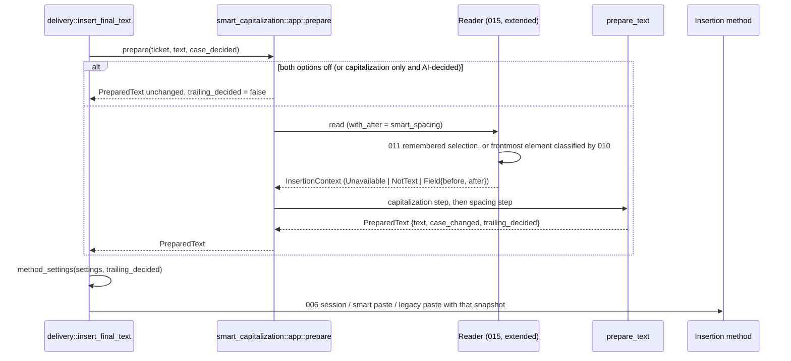
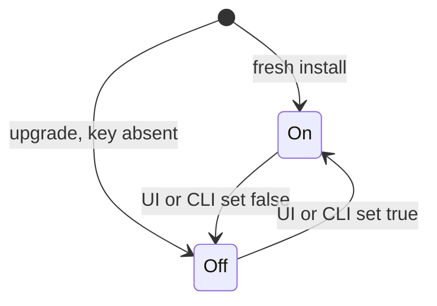

# Plan: Smart Spacing

## Summary

A new pure Rust module `smart_spacing` (junction rule and edge fitting) runs as the second step of 015's `smart_capitalization::prepare_text`, from one `InsertionContext` produced by 015's reader, extended to read the field length and 16 units after the selection and to tell "not a text field" from "unavailable"; the preparation reports whether it decided the end of the text, and `destination::delivery` turns the method's `append_trailing_space` off in that insertion's settings snapshot on every path. A boolean setting `smart_spacing` (output domain) goes through the settings service, the first row of the Text formatting section and the CLI.

## Technical Context

- **Language:** Rust 2021 (Tauri 2 backend), TypeScript/React 18 (settings UI).
- **Dependencies:** none added; CoreFoundation `CFNumberGetTypeID`/`CFNumberGetValue` declared next to 015's AX calls; `lucide-react` `Space` icon (already a dependency).
- **Storage:** `settings_store.json` through `settings_service` (one new key).
- **Testing:** `cargo test --lib` (pure tables, scripted reader port, preparation order, method settings), integration tests in `src-tauri/tests/` (remembered input, settings contracts), bun render test, ESLint, `tsc`, translation check.
- **Platform:** macOS reader; Windows and Linux compile the same code with an unsupported reader (every context Unavailable).

## Constitution Check

- Specify before implementing: spec and plan written with the code in one autonomous pass; decisions recorded in the spec's Clarifications. ✅ (process gap recorded in `progress.md`)
- Preserve source and native/frontend boundaries: pure spacing and junction rules; the native read stays behind 015's port; the UI writes through the settings service only. ✅
- Every platform builds and tests: pure code is platform-independent; the CFNumber read is in the `cfg(target_os = "macos")` adapter; the field port's `character_count` has an `Unsupported` default. ✅
- macOS native evidence before Implemented: protocol in `implementation.md`, pending Julien; status stays In Progress. ✅
- Minimal scope: no language detection, no Windows UIA reader, no change to the dictation's inner text. ✅

## Sequence — insertion with smart spacing

```gherkin
Feature: Fit the edges at insertion preparation
  Scenario: Option on, readable field
    Given the AI step returned the final text or the native text
    And smart_spacing is on
    When insert_final_text prepares the insertion
    Then the context before and after the selection is read once on a worker within 50 ms
    And capitalization then spacing run on the text
    And the method's trailing space is off for this insertion

  Scenario: Option off
    Given smart_spacing is off
    When insert_final_text prepares the insertion
    Then nothing after the selection is read
    And the method's trailing space follows append_trailing_space as before
```



## State — the setting across install and upgrade

```gherkin
Feature: smart_spacing default
  Scenario: Fresh install
    Given no settings payload
    When the store is created
    Then smart_spacing is true

  Scenario: Upgrade
    Given a payload without smart_spacing
    When it is normalized
    Then smart_spacing is false
```



No new persisted entity (no ER diagram): one scalar setting; `InsertionContext` lives only during one preparation.

## Implementation Plan

1. **Context type** — `smart_capitalization/context.rs`: `InsertionContext`, `AfterContext`, `before()` for 015, redacted `Debug`.
2. **Junction rule** — `smart_spacing/junction.rs`: `needs_space`, `is_unspaced_script`, `suits_trailing_space` (AC-003, AC-004, AC-008); tests `junction_tests.rs`.
3. **Edges** — `smart_spacing/mod.rs`: `space_junctions(text, context, inputs) -> Spaced` (AC-001, AC-002, AC-005..AC-007, AC-010); tests `spacing_tests.rs`.
4. **Extension point** — `smart_capitalization/mod.rs`: `Preparation`, `PreparedText`, `prepare_text` runs capitalization then spacing (AC-009); tests `preparation_tests.rs` (reference examples AC-011, AC-012).
5. **Reader** — `smart_capitalization/reader.rs`: `FieldText` (selection range, field length, text in range), `CaretElement: FieldText`, `read_frontmost(.., with_after)`, `read_field`, `read_remembered`, `window_after`, `after_from_units`, the `Undetermined` → `NotText`/`Unavailable` mapping; tests `reader_tests.rs`.
6. **macOS adapter** — `smart_capitalization/macos.rs`: selection range, `character_count` (`AXNumberOfCharacters`, CFNumber); `FieldNode::character_count` (default `Unsupported`) and `MacFieldNode` implementation.
7. **Remembered input** — `destination/field_context.rs`: `with_remembered_input` (take, read outside the lock, put back while current); `tests/smart_capitalization_context.rs` and the 011 fake.
8. **Glue** — `smart_capitalization/app.rs` (`prepare` returns `PreparedText`, reads when either option applies, logs kinds only); `destination/delivery.rs` (`method_settings` on the foreground, session and legacy paths).
9. **Setting** — `settings.rs` field, default true, migration off, tests; descriptor, public projection, output domain keys; `shortcut::change_smart_spacing_setting` registered in `lib.rs`; `bindings.ts` regenerated; store updater; settings validation counters and the 008 contract.
10. **UI and i18n** — `text-formatting-options.ts` first entry (`Space` icon), render test; 26 locales.
11. **Docs** — README section "Smart spacing" and CLI line; spec, plan, implementation, changelogs, registry, roadmap; 015 back-references.

## Testing Strategy

- **Unit (pure, every platform):** junction table, edges per context class, preparation order and reference examples.
- **Unit (port):** scripted `CaretPort` for the window after, field end, unknown length, spent budget, short answers, not-a-text-field, password never read.
- **Integration:** remembered input read on both sides on 006's real manager with 011's fake accessibility world.
- **Insertion paths:** `method_settings` test (never two final spaces; the user's trailing space kept when spacing did not decide).
- **Settings:** defaults, migration, stored value kept, validation counters, 008 schema (gates open and closed).
- **Frontend:** render test of the first row (icon, label, info, stored value, order), ESLint, `tsc`, translation check, output settings tests.
- **Native (pending Julien):** TextEdit, Chrome, Codex, cmux protocol in `implementation.md`.

## QE Analysis

- Risks mapped to gates: wrong junction (pure tables, P0); two final spaces (method settings test and edge tests, P0); privacy (reader tests: password never read, redacted `Debug`, review of log lines, P0); latency (shared 50 ms deadline test, P0); regression of insertion paths and of 015 (full `cargo test --lib`, P0); settings contract (P0); native fidelity (P1, protocol).
- Evidence gaps: native macOS run; Windows and Linux readers; Penflow mockup (one row).

## Risks & Considerations

- Applications that do not implement `AXNumberOfCharacters` leave the side after unknown: the leading edge is still fitted, the end gets the fallback space.
- Electron/Chromium fields that do not answer `AXStringForRange` make the whole context unavailable (one final space only).
- New installations on Windows and Linux get one trailing space per dictation (decision `macos_only_reader`, flagged to Julien).
- Text typed into the field between the stop and the paste is not seen (015's `read_at_preparation`).
