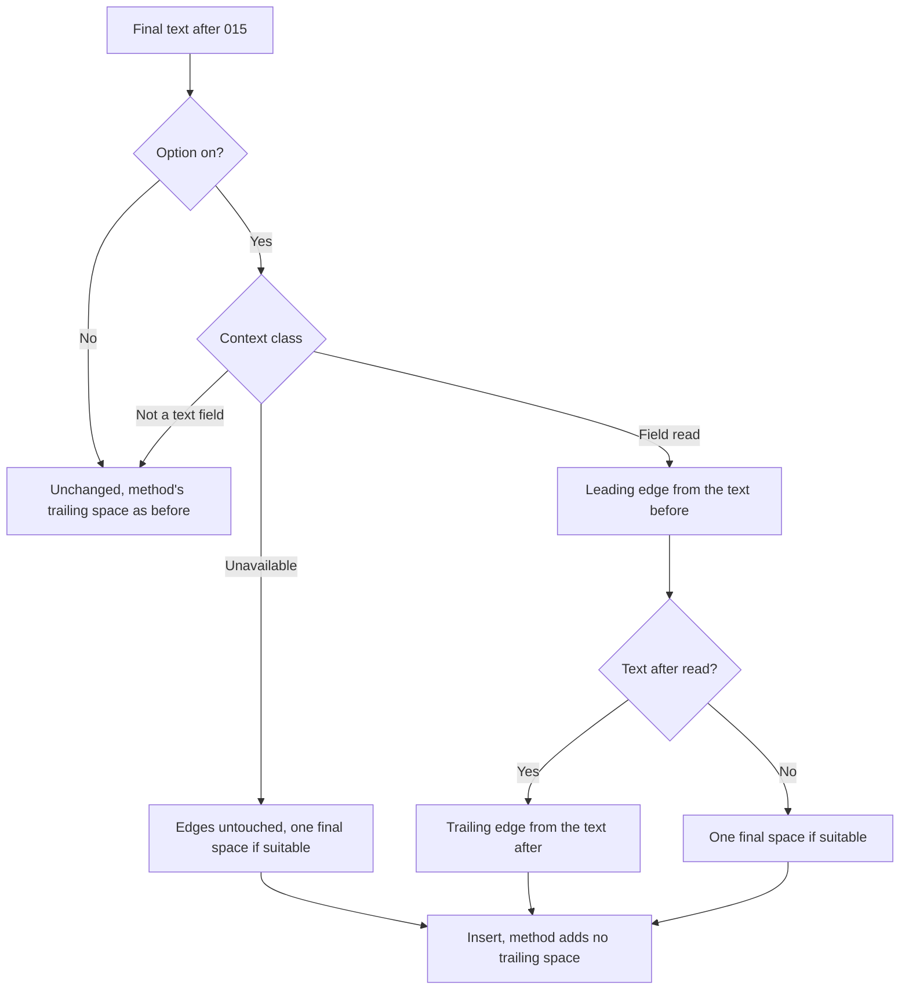
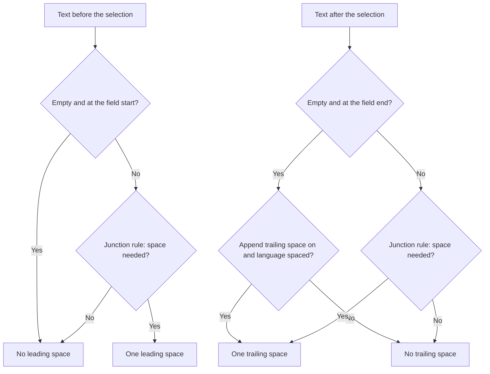
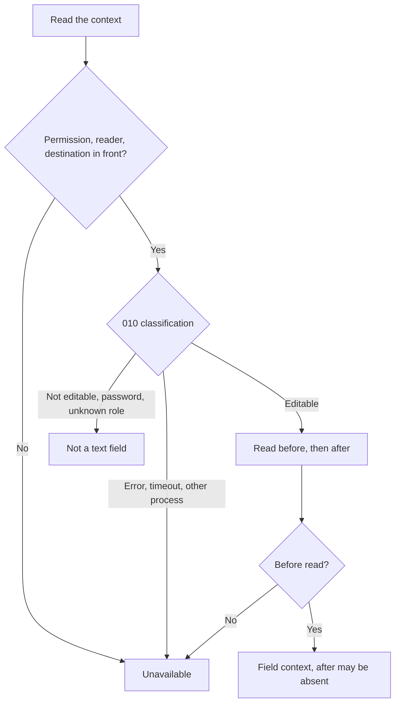
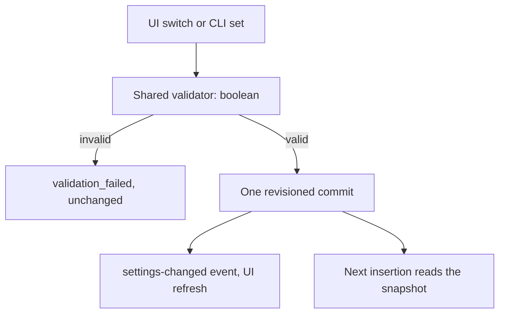

# Feature Spec: Smart Spacing

## Header

- **Feature:** Smart Spacing
- **Branch:** `feat/smart-spacing` (from `dev` `07b298ad`)
- **Date:** 2026-10-29
- **Status:** In Progress (automated evidence complete; macOS native proof pending with Julien)
- **Input:** Request from the coordinator for Julien, 2026-10-29: an option "Espacement intelligent" that inserts a dictation into existing text without accidentally merging words or piling up spaces. Use the context before **and after** the replaced selection (extend 015's reader with a bounded read after the selection); add the spaces needed at the junctions and respect the spaces and line breaks already present; respect punctuation (no space before `, . ) ]` nor after `( [`; a documented decision for French `; : ! ?`) and languages written without spaces (CJK, Thai…); never rephrase the transcription (only the spaces at its two edges). Unavailable context: no deduction, fallback of one final space if the language suits and none is already present. Really empty field: no leading space; both cases explicit and tested apart. Decide and document how it replaces or subsumes `append_trailing_space`, never two final spaces. Order: after 015's capitalization, in the same preparation step, through its extension point. Setting `smart_spacing` through the settings service (same validation in UI and CLI), on for a new installation and off on an upgrade without the key (as 015), first row "␣ Smart spacing (i)" of the "Text formatting" section, 26 locales, local processing.
- **Feature Number:** 017
- **Extends:** [015 Smart Capitalization](../015-smart-capitalization/spec.md) (context reader, preparation step and its smart spacing slot), [006 Destination Application](../006-destination-application/spec.md) (insertion paths), [010 Recovery Bubble](../010-recovery-bubble/spec.md) (editable-field rule, retained text), [011 Dictation Field Return](../011-dictation-field-return/spec.md) (remembered input and selection), [008 Settings CLI](../008-settings-cli/spec.md) (output domain).
- **Independent design (clean room, contract of 2026-10-29):** the junction rules, the edge policy, the context classes and the read after the selection were designed for this feature by the implementing agent. Authorized sources only: Handy's instructions, specs and code; the public Spokenly documentation S1 (<https://spokenly.app/docs/macos/smart-spacing>, read 2026-10-29); public API documentation (macOS accessibility `AXSelectedTextRange`, `AXStringForRange`, `AXNumberOfCharacters`, CoreFoundation `CFNumberGetValue`; Unicode script blocks and White_Space); the coordinator's prompt. Excluded and never opened, listed or searched: `.investigations/`, any disassembly or pseudo-code, any constant or architecture deduced from a binary, earlier reports about Spokenly. No accidental exposure occurred in this run (the conventions baseline that lists a path under the excluded folder was not read). Nothing here describes or claims to reproduce Spokenly's internal algorithm, and no parity with Spokenly is claimed; the Provenance table separates (1) publicly documented behavior, (2) product requirement and (3) independent technical choice.
- **Processing:** entirely local; no network call.

## User Scenarios & Testing

### Story 1 — Insert between two words without merging them `P1`

**As a** Handy user who dictates into the middle of a text, **I want** Handy to add the space that separates my dictation from the word before and the word after, **so that** I do not fix merged words after each dictation.

**Priority reason:** The main defect the option removes: a dictation inserted at a caret glued to a word produces "Bonjourà tousdemain".
**Independent test:** With the option on, type "Bonjourdemain" in TextEdit, put the caret after "Bonjour", dictate "à tous" and check the field reads "Bonjour à tous demain".

```gherkin
Feature: Spaces at the junctions
  Scenario: Between two words
    Given smart spacing is on
    And the text before the cursor ends with "Bonjour" and the text after it starts with "demain"
    When the transcription "à tous" is inserted
    Then the field reads "Bonjour à tous demain"

  Scenario: Spaces already present are kept, never doubled
    Given smart spacing is on
    And the text before the cursor ends with "Bonjour " and the text after it starts with " demain"
    When the transcription " à tous " is inserted
    Then the field reads "Bonjour à tous demain"

  Scenario: Punctuation attaches to its word
    Given smart spacing is on
    And the text before the cursor ends with "(" and the text after it starts with ")"
    When the transcription "voir plus haut" is inserted
    Then the field reads "(voir plus haut)"

  Scenario: Selection replaced
    Given smart spacing is on
    And "tout le monde" is selected in "Bonjour tout le monde demain"
    When the transcription "à tous" is inserted
    Then the field reads "Bonjour à tous demain"
```



### Story 2 — Start and end of a field `P1`

**As a** user, **I want** no leading space in an empty field and a predictable space at the end, **so that** a first dictation starts cleanly and the next one continues correctly.

**Priority reason:** An empty field is the most frequent case; a stray leading space is visible and annoying.
**Independent test:** Dictate "Bonjour" into an empty TextEdit document (no leading space), then dictate "Vérifier ce point." after "Je souhaite" (one space between them).

```gherkin
Feature: Field edges
  Scenario: Really empty field
    Given smart spacing is on
    And the field is readable and empty
    When the transcription "Bonjour" is inserted
    Then the inserted text has no leading space

  Scenario: End of a field
    Given smart spacing is on
    And the text before the cursor is "Je souhaite" and nothing follows the cursor
    And smart capitalization is on
    When the transcription "Vérifier ce point." is inserted
    Then the field reads "Je souhaite vérifier ce point."
    And a trailing space follows only when "Append trailing space" is on

  Scenario: Never two final spaces
    Given smart spacing and "Append trailing space" are on
    When any transcription is inserted
    Then the inserted text never ends with two added spaces
```



### Story 3 — No deduction without context `P1`

**As a** user, **I want** Handy to guess nothing when it cannot read the field, and to leave terminals and password fields alone, **so that** the option never makes things worse.

**Priority reason:** Safety: a wrong guess is worse than no change; a terminal or a password must not receive an invented space.
**Independent test:** On Windows or with Accessibility denied, dictate "Hello"; one trailing space is added and nothing else. In cmux, dictate "ls"; nothing changes compared with the option off.

```gherkin
Feature: Unavailable or non-text context
  Scenario: Field cannot be read
    Given smart spacing is on
    And the destination field cannot be read
    When the transcription "Hello" is inserted
    Then the inserted text is "Hello "
    And no leading space is added

  Scenario: Already ends with a space, or a language without spaces
    Given smart spacing is on
    And the destination field cannot be read
    When the transcription "Hello " or "你好。" is inserted
    Then it is inserted unchanged

  Scenario: Not a text field
    Given smart spacing is on
    And the focus is a terminal output, a password field or an unknown control
    When a transcription is inserted
    Then it is inserted exactly as with the option off

  Scenario: Terminal addressed by 013 in the background
    Given smart spacing is on
    And the dictation is typed into a remembered cmux workspace while another app is in front
    When the transcription "ls -la" is delivered
    Then the terminal receives "ls -la", without the fallback space
```



### Story 4 — Turn the option on or off `P2`

**As a** user, **I want** a switch and a CLI key, **so that** I can turn the behavior off where I prefer my own spacing.

**Priority reason:** On by default for new installations; it must be easy to turn off.
**Independent test:** Toggle "␣ Smart spacing" in Advanced > Text formatting; run `handy settings output get smart_spacing` and `handy settings set smart_spacing false`.

```gherkin
Feature: Smart spacing setting
  Scenario: On for a new installation
    Given no settings payload exists yet
    When the settings are created
    Then smart_spacing is true

  Scenario: Off after an upgrade
    Given an existing settings store without the key smart_spacing
    When the settings are loaded
    Then smart_spacing is false
    And a stored value is kept as is

  Scenario: Invalid CLI value
    When the user runs "handy settings set smart_spacing maybe"
    Then it is refused with validation_failed and nothing is written
```



## Acceptance Criteria

### AC-001

**Criterion:** With `smart_spacing` off, the text and the method's trailing space are byte-for-byte those of the build before this feature, and the side after the selection is never read. With it on, only horizontal whitespace at the two edges of the dictation may change (removed, or one U+0020 space added); every other character, including the dictation's line breaks, inner spaces and punctuation, is unchanged.
**Priority:** P1 | **Story:** Stories 1, 2

### AC-002

**Criterion:** Leading edge, when the text before the selection was read: the dictation's leading horizontal whitespace is removed and one space is added exactly when the junction rule (AC-003) asks for one between the text before and the dictation. Nothing is added when the text before ends with any whitespace (space, no-break space, narrow no-break space, tab, line break) or is empty at the field start (AC-007). An answer shorter than the window asked before the caret is not trusted (the whole context is unavailable), and an empty text that does not reach the field start leaves the leading edge untouched.
**Priority:** P1 | **Story:** Story 1

### AC-003

**Criterion:** Junction rule between a left text and a right text: no space when either side is empty or touches whitespace; no space when either touching character belongs to a script written without spaces (Thai, Lao, Myanmar, Khmer, Tibetan, CJK ideographs, kana, bopomofo, CJK punctuation, full-width forms; Hangul is spaced); no space after an opening mark (`( [ { ¿ ¡ “ ‘ „ ‚ « ‹ 「 『 （ 【 〈 《`), after a straight quote preceded by whitespace or nothing, after an apostrophe preceded by a letter (elision `l'`, `qu'`) or by whitespace, after a hyphen or slash attached to a word; no space before `, . ; : ! ? … ‽ ) ] } % » › ” ’ '`, before a straight quote not followed by a letter or digit, before a hyphen or slash followed by a letter; no space between a digit followed by `.` or `,` and a digit (a number). Every other pair gets one space.
**Priority:** P1 | **Story:** Story 1

### AC-004

**Criterion:** French typography: no space is ever invented before `; : ! ?` (nor before `»`) at a junction, and a space the field already has before them (normal, no-break or narrow no-break) is kept; the dictation's own internal spacing is never changed. Smart spacing does not try to detect the language.
**Priority:** P2 | **Story:** Story 1

### AC-005

**Criterion:** Trailing edge, when the text after the selection was read: the dictation's trailing horizontal whitespace is removed, then one space is added when the text after is non-empty and the junction rule asks for one; at the end of the field (nothing after the selection) one space is added only when `append_trailing_space` is on and the dictation does not end with a character after which the junction rule never puts a space (an opening mark, an opening quote, an eliding apostrophe after a letter, a hyphen or slash attached to a word) nor with a character of a script without spaces. Whenever smart spacing runs on a readable or unavailable context, it decides the end of the text and the insertion method adds no trailing space of its own, on every path (006 session, smart paste at the foreground, legacy paste, recovery slot), so the text never ends with two added spaces. 013's terminal route (`cmux send`) never adds a trailing space of its own and receives no spacing adjustment at all (AC-015).
**Priority:** P1 | **Story:** Story 2

### AC-006

**Criterion:** Unavailable context (option on, but no permission, no reader on this platform, a destination that is not the application in front, Handy in front, a stale dictation, any failed query or spent budget before the text before the selection is known): nothing is deduced, the dictation's edges are kept, and one space is added at the end unless the dictation already ends with whitespace, ends with a character after which the junction rule never puts a space (as in AC-005) or ends with a character of a script without spaces. The field may be of any kind, a password field included, since an unreadable field cannot be classified. The same fallback applies to the end of the text when the text before was read but the text after was not (partial context).
**Priority:** P1 | **Story:** Story 3

### AC-007

**Criterion:** Really empty field (a readable editable field with nothing before the selection, the window reaching position 0): no leading space and the dictation's leading whitespace is removed. It is distinct from AC-006: the same dictation gets no space at its start in both, but a trailing space only in the unavailable case (or with `append_trailing_space` on in the empty case). Both are tested separately.
**Priority:** P1 | **Story:** Story 2

### AC-008

**Criterion:** Languages without spaces: a junction touching a character of a script listed in AC-003 never gets a space, and the fallback and end-of-field spaces are not added after one. Korean (Hangul) is treated as a spaced language.
**Priority:** P1 | **Story:** Stories 1, 3

### AC-009

**Criterion:** Smart spacing runs in 015's final preparation of the insertion, through its extension point, after smart capitalization and with the same single context read; capitalization decides from the field, not from the space spacing adds. When smart spacing is on, the read also covers the side after the selection: the field length (`AXNumberOfCharacters`, a number, never content) and at most 16 UTF-16 units from the selection end with `AXStringForRange`, inside 015's single 50 ms budget, only after 010's rule classified the element editable (never a password field). From 011's remembered input, the remembered selection is used without a new query. A failure after the text before is known leaves only the side after absent. Field text is never logged, stored or sent in an event; logs carry only the context kind and flags.
**Priority:** P1 | **Story:** Stories 1, 3

### AC-010

**Criterion:** Not a text field: when 010's rule proves the focus is not an editable text field (not editable, a password field, a text without edit affordance such as a terminal's output, an unknown role, an unexpected affordance), smart spacing changes nothing and the method keeps its own `append_trailing_space` behavior, exactly as with the option off.
**Priority:** P1 | **Story:** Story 3

### AC-011

**Criterion:** Reference example 1 of the contract: "Bonjour|demain" (caret between the two words) + "à tous" gives "Bonjour à tous demain".
**Priority:** P1 | **Story:** Story 1

### AC-012

**Criterion:** Reference example 2 of the contract, with smart capitalization on: "Je souhaite|" (end of the field) + "Vérifier ce point." gives "Je souhaite vérifier ce point."; the final space follows AC-005 (none with `append_trailing_space` off, one with it on).
**Priority:** P1 | **Story:** Story 2

### AC-013

**Criterion:** A new installation (no settings payload yet) starts with `smart_spacing` on. An existing installation whose stored settings have no `smart_spacing` key is migrated to off, so an upgrade never changes the user's output without consent; a stored value is always kept.
**Priority:** P1 | **Story:** Story 4

### AC-014

**Criterion:** The setting `smart_spacing` (boolean, output domain) is written only through the settings service with the shared validator: the settings UI, `handy settings set smart_spacing <bool>` and `handy settings output get|set smart_spacing`. In the UI it is the **first** row "␣ Smart spacing (i)" of the "Text formatting" section (icon `Space`, label, info button with the description, independent switch; test ids `<screen>-smart-spacing` and `<screen>-smart-spacing-toggle`), before smart capitalization and smart paragraphs. Its label and description exist in the 26 locales. A change applies from the next dictation.
**Priority:** P2 | **Story:** Story 4

### AC-015

**Criterion:** A delivery through 013's addressed terminal route (the text typed by the addressing tool, `cmux send`, without a paste) receives no smart spacing adjustment, not even the AC-006 fallback final space, whatever application is in front and whatever the context read: the terminal receives the text as it is with smart spacing off (after smart capitalization, whose context is absent there). The paste methods of the same dictation keep the spaced text.
**Priority:** P1 | **Story:** Story 3

### AC-016

**Criterion:** On a system without a context reader (Windows and Linux in this feature), the option's description says so: it is the macOS description followed by one sentence stating that the text around the cursor cannot be read there, so only one space is added after each dictation (key `settings.advanced.textFormatting.smartSpacing.descriptionLimited`, chosen by the system type as 016 does for its limitation), in the 26 locales. The fallback itself (AC-006) is kept on these systems.
**Priority:** P2 | **Story:** Stories 3, 4

## Functional Requirements

### FR-001

**Requirement:** Provide a pure, platform-independent junction rule between a left and a right text (AC-003, AC-004, AC-008).
**AC References:** AC-003, AC-004, AC-008

### FR-002

**Requirement:** Provide a pure transformation of the dictation's two edges for a context (field read, partial, unavailable, not a text field), reporting whether it decided the end of the text (AC-001, AC-002, AC-005, AC-006, AC-007, AC-010, AC-011, AC-012).
**AC References:** AC-001, AC-002, AC-005, AC-006, AC-007, AC-010, AC-011, AC-012

### FR-003

**Requirement:** Extend 015's bounded reader to the side after the selection and to the "not a text field" class, from 011's remembered input or the frontmost editable element (AC-009, AC-010).
**AC References:** AC-009, AC-010

### FR-004

**Requirement:** Run smart spacing in 015's preparation step after capitalization, make every paste path drop its own trailing space when smart spacing decided the end of the text, and give 013's addressed terminal the text before spacing (AC-005, AC-009, AC-015).
**AC References:** AC-005, AC-009, AC-015

### FR-005

**Requirement:** Expose `smart_spacing` through the settings service, the UI (first row of Text formatting, description naming the fallback outside macOS) and the CLI, translated in every locale, with the new-install and upgrade defaults (AC-013, AC-014, AC-016).
**AC References:** AC-013, AC-014, AC-016

## Key Entities

- **InsertionContext** — `Unavailable`, `NotText`, or `Field { before, after }`: 015's `CursorContext` before the selection (at most 64 UTF-16 units) and the `AfterContext` after it. Lives only during the preparation.
- **AfterContext** — `Absent`, or `After { text, reaches_end }`: at most 16 UTF-16 units from the selection end, and whether they reach the end of the field.
- **SpacingInputs** — `space_at_field_end`, from `append_trailing_space` of the insertion's settings snapshot.
- **PreparedText** — the prepared text, whether capitalization changed it, and whether smart spacing decided its end (`trailing_decided`), which turns the method's trailing space off.
- **Setting `smart_spacing`** — boolean, output domain; on for a new installation, migrated to off when absent from an existing store.

## Clarifications

- Decision `017-smart-spacing:AC-005` / `trailing_space_articulation` (2026-10-29, agent): smart spacing **subsumes** `append_trailing_space` while it is on. It decides the trailing space itself and the method's own trailing space is turned off in that insertion's settings snapshot (`delivery::method_settings`), on every path, including the text the recovery slot retains as inserted. `append_trailing_space` keeps one meaning: "a space at the end of a field", used when the text after the selection is known to be empty. Reasons: a single decision point makes two final spaces impossible even if a setting changes during the insertion (the flag travels with the text, not with a later settings read); the user who asked for a trailing space to keep typing still gets it at the end of a field, where it matters; in the middle of text the junction rule is always better informed.
- Decision `017-smart-spacing:AC-006` / `fallback_final_space` (2026-10-29, contract and S1): with an unavailable context, one final space, never a leading one, nothing else deduced; not added when the dictation already ends with whitespace, an opening mark or an unspaced script. This applies whether `append_trailing_space` is on or off (the contract's fallback).
- Decision `017-smart-spacing:AC-010` / `not_text_steps_aside` (2026-10-29, agent): a focus that 010's rule proves not to be an editable text field (terminal output, password field, unknown role, unexpected affordance) is a third class, distinct from "unavailable": smart spacing changes nothing and the method keeps `append_trailing_space` as before. Reasons: a field proven to be a password must never receive an invented space; a terminal command line should behave exactly as without the option (the native protocol checks cmux unchanged); "unavailable" is reserved for not knowing anything, where the contract's fallback applies. **Accepted consequence (independent review W4):** an unavailable context cannot be classified, so the fallback space of AC-006 reaches whatever has the focus, a password field included, exactly as `append_trailing_space` already does when it is on. 015's capitalization is unchanged by this split (both classes are Absent for it).
- Decision `017-smart-spacing:AC-015` / `addressed_terminal_unspaced` (2026-10-29, coordinator's decision for Julien after review round 2, W1): a delivery through 013's addressed terminal route is treated like the "not a text field" class, identical to the option off, whatever application is in front. The route is chosen by 013's guard at dispatch, after the preparation, and a background terminal cannot be classified by reading it; so the preparation keeps the text before spacing (`PreparedText::for_addressed_terminal`) and 013's `AddressedMethod` types that text, while the paste methods keep the spaced text. Smart capitalization is unchanged on that route (its context there is absent, so it keeps the case). Residual: if the terminal send fails, the recovery slot retains the paste text of that dictation (with the fallback space when the context was unavailable).
- Decision `017-smart-spacing:AC-004` / `french_high_punctuation` (2026-10-29, agent): no space is invented before `; : ! ?` (or `»`) and none is removed. The field's own typography decides: a French text that already has a space (or a narrow no-break space) before "?" keeps it, an English one has none. Reasons: the language of the field is unknown at insertion, a wrong guess would add a space in English text, and the dictation's own spacing (often already French-style from the engine) is never rewritten.
- Decision `017-smart-spacing:AC-003` / `elision_apostrophe` (2026-10-29, agent): an apostrophe right after a letter is an elision or contraction (`l'`, `d’`, `qu'`, `aujourd'`) and joins the next word. **Known limitation:** an English plural possessive (`users'` then `settings` gives `users'settings`) and a closing single quote right after a letter (`‘yes’` then a word) are taken for an elision and get no space; an opening single quote at the start of a dictation joins the word before. Both are rare in dictation; the field's own spaces still win.
- Decision `017-smart-spacing:AC-003` / `attached_joiners` (2026-10-29, agent): a hyphen or slash attached to a word joins (`anti-` + `inflammatoire`, `celle` + `-ci`, `and/` + `or`); a spaced dash is a separator; `-5` after a word is a signed number and gets its space. A digit, `.` or `,`, then a digit is one number (`3.` + `5`). **Known limitation:** a list or a sentence that ends on a number before a dictation starting with a digit joins (`Steps 1,` + `2 and 3` gives `1,2 and 3`; `is 42.` + `2 people` gives `42.2 people`); a typed space avoids it.
- Decision `017-smart-spacing:AC-008` / `unspaced_scripts` (2026-10-29, agent): the script test uses Unicode blocks, not a language guess: Thai, Lao, Tibetan, Myanmar, Khmer, CJK radicals, CJK symbols and punctuation, kana, bopomofo, CJK ideographs (with extensions), compatibility ideographs, CJK compatibility forms and half-width/full-width forms. Hangul is excluded because Korean separates words with spaces. A junction between a CJK character and a Latin word gets no space (conservative: never add a space the script does not use).
- Decision `017-smart-spacing:AC-009` / `after_window_16` (2026-10-29, agent): 16 UTF-16 units after the selection are enough for the first character and the next one (the rule looks at two), a surrogate pair and combining marks; the field length is read first with `AXNumberOfCharacters` so the range never goes beyond the field (many applications refuse such a range), and it tells whether the end of the field is reached. Both queries fit in 015's 50 ms budget, after the read before, which keeps priority. Assumption (macOS documents ranges in UTF-16 units): `AXNumberOfCharacters` counts the same units as `AXSelectedTextRange`. An application that counts less and lands exactly on the selection end makes the side after look like the field end (no junction space, the end-of-field rule instead); a count below the selection end is refused (side after unknown). A selection whose length is not a valid number is refused as a whole (Unavailable), like any invalid answer.
- Decision `017-smart-spacing:AC-009` / `partial_context` (2026-10-29, agent): if the read before succeeds and the read after fails (unsupported length, error, spent budget), the leading edge is fitted and the end of the text gets the fallback of AC-006. If the read before fails, the whole context is unavailable.
- Decision `017-smart-spacing:AC-001` / `engine_edge_spaces` (2026-10-29, agent): leading or trailing spaces a recognition engine left on the dictation are part of "the spaces at its two edges" and are dropped when that side is known, so they never pile up with the field's spaces; with an unavailable side they are kept (no deduction).
- Decision `017-smart-spacing:AC-013` / `default_new_vs_upgrade` (2026-10-29, contract): on for a new installation, off when the key is absent from an existing store, with 015's migration pattern; an upgrade with the option off keeps the exact previous output.
- Decision `017-smart-spacing:AC-006` / `macos_only_reader` (2026-10-29, inherited from 015): only macOS reads the context; on Windows and Linux every context is unavailable, so the option there only secures one final space (equivalent to `append_trailing_space` on, without ever doubling it). **Accepted consequence (independent review W4):** since the option is on for a new installation, a new Windows or Linux user gets one trailing space after each dictation although `append_trailing_space` defaults to off; it is the contract's fallback, and turning smart spacing off restores the previous output. **Decided by the coordinator for Julien (2026-10-29):** the fallback is kept on these systems, and the option's description says so there (AC-016). Recorded as pending release evidence, not claimed.

## Provenance

Source kinds: **(1)** publicly documented behavior (S1 = Spokenly public documentation, smart spacing page, read 2026-10-29); **(2)** product requirement (Julien's brief and clean-room contract, 2026-10-29); **(3)** independent technical choice of this feature. Evidence kinds: **T** transformation result (pure unit test, every platform), **C** compilation and lint (`cargo clippy --all-targets`, `tsc`, ESLint), **U** real use (native macOS protocol in `implementation.md`, pending Julien). No row claims parity with Spokenly.

| Requirement | Source | Test / evidence |
|-------------|--------|-----------------|
| Leading space when a word precedes the cursor (AC-002, AC-003) | (1) S1 (a letter before the cursor gets a space); (2) brief | T `two_words_need_a_space`, `reference_example_bonjour_demain`; U TextEdit |
| Trailing space when a word follows the cursor (AC-005) | (1) S1 (a letter after the cursor gets a space); (2) brief | T `reference_example_bonjour_demain`, `selection_replacement_uses_both_sides_of_the_selection`; U TextEdit, Chrome |
| Read after the selection, bounded (AC-009) | (2) brief ("lire quelques caractères après"); (3) 16 units, `AXNumberOfCharacters`, same 50 ms | T `reads_after_the_selection_end`, `reads_at_most_after_window_units`, `windows_after_are_bounded_by_the_field`, `remembered_selection_is_read_on_both_sides_for_smart_spacing`; C clippy |
| Respect existing spaces and line breaks; no accumulation (AC-002, AC-005, AC-001) | (2) brief | T `whitespace_already_present_is_respected`, `spaces_of_the_dictation_never_pile_up`, `line_breaks_are_respected` |
| No space before `, . ) ]`, none after `( [` (AC-003) | (2) brief | T `no_space_before_closing_punctuation`, `no_space_after_opening_marks`, `punctuation_on_the_field_side` |
| French `; : ! ?` (AC-004) | (2) brief asks for a decision; (3) decision `french_high_punctuation` | T `french_high_punctuation_gets_no_invented_space`, `french_typography_is_never_invented_nor_removed` |
| Elision, attached hyphen, decimals (AC-003) | (3) independent rules, limitation documented | T `french_elision_joins`, `attached_hyphen_and_slash_join`, `decimal_numbers_join` |
| Languages without spaces; Korean spaced (AC-008) | (2) brief (CJK, Thai…); (3) Unicode blocks | T `scripts_without_spaces_join`, `cjk_and_thai_get_no_spaces`, `korean_is_spaced` |
| Only edge whitespace changes (AC-001) | (2) brief ("ne jamais reformuler") | T `only_edge_whitespace_changes` |
| Unavailable context: one final space, nothing deduced (AC-006) | (1) S1 (without Accessibility permission, one trailing space, no leading space); (2) contract | T `unavailable_context_secures_one_final_space_only`, `untrusted_is_unavailable`, `unsupported_port_is_unavailable` |
| Partial context (AC-006, AC-009) | (3) decision `partial_context` | T `partial_context_fits_the_known_side_and_secures_the_end`, `unknown_length_leaves_the_side_after_absent`, `spent_budget_after_the_before_read_is_partial`, `a_short_answer_before_the_caret_is_unavailable`, `a_short_answer_after_the_selection_is_kept_from_its_start`, `nothing_read_before_that_misses_the_field_start_keeps_the_leading_edge` |
| Empty field: no leading space, distinct from unavailable (AC-007) | (1) S1 (start of an empty document: no spacing change); (2) contract | T `empty_field_gets_no_leading_space`, `absent_and_empty_differ` |
| Not a text field steps aside (AC-010) | (1) S1 (apps without cursor context skip the leading rule; trailing behavior not documented there); (3) decision `not_text_steps_aside` | T `non_editable_is_not_text`, `secure_field_is_never_read`, `not_a_text_field_changes_nothing_and_leaves_the_method_space`; U cmux unchanged |
| Subsumes `append_trailing_space`, never two final spaces (AC-005) | (2) contract; (3) decision `trailing_space_articulation` | T `end_of_a_field_follows_append_trailing_space`, `the_trailing_space_is_decided_once`, `a_trailing_space_decided_by_smart_spacing_turns_the_method_space_off` |
| After 015, same step, same context (AC-009) | (2) contract; 015's extension point | T `capitalization_decides_before_the_space_is_added`, `spacing_alone_keeps_the_case`, `spacing_off_never_decides_the_trailing_space` |
| Reference examples (AC-011, AC-012) | (2) contract | T `reference_example_bonjour_demain`, `reference_example_bonjour_demain_with_both_steps`, `reference_example_je_souhaite_with_both_steps` |
| Local processing, no network | (1) S1 (on-device); (2) contract | C no dependency added |
| Setting via settings service, UI first row, CLI, 26 locales (AC-014) | (2) brief | T render test `smart spacing: space icon…`, order test; settings validation (74 keys, 56 scalars); `check:translations` |
| 013's addressed terminal gets no spacing, not even the fallback (AC-015) | (2) coordinator's decision for Julien; (3) decision `addressed_terminal_unspaced` | T `an_addressed_terminal_gets_no_spacing_whatever_the_context`, `a_terminal_gets_no_smart_spacing_even_without_context` (013's real orchestrator and guard); U protocol row 16b |
| Description names the fallback outside macOS (AC-016) | (2) coordinator's decision for Julien; (3) 016's platform description pattern | T render test `smart spacing names its fallback outside macOS`; `check:translations` |
| New install on, upgrade off (AC-013) | (2) contract; (3) 015's migration pattern | T `fresh_install_enables_smart_spacing`, `upgrade_without_smart_spacing_key_disables_it`, `stored_smart_spacing_is_kept` |

## QE Analysis

- **Criticality:** Medium-high; **Blast radius:** the two edges of every dictation with the option on (on by default for new installations); nothing when off. **Primary risks:** a merged word or a doubled space (the defect it fixes, reversed); a space invented in a terminal, a password field or an unspaced language; two final spaces with `append_trailing_space`; reading field content (privacy); a slower insertion.
- **Dimensions:** functional correctness (junction table, edges, classes), Unicode (scripts, surrogates, combining marks), privacy (no content in logs, events, history; no password field), latency (one 50 ms budget shared with 015), regression of insertion paths (006/007/010/011/013), settings contract (UI, CLI, validation, defaults), i18n.
- **P0 gates/evidence:** pure unit tests of the junction rule and the edges (empty, short, start, middle, end, selection, unavailable, partial, empty field, spaces, punctuation, line breaks, Unicode, French, CJK, Thai, Korean); reader tests with a scripted port (after window, field end, unknown length, spent budget, not a text field, password never read); the remembered-input integration test; the method-settings test (never two spaces); settings tests (defaults, migration, counters, 008 contract); `cargo fmt`, `cargo clippy --all-targets --features destination-return,smart-paste-dispatch`, `cargo test --lib` with those features; `bun run lint`, `tsc`, `check:translations`, `test:text-formatting`, `test:output-settings`.
- **P1 gates/evidence:** native macOS proof by Julien (TextEdit, Chrome, Codex, cmux unchanged) following the protocol in `implementation.md`.
- **Non-functional expectations:** no added latency beyond 015's 50 ms budget (the read after shares it); no field content in any log.
- **Missing evidence:** native macOS proof (pending, protocol provided); Windows and Linux readers (unavailable by design); Penflow mockup not regenerated for one row.
- **Boundary:** QE defines risk and test sufficiency; spec-test runs the proofs; Penflow governs mockups.

## Screens

| Screen | Status | Reference |
|--------|--------|-----------|
| output-settings | Modified | New first row "␣ Smart spacing (i)" in the "Text formatting" section (same row component as 015 and 016); Penflow `penflow/ui.pen` not updated by this run (gap recorded in `implementation.md`) |

## Edge Cases

- The dictation is only whitespace: unchanged, and the method's trailing space applies as before.
- The dictation starts or ends with a line break: no space is added on that side; spaces before a leading line break are removed only when the side before is known.
- The caret is inside a word ("hel|lo"): both sides are letters, so the dictation gets a space on each side.
- The selection ends beyond the field length reported: the side after is unknown (fallback).
- The window after ends in the middle of a surrogate pair: only the first characters matter; the cut character becomes U+FFFD and is never examined.
- A text typed in the field between the stop and the paste is not seen (015's `read_at_preparation`).
- cmux or another terminal in front: its focus is not an editable text field by 010's rule (015's native protocol records cmux as not editable), so nothing changes (AC-010). A dictation typed into a terminal by 013's addressed route (a background workspace included) gets no spacing either (AC-015), even though its context is unavailable.

## Success Criteria

### SC-001

Every case of the junction and edge tables passes in automated tests on every platform.

### SC-002

With the option off, all existing insertion tests pass unchanged and nothing after the selection is read.

### SC-003

On macOS, with the option on, the native protocol shows the expected spaces in TextEdit, Chrome and Codex, cmux unchanged, never two final spaces, and no field text in the logs.
