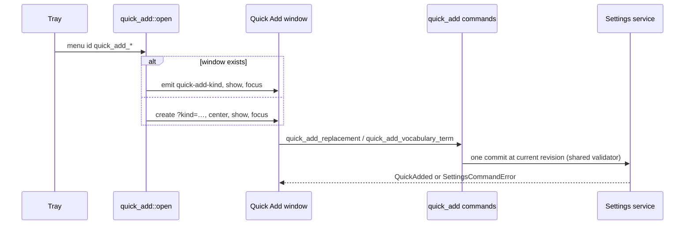

# Plan: Quick Add from the Tray

## Summary

Two tray items open one small webview window (`quick_add`) with two tabs. Each tab commits one
append through the settings service with the existing 002/003 edits, so validation, refusals,
revision and `settings-changed` notification are shared with the settings UI and the CLI.

## Technical Context

- Backend: Tauri 2, `settings_service::tauri_adapter::{edit_at, write_change}`, `word_replacements::service::add_rule`, `recognition_vocabulary::edits::VocabularyEdit::Add`.
- Frontend: separate Vite entry `src/overlay/quick-add.html` (like `recovery.html`), React, i18next, shared `ui` components.

## Constitution Check

- One writer for settings (settings service) — respected: no direct store write.
- All user-facing strings translated (26 locales) — respected.
- No network, no dictated text logged — respected (refusals carry no rule text).

## Implementation Plan

1. `src-tauri/src/quick_add.rs`: `QuickAddKind`, `open`.
2. `src-tauri/src/commands/quick_add.rs`: the two commands; registered in `lib.rs`.
3. `tray.rs` items + `lib.rs` menu event; tray strings in every locale.
4. Frontend entry, window, pure model + tests; capability `quick-add.json`; Vite input.
5. README section; bindings regenerated.

## Testing Strategy

- Rust unit: menu-id mapping, kind serialization, append edit (appended, duplicate refused, empty refused).
- Bun unit: tab parsing, Add availability, refusal keys and uncertain outcome.
- `bindings_tests` keeps `src/bindings.ts` in sync.
- Native macOS proof (window focus from the tray, adding both kinds) with Julien.
