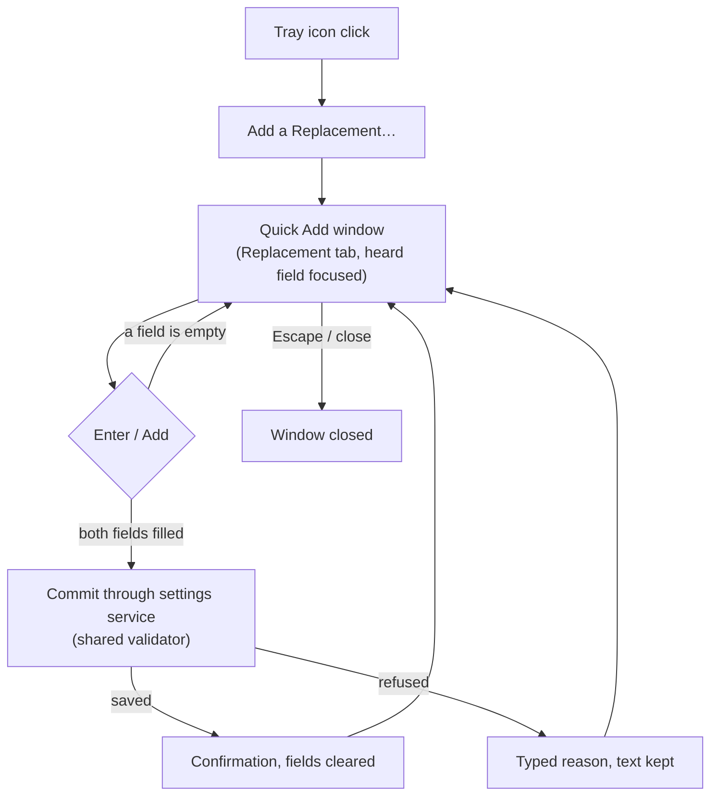
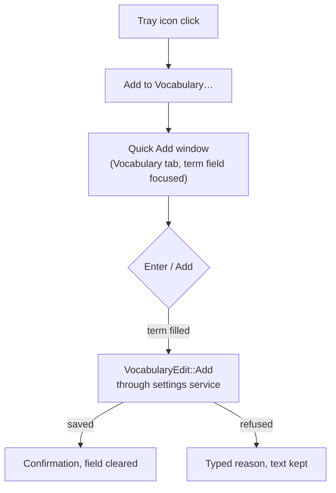
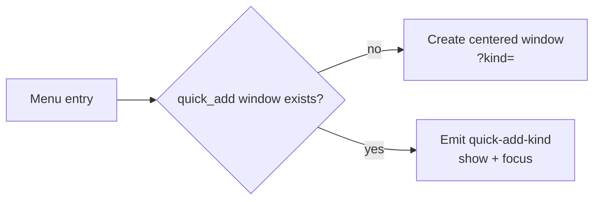

# Feature Spec: Quick Add from the Tray

## Header

- **Feature:** Quick Add from the Tray
- **Branch:** `dev`
- **Date:** 2026-10-31
- **Status:** In Progress (automated evidence; macOS native proof pending with Julien)
- **Input:** Julien, 2026-10-31: « quand je clique sur l'icône en haut de Handy, j'aimerais pouvoir ajouter facilement une règle de remplacement ou un terme de vocabulaire […] je suis obligé d'aller paramètres avancés, c'est long. »
- **Feature Number:** 018
- **Extends:** [002 Word Replacements](../002-word-replacements/spec.md) (rule model, shared validator, typed refusals), [003 Recognition Vocabulary](../003-recognition-vocabulary/spec.md) (term validation, `VocabularyEdit::Add`), [008 Settings CLI](../008-settings-cli/spec.md) (settings service commit path).
- **Processing:** entirely local; no network call.

## User Scenarios & Testing

### Story 1 — Add a replacement rule from the tray `P1`

**As a** Handy user who just saw a word recognized wrongly, **I want** to add a replacement rule from the menu bar icon, **so that** I fix it in a few seconds without opening Settings > Advanced.

**Priority reason:** The request itself: the path through Settings > Advanced takes several clicks and scrolls.
**Independent test:** Click the tray icon, choose "Add a Replacement…", type "cloud code" then "Claude Code", press Enter; the confirmation shows and the rule is listed in Settings > Advanced.

```gherkin
Feature: Quick replacement
  Scenario: Add a valid rule
    Given the Quick Add window is open on "Replacement"
    When the user types "cloud code" as heard text and "Claude Code" as written text
    And presses Enter
    Then the rule "cloud code" → "Claude Code" is appended after the saved rules
    And the window confirms the addition and clears both fields for another one

  Scenario: Refused rule
    Given a saved rule already uses the heard text "cloud code"
    When the user adds "Cloud Code" → "Claude"
    Then nothing is saved
    And the window shows the shared validator's reason "duplicate" and keeps the typed text
```



### Story 2 — Add a vocabulary term from the tray `P1`

**As a** Handy user, **I want** to add a vocabulary term from the menu bar icon, **so that** the next dictations recognize it without a trip through Settings.

**Independent test:** Click the tray icon, choose "Add to Vocabulary…", type "Kubernetes", press Enter; the term appears in Settings > Advanced > Vocabulary.

```gherkin
Feature: Quick vocabulary term
  Scenario: Add a new term
    Given the Quick Add window is open on "Vocabulary"
    When the user types "Kubernetes" and presses Enter
    Then "Kubernetes" is appended to the vocabulary through the same edit as the settings UI
    And the window confirms the addition and clears the field

  Scenario: Term already saved
    Given "Kubernetes" is already in the vocabulary
    When the user adds "kubernetes"
    Then nothing is saved and the window shows the vocabulary refusal message
```



### Story 3 — One window, reused `P2`

**As a** user, **I want** the second menu entry to reuse the open window and switch to its tab, **so that** I never get two Quick Add windows.

```gherkin
Feature: Single Quick Add window
  Scenario: Reopen on the other kind
    Given the Quick Add window is open on "Replacement"
    When the user chooses "Add to Vocabulary…" in the tray menu
    Then the same window comes to the front on "Vocabulary" with its field focused
```

```gherkin
Feature: Show the list in the settings
  Scenario: From the Vocabulary tab
    Given the Quick Add window is open on "Vocabulary"
    When the user clicks "Show the list"
    Then the settings window comes to the front on Advanced, scrolled to the vocabulary list
    And the Quick Add window is closed
```



## Acceptance Criteria

### AC-001
The tray menu (idle and busy) shows "Add a Replacement…" and "Add to Vocabulary…" right after "Copy Last Transcript", translated in every locale.

### AC-002
Choosing one of them opens the Quick Add window centered on the primary monitor, in front, focused, on the matching tab, with its first field focused; the main settings window is not shown.

### AC-003
With the window already open, choosing either entry shows and focuses the same window and switches it to the chosen tab; a second window is never created.

### AC-004
Adding a replacement appends one rule (new identity) after the saved rules in one settings-service commit validated by the shared 002 validator; the settings UI and CLI see it at the next revision.

### AC-005
A refused replacement (empty field, forbidden character, duplicate heard text, more than 1000 rules) saves nothing and shows the translated 002 reason of each refused field; the typed text stays.

### AC-006
Adding a vocabulary term commits `VocabularyEdit::Add` through the settings service; a refusal (invalid term, duplicate, limit) saves nothing and shows the translated 003 refusal; the typed text stays.

### AC-007
After a successful addition the window shows a confirmation naming what was added, clears the fields and focuses the first field; the confirmation goes away by itself after 4 s (a refusal stays until the text changes). Escape, Close or the window's close button really closes the window (it is not hidden like the settings window), so reopening it starts empty, without the previous confirmation.

### AC-008
Add stays unavailable while a required field is empty or a commit is in flight; Enter in any field submits.

### AC-009
"Show the list" in the Quick Add window shows the settings window, goes to the Advanced section (asking first when a section holds unsaved edits) and scrolls to the list of the current tab (Vocabulary or Replacements); the Quick Add window closes so it does not cover the settings.

## Functional Requirements

### FR-001
Two tray menu items with ids `quick_add_replacement` and `quick_add_vocabulary`, labels from the `tray` translations (`addReplacement`, `addVocabulary`).

### FR-002
A single webview window labelled `quick_add`, page `src/overlay/quick-add.html`, opened by `quick_add::open(app, kind)`; an existing window receives the `quick-add-kind` event instead of a second window.

### FR-003
Command `quick_add_replacement(recognized, replacement)`: one `edit_at` commit at the current revision applying `word_replacements::service::add_rule` with a fresh UUID identity; refusals through `domains::replacements::refusal`.

### FR-004
Command `quick_add_vocabulary_term(term)`: one `write_change` commit at the current revision of `VocabularyEdit::Add(term)`.

### FR-005
The window follows the app theme and language like the recovery window; its capability grants only its events, the locale read and closing itself.

### FR-006
Command `open_settings_list(kind)`: shows the main window and emits `settings-reveal` with the kind to it; the settings window navigates to `advanced` and scrolls the element marked `data-settings-anchor=<kind>` into view.

## Key Entities

- **QuickAddKind:** `replacement` | `vocabulary`; the tab shown.
- **QuickAdded:** the stored item count after a successful addition (`count`).

## Clarifications

- **Commit revision:** a quick addition commits at the current revision (no expected revision). An addition is an append checked under the service lock, so it cannot overwrite a concurrent change; an open settings editor with unsaved edits gets its usual revision conflict.
- **Window stays open after success:** the user may add several items in a row; Escape closes.
- **Show the list (Julien, 2026-10-31):** a button of the Quick Add window opens the settings directly on the matching list, to view, edit or delete rules and terms without navigating and scrolling.
- **No prefill:** the window opens empty (no clipboard or last-transcript prefill) to never expose dictated text unexpectedly.

## Screens

- `quick-add` — Quick Add window, tabs Replacement / Vocabulary (no Penflow mockup yet; see Edge Cases).

## Edge Cases

- Settings service unavailable: the typed `unavailable` refusal is shown; nothing is saved.
- A commit whose outcome is uncertain (`committed`/`unknown`) never claims "nothing saved".
- Penflow mockup and visual gate for `quick-add` are not produced in this run (same pending state as 012–017).

## Success Criteria

### SC-001
Adding a rule or a term from the tray takes two clicks plus typing, without opening the settings window.
