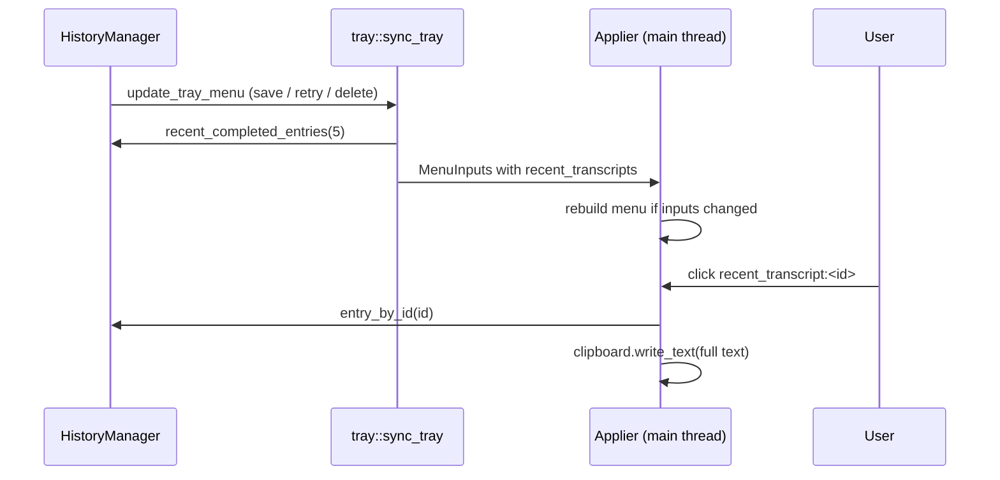

# Plan: Recent Transcripts in the Tray

## Summary

The tray menu snapshot (`MenuInputs`) gains the `(id, label)` list of the 5 newest completed
transcripts, read from the history on the calling thread like the other inputs. The submenu is
built with the rest of the menu; a click copies the entry's full text with the same helper as
"Copy Last Transcript". History writes and deletions trigger `update_tray_menu`.

## Technical Context

- Backend only: `src-tauri/src/tray.rs`, `src-tauri/src/managers/history.rs`, `src-tauri/src/lib.rs` (menu event).
- Labels: `tray` translations generated by `build.rs` (26 locales).

## Constitution Check

- Single native tray writer (applier) — respected: the list is a menu input, never set directly.
- No dictated text in logs — respected (only ids are logged).
- All user-facing strings translated — respected.

## Implementation Plan

## Testing Strategy

- Rust unit tests: query order and empty-entry filter (`history.rs`), preview/label/id parsing and menu-change detection (`tray.rs`).
- Native (Julien): open the submenu, click an item, paste.
