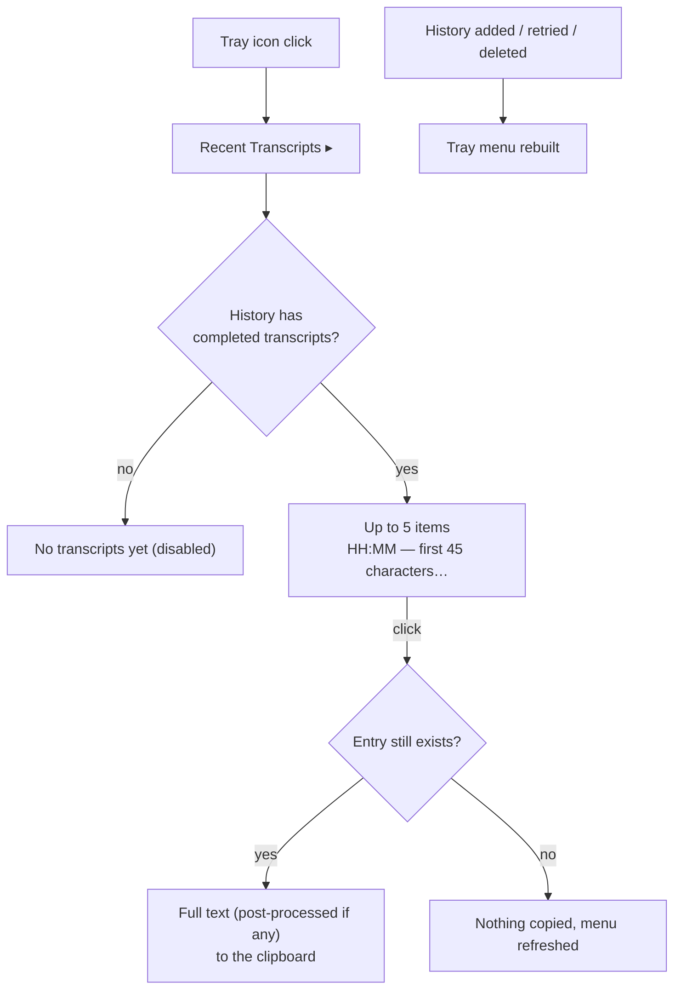

# Feature Spec: Recent Transcripts in the Tray

## Header

- **Feature:** Recent Transcripts in the Tray
- **Branch:** `dev`
- **Date:** 2026-11-02
- **Status:** In Progress (automated evidence; macOS native proof pending with Julien)
- **Input:** Julien, 2026-11-02: « dans le menu quand je clique sur l'icône […] j'aimerais voir l'historique ici et de pouvoir quand je clique dessus le copier. […] quand ça ne va pas trop marcher, de pouvoir quand même aller là et aller sélectionner l'historique qui m'intéresse et le coller. […] les trois ou quatre derniers. »
- **Feature Number:** 019
- **Extends:** [018 Quick Add from the Tray](../018-quick-add-from-tray/spec.md) (tray menu entries), the existing history (`HistoryManager`) and "Copy Last Transcript".
- **Processing:** entirely local; the text never leaves the clipboard.

## User Scenarios & Testing

### Story 1 — Copy a recent transcript from the tray `P1`

**As a** Handy user whose paste went wrong or who needs an earlier dictation, **I want** the latest transcripts listed in the menu bar menu, **so that** I copy the one I need and paste it myself.

**Independent test:** Dictate three sentences, click the tray icon, open "Recent Transcripts", click the second one, paste in TextEdit: the full second sentence is pasted.

```gherkin
Feature: Recent transcripts in the tray
  Scenario: Copy an older transcript
    Given the history holds "first", "second" and "third" (newest last)
    When the user opens "Recent Transcripts" in the tray menu
    Then the submenu lists "third", "second", "first", each with its time
    When the user clicks "second"
    Then the clipboard holds the full text of "second"

  Scenario: Empty history
    Given the history holds no transcript
    When the user opens "Recent Transcripts"
    Then the submenu shows the disabled item "No transcripts yet"
```



## Acceptance Criteria

### AC-001
The tray menu (idle and busy) shows a "Recent Transcripts" submenu right after "Copy Last Transcript", translated in every locale.

### AC-002
The submenu lists the 5 newest history entries whose transcription is not empty, newest first; with none it shows one disabled "No transcripts yet" item.

### AC-003
Each item reads `HH:MM — text` in local time, the text on one line (whitespace collapsed) and cut after 45 characters with "…".

### AC-004
Clicking an item copies the full text of that entry to the clipboard (the post-processed text when there is one, as "Copy Last Transcript"); an entry deleted meanwhile copies nothing and refreshes the menu.

### AC-005
A new, retried or deleted history entry, including entries removed by the retention cleanup (history limit or retention period), updates the submenu without restarting Handy.

## Functional Requirements

### FR-001
`HistoryManager::recent_completed_entries(limit)` returns the newest non-empty entries, newest first.

### FR-002
Tray submenu id `recent_transcripts`; items `recent_transcript:<history id>`; labels from the `tray` translations (`recentTranscripts`, `noRecentTranscripts`). The labels are part of the menu inputs, so a changed list rebuilds the menu through the single tray applier.

### FR-003
`HistoryManager` asks the tray to sync after saving, retrying or deleting an entry, and after the retention cleanup removes entries.

## Clarifications

- **How many (Julien: « les trois ou quatre derniers »):** 5, in a submenu so the main menu stays short.
- **Copy only:** the click copies; the user pastes where he wants (no automatic paste).
- **Privacy:** the menu shows the start of the dictated text, like the History tab; it lists nothing when the history is empty.

## Edge Cases

- Unreadable history: the submenu shows "No transcripts yet" and the error is logged (without text).
- Windows: "&" in a transcript is escaped so it is not read as a menu mnemonic.

## Success Criteria

### SC-001
Copying one of the last 5 transcripts takes two clicks from the menu bar, without opening the settings window.
