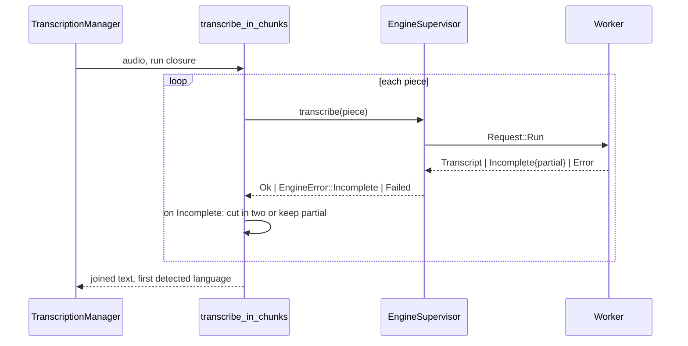

# Plan: Long Dictations Transcribed in Pieces

## Summary

`transcribe_cpp` hands the audio to a pure pieces driver instead of one engine run. The driver cuts
long recordings at quiet moments, runs each piece through the engine supervisor and joins the
texts. The worker reports a run that stopped early with its partial text, so the driver can cut the
piece again or keep the partial text.

## Technical Context

- Backend only: `src-tauri/src/managers/transcription_chunks.rs` (new), `src-tauri/src/managers/transcription.rs`, `src-tauri/src/engine_supervisor/{protocol,worker,supervisor}.rs`.
- No setting, no UI string.

## Constitution Check

- No dictated text in logs — respected (lengths, counts and reasons only).
- Errors handled explicitly — respected (no unwrap; cancellation and failures propagate unchanged).

## Implementation Plan

## Testing Strategy

- Rust unit tests (`transcription_chunks.rs`): one piece for short audio, cuts in silences covering every sample, ordered join, a looping piece cut in two, a short looping piece keeping its partial text, cancel and failure stopping.
- Headless proof: `handy --debug -f <failed recording>` on the real model.
- Native (Julien): retry entry 964 in the history after installing the build.
