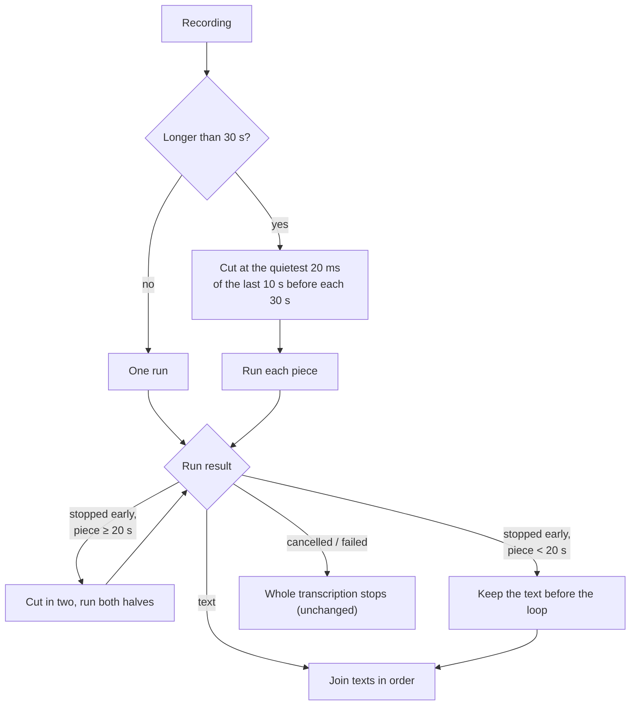

# Feature Spec: Long Dictations Transcribed in Pieces

## Header

- **Feature:** Long Dictations Transcribed in Pieces
- **Branch:** `dev`
- **Date:** 2026-11-03
- **Status:** In Progress (automated and headless evidence; native dictation with Julien pending)
- **Input:** Julien, 2026-11-03: « Je viens de faire une transcription, j'ai un échec […] J'ai beau faire le reload […] ça ne veut pas. Elle dure 5 minutes […] Ça arrive de temps en temps que la transcription ne marche pas […] pour qu'on puisse corriger ça. »
- **Feature Number:** 020
- **Extends:** the batch transcription path of transcribe-cpp models (`TranscriptionManager::transcribe`), used by dictation, "Retry" in the history and `--transcribe-file`.
- **Processing:** entirely local.

## Diagnosis

A 5 min 47 s dictation with Canary 1B v2 failed, and every retry failed the same way: the whole recording went to the model in one run, the decoder began repeating one sentence, and transcribe-cpp stopped the run with `OutputRepetition` (status 19). Handy turned that into an empty transcript. The same recording cut at silences into pieces of about 40 s is transcribed entirely. The longest successful dictation still in the history lasted 91 s.

## User Scenarios & Testing

### Story 1 — A long dictation is transcribed `P1`

**As a** Handy user dictating for several minutes, **I want** the whole dictation transcribed, **so that** I do not lose it.

**Independent test:** Retry the 5 min 47 s recording of 2026-11-03 15:32 (history entry 964): its full text appears.

```gherkin
Feature: Long dictations
  Scenario: Dictation longer than 30 seconds
    Given a transcribe-cpp model is selected
    When the user dictates for 5 minutes
    Then Handy transcribes the recording in pieces cut at quiet moments
    And the text of every piece is joined in order

  Scenario: A piece still loops
    Given a piece of 20 seconds or more stops because its output repeats
    Then Handy cuts it in two at its quietest moment and transcribes both halves
    When a piece shorter than 20 seconds stops the same way
    Then Handy keeps the text decoded before the loop
```



## Acceptance Criteria

### AC-001
With a transcribe-cpp model, a recording longer than 30 s is transcribed in pieces of at most 30 s, each cut at the quietest moment of the 10 s before the limit; every sample belongs to exactly one piece and the texts are joined in order with one space.

### AC-002
A piece of 20 s or more whose run stops early (repeating output or output limit) is cut in two at its quietest moment, at least 10 s from each end, and both halves are transcribed.

### AC-003
A shorter piece whose run stops early keeps the text decoded before it stopped; the rest of the recording is still transcribed.

### AC-004
"Retry" in the history uses the same path, so a long recording that failed before can be recovered.

### AC-005
The log records how many pieces a long recording was cut into and every piece that stopped early, with the reason (never the dictated text).

## Functional Requirements

### FR-001
`transcription_chunks::transcribe_in_chunks` drives the pieces of `TranscriptionManager::transcribe_cpp`; a recording of 30 s or less is still one run.

### FR-002
The engine worker answers `Response::Incomplete { message, partial }` for transcribe-cpp `OutputRepetition` and `OutputTruncated`; the supervisor turns it into `EngineError::Incomplete`, handled by the pieces driver. Cancellation and other failures stop the transcription as before.

## Clarifications

- **Piece length:** 30 s keeps every piece well under the length at which the failure was observed and near the length Canary was trained on.
- **ONNX models and live streaming:** unchanged.

## Success Criteria

### SC-001
The 5 min 47 s recording that failed on 2026-11-03 is transcribed in full through Handy's own path.
