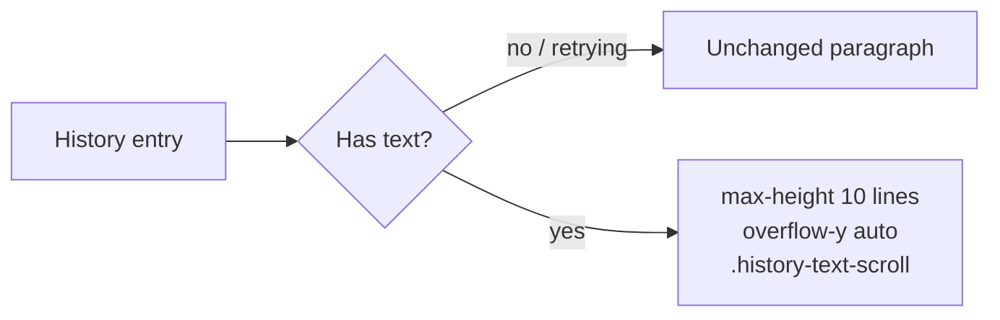

# Plan: Long Transcripts Scroll in the History

## Summary

The transcript paragraph of a history entry gets a maximum height of 10 lines (`calc(10lh + 0.5rem)`, the padding included) and scrolls vertically; a scoped class narrows the app's custom WebKit scrollbar for that box.

## Technical Context

- Frontend only: `src/components/settings/history/HistorySettings.tsx`, `src/App.css`. No new string.

## Constitution Check

- Translated strings — unchanged (no new text).
- Tailwind and theme tokens — the scrollbar keeps `--scrollbar-thumb`.

## Implementation Plan

## Testing Strategy

- `tsc`, ESLint, Prettier.
- Native: History tab of the installed build with a long and a short transcript (screenshot).
