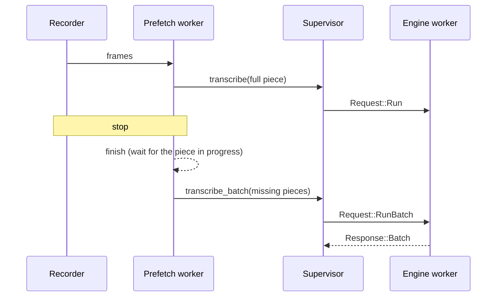

# Plan: Long Dictations Transcribed While Recorded

## Summary

A prefetch worker receives the recorder's frames through `StreamRouter` when the model does not stream, cuts full pieces with the 020 rule (`next_cut`, which reads only the audio before the cut) and transcribes them during the recording. The stop finishes the worker and reuses its pieces when the audio prefix and the run options are identical; the pieces still missing go to the model in one batch. `NSAppSleepDisabled` keeps macOS from throttling Handy while it waits.

## Technical Context

- `src-tauri/src/managers/transcription_prefetch.rs` (new), `transcription_chunks.rs` (`next_cut`, `PieceEngine`, batch), `transcription.rs` (`start_prefetch`, `transcribe_dictation`, `cpp_run`, `CppPieces`), `actions.rs` (start and stop), `engine_supervisor/{batch,protocol,worker,supervisor}.rs` (`RunBatch`), `cli.rs` and `lib.rs` (`--live`), `Info.plist`.

## Constitution Check

- No dictated text in logs — respected (counts, durations).
- Explicit errors — a failed piece during the recording is retried at the stop; cancellation drops the pieces.
- Settings untouched: no new setting.

## Implementation Plan

## Testing Strategy

- Rust unit tests: final cuts equal to the cuts made while recording, reuse refused for other audio or options, no model, batch with a looping piece, batch lengths.
- Headless measurement: `handy -f <wav>` and `handy -f <wav> --live`, run from a normal-priority terminal (the agent's shell runs at `nice 5`).
- Native (Julien): a long dictation with the installed build.
