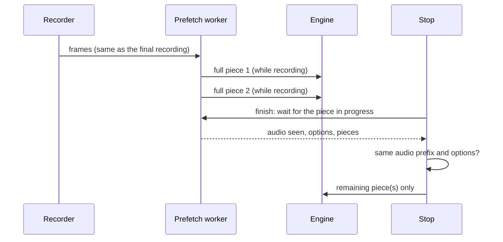

# Feature Spec: Long Dictations Transcribed While Recorded

## Header

- **Feature:** Long Dictations Transcribed While Recorded
- **Branch:** `dev`
- **Date:** 2026-11-03
- **Status:** In Progress (automated and headless evidence; native dictation with Julien pending)
- **Input:** Julien, 2026-11-04: « il faut que tu analyses pourquoi ça met 10 fois plus de temps pendant l'enregistrement […] Tu optimises tout ça. » Earlier, Julien, 2026-11-03: « pour une longue transcription, c'est assez long […] Il faudrait que ça aille plus vite. » then « Fais les deux, commence par transcription pendant que je parle » and « Tu fais le test pour voir vraiment quel gain on a par rapport au traitement par lots. »
- **Feature Number:** 022
- **Extends:** [020 Long Dictations Transcribed in Pieces](../020-long-dictation-chunks/spec.md).
- **Processing:** entirely local.

## User Scenarios & Testing

### Story 1 — Short wait after a long dictation `P1`

**As a** Handy user dictating for minutes, **I want** the text soon after I stop, **so that** a long dictation does not make me wait longer than a short one.

**Independent test:** `handy -f <98 s recording> --live` replays the recording at recording pace and reports the wait after its end, compared with `handy -f <same recording>`.

```gherkin
Feature: Transcription while recording
  Scenario: Long dictation
    Given a transcribe-cpp model that does not stream
    When the user dictates for 3 minutes
    Then each full 30 s piece is transcribed while the user keeps speaking
    And at the stop only the last piece is transcribed

  Scenario: Something changed
    Given pieces were transcribed during the recording
    When the recording or the run options at the stop differ from what those pieces used
    Then they are discarded and the whole recording is transcribed at the stop
```



## Acceptance Criteria

### AC-001
During a dictation with a transcribe-cpp model that does not stream, each full piece (the cuts of 020) is transcribed while the user keeps speaking.

### AC-002
At the stop, pieces transcribed during the recording are reused when the recording begins with exactly the audio they came from and the run options are the same; only the other pieces are transcribed.

### AC-003
A cancelled or empty dictation discards its pieces; a failed or stopped-early piece is transcribed again at the stop through the 020 path.

### AC-004
"Retry" in the history and `--transcribe-file` never use pieces of a dictation in progress.

### AC-005
The log reports how many pieces were reused or discarded (never the dictated text).

### AC-006
When two or more pieces remain to be transcribed (a retry, `--transcribe-file`, or pieces not yet done at the stop), they go to the model in one batch; a piece of the batch that stops early is handled as in 020.

### AC-007
macOS does not put Handy to sleep (App Nap) while it waits on a dictation: the work at the stop runs at full speed although Handy has no visible window.

## Functional Requirements

### FR-001
`transcription_chunks::next_cut` computes a cut from the audio before it only; `TranscriptionManager::start_prefetch` (started instead of a live stream) runs a worker fed by `StreamRouter::feed`.

### FR-002
`TranscriptionManager::transcribe_dictation` finishes the worker and passes its pieces to `transcribe_in_chunks`; `transcribe` passes none.

### FR-003
`Prefetched::pieces_for` returns the pieces only for the same audio prefix and equal `RunOptions` (built once by `cpp_run`).

### FR-004
`handy -f <wav> --live` replays the recording at recording pace through this path and times the wait after its end.

### FR-005
`Request::RunBatch` sends the remaining pieces in one engine call (`Session::run_batch`), answered with one `BatchItem` per piece; `chunks::PieceEngine::run_many` uses it through `EngineSupervisor::transcribe_batch`.

### FR-006
`Info.plist` sets `NSAppSleepDisabled`.

## Measurements

98 s recording (Canary 1B v2, Metal, M4 Pro), wait after the end of the recording, calm machine:

| Path | Wait |
|---|---|
| Before 022: four pieces one after another at the stop | 2.1–2.8 s |
| All pieces at the stop, one batch | 1.79 s |
| Pieces during the recording, App Nap active | 2.08 s (post-processing 537 ms, run options 253 ms) |
| Pieces during the recording, App Nap disabled | 0.67 s |

App Nap explained the gap: the stop's light steps (post-processing, context preparation) took hundreds of milliseconds while Handy looked idle. On a loaded machine (other GPU work) every run slows down, whatever the path.

## Success Criteria

### SC-001
For a long dictation, the wait after the stop is close to the time of one piece, whatever the length of the dictation (measured with `--live`).
