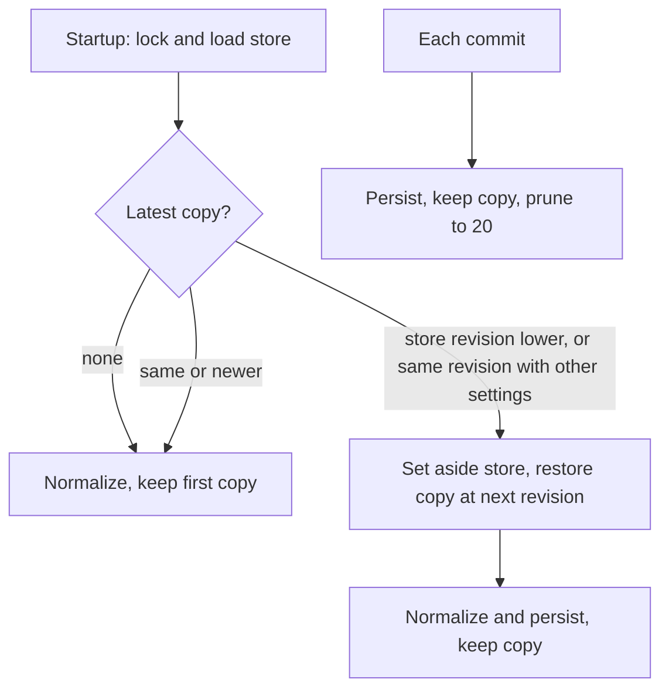

# Plan: Settings Survive Another Handy Version

## Summary

The settings service is the only writer that increments `settings_revision`. Each generation it persists is copied to `settings_backups/`. At startup, a store that went back in revision, or changed at the same revision, was written by someone else: the latest copy is restored and the rewritten store is set aside. A store from a newer schema is opened read-only.

## Technical Context

- `src-tauri/src/settings_service/backups.rs` (new): `keep`, `latest`, `restoration`, `set_aside`, private writes.
- `src-tauri/src/settings_service/transaction.rs`: `persist_locked` keeps a copy; `initialize` calls `restore_if_rewritten` and `keep_first_backup`.
- `src-tauri/src/settings_service/store.rs`: `document` refuses writes for a newer schema.
- `src-tauri/src/settings.rs`: `CURRENT_SETTINGS_SCHEMA_VERSION` visible to the crate.

## Constitution Check

- Never write settings directly: restores go through the locked startup transaction and the atomic persist.
- Secrets stay private: copies are 0600 in a 0700 folder; nothing from the document is logged.
- Nothing is deleted except copies beyond the 20 newest; a restore keeps the replaced file.

## Implementation Plan

## Testing Strategy

- `backups.rs` unit tests: latest copy, pruning, private permissions, restoration rules.
- `live_tests.rs`: settings removed by an "older build" rewrite are back after the next start and the rewritten file is set aside; a newer-schema store is never rewritten.
