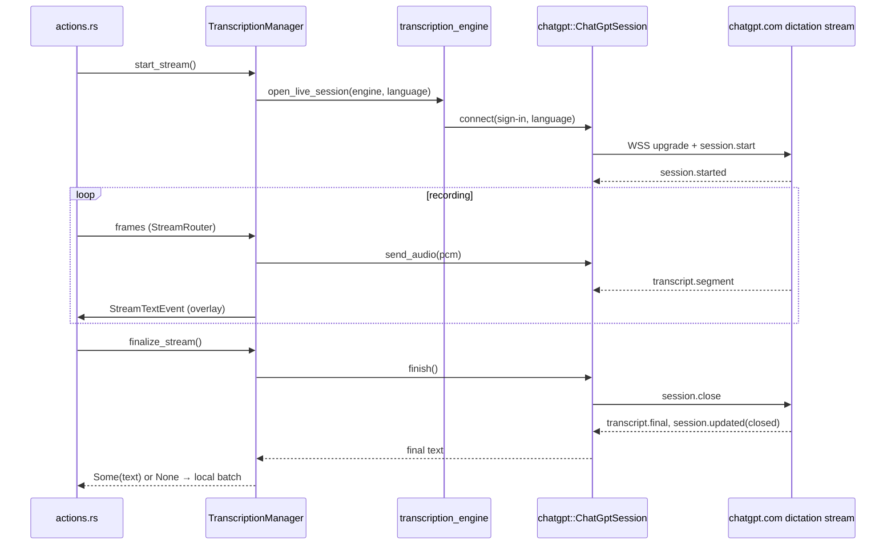
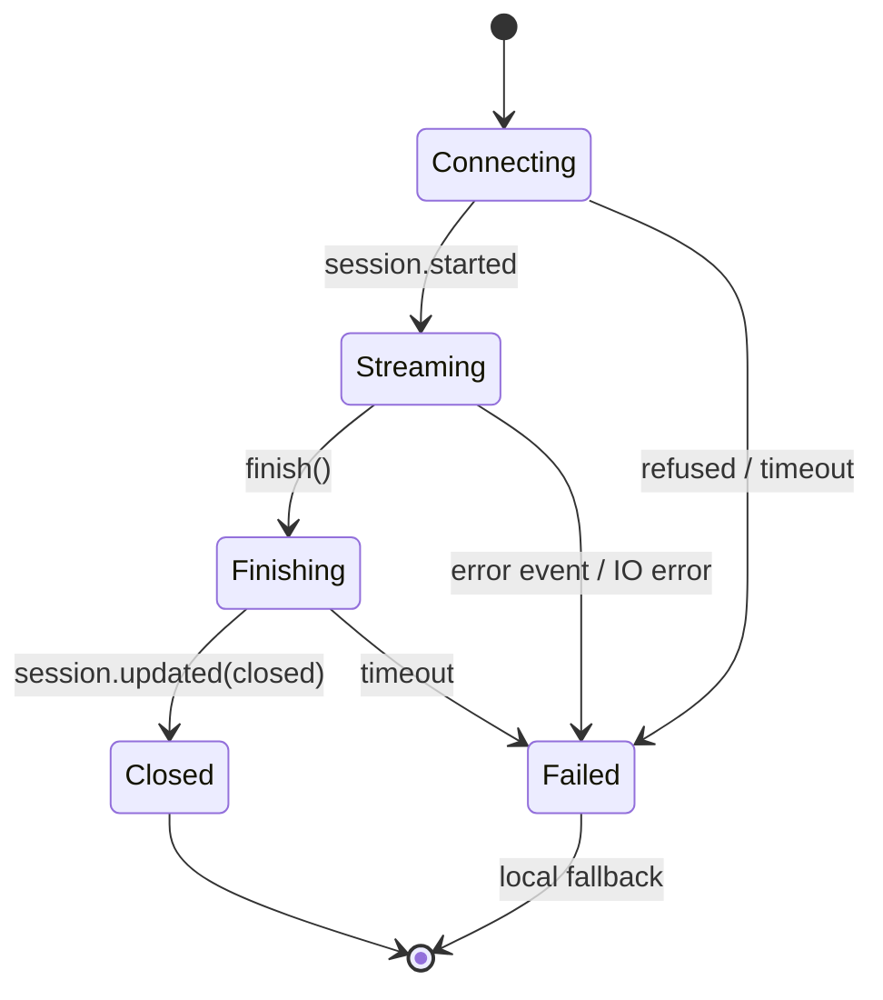

# Implementation Plan: Transcription engine selector

**Summary:** Add a closed `transcription_engine` setting (`local` | `chatgpt`) and a `transcription_engine` Rust module that owns engine selection and an engine-neutral live session contract; move the ChatGPT experiment into its own submodule (auth, protocol, transcript, session) and let the transcription manager drive any live session, falling back to the local model.

## Technical Context

- Rust (Tauri 2), React/TypeScript, Zustand settings store, tauri-specta bindings, i18next (26 locales, `check:translations`).
- New dependencies (already added by the experiment): `tungstenite 0.26` (`native-tls`), `base64 0.22`.
- Storage: `settings_store.json` through `settings_service` (validated, revisioned).
- Tests: `cargo test` (unit, inline `mod tests`), `bun test`, `bun run check:translations`, real CLI replay `handy -f <wav> --live --json`.

## Constitution Check

- Settings are written only through `settings_service` (AGENTS.md « Settings System »): new key goes through the descriptor table, `live_settings::write` command, public snapshot. ✅
- CLI and UI share validation (descriptor allowed values). ✅
- User-facing strings through i18next in every locale. ✅
- Local-first default: `local` stays default; ChatGPT is opt-in with an explicit OpenAI notice. ✅

## Sequence — ChatGPT dictation

```gherkin
Feature: ChatGPT session lifecycle
  Scenario: Successful session
    Given the engine is chatgpt and a sign-in file exists
    When  recording starts
    Then  Handy connects to the dictation stream and sends session.start
    And   streams audio.append frames while recording
    When  recording stops
    Then  Handy sends session.close and returns the final text after session.updated(closed)

  Scenario: Connection refused
    Given the engine is chatgpt
    When  the server refuses the WebSocket upgrade
    Then  finalize reports no stream result
    And   the coordinator transcribes the recording with the local model
```



## State — live session

```gherkin
Feature: Live session states
  Scenario: Normal end
    Given a session is Streaming
    When  finish is requested and the server closes
    Then  the session is Closed with a final text

  Scenario: Failure
    Given a session is Streaming
    When  a send or poll fails
    Then  the session is Failed and the worker drops it
```



No ER diagram: no new persisted entity (one scalar setting).

## Implementation Plan

1. **Setting** — `settings.rs`: `TranscriptionEngine { Local, ChatGpt }` (serde `local`/`chatgpt`, default `Local`), field `transcription_engine`; `descriptor_data.rs` row (`String`, values `["local","chatgpt"]`, owner `general`, effect `None` — read at each dictation start); `public.rs` snapshot; command `change_transcription_engine_setting` (`shortcut/mod.rs`, beside other scalar setting commands) registered in `lib.rs`.
2. **Engine module** `src-tauri/src/transcription_engine/`:
   - `mod.rs` — responsibility header, `open_live_session(engine, language) -> Option<Result<Box<dyn LiveSession>, LiveSessionError>>` (`None` = local engine).
   - `live.rs` — `LiveText`, `LiveSession` trait (`send_audio`, `poll`, `finish`), `LiveSessionError` enum (Unavailable, Stream, Timeout) with `Display`/`Error`.
   - `chatgpt/auth.rs` — `SignIn` read from an injected path (default `~/.codex/auth.json`), `Debug` redacts the token; `sign_in_status()`.
   - `chatgpt/protocol.rs` — endpoint/subprotocol constants, `session_start` builder, `ServerEvent` parsing.
   - `chatgpt/transcript.rs` — utterance/revision assembler (pure, unit-tested).
   - `chatgpt/session.rs` — WebSocket session implementing `LiveSession`.
   - Remove `src/chatgpt_dictation.rs`.
3. **Manager glue** — `transcription.rs`: `run_live_engine_stream(rx, session)` engine-neutral loop (feed → `send_audio`, idle → `poll` → `emit_stream_text`, finalize → `finish` → `FinalizedStreamText` or `None`); `run_stream_worker` opens the live session from the setting first.
4. **Routing** — `actions.rs`: `streams = transcription_engine::is_live(settings.transcription_engine) || model streams`; `lib.rs` CLI `--live` uses the same rule.
5. **Commands** — `commands/transcription_engine.rs`: `get_chatgpt_sign_in_status` → `ChatGptSignInStatus { SignedIn, SignedOut }`.
6. **UI** — `src/components/settings/transcription-engine/`: `transcription-engine-tabs.tsx` (ARIA tablist Local / API, arrows + Home/End, active-engine dot), `local-engine-panel.tsx` (fallback notice + activate local around the model list), `api-engine-panel.tsx` (ChatGPT card with activate, OpenAI notice, sign-in; "Other APIs" coming soon), `engine-activation.tsx`, `use-chatgpt-sign-in.ts`, pure model `transcription-engine-options.ts`; wrapped around the model list in `ModelsSettings`; `settingsStore.ts` updater; bindings regenerated.
7b. **Fallback lock (FR-008)** — `transcription_engine::can_switch_local_model` refused in `commands::models::switch_active_model` (all callers incl. tray), `modelStore.selectModel` early return, `ModelCard` `disabled`/`activeLabel`, footer `ModelDropdown` `isLocked`.
7. **i18n** — `settings.models.engine.*` keys in all locales.
8. **Docs** — AGENTS.md architecture line for `transcription_engine/`; README settings mention if listing keys.

## Convention-to-plan mapping

| Rule | Module/contract | Decision | Verification |
|---|---|---|---|
| general §2 closed variants, validate at boundary | `TranscriptionEngine` enum + descriptor allowed values | no string states | descriptor test, CLI invalid value |
| architecture §34 / rust traits | `LiveSession` trait, `Box<dyn LiveSession>` (runtime substitution) | manager depends on trait only | build + review |
| architecture §28 new providers behind adapters | `chatgpt/` submodule | future remote engine = new submodule + enum variant | review |
| general §7/§21 errors, timeouts | `LiveSessionError`; connect 10 s, finish 8 s, read poll 5 ms | failures → `None` → local fallback, logged | forced no-sign-in run |
| logging.md no tokens | auth `Debug` redaction, logs only session ids/durations | — | review + grep logs |
| general §14/§25 magic values | protocol constants documented with origin (ChatGPT app 26.1117) | — | review |
| general §20 / testing fakes | auth path injected; transcript pure | unit tests without network | cargo test |
| i18n | all strings via catalog, all locales | — | check:translations |
| UI spacing/layout, a11y | tabs/panels as nested flex layouts with scale gaps (2/3/4) and paddings (px-4 py-3); ARIA tabs pattern; disabled cards announced (`aria-disabled`) | no custom positioning | Playwright screenshots, render tests |

## Testing Strategy

- Rust unit: transcript assembler; auth parsing + redaction + missing file; engine enum serde/default; descriptor validation for `transcription_engine`.
- Frontend: `bun test` render test of the engine setting (options, disabled Remote, notice), `check:translations`, `lint`, `tsc` via build.
- Integration (manual, recorded): CLI replay with the setting on `chatgpt` (ChatGPT text), on `chatgpt` with `CODEX_HOME` pointing to an empty directory (forced fallback to the local model), and on `local`.
- UI: Playwright harness `tests/transcription-engine.spec.ts` (real component, fake IPC).

## Risks & Considerations

- Private, undocumented OpenAI endpoint: may change; fallback contains the damage.
- ToS/account risk of using the internal endpoint from a third-party app — disclosed to the user.
- Audio leaves the device when ChatGPT is selected — explicit notice in the UI.
- Token expiry is not refreshed by Handy (Codex/ChatGPT refresh it).
